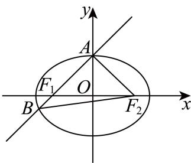
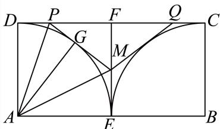
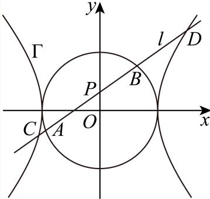
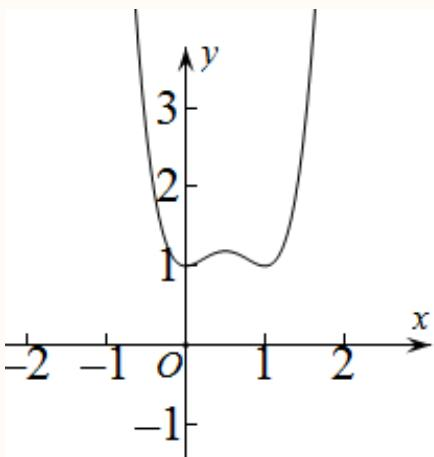

# 2025一模 闵行区原卷 · 教师版

> 本地预览：题目、答案及分类尚未全部审定。校对使用的PDF为高中工作台解析版，尚未逐区确认区级印刷原卷。

## 填空题

按本区原卷题号顺序排列。

### 闵行 · 第1题

设集合 $A = \{ 0 , 1 , 2 , 3 , 4 \}$ $B = \{ x | 0 < x < 3 \}$ ，则 $A \cap B$ =

**考点：** 按元素归属求交集

**难度依据：** 离散集合与区间交集；按元素归属求交集

【答案】{1,2}

【解析】

根据交集的定义计算可得.

因为 $A = \{ 0 , 1 , 2 , 3 , 4 \}$ $B = \{ x | 0 < x < 3 \}$

所以 $A \cap B = \{ 1 , 2 \}$

故答案为：{1,2}

### 闵行 · 第2题

不等式 $\frac { 2 x - 1 } { x - 1 } <$ 0的解集为

**考点：** 定义域及符号区间求解

**难度依据：** 分式不等式；定义域及符号区间求解

【答案】$\left( { \frac { 1 } { 2 } } , 1 \right)$

【解析】

将分式不等式等价转化为一元二次不等式，解得即可.

不等式 $\frac { 2 x - 1 } { x - 1 } < 0$ 等价 $\begin{array} { r } { \mp ( x - 1 ) ( 2 x - 1 ) < 0 } \end{array}$ ，解得 $\frac { 1 } { 2 } < x < 1$

所以不等式 $\frac { 2 x - 1 } { x - 1 } <$ < 0的解集为 $\left( { \frac { 1 } { 2 } } , 1 \right)$

故答案为： $\left( { \frac { 1 } { 2 } } , 1 \right)$

### 闵行 · 第3题

直线 ${ \sqrt { 3 } } \mathbf { x } - \mathbf { y } + 1 =$ 0的倾斜角为

> 本题资料或解析有待核事项，预览不可作为已审定成品。

**考点：** 由斜率求直线倾斜角

**难度依据：** 斜率与倾斜角；由斜率求直线倾斜角

**核查说明：** 源解析倾斜角范围误写为(0,π]，应核原卷；本题答案不受影响。

【解析】

把直线方程化为斜截式，再利用斜率与倾斜角的关系即可得出．设直线 ${ \sqrt { 3 } } x - y + 1 = 0$ 的倾斜角为θ

由直线 ${ \sqrt { 3 } } x - y + 1 = 0$ 化为 $y = \sqrt { 3 } x + 1$ ，故 $\tan \theta = { \sqrt { 3 } }$

又 $\theta \in ( 0 , \pi ]$ ，故 $\displaystyle { \dot { \theta } = \frac { \pi } { 3 } }$ ，故答案为 $\frac { \pi } { 3 }$

一般地，如果直线方程的一般式为 $A x + B y + C = 0 \left( B \neq 0 \right)$ )，那么直线的斜率为 $k = - { \frac { A } { B } }$ 且 $. k = \tan \theta .$ ，其中θ为直线的倾斜角，注意它的范围是(0,π]

### 闵行 · 第4题

已知正实数a、b满足ab = 1，则 ${ \frac { 1 } { a } } + { \frac { 1 } { b } }$ 的最小值为

**考点：** 利用基本不等式及等号条件

**难度依据：** 定积下倒数和最值；利用基本不等式及等号条件

【答案】2

【解析】

利用基本不等式求出最小值即可.

正实数a、b满足 $a b = 1$ ，则 $\frac { 1 } { a } + \frac { 1 } { b } \geq 2 \sqrt { \frac { 1 } { a b } } = 2$ 当且仅当a = b = 1时取等号，

所以 ${ \frac { 1 } { a } } + { \frac { 1 } { b } }$ 的最小值为2.

故答案为：2

### 闵行 · 第5题

已知圆锥的高为8，底面半径为6，则该圆锥的侧面积为

**考点：** 求母线并代入侧面积公式

**难度依据：** 圆锥侧面积；求母线并代入侧面积公式

【答案】60π.

【解析】

根据勾股定理求出母线长，再根据圆锥的侧面积公式求解即可.

因为圆锥的高为8，底面半径为r = 6，

所以圆锥的母线长为 $! l = { \sqrt { 8 ^ { 2 } + 6 ^ { 2 } } } = 1 0$ ，

则圆锥的侧面积 $! S = \pi r l = \pi \times 6 \times 1 0 = 6 0 \pi$

故答案为：60π.

### 闵行 · 第6题

$\left( x + { \frac { 1 } { x } } \right)$ 8 的二项展开式中， $x ^ { 4 }$ 项的系数为

**考点：** 通项指数定位系数

**难度依据：** 二项展开指定项系数；通项指数定位系数

【答案】28

【解析】

利用二项式定理求出含 $\cdot _ { x ^ { 4 } }$ 的项，进而求出其系数.

在 $\left( x + { \frac { 1 } { x } } \right)$ 8 的二项展开式中，含x4的项为 $\mathrm { C } _ { 8 } ^ { 2 } x ^ { 6 } \cdot \left( { \frac { 1 } { x } } \right) ^ { 2 } = 2 8 x ^ { 4 }$

所以 $x ^ { 4 }$ 项的系数为28.

故答案为：28

### 闵行 · 第7题

已知函数 $\overset { } { \cdot } y = \left\{ \begin{array} { l l } { \log _ { 2 } x , } & { x > 0 } \\ { f \left( x \right) , } & { x < 0 } \end{array} \right.$ 为奇函数，则f (−8) =

**考点：** 奇偶性变换后代入对数分段

**难度依据：** 奇函数与分段求值；奇偶性变换后代入对数分段

【答案】−3

【解析】

首先求出当x = 8时的函数值，再根据奇函数的性质得解.

因为函数 $\overset { } { \underset { } { \cdot } } y = \left\{ \begin{array} { l l } { \log _ { 2 } x , } & { x > 0 } \\ { f \left( x \right) , } & { x < 0 } \end{array} \right.$ 为奇函数，

当x = 8时 $\mathbf { \dot { \boldsymbol { y } } } = \log _ { 2 } \mathbf { \boldsymbol { 8 } } = \log _ { 2 } \mathbf { 2 ^ { 3 } } = 3 \log _ { 2 } \mathbf { 2 } = \mathbf { 3 } ,$

所以f (−8) = −3.

故答案为：−3

### 闵行 · 第8题

从10名数学老师中选出3人安排在3天的假期中值班，每天有且只有一人值班．若老师甲必须参加且不安排在假期第一天值班，则不同的值班安排方法种数为

> 本题资料或解析有待核事项，预览不可作为已审定成品。

**考点：** 特殊元素优先安排再排列

**难度依据：** 指定人员参加与位置限制排列；特殊元素优先安排再排列

**核查说明：** 仅完成本题所述针对性校核；不代表其他题或全卷数学通过。

【答案】144

【解析】

利用分步乘法计数原理及排列应用问题列式计算得解.

依题意，安排老师甲有 $\mathbf { A } _ { 2 } ^ { 1 }$ 种，从除甲外的9名老师中任选2人并安排值班有 $\mathrm { A } _ { 9 } ^ { 2 }$ 种，

所以不同的值班安排方法种数为 $\mathrm A_2^1\mathrm A_9^2=2\times72=144$（种）。

故答案为：144

### 闵行 · 第9题

已知 $f \left( n \right) = \mathrm { i } ^ { n + 1 } + \mathrm { i } ^ { n + 2 } + \mathrm { i } ^ { n + 3 } + \mathrm { i } ^ { n + 4 } + \mathrm { i } ^ { n + 5 }$ （i为虚数单位，n为正整数），当 $n _ { 1 } , ~ n _ { 2 }$ 取遍所有正整数时， $f \left( n _ { 1 } \right) + f \left( n _ { 2 } \right)$ 的值中不同虚数的个数为

**考点：** 利用i的周期确定不同复数值

**难度依据：** 虚数幂周期与计数；利用i的周期确定不同复数值

【解析】

由i的整数次幂的周期性求出f(n)的取值集合，进而列举出所有结果即可得解

依题意， $n \in \mathrm { N ^ { * } , ~ i ^ { 4 n - 3 } = i , i ^ { 4 n - 2 } = - 1 , i ^ { 4 n - 1 } = - i , i ^ { 4 n } = 1 }$ ，则 $\mathrm { i } ^ { 4 n - 3 } + \mathrm { i } ^ { 4 n - 2 } + \mathrm { i } ^ { 4 n - 1 } + \mathrm { i } ^ { 4 n } = 0$ 1

$$
n \in \mathrm{N} ^ {*}, f (n) = \mathrm{i} ^ {n + 1} + \mathrm{i} ^ {n + 2} + \mathrm{i} ^ {n + 3} + \mathrm{i} ^ {n + 4} + \mathrm{i} ^ {n + 5} = \mathrm{i} ^ {n + 1} \in \{- 1, - \mathrm{i}, 1, \mathrm{i} \}
$$

所以 $f ( n _ { 1 } ) + f ( n _ { 2 } )$ 的值中不同虚数有： $- 2 \mathrm { i } , 2 \mathrm { i } , - 1 - \mathrm { i } , - 1 + \mathrm { i } , 1 - \mathrm { i } , 1 + \mathrm { i }$ ，共6个.故答案为：6

### 闵行 · 第10题

已知 $\begin{array} { r l } { \ F _ { 1 } , } & { { } F _ { 2 } } \end{array}$ 分别为椭圆 ${ \frac { x ^ { 2 } } { 4 } } + { \frac { y ^ { 2 } } { 2 } } = 1$ 的左、右焦点，过 $F _ { 1 }$ 的直线交椭圆于A、B两点．若 $\overrightarrow { A F _ { 1 } } \cdot \overrightarrow { A F _ { 2 } } = 0$ ，则 $\overrightarrow { A F _ { 2 } } \cdot \overrightarrow { B F _ { 2 } }$

> 本题资料或解析有待核事项，预览不可作为已审定成品。

**考点：** 由垂直定位短轴顶点并计算数量积

**难度依据：** 椭圆焦点与向量垂直；由垂直定位短轴顶点并计算数量积

**核查说明：** 仅修复所列OCR公式及其定界符错位；原解数学疑点和其他可渲染错识未因此消除。

【答案】4.

【解析】

首先求出 $F _ { \mathrm { 1 } } , \ F _ { \mathrm { 2 } }$ ，设 $A \left( x _ { 0 } , y _ { 0 } \right)$ ，根据数量积的坐标表示及 $\frac { x _ { 0 } ^ { 2 } } { 4 } + \frac { y _ { 0 } ^ { 2 } } { 2 } = 1$ 求出A点坐标，从而求出AB的方程，再联立直线与椭圆方程，求出B点坐标，最后由数量积的坐标表示计算可得.

椭圆 ${ \frac { x ^ { 2 } } { 4 } } + { \frac { y ^ { 2 } } { 2 } } = 1$ ，则 $F _ { 1 } \left( - { \sqrt { 2 } } , 0 \right) , F _ { 2 } \left( { \sqrt { 2 } } , 0 \right)$

设A $( x _ { 0 } , y _ { 0 } )$ ，因为 $\overrightarrow { A F _ { 1 } } \cdot \overrightarrow { A F _ { 2 } } = 0$ ，即 $\left( - \sqrt { 2 } - x _ { 0 } \right) \left( \sqrt { 2 } - x _ { 0 } \right) + ( - y _ { 0 } ) ^ { 2 } = 0 _ { : }$

即 $| x _ { 0 } ^ { 2 } + y _ { 0 } ^ { 2 } = 2$ ，又 $\frac { x _ { 0 } ^ { 2 } } { 4 } + \frac { y _ { 0 } ^ { 2 } } { 2 } = 1$ ，解得 $\left\{ { \begin{array} { l } { y _ { 0 } ^ { 2 } = 2 } \\ { x _ { 0 } ^ { 2 } = 0 } \end{array} } \right.$ 不妨取A $\left( 0 , { \sqrt { 2 } } \right)$

则AB的方程为 $y = x + { \sqrt { 2 } } ,$ ，由 ${ \left\{ \begin{array} { l l } { y = x + { \sqrt { 2 } } } \\ { { \frac { x ^ { 2 } } { 4 } } + { \frac { y ^ { 2 } } { 2 } } = 1 } \end{array} \right. } ,$ ，解得 $\left\{ { \begin{array} { l l } { x = 0 } \\ { y = { \sqrt { 2 } } } \end{array} } \right.$ 或 $\begin{cases}x=-\dfrac{4\sqrt2}{3},\\y=-\dfrac{\sqrt2}{3}.\end{cases}$

所以 $B \left( - { \frac { 4 { \sqrt { 2 } } } { 3 } } , - { \frac { \sqrt { 2 } } { 3 } } \right)$

所以 $\overrightarrow { A F _ { 2 } } = \Big ( \sqrt { 2 } , - \sqrt { 2 } \Big ) , \overrightarrow { B F _ { 2 } } = \Bigg ( \frac { 7 \sqrt { 2 } } { 3 } , \frac { \sqrt { 2 } } { 3 } \Bigg )$

所以 $\overrightarrow { A F _ { 2 } } \cdot \overrightarrow { B F _ { 2 } } = \frac { 7 \sqrt { 2 } } { 3 } \times \sqrt { 2 } - \sqrt { 2 } \times \frac { \sqrt { 2 } } { 3 } = 4 .$

故答案为：4.

### 闵行 · 第11题

如图，某小区内有一块矩形区域ABCD，其中AB = 40米，AD = 20米，点E、F分别为AB、CD的中点，左右两个扇形区域为花坛（两个扇形的圆心分别为A、B，半径均为20米），其余区域为草坪．现规划在草坪上修建一个三角形的儿童游乐区，且三角形的一个顶点在线段 $E F _ { - }$ 上，另外两个顶点在线段CD上，则该游乐区面积的最大值为 平方米．（结果保留整数）

**考点：** 利用切线构形、三角变换及基本不等式

**难度依据：** 扇形内三角形面积最值；利用切线构形、三角变换及基本不等式

【答案】137.

【解析】

根据已知条件知，当三角形的两边分别与圆弧相切时，三角形的面积最大，设切点为G，$\angle M A E = \theta , \theta \in \left( 0 , \frac { \pi } { 4 } \right)$ ，由三角形全等得到 $\angle P A D = { \frac { \pi } { 4 } } - \theta$ ，将三角形面积的表达式用θ表示，从而转化为三角函数，利用换元法转化为基本不等式求最值即可求解

设游乐区所在的三角形为 $\triangle P Q M$ ，M在线段EF上， $P , Q$ 在线段DC上，如图所示，

当 $P M , Q M \mathcal { D }$ 别于圆弧相切时， $S _ { P Q M }$ 取得最大值，

由对称性，只讨论 $\triangle P F M$

设 $P M ^ { \underline { { E } } }$ 圆弧相切于点G，连接 $A G , A M , A P$

设 $\angle M A E = \theta , \theta \in \left( 0 , { \frac { \pi } { 4 } } \right)$ ，因为 $\triangle M A E { \equiv } \triangle M A G , \triangle P A D { \equiv } \triangle P A G$

π − 2θ 则∠MAG = θ，∠PAD = π − θ， 2

因为 $A E = E F = D F = A D = 2 0$ ，所以 $M E = 2 0 \tan \theta , ~ M F = 2 0 - 2 0 \tan \theta ,$

$$
P D = 2 0 \tan \left(\frac {\pi}{4} - \theta\right), P F = 2 0 - 2 0 \tan \left(\frac {\pi}{4} - \theta\right),
$$

所以 $S _ { P Q M } = 2 S _ { P F M } = 2 \times \frac { 1 } { 2 } ( 2 0 - 2 0 \tan \theta ) \left[ 2 0 - 2 0 \tan \left( \frac { \pi } { 4 } - \theta \right) \right]$

$$
= 4 0 0 (1 - \tan \theta) \left(1 - \frac {\tan \frac {\pi}{4} - \tan \theta}{1 + \tan \frac {\pi}{4} \cdot \tan \theta}\right) = 8 0 0 \times \frac {\tan \theta (1 - \tan \theta)}{1 + \tan \theta},
$$

因为 $\theta \in \left( 0 , { \frac { \pi } { 4 } } \right)$ ，所以 $\tan \theta \in ( 0 , 1 )$

$\mathfrak { P } t = 1 + \tan \theta \in ( 1 , 2 )$ ，则 $\tan \theta = t - 1$

则

$$
S _ {P Q M} = 8 0 0 \cdot \frac {(t - 1) (2 - t)}{t} = - 8 0 0 \left(t + \frac {2}{t} - 3\right) \leq - 8 0 0 \left(2 \sqrt {t \cdot \frac {2}{t}} - 3\right) = 2 4 0 0 - 1 6 0 0 \sqrt {2}
$$

当且仅当 $t = { \frac { 2 } { t } }$ ，即 $\mathsf { I } t = \sqrt { 2 } \mathsf { I }$ 时等号成立，

所以 $\left( S _ { P Q M } \right) _ { \mathrm { m a x } } = 2 4 0 0 - 1 6 0 0 \sqrt { 2 } \approx 1 3 7$ 平方米，

即该游乐区面积的最大值为137平方米

故答案为：137.

### 闵行 · 第12题

已知 $f \left( x \right) = \left| \sin \omega x \right|$ ，若存在x1、 $x _ { 2 } \in [ \omega \pi , 2 \omega \pi ]$ ，且 $x _ { 1 } \neq x _ { 2 }$ ，使得 ${ \frac { 1 } { f \left( x _ { 1 } \right) + 1 } } + { \frac { 1 } { f \left( x _ { 2 } \right) + 1 } } =$ 1成立，则ω的取值范围是

**考点：** 将倒数和条件转为极大值点个数并分类

**难度依据：** 绝对值正弦的零点与周期计数；将倒数和条件转为极大值点个数并分类

【答案】$\left[ { \frac { \sqrt { 5 } } { 2 } } , { \frac { \sqrt { 6 } } { 2 } } \right] \cup \left[ { \frac { \sqrt { 7 } } { 2 } } , + \infty \right)$

【解析】

根据f(x)的值域得到 $f \left( x _ { 1 } \right) = f \left( x _ { 2 } \right) = 1$ ，则 $| x _ { 2 } - x _ { 1 } | _ { \operatorname* { m i n } } = T = { \frac { \pi } { \omega } }$ 成 立 的必要条件是$2 \omega \pi - \omega \pi \geq \frac { \pi } { \omega }$ ，当 $2 \omega \pi - \omega \pi \ge \frac { 2 \pi } { \omega }$ 时必然成立，讨论1 $\leq \omega < \sqrt { 2 } \vert$ 时是否满足条件即可.因为 $2 \omega \pi > \omega \pi$ ，所 $\mathcal { L } \omega > 0 , T = \frac { \pi } { \omega }$

因为 $f \left( x \right) = \left| \sin \omega x \right|$ ，所以 $f \left( x \right) \in \left[ 0 , 1 \right]$ ，所以 ${ \frac { 1 } { f \left( x \right) + 1 } } \in \left[ { \frac { 1 } { 2 } } , 1 \right]$ ，

即 ${ \frac { 1 } { f \left( x _ { 1 } \right) + 1 } } \in \left[ { \frac { 1 } { 2 } } , 1 \right] , \ { \frac { 1 } { f \left( x _ { 2 } \right) + 1 } } \in \left[ { \frac { 1 } { 2 } } , 1 \right]$ ，所以 ${ \frac { 1 } { f \left( x _ { 1 } \right) + 1 } } + { \frac { 1 } { f \left( x _ { 2 } \right) + 1 } } \in \left[ 1 , 2 \right]$

当且仅当 $f \left( x _ { 1 } \right) = f \left( x _ { 2 } \right)$ = 1时， ${ \frac { 1 } { f \left( x _ { 1 } \right) + 1 } } + { \frac { 1 } { f \left( x _ { 2 } \right) + 1 } }$ = 1成立，

所以 $| x _ { 2 } - x _ { 1 } | _ { \operatorname* { m i n } } = T = { \frac { \pi } { \omega } }$

必要条件： $2 \omega \pi - \omega \pi \geq \frac { \overline { { \pi } } } { \omega }$ ，解得 $\omega \geq 1$ ；

若 $2 \omega \pi - \omega \pi \ge \frac { 2 \pi } { \omega }$ ，即 $\mathsf { I } _ { \omega } \geq \sqrt { 2 } \mathsf { I }$ 时，必然成立；

若1 $\leq \omega < { \sqrt { 2 } } ,$ ，因为 $| \sin \omega x _ { 1 } | = 1$ $| \sin \omega x _ { 2 } | = 1$ ，不妨设 $x _ { 1 } < x _ { 2 }$

则 $\omega x _ { 1 } = \frac { \pi } { 2 } + k _ { 1 } \pi , k _ { 1 } \in { \mathrm { Z } } , ~ \omega x _ { 2 } = \frac { \pi } { 2 } + k _ { 2 } \pi , k _ { 2 } \in { \mathrm { Z } } ,$ 且 $k _ { 1 } < k _ { 2 }$

π2 + k1π π2 + k2π 所以x1 = , k1 ∈ Z，x2 = , k2 ∈ Z， ω ω

π π 所以ωπ ≤ 2 + k1π , k ∈ Z①，2ωπ ≥ 2 + k2π , k ∈ Z②， ω ω

①②两式联立得 ${ \frac { 1 } { 4 } } + { \frac { 1 } { 2 } } k _ { 2 } \leq \omega ^ { 2 } \leq { \frac { 1 } { 2 } } + k _ { 1 }$ ，即 $\sqrt { \frac { 1 } { 4 } + \frac { 1 } { 2 } k _ { 2 } } \leq \omega \leq \sqrt { \frac { 1 } { 2 } + k _ { 1 } }$

所以 $0 < \displaystyle \frac { 1 } { 4 } + \displaystyle \frac { 1 } { 2 } k _ { 2 } \leq \displaystyle \frac { 1 } { 2 } + k _ { 1 }$ ，又 $k _ { 1 } < k _ { 2 }$ ，所以 $) \leq k _ { 1 } < k _ { 2 } \leq { \frac { 1 } { 2 } } + 2 k _ { 1 } , k _ { 1 } , k _ { 2 } \in \mathrm { Z }$

$k _ { 1 } = 0 |$ 时， $0 < k _ { 2 } \leq \frac { 1 } { 2 }$ ，不符合条件；

当 $k _ { 1 } = 1 \mathbb { H } \mathbb { I }$ ， $1 < k _ { 2 } \leq \frac { 5 } { 2 }$ ，则 $k _ { 2 } = 2 .$ ，此时 ${ \frac { \sqrt { 5 } } { 2 } } \leq \omega \leq { \frac { \sqrt { 6 } } { 2 } }$ ；

当 $k _ { 1 } =$ 2时， $2 < k _ { 2 } \leq \frac { 9 } { 2 }$ ，则 $k _ { 2 } = 3 \not \equiv \hat { \chi } k _ { 2 } = 4$ ，此时 ${ \frac { \sqrt { 7 } } { 2 } } \leq \omega \leq { \frac { \sqrt { 1 0 } } { 2 } }$ 或 ${ \frac { 3 } { 2 } } \leq \omega \leq { \frac { \sqrt { 1 0 } } { 2 } }$

因为 $1 \leq \omega < { \sqrt { 2 } } ,$ ，所以 ${ \frac { \sqrt { 7 } } { 2 } } \leq \omega < { \sqrt { 2 } } ;$ ；

综上， $\frac { \sqrt { 5 } } { 2 } \leq \omega \leq \frac { \sqrt { 6 } } { 2 } \bar { \sharp } \hat { \chi } \omega \geq \frac { \sqrt { 7 } } { 2 }$

所以ω的取值范围是 $\left\lceil { \frac { \sqrt { 5 } } { 2 } } , { \frac { \sqrt { 6 } } { 2 } } \right\rceil \cup \left\lceil { \frac { \sqrt { 7 } } { 2 } } , + \infty \right\rceil$

故答案为： $\left[ { \frac { \sqrt { 5 } } { 2 } } , { \frac { \sqrt { 6 } } { 2 } } \right] \cup \left[ { \frac { \sqrt { 7 } } { 2 } } , + \infty \right)$

关键点点睛：本题的关键点之一在于根据 ${ \boldsymbol { \cdot } } { \boldsymbol { f } } \left( { \boldsymbol { x } } \right)$ 的值域得到 $f \left( x _ { 1 } \right) = f \left( x _ { 2 } \right) = 1$ ，将问题转化为$| x _ { 2 } - x _ { 1 } | _ { \operatorname* { m i n } } = T = { \frac { \pi } { \omega } }$ ；关键点之二在于讨论 $1 \leq \omega < \sqrt { 2 } |$ 时是否满足条件.

## 二、选择题

## 选择题

按本区原卷题号顺序排列。

### 闵行 · 第13题

在空间中，“$a,b$ 为异面直线”是“$a,b$ 不相交”的（　）。

A. 充分非必要条件

B. 必要非充分条件

C. 充要条件

D. 既非充分又非必要条件

> 本题资料或解析有待核事项，预览不可作为已审定成品。

**考点：** 判断异面与不相交的逻辑关系

**难度依据：** 异面直线与充分必要条件；判断异面与不相交的逻辑关系

**核查说明：** 题干A、B、C选项缺失，仅剩D标记，需回原卷补齐。

【答案】A

【解析】

利用异面直线的定义及充分条件、必要条件的定义判断即得.

直线a、b为异面直线，则直线a、b不相交，

反之，直线a、b不相交，直线a、b可能平行，也可能是异面直线，

所以在空间中，“a、b为异面直线”是“a、b不相交”的充分非必要条件.

故选：A

### 闵行 · 第14题

下列函数中，在区间 $( 0 , + \infty )$ 上是严格减函数的为（ ）

A. $y = x ^ { \frac { 1 } { 2 } }$

B. $y = { \frac { 1 } { x ^ { 2 } + 1 } }$

C. $y = 2 ^ { x }$

D. $y = \lg \left. x \right.$

**考点：** 比较四种函数在正半轴单调性

**难度依据：** 基本函数单调性判断；比较四种函数在正半轴单调性

【答案】B

【解析】

利用解析式直接判断各选项中函数在 $( 0 , + \infty )$ 上的单调性即可.

对于A，函数 $\scriptstyle \left[ y \right] = x ^ { \frac { 1 } { 2 } }$ 在 $( 0 , + \infty )$ 上是严格增函数，A不是；

对于B，函数 $: y = { \frac { 1 } { x ^ { 2 } + 1 } }$ 在 $( 0 , + \infty )$ 上是严格减函数，B是；

对于C，函数 $\cdot y = 2 ^ { x } \mathcal { \overleftarrow { 1 } } \mathbb { E } ( 0 , + \infty )$ 上是严格增函数，C不是；

对于D，当 $x > 0 |$ 时， $y = \lg \left. x \right. = \lg x$ 在 $( 0 , + \infty )$ 上是严格增函数，D不是.

故选：B.

### 闵行 · 第15题

设f $( x ) = ( \sin x - \cos x ) ( \cos x - \tan x ) ( \tan x - \sin x )$ ，若α、β为同一象限的角，且不存在α、β，使得 $f \left( \alpha \right) f \left( \beta \right) < 0 .$ ，则α、β所在的象限为（ ）

A. 第一象限

B. 第二象限

C. 第三象限

D. 第四象限

**考点：** 按象限分析三个因子的符号

**难度依据：** 三角函数乘积符号讨论；按象限分析三个因子的符号

【答案】D

【解析】

根据给定条件，结合同角公式，逐项分析确定sinx − cosx,cosx − tanx,tanx − sinx的取值的正负情况即可判断得解.

对于A，若 $x \in \left( 0 , { \frac { \pi } { 4 } } \right)$ $\cos x - \tan x = { \frac { \cos ^ { 2 } x - \sin x } { \cos x } } = { \frac { 1 - \sin ^ { 2 } x - \sin x } { \cos x } }$

由 $1 - \sin ^ { 2 } x - \sin x = 0 ,$ ，解得 $\sin x = { \frac { { \sqrt { 5 } } - 1 } { 2 } }$ ，显然 ${ \frac { 1 } { 2 } } < { \frac { { \sqrt { 5 } } - 1 } { 2 } } < { \frac { \sqrt { 2 } } { 2 } }$

令方程 $\sin x = { \frac { { \sqrt { 5 } } - 1 } { 2 } }$ 的根为x0， $x _ { 0 } \in \left( { \frac { \pi } { 6 } } , { \frac { \pi } { 4 } } \right)$ ，当 $0 < x < x _ { 0 } \mathbb { H } \Sigma , \ - \sin ^ { 2 } x - \sin x + 1 > 0$

当 $x _ { 0 } < x < { \frac { \pi } { 4 } }$ 时， $- \sin ^ { 2 } x - \sin x + 1 < 0$ ，而当 $x \in \left( 0 , { \frac { \pi } { 4 } } \right)$ 时，sin $x - \cos x < 0 .$

当 $x \in \left( 0 , { \frac { \pi } { 2 } } \right)$ 时， $\tan x = { \frac { \sin x } { \cos x } } > \sin x$ $\sharp \chi _ { \alpha } \propto ( 0 , x _ { 0 } ) , \beta \in \left( x _ { 0 } , \frac { \pi } { 4 } \right)$ ，则 $f ( \alpha ) < 0 , f ( \beta ) > 0 .$ A不是；

对于B，当x为第二象限时， $\sin x - \cos x > 0 , \ \tan x - \sin x < 0$

取 $\alpha = \frac { 2 \pi } { 3 } , \beta = \frac { 5 \pi } { 6 }$ cos α − tan α = 1 + √3 > 0, cos β − tan β = √3 + √3 < 0， 2 2 3

则 $f ( \alpha ) < 0 , f ( \beta ) > 0$ ，B不是；

对于C，当x为第三象限时， $\tan x - \sin x > 0 , \cos x - \tan x < 0$ ，取 $\alpha = \frac { 7 \pi } { 6 } , \beta = \frac { 4 \pi } { 3 }$

$\sin \alpha - \cos \alpha = - \frac { 1 } { 2 } + \frac { \sqrt { 3 } } { 2 } > 0 , \sin \beta - \cos \beta = - \frac { \sqrt { 3 } } { 2 } + \frac { 1 } { 2 } < 0 , f ( \alpha ) < 0 , f ( \beta ) > 0$ ，C不是；

对于D，当x为第四象限时， $\sin x - \cos x < 0 , \cos x - \tan x > 0 ,$

$$
\tan x - \sin x = \sin x \left(\frac {1}{\cos x} - 1\right) <   0,
$$

则 $f ( x ) > 0$ ，当α,β为第四象限时， $f ( \alpha ) f ( \beta ) > 0$ ，D正确.

故选：D

### 闵行 · 第16题

已知数列 $\{a_n\}$ 满足 $a_{n+1}=|a_n+1|+\lambda|a_n-1|$，其中 $\lambda$ 为常数。对于下述两个命题：

①对于任意的 $\lambda>0$，任意的 $a_1\in\mathbf R$，都有 $\{a_n\}$ 是严格增数列；

②对于任意的 $\lambda<0$，存在 $a_1\in\mathbf R$，使得 $\{a_n\}$ 是严格减数列。

以下说法正确的为（　）。

A. ①真命题；②假命题

B. ①假命题；②真命题

C. ①真命题；②真命题

D. ①假命题；②假命题

> 本题资料或解析有待核事项，预览不可作为已审定成品。

**考点：** 按参数和数值范围讨论递推增量

**难度依据：** 绝对值递推数列单调性；按参数和数值范围讨论递推增量

**核查说明：** D选项缺失；源解析中一处绝对值不等式不成立，需回原卷及独立复核。

【答案】A

【解析】

对于①，当λ > 0时， $a _ { n + 1 } = \left| a _ { n } + 1 \right| + \lambda \left| a _ { n } - 1 \right| \geq \left| a _ { n } + 1 \right|$ ，然后作差证明数列的单调性；对于②，当 $\lambda = - 1$ 时，容易发现无论 ${ \bf \dot { a } } _ { 1 }$ 为何值， $\{ a _ { n } \}$ 最终恒为常数.

对于①， $\lambda > 0$ 时， $a _ { n + 1 } = | a _ { n } + 1 | + \lambda | a _ { n } - 1 | \geq | a _ { n } + 1 | , \ a _ { n + 1 } - a _ { n } \geq | a _ { n } + 1 | - a _ { n } \geq | a _ { n } - 1 |$

$a _ { n } <$ 0时， $a _ { n + 1 } - a _ { n } > 0 ; ~ a _ { n } \geq$ 0时， $| a _ { n } + 1 | - a _ { n } = 1$ ，也有 $a _ { n + 1 } - a _ { n } > 0$ ，故①为真命题.

对于②，λ = −1时， $a _ { n + 1 } = | a _ { n } + 1 | - | a _ { n } - 1 | , \ a _ { 2 } = | a _ { 1 } + 1 | - | a _ { 1 } - 1 | .$

当 $\lvert a _ { 1 } < - 1$ 时， $a _ { 2 } { = } { - } 2 , a _ { 3 } { = } { - } 2 , \{ a _ { n } \}$ 不严格递减；

当 $a _ { 1 } >$ 1时， $a _ { 2 } = 2 , ~ a _ { 3 } = 2 , ~ \{ a _ { n } \}$ 不严格递减；

当 $\begin{array} { r } { - 1 \le a _ { 1 } \le \dot { } } \end{array}$ 1时， $a _ { 2 } = a _ { 1 } + 1 + a _ { 1 } - 1 = 2 a _ { 1 }$ ，

若 $\dot { \mathbf { \zeta } } a _ { 2 } < a _ { 1 }$ ，则 $- 1 \leq a _ { 1 } < 0$

同理当 $a _ { n } \in [ - 1 , 0 )$ 时， $a _ { n + 1 } = 2 a _ { n }$ ，

则存在 $N \in \mathbf { N } _ { + }$ ，使得 $a _ { N } < - 1$

则 $| a _ { N + 1 } = | a _ { N } + 1 | - | a _ { N } - 1 | = - 2 , ~ a _ { N + 2 } = - 2 , ~ \{ a _ { n } \}$ 不严格递减.

综上所述，λ = −1时， $\{ a _ { n } \}$ 不可能是严格递减数列.故②为假命题.

故选：A.

关键点点睛：本题对①的分析得关键是对 $\dot { a } _ { n }$ 分类讨论，分 $u _ { n } <$ < 0和 $\left| a _ { n } \geq \right.$ 0研究即可.

## 三、解答题

## 解答题

按本区原卷题号顺序排列。

### 闵行 · 第17题

在直三棱柱 $A B C - A _ { 1 } B _ { 1 } C _ { 1 }$ 中，AB = AC = 2， $A A _ { 1 } = 3$ $\angle B A C = 9 0 ^ { \circ }$ ，连接 $A _ { 1 } C _ { : }$ ，M、E分别为 $A _ { 1 } C$ 和BC的中点

(1) (6分)证明：直线 $E M / /$ 平面 $A _ { 1 } A B B _ { 1 }$ ；
(2) (8分)求二面角 $A _ { 1 } - B C - A$ 的大小

**考点：** （1）中位线证明线面平行；（2）空间法向量求二面角

**难度依据：** 棱柱线面平行与二面角；（1）中位线证明线面平行；（2）空间法向量求二面角

【解析】

(1) 证明：如图所示：

连接 $A _ { 1 } B ,$ 因为M、E分别为 $A _ { 1 } C$ 和BC的中点，

所以 $A _ { 1 } B / / M E$ ，又 $A _ { 1 } B$ ⊂平面 $A _ { 1 } A B B _ { 1 }$ 1 $M E \notin$ 平面 $A _ { 1 } A B B _ { 1 }$

所以直线 $E M / / { \vec { \cdot } } $ 面 $A _ { 1 } A B B _ { 1 }$ ；

(2) 建立如图所示空间直角坐标系，

则 $\left| A _ { 1 } ( 0 , 0 , 3 ) , B ( 2 , 0 , 0 ) , C ( 0 , 2 , 0 ) \right.$

所以 $\overrightarrow { \cdot B C } = ( - 2 , 2 , 0 ) , \overrightarrow { B A _ { 1 } } = ( - 2 , 0 , 3 ) ,$

设平面 $A _ { 1 } B C$ 的一个法向量为 $\vec { m } = ( x , y , z )$

$\left\{ \begin{array} { l l } { \overrightarrow { B C } \cdot \overrightarrow { m } = 0 } \\ { \overrightarrow { B A _ { 1 } } \cdot \overrightarrow { m } = 0 } \end{array} \right.$ ，即 $\left\{ { \begin{array} { l } { - 2 x + 2 y = 0 } \\ { - 2 x + 3 z = 0 } \end{array} } \right.$

令 $x = 1$ ，得 $y = 1 , z = \frac { 2 } { 3 }$ ，则 ${ \vec { m } } = \left( 1 , 1 , { \frac { 2 } { 3 } } \right)$

易知平面ABC的一个法向量为： $\stackrel {  } { n } = ( 0 , 0 , 1 )$ ，

设二面角 $A _ { 1 } - B C - A$ 的大小为θ，

→m ⋅→n √22 则 cos θ = cos ⟨→m,→n⟩ = →m ⋅ →n 11

二面角 $A _ { 1 } - B C - A$ 的大小为 $\operatorname { a r c c o s } { \frac { \sqrt { 2 2 } } { 1 1 } }$ .

### 闵行 · 第18题

已知 $\begin{array} { r } { f \left( x \right) = \left\{ \begin{array} { l l } { x ^ { 2 } - a x , x \geq 0 } \\ { x + \displaystyle \frac { 1 } { x } , x < 0 } \end{array} \right. } \end{array}$
(1) (6分)若a = 1，求函数 $y = f ( x )$ 的值域；
(2) (8分)若存 $\mathrm { { \it ~  ~ } } \mathcal { ( \mathrm { { \bf ~ \oplus ~ } } ) } = ( 0 , \frac { \pi } { 4 } )$ ，使得 $f ( \sin \varphi ) = f ( \cos \varphi )$ ，求实数a的取值范围

**考点：** （1）分段求值域；（2）相等条件因式分解并求三角表达式范围

**难度依据：** 分段函数值域与三角参数；（1）分段求值域；（2）相等条件因式分解并求三角表达式范围

【解析】

(1) $\left\{ f \left( x \right) = { \left\{ \begin{array} { l l } { x ^ { 2 } - x , x \geq 0 } \\ { x + { \frac { 1 } { x } } , x < 0 } \end{array} \right. } \right.$ 当a = 1时，函数

当 $x \geq 1$ 0时， $f \left( x \right) = x ^ { 2 } - x = \left( x - { \frac { 1 } { 2 } } \right) ^ { 2 } - { \frac { 1 } { 4 } } \geq - { \frac { 1 } { 4 } }$ 当且仅当 $x = { \frac { 1 } { 2 } }$ 时取等号，1当 $x < 0$ 时， $f \left( x \right) = x + { \frac { 1 } { x } }$ 在 $( - \infty , - 1 ]$ 上单调递增，在[−1,0)上单调递减，

$$
f (x) \leq f (- 1) = - 2,
$$

所以函数 $y = f ( x )$ 的值域是 $( - \infty , - 2 ] \cup \left\lceil - \frac { 1 } { 4 } , + \infty \right\rceil$

(2) 当 $\varphi \in \left( 0 , \frac { \pi } { 4 } \right)$ 时， $\sin \varphi > 0 , \cos \varphi > 0$ ，由 $f ( \sin \varphi ) = f ( \cos \varphi )$ ，得 $f ( x ) = x ^ { 2 } - a x .$ 则 $\left| \sin ^ { 2 } \varphi - a \sin \varphi = \cos ^ { 2 } \varphi - a \cos \varphi \right.$ 整理得 $a = \sin \varphi + \cos \varphi = { \sqrt { 2 } } \sin \left( \varphi + { \frac { \pi } { 4 } } \right)$ 而 $\varphi + { \frac { \pi } { 4 } } \in \left( { \frac { \pi } { 4 } } , { \frac { \pi } { 2 } } \right)$ $\sin \left( \varphi + { \frac { \pi } { 4 } } \right) \in \left( { \frac { \sqrt { 2 } } { 2 } } , 1 \right)$ ，因此 $( a \in \left( 1 , { \sqrt { 2 } } \right)$

所以实数a的取值范围 $\left( 1 , { \sqrt { 2 } } \right)$

### 闵行 · 第19题

为了解某市高三学生的睡眠时长，从该市6.6万名高三学生中随机抽取600人，统计他们的日均睡眠时长及分布人数如下表所示：

| 睡眠时长（小时） | $[4,6)$ | $[6,8)$ | $[8,10]$ |
|---|---|---|---|
| 人数 | 150 | 270 | 180 |

注：睡眠时长在[8, 10]的为睡眠充足，在[6, 8)的为睡眠良好，在[4, 6)的为睡眠不足
(1) (4分)估计该市6.6万名高三学生中日均睡眠时长大于等于6小时的人数约为多少？
(2) (4分)估计该市高三学生日均睡眠时长；
(3) (6分)若从这600名学生中利用分层抽样的方法抽取20人，再从这20人中随机抽取4人做进一步访谈调查，求这4人中既有睡眠充足，又有睡眠良好，也有睡眠不足学生的概率

> 本题资料或解析有待核事项，预览不可作为已审定成品。

**考点：** （1）样本估计总体；（2）组中值估计均值；（3）分层抽样后分类计数

**难度依据：** 分组统计、分层抽样与概率；（1）样本估计总体；（2）组中值估计均值；（3）分层抽样后分类计数

**核查说明：** 题干统计表缺失，解析可见各组人数但不能替代原表，需回原卷。

【解析】

(1) 由题知，随机抽取的600人中日均睡眠时长大于等于6小时的人数为270 $+ 1 8 0 = 4 5 0 ( \lambda )$ 所以估计该市6.6万名高三学生中日均睡眠时长大于等于6小时的人数约为6 $. 6 \times { \frac { 4 5 0 } { 6 0 0 } } = 4 . 9 5$ （万人）；

(2) 随机抽取的600人的日均睡眠时长为 $\frac { 1 5 0 \times 5 + 2 7 0 \times 7 + 1 8 0 \times 9 } { 6 0 0 } = 7 . 1 ( / J \backslash \mathbb H \mathbb H )$ 所以估计该市高三学生日均睡眠时长约为7.1（小时）；

(3) 从这600名学生中利用分层抽样的方法抽取20人，抽样比例为 ${ \frac { 2 0 } { 6 0 0 } } = { \frac { 1 } { 3 0 } }$ ，

所以睡眠时长在[4,6)抽取 $1 5 0 \times \frac { 1 } { 3 0 } = 5 ( \lambda )$

睡眠时长在[6,8)抽取 $2 7 0 \times \frac { 1 } { 3 0 } = 9 ( \lambda )$

睡眠时长在[8,10]抽取 $1 8 0 \times \frac { 1 } { 3 0 } = 6 ( \lambda )$ ），

则从这20人中随机抽取4人，这4人中既有睡眠充足，又有睡眠良好，也有睡眠不足学生的概率为 $\frac { \mathrm { C _ { 5 } ^ { 2 } C _ { 9 } ^ { 1 } C _ { 6 } ^ { 1 } } + \mathrm { C _ { 5 } ^ { 1 } C _ { 9 } ^ { 2 } C _ { 6 } ^ { 1 } } + \mathrm { C _ { 5 } ^ { 1 } C _ { 9 } ^ { 1 } C _ { 6 } ^ { 2 } } } { \mathrm { C _ { 2 0 } ^ { 4 } } } = \frac { 9 } { 1 9 }$

### 闵行 · 第20题

已知圆 $O \colon x ^ { 2 } + y ^ { 2 } = 1$ ，双曲线Γ: $x ^ { 2 } - { \frac { y ^ { 2 } } { b ^ { 2 } } } = 1$ ，直线l: $y = k x + b$ ，其中 ${ \mathbb X } \in { \mathbb R } , b > 0$
(1) (4分)当b = 2时，求双曲线Γ的离心率；
(2) (6分)若l与圆O相切，证明：l与双曲线Γ的左右两支各有一个公共点；
(3) (8分)设l与y轴交于点P，与圆O交于点A、B，与双曲线Γ的左右两支分别交于点C、D，四个点从左至右依次为C、A、B、D．当 $k = { \frac { \sqrt { 2 } } { 2 } }$ 时，是否存在实数b，使得 $\overrightarrow { P A } \cdot \overrightarrow { P C } = \overrightarrow { P B } \cdot \overrightarrow { P D } \vert$ 成立？若存在，求出b的值；若不存在，说明理由

**考点：** （1）求离心率；（2）联立及根的符号证明交两支；（3）韦达定理与数量积求参数

**难度依据：** 直线与圆、双曲线交点关系；（1）求离心率；（2）联立及根的符号证明交两支；（3）韦达定理与数量积求参数

【解析】

(1) 由题意， $a ^ { 2 } = 1 , b ^ { 2 } = 4$ ，所以， $c ^ { 2 } = a ^ { 2 } + b ^ { 2 } = 5$

因此，双曲线Γ的离心率 $e = { \frac { c } { a } } = { \sqrt { 5 } } .$

(2) 由直线l与圆O相切，得 $\frac { | b | } { \sqrt { k ^ { 2 } + 1 } } = 1$ ，即 $b ^ { 2 } = k ^ { 2 } + 1 > 0$

联立 $\left\{ x ^ { 2 } - \frac { y ^ { 2 } } { b ^ { 2 } } = 1 , \gamma _ { \check { \mathbb { H } } } \big ( b ^ { 2 } - k ^ { 2 } \big ) x ^ { 2 } - 2 k b x - 2 b ^ { 2 } = 0 , \right.$

即 $x ^ { 2 } - 2 k b x - 2 b ^ { 2 } = 0$

该一元二次方程的判别式 $\Delta = 4 k ^ { 2 } b ^ { 2 } + 8 b ^ { 2 } = 4 b ^ { 2 } \left( k ^ { 2 } + 2 \right) > 0$

因此有两个不相等的实数根，

且两根之积为 $- 2 b ^ { 2 } < 0$ ，因此两根一正一负，

即l与双曲线Γ的左右两支各有一个公共点.

(3) 设 $4 ( x _ { 1 } , y _ { 1 } ) , B ( x _ { 2 } , y _ { 2 } ) , C ( x _ { 3 } , y _ { 3 } ) , D ( x _ { 4 } , y _ { 4 } ) _ { 1 }$ ，

联立 $\left\{ { x ^ { 2 } + y ^ { 2 } = 1 \atop y = k x + b } \right.$ ，得 $\big ( 1 + k ^ { 2 } \big ) x ^ { 2 } + 2 k b x + b ^ { 2 } - 1 = 0$ ，得 $\left\{ \begin{array} { l l } { \displaystyle x _ { 1 } + x _ { 2 } = \displaystyle \frac { - 2 k b } { 1 + k ^ { 2 } } } \\ { \displaystyle x _ { 1 } x _ { 2 } = \displaystyle \frac { b ^ { 2 } - 1 } { 1 + k ^ { 2 } } } \end{array} \right.$

由 $\Delta _ { 1 } > 0$ 可得 $b ^ { 2 } - k ^ { 2 } < 1$

联立 $\left\{ x ^ { 2 } - { \frac { y ^ { 2 } } { b ^ { 2 } } } = 1 \right.$ 得, $\ ( b ^ { 2 } - k ^ { 2 } ) x ^ { 2 } - 2 k b x - 2 b ^ { 2 } = 0 \quad$ ，得 $\left\{ \begin{array} { l l } { \displaystyle x _ { 3 } + x _ { 4 } = \frac { 2 k b } { b ^ { 2 } - k ^ { 2 } } , } \\ { \displaystyle x _ { 3 } x _ { 4 } = \frac { - 2 b ^ { 2 } } { b ^ { 2 } - k ^ { 2 } } . } \end{array} \right.$

$\Delta _ { 2 } > ($ 且分别交于左右两支可得 $\left\{ { 2 b ^ { 2 } - k ^ { 2 } > 0 } \right.$

又 $\overrightarrow { P A } \cdot \overrightarrow { P C } = \overrightarrow { P B } \cdot \overrightarrow { P D }$ ，又C、A、B、D四个点在同一直线上，

$$
\therefore | \overrightarrow {P A} | \cdot | \overrightarrow {P C} | = | \overrightarrow {P B} | \cdot | \overrightarrow {P D} | \Rightarrow \frac {| P A |}{| P B |} = \frac {| P D |}{| P C |} \Rightarrow \frac {| x _ {1} |}{| x _ {2} |} = \frac {| x _ {4} |}{| x _ {3} |},
$$

$\therefore { \frac { x _ { 1 } } { x _ { 2 } } } = { \frac { x _ { 4 } } { x _ { 3 } } }$ ，还可得 ${ \frac { x _ { 2 } } { x _ { 1 } } } = { \frac { x _ { 3 } } { x _ { 4 } } }$

$$
\therefore \frac {x _ {1}}{x _ {2}} + \frac {x _ {2}}{x _ {1}} = \frac {x _ {4}}{x _ {3}} + \frac {x _ {3}}{x _ {4}}, \frac {x _ {1} ^ {2} + x _ {2} ^ {2}}{x _ {1} x _ {2}} = \frac {x _ {3} ^ {2} + x _ {4} ^ {2}}{x _ {3} x _ {4}}, \frac {(x _ {1} + x _ {2}) ^ {2}}{x _ {1} x _ {2}} = \frac {(x _ {3} + x _ {4}) ^ {2}}{x _ {3} x _ {4}},
$$

即 ${ \frac { \left( { \cfrac { - 2 k b } { 1 + k ^ { 2 } } } \right) ^ { 2 } } { \cfrac { b ^ { 2 } - 1 } { 1 + k ^ { 2 } } } } = { \frac { \left( { \cfrac { 2 k b } { b ^ { 2 } - k ^ { 2 } } } \right) ^ { 2 } } { \cfrac { - 2 b ^ { 2 } } { b ^ { 2 } - k ^ { 2 } } } }$ 化简后可得: $: \frac { 2 b ^ { 2 } } { k ^ { 2 } + 1 } = \frac { b ^ { 2 } - 1 } { k ^ { 2 } - b ^ { 2 } }$ $k = { \frac { \sqrt { 2 } } { 2 } }$ 代入后化简可得 $: 4 b ^ { 4 } + b ^ { 2 } - 3 = 0$ ，解得 $\cdot b = \pm { \frac { \sqrt { 3 } } { 2 } }$ ，由 $b > 0 _ { : }$ ，得 $b = { \frac { \sqrt { 3 } } { 2 } }$ 经检验，此时l与Γ两支分别有交点，

$\therefore b = { \frac { \sqrt { 3 } } { 2 } }$ 为唯一满足条件的实数b.

### 闵行 · 第21题

设函数y = f(x)的定义域为R，集合 $M = \{ x | f ( x ) = a , x \in \mathbf { R } \}$ ．若M中有且仅有一个元素，则称a为函数 $\left[ y = f \left( x \right) \right.$ 的一个“S值”
(1) (4分)设 $f \left( x \right) = x ^ { 2 } - 2 x$ ，求 $y = f \left( x \right)$ 的S值；
(2) (6分)设 $\cdot g \left( x \right) = 3 x ^ { 4 } - ( 4 k + 4 ) x ^ { 3 } + 6 k x ^ { 2 } + 1$ ，且 $0 < k \leq 1$ ，若 $y = g \left( x \right)$ 的函数值中不存在S值，求实数k取值的集合；
(3) (8分)已知定义域为R的函数 $\{ y = h \left( x \right)$ 的图象是一条连续曲线，且函数 $y = h \left( x \right)$ 的所有函数值均为S值，若 $m < n ,$ ，证明： $y = h \left( x \right) \# [ m , n ]$ 上为严格增函数的一个充要条件是 $\iota \left( m \right) < h \left( n \right)$

> 本题资料或解析有待核事项，预览不可作为已审定成品。

**考点：** （1）二次方程唯一解；（2）导数分析四次函数零点个数；（3）连续单射与严格单调

**难度依据：** 唯一原像S值与函数单调性；（1）二次方程唯一解；（2）导数分析四次函数零点个数；（3）连续单射与严格单调

**核查说明：** 第（3）问原解充分性与必要性标题颠倒，连续单射推出单调的依据未展开。

【解析】

(1) 由题设知： $f \left( x \right) = x ^ { 2 } - 2 x = a$ 有唯一解，

即 $\ ] x ^ { 2 } - 2 x - a = 0$ 有唯一解，所以 $\Delta = 2 ^ { 2 } + 4 a = 0$ ，解得： $a = - 1$

$$
y = f (x)
$$

(2) $g ^ { \prime } \left( x \right) = 1 2 x ^ { 3 } - 3 ( 4 k + 4 ) x ^ { 2 } + 1 2 k x = 1 2 x \left( x - 1 \right) ( x - k ) ,$

当 $0 < k < 1 \mathbb { H } \mathbf { \Sigma }$ ，由 $g ^ { \prime } \left( x \right) < 0$ 可得：x < 0或k $< x < 1$ ，由 $g ^ { \prime } \left( x \right) > 0$ 可得： $x >$ 1或0 $< x < i$ k9

所以g (x)在 $( - \infty , 0 ) , ( k , 1 )$ 上单调递减，在(0,k)，(1,+∞)上单调递增，

当x → −∞时， $g ( x )  + \infty$ ，当 $x \to \infty !$ 时， $g ( x )  + \infty$ ，且 $g \left( 0 \right) = 1 , g \left( 1 \right) = 2 k$ ，画简图如下：

若 $y = g \left( x \right)$ 的函数值中不存在S值，则 $\boldsymbol { \vert g ( x ) = a }$ 不存在唯一解，即 $| g ( 1 ) = g ( 0 )$

解得： $k = \frac 1 2$ ；

当 $k = 1$ 时， $g ^ { \prime } \left( x \right) = 1 2 x { { \left( x - 1 \right) } ^ { 2 } }$ ，令 $g ^ { \prime } \left( x \right) > 0$ ，则 $x > 0$ ，令 $g ^ { \prime } \left( x \right) < 0$ ，则 $x < 0$

所 $\mathscr { V } g \left( x \right)$ 在 $( - \infty , 0 )$ 上单调递减，在 $( 0 , + \infty )$ 上单调递增，此时存在 ${ \mathfrak { g } } ( 0 ) = a$ 有唯一解，不符合题意，所以k ≠ 1，实数k取值的集合为 $\left\{ { \frac { 1 } { 2 } } \right\}$

(3) 由函数 $y = h \left( x \right)$ 的图象是一条连续曲线，且函数 $? y = h \left( x \right)$ 的所有函数值均为S值可知，

$h \left( x \right) = a$ 的任一解均唯一，即 $y = h \left( x \right)$ 是单调函数.

充分性：若 $y = h \left( x \right) \# [ m , n ]$ 上为严格增函数，则对 $\forall m \leq x _ { 1 } < x _ { 2 } \leq n$

有h $. ( x _ { 1 } ) - h \left( x _ { 2 } \right) < 0$ ，即h $( m ) - h \left( n \right) < 0$ 成立，则有 $h \left( m \right) < h \left( n \right)$ ；

必要性：若 $y = h \left( x \right) \# [ m , n ]$ 上不为严格增函数，因为 $y = h \left( x \right)$ 是单调函数，则假设$y = h \left( x \right)$ 是单调减函数，

则对 $\forall m \leq x _ { 1 } < x _ { 2 } \leq n$ ，都有 $h \left( x _ { 1 } \right) - h \left( x _ { 2 } \right) > 0$ ，即 $h \left( m \right) - h \left( n \right) > 0 ,$ 成立，$\mathrel { \mathop {  } } h ( m ) < h ( n )$ 矛盾，所以假设不成立，即 $\mathfrak { k } y = h \left( x \right) \# [ m , n ] \pounds \forall \mathfrak { j } ^ { \mathtt { N } }$ 格增函数.得证.

