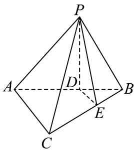
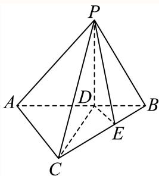
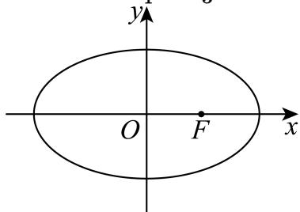

# 2025一模 青浦区原卷 · 教师版

> 本地预览：题目、答案及分类尚未全部审定。校对使用的PDF为高中工作台解析版，尚未逐区确认区级印刷原卷。

## 填空题

按本区原卷题号顺序排列。

### 青浦 · 第1题

在复平面内，复数 $z=1+\frac12\mathrm i$（其中 $\mathrm i$ 是虚数单位）的共轭复数对应的点位于第 $\underline{\qquad}$ 象限。

**考点：** 共轭复数的坐标与象限

**难度依据：** 虚部反号即可判断

**核查说明：** 题干与解析已用于人工归类，尚未完成整题公式校净与独立数学终审。

【答案】四。

【解析】

由 $z=1+\frac12\mathrm i$，得 $\overline z=1-\frac12\mathrm i$，其对应的点为 $\left(1,-\frac12\right)$，位于第四象限。

故答案为：四。

### 青浦 · 第2题

已知集合 $A=\{x\mid x=2k-1,\ k\in\mathbf N\}$，$B=\{-1,0,1,2,3\}$，则 $A\cap B=\underline{\qquad}$。

**考点：** 自然数生成集合与交集

**难度依据：** 枚举满足奇数表达式的元素

**核查说明：** 题干与解析已用于人工归类，尚未完成整题公式校净与独立数学终审。

【答案】$\{-1,1,3\}$。

【解析】

按来源解析中自然数包含 $0$ 的约定，$A=\{-1,1,3,5,\ldots\}$。由交集定义，得

$$A\cap B=\{-1,1,3\}.$$

故答案为：$\{-1,1,3\}$。

### 青浦 · 第3题

不等式 $\frac{x-3}{x+1}\ge2$ 的解集为 $\underline{\qquad}$。

> 本题资料或解析有待核事项，预览不可作为已审定成品。

**考点：** 分式不等式移项和端点取舍

**难度依据：** 通分后用符号表保留分母限制

**核查说明：** 题干与解析已用于人工归类，尚未完成整题公式校净与独立数学终审。；题干右端出现“≥3 2”错识；同名PDF第1页文字层确认右端为2。

【答案】$[-5,-1)$。

【解析】

由 $x\ne-1$，原不等式等价于

$$\frac{x+5}{x+1}\le0.$$

因此 $(x+5)(x+1)\le0$ 且 $x\ne-1$，解得 $-5\le x<-1$。

故答案为：$[-5,-1)$。

### 青浦 · 第4题

已知直线 $l_1:x+(1+m)y+m-2=0$ 与直线 $l_2:mx+2y+8=0$ 平行，则 $m=\underline{\qquad}$。

**考点：** 直线平行参数与重合排除

**难度依据：** 比例条件会给出重合直线需剔除

**核查说明：** 题干与解析已用于人工归类，尚未完成整题公式校净与独立数学终审。

【答案】$1$。

【解析】

当 $m=-1$ 时，$l_1:x-3=0$ 垂直于 $x$ 轴，而 $l_2:-x+2y+8=0$ 不垂直于 $x$ 轴，两直线不平行。

当 $m\ne-1$ 时，两直线斜率分别为 $-\frac1{1+m}$、$-\frac m2$。由斜率相等得 $m=-2$ 或 $m=1$。当 $m=-2$ 时，两直线均为 $x-y-4=0$，重合，舍去；当 $m=1$ 时，两直线为 $x+2y-1=0$ 与 $x+2y+8=0$，平行。

故答案为：$1$。

### 青浦 · 第5题

两条渐近线互相垂直的双曲线的离心率为 $\underline{\qquad}$。

**考点：** 等轴双曲线渐近线与离心率

**难度依据：** 垂直渐近线推出两半轴相等

**核查说明：** 题干与解析已用于人工归类，尚未完成整题公式校净与独立数学终审。

【答案】$\sqrt2$。

【解析】

在双曲线的对称轴所确定的坐标系中，其两条渐近线的斜率分别为 $\frac ba$ 与 $-\frac ba$，或分别为 $\frac ab$ 与 $-\frac ab$。两线互相垂直，故 $a=b$。

由 $c^2=a^2+b^2$，得

$$e=\frac ca=\sqrt{1+\frac{b^2}{a^2}}=\sqrt2.$$

故答案为：$\sqrt2$。

### 青浦 · 第6题

已知数列 $\{a_n\}$ 满足 $a_1+2a_2+3a_3+\cdots+na_n=n(n+2)$，则 $a_{66}=\underline{\qquad}$。

**考点：** 加权前n项和的相邻作差

**难度依据：** 对加权和作差得到第n项

**核查说明：** 题干与解析已用于人工归类，尚未完成整题公式校净与独立数学终审。

【答案】$\frac{133}{66}$。

【解析】

当 $n\ge2$ 时，由已知得 $a_1+2a_2+\cdots+(n-1)a_{n-1}=(n-1)(n+1)$。两式相减得 $na_n=2n+1$，所以 $a_n=\frac{2n+1}{n}$（$n\ge2$）。

所以 $a_{66}=\frac{133}{66}$。

### 青浦 · 第7题

在 $\triangle ABC$ 中，已知 $\angle ACB=120^{\circ},AB=2\sqrt{7}$，若 $BC=2AC$，则 $\triangle ABC$ 的面积为 $\underline{\qquad}$。

> 本题资料或解析有待核事项，预览不可作为已审定成品。

**考点：** 已知边比的余弦定理与面积

**难度依据：** 一条边设未知再用余弦定理求尺度

**核查说明：** 未检查网站实际渲染及跨页布局。；题干与解析已用于人工归类，尚未完成整题公式校净与独立数学终审。

【答案】$2 \sqrt { 3 }$

【解析】

根据给定条件，利用余弦定理求出 $A C$ ，再利用三角形面积公式计算即得.

在 $\triangle A B C$ 中， $\angle A C B = 1 2 0 ^ { \circ } , A B = 2 { \sqrt { 7 } } , \ B C = 2 A C ,$

由余弦定理得 $2 8 = A B ^ { 2 } = A C ^ { 2 } + B C ^ { 2 } - 2 A C \cdot B C \cos 1 2 0 ^ { \circ } = 7 A C ^ { 2 }$，

解得 $A C ^ { 2 } = 4$

所以 $\triangle A B C$ 的面积为 ${ \frac { 1 } { 2 } } A C \times B C \times \sin 1 2 0 ^ { \circ } = A C ^ { 2 } \cdot { \frac { \sqrt { 3 } } { 2 } } = 2 { \sqrt { 3 } } .$

故答案为： $2 \sqrt { 3 }$

### 青浦 · 第8题

已知圆柱 $M$ 的底面半径为 $3$，高为 $\sqrt3$，圆锥 $N$ 的底面直径和母线长相等。若圆柱 $M$ 和圆锥 $N$ 的体积相同，则圆锥 $N$ 的底面半径为 $\underline{\qquad}$。

**考点：** 圆柱圆锥等体积与母线约束

**难度依据：** 由圆锥直径等母线先确定高半径比

**核查说明：** 题干与解析已用于人工归类，尚未完成整题公式校净与独立数学终审。

【答案】$3$。

【解析】

圆柱 $M$ 的体积为 $V_M=\pi\cdot3^2\cdot\sqrt3=9\sqrt3\pi$。

设圆锥 $N$ 的底面半径为 $r>0$，则其母线长为 $2r$，高为 $\sqrt{(2r)^2-r^2}=\sqrt3r$。由两体积相等，得

$$\frac13\pi r^2\cdot\sqrt3r=9\sqrt3\pi,$$

即 $r^3=27$，故 $r=3$。

故答案为：$3$。

### 青浦 · 第9题

$(x+y)(x-y)^6$ 的展开式中，$x^4y^3$ 项的系数为 $\underline{\qquad}$。

**考点：** 二项式展开乘一次式的系数合并

**难度依据：** 目标单项式可来自两项必须相加

**核查说明：** 题干与解析已用于人工归类，尚未完成整题公式校净与独立数学终审。

【答案】$-5$。

【解析】

$x^4y^3$ 项分别来自 $x$ 乘以 $(x-y)^6$ 的 $x^3y^3$ 项，以及 $y$ 乘以 $(x-y)^6$ 的 $x^4y^2$ 项。故所求系数为

$$-\binom63+\binom62=-20+15=-5.$$

故答案为：$-5$。

### 青浦 · 第10题

已知函数 $y=f(x)$ 的定义域为 $\{-2,-1,1,2\}$，值域为 $\{-2,2\}$，则满足条件的函数 $y=f(x)$ 最多有 $\underline{\qquad}$ 个。

**考点：** 有限集合上满射函数的计数；对应规则分类与排除常值函数

**难度依据：** 值域两个元素都须取得可用总数减两种常值

**核查说明：** 题干与解析已用于人工归类，尚未完成整题公式校净与独立数学终审。

【答案】$14$

【解析】

由函数的概念及分类加法计数原理、组合数计算得解。

由函数定义，转化为给 $-2,2$ 安排对应的自变量，每一种对应方式，即为一个函数。

给 $-2$ 取 $3$ 个自变量，则 $2$ 对应 $1$ 个自变量，有 $\mathrm{C}_4^3$ 种；

给 $-2$ 取 $2$ 个自变量，则 $2$ 对应 $2$ 个自变量，有 $\mathrm{C}_4^2$ 种；

给 $-2$ 取 $1$ 个自变量，则 $2$ 对应 $3$ 个自变量，有 $\mathrm{C}_4^1$ 种。

所以由分类加法计数原理知，共有 $\mathrm{C}_4^3+\mathrm{C}_4^2+\mathrm{C}_4^1=14$ 种不同的对应方式。

故答案为：$14$。

### 青浦 · 第11题

若函数 $y = \log _ { \frac { 1 } { 2 } } \left( a x ^ { 2 } - 8 x + 15 \right)$ 在区间(1,2)上严格增，则实数a的取值范围

> 本题资料或解析有待核事项，预览不可作为已审定成品。

**考点：** 复合对数函数单调与定义域；区间恒成立的参数范围及开端点

**难度依据：** 内层须同时严格递减与真数恒正

**核查说明：** 解析一处底数误为1/9，且含其他OCR噪声；尚未完整校净。；题干与解析已用于人工归类，尚未完成整题公式校净与独立数学终审。；原解对数底数曾误写1/9但题干为1/2，需统一回核。

【答案】$\left[\frac14,2\right]$。

【解析】

令 $g(x)=ax^2-8x+15$。由于 $y=\log_{\frac12}t$ 在 $(0,+\infty)$ 上严格递减，题意等价于 $g(x)$ 在 $(1,2)$ 上严格递减且恒为正。

由严格递减及可导性，$g'(x)=2ax-8\leqslant 0$ 在 $(1,2)$ 上恒成立，令 $x\to2^-$，得 $a\leqslant2$。反之，当 $a\leqslant2$ 时，对任意 $x\in(1,2)$，均有 $g'(x)<0$，故 $g(x)$ 严格递减。

在此条件下，$g(x)>0$ 对一切 $x\in(1,2)$ 成立，当且仅当 $g(2)=4a-1\geqslant0$。其中等号成立时，由于 $2$ 不属于区间且 $g$ 严格递减，仍有 $g(x)>g(2)=0$。因此 $a\geqslant\frac14$。

综上，$a$ 的取值范围为 $\left[\frac14,2\right]$。

### 青浦 · 第12题

已知A,B,C是单位圆上任意不同三点，则 $\frac { { \overrightarrow { A B } } \cdot { \overrightarrow { A C } } } { \left| { \overrightarrow { A B } } \right| }$ 的取值范围是

> 本题资料或解析有待核事项，预览不可作为已审定成品。

**考点：** 数量积除模转化为有向投影；单位圆上三点的投影范围

**难度依据：** 利用圆上投影上下界且审查互异点下端点可达性

**核查说明：** 仅修复所列OCR公式及其定界符错位；原解数学疑点和其他可渲染错识未因此消除。；原解析保留在源字段及精确补丁old中；本题针对性纠错已独立复核，不外推为全卷数学终审。；题干与解析已用于人工归类，尚未完成整题公式校净与独立数学终审。；原解取AB=2x后写0<x<1，漏了AB为直径时x=1情形；最终范围仍需补充该情形与端点不可达证明。

【答案】$(-1,2)$。

【解析·补全直径情形和取值充分性】

设圆心为$O$，以$O$为原点，令$\vec u=\dfrac{\overrightarrow{AB}}{|\overrightarrow{AB}|}$，$s=\dfrac{|AB|}{2}$。由于$A\ne B$，有$0<s\leq1$。

由$|\overrightarrow{OA}|=|\overrightarrow{OB}|=1$及弦长关系，得

$$
\overrightarrow{OA}\cdot\vec u=-s.
$$

因此所求投影为

$$
r=\overrightarrow{AC}\cdot\vec u=s+\overrightarrow{OC}\cdot\vec u.
$$

由$-1\leq\overrightarrow{OC}\cdot\vec u\leq1$，得$r>-1$且$r\leq2$。

若$r=2$，则$s=1$且$\overrightarrow{OC}=\vec u$。这时$AB$为直径，$\overrightarrow{OB}=\vec u$，故$C=B$，与三点互异矛盾。因此$r<2$，包括直径情形在内均有$r\in(-1,2)$。

再验证区间内每个值都能取到。任取$r\in(-1,2)$，选取

$$
\max\{0,r-1\}<s<\min\{1,r+1\}.
$$

该开区间非空，且$0<s<1$。在单位圆上取

$$
A=(-s,\sqrt{1-s^2}),\qquad B=(s,\sqrt{1-s^2}).
$$

此时$\vec u=(1,0)$。由于$-1<r-s<1$，圆上横坐标为$r-s$的点有两个且互不相同。

$A$、$B$的横坐标不同，所以这两个候选点至多一个与$A$或$B$重合。选另一个作为$C$，便可保证三点互异，并有

$$
\frac{\overrightarrow{AB}\cdot\overrightarrow{AC}}{|\overrightarrow{AB}|}=s+(r-s)=r.
$$

综上，所求取值范围为$(-1,2)$。

本段为独立复算后补写的证明；原PDF解析未讨论$AB$为直径及全部中间值的达到性，原解完整留存于来源字段和补丁记录。

## 选择题

按本区原卷题号顺序排列。

### 青浦 · 第13题

已知 $x,y\in\mathbf{R}$ 且满足 $x>y$，则下列关系式恒成立的是（ ）。

A. $\frac{1}{x^2+1}<\frac{1}{y^2+1}$

B. $\ln\left(x^2+1\right)>\ln\left(y^2+1\right)$

C. $\sin x>\sin y$

D. $x^3>y^3$

**考点：** 基本函数全局单调性的反例辨析；实数序关系在函数映射下的保持

**难度依据：** 区分局部单调和全实数单调

**核查说明：** 题干与解析已用于人工归类，尚未完成整题公式校净与独立数学终审。

【答案】D

【解析】

利用不等式的性质，以及对数函数的性质、幂函数的性质、正弦函数的图象性质求解。

对A，取 $x=-1,y=-2$，则 $\frac{1}{x^2+1}>\frac{1}{y^2+1}$，A错误；

对B，取 $x=-1,y=-2$，则 $\ln2<\ln5$，即 $\ln\left(x^2+1\right)<\ln\left(y^2+1\right)$，B错误；

对C，取 $x=\frac{5\pi}{6},y=\frac{2\pi}{3}$，满足 $x>y$，但 $\sin\frac{5\pi}{6}<\sin\frac{2\pi}{3}$，C错误；

对D，因为幂函数 $f(x)=x^3$ 在定义域 $\mathbf{R}$ 上单调递增，且 $x>y$，所以 $x^3>y^3$，D正确。

故选：D。

### 青浦 · 第14题

若点 $P \left( x , y , z \right) \left( x y z \neq 0 \right)$ 关于xOy的对称点为A，关于z轴的对称点为B，则A、B两点的对称是（ ）

A. 关于 $xOz$ 平面对称

B. 关于x轴对称

C. 关于y轴对称

D. 关于坐标原点对称

**考点：** 空间坐标轴平面对称；空间点的坐标与中心对称

**难度依据：** 坐标变号两次比较即可

**核查说明：** 题干与解析已用于人工归类，尚未完成整题公式校净与独立数学终审。

【答案】D

【解析】

运用空间向量坐标表示以及对称中的坐标特点可解.

点 $P \left( x , y , z \right) \left( x y z \neq 0 \right)$ 关于xOy的对称点为A，则A坐标 $( x , y , - z )$ ；

点 $P \left( x , y , z \right) \left( x y z \neq 0 \right)$ 关于z轴的对称点为B，则B坐标 $( - x , - y , z )$ ；

则根据坐标特点知道A、B两点关于原点对称.

故选：D

### 青浦 · 第15题

已知函数 $y=f(x)$ 是定义在 $\mathbb R$ 上的奇函数，且当 $x>0$ 时，$f(x)=(x-1)(x-3)+0.01$，则关于函数 $y=f(x)$ 在 $\mathbb R$ 上的零点的说法正确的是（ ）。

A. 有4个零点，其中只有一个零点在区间 $(-3,-1)$ 上

B. 有4个零点，其中两个零点在区间 $(-3,-1)$ 上，另外两个零点在区间 $(1,3)$ 上

C. 有5个零点，两个正零点中一个在区间 $(0,1)$ 上，一个在区间 $(3,+\infty)$ 上

D. 有5个零点，都不在 $(0,1)$ 上

> 本题资料或解析有待核事项，预览不可作为已审定成品。

**考点：** 奇函数零点对称与二次函数零点定位

**难度依据：** 不能漏原点零点且需判断正根区间

**核查说明：** 题干与解析已用于人工归类，尚未完成整题公式校净与独立数学终审。；原解把正半轴表达式延伸到0并称f(0)=3.01，与奇函数f(0)=0冲突；该处应为正分支延拓值，不可直接照抄。

【答案】D

【解析】（根据原解析修订）

当 $x>0$ 时，令 $(x-1)(x-3)+0.01=0$，得 $x=2\pm\frac{\sqrt{99}}{10}$，两个根均在 $(1,3)$ 内。

由奇函数的性质，$f(0)=0$，且两个正零点对应两个负零点，故函数共有5个零点，均不在 $(0,1)$ 内，选 D。

原解析将仅适用于 $x>0$ 的表达式代入 $x=0$，所得 $f(0)=3.01$ 与奇函数性质矛盾，此处已修正。

### 青浦 · 第16题

对于数列 $\{a_n\}$，设数列 $\{a_n\}$ 的前 $n$ 项和为 $S_n$，给出下列两个命题：

①存在函数 $y=f(x)$，使得 $S_n=f(a_n)$；

②存在函数 $y=g(x)$，使得 $n=g(a_n)$。

则①是②的（　）。

A. 充分不必要条件

B. 必要不充分条件

C. 充要条件

D. 既不充分也不必要条件

> 本题资料或解析有待核事项，预览不可作为已审定成品。

**考点：** 前缀和与通项的函数对应；函数单值性及一一对应；两个存在命题的充分必要性；数列映射条件的反例与蕴含

**难度依据：** 零数列给反例且要证明反向映射可定义

**核查说明：** 题干与解析已用于人工归类，尚未完成整题公式校净与独立数学终审。；原解最后复合映射的书写不严谨，应从an互异保证Sn关于an可定义来证明。

【答案】B

【解析】

取特例可知①推不出②，根据反函数可知满足②能推出①，结合充分条件、必要条件的概念得 解.

取 $S _ { n } = a _ { n } = 0$ ，存在 $y = f ( x ) = 0$ ，使得 $S _ { n } = f \left( a _ { n } \right)$ 成立，

此时由函数定义知，不存在函数 $y = g \left( x \right)$ ，使得 $n = g \left( a _ { n } \right)$

当存在函数 ${ \boldsymbol { \cdot } } { \boldsymbol { y } } = { \boldsymbol { g } } \left( { \boldsymbol { x } } \right)$ ，使得 $n = g \left( a _ { n } \right)$ 成立时，

由于n与a 为一一对应关系，所 $\complement { \lambda } a _ { n }$ 就可以写成y = g(x)的反函数，

即 $a _ { n }$ 可以用n表示，即存在函数 $\dot { a } _ { n } = g ^ { - 1 } \left( n \right)$

所以存在 $S _ { n } = h ( n ) = f \left( a _ { n } \right) = f \left\{ g ^ { - 1 } ( n ) \right\}$

综上可知，①是②的必要不充分条件.

故选：B

关键点点睛：对于新概念问题需要去理解，本题理解了之后，可以根据函数的概念去判断①②之间的推出关系得解.

## 解答题

按本区原卷题号顺序排列。

### 青浦 · 第17题

已知函数 $f ( x ) = ( 2 \mathrm { { c o s } } ^ { 2 } x - 1 ) \mathrm { { s i n } } 2 x + { \frac { 1 } { 2 } } \mathrm { { c o s } } 4 x$
（Ⅰ）求f(x)的最小正周期及最大值；
（Ⅱ）若 $\mathrm { i } \alpha \in ( \frac { \pi } { 2 } , \pi )$ ，且 $f ( \alpha ) = \frac { \sqrt { 2 } } { 2 }$ ，求α的值.

**考点：** （1）化为单一正弦求周期最大值；（2）限制相位范围后由最大值反求角

**难度依据：** （1）化为单一正弦求周期最大值；（2）限制相位范围后由最大值反求角

**核查说明：** 题干与解析已用于人工归类，尚未完成整题公式校净与独立数学终审。

【解析】

第（Ⅰ）题，化简函数解析式为最简形式，利用公式求出周期和最值．第（Ⅱ）题，是给值求角问题，要先限定范围

（Ⅰ），因为 $f \left( x \right) = \left( 2 { \cos } ^ { 2 } x - 1 \right) { \sin } 2 x + \frac { 1 } { 2 } { \cos } 4 x$ $\begin{array} { l } { \displaystyle = \cos 2 x \sin 2 x + \frac { 1 } { 2 } \cos 4 x } \\ { \displaystyle = \frac { 1 } { 2 } ( \sin 4 x + \cos 4 x ) } \\ { \displaystyle = \frac { \sqrt 2 } { 2 } \sin ( 4 x + \frac { \pi } { 4 } ) } \end{array}$

所以f(x)的最小正周期为 $\frac { \pi } { 2 }$ ，最大值为 $\frac { \sqrt { 2 } } { 2 }$

因为 $\mathsf { I } \alpha \in ( \frac { \pi } { 2 } , \pi )$ ，所以 $4 \alpha + \frac { \pi } { 4 } \in ( \frac { 9 \pi } { 4 } , \frac { 1 7 \pi } { 4 } )$

因为 $f ( \alpha ) = { \frac { \sqrt { 2 } } { 2 } }$ ，所以 $f ( \alpha ) = \frac { \sqrt { 2 } } { 2 } { \sin ( 4 \alpha + \frac { \pi } { 4 } ) } = \frac { \sqrt { 2 } } { 2 }$ ，即 $\sin ( 4 \alpha + { \frac { \pi } { 4 } } ) = 1$

所以 $4 \alpha + { \frac { \pi } { 4 } } = { \frac { 5 \pi } { 2 } }$ ，故 $\displaystyle \dot { \alpha } = \frac { 9 \pi } { 1 6 }$

【考点定位】本题考查了二倍角公式、两角和的正弦公式、三角函数的性质.考查了三角函数式的化简、求值，故考查了运算求解能力.

### 青浦 · 第18题

如图，在三棱锥 $P - A B C$ 中，平面 $P A B \bot$ 平面 $A B C , A B = 6 , B C = 2 { \sqrt { 3 } } , A C = 2 { \sqrt { 6 } } , D .$ 、E分别为线段AB、BC上的点，且 $A D = 2 D B , C E = 2 E B , P D \bot A C .$
(1) (6分)求证： $D E / /$ 平面 $P A C ;$
(2) (8分)求证： $P D \perp$ 平面 $A B C$

> 本题资料或解析有待核事项，预览不可作为已审定成品。

**考点：** （1）比例分点推出平行线；（2）算出底面垂线后结合面面垂直证明线面垂直

**难度依据：** （1）比例分点推出平行线；（2）算出底面垂线后结合面面垂直证明线面垂直

**核查说明：** 题干与解析已用于人工归类，尚未完成整题公式校净与独立数学终审。；解析CD²+AD²=AC²一行与前述CD=2√2、AD=4、AC=2√6实际一致；须保持数据，不把直角位置错移。

【解析】

(1) 因为D、E分别为线段AB、BC上的点，且 $A D = 2 D B , C E = 2 E B$

所以 $D E / / A C$ ，又 $A C \subset$ 平面PAC，DE ⊄平面 $P A C$ ，所以 $D E / / .$ 平面 $P A C$

(2) 因为 $A B = 6 , B C = 2 { \sqrt { 3 } } , A C = 2 { \sqrt { 6 } } ,$ ，所以 $A B ^ { 2 } = 6 ^ { 2 } = B C ^ { 2 } + A C ^ { 2 } = 3 6$

所以 $\angle A C B = 9 0 ^ { \circ } , \ \cos \angle A B C = { \frac { 2 { \sqrt { 3 } } } { 6 } } = { \frac { \sqrt { 3 } } { 3 } }$ ，连接DC，又 $B D = 2$

所以 $C D ^ { 2 } = 2 ^ { 2 } + \left( 2 { \sqrt { 3 } } \right) ^ { 2 } - 2 \times 2 \times 2 { \sqrt { 3 } } \times \cos \angle A B C = 8$ ，所以 $C D = 2 { \sqrt { 2 } }$ ，又 $A D = 4$

所以 $C D ^ { 2 } + A D ^ { 2 } = A C ^ { 2 }$ ，所以 $C D \bot A B .$

因为平面 $P A B \bot$ 平面 $A B C ,$ ，交线为 $A B , \ C D \subset$ 平面 $A B C$

所以 $C D \perp$ 平面PAB， $P D \subset$ 平面 $P A B ,$ ，所以 $C D \bot P D$

因为 $P D \bot A C$ $A C \cap C D = C$ ， $A C , C D \subset$ 平面 $A B C$

所以PD⊥平面ABC.

### 青浦 · 第19题

第七届中国国际进口博览会于 2024 年 11 月 5 日至 10 日在上海举办，某公司生产的 A、B 、C 三款产品在博览会上亮相，每一种产品均有普通装和精品装两种款式，该公司每天产量如下表: （单位:个）

|  | 产品A | 产品B | 产品C |
| --- | ---: | ---: | ---: |
| 普通装 | $n$ | 180 | 400 |
| 精品装 | 300 | 420 | 600 |

现采用分层抽样的方法在某一天生产的产品中抽取 100 个，其中 B款产品有30个
(1) (4分)求 n的值；
(2) (4分)用分层抽样的方法在C款产品中抽取一个容量为5的样本，从样本中任取 2个产品，求其中至少有一个精品装产品的概率;
(3) (6分)对抽取到的 B款产品样本中某种指标进行统计，普通装产品的平均数为10，方差为2，精品装产品的平均数为12，方差为1.8，试估计这天生产的 B款产品的某种指标的总体方差 （精确到 0.01 ）.

> 本题资料或解析有待核事项，预览不可作为已审定成品。

**考点：** （1）按抽样比例反求产量；（2）分层样本中的至少一件概率；（3）组内方差与组间均值差加权合并

**难度依据：** （1）按抽样比例反求产量；（2）分层样本中的至少一件概率；（3）组内方差与组间均值差加权合并

**核查说明：** 题干与解析已用于人工归类，尚未完成整题公式校净与独立数学终审。；题干产量表在MD缺失；已定位同名PDF文字层：普通装A=n、B=180、C=400，精品装A=300、B=420、C=600，须恢复原表。

【解析】

(1) 由题意可知，该工厂一天所生产的产品数为

$$
n + 3 0 0 + 1 8 0 + 4 2 0 + 4 0 0 + 6 0 0 = n + 1 9 0 0.
$$

现采用分层抽样的方法在这一天生产的产品中抽取100个，其中B款产品有30个，

则 ${ \frac { 1 8 0 + 4 2 0 } { n + 1 9 0 0 } } = { \frac { 3 0 } { 1 0 0 } }$ ，解得 $n = 1 0 0$

(2) 设所抽取的样本中有p个精品装产品，则 ${ \frac { p } { 5 } } = { \frac { 6 0 0 } { 1 0 0 0 } }$ ，解得p = 3,

所以容量为5的样本中，有3个精品装产品，2个普通装产品.

因此从样本中任取 2个产品，至少有1个精品装产品的概率为 $\frac { \mathrm { C } _ { 5 } ^ { 2 } - \mathrm { C } _ { 2 } ^ { 2 } } { \mathrm { C } _ { 5 } ^ { 2 } } = \frac { 9 } { 1 0 } .$

(3) 由题意，某项指标总体的平均数为 ${ \frac { 1 8 0 \times 1 0 + 4 2 0 \times 1 2 } { 6 0 0 } } = 1 1 . 4$ 所以由分层抽样的总体方差公式可得

$$
\begin{array}{l} s ^ {2} = \frac {1 8 0}{6 0 0} \left[ 2 + (1 1. 4 - 1 0) ^ {2} \right] + \frac {4 2 0}{6 0 0} \left[ 1. 8 + (1 1. 4 - 1 2) ^ {2} \right] \\ = \frac {1 8 0}{6 0 0} \times \frac {9 9}{2 5} + \frac {4 2 0}{6 0 0} \times \frac {5 4}{2 5} = \frac {6 7 5}{2 5 0} = 2. 7 0 \end{array}
$$

### 青浦 · 第20题

已知椭圆 $C : \frac { x ^ { 2 } } { 4 } + \frac { y ^ { 2 } } { 3 } = 1 , F$ 为椭圆 C的右焦点，过点F的直线 l交椭圆 C于A、B两点.

(1) (4分)若直线 l垂直于 x轴，求椭圆 C的弦AB的长度；
(2) (6分)设点P (−3, 0)，当 $\angle P A B = 9 0 ^ { \circ }$ 时，求点A的坐标；
(3) (8分)设点M (3, 0)，记 MA 、 MB的斜率分别为 $| k _ { 1 }$ 和 $k _ { 2 }$ ，求 $k _ { 1 } + k _ { 2 }$ 的取值范围.

> 本题资料或解析有待核事项，预览不可作为已审定成品。

**考点：** （1）竖直焦点弦长；（2）直角几何结合焦点定义求点；（3）韦达化斜率和再求范围

**难度依据：** （1）竖直焦点弦长；（2）直角几何结合焦点定义求点；（3）韦达化斜率和再求范围

**核查说明：** 题干与解析已用于人工归类，尚未完成整题公式校净与独立数学终审。；原解第1问把c=√(a²−b²)代入写成√(4²−3²)=1，且第3问联立系数有漏4，须校净复算。

【解析】

(1) 由题意可知， $c = { \sqrt { a ^ { 2 } - b ^ { 2 } } } = { \sqrt { 4 ^ { 2 } - 3 ^ { 2 } } } = 1$

$\therefore F \left( 1 , 0 \right)$ ,又∵当直线 l垂直于 x轴时，直线l的方程为 $x = 1$

$\left\{ { \frac { x = 1 } { 4 } } \right. \qquad { \frac { y ^ { 2 } } { 3 } } = 1$ 得， $y = \pm \frac { 3 } { 2 }$

∴弦AB的长为 $2 \times { \frac { 3 } { 2 } } = 3 .$

(2) $\because \angle P A B = 9 0 ^ { \circ }$ ，且直线l过点F，

$\therefore \angle P A F = 9 0 ^ { \circ }$ ，在 $: { \mathrm { R t } } \triangle P A F ^ { \natural }$ 中， $P ( - 3 , 0 ) , F \left( 1 , 0 \right)$

∴斜边PF的中点(−1,0)，恰为椭圆的左焦点 $F ^ { \prime }$ ,

$\therefore A F ^ { \prime } = { \frac { 1 } { 2 } } P F = 2$ ,又由椭圆的定义可得 $A F = 2 a - A F ^ { \prime } = 4 - 2 = 2$

∴点A在线段 $F F ^ { \prime }$ 的垂直平分线上，又A在椭圆上，

$\therefore A$ 为椭圆的上顶点或下顶点，

∴A $\left( 0 , - { \sqrt { 3 } } \right)$ 或A $\left( 0 , { \sqrt { 3 } } \right)$

(3) 当直线AB的斜率不存在时，不妨设A $\left( 1 , \frac { 3 } { 2 } \right) , B \left( 1 , - \frac { 3 } { 2 } \right)$ ，

$$
\therefore k _ {1} = \frac {0 - \frac {3}{2}}{3 - 1} = - \frac {3}{4}, k _ {2} = \frac {0 + \frac {3}{2}}{3 - 1} = \frac {3}{4},
$$

故 $k _ { 1 } + k _ { 2 } = 0 ;$

当直线AB的斜率存在时，设斜率为k，则直线AB： $y = k \left( x - 1 \right)$ ，设 $A \left( x _ { 1 } , y _ { 1 } \right) , B \left( x _ { 2 } , y _ { 2 } \right)$

由 $\left\{ { \begin{array} { l } { y = k \left( x - 1 \right) } \\ { { \frac { x ^ { 2 } } { 4 } } + { \frac { y ^ { 2 } } { 3 } } = 1 } \end{array} } \right.$ 得， $\left( 3 + k ^ { 2 } \right) x ^ { 2 } - 8 k ^ { 2 } x + \left( 4 k ^ { 2 } - 1 2 \right) = 0 ,$

$$
\therefore x _ {1} + x _ {2} = \frac {8 k ^ {2}}{4 k ^ {2} + 3}, x _ {1} x _ {2} = \frac {4 k ^ {2} - 1 2}{4 k ^ {2} + 3},
$$

$$
\therefore k _ {1} + k _ {2} = \frac {y _ {1}}{x _ {1} - 3} + \frac {y _ {2}}{x _ {2} - 3} = \frac {k (x _ {1} - 1)}{x _ {1} - 3} + \frac {k (x _ {2} - 1)}{x _ {2} - 3} = \frac {k (2 x _ {1} x _ {2} - 4 (x _ {1} + x _ {2}) + 6)}{x _ {1} x _ {2} - 3 (x _ {1} + x _ {2}) + 9},
$$

化简得 $\therefore k _ { 1 } + k _ { 2 } = { \frac { k \left( { \cfrac { 8 k ^ { 2 } - 2 4 - 3 2 k ^ { 2 } + 2 4 k ^ { 2 } + 1 8 } { 4 k ^ { 2 } + 3 } } \right) } { { \cfrac { 4 k ^ { 2 } - 1 2 } { 4 k ^ { 2 } + 3 } } - { \cfrac { 2 4 k ^ { 2 } } { 4 k ^ { 2 } + 3 } } + 9 } } = - { \frac { 6 k } { 1 6 k ^ { 2 } + 1 5 } } ,$

①当k > 0， $0 > k _ { 1 } + k _ { 2 } = - { \frac { 6 } { 1 6 k + { \frac { 1 5 } { k } } } } \geq - { \frac { 6 } { 2 { \sqrt { 1 6 k \times { \frac { 1 5 } { k } } } } } } = - { \frac { \sqrt { 1 5 } } { 2 0 } }$ ，当且仅当 $k = \frac { \sqrt { 1 5 } } { 4 }$

时等式成立；

②当k < 0， $0 < k _ { 1 } + k _ { 2 } = { \frac { 6 } { - \left( 1 6 k + { \frac { 1 5 } { k } } \right) } } \leq { \frac { 6 } { 2 { \sqrt { ( - 1 6 k ) } } \times \left( - { \frac { 1 5 } { k } } \right) } } = { \frac { \sqrt { 1 5 } } { 2 0 } }$ ，当且仅当

$k = - { \frac { \sqrt { 1 5 } } { 4 } }$ 时等式成立；

③当 $k = 0 , \ k _ { 1 } + k _ { 2 } = 0$ ；

综上所述可得， $k _ { 1 } + k _ { 2 }$ 的取值范围为 $\left[ - { \frac { \sqrt { 1 5 } } { 2 0 } } , { \frac { \sqrt { 1 5 } } { 2 0 } } \right]$

### 青浦 · 第21题

已知函数 $\boldsymbol { \cdot } \boldsymbol { y } = \boldsymbol { f } \left( \boldsymbol { x } \right)$ ，其中 $f \left( x \right) = \mathrm { e } ^ { x - 1 } - 2 \ln x + x$
(1) (4分)求函 ${ \ddot { \boldsymbol { \mathfrak { L } } } } \nabla y = f \left( { \boldsymbol { x } } \right)$ 的单调区间；
(2) (6分)设函数 $\left[ g \left( x \right) \right. = f \left( x \right) + 2 \ln { x }$ ，问:函数 $\scriptstyle \left( y = g \left( x \right) \right.$ 的图像上是否存在三点A,B,C，使得它们的横坐标成等差数列，且直线 AC的斜率等于 $y = g \left( x \right)$ 在点B处的切线的斜率? 若存在，求出所有满足条件的点B的坐标;若不存在，说明理由;
(3) (8分)证明: 函数 $\boldsymbol { \cdot } \boldsymbol { y } = \boldsymbol { f } \left( \boldsymbol { x } \right)$ 图像上任意一点都不落在函数 ${ \bf \langle } y = \left( x - 2 \right) ^ { 3 } - 3 \left( x - 2 \right)$ 图像的下方

> 本题资料或解析有待核事项，预览不可作为已审定成品。

**考点：** （1）导函数单调确定极值；（2）等距三点差商与切线斜率矛盾；（3）分区间并多次构造导函数证明图像比较

**难度依据：** （1）导函数单调确定极值；（2）等距三点差商与切线斜率矛盾；（3）分区间并多次构造导函数证明图像比较

**核查说明：** 题干与解析已用于人工归类，尚未完成整题公式校净与独立数学终审。；原解第3问写“3(x−2)²≤1”于(1,3]不成立，后续估计实际用≤3；须修正并核查证明。

【解析】

(1) f (x)定义域为 $( 0 , + \infty )$ $f ^ { \prime } \left( x \right) = \mathrm { e } ^ { x - 1 } - \frac { 2 } { x } + 1$

显然f′(x)在 $( 0 , + \infty )$ 上严格增，且 $f ^ { \prime } ( 1 ) = 0 .$

所以当 $x \in ( 0 , 1 )$ 时， $f ^ { \prime } ( x ) < 0 ;$ ；当 $x \in ( 1 , + \infty )$ 时， $f ^ { \prime } ( x ) > 0$

∴ f(x)的单调递减区间为(0,1)，单调递增区间为 $( 1 , + \infty )$

(2) $g \left( x \right) = f \left( x \right) + 2 \ln x = \mathrm { { e } } ^ { x - 1 } + x$ ，假设存在A,B,C三点满足条件，

设A,B,C三点的横坐标分别为 $s - t , s , s + t ( t \neq 0 )$

则g′ (s) = g (s + t) − g (s − t)2 ∴ es−1 + 1 = es−1+t − es−1−t + 1，

即 $\frac { \mathrm { e } ^ { t } - \mathrm { e } ^ { - t } } { 2 t } = 1$ ，即 $\begin{array} { r } { \mathrm { l e } ^ { t } - \mathrm { e } ^ { - t } = 2 t , } \end{array}$ 令 $h \left( t \right) = { { \mathrm { e } } ^ { t } } - { { \mathrm { e } } ^ { - t } } - 2 t$ ，则 $h ^ { \prime } \left( t \right) = \mathbf { e } ^ { t } + \mathbf { e } ^ { - t } - 2 \geq 0$ 当且仅当t = 0时等号成立，所以h(t)严格增，只有t = 0一个零点，矛盾，

所以不存在满足条件的 $A , B , C \equiv \sharp$ .

(3) 令 $F \left( x \right) = { { \mathrm { e } } ^ { x - 1 } } - { 2 \ln x } + 4 x - 6 - ( x - 2 ) ^ { 3 }$ ，只需证明当x > 0时， $F ( x ) \geq$ 0恒成立.

由 $\mathfrak { l } F \left( 1 \right) = 0 , F ^ { \prime } \left( x \right) = \mathrm { e } ^ { x - 1 } - \frac { 2 } { x } + 4 - 3 ( x - 2 ) ^ { 2 } , F ^ { \prime } \left( 1 \right) = 0 ,$

当 $x \in ( 0 , 1 )$ 时，显然 $F ^ { \prime } ( x )  \overline { { \} } } ^ { \mathrm { u } \mathrm { { z } } }$ 格增， $\therefore F ^ { \prime } ( x ) < 0 .$

当 $x \in ( 1 , + \infty )$ 是，分两段，

①当x ∈ (1, 3]时， $3 ( x - 2 ) ^ { 2 } \leq 1$ ，所以

$$
F ^ {\prime} (x) = \mathrm{e} ^ {x - 1} - \frac {2}{x} + 4 - 3 (x - 2) ^ {2} > 1 - 2 + 4 - 3 = 0;
$$

②当 $x \in ( 3 , + \infty )$ 时， $F ^ { \prime } \left( x \right) = \mathrm { e } ^ { x - 1 } - \frac { 2 } { r } + 4 - 3 ( x - 2 ) ^ { 2 } > \mathrm { e } ^ { x - 1 } - 3 ( x - 2 ) ^ { 2 } ,$

${ \mathfrak { F } } m ( x ) = \mathrm { e } ^ { x - 1 } - 3 ( x - 2 ) ^ { 2 }$ ，则 $m ^ { \prime } \left( x \right) = \mathrm { e } ^ { x - 1 } - 6 \left( x - 2 \right)$ ，再令 $n \left( x \right) = { { \mathrm { e } } ^ { x - 1 } } - 6 \left( x - 2 \right)$ 1

则 $n ^ { \prime } \left( x \right) = \mathrm { e } ^ { x - 1 } - 6$ ，当x > 3时， $n ^ { \prime } \left( x \right) > 0$ ，所以n(x)单调递增，

所以 $n \left( x \right) > n \left( 3 \right) = { \mathrm { e } } ^ { 2 } - 6 > 0$ ，即 $m ^ { \prime } \left( x \right) > 0$ ，所以m(x)单调递增，

所以 $m \left( x \right) > m \left( 3 \right) = { { \mathrm { e } } ^ { 2 } } - 3 > 0$ ，所以 $\mathrm { e } ^ { x - 1 } > 3 ( x - 2 ) ^ { 2 } , \therefore F ^ { \prime } ( x ) > 0 $

综上可知， $F ( x ) _ { \mathrm { m i n } } = F \left( 1 \right) = 0 ,$ ，

所以y = f(x)图像上任意一点都不落在函数 $: y = ( x - 2 ) ^ { 3 } - 3 ( x - 2 )$ 图像的下方.

