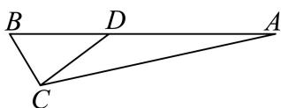
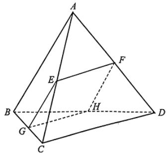

# 2025一模 静安区原卷 · 学生版

> 本地预览：题目、答案及分类尚未全部审定。校对使用的PDF为高中工作台解析版，尚未逐区确认区级印刷原卷。

## 填空题

按本区原卷题号顺序排列。

### 静安 · 第1题

设集合A = {1, 3, 5, 7}, B = {2, 3, 4, 5}，则A ∩ B = .

### 静安 · 第2题

不等式 $| 2 x - 1 | < 3$ 的解集为

### 静安 · 第3题

已知i是虚数单位，(m+i)(1−2i)是纯虚数，则实数m的值为

### 静安 · 第4题

设 $\left\{ a _ { n } \right\}$ 是等差数列， $a _ { 1 } = - 6 , a _ { 3 } = 0$ ，则该数列的前8项的和 $S _ { 8 }$ 的值为 .

### 静安 · 第5题

到点 $F _ { 1 } ( - 3 , 0 ) , F _ { 2 } ( 3 , 0 )$ 距离之和为10的动点P的轨迹方程为

### 静安 · 第6题

在△ABC中，已知 $B C = 5 , A C = 4 , A = 2 B$ ，则cosB的值为

### 静安 · 第7题

已知物体的位移d（单位：m）与时间t（单位：s）满足函数关系 $d = 5 \sin t - 2 \cos t$ ，则该物体在$t = { \frac { \pi } { 2 } } ( \mathbf { s } )$ 时刻的瞬时速度为 $\mathbf { ( m / s ) }$

### 静安 · 第8题

若用t替换命题“对于任意实数d，有 $\mathrm { \dot { \ d } } ^ { 2 } \geq 0$ ，且等号当且仅当d = 0时成立”中的d，即可推出平均值不等式“任意两个正数的算术平均值不小于它们的几何平均值，且等号当且仅当这两个正数相等时成立”.则t =

### 静安 · 第9题

以双曲线 ${ \frac { x ^ { 2 } } { 4 } } - { \frac { y ^ { 2 } } { m } } = 1$ 的离心率为半径，以右焦点为圆心的圆与双曲线的渐近线相切，则m的值为

### 静安 · 第10题

如图所示，小明和小宁家都住在东方明珠塔附近的同一幢楼上，小明家在A层，小宁家位于小明家正上方的B层，已知 $A B = a$ .小明在家测得东方明珠塔尖的仰角为α，小宁在家测得东方明珠塔尖的仰角为β，则他俩所住的这幢楼与东方明珠塔之间的距离d =

### 静安 · 第11题

记$f(x)=x^2+(a^2+b^2-1)x+a^2+2ab-b^2$。若函数$y=f(x)$是偶函数，则该函数图象与$y$轴交点的纵坐标的最大值为______。

> 本题资料或解析有待核事项，预览不可作为已审定成品。

### 静安 · 第12题

已知lg $x _ { 1 \cdot }$ lg x2､ lg x3､ lg $x _ { 4 } ,$ ､ lg $x _ { 5 }$ 是从大到小连续的正整数，且 $( \lg x _ { 4 } ) ^ { 2 } < \lg x _ { 1 } \cdot \lg x _ { 5 }$ ，则 $| x _ { 1 }$ 1的最小值为

## 选择题

按本区原卷题号顺序排列。

### 静安 · 第13题

设 $[ a , b \in \mathbf { R } ,$ ，则 $^ { * } a + b > 0 ^ { * }$ 是 $\mathbf { \bar { \rho } } ^ { * } a > 0$ 且 $. b > 0 ^ { \ast }$ 的（ ）

A. 充分非必要条件

B. 必要非充分条件

C. 充要条件

D. 既非充分又非必要条件

### 静安 · 第14题

污水处理厂通过清除污水中的污染物获得清洁用水并生产肥料.该厂的污水处理装置每小时从处理池清除掉12%的污染残留物.要使处理池中的污染物水平降到最初的10%，大约需要的时间为（ ）（参考数据： $\lg 0 . 8 8 \approx - 0 . 0 5 5 5 )$

A. 14小时

B. 18小时

C. 20小时

D. 24小时

### 静安 · 第15题

我国古代数学著作《九章算术》中将四个面都是直角三角形的空间四面体叫做“鳖臑”.如图是一个水平放置的 $\triangle A B C , C D \bot A B , \angle A = 3 0 ^ { \circ } , \angle B = 4 5 ^ { \circ }$ .现将 $\begin{array} { r } { \mathrm { R t } \triangle A C D \dot { \% } C D } \end{array}$ 折起，使点A移动到点A′，使得空间四面体A′BCD恰好是一个“鳖臑”，则二面角A′ −CD−B的大小为（ ）

A. $6 0 ^ { \circ }$

B. $9 0 ^ { \circ }$

C. $\arctan 2$

D. $\operatorname { a r c c o s } { \frac { \sqrt { 3 } } { 3 } }$

### 静安 · 第16题

在四棱锥 $P - A B C D$ 中， $\overrightarrow { A B } = ( 4 , - 2 , 3 ) , \overrightarrow { A D } = ( - 4 , 1 , 0 ) , \overrightarrow { A P } = ( - 6 , 2 , - 8 )$ ，则该四棱锥的高为（ ）

A. 4

B. 3

C. 2

D. 1

## 解答题

按本区原卷题号顺序排列。

### 静安 · 第17题

设函数 $\mathbf { \nabla } \cdot f \left( x \right) = x + \frac { 4 } { x } , x \in \left( - \infty , 0 \right) \cup \left( 0 , + \infty \right) .$
(1) (6分)求函数 $\boldsymbol { \cdot } \boldsymbol { y } = \boldsymbol { f } \left( \boldsymbol { x } \right)$ 的单调区间；
(2) (8分)求不等 $\nexists \boldsymbol { f } \left( \boldsymbol { x } \right) < 2 \boldsymbol { x }$ 的解集.

### 静安 · 第18题

已知向量 ${ \vec { a } } = \left( \cos { \frac { 3 x } { 2 } } , \sin { \frac { 3 x } { 2 } } \right) , { \vec { b } } = \left( \cos { \frac { x } { 2 } } , - \sin { \frac { x } { 2 } } \right)$ ，且 $x \in \left[ 0 , { \frac { \pi } { 2 } } \right]$
(1) (6分)求→a ⋅→b 及 $\displaystyle { \vec { a } + \vec { b } }$ ；
(2) (8分) $\mathrm { i } \mathrm { \overrightarrow { L } } f \left( x \right) = \mathrm { \overrightarrow { { a } } } \cdot \mathrm { \overrightarrow { { b } } } - \left| \mathrm { \overrightarrow { { a } } } + \mathrm { \overrightarrow { { b } } } \right|$ ，求函数 $y = f \left( x \right)$ 的最小值.

> 本题资料或解析有待核事项，预览不可作为已审定成品。

### 静安 · 第19题

如图所示，正三棱锥A−BCD的侧面是边长为2的正三角形.

(1) (4分)求正三棱锥A − BCD的体积V；
(2) (10分)设E､F､G分别是线段AC､AD､BC的中点.
求证： $\textcircled { 1 } C D / / .$ 平面EFG；②若平面EFG交BD于点H，则四边形EFHG是正方形.

### 静安 · 第20题

如图的封闭图形的边缘由抛物线Γ和垂直于拋物线对称轴的线段AB组成.已知 $| A B = 4$ ，拋物线的顶 点到线段AB所在直线的距离为2.

(1) (4分)请用数学符号语言表达这个封闭图形的边缘；
(2) (6分)在该封闭图形上截取一个矩形CDEF，其中点C､D在线段AB上，点E､F抛物线Γ上.求以矩形CDEF为侧面，CF为母线的圆柱的体积最大值；
(3) (8分)求证：抛物线Γ的任何两条相互垂直的切线的交点都在同一条直线上.

### 静安 · 第21题

如果函数 $\mathbf { \boldsymbol { y } } = \mathbf { \boldsymbol { f } } \left( \boldsymbol { x } \right)$ 满足以下两个条件，我们就称函数y = f (x)为U型函数.
①对任意的 $x \in [ 0 , 1 ]$ ，有 $f \left( x \right) \geq 1 , f \left( 1 \right) = 3 ;$
②对于任意的x, $y \in [ 0 , 1 ]$ ，若 $\dot { \boldsymbol { x } } + \boldsymbol { y } \le 1$ ，则 $f \left( x + y \right) \geq f \left( x \right) + f \left( y \right) - 1$
(1) $( 4 \ 4 ) y = 3 ^ { x }$ 是U型函数；
(2) (6分)U型函数y = f (x)在[0, 1]上为增函数；
(3) (8分)对于U型函数 $y = f \left( x \right)$ ，有 $f \left( { \frac { 1 } { 3 ^ { n } } } \right) \leq { \frac { 2 } { 3 ^ { n } } } + 1$ （n为正整数）.

> 本题资料或解析有待核事项，预览不可作为已审定成品。

