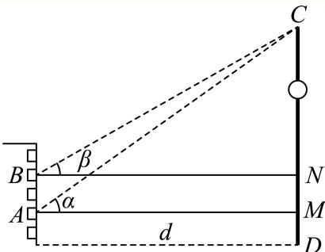
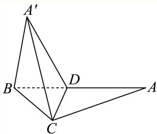

# 2025一模 静安区原卷 · 教师版

> 本地预览：题目、答案及分类尚未全部审定。校对使用的PDF为高中工作台解析版，尚未逐区确认区级印刷原卷。

## 填空题

按本区原卷题号顺序排列。

### 静安 · 第1题

设集合A = {1, 3, 5, 7}, B = {2, 3, 4, 5}，则A ∩ B = .

**考点：** 交集定义

**难度依据：** 有限集合交集；交集定义

【答案】{3,5}

【解析】

根据给定条件，利用交集的定义求得答案.

集合 $A = \{ 1 , 3 , 5 , 7 \} , B = \{ 2 , 3 , 4 , 5 \}$ ，所以 $\displaystyle 1 \cap B = \{ 3 , 5 \}$

故答案为：{3,5}

### 静安 · 第2题

不等式 $| 2 x - 1 | < 3$ 的解集为

**考点：** 去绝对值求区间

**难度依据：** 绝对值不等式；去绝对值求区间

【答案】(−1, 2)

【解析】

将不等式转化成一元二次不等式求解即可.

由不等式 $| 2 x - 1 | < 3$ ，得 $( 2 x - 1 ) ^ { 2 } - 9 < 0$ ，即 $( 2 x + 2 ) ( 2 x - 4 ) < 0$ ，解得 $- 1 < x < 2$ 所以原不等式的解集为 (−1,2).

故答案为: (−1, 2)

### 静安 · 第3题

已知i是虚数单位，(m+i)(1−2i)是纯虚数，则实数m的值为

**考点：** 实部为零且虚部非零

**难度依据：** 复数运算与纯虚数；实部为零且虚部非零

【答案】−2.

【解析】

根据复数的乘法运算和复数分类即可得到答案.

(m + i) (1 − 2i) = m + 2 + (1 − 2m)i，

因为其为纯虚数，则m+2 = 0且 $1 - 2 m \neq 0$ ，解得m = −2.

故答案为：−2.

### 静安 · 第4题

设 $\left\{ a _ { n } \right\}$ 是等差数列， $a _ { 1 } = - 6 , a _ { 3 } = 0$ ，则该数列的前8项的和 $S _ { 8 }$ 的值为 .

**考点：** 由两项求公差再求和

**难度依据：** 等差数列求和；由两项求公差再求和

【答案】36

【解析】

根据给定条件，求出数列 $\{ a _ { n } \}$ 的公差，进而求出其前8项的和.

在等差数列 $\{ a _ { n } \}$ 中， $a _ { 1 } = - 6 , a _ { 3 } = 0$ ，则公差 $d = { \frac { a _ { 3 } - a _ { 1 } } { 3 - 1 } } = 3$

所以 $S _ { 8 } = 8 a _ { 1 } + \frac { 8 \times 7 } { 2 } d = 3 6$

故答案为：36

### 静安 · 第5题

到点 $F _ { 1 } ( - 3 , 0 ) , F _ { 2 } ( 3 , 0 )$ 距离之和为10的动点P的轨迹方程为

**考点：** 由焦距和距离和求参数

**难度依据：** 椭圆定义与标准方程；由焦距和距离和求参数

【答案】${ \frac { x ^ { 2 } } { 2 5 } } + { \frac { y ^ { 2 } } { 1 6 } } = 1$

【解析】

根据给定条件，利用椭圆的定义求出轨迹方程.

依题意， $| P F _ { 1 } | + | P F _ { 2 } | = 1 0 > 6 = | F _ { 1 } F _ { 2 } |$

则点P的轨迹是以 $F _ { 1 } , F _ { 2 }$ 为左右焦点，长轴长2a = 10的椭圆，

由2c = 6，得 $\cdot b = { \sqrt { a ^ { 2 } - c ^ { 2 } } } = { \sqrt { 5 ^ { 2 } - 3 ^ { 2 } } } = 4$

所以动点P的轨迹方程为 ${ \frac { x ^ { 2 } } { 2 5 } } + { \frac { y ^ { 2 } } { 1 6 } } = 1$

故答案为： ${ \frac { x ^ { 2 } } { 2 5 } } + { \frac { y ^ { 2 } } { 1 6 } } = 1$

### 静安 · 第6题

在△ABC中，已知 $B C = 5 , A C = 4 , A = 2 B$ ，则cosB的值为

**考点：** 代入A=2B求余弦

**难度依据：** 正弦定理与倍角；代入A=2B求余弦

【解析】

根据给定条件，利用正弦定理及二倍角公式求解即得.

在 $\triangle A B C ^ { \prime }$ 中，由正弦定理得 ${ \frac { B C } { \sin A } } = { \frac { A C } { \sin B } }$ ，而 $B C = 5 , A C = 4 , A = 2 B$ 因此 ${ \frac { 5 } { \sin 2 B } } = { \frac { 4 } { \sin B } } ,$ ，即 ${ \frac { 5 } { 2 \sin B \cos B } } = { \frac { 4 } { \sin B } }$ ，所以 $\cos B = { \frac { 5 } { 8 } }$ 故答案为： 5

### 静安 · 第7题

已知物体的位移d（单位：m）与时间t（单位：s）满足函数关系 $d = 5 \sin t - 2 \cos t$ ，则该物体在$t = { \frac { \pi } { 2 } } ( \mathbf { s } )$ 时刻的瞬时速度为 $\mathbf { ( m / s ) }$

**考点：** 对位移求导后代入时刻

**难度依据：** 瞬时速度与导数；对位移求导后代入时刻

【答案】2

【解析】

由瞬时速度的意义，求出函数在 $t = \frac { \pi } { 2 }$ 时的导数值即可.

函数 $d = 5 \sin t - 2 \cos t $ ，求导得 $d ^ { \prime } = 5 \cos t + 2 \sin t$ ，则 $\left. l ^ { \prime } \right| _ { t = \frac { \pi } { 2 } } = 5 \cos \frac { \pi } { 2 } + 2 \sin \frac { \pi } { 2 } = 2 ,$ 所以所求瞬时速度为 $2 \mathrm { m / s }$

故答案为：2

### 静安 · 第8题

若用t替换命题“对于任意实数d，有 $\mathrm { \dot { \ d } } ^ { 2 } \geq 0$ ，且等号当且仅当d = 0时成立”中的d，即可推出平均值不等式“任意两个正数的算术平均值不小于它们的几何平均值，且等号当且仅当这两个正数相等时成立”.则t =

**考点：** 构造平方差并考察等号

**难度依据：** 平方非负推导均值不等式；构造平方差并考察等号

【答案】${ \sqrt { a } } - { \sqrt { b } }$

【解析】

根据给定的信息，取正数 $[ a , b ,$ 作差变形推导即可得解.

取正数 $[ a , b ,$ 则 $a + b - 2 { \sqrt { a b } } = \left( { \sqrt { a } } - { \sqrt { b } } \right) ^ { 2 } \geq 0$ ，当且仅当a = b时取等号，

因此 $a + b \geq 2 { \sqrt { a b } }$ ，即 ${ \frac { a + b } { 2 } } \geq { \sqrt { a b } } ,$

于是“任意两个正数的算术平均值不小于它们的几何平均值，且等号当且仅当这两个正数相等时成立”.

显然 $t ^ { 2 } = \left( { \sqrt { a } } - { \sqrt { b } } \right) ^ { 2 }$ ，取 $\dot { \mathbf { \Omega } } . t = \sqrt { a } - \sqrt { b } .$

故答案为： ${ \sqrt { a } } - { \sqrt { b } }$

### 静安 · 第9题

以双曲线 ${ \frac { x ^ { 2 } } { 4 } } - { \frac { y ^ { 2 } } { m } } = 1$ 的离心率为半径，以右焦点为圆心的圆与双曲线的渐近线相切，则m的值为

**考点：** 焦点到渐近线距离等于离心率

**难度依据：** 双曲线渐近线与圆相切；焦点到渐近线距离等于离心率

【答案】$\frac { 4 } { 3 }$

【解析】

根据给定条件，求出双曲线渐近线方程、离心率及右焦点坐标，再利用圆的切线性质列式计算得解.

双曲线 ${ \frac { x ^ { 2 } } { 4 } } - { \frac { y ^ { 2 } } { m } } = 1$ 1的渐近线为 $\sqrt { m } x \pm 2 y = 0$ ，离心率 $e = { \frac { \sqrt { 4 + m } } { 2 } }$ ，右焦点 $\left( { \sqrt { 4 + m } } , 0 \right)$ 依题意， ${ \frac { { \sqrt { m } } \cdot { \sqrt { 4 + m } } } { \sqrt { 4 + m } } } = { \frac { \sqrt { 4 + m } } { 2 } }$ ，所以 $m = \frac { 4 } { 3 }$

故答案为： $\frac { 4 } { 3 }$

### 静安 · 第10题

如图所示，小明和小宁家都住在东方明珠塔附近的同一幢楼上，小明家在A层，小宁家位于小明家正上方的B层，已知 $A B = a$ .小明在家测得东方明珠塔尖的仰角为α，小宁在家测得东方明珠塔尖的仰角为β，则他俩所住的这幢楼与东方明珠塔之间的距离d =

**考点：** 两层高度差与正切列式

**难度依据：** 仰角测距；两层高度差与正切列式

【答案】$\frac { a } { \tan \alpha - \tan \beta }$

【解析】

根据正切函数的定义得到方程，解出即可.

分别过点A,B作CD的垂线，垂足分别为 $M , N$

则根据正切函数的定义得 $C M = d \tan \alpha , \ C N = d \tan \beta ,$

则 $M N = A B = d \tan \alpha - d \tan \beta = a$ ，解得 $d = { \frac { a } { \tan \alpha - \tan \beta } }$

故答案为： $\frac { a } { \tan \alpha - \tan \beta }$

### 静安 · 第11题

记$f(x)=x^2+(a^2+b^2-1)x+a^2+2ab-b^2$。若函数$y=f(x)$是偶函数，则该函数图象与$y$轴交点的纵坐标的最大值为______。

> 本题资料或解析有待核事项，预览不可作为已审定成品。

**考点：** 由偶函数消一次项后参数化求最值

**难度依据：** 偶函数与二次型最值；由偶函数消一次项后参数化求最值

**核查说明：** 仅恢复题干；解析和其他题目未全面校净、未数学终审。；题干函数表达式严重损坏，原解中可见函数，须回原卷核对后补齐。

【答案】${ \sqrt { 2 } } .$

【解析】

由偶函数的性质可得出 $a ^ { 2 } + b ^ { 2 } = 1$ ，令 $a = \cos \theta , b = \sin \theta$ ，利用三角恒等变换结合正弦型函数的有界性可求得该函数图象与 轴交点的纵坐标的最大值

因为二次函数 $f \left( x \right) = x ^ { 2 } + { \left( a ^ { 2 } + b ^ { 2 } - 1 \right) } x + a ^ { 2 } + 2 a b - b ^ { 2 }$ 为偶函数，

则该函数的对称轴为直线 $\overset { \cdot } { x } = - \frac { a ^ { 2 } + b ^ { 2 } - 1 } { 2 } = 0 .$ ，可得 $a ^ { 2 } + b ^ { 2 } = 1$

$$
\text {令} a = \cos \theta , b = \sin \theta ,
$$

则

$$
a ^ {2} + 2 a b - b ^ {2} = \cos^ {2} \theta + 2 \sin \theta \cos \theta - \sin^ {2} \theta = \sin 2 \theta + \cos 2 \theta = \sqrt {2} \sin \left(2 \theta + \frac {\pi}{4}\right) \in [ - \sqrt {2}, \sqrt {2} ]
$$

因此，该函数图象与y轴交点的纵坐标 $\dot { a } ^ { 2 } + 2 a b - b ^ { 2 }$ 的最大值为 ${ \sqrt { 2 } }$

故答案为： ${ \sqrt { 2 } } .$

### 静安 · 第12题

已知lg $x _ { 1 \cdot }$ lg x2､ lg x3､ lg $x _ { 4 } ,$ ､ lg $x _ { 5 }$ 是从大到小连续的正整数，且 $( \lg x _ { 4 } ) ^ { 2 } < \lg x _ { 1 } \cdot \lg x _ { 5 }$ ，则 $| x _ { 1 }$ 1的最小值为

**考点：** 设中间项建立整数约束

**难度依据：** 连续整数对数与最值；设中间项建立整数约束

【答案】100000

【解析】

令lg $x _ { 3 } = k _ { \mathrm { i } }$ ，根据给定信息列出不等式，求出k的范围即可得解.

设 $\lg x _ { 3 } = k , k \in \mathbb { N } ^ { * }$ ，依题意， $\lg x _ { 1 } = k + 2 , \lg x _ { 4 } = k - 1 , \lg x _ { 5 } = k - 2 , k \geq 3$

$\mathbb { H } ( \lg x _ { 4 } ) ^ { 2 } < \lg x _ { 1 } \cdot \lg x _ { 5 }$ ，得 $( k - 1 ) ^ { 2 } < ( k + 2 ) ( k - 2 )$ ，解得k $> \frac { 3 } { 2 }$ ，因此k $\geq 3 .$

则 $\log x _ { 1 } \geq 5 , x _ { 1 } \geq 1 0 0 0 0 0$ ，所 $\downarrow \lambda x _ { 1 }$ 1的最小值为100000.

故答案为：100000

## 二、选择题

## 选择题

按本区原卷题号顺序排列。

### 静安 · 第13题

设 $[ a , b \in \mathbf { R } ,$ ，则 $^ { * } a + b > 0 ^ { * }$ 是 $\mathbf { \bar { \rho } } ^ { * } a > 0$ 且 $. b > 0 ^ { \ast }$ 的（ ）

A. 充分非必要条件

B. 必要非充分条件

C. 充要条件

D. 既非充分又非必要条件

**考点：** 用反例与不等式性质判断

**难度依据：** 充分必要条件判断；用反例与不等式性质判断

【答案】B

【解析】

正向取反例即可，反向根据不等式性质即可，最后根据必要不充分条件判定即可.

正向来看，取 $\ Q = 2 , b = - 1$ ，则 $\left| a + b > 0 \right.$ ，满足 $a + b > 0$ ，但不满足 $\because 0 \mathbb { H } b > 0$ ，故充分性不成立，

反向来看， $a > 0 , b > 0$ ，则 $\left| a + b > 0 \right.$ ，故必要性成立，

所以前者是后者的必要不充分条件.

故选：B.

### 静安 · 第14题

污水处理厂通过清除污水中的污染物获得清洁用水并生产肥料.该厂的污水处理装置每小时从处理池清除掉12%的污染残留物.要使处理池中的污染物水平降到最初的10%，大约需要的时间为（ ）（参考数据： $\lg 0 . 8 8 \approx - 0 . 0 5 5 5 )$

A. 14小时

B. 18小时

C. 20小时

D. 24小时

**考点：** 建立指数模型并换底求时间

**难度依据：** 指数衰减与对数模型；建立指数模型并换底求时间

【解析】

分析可知，t小时后，处理池中的残留物为 $a ( 1 - 1 2 \% ) ^ { t }$ ，根据题意可得出关于t的等式，解之即可.

设处理池中的残留物初始时为a，则t小时后，处理池中的残留物为 $1 a ( 1 - 1 2 \% ) ^ { t }$

根据题意可得 $a ( 1 - 0 . 1 2 ) ^ { t } = 0 . 1 a$ ，即0.88t = 0.1，解得t $= \log _ { 0 . 8 8 } 0 . 1 = { \frac { \log 0 . 1 } { \log 0 . 8 8 } } \approx 1 8 .$

因此，要使处理池中的污染物水平降到最初的10%，大约需要的时间为18小时.

### 静安 · 第15题

我国古代数学著作《九章算术》中将四个面都是直角三角形的空间四面体叫做“鳖臑”.如图是一个水平放置的 $\triangle A B C , C D \bot A B , \angle A = 3 0 ^ { \circ } , \angle B = 4 5 ^ { \circ }$ .现将 $\begin{array} { r } { \mathrm { R t } \triangle A C D \dot { \% } C D } \end{array}$ 折起，使点A移动到点A′，使得空间四面体A′BCD恰好是一个“鳖臑”，则二面角A′ −CD−B的大小为（ ）

A. $6 0 ^ { \circ }$

B. $9 0 ^ { \circ }$

C. $\arctan 2$

D. $\operatorname { a r c c o s } { \frac { \sqrt { 3 } } { 3 } }$

**考点：** 利用各面直角约束分类求二面角

**难度依据：** 四面体折叠与二面角；利用各面直角约束分类求二面角

【答案】D

【解析】

设CD = 1，根据题意求出四面体的棱长，二面角A′ −CD−B的平面角为 $\angle A ^ { \prime } D B$ ，求 $\angle A ^ { \prime } D B$ 的三角函数值即可.

$\triangle A B C$ 中， $C D \bot A B , \angle A = 3 0 ^ { \circ } , \angle B = 4 5 ^ { \circ }$

不妨设 $C D = 1$ ，则 $B D = 1 , B C = \sqrt { 2 } , A D = \sqrt { 3 } , A C = 2$

空间四面体 $A ^ { \prime } B C D$ 是一个“鳖臑”，则 $\triangle A ^ { \prime } B C$ 和 $| \triangle A ^ { \prime } B D$ 都是直角三角形，

若 $A ^ { \prime } B > A ^ { \prime } D$ ，则 $\mathrm { R t } \triangle A ^ { \prime } B D ^ { \scriptscriptstyle | }$ 中， $\angle A ^ { \prime } D B = 9 0 ^ { \circ }$ ，由勾股定理得 $A ^ { \prime } B = 2$

此时 $\triangle A ^ { \prime } B C$ 不是直角三角形，不合题意；

所以 $A ^ { \prime } B < A ^ { \prime } D ,$ ，在 $\mathrm { R t } \triangle A ^ { \prime } B D ^ { \scriptscriptstyle 1 }$ 中， $\angle A ^ { \prime } B D = 9 0 ^ { \circ }$ ，由勾股定理得 $A ^ { \prime } B = { \sqrt { 2 } }$

此时满足 $\triangle A ^ { \prime } B C$ 是直角三角形， $\angle A ^ { \prime } B C = 9 0 ^ { \circ }$

由 $A ^ { \prime } D \bot C D , B D \bot C D$ ，二面角A′ − CD − B的平面角为 $\angle A ^ { \prime } D B$

$\mathrm { R t } \triangle A ^ { \prime } B D$ 中， $\tan \angle A ^ { \prime } D B = \sqrt { 2 }$ $\cos \angle A ^ { \prime } D B = \frac { 1 } { \sqrt { 3 } } = \frac { \sqrt { 3 } } { 3 } ,$

所以二面角A′ − CD − B的大小为 $\operatorname { a r c c o s } { \frac { \sqrt { 3 } } { 3 } }$

故选：D.

### 静安 · 第16题

在四棱锥 $P - A B C D$ 中， $\overrightarrow { A B } = ( 4 , - 2 , 3 ) , \overrightarrow { A D } = ( - 4 , 1 , 0 ) , \overrightarrow { A P } = ( - 6 , 2 , - 8 )$ ，则该四棱锥的高为（ ）

A. 4

B. 3

C. 2

D. 1

**考点：** 法向量与投影求点面距离

**难度依据：** 法向量求棱锥高度；法向量与投影求点面距离

【答案】C

【解析】

求出平面ABCD的一个法向量，再利用点到平面的距离公式即可得到答案设平面ABCD的一个法向量 $\vec { \mathfrak { i } } \vec { n } = ( x , y , z )$

则 $\left\{ { \begin{array} { l } { { \vec { n } } \cdot { \overrightarrow { A B } } = 4 x - 2 y + 3 z = 0 } \\ { { \vec { n } } \cdot { \overrightarrow { A D } } = - 4 x + y = 0 } \end{array} } \right.$ 令 $y = 1 2 ,$ 则 $x = 3 , z = 4$ ，即 $\vec { \mathrm { \Delta } n } = ( 3 , 1 2 , 4 )$

所以该四棱锥的高 $h = \frac { \overrightarrow { | A P \cdot \overrightarrow { n } | } } { \vert \overrightarrow { n } \vert } = \frac { \vert - 6 \times 3 + 1 2 \times 2 - 8 \times 4 \vert } { \sqrt { 3 ^ { 2 } + 1 2 ^ { 2 } + 4 ^ { 2 } } } = 2 .$

故选：C.

## 三、解答题

## 解答题

按本区原卷题号顺序排列。

### 静安 · 第17题

设函数 $\mathbf { \nabla } \cdot f \left( x \right) = x + \frac { 4 } { x } , x \in \left( - \infty , 0 \right) \cup \left( 0 , + \infty \right) .$
(1) (6分)求函数 $\boldsymbol { \cdot } \boldsymbol { y } = \boldsymbol { f } \left( \boldsymbol { x } \right)$ 的单调区间；
(2) (8分)求不等 $\nexists \boldsymbol { f } \left( \boldsymbol { x } \right) < 2 \boldsymbol { x }$ 的解集.

**考点：** （1）导数求单调区间；（2）化分式不等式分区间求解

**难度依据：** 导数单调性与分式不等式；（1）导数求单调区间；（2）化分式不等式分区间求解

【解析】

(1) $y ^ { \prime } = 1 - { \frac { 4 } { x ^ { 2 } } }$

令 $\dot { \boldsymbol { \cdot } } \boldsymbol { y } ^ { \prime } = 1 - \frac { 4 } { x ^ { 2 } } > 0 .$ ，解得 $x < - 2$ 或者 $x > 2$

$\widehat { \vec { \triangledown } } y ^ { \prime } = 1 - \frac { 4 } { x ^ { 2 } } < 0 .$ ，解得− $- 2 < x < 0 \dag \hat { \chi } _ { } 0 < x < 2$ 4

所以，该函数的严格单调增区间为 $( - \infty , - 2 )$ 和 $| ( 2 , + \infty )$ ，严格单调减区间为(−2,0)和(0,2)

(2) $f ( x ) < 2 x$ ，即 $\mid x - { \frac { 4 } { x } } > 0 \mid$

${ \frac { x ^ { 2 } - 4 } { x } } > 0 .$ ，即x $\left( x ^ { 2 } - 4 \right) > 0$ ，利用穿根法解得 $x \in ( - 2 , 0 ) \cup ( 2 , + \infty )$

所以解集为 $( - 2 , 0 ) \cup ( 2 , + \infty )$ ).

### 静安 · 第18题

已知向量 ${ \vec { a } } = \left( \cos { \frac { 3 x } { 2 } } , \sin { \frac { 3 x } { 2 } } \right) , { \vec { b } } = \left( \cos { \frac { x } { 2 } } , - \sin { \frac { x } { 2 } } \right)$ ，且 $x \in \left[ 0 , { \frac { \pi } { 2 } } \right]$
(1) (6分)求→a ⋅→b 及 $\displaystyle { \vec { a } + \vec { b } }$ ；
(2) (8分) $\mathrm { i } \mathrm { \overrightarrow { L } } f \left( x \right) = \mathrm { \overrightarrow { { a } } } \cdot \mathrm { \overrightarrow { { b } } } - \left| \mathrm { \overrightarrow { { a } } } + \mathrm { \overrightarrow { { b } } } \right|$ ，求函数 $y = f \left( x \right)$ 的最小值.

> 本题资料或解析有待核事项，预览不可作为已审定成品。

**考点：** （1）坐标数量积与模；（2）倍角换元求最值

**难度依据：** 向量数量积与三角最值；（1）坐标数量积与模；（2）倍角换元求最值

**核查说明：** 第（1）问向量和的模符号缺失，原解有模，须核原卷。

【解析】

(1) 由题意得→a $\cdot \stackrel {  } { b } = \cos \frac { 3 x } { 2 } \cos \frac { x } { 2 } - \sin \frac { 3 x } { 2 } \mathrm { s i n } \frac { x } { 2 } = \cos 2 x _  \mathrm  \scriptscriptstyle$

$$
\left| \stackrel {\rightarrow} {a} \right| = \sqrt {\cos^ {2} \frac {3 x}{2} + \sin^ {2} \frac {3 x}{2}} = 1, \left| \stackrel {\rightarrow} {b} \right| = \sqrt {\cos^ {2} \frac {x}{2} + \left(- \sin \frac {x}{2}\right) ^ {2}} = 1
$$

$$
\left| \overrightarrow {a} + \overrightarrow {b} \right| ^ {2} = \overrightarrow {a} ^ {2} + \overrightarrow {b} ^ {2} + 2 \overrightarrow {a} \cdot \overrightarrow {b} = 2 + 2 \overrightarrow {a} \cdot \overrightarrow {b}
$$

$$
= 2 + 2 \cos 2 x = 4 \cos^ {2} x,
$$

因为 $\left[ x \in \left[ 0 , { \frac { \pi } { 2 } } \right] \right]$ ，所以 $| { \vec { a } } + { \vec { b } } | = 2 \cos x$

$$
f (x) = \vec {a} \cdot \vec {b} - | \vec {a} + \vec {b} | = \cos 2 x - 2 \cos x = 2 \cos^ {2} x - 2 \cos x - 1 = 2 \left(\cos x - \frac {1}{2}\right) ^ {2} - \frac {3}{2},
$$

因为 $x \in \left[ 0 , { \frac { \pi } { 2 } } \right]$ ，则 $\cos x \in [ 0 , 1 ]$ ，则当 $\cos x = { \frac { 1 } { 2 } }$ ，即 $x = { \frac { \pi } { 3 } }$ 时，该函数取得最小值 $- { \frac { 3 } { 2 } }$

### 静安 · 第19题

如图所示，正三棱锥A−BCD的侧面是边长为2的正三角形.

(1) (4分)求正三棱锥A − BCD的体积V；
(2) (10分)设E､F､G分别是线段AC､AD､BC的中点.
求证： $\textcircled { 1 } C D / / .$ 平面EFG；②若平面EFG交BD于点H，则四边形EFHG是正方形.

**考点：** （1）求高与体积；（2）①证明线面平行②证明截面正方形

**难度依据：** 正四面体体积与截面；（1）求高与体积；（2）①证明线面平行②证明截面正方形

【解析】

(1) 由正三棱锥A−BCD的侧面是边长为2的正三角形，得正三棱锥A−BCD为正四面体，取正 $\triangle B C D$ 的中心O，连接 $A O , B O $ ，延长BO交CD于M，连接AM，则 $A O \bot$ 平面 $B C D$

M是CD的中点， $A M = B M = { \sqrt { 3 } }$ • $O M = { \frac { 1 } { 3 } } B M = { \frac { \sqrt { 3 } } { 3 } }$ ，则

$$
A O = \sqrt {A M ^ {2} - O M ^ {2}} = \frac {2 \sqrt {6}}{3},
$$

所以正三棱锥 $A - B C D$ 的体积 $V = { \frac { 1 } { 3 } } S _ { \triangle B C D } \cdot A O = { \frac { 1 } { 3 } } \times { \frac { 1 } { 2 } } \times 2 \times { \sqrt { 3 } } \times { \frac { 2 { \sqrt { 6 } } } { 3 } } = { \frac { 2 { \sqrt { 2 } } } { 3 } }$

(2) ①由 $E , F ^ { . }$ 分别是线段AC,AD的中点，得 $E F / / C D _ { : }$ ，而 $E F \subset$ 平面EFG， $C D \notin$ 平面 $E F G$ 所以 $C D / /$ 平面 $E F G$

②由平面 $E F G$ 交BD于点H，得面 $E F G \cap$ 平面 $B C D = G H$ ，而 $C D / /$ 平面 $E F G$

$C D \subset$ 平面 $B C D ,$ ，则 $G H / / C D _ { : }$ ，而G是BC的中点，则H是BD的中点，

因此 $E G / / A B / / F H$ ，而 $E F / / G H$ ，则四边形 $E F H G$ 是平行四边形，

又 $E F = { \frac { 1 } { 2 } } C D = { \frac { 1 } { 2 } } A B = E G$ ，于是 $\neg E F H G$ 为菱形，而 $A M \bot C D , B M \bot C D$

$A M \cap B M = M , A M , B M \subset$ 平面ABM，则 $C D \perp$ 平面ABM，又 $A B \subset$ 平面ABM，

因此 $A B \bot C D$ ，于是 $E G \bot G H$ ，所以四边形EFHG是正方形.

### 静安 · 第20题

如图的封闭图形的边缘由抛物线Γ和垂直于拋物线对称轴的线段AB组成.已知 $| A B = 4$ ，拋物线的顶 点到线段AB所在直线的距离为2.

(1) (4分)请用数学符号语言表达这个封闭图形的边缘；
(2) (6分)在该封闭图形上截取一个矩形CDEF，其中点C､D在线段AB上，点E､F抛物线Γ上.求以矩形CDEF为侧面，CF为母线的圆柱的体积最大值；
(3) (8分)求证：抛物线Γ的任何两条相互垂直的切线的交点都在同一条直线上.

**考点：** （1）建立图形方程；（2）圆柱体积最值；（3）垂直切线交点轨迹

**难度依据：** 抛物线模型与切线；（1）建立图形方程；（2）圆柱体积最值；（3）垂直切线交点轨迹

【解析】

(1) 如图建立平面直角坐标系 $x O y$

设抛物线Γ的方程为 $y = a x ^ { 2 } , x \in [ - 2 , 2 ]$

则曲线Γ过点(2,2)，所以 $\displaystyle \left. 2 = 4 a \right.$ ，故 $\mathrm { \dot { \alpha } } a = \frac { 1 } { 2 }$

所以，曲线Γ的方程为 $\left| y = { \frac { 1 } { 2 } } x ^ { 2 } , x \in [ - 2 , 2 ] \right.$ ，

线段AB的方程为 $y = 2 , x \in [ - 2 , 2 ]$ ，

(2) 设 $E \left( x , y \right)$ ，则 $D E = 2 - { \frac { 1 } { 2 } } x ^ { 2 }$

以 $C F$ 为母线的圆柱的底面半径r 满足 $2 x = 2 \pi r _ { 1 }$ ，

所以 $\displaystyle { \boldsymbol { r } } _ { 1 } = { \frac { x } { \pi } }$

所以圆柱的体积 $V _ { 1 } = \pi \cdot \left( { \frac { x } { \pi } } \right) ^ { 2 } \cdot \left( 2 - { \frac { 1 } { 2 } } x ^ { 2 } \right) = { \frac { 1 } { \pi } } \left( 2 x ^ { 2 } - { \frac { 1 } { 2 } } x ^ { 4 } \right)$ .

所以 $V _ { 1 } = - \frac { 1 } { 2 \pi } \left( x ^ { 2 } - 2 \right) ^ { 2 } + \frac { 2 } { \pi }$ ，

所以，当 $\mathfrak { x } = \sqrt { 2 } \mathbb { H }$ 时，其体积取得最大值 $\frac { 2 } { \pi }$

(3) 证明： 因为函数 $y = { \frac { 1 } { 2 } } x ^ { ; }$ 2的导函数 $\boldsymbol { \cdot } \boldsymbol { y } ^ { \prime } = \boldsymbol { x }$

所以，抛物线Γ上任意一点 $( x , y )$ 的切线斜率为 $x _ { i }$ ，

$\sharp \ell _ { 1 } , l _ { 2 }$ 是抛物线Γ上两条相互垂直的切线，切点分别为 $( x _ { 1 } , y _ { 1 } ) , ( x _ { 2 } , y _ { 2 } )$ ，

则其方程分别为 $\begin{array} { r } { \vert l _ { 1 } ; y - y _ { 1 } = x _ { 1 } \left( x - x _ { 1 } \right) , l _ { 2 } ; y - y _ { 2 } = x _ { 2 } \left( x - x _ { 2 } \right) } \end{array}$ ，

且 $x _ { 1 } x _ { 2 } = - 1$

消去x，解得 $( x _ { 1 } - x _ { 2 } ) y = { \frac { 1 } { 2 } } x _ { 1 } x _ { 2 } \left( x _ { 1 } - x _ { 2 } \right)$ ，

因为 $x _ { 1 } \neq x _ { 2 } ,$ ，得 $y = - \frac 1 2$

故抛物线Γ的任何两条相互垂直的切线的交点都在直线 $: y = - \frac { 1 } { 2 } .$ 上.

### 静安 · 第21题

如果函数 $\mathbf { \boldsymbol { y } } = \mathbf { \boldsymbol { f } } \left( \boldsymbol { x } \right)$ 满足以下两个条件，我们就称函数y = f (x)为U型函数.
①对任意的 $x \in [ 0 , 1 ]$ ，有 $f \left( x \right) \geq 1 , f \left( 1 \right) = 3 ;$
②对于任意的x, $y \in [ 0 , 1 ]$ ，若 $\dot { \boldsymbol { x } } + \boldsymbol { y } \le 1$ ，则 $f \left( x + y \right) \geq f \left( x \right) + f \left( y \right) - 1$
(1) $( 4 \ 4 ) y = 3 ^ { x }$ 是U型函数；
(2) (6分)U型函数y = f (x)在[0, 1]上为增函数；
(3) (8分)对于U型函数 $y = f \left( x \right)$ ，有 $f \left( { \frac { 1 } { 3 ^ { n } } } \right) \leq { \frac { 2 } { 3 ^ { n } } } + 1$ （n为正整数）.

> 本题资料或解析有待核事项，预览不可作为已审定成品。

**考点：** （1）验证定义；（2）由定义证明单调；（3）迭代不等式估计函数值

**难度依据：** U型函数性质与迭代不等式；（1）验证定义；（2）由定义证明单调；（3）迭代不等式估计函数值

**核查说明：** 各小问题干证明提示可能缺字；原解使用增函数概念需明确非严格单调。

【解析】

(1) 记 $f ( x ) = 3 ^ { x }$ ；

对任意的 $x \in [ 0 , 1 ]$ ，有 $f ( x ) = 3 ^ { x } \geq 1 , f ( 1 ) = 3 ^ { 1 } = 3$ ；

对于任意的 $x , y \in [ 0 , 1 ]$ ，

若 $x + y \leq 1$

$$
f (x + y) - f (x) - f (y) + 1 = 3 ^ {x + y} - 3 ^ {x} - 3 ^ {y} + 1 = \left(3 ^ {x} - 1\right) \left(3 ^ {y} - 1\right) \geq 0,
$$

即 $\mid f ( x + y ) \geq f ( x ) + f ( y ) - 1$

故函数y = 3x是U型函数.

(2) 设 $x _ { 1 } , x _ { 2 } \in [ 0 , 1 ]$ ，且 $. x _ { 1 } < x _ { 2 }$ ，则 $x _ { 2 } - x _ { 1 } \in [ 0 , 1 ]$ 因此 $\left[ f \left( x _ { 2 } \right) - f \left( x _ { 1 } \right) = f \left[ x _ { 1 } + \left( x _ { 2 } - x _ { 1 } \right) \right] - f \left( x _ { 1 } \right) \right.$ $\begin{array} { r } { \ge f \left( x _ { 1 } \right) + f \left( x _ { 2 } - x _ { 1 } \right) - 1 - f \left( x _ { 1 } \right) = f \left( x _ { 2 } - x _ { 1 } \right) - 1 \ge 0 , } \end{array}$ 可知y = f(x)在[0, 1]上为增函数.

(3) 因为 $f \left( { \frac { 1 } { 3 ^ { n - 1 } } } \right) = f \left( { \frac { 1 } { 3 ^ { n } } } + { \frac { 1 } { 3 ^ { n } } } + { \frac { 1 } { 3 ^ { n } } } \right) \geq f \left( { \frac { 1 } { 3 ^ { n } } } + { \frac { 1 } { 3 ^ { n } } } \right) + f \left( { \frac { 1 } { 3 ^ { n } } } \right) - 1 \geq 3 f \left( { \frac { 1 } { 3 ^ { n } } } \right) - 2 ,$ 所以 $f \left( { \frac { 1 } { 3 ^ { n } } } \right) \leq { \frac { 1 } { 3 } } f \left( { \frac { 1 } { 3 ^ { n - 1 } } } \right) + { \frac { 2 } { 3 } }$ $\leq { \frac { 1 } { 3 ^ { 2 } } } f \left( { \frac { 1 } { 3 ^ { n - 2 } } } \right) + { \frac { 2 } { 3 ^ { 2 } } } + { \frac { 2 } { 3 } }$ $\cdots \cdot \cdots \cdot \leq { \frac { 1 } { 3 ^ { n } } } f \left( { \frac { 1 } { 3 ^ { n - n } } } \right) + { \frac { 2 } { 3 ^ { n } } } + \cdots + { \frac { 2 } { 3 ^ { 2 } } } + { \frac { 2 } { 3 } }$ $= { \frac { 1 } { 3 ^ { n } } } \times 3 + 2 \times { \frac { { \frac { 1 } { 3 } } { \bigg ( } 1 - { \bigg ( } { \frac { 1 } { 3 } } { \bigg ) } ^ { n } { \bigg ) } } { 1 - { \frac { 1 } { 3 } } } } = { \frac { 2 } { 3 ^ { n } } } + 1$

