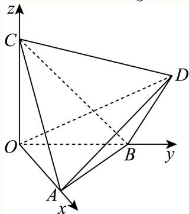
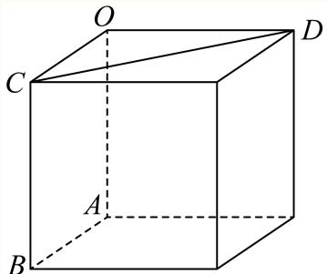
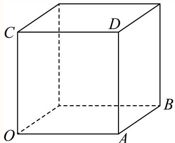
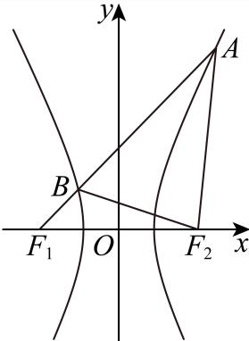

# 2025一模 黄浦区原卷 · 教师版

> 本地预览：题目、答案及分类尚未全部审定。校对使用的PDF为高中工作台解析版，尚未逐区确认区级印刷原卷。

## 填空题

按本区原卷题号顺序排列。

### 黄浦 · 第1题

若集合A = {1, 2}，B = {1, 3}，则A ∪ B =

**考点：** 并集定义

**难度依据：** 有限集合并集；并集定义

【答案】{1, 2, 3}.

【解析】

根据并集的定义运算即可.

因为A = {1, 2}，B = {1, 3}，所以 $A \cup B = \{ 1 , 2 , 3 \}$ }

故答案为: {1, 2, 3}.

### 黄浦 · 第2题

不等式x2 − 3x + 2 < 0的解集为

**考点：** 因式分解求解集

**难度依据：** 二次不等式；因式分解求解集

【答案】(1,2)

【解析】

因为 $\begin{array} { r } {  x ^ { 2 } - 3 x + 2 < 0 \Leftrightarrow ( x - 2 ) ( x - 1 ) < 0 , } \end{array}$

所以不等式的解集为： $\{ x | 1 < x < 2 \}$ ，

故答案为：(1,2)

### 黄浦 · 第3题

椭圆 ${ \frac { x ^ { 2 } } { 4 } } + { \frac { y ^ { 2 } } { 3 } } = 1$ 的焦距是

**考点：** 由a²−b²求焦距

**难度依据：** 椭圆焦距；由a²−b²求焦距

【解析】

分析：由椭圆方程可求a b，然后由 $\begin{array} { r } { | c = \sqrt { a ^ { 2 } - b ^ { 2 } } } \end{array}$ 可求c，进而可求焦距

详解：∵椭圆 ${ \frac { x ^ { 2 } } { 4 } } + { \frac { y ^ { 2 } } { 3 } } = 1 , \div a = 2 \ , \ b = { \sqrt { 3 } }$

∴c = √a2 − b2 = 1 ∴ 2c = 2.

即答案为2

点睛：本题主要考查了椭圆的性质的简单应用，属基础题

### 黄浦 · 第4题

若圆柱的底面半径与高均为1，则其侧面积为

**考点：** 侧面积公式

**难度依据：** 圆柱侧面积；侧面积公式

【答案】2π

【解析】

根据圆柱的侧面积公式直接计算可得.

由题意，圆柱的侧面积为： $S = 2 \pi r h = 2 \pi$

故答案为：2π

### 黄浦 · 第5题

$\left( x + { \frac { 1 } { x } } \right) ^ { 1 }$ 6 的二项展开式的常数项为

> 本题资料或解析有待核事项，预览不可作为已审定成品。

**考点：** 通项指数为零

**难度依据：** 二项展开常数项；通项指数为零

**核查说明：** 题干展开式指数识别错误，原解析按6次处理，须核原卷。

【解析】

$\left( x + { \frac { 1 } { x } } \right) ^ { 1 }$ 6 的二项展开式的通项为 $T _ { r + 1 } = \mathrm { C } _ { 6 } ^ { r } x ^ { 6 - r } x ^ { - r } = \mathrm { C } _ { 6 } ^ { r } x ^ { 6 - 2 r }$ ${ \widehat { \vec { \times } } } 6 - 2 r = 0$ 得r = 3．所以 $\left( x + { \frac { 1 } { x } } \right) ^ { \prime }$ 6 的二项展开式的常数项为 $\mathrm { C } _ { 6 } ^ { 3 } = 2 0$

### 黄浦 · 第6题

若正数x、y满足 $\begin{array} { r } { x + 4 y = 1 } \end{array}$ ，则xy的最大值为

**考点：** 消元配方或基本不等式

**难度依据：** 线性约束下乘积最值；消元配方或基本不等式

【答案】$\frac { 1 } { 1 6 }$

【解析】

$\ddot { \gtrsim } x = 1 - 4 y$ ，再结合二次函数的性质求解即可；

因为正数x、y满足 $x + 4 y = 1$ ，所以 $x = 1 - 4 y$

所以 $x y = y ( 1 - 4 y ) = - 4 y ^ { 2 } + y = - 4 { \bigg ( } y - { \frac { 1 } { 8 } } { \bigg ) } ^ { 2 } + { \frac { 1 } { 1 6 } } ,$

所以当 $y = \frac 1 8$ 时，最大值为 $\frac { 1 } { 1 6 }$

故答案为： $\frac { 1 } { 1 6 }$

### 黄浦 · 第7题

从A校高一年级学生中抽取66名学生测量他们的身高，其中最大值为184cm，最小值152cm，绘制身高频率分布直方图，若组距为3，且第一组下限为151.5，则组数为

**考点：** 由数据范围和组距计算组数

**难度依据：** 频率分布组距与组数；由数据范围和组距计算组数

【答案】11

【解析】

根据组距即可求解.

第一组下限为151.5，组距为3，所以 $1 5 1 . 5 + 3 \times 1 0 = 1 8 1 . 5$

故第11组的下限为181.5，因此组数为11，

故答案为：11

### 黄浦 · 第8题

在正四面体 $A B C D$ 中，点N是 $\triangle A B C$ 的中心，若 $\overrightarrow { D N } = \lambda \overrightarrow { D A } + \mu \overrightarrow { D B } + \nu \overrightarrow { B C } \left( \lambda , \mu , \nu \in \mathbf { R } \right)$ ，则$\lambda + \mu + \nu =$

**考点：** 由重心表示与向量基底求系数

**难度依据：** 正四面体中心的空间向量表示；由重心表示与向量基底求系数

【答案】${ \frac { 4 } { 3 } } .$

【解析】

依题意设 $O A = a , O B = b , O C = c$ ，利用勾股定理即可得到 $a = b = c$ ，设该正四面体的棱长为 ${ \sqrt { 2 } } ,$ ，求出点的坐标，结合 $\overrightarrow { D N } = \lambda \overrightarrow { D A } + \mu \overrightarrow { D B } + \nu \overrightarrow { B C }$ 利用空间向量法计算求解

因为在正四面体 $A B C D \ L \mathrm { \Sigma }$ ， $A B = B C = C A$ ，正四面体ABCD的顶点A，B，C分别在两两垂 直的三条射线 $O x , O y , O z \bot$

设 $O A = a , O B = b , O C = c ,$

由 $O A , O B , O C$ 两两垂直，得 $a ^ { 2 } + b ^ { 2 } = b ^ { 2 } + c ^ { 2 } = c ^ { 2 } + a ^ { 2 }$

所以 $a = b = c , $ ，即 $\begin{array} { r } { | O A = O B = O C , } \end{array}$ ，所以 $O - A B C$ 是正三棱锥，

设该正四面体的棱长为 ${ \overline { { \cdot } } } \sqrt { 2 } ,$ ，则 $a = b = c = 1$ ，于是 $A ( 1 , 0 , 0 ) , B ( 0 , 1 , 0 ) , C ( 0 , 0 , 1 ) , D ( 1 , 1 , 1 )$

又点N是 $\triangle A B C$ 的中心，所以 $N = \left( \frac { 1 } { 3 } , \frac { 1 } { 3 } , \frac { 1 } { 3 } \right)$

所以 $\overrightarrow { D N } = \left( - \frac { 2 } { 3 } , - \frac { 2 } { 3 } , - \frac { 2 } { 3 } \right) , \overrightarrow { D A } = ( 0 , - 1 , - 1 ) , \overrightarrow { D B } = ( - 1 , 0 , - 1 ) , \overrightarrow { B C } = ( 0 , - 1 , 1 )$

因为 $\overrightarrow { ^ { \vert D N } } = \lambda \overrightarrow { D A } + \mu \overrightarrow { D B } + \nu \overrightarrow { B C }$ ，所以

$$
\left(- \frac {2}{3}, - \frac {2}{3}, - \frac {2}{3}\right) = \lambda (0, - 1, - 1) + \mu (- 1, 0, - 1) + \nu (0, - 1, 1),
$$

可得 $\left\{ \begin{array} { l l } { - { \displaystyle \frac { 2 } { 3 } } = - \mu } \\ { - { \displaystyle \frac { 2 } { 3 } } = - \lambda - \nu } \\ { - { \displaystyle \frac { 2 } { 3 } } = - \lambda - \mu + \nu } \end{array} \right. ,$ 得 $\left\{ \begin{array} { l l } { \displaystyle \mu = \frac { 2 } { 3 } } \\ { \displaystyle \nu = \frac { 1 } { 3 } , } \\ { \displaystyle \lambda = \frac { 1 } { 3 } } \end{array} \right.$

可得 $\lambda + \mu + \nu = { \frac { 4 } { 3 } }$

故答案为： ${ \frac { 4 } { 3 } } .$

### 黄浦 · 第9题

若 ${ \overline { { f \left( x \right) = x ^ { 3 } } } } , g \left( x \right) = { \left\{ \begin{array} { l l } { f \left( x \right) , x \geq 0 , } \\ { f \left( - x \right) , x < 0 } \end{array} \right. }$ 则不等 $\nexists \lor g ( x ) < - x$ 的解集为

**考点：** 分段求函数表达式和解集

**难度依据：** 分段函数与不等式；分段求函数表达式和解集

【答案】(−1, 0).

【解析】

先求出分段函 $\sharp \chi _ { g } ( x )$ 的解析式，再求不等 $\vec { \tau } \hat { \zeta } g \left( x \right) < - x$ 的解集.

$x \ge$ 0时， $g \left( x \right) = x ^ { 3 }$ 9

$x <$ 0时， $- x > 0 , g \left( x \right) = \left( - x \right) ^ { 3 } = - x ^ { 3 } ,$

$$
\therefore g \left(x\right) = \left\{ \begin{array}{l} x ^ {3}, x \geq 0, \\ - x ^ {3}, x <   0, \end{array} \right.
$$

由g (x) < −x得， $\left\{ \begin{array} { l } { x \geq 0 } \\ { x ^ { 3 } < - x } \end{array} \right. , \mathbb { O } \mathbb { E } \hat { \zeta } ^ { \left\{ x < 0 \right. }  - x ^ { \left. \bigotimes \right.} $

不等式组①无解；

不等式组②的解集为(−1,0)

综上，不等 $\nexists \zeta g ( x ) < - x$ 的解集为(−1, 0).

故答案为：(−1, 0).

### 黄浦 · 第10题

i为虚数单位，若复数 $z _ { 1 }$ 满足 $| z _ { 1 } - 1 + \mathbf { i } | \leq { \sqrt { 2 } }$ ，复数 $\scriptstyle z _ { 2 }$ 满足 $\left| z _ { 2 } \right| = \left| z _ { 2 } + 1 - \mathrm { i } \right|$ ，则 $| z _ { 1 } - z _ { 2 } |$ |的最小值 为

**考点：** 转化圆面到直线距离

**难度依据：** 复数轨迹间最短距离；转化圆面到直线距离

【答案】$\frac { \sqrt { 2 } } { 2 }$

【解析】

设 ${ \bf \ddot { z } } _ { 1 } = a _ { 1 } + b _ { 1 } { \bf \dot { i } } , a _ { 1 } , b _ { 1 } \in { \bf R } , z _ { 2 } = a _ { 2 } + b _ { 2 } { \bf \dot { i } } , a _ { 2 } , b _ { 2 } \in { \bf R }$ ，由题设易得z 对应的点 $( a _ { 1 } , b _ { 1 } )$ )的轨迹是以(1,−1)为圆心， $\downarrow \downarrow r = \sqrt { 2 }$ 为半径的圆面（包括边界）内， $z _ { 2 }$ 对应的点 $( a _ { 2 } , b _ { 2 } )$ 是直线$x - y + 1 = 0 \pm { \frac { - 5 } { \cdots } }$ ，进而结合圆上一点到直线上一点的距离最值问题求解即可

设 $z _ { 1 } = a _ { 1 } + b _ { 1 } \mathrm { i } , \ a _ { 1 } , b _ { 1 } \in \mathbf { R } .$

则 $| z _ { 1 } - 1 + \mathrm { i } = a _ { 1 } + b _ { 1 } \mathrm { i } - 1 + \mathrm { i } = ( a _ { 1 } - 1 ) + ( b _ { 1 } + 1 ) \mathrm { i } ,$

由 $| z _ { 1 } - 1 + \mathrm { i } | \leq \sqrt { 2 }$ ，得 ${ \sqrt { \left( a _ { 1 } - 1 \right) ^ { 2 } + \left( b _ { 1 } + 1 \right) ^ { 2 } } } \leq { \sqrt { 2 } } ,$

即 $\left( a _ { 1 } - 1 \right) ^ { 2 } + \left( b _ { 1 } + 1 \right) ^ { 2 } \leq 2 ,$

则复数 $z _ { 1 }$ 对应的点 $( a _ { 1 } , b _ { 1 } )$ 的轨迹是以(1,−1)为圆心，以 ${ \sqrt { r } } = { \sqrt { 2 } }$ 为半径的圆面（包括边界）内，

设 $\cdot z _ { 2 } = a _ { 2 } + b _ { 2 } \mathbf { i } , ~ a _ { 2 } , b _ { 2 } \in { \bf R } , ~ \ b \| z _ { 2 } + 1 - \mathbf { i } = a _ { 2 } + b _ { 2 } \mathbf { i } + 1 - \mathbf { i } = ( a _ { 2 } + 1 ) + ( b _ { 2 } - 1 ) \mathbf { i } ,$

由 $| z _ { 2 } | = | z _ { 2 } + 1 - \mathrm { i } |$ ，得 ${ \sqrt { a _ { 2 } ^ { 2 } + b _ { 2 } ^ { 2 } } } = { \sqrt { ( a _ { 2 } + 1 ) ^ { 2 } + ( b _ { 2 } - 1 ) ^ { 2 } } }$ ，

整理得， $a _ { 2 } - b _ { 2 } + 1 = 0$

则复数 $\dot { z } _ { 2 }$ 对应的点 $( a _ { 2 } , b _ { 2 } )$ 是直线x − y + 1 = 0上一点，

又z1 − z2 = a1 + b1i − (a2 + b2i) = (a1 − a2) + (b1 − b2)i，

所以 $\left| z _ { 1 } - z _ { 2 } \right| = { \sqrt { \left( a _ { 1 } - a _ { 2 } \right) ^ { 2 } + \left( b _ { 1 } - b _ { 2 } \right) ^ { 2 } } }$ 表示点 $( a _ { 1 } , b _ { 1 } ) ^ { l }$ 与点 $( a _ { 2 } , b _ { 2 } )$ 之间的距离，

因为圆心(1,−1)到直线 $x - y + 1 = 0$ 的距离为 $d = { \frac { | 1 + 1 + 1 | } { \sqrt { 2 } } } = { \frac { 3 { \sqrt { 2 } } } { 2 } }$

所以 $| z _ { 1 } - z _ { 2 } |$ |的最小值为 $d - r = { \frac { 3 { \sqrt { 2 } } } { 2 } } - { \sqrt { 2 } } = { \frac { \sqrt { 2 } } { 2 } }$

故答案为： $\frac { \sqrt { 2 } } { 2 }$

### 黄浦 · 第11题

一个机器零件的形状是有缺口的圆形铁片，如图中实线部分为裁剪后的形状．已知这个圆的半径是13cm， $A B = 8 \mathrm { { c m } }$ ， $B C = 6 \mathrm { c m }$ ，且 $A B \bot B C$ ，则圆心到点B的距离约为 cm．（结果精确到0.1cm）

**考点：** 三角恒等变换与余弦定理求长度

**难度依据：** 圆内几何测距；三角恒等变换与余弦定理求长度

【答案】7.3.

【解析】

利用圆的对称性及三角恒等变换、余弦定理计算即可.

如图所示，设圆心为D，AC的中点为E，则 $A D = 1 3$ ，

由题意易知 $A C = { \sqrt { A B ^ { 2 } + B C ^ { 2 } } } = 1 0 = 2 A E .$

$$
\left| \cos \angle D A C = \frac {A E}{A D} = \frac {5}{1 3}, \cos \angle B A C = \frac {A B}{A C} = \frac {4}{5}, \therefore \sin \angle D A C = \frac {1 2}{1 3}, \sin \angle B A C = \frac {3}{5}, \right.
$$

$$
\cos \angle B A D = \cos (\angle D A C - \angle B A C) = \frac {5}{1 3} \times \frac {4}{5} + \frac {1 2}{1 3} \times \frac {3}{5} = \frac {5 6}{6 5},
$$

由余弦定理知 $B D ^ { 2 } = A D ^ { 2 } + A B ^ { 2 } - 2 A D \cdot A B \cdot \cos \angle B A D = 5 3 . 8 .$

所以 $B D \approx 7 . 3 \mathrm { { c m } }$

故答案为：7.3.

### 黄浦 · 第12题

设常数b为整数，数列 $\left\{ a _ { n } \right\}$ 的通项公式为 $a _ { n } = \left( n + b \right) ^ { 2 } + { \frac { b } { 2 } }$ ，若 $a _ { m } + a _ { m + 1 } + a _ { m + 2 } \ \left( m \geq 1 \right.$ $m \in \mathbf { Z }$ ）的最小值为−7，则b＝

**考点：** 按对称轴位置及整数约束分类

**难度依据：** 离散二次数列三项和最值；按对称轴位置及整数约束分类

【答案】−6

【解析】

根据对称轴 $n = - b$ 在数轴上的位置分类讨论，结合二次函数的性质研究最值，进而求解由题意知b $\in \mathbf { Z } ,$

当− $\cdot b \leq 1$ ，即 $) \geq - 1$ 时，根据二次函数的性质可知，数列 $\{ a _ { n } \} \# [ 1 , + \infty )$ 上单调递增，

此时 $\dot { a } _ { m } + a _ { m + 1 } + a _ { m + 2 }$ 的最小值为 $a _ { 1 } + a _ { 2 } + a _ { 3 }$ ，故 $[ a _ { 1 } + a _ { 2 } + a _ { 3 } = - 7$

可得 $( 1 + b ) ^ { 2 } + { \frac { b } { 2 } } + ( 2 + b ) ^ { 2 } + { \frac { b } { 2 } } + ( 3 + b ) ^ { 2 } + { \frac { b } { 2 } } = - 7$ ，化简得 $2 b ^ { 2 } + 9 b + 1 4 = 0$

因为 $\Delta = 9 ^ { 2 } - 4 \times 2 \times 1 4 = - 3 1 < 0$ ，所以方程无解，故 $\cdot b \leq 1$ 不符合题意；

当 $- b \geq 2 ,$ ，即b ≤ −2时，根据二次函数的性质可知，

$a _ { m } + a _ { m + 1 } + a _ { m + 2 }$ 的最小值为 $\mathop { \large / } a _ { - b - 1 } + a _ { - b } + a _ { - b + 1 }$ ，故 $a _ { - b - 1 } + a _ { - b } + a _ { - b + 1 } = - 7 ,$

即 $( - 1 ) ^ { 2 } + { \frac { b } { 2 } } + { \frac { b } { 2 } } + 1 ^ { 2 } + { \frac { b } { 2 } } = - 7 .$ ，解得b = −6；

综上所述， $b = - 6 .$

故答案为：−6

## 二、选择题

## 选择题

按本区原卷题号顺序排列。

### 黄浦 · 第13题

掷一颗质地均匀的骰子，观察朝上面的点数．设事件E：点数是奇数，事件F：点数是偶数，事件G：点数是3的倍数，事件H：点数是4．下列每对事件中，不是互斥事件的为（ ）

A. E与F

B. F与G

C. E与H

D. G与H

**考点：** 以骰子样本空间判断交事件

**难度依据：** 互斥事件判断；以骰子样本空间判断交事件

【答案】B

【解析】

根据条件，利用互斥事件的定义，对各个选项逐一分析判断，即可求解.对于选项A，因为事件E和事件F不能同时发生，所以E与F互斥，故选项A错误，对于选项B，当朝上面的点数为6时，F与G同时发生，即F与G不是互斥事件，所以选项B正确，对于选项C，因为事件E和事件H不能同时发生，所以E与H互斥，故选项C错误，对于选项D，因为事件G和事件H不能同时发生，所以G与H互斥，故选项D错误，故选：B.

### 黄浦 · 第14题

若从正方体八个顶点中任取四个顶点分别记为A、B、C、D，则直线AB与CD所成角的大小不可能为（ ）

A. $3 0 ^ { \circ }$

B. $4 5 ^ { \circ }$

C. $6 0 ^ { \circ }$

D. $9 0 ^ { \circ }$

> 本题资料或解析有待核事项，预览不可作为已审定成品。

**考点：** 分类空间方向并判断可取角度

**难度依据：** 正方体顶点连线夹角；分类空间方向并判断可取角度

**核查说明：** 原解列举可实现角后直接断言30度不可能，未给穷尽证明。

【答案】A

【解析】

由题意作图，根据正方体的几何性质，利用异面直线的夹角的定义，可得答案.①由题意作图如下：

由图易知 $| \triangle { O C D }$ 为等腰直角三角形，则直线AB与CD的夹角为 $4 5 ^ { \circ }$ ；②由题意作图如下：

由图易知 $\triangle O C D$ 为等边三角形，则直线 $A B ^ { \perp }$ 与CD的夹角为60∘；

③由题意作图如下：

由图易知OA⊥AB，因为 $C B / / O A$ ，则直线AB与CD的夹角为 $9 0 ^ { \circ }$ 而不管怎么找顶点，都无法得到直线AB与CD所成角为 $3 0 ^ { \circ }$ 故选：A.

### 黄浦 · 第15题

设 $0\le x<2\pi$，满足 $\sin(x+\frac\pi6)=\sin x+\sin\frac\pi6$ 的 $x$ 的个数为（　）。

A. 0个

B. 1个

C. 2个

D. 无数个

> 本题资料或解析有待核事项，预览不可作为已审定成品。

**考点：** 和角变形及周期内解数

**难度依据：** 三角方程解的个数；和角变形及周期内解数

**核查说明：** 源解辅助角的符号与系数表述疑似有误，须独立核查。

【答案】C

【解析】

利用正弦的和角公式及辅助角公式结合三角函数的图象与性质计算即可$\operatorname { f f s i n } \left( x + { \frac { \pi } { 6 } } \right) = \sin x + \sin { \frac { \pi } { 6 } }$ 可得 ${ \frac { \sqrt { 3 } - 2 } { 2 } } \mathrm { s i n } x + { \frac { 1 } { 2 } } \mathrm { c o s } x - { \frac { 1 } { 2 } } = 0 \mathrm { _ { } }$ 即 ${ \sqrt { 2 - { \sqrt { 3 } } } } \sin \left( x - \theta \right) + { \frac { 1 } { 2 } } = 0$ ，其 $\tan \theta = { \frac { 1 } { 2 { \sqrt { 2 - { \sqrt { 3 } } } } } } , \theta \in \left( 0 , { \frac { \pi } { 2 } } \right)$ 所以原方程化为 ${ \sqrt { 2 - { \sqrt { 3 } } } } \sin \left( x - \theta \right) + { \frac { 1 } { 2 } } = 0$ ，即 $\sin \left( x - \theta \right) = - { \frac { 1 } { 2 { \sqrt { 2 - { \sqrt { 3 } } } } } } ,$ 不妨令 $f \left( x \right) = \sin \left( x - \theta \right)$ ，因为 $) \leq x < 2 \pi$ ，所以 $x - \theta \in [ - \theta , 2 \pi - \theta )$ 易知x = 0时， $\sin \left( - \theta \right) = - { \frac { 1 } { 2 { \sqrt { 2 - { \sqrt { 3 } } } } } }$ 成立，即x = 0满足题意；又 $f \left( x \right) = \sin \left( x - \theta \right)$ 的周期为 $T = 2 \pi$ ，且 $- \frac { 1 } { 2 \sqrt { 2 - \sqrt { 3 } } } \in ( - 1 , 0 )$ 所以在区间[−θ,2π−θ)上还有一个根，如图所示，

故选：C

### 黄浦 · 第16题

设函数 $y=f(x)$ 在区间 $I$ 上有导函数 $y=f'(x)$，且 $f'(x)<0$ 在区间 $I$ 上恒成立，对任意的 $x\in I$，有 $f(x)\in I$。对于各项均不相同的数列 $\{a_n\}$，$a_1\in I$，$a_{n+1}=f(a_n)$，下列结论正确的是（　）。

A. 数列 $\{a_{2n-1}\}$ 与 $\{a_{2n}\}$ 均是严格增数列

B. 数列 $\{a_{2n-1}\}$ 与 $\{a_{2n}\}$ 均是严格减数列

C. 数列 $\{a_{2n-1}\}$ 与 $\{a_{2n}\}$ 中的一个是严格增数列，另一个是严格减数列

D. 数列 $\{a_{2n-1}\}$ 与 $\{a_{2n}\}$ 均既不是严格增数列也不是严格减数列

> 本题资料或解析有待核事项，预览不可作为已审定成品。

**考点：** 利用复合函数单调性及相邻项关系

**难度依据：** 递减函数迭代与奇偶子列；利用复合函数单调性及相邻项关系

**核查说明：** 源解由单次奇偶项大小直接断言整个子列单调，缺少递推保持方向的论证。

【答案】C

【解析】

由条件易知函数 $y = f \left( x \right)$ 在I上严格递减，构造 $a _ { 2 n + 2 } - a _ { 2 n } = f ( a _ { 2 n + 1 } ) - f ( a _ { 2 n - 1 } )$ ，因数列$\{ a _ { n } \}$ 的各项均不相同，由 $a _ { 2 n + 1 } , a _ { 2 n - 1 }$ 的大小比较，利用函数单调性可得 $a _ { 2 n + 2 } , a _ { 2 n }$ 的大小关系，即得结论.

依题意，因 $f ^ { \prime } \left( x \right) < 0$ 在区间I上恒成立，则函数 $y = f \left( x \right)$ )在I上严格递减，

由 $\displaystyle { | a _ { 2 n + 2 } - a _ { 2 n } = f ( a _ { 2 n + 1 } ) - f ( a _ { 2 n - 1 } ) }$ $n \in \mathrm { N ^ { \ast } }$ ，因数列 $\{ a _ { n } \}$ 的各项均不相同，且 $. a _ { 1 } \in I ,$

若 $a _ { 2 n + 1 } > a _ { 2 n - 1 }$ ，则 $f ( a _ { 2 n + 1 } ) < f ( a _ { 2 n - 1 } )$ ，即 $\displaystyle { \lvert a _ { 2 n + 2 } < a _ { 2 n } }$ ，即此时数列 $\{ a _ { 2 n - 1 } \} ^ { \overline { { \mathtt { N E } } } }$ 格递增，数列$\left\{ a _ { 2 n } \right\}$ 严格递减；

若 $\dot { a } _ { 2 n + 1 } < a _ { 2 n - 1 }$ ，则 $f ( a _ { 2 n + 1 } ) > f ( a _ { 2 n - 1 } )$ ，即 $\displaystyle { \mathrm { I } a _ { 2 n + 2 } > a _ { 2 n } }$ ，即此时数列 $\left\{ a _ { 2 n - 1 } \right\}$ 严格递减，数列 $\{ a _ { 2 n } \} ^ { \mathbb { N } }$ 格递增.

综上所述，数列 $\left\{ a _ { 2 n - 1 } \right\}$ 与 $\left\{ a _ { 2 n } \right\}$ 中的一个是严格增数列，另一个是严格减数列.

故选：C.

思路点睛：本题主要考查利用函数单调性判断数列的单调性的应用，属于难题.

解题思路在于根据选项信息，考虑数列中连续偶数项的差，通过对应的连续奇数项的大小比较，借助于函数单调性得出偶数项的大小关系.

## 三、解答题

## 解答题

按本区原卷题号顺序排列。

### 黄浦 · 第17题

如图，在正方体ABCD− $A _ { 1 } B _ { 1 } C _ { 1 } D _ { 1 }$ 中，E是 $B C _ { 1 }$ 的中点

(1) (6分)求证： $B C _ { 1 \bot }$ 平面CDE；
(2) (8分)求直线DE与平面ABCD所成角的大小

**考点：** （1）两条相交直线证明线面垂直；（2）投影求线面角

**难度依据：** 正方体线面垂直与线面角；（1）两条相交直线证明线面垂直；（2）投影求线面角

【解析】

(1) 证明：连接 $B _ { 1 } C ,$ ，在正方体 $A B C D - A _ { 1 } B _ { 1 } C _ { 1 } D _ { 1 }$ 中，E是 $B C _ { 1 }$ 的中点，

所以E是 $B _ { 1 } ($ C的中点，且 $B _ { 1 } C \bot B C _ { 1 }$ ，即 $E C \bot B C _ { 1 }$

因为 $D C \bot$ 平面 $B C C _ { 1 } B _ { 1 }$ $B C _ { 1 } \subset$ 平面 $B C C _ { 1 } B _ { 1 }$ 1,

所以 $D C \bot B C _ { 1 }$

又 $D C \cap E C = C , D C , E C \subset$ 平面 $C D E .$

所以 $B C _ { 1 \bot }$ 平面CDE.

(2) 过E作 $E F \bot B C$ ，交BC于F，连接 $D F .$ ，

在正方体 $A B C D - A _ { 1 } B _ { 1 } C _ { 1 } D _ { 1 } \sharp$ ， $C C _ { 1 - }$ ⊥平面 $A B C D$ $E F / / C C _ { 1 }$ 1

所以 $E F \bot$ 平面 $A B C D$ ，

又 $D F \subset$ 平面 $A B C D$ ，所以 $E F \bot D F$ ，

所以 $\angle E D F$ 是直线DE与平面 $A B C D$ 所成的角.

由题意，设 $C C _ { 1 } = C B = C D = 2 a$ ，则 $E F = \frac { 1 } { 2 } C C _ { 1 } = a .$

$C F = { \frac { 1 } { 2 } } C B = a$ ，所以 $D F = { \sqrt { 5 } } a$

所以在 $\mathrm { R t } \triangle D E F$ $\tan \angle E D F = { \frac { E F } { D F } } = { \frac { a } { \sqrt { 5 } a } } = { \frac { \sqrt { 5 } } { 5 } }$

故直线DE与平面ABCD所成角的大小是 $\arctan { \frac { \sqrt { 5 } } { 5 } }$

### 黄浦 · 第18题

已知 $\left| f \left( x \right) \right. = \sin { x } .$
(1) (6分)求函数 $\mathbf { \dot { \boldsymbol { y } } } = f \left( \boldsymbol { x } \right) \cdot f \left( \frac { \pi } { 2 } - \boldsymbol { x } \right)$ 的最小正周期；
(2) (8分)求函数 $: y = f \left( 2 x + { \frac { \pi } { 3 } } \right) , x \in \left[ 0 , { \frac { \pi } { 2 } } \right]$ 的单调减区间

> 本题资料或解析有待核事项，预览不可作为已审定成品。

**考点：** （1）倍角化简求周期；（2）复合正弦单调区间

**难度依据：** 正弦倍角与单调区间；（1）倍角化简求周期；（2）复合正弦单调区间

**核查说明：** 仅修复所列OCR公式及其定界符错位；原解数学疑点和其他可渲染错识未因此消除。

【解析】

(1) 由 $f \left( x \right) = \sin { x }$ ，得 $f \left( { \frac { \pi } { 2 } } - x \right) = \sin \left( { \frac { \pi } { 2 } } - x \right) = \cos x$ ，

则函数 $\cdot y = f \left( x \right) \cdot f \left( { \frac { \pi } { 2 } } - x \right) { \mathrm { = } } \sin x \cdot \cos x = { \frac { 1 } { 2 } } { \mathrm { s i n } } 2 x ,$

故最小正周期为 $\frac { 2 \pi } { | 2 | } = \pi .$

(2) 由 $f(x)=\sin x,\text{得}\ y=f\left(2x+\frac\pi3\right)=\sin\left(2x+\frac\pi3\right),\ x\in\left[0,\frac\pi2\right]$

由 $1 0 \leq x \leq \frac { \pi } { 2 }$ ，得 $\frac { \pi } { 3 } \leq 2 x + \frac { \pi } { 3 } \leq \frac { 4 \pi } { 3 }$ ，

$\widehat { \vec { \textrm { \small {prec } } } } \frac { \pi } { 2 } \leq 2 x + \frac { \pi } { 3 } \leq \frac { 4 \pi } { 3 }$ ，解得 ${ \frac { \pi } { 1 2 } } \leq x \leq { \frac { \pi } { 2 } }$ ；

故单调减区间为 $\left[ { \frac { \pi } { 1 2 } } \ , \ { \frac { \pi } { 2 } } \right]$

### 黄浦 · 第19题

A校高一年级共有学生330名，为了解该校高一年级学生的身高情况，学校采用分层随机抽样的方法抽取66名学生，其中女生32名，男生34名，测量他们的身高
(1) (4分)该校高一学生中男、女生各有多少名？
(2) (4分)若从这66名学生中随机抽取两名，求这两名都是男生的概率；
(3) (6分)在32名女生身高的数据中，其中一个数据记录有误，错将165cm记录为156cm，由错误数据求得这32个数据的平均数为161cm，方差为23.6875，求原始数据的平均数及方差．（平均数结果保留精确值，方差结果精确到0.01）

**考点：** （1）样本比例估计人数；（2）组合计数求概率；（3）修正均值和方差

**难度依据：** 分层抽样、概率与方差修正；（1）样本比例估计人数；（2）组合计数求概率；（3）修正均值和方差

【解析】

(1) 根据题意可知，抽样比为5:1，所以该校高一学生中男生有34×5 = 170名，女生有 $3 2 \times 5 = 1 6 0$ 名；

(2) 从这66名学生中随机抽取两名共有 $\mathrm { \dot { C } _ { 6 6 } ^ { 2 } }$ 种，两名都是男生的抽法共有 $\mathrm { \dot { C } _ { 3 4 } ^ { 2 } }$ 种，所以这两名都是男生的概率为 $P = { \frac { \mathrm { C _ { 3 4 } ^ { 2 } } } { \mathrm { C _ { 6 6 } ^ { 2 } } } } = { \frac { 1 7 } { 6 5 } }$

(3) 根据题意可设正确的31个数据为 $\begin{array} { r } { | x _ { 1 } , x _ { 2 } , \cdots , } \end{array}$ x31，易知 $| \sum _ { i = 1 } ^ { 3 1 } x _ { i } + 1 5 6 = 3 2 \times 1 6 1$ ，可得 $\sum _ { i = 1 } ^ { 3 1 } x _ { i } = 4 9 9 6 .$ 所以原始数据平均值为 ${ \frac { 1 } { 3 2 } } { \bigg ( } \sum _ { i = 1 } ^ { 3 1 } x _ { i } + 1 6 5 { \bigg ) } = 1 6 1 . 2 8 1 2 5$ 由方差定义可得 ${ \frac { 1 } { 3 2 } } \biggl [ \sum _ { i = 1 } ^ { 3 1 } { ( x _ { i } - 1 6 1 ) ^ { 2 } } + { ( 1 5 6 - 1 6 1 ) ^ { 2 } } \biggr ] = 2 3 . 6 8 7 5$ 因此 $\sum _ { i = 1 } ^ { 3 1 } { \bigl ( } x _ { i } - 1 6 1 { \bigr ) } ^ { 2 } = \sum _ { i = 1 } ^ { 3 1 } x _ { i } ^ { 2 } - 2 \times 1 6 1 \sum _ { i = 1 } ^ { 3 1 } x _ { i } + 3 1 \times 1 6 1 ^ { 2 } = 7 3 3$ ，可得$\sum _ { i = 1 } ^ { 3 1 } x _ { i } ^ { 2 } = 2 \times 1 6 1 \sum _ { i = 1 } ^ { 3 1 } x _ { i } - 3 1 \times 1 6 1 ^ { 2 } + 7 3 3 = 8 0 5 8 9 4 ;$ 原始数据的方差为 ${ \frac { 1 } { 3 2 } } \left[ \sum _ { i = 1 } ^ { 3 1 } { \big ( } x _ { i } - 1 6 1 . 2 8 1 2 5 { \big ) } ^ { 2 } + { \big ( } 1 6 5 - 1 6 1 . 2 8 1 2 5 { \big ) } ^ { 2 } \right]$ $= \frac { 1 } { 3 2 } \bigg [ \sum _ { i = 1 } ^ { 3 1 } x _ { i } ^ { 2 } - 2 \times 1 6 1 . 2 8 1 2 5 \sum _ { i = 1 } ^ { 3 1 } x _ { i } + 3 1 \times 1 6 1 . 2 8 1 2 5 ^ { 2 } + 3 . 7 1 8 7 5 ^ { 2 } \bigg ]$ $\approx { \frac { 1 } { 3 2 } } \times 7 4 6 . 4 6 8 7 5 \approx 2 3 . 3 3$ 即原始数据的方差为23.33.

### 黄浦 · 第20题

双曲线Γ: ${ \frac { x ^ { 2 } } { a ^ { 2 } } } - { \frac { y ^ { 2 } } { b ^ { 2 } } } = 1 ( a > 0 , b > 0 )$ 的左、右焦点分别为 $F _ { 1 } \left( - c , 0 \right) , F _ { 2 } \left( c , 0 \right) \left( c > 0 \right)$ ），过点 $F _ { 1 }$ 的直线l与Γ右支在x轴上方交于点A
(1) (4分)若 $a = { \sqrt { 5 } } ,$ ，点A的坐标为(3,4)，求c的值；
(2) (6分)若 $A F _ { 2 } \bot F _ { 1 } F _ { 2 }$ ，且 $. a , b , c$ 是等比数列，求证：直线l的斜率为定值；
(3) (8分)设直线l与Γ左支的交点为B， $c = 3$ ，当且仅当a满足什么条件时，存在直线l，使得$| A B | = | A F _ { 2 } |$ 成立

> 本题资料或解析有待核事项，预览不可作为已审定成品。

**考点：** （1）代点求焦距；（2）等比条件求定斜率；（3）焦点定义与三角形条件求参数

**难度依据：** 双曲线焦点弦与存在性；（1）代点求焦距；（2）等比条件求定斜率；（3）焦点定义与三角形条件求参数

**核查说明：** 第（3）问源解推导中位置关系与充要性需要独立复核。

【解析】

(1) 依题意，将 $a = { \sqrt { 5 } } , x = 3 , y =$ 4代入Γ: ${ \frac { x ^ { 2 } } { a ^ { 2 } } } - { \frac { y ^ { 2 } } { b ^ { 2 } } } = 1 \mathbb { H }$ ，解得 $b ^ { 2 } = 2 0$ ，则 $c = { \sqrt { a ^ { 2 } + b ^ { 2 } } } = 5$ ；

(2)

依题意知，可设直线l: $y = k ( x + c )$ ，代入Γ: ${ \frac { x ^ { 2 } } { a ^ { 2 } } } - { \frac { y ^ { 2 } } { b ^ { 2 } } } = 1 \ u \cdot$ 中，

整理得： $( b ^ { 2 } - a ^ { 2 } k ^ { 2 } ) x ^ { 2 } - 2 a ^ { 2 } c k ^ { 2 } x - a ^ { 2 } c ^ { 2 } k ^ { 2 } - a ^ { 2 } b ^ { 2 } = 0 ( * )$ ，

如图，因 $A F _ { 2 } \bot F _ { 1 } F _ { 2 }$ ，故点A的横坐标为c恰是方程（\*）的解，

则 $| ( b ^ { 2 } - a ^ { 2 } k ^ { 2 } ) c ^ { 2 } - 2 a ^ { 2 } c ^ { 2 } k ^ { 2 } - a ^ { 2 } c ^ { 2 } k ^ { 2 } - a ^ { 2 } b ^ { 2 } = 0 ,$

整理得： $b ^ { 2 } c ^ { 2 } - 4 a ^ { 2 } c ^ { 2 } k ^ { 2 } - a ^ { 2 } b ^ { 2 } = 0$ ，即 $4 a ^ { 2 } c ^ { 2 } k ^ { 2 } = b ^ { 4 }$

$$
| a, b,
$$

$$
b ^ {2} = a c,
$$

$$
4 a ^ {2} c ^ {2} k ^ {2} = a ^ {2} c ^ {2}
$$

$$
k ^ {2} = \frac {1}{4}
$$

因过点 $F _ { 1 }$ 的直线l与Γ右支在x轴上方交于点A，故得 $k = \frac 1 2$ ，即直线l的斜率为定值；

(3)

如图，因点A在双曲线右支上，则 $| A F _ { 1 } | - | A F _ { 2 } | = 2 a$ ，即 $| A F _ { 2 } | = | A F _ { 1 } | - 2 a$ 故由 $| A B | = | A F _ { 2 } |$ |可得 $| A F _ { 1 } | - | A B | = | B F _ { 1 } | = 2 a$

又因点B直线l与Γ左支的交点,故 $| B F _ { 2 } | - | B F _ { 1 } | = 2 a$ ，则 $\left| B F _ { 2 } \right| = 4 a$

在 $\triangle B F _ { 1 } F _ { 2 } \notin$ ，设 $\angle F _ { 1 } B F _ { 2 } = \theta$ ，由余弦定理，

$$
\cos \theta = \frac {4 a ^ {2} + 1 6 a ^ {2} - 4 c ^ {2}}{2 \times 2 a \times 4 a} = \frac {2 0 a ^ {2} - 3 6}{1 6 a ^ {2}} = \frac {5}{4} - \frac {9}{4 a ^ {2}},
$$

依题意， $\frac { \pi } { 2 } < \theta < \pi ,$ ，故 $- 1 < \cos \theta < 0$ ，即 $- 1 < \frac { 5 } { 4 } - \frac { 9 } { 4 a ^ { 2 } } < 0$ ，

去分母得− $4 a ^ { 2 } < 5 a ^ { 2 } - 9 < 0$ ，解得 $1 < a ^ { 2 } < { \frac { 9 } { 5 } } .$ ，

因 $| a > 0$ ，故当且仅当a满足 $a \in ( 1 , \frac { 3 \sqrt { 5 } } { 5 } ) .$ )时，存在直线l，使得 $| A B | = | A F _ { 2 } |$ |成立.

### 黄浦 · 第21题

函数y = f (x)的定义域为D，在D上仅有一个极值点x0，方程f (x) = 0在D上仅有两解，分别为x1$\mathrm { ~ \textbf ~ { ~ } ~ } \cdot \mathbf { \Lambda } ^ { x _ { 2 } }$ ，且 $x _ { 1 } < x _ { 0 } < x _ { 2 }$ ．若 $\frac { x _ { 1 } + x _ { 2 } } { 2 } > x _ { 0 }$ ，则称函数y = f(x)在D上的极值点左偏移；若$\frac { x _ { 1 } + x _ { 2 } } { 2 } < x _ { 0 }$ ，则称函数 ${ \boldsymbol { \cdot } } { \boldsymbol { y } } = f \left( { \boldsymbol { x } } \right) { \overleftrightarrow { \mathbb { \pm } } } { \boldsymbol { D } }$ 上的极值点右偏移
(1) (4分)设 $f \left( x \right) = x ^ { 2 } - 1$ ，D = R，判断函数 $\boldsymbol { \mathfrak { y } } = \boldsymbol { \mathfrak { f } } \left( \boldsymbol { \mathfrak { x } } \right)$ 在D上的极值点是否左偏移或右偏移？
(2) (6分)设m > 0且m ≠ 1， $f \left( x \right) = x ^ { 3 } - m x ^ { 2 } - x + m$ ，D = (0, +∞)，求证：函数y = f (x)在D上的极值点右偏移；
(3) (8分)设a ∈ R，f (x) = ln x − ax，D = (0, +∞)，求证：当0 $< a < \mathbf { e } ^ { - 1 }$ 1时，函数 $\mathbf { \dot { \boldsymbol { y } } } = \mathbf { \boldsymbol { f } } \left( \mathbf { \boldsymbol { x } } \right) \hbar \mathbf { \overleftrightarrow { \boldsymbol { \mathrm { t } } } } \boldsymbol { D }$ 上的极值点左偏移

> 本题资料或解析有待核事项，预览不可作为已审定成品。

**考点：** （1）判断二次函数偏移；（2）导数判极值与中点比较；（3）构造对称差函数比较双零点

**难度依据：** 极值点偏移与零点比较；（1）判断二次函数偏移；（2）导数判极值与中点比较；（3）构造对称差函数比较双零点

**核查说明：** 第（3）问源解导数在极值点处等于零，误称全区间严格大于零；结论需规范证明。

【解析】

(1) 由 $f \left( x \right) = x ^ { 2 } - 1 = 0$ ，得到 $x ^ { 2 } = 1$ ，所以 $\langle x _ { 1 } = - 1 , x _ { 2 } = 1$ ，

又时 $f ^ { \prime } \left( x \right) = 2 x$ ，由 $f ^ { \prime } \left( x \right) = 2 x = 0$ ，得到x = 0，又当x < 0时， $f ^ { \prime } \left( x \right) = 2 x < 0$ ，当 $x > 0$ $f ^ { \prime } \left( x \right) = 2 x > 0 .$

所以 $f \left( x \right) = x ^ { 2 } - 1$ 只有一个极值点，且极值点为 $\scriptstyle \left| x _ { 0 } \right. = 0$ ，此时 $\overset { \cdot } { x } _ { 0 } = \frac { x _ { 1 } + x _ { 2 } } { 2 }$ 所以函数y = f(x)在D上的极值点不偏移.

(2) 因为 $\mid f \left( x \right) = x ^ { 3 } - m x ^ { 2 } - x + m = x ^ { 2 } ( x - m ) - ( x - m ) = ( x - m ) ( x - 1 ) ( x + 1 )$ $m > 0 .$ 且$m \neq 1 , D = ( 0 , + \infty )$

由f(x) = 0，得到 $x _ { 1 } = 1 , x _ { 2 } = m \not \exists \not \in { x } _ { 1 } = m , x _ { 2 } = 1$ ，则 $\left| x _ { 1 } + x _ { 2 } = m + 1 > 0 \right.$

又 $. f ^ { \prime } \left( x \right) = 3 x ^ { 2 } - 2 m x - 1 , \Delta = 4 m ^ { 2 } + 1 2 > 0 ,$ ，则 $f ^ { \prime } \left( x \right) = 3 x ^ { 2 } - 2 m x - 1 = 0$ 有两根，

不妨设为 $t _ { 1 } , t _ { 2 } ,$ ，且 $t _ { 1 } < t _ { 2 }$ ，又 $\stackrel { . } { t } _ { 1 } + t _ { 2 } = \frac { 2 m } { 3 } > 0 , t _ { 1 } t _ { 2 } = - \frac { 1 } { 3 } < 0$ ，所以 $t _ { 1 } < 0 < t _ { 2 }$

又 $x \in ( 0 , t _ { 2 } )$ 时， $f ^ { \prime } \left( x \right) < 0 , x \in \left( t _ { 2 } , + \infty \right)$ )时， $f ^ { \prime } \left( x \right) > 0$ ，所以函数 $y = f \left( x \right)$ 在D上只有一个极值点x0，且 $x _ { 0 } = t _ { 2 }$

又

$$
\begin{array}{l} f ^ {\prime} \left(\frac {x _ {1} + x _ {2}}{2}\right) = f \left(\frac {m + 1}{2}\right) = 3 \left(\frac {m + 1}{2}\right) ^ {2} - 2 m \left(\frac {m + 1}{2}\right) - 1 = - \frac {1}{4} m ^ {2} + \frac {1}{2} m - \frac {1}{4} = \\ - \frac {1}{4} (m - 1) ^ {2} <   0 \end{array}
$$

所以 $\frac { x _ { 1 } + x _ { 2 } } { 2 } < t _ { 2 } = x _ { 0 }$ ，故函数y = f(x)在D上的极值点右偏移.

(3) 由题知， $f ^ { \prime } \left( x \right) = \frac { 1 } { x } - a ,$ 令 $f ^ { \prime } \left( x \right) = \frac { 1 } { x } - a = 0$ ，得到 $| x = { \frac { 1 } { a } }$

当 $x \in \left( 0 , { \frac { 1 } { a } } \right)$ 时， $f ^ { \prime } \left( x \right) > 0$ ，当 $x \in \left( { \frac { 1 } { a } } , + \infty \right)$ 时， $f ^ { \prime } \left( x \right) < 0$ ，所以 $x = { \frac { 1 } { a } }$ 是

$f \left( x \right) = \ln x - a x$ 的极值点，

且f(x)在区间 $\left( 0 , { \frac { 1 } { a } } \right)$ 上单调递增，在区间 $\left( { \frac { 1 } { a } } , + \infty \right)$ 上单调递减，

又 $f \left( x _ { 0 } \right) = f \left( { \frac { 1 } { a } } \right) = \ln { \frac { 1 } { a } } - 1 > 0$ ，x → 0时， $f ( x )  - \infty , x  + \infty$ 时， $f ( x )  - \infty$ $f ( \mathrm { e } ) = \ln \mathrm { e } - a \mathrm { e } = 1 - a \mathrm { e } > 0 ,$

则 $f \left( x \right) = 0$ 有两个零点，不妨设为 $x _ { 1 } , x _ { 2 }$ ，且 $x _ { 1 } < x _ { 2 }$ ，所以 $) < x _ { 1 } < \mathsf { e } < x _ { 0 } = \frac { 1 } { a } < x _ { 2 }$ $f ( x _ { 1 } ) = f ( x _ { 2 } )$ ，

$$
\text {令} g (x) = f (x) - f \left({\frac {2}{a}} - x\right) = \ln x - a x - \ln \left({\frac {2}{a}} - x\right) + a \left({\frac {2}{a}} - x\right) \left(0 <   x <   {\frac {2}{a}}\right),
$$

$| g ^ { \prime } \left( x \right) = { \frac { 1 } { x } } - a + { \frac { 1 } { { \frac { 2 } { a } } - x } } - a = { \frac { 2 a { \left( x - { \frac { 1 } { a } } \right) } ^ { 2 } } { x { \left( { \frac { 2 } { a } } - x \right) } } } > 0 { \mathrm { f i f } } x \in { \left( 0 , { \frac { 2 } { a } } \right) }$ 恒成立，

所以 $g \left( x \right) = f \left( x \right) - f \left( { \frac { 2 } { a } } - x \right)$ 在区间 $\left( 0 , { \frac { 2 } { a } } \right)$ 上单调递增，

所以g $\left( { \frac { 1 } { a } } \right) > g \left( x _ { 1 } \right)$ ，即0 $> f \left( x _ { 1 } \right) - f \left( { \frac { 2 } { a } } - x _ { 1 } \right) = f \left( x _ { 2 } \right) - f \left( { \frac { 2 } { a } } - x _ { 1 } \right)$

故 $f \left( { \frac { 2 } { a } } - x _ { 1 } \right) > f \left( x _ { 2 } \right)$ ，又 ${ \frac { 2 } { a } } - x _ { 1 } > x _ { 0 } = { \frac { 1 } { a } } , x _ { 2 } > x _ { 0 } = { \frac { 1 } { a } }$

故 $\frac { 2 } { a } - x _ { 1 } < x _ { 2 }$ ，得到 $\frac { 1 } { a } < \frac { x _ { 1 } + x _ { 2 } } { 2 }$ ，即 $\vert x _ { 0 } < { \frac { x _ { 1 } + x _ { 2 } } { 2 } }$

所以当 $0 < a < \mathrm { e } ^ { - 1 }$ 时，函数 $y = f \left( x \right)$ 在D上的极值点左偏移

