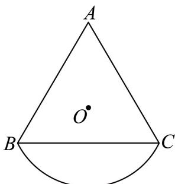
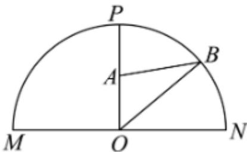
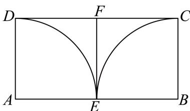
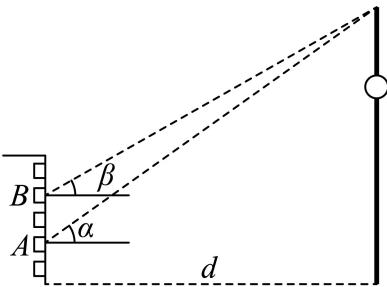

# 2025一模 三角函数与解三角形专题 · 学生版

> 本地预览：题目、答案及分类尚未全部审定。校对使用的PDF为高中工作台解析版，尚未逐区确认区级印刷原卷。

## 倾斜角、同角倍角与诱导求值

用斜率与反正切确定倾斜角；其余求值先明确象限和角范围，再用三角恒等式或反例判断。

### 嘉定 · 第2题

直线3x − y + 1 = 0的倾斜角为 .（用反三角函数表示）

> 本题资料或解析有待核事项，预览不可作为已审定成品。

### 奉贤 · 第13题

在 $\triangle A B C ^ { \ r }$ 中， $^ { \ast } C = \frac { \pi } { 2 } ;$ ”是 $\ddot { } \sin ^ { 2 } A + \sin ^ { 2 } B = 1$ ”的（ ）

A. 充分不必要条件

B. 必要不充分条件

C. 充要条件

D. 既不充分也不必要条件

> 本题资料或解析有待核事项，预览不可作为已审定成品。

### 普陀 · 第13题

设 $\alpha\in\mathbb{R}$，则“$\cos 2\alpha=\frac{1}{3}$”是“$\sin\alpha=\frac{\sqrt{3}}{3}$”的（　）

A. 充分非必要条件

B. 必要非充分条件

C. 充要条件

D. 既非充分又非必要条件

> 本题资料或解析有待核事项，预览不可作为已审定成品。

### 松江 · 第2题

若 $\mathrm { s i n } \theta = \frac { 4 } { 5 }$ ，则 $\mathrm { \ l c o s 2 \theta }$ =

> 本题资料或解析有待核事项，预览不可作为已审定成品。

### 虹口 · 第3题

若tan α = 5，则tan 2α =

> 本题资料或解析有待核事项，预览不可作为已审定成品。

### 虹口 · 第13题

已知 $\alpha\in(0,\pi)$，则“$\sin(\pi-\alpha)=\frac12$”是“$\cos\alpha=\frac{\sqrt3}2$”的（　）条件。

A. 充要

B. 充分非必要

C. 必要非充分

D. 既非充分又非必要

> 本题资料或解析有待核事项，预览不可作为已审定成品。

### 金山 · 第13题

函数 $\langle y = 1 - 2 \sin ^ { 2 }$ x是（ ）

A. 最小正周期为π的奇函数

B. 最小正周期为π的偶函数

C. 最小正周期为 $\frac { \pi } { 2 }$ 的奇函数

D. 最小正周期为 $\frac { \pi } { 2 }$ 的偶函数

### 闵行 · 第15题

设f $( x ) = ( \sin x - \cos x ) ( \cos x - \tan x ) ( \tan x - \sin x )$ ，若α、β为同一象限的角，且不存在α、β，使得 $f \left( \alpha \right) f \left( \beta \right) < 0 .$ ，则α、β所在的象限为（ ）

A. 第一象限

B. 第二象限

C. 第三象限

D. 第四象限

### 静安 · 第6题

在△ABC中，已知 $B C = 5 , A C = 4 , A = 2 B$ ，则cosB的值为

## 周期、值域、零点与参数

把相位区间、极值点个数和平移条件转化为频率及角的约束。

### 嘉定 · 第18题

已知 $f \left( x \right) = 2 \cos { \left( \omega x + \frac { 3 \pi } { 4 } \right) }$ ，其中 $\iota _ { \omega } > 0$
(1) (6分)若ω = 2，求函数 $\langle y = f ( x ) , x \in \left[ - \frac { \pi } { 4 } , \frac { \pi } { 4 } \right]$ 的值域；
(2) (8分)若 $f \left( { \frac { \pi } { 4 } } \right) = 0$ ，且函数 $\{ y = f ( x )$ 在 $\left( { \frac { \pi } { 4 } } , { \frac { \pi } { 3 } } \right)$ 内有极小值，但无极大值，求ω的值.

> 本题资料或解析有待核事项，预览不可作为已审定成品。

### 嘉定 · 第21题

设A为非空集合，函数f (x)的定义域为D.若存在 $\mathbf { \Phi } _ { \boldsymbol { x } _ { 0 } } \in \mathbf { D }$ 使得对任意的x ∈ D均有 $f \left( x \right) - f \left( x _ { 0 } \right) \in \mathrm { A }$ ，则称f(x0)为函数f(x)的一个A值，x0为相应的A值点.
(1) (4分)若 $A = [ - 2 , 0 ] , f ( x ) = \sin x$ .证明： $x _ { 0 } = 2 k \pi + \frac { 1 } { 2 } \pi , k \in { \bf Z }$ 是函数f (x)的一个A值点，并写出相应的A值；
(2) (6分)若 $A = [ 0 , + \infty ) , f ( x ) = - x , g ( x ) = x ^ { 2 } + x + 1$ .分别判断函数 ${ \bf \nabla } f \left( x \right) , g \left( x \right)$ 是否存在A值？
若存在，求出相应的A值点；若不存在，说明理由；
(3) (8分)若 $A = ( - \infty , 0 ]$ ，且函数 $f \left( x \right) = \ln x + a x ^ { 2 } \left( a \in \mathbf { R } \right)$ 存在A值，求函数f(x)的A值，并指出相应的A值点.

> 本题资料或解析有待核事项，预览不可作为已审定成品。

### 奉贤 · 第12题

已知集合 $\mathbf { \partial } M = \{ P _ { 0 } , P _ { 1 } , P _ { 2 } , \cdots , P _ { n } \} , n \geq 2 , n \in \mathbf { N }$ 是由函数 $y = \cos x , x \in [ 0 , 2 \pi ]$ 的图象上两两不相同的点构成的点集，集合 $S = \left\{ a | a = { \overrightarrow { O P _ { 0 } } } \cdot { \overrightarrow { O P _ { i } } } , i = 0 , 1 , 2 , \cdots , n , n \geq 2 , n \in \mathbf { N } \right\}$ ，其中 $P _ { 0 } \left( 0 , 1 \right)$ $P _ { 1 } \left( \pi , - 1 \right)$ ．若集合S中的元素按照从小到大的顺序排列能构成公差为d的等差数列，当 $d \in \left\{ { \frac { 1 } { 2 } } , 1 \right\}$ 时，则符合条件的点集M的个数为

> 本题资料或解析有待核事项，预览不可作为已审定成品。

### 奉贤 · 第14题

函数 $y = \log _ { 2 } \sin x + \log _ { 2 } \cos x$ ，则下列命题正确的是（ ）

A. 函数是偶函数

B. 函数定义域是 $\left( 0 , { \frac { \pi } { 2 } } \right)$

C. 函数最大值−1

D. 函数的最小正周期为π

> 本题资料或解析有待核事项，预览不可作为已审定成品。

### 奉贤 · 第21题

若函数 $\boldsymbol { \cdot } \boldsymbol { y } = \boldsymbol { f } \left( \boldsymbol { x } \right)$ 的图象上存在k个不同点 $P _ { 1 \setminus } \ P _ { 2 \setminus } \ \cdots \ P _ { k } \left( k \geq 2 , k \in \mathbf { N } \right)$ 处的切线重合，则称该切线为函数 $y = f \left( x \right)$ 的一条k点切线，该函数具有k点切线性质
(1) (4分)判断函数 $y = x ^ { 2 } - 2 | x | , x \in \mathbf { R }$ 的奇偶性并写出它的一条2点切线方程（无需理由）；
(2) (6分)设 $f \left( x \right) = \mathrm { e } ^ { x } - \ln x$ ，判断函数 $y = f \left( x \right)$ 是否具有k点切线性质，并说明理由；
(3) (8分)设 $y \left( x \right) = \cos x + 2 x$ ，证明：对任意的 $m \ge 3 , m \in \mathbf { N }$ ，函数 $y = g \left( x \right)$ 具有m点切线性质，并求出所有相应的切线方程

> 本题资料或解析有待核事项，预览不可作为已审定成品。

### 宝山 · 第2题

…
函数 $\cdot y = \cos { 2 x } + 1$ 的最小正周期为

### 崇明 · 第11题

已知 $f(x)=A\sin(\omega x+\frac\pi6)$（$A>0,\omega>0$），若函数 $y=f(x)$ 在区间 $[0,2\pi]$ 上有且仅有3个零点和1个极小值点，则 $\omega$ 的取值范围是______。

> 本题资料或解析有待核事项，预览不可作为已审定成品。

### 徐汇 · 第17题

已知 $\mid f \left( x \right) = a \sin \omega x + b \cos \omega x \left( \omega > 0 \right)$ ，若定义在R上的函数 $y = f \left( x \right)$ 的最小正周期为π，且对任意的 $\mathbf { { \boldsymbol { x } } \in \mathbf { { \boldsymbol { R } } } }$ ，都有 $f \left( x \right) \leq f \left( { \frac { \pi } { 1 2 } } \right) = 4 .$
(1) (6分)求实数a, b的值；
(2) (8分)设 $x _ { 1 } , x _ { 2 } \in ( 0 , \pi )$ ，当 $x _ { 1 } \neq x _ { 2 }$ 时， $f \left( x _ { 1 } \right) = f \left( x _ { 2 } \right) = - 2$ ，求 $x _ { 1 } + x _ { 2 }$ 的值.

> 本题资料或解析有待核事项，预览不可作为已审定成品。

### 普陀 · 第18题

设函数 $\cdot y = f \left( x \right)$ 的表达式为 $f \left( x \right) = \sin \left( \omega x \right)$ ，其中 $\omega > 0$
(1) (6分)设ω = 1， $m \in \mathbf { R }$ ，若有且只有一个 $\cdot x _ { 0 } \in ( 0 , m )$ ，使得函数 $y = f \left( x + { \frac { \pi } { 4 } } \right)$ 取得最小值，求m的取值范围；
(2) (8分)若对任意的 $| x \in \mathrm { R } .$ ，皆有 $f \left( x \right) + f \left( \frac { 2 \pi } { 3 } - x \right) = 0$ 恒成立，且函数 $y = f \left( x \right)$ 在区间 $\left( - { \frac { \pi } { 8 } } , 0 \right)$ 上是严格增函数，求函数 $y = f \left( x \right)$ 的最小正周期.

> 本题资料或解析有待核事项，预览不可作为已审定成品。

### 杨浦 · 第2题

函数 $y = \sin 2 x$ 的最小正周期是

> 本题资料或解析有待核事项，预览不可作为已审定成品。

### 杨浦 · 第21题

已知 $\left| y = f \left( x \right) \right.$ 是定义域为[0,1]的函数，实数 $\{ p \in ( 0 , 1 )$ ，称函数
$y = ( 1 - p ) f \left( 0 \right) + p f \left( x \right) - f \left( p x \right) , x \in \left[ 0 , 1 \right]$ 为函数 $\begin{array} { r } { \dot { \boldsymbol { y } } = \boldsymbol { f } ( \boldsymbol { x } ) \dot { \boldsymbol { \mathrm { H } } } ^ { \prime } \dot { \boldsymbol { \mathrm { J } } } ^ {  } \boldsymbol { p } \dot { \boldsymbol { \cdot } } } \end{array}$ -生成函数”，记作$y = F _ { p } \left( x \right) , x \in \left[ 0 , 1 \right]$
(1) (4分)若 ${ \bf \dot { \cdot } } f \left( x \right) = \cos 2 \pi x$ ，求函数 $\boldsymbol { \cdot } \boldsymbol { y } = F _ { \frac { 1 } { 2 } } \left( x \right)$ 的值域；
(2) (6分)若 $f \left( x \right) = a x ^ { 2 } + \ln \left( 1 + x \right)$ ，函数 $\boldsymbol { \cdot } \boldsymbol { y } = F _ { \frac { 1 } { 3 } } \left( x \right)$ 满足 $F _ { \frac { 1 } { 3 } } \left( x \right) \geq 0$ 对任意的0 $\leq x \leq 1$ 恒成立，求实数a的取值范围；
(3) (8分)若 $y = f \left( x \right)$ 满足： $\textcircled { 1 } f \left( 0 \right) = 0 ; \textcircled { 2 } y = f \left( x \right)$ 在(0,1)上存在导函 ${ \ddot { \Sigma } } \nabla y = f ^ { \prime } \left( x \right)$ ，且 $y = f ^ { \prime } \left( x \right)$ 在(0,1)上是严格增函数；③对于任意 $p \in ( 0 , 1 ) , y = f \left( x \right)$ 的“p-生成函数 $\ ' y = F _ { p } \left( x \right) , x \in \left[ 0 , 1 \right]$ ]的图像是一段连续曲线，求证：函数 $\wp = { \frac { f \left( x \right) } { x } }$ 在(0,1)上是严格增函数.

> 本题资料或解析有待核事项，预览不可作为已审定成品。

### 浦东 · 第17题

已知函数 $y = f \left( x \right)$ 的表达式为 $f \left( x \right) = \sin \omega x , \omega > 0$
(1) (6分)若函数 $y = f \left( x \right)$ 的最小正周期为 $\frac { \pi } { 2 }$ ，求ω的值及 $y = f \left( x \right)$ 的单调增区间；
(2) (8分)若ω = 2，设函数 $y = g \left( x \right)$ 的表达式为 $ \begin{array} { r } { | g ( x )  = f ( x ) + \sqrt { 3 } \cos 2 x } \end{array}$ ，求当 $x \in \left[ 0 , { \frac { \pi } { 2 } } \right]$ ]时，$y = g \left( x \right)$ 的值域

> 本题资料或解析有待核事项，预览不可作为已审定成品。

### 虹口 · 第16题

设数列 $\left\{ a _ { n } \right\}$ 的前四项分别为 $a _ { 1 } , ~ a _ { 2 } , ~ a _ { 3 } , ~ a _ { 4 }$ ，对于以下两个命题，说法正确的是（ ）
①存在等比数列 $\left\{ a _ { n } \right\}$ 以及锐角α，使 $\{ \sin \alpha , \cos \alpha , \tan \alpha \} = \{ a _ { 1 } , a _ { 2 } , a _ { 3 } \}$ 成立
②对任意等差数列 $\left\{ a _ { n } \right\}$ 以及锐角α，均不能使 $\{ \sin \alpha , \cos \alpha , \tan \alpha , \cot \alpha \} = \{ a _ { 1 } , a _ { 2 } , a _ { 3 } , a _ { 4 } \}$ 成立

A. ①是真命题，②是真命题

B. ①是真命题，②是假命题

C. ①是假命题，②是真命题

D. ①是假命题，②是假命题

> 本题资料或解析有待核事项，预览不可作为已审定成品。

### 金山 · 第9题

在(0, 2π)内，使 $\mathrm { i } _ { \mathrm { s i n } } x \geq \cos x$ 成立的x的取值范围是

### 金山 · 第21题

对于函数 $y = f \left( x \right)$ 图像上不同的三点 $A \left( x _ { 1 } , y _ { 1 } \right) , B \left( x _ { 2 } , y _ { 2 } \right) , M \left( x _ { 0 } , y _ { 0 } \right)$ （其中 $x _ { 0 } \in \left( x _ { 1 } , x _ { 2 } \right) )$ ），记点M处的切线为l，若 $l / / A B$ ，则称M为函数 $y = f \left( x \right)$ 在区间 $( x _ { 1 } , x _ { 2 } )$ 上的“T点”．特别地，当$x _ { 0 } = { \frac { x _ { 1 } + x _ { 2 } } { 2 } }$ ，则称M为函数 $\boldsymbol { \cdot } \boldsymbol { y } = \boldsymbol { f } \left( \boldsymbol { x } \right)$ 在区间 $( x _ { 1 } , x _ { 2 } )$ 上的“和谐T点”
(1) (4分)设 $f \left( x \right) = x ^ { 2 } , M \left( x _ { 0 } , y _ { 0 } \right)$ 是函数 $\boldsymbol { \cdot } \boldsymbol { y } = \boldsymbol { f } \left( \boldsymbol { x } \right)$ 在区间 $( 0 , n )$ 上的“T点”，若 $f ^ { \prime } \left( x _ { 0 } \right) = 1$ ，求实数n的值；
(2) (6分)设 $f \left( x \right) = a \sin 2 x + \cos x + x - 1$ ，若函数 $\boldsymbol { \cdot } \boldsymbol { y } = \boldsymbol { f } \left( \boldsymbol { x } \right)$ 在区间(0, 2π)上恰有3个“T点”，求所有满足条件的实数a的值组成的集合；
(3) (8分)设 $f \left( x \right) = \ln x + b x ^ { 2 } \left( b \in \mathrm { R } \right)$ ，试探究函数 $y = f \left( x \right)$ )的定义域内是否存在一个包含“和谐T点”的区间 $] ( x _ { 1 } , x _ { 2 } )$ ，若存在，求出该区间 $\mathbb { J } ( x _ { 1 } , x _ { 2 } )$ ；若不存在，请说明理由

> 本题资料或解析有待核事项，预览不可作为已审定成品。

### 长宁 · 第15题

已知函数 $y=\sin(\omega x+\frac\pi6)$（$\omega>0$）在区间 $(-\frac\pi2,\frac\pi3)$ 上单调递增，则 $\omega$ 的取值范围是（　）。

A. $(0,1]$

B. $(0,1)$

C. $(1,\frac43)$

D. $(0,\frac65]$

### 闵行 · 第12题

已知 $f \left( x \right) = \left| \sin \omega x \right|$ ，若存在x1、 $x _ { 2 } \in [ \omega \pi , 2 \omega \pi ]$ ，且 $x _ { 1 } \neq x _ { 2 }$ ，使得 ${ \frac { 1 } { f \left( x _ { 1 } \right) + 1 } } + { \frac { 1 } { f \left( x _ { 2 } \right) + 1 } } =$ 1成立，则ω的取值范围是

### 闵行 · 第18题

已知 $\begin{array} { r } { f \left( x \right) = \left\{ \begin{array} { l l } { x ^ { 2 } - a x , x \geq 0 } \\ { x + \displaystyle \frac { 1 } { x } , x < 0 } \end{array} \right. } \end{array}$
(1) (6分)若a = 1，求函数 $y = f ( x )$ 的值域；
(2) (8分)若存 $\mathrm { { \it ~  ~ } } \mathcal { ( \mathrm { { \bf ~ \oplus ~ } } ) } = ( 0 , \frac { \pi } { 4 } )$ ，使得 $f ( \sin \varphi ) = f ( \cos \varphi )$ ，求实数a的取值范围

### 青浦 · 第17题

已知函数 $f ( x ) = ( 2 \mathrm { { c o s } } ^ { 2 } x - 1 ) \mathrm { { s i n } } 2 x + { \frac { 1 } { 2 } } \mathrm { { c o s } } 4 x$
（Ⅰ）求f(x)的最小正周期及最大值；
（Ⅱ）若 $\mathrm { i } \alpha \in ( \frac { \pi } { 2 } , \pi )$ ，且 $f ( \alpha ) = \frac { \sqrt { 2 } } { 2 }$ ，求α的值.

> 本题资料或解析有待核事项，预览不可作为已审定成品。

### 黄浦 · 第15题

设 $0\le x<2\pi$，满足 $\sin(x+\frac\pi6)=\sin x+\sin\frac\pi6$ 的 $x$ 的个数为（　）。

A. 0个

B. 1个

C. 2个

D. 无数个

> 本题资料或解析有待核事项，预览不可作为已审定成品。

### 黄浦 · 第18题

已知 $\left| f \left( x \right) \right. = \sin { x } .$
(1) (6分)求函数 $\mathbf { \dot { \boldsymbol { y } } } = f \left( \boldsymbol { x } \right) \cdot f \left( \frac { \pi } { 2 } - \boldsymbol { x } \right)$ 的最小正周期；
(2) (8分)求函数 $: y = f \left( 2 x + { \frac { \pi } { 3 } } \right) , x \in \left[ 0 , { \frac { \pi } { 2 } } \right]$ 的单调减区间

> 本题资料或解析有待核事项，预览不可作为已审定成品。

## 正余弦定理与三角形边角

依据边角关系、面积和周长确定方法，检查三角形存在条件。

### 嘉定 · 第4题

在 $\triangle A B C ^ { \prime }$ 中，若 $A B = 5 , B C = { \sqrt { 2 1 } } , C A = 4$ ，则∠A = .

> 本题资料或解析有待核事项，预览不可作为已审定成品。

### 宝山 · 第18题

…
在 $\triangle A B C ^ {  }$ 中，已知 $\displaystyle { 1 6 ^ { 2 } + c ^ { 2 } = a ^ { 2 } + b c }$
(1) (6分)若 $\mathbf { \dot { s i n } } C = 2 \sin B$ ，且 $b = 2$ ，求 $\triangle A B C$ 的面积；
(2) (8分)若 $\dot { \boldsymbol { b } } + \boldsymbol { c } = 1$ ,求a的取值范围.

> 本题资料或解析有待核事项，预览不可作为已审定成品。

### 崇明 · 第18题

在 $\triangle A B C ^ { \prime }$ 中，已知点D是BC边上一点，且BD = 1，CD = 3.
(1) (6分)若 $A D \bot B C$ ，且 $\angle A B D = 2 \angle A C D$ ，求AD的长；
(2) (8分)若 $\angle A B D = 5 5 ^ { \circ } , \angle A C D = 3 2 ^ { \circ }$ ，求AD的长（结果精确到0.01）.

### 徐汇 · 第10题

已知椭圆 ${ \frac { x ^ { 2 } } { a ^ { 2 } } } + { \frac { y ^ { 2 } } { b ^ { 2 } } } = 1 ( a > b > 0 )$ 的左､右焦点分别为 $F _ { 1 } , F _ { 2 }$ ，P为椭圆上一点，且 $\angle P F _ { 2 } F _ { 1 } = \frac { \pi } { 3 }$ 若此椭圆的离心率为 ${ \sqrt { 3 } } - 1$ ，则 $\angle P F _ { 1 } F _ { 2 }$ 的大小为

> 本题资料或解析有待核事项，预览不可作为已审定成品。

### 普陀 · 第6题

设△ABC的内角A，B，C的对边分别为a， $b , \ c ,$ 若b = 4， $\sin \left( A + { \frac { \pi } { 3 } } \right) = 0$ $\triangle A B C$ 的面积为 $\sqrt { 3 }$ ，则a的值为

> 本题资料或解析有待核事项，预览不可作为已审定成品。

### 杨浦 · 第18题

已知 $\triangle A B C$ 的内角A､B､C所对边的长度分别为 $a , b , c .$
(1) (6分)若 $( a + b ) ^ { 2 } - c ^ { 2 } = 4 , C = 6 0 ^ { \circ }$ ，求 $\triangle A B C$ 的面积；
(2) (8分)若 ${ \frac { \cos C } { c } } = { \frac { \cos A } { 3 b - a } }$ ，求sinC的值.

> 本题资料或解析有待核事项，预览不可作为已审定成品。

### 松江 · 第4题

在 $\triangle A B C ^ { \ r }$ 中，角A、B、C所对的边分别为a、b、c，若a = 4， $b = { \sqrt { 3 } } , \ C = { \frac { 5 } { 6 } } \pi$ ，则c = .

> 本题资料或解析有待核事项，预览不可作为已审定成品。

### 浦东 · 第5题

在△ABC中，BC = 5， $\angle B = 4 5 ^ { \circ }$ $\angle C = 1 0 5 ^ { \circ }$ ，则AC =

> 本题资料或解析有待核事项，预览不可作为已审定成品。

### 长宁 · 第17题

在 $\triangle A B C \sharp$ ，角A，B，C所对的边分别为a，b，c，且 $b \sin A - { \sqrt { 3 } } a \cos B = 0$
(1) (6分)求角B的大小；
(2) (8分)若 $\mathbf { \dot { b } } = 2 , \triangle A B C$ 的面积为 $\sqrt { 3 }$ ，请判断 $\triangle A B C$ 的形状，并说明理由

### 青浦 · 第7题

$\# \triangle A B C ^ { \mathrm { \scriptscriptstyle F } }$ 中，已知 $\angle A C B = 1 2 0 ^ { \circ } , A B = 2 { \sqrt { 7 } } ,$ ，若 $B C = 2 A C$ ，则 $\triangle A B C$ 的面积为

> 本题资料或解析有待核事项，预览不可作为已审定成品。

### 青浦 · 第18题

如图，在三棱锥 $P - A B C$ 中，平面 $P A B \bot$ 平面 $A B C , A B = 6 , B C = 2 { \sqrt { 3 } } , A C = 2 { \sqrt { 6 } } , D .$ 、E分别为线段AB、BC上的点，且 $A D = 2 D B , C E = 2 E B , P D \bot A C .$
(1) (6分)求证： $D E / /$ 平面 $P A C ;$
(2) (8分)求证： $P D \perp$ 平面 $A B C$

> 本题资料或解析有待核事项，预览不可作为已审定成品。

## 三角建模、圆弦距离与几何最值

先建立圆弧、圆弦距离、截面、向量投影或实际长度模型；可用勾股及圆心到弦的垂线，不强迫所有题都做三角优化。

### 嘉定 · 第11题

某公园为了美化环境，计划建造一座拱桥 $DACBE$。已知该桥的剖面如图所示，共包括一段圆弧形桥面 $\widehat{ACB}$ 和两段长度相等的直线型桥面 $AD,BE$。圆弧形桥面 $\widehat{ACB}$ 所在圆的半径为4米，圆心 $O$ 在 $DE$ 上，且 $AD$ 和 $BE$ 所在直线与圆 $O$ 分别在连接点 $A$ 和 $B$ 处相切。已知直线型桥面的修建费用是每米0.4万元，弧形桥面 $\widehat{ACB}$ 的修建费用是每米2.5万元，设 $\angle ADO=\theta$。根据空间限制及桥面坡度的限制，$\theta$ 的范围为 $\arcsin\frac13\le\theta\le\frac\pi6$，则当桥面修建总费用最低时 $\theta$ 的值为______。

> 本题资料或解析有待核事项，预览不可作为已审定成品。

### 嘉定 · 第12题

已知实数 $\left[ x _ { 1 } , x _ { 2 } , y _ { 1 } , y _ { 2 } \right.$ 满足： $x _ { 1 } ^ { 2 } + y _ { 1 } ^ { 2 } = 1 , x _ { 2 } ^ { 2 } + y _ { 2 } ^ { 2 } = 1 , x _ { 1 } x _ { 2 } + y _ { 1 } y _ { 2 } = { \frac { 1 } { 2 } }$ ，则${ \frac { | x _ { 1 } + y _ { 1 } - 1 | } { \sqrt { 2 } } } + { \frac { | x _ { 2 } + y _ { 2 } - 1 | } { \sqrt { 2 } } }$ 的最小值为

> 本题资料或解析有待核事项，预览不可作为已审定成品。

### 奉贤 · 第10题

申辉中学高一（8）班设计了一个“水滴状”班徽的平面图（如图），徽章由等腰三角形ABC及以弦BC和劣弧BC所围成的弓形所组成，其中 $A B = A C$ ，劣弧BC所在的圆为三角形的外接圆，圆心为O

已知 $\angle B A C = \theta , \theta \in \left( 0 , \frac { \pi } { 2 } \right)$ ，外接圆的半径是2，则该图形的面积为 ．（用含θ的表达式表示）

> 本题资料或解析有待核事项，预览不可作为已审定成品。

### 宝山 · 第12题

已知平面向量$\vec a$、$\vec b$满足$|\vec a|=1$，$|\vec b|=m\in(1,2)$，且对任意单位向量$\vec c$，都有$|\vec a\cdot\vec c|+|\vec b\cdot\vec c|\leq\sqrt6$，则$\vec a\cdot\vec b$的最大值为______。（用含$m$的式子表示）

> 本题资料或解析有待核事项，预览不可作为已审定成品。

### 普陀 · 第8题

若圆锥PO的体积为 $\frac { 2 { \sqrt { 2 } } \pi } { 3 }$ ，它的母线与底面所成的角的余弦值为 $\frac 1 3$ ，则圆锥PO的表面积为

> 本题资料或解析有待核事项，预览不可作为已审定成品。

### 松江 · 第11题

已知平面向量$\vec a$、$\vec b$的夹角为$\theta$，$\vec b-\vec a$与$\vec a$的夹角为$3\theta$，$|\vec a|=1$，$\vec a$和$\vec b-\vec a$在$\vec b$上的投影分别为$x$、$y$，则$x(y+\sin\theta)$的取值范围是______。

> 本题资料或解析有待核事项，预览不可作为已审定成品。

### 松江 · 第19题

整治人居环境，打造美丽乡村，某村准备将一块由一个半圆和长方形组成的空地进行美化，如图，长方形的边AB为半圆的直径，O为半圆的圆心， $A B = 2 A D = 2 0 0 \mathrm { m }$ ，现要将此空地规划出一个等腰三角形区域PMN（底边 $M N \bot C D )$ 种植观赏树木，其余的区域种植花卉.设
$$
\angle M O B = \theta , \theta \in \left(0, \frac {\pi}{2} \right]
$$

(1) (6分)当 $\theta = \frac { \pi } { 3 }$ 时，求MN的长；
(2) (8分)求三角形区域PMN面积的最大值.

> 本题资料或解析有待核事项，预览不可作为已审定成品。

### 浦东 · 第10题

某地要建造一个市民休闲公园长方形ABCD，如图，边 $A B = 2 \mathrm { k m }$ ，边 $A D = 1 \mathrm { k m }$ ，其中区域ADE开挖成一个人工湖，其他区域为绿化风景区．经测算，人工湖在公园内的边界是一段圆弧，且A、D位于圆心O的正北方向，E位于圆心O的北偏东 $\mathrm { \Delta } 6 0 ^ { \circ }$ 方向．拟定在圆弧P处修建一座渔人码头，供游客湖中泛舟，并在公园的边DC、CB开设两个门M、N，修建步行道PM、PN通往渔人码头，且PM⊥CD、PN⊥CB，则步行道PM、PN长度之和的最小值是 km．（精确到0.001）

> 本题资料或解析有待核事项，预览不可作为已审定成品。

### 虹口 · 第17题

设 $\begin{array} { r } { f \left( x \right) = \sin \omega x ( \omega > 0 ) } \end{array}$
(1) (6分)当函数 $\boldsymbol { \cdot } \boldsymbol { y } = \boldsymbol { f } \left( \boldsymbol { x } \right)$ 的最小正周期为2π时，求 ${ \bf \dot { \boldsymbol { y } } } = f \left( { \boldsymbol { x } } \right) + \cos$ x在 $\left[ 0 , { \frac { \pi } { 2 } } \right]$ 上的最大值；
(2) (8分)若ω = 2，且在 $\triangle A B C \sharp$ ，角A、B、C所对的边长为a、b、c，锐角A满足
$f \left( A + { \frac { \pi } { 6 } } \right) = 0 , { \overrightarrow { A B } } \cdot { \overrightarrow { A C } } = 4$ ，求a的最小值

### 金山 · 第7题

已知某圆锥的侧面展开图是圆心角为 $\sqrt { 2 } \pi$ ，半径为2的扇形，则该圆锥的母线与底面所成角的大小

### 金山 · 第10题

某海滨浴场平面图是如图所示的半圆，其中O是圆心，直径MN为400米，P是弧MN的中点．一个急救中心A在栈桥OP中点上，计划在弧NP上设置一个瞭望台B，并在AB间修建浮桥．已知 $\angle A B O$ 越大，瞭望台B处的视线范围越大，则B处的视线范围最大时，AB的长度为 米．（结果精确到1米）

### 闵行 · 第11题

如图，某小区内有一块矩形区域ABCD，其中AB = 40米，AD = 20米，点E、F分别为AB、CD的中点，左右两个扇形区域为花坛（两个扇形的圆心分别为A、B，半径均为20米），其余区域为草坪．现规划在草坪上修建一个三角形的儿童游乐区，且三角形的一个顶点在线段 $E F _ { - }$ 上，另外两个顶点在线段CD上，则该游乐区面积的最大值为 平方米．（结果保留整数）

### 静安 · 第10题

如图所示，小明和小宁家都住在东方明珠塔附近的同一幢楼上，小明家在A层，小宁家位于小明家正上方的B层，已知 $A B = a$ .小明在家测得东方明珠塔尖的仰角为α，小宁在家测得东方明珠塔尖的仰角为β，则他俩所住的这幢楼与东方明珠塔之间的距离d =

### 静安 · 第11题

记$f(x)=x^2+(a^2+b^2-1)x+a^2+2ab-b^2$。若函数$y=f(x)$是偶函数，则该函数图象与$y$轴交点的纵坐标的最大值为______。

> 本题资料或解析有待核事项，预览不可作为已审定成品。

### 静安 · 第18题

已知向量 ${ \vec { a } } = \left( \cos { \frac { 3 x } { 2 } } , \sin { \frac { 3 x } { 2 } } \right) , { \vec { b } } = \left( \cos { \frac { x } { 2 } } , - \sin { \frac { x } { 2 } } \right)$ ，且 $x \in \left[ 0 , { \frac { \pi } { 2 } } \right]$
(1) (6分)求→a ⋅→b 及 $\displaystyle { \vec { a } + \vec { b } }$ ；
(2) (8分) $\mathrm { i } \mathrm { \overrightarrow { L } } f \left( x \right) = \mathrm { \overrightarrow { { a } } } \cdot \mathrm { \overrightarrow { { b } } } - \left| \mathrm { \overrightarrow { { a } } } + \mathrm { \overrightarrow { { b } } } \right|$ ，求函数 $y = f \left( x \right)$ 的最小值.

> 本题资料或解析有待核事项，预览不可作为已审定成品。

### 黄浦 · 第11题

一个机器零件的形状是有缺口的圆形铁片，如图中实线部分为裁剪后的形状．已知这个圆的半径是13cm， $A B = 8 \mathrm { { c m } }$ ， $B C = 6 \mathrm { c m }$ ，且 $A B \bot B C$ ，则圆心到点B的距离约为 cm．（结果精确到0.1cm）

## 三角函数与导数差商综合

在完整大题中辨认三角恒等与导数差商的各自作用，不只截取单个小问。

### 虹口 · 第21题

设 $\overline { { a \in { \bf R } , F _ { a } \left( x \right) } } = \frac { f \left( x \right) - f \left( a \right) } { x - a } , x \in \left( a - 1 , a \right) \cup \left( a , a + 1 \right)$ ．若函数 $y = f \left( x \right)$ 满足 $F _ { a } \left( x \right) > 0$ 恒成 立，则称函数y = f (x)具有性质P (a)
(1) (4分)判断y = sinx是否具有性质P(0)，并说明理由；
(2) (6分)设 $f \left( x \right) = \mathrm { e } ^ { x } - x$ ，若函数 $\boldsymbol { \cdot } \boldsymbol { y } = \boldsymbol { f } \left( \boldsymbol { x } \right)$ 具有性质 $P \left( a \right)$ ，求实数a的取值范围；
(3) (8分)设函数y = f(x)的定义域为R，且对任意 ${ \bf { \dot { a } } } \in { \bf { R } }$ 以及 $t \in ( 0 , 1 )$ )，都有
$F _ { a } \left( a - t \right) < F _ { a } \left( a + t \right)$ ．若当x < 0时，恒有 $f \left( x \right) < 0$ ．求证：函数 $y = f \left( x \right)$ 对任意实数a均具有性质P (a)

### 静安 · 第7题

已知物体的位移d（单位：m）与时间t（单位：s）满足函数关系 $d = 5 \sin t - 2 \cos t$ ，则该物体在$t = { \frac { \pi } { 2 } } ( \mathbf { s } )$ 时刻的瞬时速度为 $\mathbf { ( m / s ) }$

