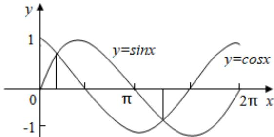
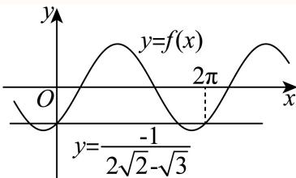
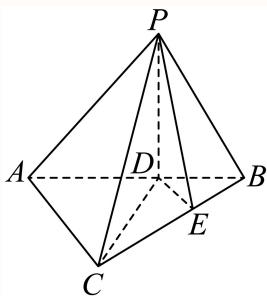
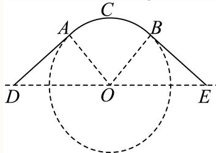
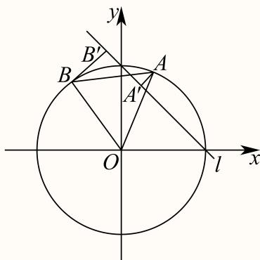
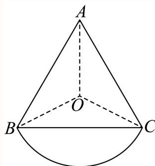
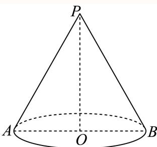
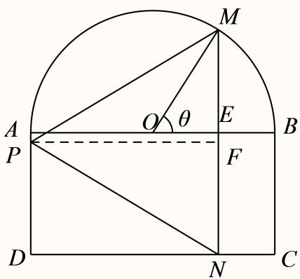
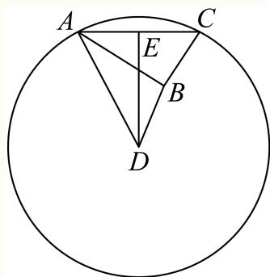

# 2025一模 三角函数与解三角形专题 · 教师版

> 本地预览：题目、答案及分类尚未全部审定。校对使用的PDF为高中工作台解析版，尚未逐区确认区级印刷原卷。

## 倾斜角、同角倍角与诱导求值

用斜率与反正切确定倾斜角；其余求值先明确象限和角范围，再用三角恒等式或反例判断。

### 嘉定 · 第2题

直线3x − y + 1 = 0的倾斜角为 .（用反三角函数表示）

> 本题资料或解析有待核事项，预览不可作为已审定成品。

**考点：** 一般式求斜率与倾斜角；反正切表示倾斜角

**难度依据：** 斜率为正时直接反正切求角

**核查说明：** 题干与解析已用于人工归类，尚未完成整题公式校净与独立数学终审。

【答案】arctan 3.

【解析】

由直线的一般式方程求得斜率，根据倾斜角与斜率的关系，建立方程，可得答案.

由直线 $3 x - y + 1 = 0$ ，则该直线的斜率为3，设其倾斜角为θ，则 $\tan \theta = 3$

解得 $\theta = \arctan 3 .$

故答案为：arctan 3.

### 奉贤 · 第13题

在 $\triangle A B C ^ { \ r }$ 中， $^ { \ast } C = \frac { \pi } { 2 } ;$ ”是 $\ddot { } \sin ^ { 2 } A + \sin ^ { 2 } B = 1$ ”的（ ）

A. 充分不必要条件

B. 必要不充分条件

C. 充要条件

D. 既不充分也不必要条件

> 本题资料或解析有待核事项，预览不可作为已审定成品。

**考点：** 三角命题的充分必要性与反例；三角形内角关系及平方和恒等式

**难度依据：** 充分性用互余关系必要性需构造非直角反例

**核查说明：** 题干与解析已用于人工归类，尚未完成整题公式校净与独立数学终审。

【答案】A

【解析】

结合同角三角函数关系、诱导公式，分别从充分性、必要性两方面来说明即可

一方面：

$$
C = \frac {\pi}{2} \Rightarrow A + B = \frac {\pi}{2} \Rightarrow \sin A = \sin \left(\frac {\pi}{2} - B\right) = \cos B \Rightarrow \sin^ {2} A + \sin^ {2} B = \cos^ {2} B + \sin^ {2} B =
$$

另一方面： $A = { \frac { 2 \pi } { 3 } } , B = C = { \frac { \pi } { 6 } } \Rightarrow \sin ^ { 2 } A + \sin ^ { 2 } B = \left( { \frac { \sqrt { 3 } } { 2 } } \right) ^ { 2 } + \left( { \frac { 1 } { 2 } } \right) ^ { 2 } = 1$ 但 $C \neq { \frac { \pi } { 2 } }$

$$
" C = \frac {\pi}{2}" \text {是}" \sin^ {2} A + \sin^ {2} B = 1
$$

故选：A.

### 普陀 · 第13题

设 $\alpha\in\mathbb{R}$，则“$\cos 2\alpha=\frac{1}{3}$”是“$\sin\alpha=\frac{\sqrt{3}}{3}$”的（　）

A. 充分非必要条件

B. 必要非充分条件

C. 充要条件

D. 既非充分又非必要条件

> 本题资料或解析有待核事项，预览不可作为已审定成品。

**考点：** 二倍角命题的充分必要条件；二倍角公式与符号分支

**难度依据：** 平方关系不能确定正弦符号

**核查说明：** 题干与解析已用于人工归类，尚未完成整题公式校净与独立数学终审。；题干α范围大段乱码；同名PDF第9页文字层已确认“设α∈R”，本分类不改源稿。；题干与解析已用于人工归类，尚未完成整题公式校净与独立数学终审。；题干α范围大段乱码；同名PDF第9页文字层已确认“设α∈R”，本分类不改源稿。

【答案】B

【解析】

根据余弦二倍角公式由 $\mathrm { I c o s 2 } \alpha = \frac { 1 } { 3 }$ 可得sinα的值，结合充分必要条件判断即可因为 $\cos 2 \alpha = \frac { 1 } { 3 }$ ，则 $\cos 2 \alpha = 1 - 2 \sin ^ { 2 } \alpha = { \frac { 1 } { 3 } }$ ，所 $B / \sin \alpha = { \frac { \sqrt { 3 } } { 3 } }$ 或 $\sin \alpha = - { \frac { \sqrt { 3 } } { 3 } }$ 则 $| { ^ { \circ } \cos 2 \alpha = \frac { 1 } { 3 } , \frac { \sqrt { 3 } } { \sqrt { \pm } } { ^ \circ \sin \alpha } = \frac { \sqrt { 3 } } { 3 } }$ ”的必要非充分条件.故选：B.

### 松江 · 第2题

若 $\mathrm { s i n } \theta = \frac { 4 } { 5 }$ ，则 $\mathrm { \ l c o s 2 \theta }$ =

> 本题资料或解析有待核事项，预览不可作为已审定成品。

**考点：** 二倍角公式

**难度依据：** 二倍角公式；按所需步骤与推理量估计

**核查说明：** 题干与解析已用于人工归类，尚未完成整题公式校净与独立数学终审。

【答案】$- { \frac { 7 } { 2 5 } }$

【解析】

∵ sinθ = 4 ,

$$
\cos 2 \theta = 1 - 2 \sin^ {2} \theta = 1 - 2 \times \left(\frac {4}{5}\right) ^ {2} = - \frac {7}{2 5},
$$

故答案为 $- { \frac { 7 } { 2 5 } }$

### 虹口 · 第3题

若tan α = 5，则tan 2α =

> 本题资料或解析有待核事项，预览不可作为已审定成品。

**考点：** 正切二倍角

**难度依据：** 涉及正切二倍角；难度为教师预估，需结合原题条件复核。

**核查说明：** 解析推导得负五分之十二，但末尾答案文字识别损坏为5和12，须回源。；依据现有底稿归类，尚未逐页校卷、公式校净或独立数学终审。

【解析】

直接利用二倍角公式计算可得.

因为 $\tan \alpha = 5$

所以 $\tan 2 \alpha = { \frac { 2 \tan \alpha } { \underline { { { 1 } } } - \tan ^ { 2 } \alpha } } = { \frac { 2 \times 5 } { 1 - 5 ^ { 2 } } } = - { \frac { 5 } { 1 2 } } .$ 5故答案为：12

### 虹口 · 第13题

已知 $\alpha\in(0,\pi)$，则“$\sin(\pi-\alpha)=\frac12$”是“$\cos\alpha=\frac{\sqrt3}2$”的（　）条件。

A. 充要

B. 充分非必要

C. 必要非充分

D. 既非充分又非必要

> 本题资料或解析有待核事项，预览不可作为已审定成品。

**考点：** 三角诱导公式与充要条件

**难度依据：** 涉及三角诱导公式与充要条件；难度为教师预估，需结合原题条件复核。

**核查说明：** 题干及A选项可能在题图中，需核题图及原卷。；依据现有底稿归类，尚未逐页校卷、公式校净或独立数学终审。

【答案】C

【解析】

结合诱导公式及特殊角的三角函数值求出两个条件的α的值，进而结合充分、必要条件的定义判断即可.

由题意， $\alpha \in ( 0 , \pi )$

由 $\sin \left( \pi - \alpha \right) = \frac { 1 } { 2 }$ ，即 $\sin \alpha = \frac { 1 } { 2 }$ ，则 $\lvert \alpha = \frac { \pi } { 6 }$ 或 $\alpha = \frac { 5 \pi } { 6 }$

由 $\cos \alpha = { \frac { \sqrt { 3 } } { 2 } }$ ，则 $\alpha = \frac { \pi } { 6 }$

所以 $\sin \left( \pi - \alpha \right) = \frac { 1 } { 2 } ,$ ”是 ${ \mathrm { \ddot { c } o s } } \alpha = { \frac { \sqrt { 3 } } { 2 } } { \mathrm { \ddot { } } }$ ”的必要非充分条件

故选：C.

### 金山 · 第13题

函数 $\langle y = 1 - 2 \sin ^ { 2 }$ x是（ ）

A. 最小正周期为π的奇函数

B. 最小正周期为π的偶函数

C. 最小正周期为 $\frac { \pi } { 2 }$ 的奇函数

D. 最小正周期为 $\frac { \pi } { 2 }$ 的偶函数

**考点：** 二倍角化简、周期与奇偶

**难度依据：** 涉及二倍角化简、周期与奇偶；难度为教师预估，需结合原题条件复核。

**核查说明：** 依据现有底稿归类，尚未逐页校卷、公式校净或独立数学终审。

【答案】B

【解析】

由余弦二倍角公式化简即可求解.

$$
y = 1 - 2 \sin^ {2} x = \cos 2 x
$$

所以最小正周期为π，且为偶函数.

故选：B

### 闵行 · 第15题

设f $( x ) = ( \sin x - \cos x ) ( \cos x - \tan x ) ( \tan x - \sin x )$ ，若α、β为同一象限的角，且不存在α、β，使得 $f \left( \alpha \right) f \left( \beta \right) < 0 .$ ，则α、β所在的象限为（ ）

A. 第一象限

B. 第二象限

C. 第三象限

D. 第四象限

**考点：** 按象限分析三个因子的符号

**难度依据：** 三角函数乘积符号讨论；按象限分析三个因子的符号

【答案】D

【解析】

根据给定条件，结合同角公式，逐项分析确定sinx − cosx,cosx − tanx,tanx − sinx的取值的正负情况即可判断得解.

对于A，若 $x \in \left( 0 , { \frac { \pi } { 4 } } \right)$ $\cos x - \tan x = { \frac { \cos ^ { 2 } x - \sin x } { \cos x } } = { \frac { 1 - \sin ^ { 2 } x - \sin x } { \cos x } }$

由 $1 - \sin ^ { 2 } x - \sin x = 0 ,$ ，解得 $\sin x = { \frac { { \sqrt { 5 } } - 1 } { 2 } }$ ，显然 ${ \frac { 1 } { 2 } } < { \frac { { \sqrt { 5 } } - 1 } { 2 } } < { \frac { \sqrt { 2 } } { 2 } }$

令方程 $\sin x = { \frac { { \sqrt { 5 } } - 1 } { 2 } }$ 的根为x0， $x _ { 0 } \in \left( { \frac { \pi } { 6 } } , { \frac { \pi } { 4 } } \right)$ ，当 $0 < x < x _ { 0 } \mathbb { H } \Sigma , \ - \sin ^ { 2 } x - \sin x + 1 > 0$

当 $x _ { 0 } < x < { \frac { \pi } { 4 } }$ 时， $- \sin ^ { 2 } x - \sin x + 1 < 0$ ，而当 $x \in \left( 0 , { \frac { \pi } { 4 } } \right)$ 时，sin $x - \cos x < 0 .$

当 $x \in \left( 0 , { \frac { \pi } { 2 } } \right)$ 时， $\tan x = { \frac { \sin x } { \cos x } } > \sin x$ $\sharp \chi _ { \alpha } \propto ( 0 , x _ { 0 } ) , \beta \in \left( x _ { 0 } , \frac { \pi } { 4 } \right)$ ，则 $f ( \alpha ) < 0 , f ( \beta ) > 0 .$ A不是；

对于B，当x为第二象限时， $\sin x - \cos x > 0 , \ \tan x - \sin x < 0$

取 $\alpha = \frac { 2 \pi } { 3 } , \beta = \frac { 5 \pi } { 6 }$ cos α − tan α = 1 + √3 > 0, cos β − tan β = √3 + √3 < 0， 2 2 3

则 $f ( \alpha ) < 0 , f ( \beta ) > 0$ ，B不是；

对于C，当x为第三象限时， $\tan x - \sin x > 0 , \cos x - \tan x < 0$ ，取 $\alpha = \frac { 7 \pi } { 6 } , \beta = \frac { 4 \pi } { 3 }$

$\sin \alpha - \cos \alpha = - \frac { 1 } { 2 } + \frac { \sqrt { 3 } } { 2 } > 0 , \sin \beta - \cos \beta = - \frac { \sqrt { 3 } } { 2 } + \frac { 1 } { 2 } < 0 , f ( \alpha ) < 0 , f ( \beta ) > 0$ ，C不是；

对于D，当x为第四象限时， $\sin x - \cos x < 0 , \cos x - \tan x > 0 ,$

$$
\tan x - \sin x = \sin x \left(\frac {1}{\cos x} - 1\right) <   0,
$$

则 $f ( x ) > 0$ ，当α,β为第四象限时， $f ( \alpha ) f ( \beta ) > 0$ ，D正确.

故选：D

### 静安 · 第6题

在△ABC中，已知 $B C = 5 , A C = 4 , A = 2 B$ ，则cosB的值为

**考点：** 代入A=2B求余弦

**难度依据：** 正弦定理与倍角；代入A=2B求余弦

【解析】

根据给定条件，利用正弦定理及二倍角公式求解即得.

在 $\triangle A B C ^ { \prime }$ 中，由正弦定理得 ${ \frac { B C } { \sin A } } = { \frac { A C } { \sin B } }$ ，而 $B C = 5 , A C = 4 , A = 2 B$ 因此 ${ \frac { 5 } { \sin 2 B } } = { \frac { 4 } { \sin B } } ,$ ，即 ${ \frac { 5 } { 2 \sin B \cos B } } = { \frac { 4 } { \sin B } }$ ，所以 $\cos B = { \frac { 5 } { 8 } }$ 故答案为： 5

## 周期、值域、零点与参数

把相位区间、极值点个数和平移条件转化为频率及角的约束。

### 嘉定 · 第18题

已知 $f \left( x \right) = 2 \cos { \left( \omega x + \frac { 3 \pi } { 4 } \right) }$ ，其中 $\iota _ { \omega } > 0$
(1) (6分)若ω = 2，求函数 $\langle y = f ( x ) , x \in \left[ - \frac { \pi } { 4 } , \frac { \pi } { 4 } \right]$ 的值域；
(2) (8分)若 $f \left( { \frac { \pi } { 4 } } \right) = 0$ ，且函数 $\{ y = f ( x )$ 在 $\left( { \frac { \pi } { 4 } } , { \frac { \pi } { 3 } } \right)$ 内有极小值，但无极大值，求ω的值.

> 本题资料或解析有待核事项，预览不可作为已审定成品。

**考点：** （1）相位区间求值域；（2）零点给出离散频率再以极值分布筛选

**难度依据：** （1）相位区间求值域；（2）零点给出离散频率再以极值分布筛选

**核查说明：** 题干与解析已用于人工归类，尚未完成整题公式校净与独立数学终审。；原解频率筛选步骤含错字和遗漏端点，须逐段检查整数参数。；题干与解析已用于人工归类，尚未完成整题公式校净与独立数学终审。；原解频率筛选步骤含错字和遗漏端点，须逐段检查整数参数。

【解析】

(1) 当ω = 2时， $f \left( x \right) = 2 \cos { \left( 2 x + \frac { 3 \pi } { 4 } \right) }$ ，由 $x \in \left[ - \frac { \pi } { 4 } , \frac { \pi } { 4 } \right]$ ，得 $2 x + { \frac { 3 \pi } { 4 } } \in \left\lceil { \frac { \pi } { 4 } } , { \frac { 5 \pi } { 4 } } \right\rceil$

$$
- 1 \leq \cos \left(2 x + \frac {3 \pi}{4}\right) \leq \frac {\sqrt {2}}{2}, - 2 \leq f (x) \leq \sqrt {2},
$$

所以函数 $\left[ { \mathfrak { y } } = { \mathfrak { f } } \left( x \right) , x \in \left[ - { \frac { \pi } { 4 } } , { \frac { \pi } { 4 } } \right] \right.$ 的值域是 $\left\lceil - 2 , { \sqrt { 2 } } \right\rceil$

(2) 由 $f \left( { \frac { \pi } { 4 } } \right) = 0 .$ ，得 $\frac { \pi } { 4 } \omega + \frac { 3 \pi } { 4 } = \frac { \pi } { 2 } + k \pi , k \in \mathrm { N } ^ { * }$ ，解得 $\omega = - 1 + 4 k , k \in \mathrm { N } ^ { \ast }$

当 $\frac { \pi } { 4 } < x < \frac { \pi } { 3 }$ 时， $\overrightarrow { \vert \vert \vert } \omega > 0$ ，则 $\frac { \overline { { ( \omega + 3 ) \pi } } } { 4 } < \omega x + \frac { 3 \pi } { 4 } < \frac { ( 4 \omega + 9 ) \pi } { 1 2 }$

又函数f(x)在 $\left( { \frac { \pi } { 4 } } , { \frac { \pi } { 3 } } \right)$ 内有极小值，无极大值，则

$$
\left\{ \begin{array}{l} 2 n \pi \leq \frac {(\omega + 3) \pi}{4} <   (2 n + 1) \pi \\ (2 n + 1) \pi <   \frac {(4 \omega + 9) \pi}{1 2} \leq (2 n + 2) \pi \end{array} , n \in \mathbf {Z}, \right.
$$

解得 $\left\{ \begin{array} { l l } { { 8 n - 3 \leq \omega < 8 n + 1 } } \\ { { 6 n + { \frac { 3 } { 4 } } < \omega \leq 6 n + { \frac { 1 5 } { 4 } } , n \in \mathrm { Z } , } } \end{array} \right.$ 于是 $8 n - 3 < 6 n + \frac { 3 } { 4 } < 8 n + 1 < 6 n + \frac { 1 5 } { 4 } \frac { \ d H } { \ d t }$ 或

$6 n + \frac { 3 } { 4 } < 8 n - 3 < 6 n + \frac { 1 5 } { 4 } < 8 n + 1 , n \in \mathrm { Z }$ ，解得 $- \frac { 1 } { 8 } < n < \frac { 1 1 } { 8 }$ 或 $\frac { 1 5 } { 8 } < n < \frac { 2 7 } { 8 } , n \in \mathrm { Z }$

当n = 0时， $\frac { 3 } { 4 } < \omega < 1$ ，又 $\angle \omega = - 1 + 4 k , k \in \mathrm { N } ^ { \ast }$ ∗，无解；

当 $\lvert n = 1$ 时， $\frac { \hat { 2 } 7 } { 4 } < \omega < 9$ ，又 $\omega = - 1 + 4 k , k \in \mathrm { N } ^ { \ast }$ ，则 $k = 2 , \omega = 7$

当n = 2时， $1 3 \leq \omega \leq \frac { 6 3 } { 4 }$ ，又 $\omega = - 1 + 4 k , k \in \mathbb { N } ^ { * }$ ，则 $k = 4 , \omega = 1 5$

当 $n = 3 \mathbb { H } ]$ ， $2 1 \leq \omega \leq \frac { 8 \dot { 7 } } { 4 }$ ，又 $\omega = - 1 + 4 k , k \in \mathrm { N } ^ { \ast }$ ，无解，

所以ω的值是7或15.

### 嘉定 · 第21题

设A为非空集合，函数f (x)的定义域为D.若存在 $\mathbf { \Phi } _ { \boldsymbol { x } _ { 0 } } \in \mathbf { D }$ 使得对任意的x ∈ D均有 $f \left( x \right) - f \left( x _ { 0 } \right) \in \mathrm { A }$ ，则称f(x0)为函数f(x)的一个A值，x0为相应的A值点.
(1) (4分)若 $A = [ - 2 , 0 ] , f ( x ) = \sin x$ .证明： $x _ { 0 } = 2 k \pi + \frac { 1 } { 2 } \pi , k \in { \bf Z }$ 是函数f (x)的一个A值点，并写出相应的A值；
(2) (6分)若 $A = [ 0 , + \infty ) , f ( x ) = - x , g ( x ) = x ^ { 2 } + x + 1$ .分别判断函数 ${ \bf \nabla } f \left( x \right) , g \left( x \right)$ 是否存在A值？
若存在，求出相应的A值点；若不存在，说明理由；
(3) (8分)若 $A = ( - \infty , 0 ]$ ，且函数 $f \left( x \right) = \ln x + a x ^ { 2 } \left( a \in \mathbf { R } \right)$ 存在A值，求函数f(x)的A值，并指出相应的A值点.

> 本题资料或解析有待核事项，预览不可作为已审定成品。

**考点：** （1）正弦值域验证A值；（2）线性与二次函数最小值辨析；（3）导数判定对数二次复合函数的最大值及取值点

**难度依据：** （1）正弦值域验证A值；（2）线性与二次函数最小值辨析；（3）导数判定对数二次复合函数的最大值及取值点

**核查说明：** 题干与解析已用于人工归类，尚未完成整题公式校净与独立数学终审。；原解声称列表但表格在MD缺失，需补单调性表或改为文字证明。；题干与解析已用于人工归类，尚未完成整题公式校净与独立数学终审。；原解声称列表但表格在MD缺失，需补单调性表或改为文字证明。

【解析】

(1) 函数f(x) = sin x的定义域为R.对 $x _ { 0 } = 2 k \pi + \frac { 1 } { 2 } \pi , k \in { \bf Z }$ ，以及任意 $\boldsymbol { x } \in \mathbf { R } .$

即 $f ( x ) - f \left( x _ { 0 } \right) \in A$ ，所以 $x _ { 0 } = 2 k \pi + \frac { 1 } { 2 } \pi$ ,k ∈ Z是函数f(x)的一个A值点， $f \left( x _ { 0 } \right) = 1$ 为相应的A值.

(2) 函数f(x) = −x的定义域为R.

对任意x0 ∈ R，取 $\scriptstyle { \mathscr { x } = { x _ { 0 } } + 2 }$ ，仍有 $x = x _ { 0 } + 2 \in \mathbf { R }$ ，但

f(x) − f (x0) = − (x0 + 2) − (−x0) = −2 ∉ A，

所以函数f(x)不存在A值.

函数 $\dot { \boldsymbol g } ( \boldsymbol x ) = \boldsymbol x ^ { 2 } + \boldsymbol x + \boldsymbol { \ O }$ 1的定义域为R.

$\forall g \left( x \right) = x ^ { 2 } + x + 1 = \left( x + { \frac { 1 } { 2 } } \right) ^ { 2 } + { \frac { 3 } { 4 } }$ 易知，

当 $x _ { 0 } = - \frac { 1 } { 2 }$ 时，对任意 $\mathbf { \boldsymbol { x } } \in \mathbf { \boldsymbol { R } } $ ，均有 $g \left( x \right) - g \left( x _ { 0 } \right) = \left( x + \frac { 1 } { 2 } \right) ^ { 2 } \geq 0$ ，即 $\begin{array} { r } { { { \mathfrak { l } } _ { g } } ( { x } ) - g \left( { { x } _ { 0 } } \right) \in A ; } \end{array}$

又对任意 $x _ { 0 } \neq - \frac { 1 } { 2 }$ $\mathbb { H } x = - \frac { 1 } { 2 }$

$$
\left. \right| g (x) - g \left(x _ {0}\right) = 0 - \left(x _ {0} + \frac {1}{2}\right) ^ {2} <   0,
$$

即 $\mathbb { J } _ { g ( x ) } - g \left( x _ { 0 } \right) \not \in A$ ，所以 $g \left( x _ { 0 } \right) = \frac { 3 } { 4 }$ 是函数g(x)仅有的一个A值，

$x _ { 0 } = - \frac { 1 } { 2 }$ 是相应的A值点.

(3) 函数 $f ( x ) = \ln x + a x ^ { 2 } ( a \in \mathbf { R } )$ 的定义域为 $( 0 , + \infty )$ ，

由题设，该函数存在A值，设相应A值点为 $x _ { 0 } \in ( 0 , + \infty )$ ，

则f(x) − f (x0) ∈ A即 $f ( x ) \leq f \left( x _ { 0 } \right)$ 对任意 $x \in ( 0 , + \infty )$ 成立，

故函数f(x)的A值即为最大值，A值点即最大值点.

$f ^ { \prime } \left( x \right) = \frac { 1 } { x } + 2 a x$ 令 ${ } ^ { \cdot } f ^ { \prime } ( x ) = 0 / { } _ { \mp } ^ { \boxplus } 2 a x ^ { 2 } + 1 = 0 ,$

显然当a ≥ 0时， $f ^ { \prime } ( x ) >$ 0恒成立，则函数f(x)在(0,+∞)上单调递增，此时f(x)无最大值，舍去，

所以 ${ a < 0 }$ ，解得 $x = { \sqrt { - { \frac { 1 } { 2 a } } } }$ ，列表如下：

所以若函数 $f ( x ) = \ln x + a x ^ { 2 }$ 存在A值，

则 $\begin{array} { r } { | a < 0 , } \end{array}$ A值为ln ${ \sqrt { - { \frac { 1 } { 2 a } } } } - { \frac { 1 } { 2 } }$ ，A值点为 $\sqrt { - \frac { 1 } { 2 a } }$

### 奉贤 · 第12题

已知集合 $\mathbf { \partial } M = \{ P _ { 0 } , P _ { 1 } , P _ { 2 } , \cdots , P _ { n } \} , n \geq 2 , n \in \mathbf { N }$ 是由函数 $y = \cos x , x \in [ 0 , 2 \pi ]$ 的图象上两两不相同的点构成的点集，集合 $S = \left\{ a | a = { \overrightarrow { O P _ { 0 } } } \cdot { \overrightarrow { O P _ { i } } } , i = 0 , 1 , 2 , \cdots , n , n \geq 2 , n \in \mathbf { N } \right\}$ ，其中 $P _ { 0 } \left( 0 , 1 \right)$ $P _ { 1 } \left( \pi , - 1 \right)$ ．若集合S中的元素按照从小到大的顺序排列能构成公差为d的等差数列，当 $d \in \left\{ { \frac { 1 } { 2 } } , 1 \right\}$ 时，则符合条件的点集M的个数为

> 本题资料或解析有待核事项，预览不可作为已审定成品。

**考点：** 坐标数量积提取纵坐标；有限等差数列公差分类；余弦函数定值点枚举；有必选点约束的集合计数；点集到数集映射的重合与去重

**难度依据：** 公差两种情形下按同纵坐标点的非空选择计数

**核查说明：** 题干与解析已用于人工归类，尚未完成整题公式校净与独立数学终审。；原解多个余弦值与横坐标被错排，计数思路可辨但公式未校净。；题干与解析已用于人工归类，尚未完成整题公式校净与独立数学终审。；原解多个余弦值与横坐标被错排，计数思路可辨但公式未校净。

【答案】60.

【解析】

确定数列中最大值为1，最小值为−1，然后根据d分类得出等差数列，再由等差数列的项确定点 $P _ { i }$ 的横坐标的值，然后由M中对应点的的情形确定集合个数

由已知 $\vert a _ { 0 } = \overrightarrow { O P _ { 0 } } \cdot \overrightarrow { O P _ { 0 } } = 1 , a _ { 1 } = \overrightarrow { O P _ { 0 } } \cdot \overrightarrow { O P _ { 1 } } = - 1$

设 $P _ { i } ( x _ { i } , y _ { i } )$ ，则 $a _ { i } = \overrightarrow { O P _ { 0 } } \cdot \overrightarrow { O P _ { i } } = y _ { i }$ ，显然 $- 1 \leq y _ { i } \leq 1$

若 $\dot { \boldsymbol { d } } = 1$ ，则 $S = \{ - 1 , 0 , 1 \}$ ，因此有 $\dot { y } _ { i } = 0$

由 $\cos x _ { i } = 0 , x _ { i } \in [ 0 , 2 \pi ]$ 得 $x _ { i } = { \frac { \pi } { 2 } }$ 或 $\frac { 3 \pi } { 2 }$ ，对应 $Q _ { 1 } \left( \frac { \pi } { 2 } , 0 \right) , Q _ { 2 } \left( \frac { 3 \pi } { 2 } , 0 \right)$

同理 $Q _ { 3 } ( 2 \pi , 1 )$ 对应 $P _ { 0 }$ ，

集合M中已经含有点 $P _ { 0 } , P _ { 1 }$ ，

因此产生 $S = \{ - 1 , 0 , 1 \}$ 的集合M中，点 $Q _ { 3 }$ 可有也可没有， $Q _ { 1 } , Q _ { 2 }$ 至少有一个，

所以M的个数为 $2 \times 3 = 6$

若 $\dot { \boldsymbol { d } } = \frac { 1 } { 2 }$ ，则 $S = \left\{ - 1 , - \frac { 1 } { 2 } , 0 , \frac { 1 } { 2 } , 1 \right\}$

cos xi = 1 xi 2π 或 4π cos xi = 1 xi π 或 5π

对应点Q $\mathrm { ~ \ i ~ } \left( \frac { \pi } { 3 } , \frac { 1 } { 2 } \right) , Q _ { 5 } \left( \frac { 5 \pi } { 3 } , \frac { 1 } { 2 } \right) , Q _ { 6 } \left( \frac { 2 \pi } { 3 } , - \frac { 1 } { 2 } \right) , Q _ { 7 } \left( \frac { 4 \pi } { 3 } , - \frac { 1 } { 2 } \right)$

产生 $\left\{ - 1 , - \frac { 1 } { 2 } , 0 , \frac { 1 } { 2 } , 1 \right\}$ 的集合M中，点 ${ \bf \nabla } \cdot { \bf Q _ { 3 } }$ 可有也可没有， $Q _ { 1 } , Q _ { 2 }$ 至少有一个，

$Q _ { 4 } , Q _ { 5 }$ 中至少有一个， $Q _ { 6 } , Q _ { 7 }$ 中至少有一个，M的个数为 $2 \times 3 \times 3 \times 3 = 5 4$

综上，集合M的个数为 $6 + 5 4 = 6 0$

故答案为：60.

方法点睛：确定集合的个数即为确定集合中元素的可能性，本题中首先确定出最终等差数列的最大值和最小值，从而根据公差得出等差数列，由等差数列确定可能含有的点，从而得出集合个数

## 二、选择题

### 奉贤 · 第14题

函数 $y = \log _ { 2 } \sin x + \log _ { 2 } \cos x$ ，则下列命题正确的是（ ）

A. 函数是偶函数

B. 函数定义域是 $\left( 0 , { \frac { \pi } { 2 } } \right)$

C. 函数最大值−1

D. 函数的最小正周期为π

> 本题资料或解析有待核事项，预览不可作为已审定成品。

**考点：** 复合对数函数定义域与周期；正弦余弦同正区域及二倍角最值

**难度依据：** 周期不能只看化简式还需保留原定义域

**核查说明：** 题干与解析已用于人工归类，尚未完成整题公式校净与独立数学终审。

【答案】C

【解析】

求出函数f(x)的定义域，可判断AB选项；利用二倍角的正弦公式以及正弦函数的有界性可判断C选项；利用正弦型函数的周期性可判断D选项.

设 $f \left( x \right) = \log _ { 2 } \sin x + \log _ { 2 } \cos x$ ，由 $\left\{ { \begin{array} { l } { \sin x > 0 } \\ { \cos x > 0 } \end{array} } \right.$ 可得 $2 k \pi < x < 2 k \pi + { \frac { \pi } { 2 } } ( k \in { \bf Z } )$

所以，函数f(x)的定义域为 $\left\{ x \Big \vert 2 k \pi < x < 2 k \pi + \frac { \pi } { 2 } , k \in \mathbf { Z } \right\}$ ，定义域不关于原点对称

所以，函数f(x)不是偶函数，A错B错；

当 $2 k \pi < x < 2 k \pi + \frac { \pi } { 2 } ( k \in { \bf Z } )$ 时，则 $\displaystyle { \mathfrak { k } } \pi < 2 x < 4 k \pi + \pi \left( k \in \mathbf { Z } \right)$

$$
f (x) = \log_ {2} (\sin x \cos x) = \log_ {2} \left(\frac {1}{2} \sin 2 x\right) \leq \log_ {2} \frac {1}{2} = - 1,
$$

当且仅当 $2 x = \frac { \pi } { 2 } + 4 k \pi \left( k \in \mathbf { Z } \right)$ 时，即当 $x = { \frac { \pi } { 4 } } + 2 k \pi \left( k \in { \mathbf { Z } } \right)$ 时，函数f(x)取最大值−1，C对；

因为 $f \left( 2 \pi + x \right) = \log _ { 2 } \sin \left( 2 \pi + x \right) + \log _ { 2 } \cos \left( 2 \pi + x \right) = \log _ { 2 } \sin x + \log _ { 2 } \cos x = f \left( x \right)$

结合函数f(x)的定义域可知，函数f(x)的最小正周期为2π，D错.故选：C.

### 奉贤 · 第21题

若函数 $\boldsymbol { \cdot } \boldsymbol { y } = \boldsymbol { f } \left( \boldsymbol { x } \right)$ 的图象上存在k个不同点 $P _ { 1 \setminus } \ P _ { 2 \setminus } \ \cdots \ P _ { k } \left( k \geq 2 , k \in \mathbf { N } \right)$ 处的切线重合，则称该切线为函数 $y = f \left( x \right)$ 的一条k点切线，该函数具有k点切线性质
(1) (4分)判断函数 $y = x ^ { 2 } - 2 | x | , x \in \mathbf { R }$ 的奇偶性并写出它的一条2点切线方程（无需理由）；
(2) (6分)设 $f \left( x \right) = \mathrm { e } ^ { x } - \ln x$ ，判断函数 $y = f \left( x \right)$ 是否具有k点切线性质，并说明理由；
(3) (8分)设 $y \left( x \right) = \cos x + 2 x$ ，证明：对任意的 $m \ge 3 , m \in \mathbf { N }$ ，函数 $y = g \left( x \right)$ 具有m点切线性质，并求出所有相应的切线方程

> 本题资料或解析有待核事项，预览不可作为已审定成品。

**考点：** （1）偶性和双切线；（2）导数严格单调排除公切线；（3）比较斜率截距并用三角周期构造任意多个切点

**难度依据：** （1）偶性和双切线；（2）导数严格单调排除公切线；（3）比较斜率截距并用三角周期构造任意多个切点

**核查说明：** 题干与解析已用于人工归类，尚未完成整题公式校净与独立数学终审。；第3问题干g误写y，原解多处三角符号乱码，公切线论证待终审。；题干与解析已用于人工归类，尚未完成整题公式校净与独立数学终审。；第3问题干g误写y，原解多处三角符号乱码，公切线论证待终审。

【解析】

(1) 令h $( x ) = x ^ { 2 } - 2 \left| x \right|$ ，其中 $\mathbf { { \boldsymbol { x } } } \in \mathbf { { \boldsymbol { R } } }$ ，则h $( - x ) = ( - x ) ^ { 2 } - 2 \left| - x \right| = x ^ { 2 } - 2 \left| x \right| = h \left( x \right)$

$$
h (x) = x ^ {2} - 2 | x |
$$

$$
h \left(x\right) = \left\{ \begin{array}{l} x ^ {2} + 2 x, x \leq 0 \\ x ^ {2} - 2 x, x > 0 \end{array} \right.,
$$

由图可知，函数 $y = x ^ { 2 } - 2 \left| x \right|$ |的一条2点切线方程为 $y = - 1$

(2) 因为 $f \left( x \right) = \mathrm { e } ^ { x } - \ln x$ ，该函数的定义域为 $( 0 , + \infty )$ ，且 $f ^ { \prime } \left( x \right) = \mathrm { e } ^ { x } - \frac { 1 } { x }$

令 ${ \bf \nabla } \tilde { \bf \Delta } p \left( x \right) = { \bf e } ^ { x } - \frac { 1 } { x }$ ，其中 $\boldsymbol { \mathscr { x } } > 0$ ，则 $\left| p ^ { \prime } \left( x \right) \right. = \mathbf { e } ^ { x } + \frac { 1 } { x ^ { 2 } } > 0$

所以，函数 $f ^ { \prime } \left( x \right)$ 在 $( 0 , + \infty )$ 上为增函数，

因此，不可能存在a、 $b \in ( 0 , + \infty ) \operatorname { E } a \neq b ,$ ，使得 $f ^ { \prime } \left( a \right) = f ^ { \prime } \left( b \right)$ )，

因此，函数 $f \left( x \right) = \mathrm { e } ^ { x } - \ln x .$ 不具有k点性质.

(3) 取点 $P _ { 1 } ( x _ { 1 } , \cos x _ { 1 } + 2 x _ { 1 } ) , P _ { 2 } ( x _ { 2 } , \cos x _ { 2 } + 2 x _ { 2 } ) , P _ { 3 } ( x _ { 3 } , \cos x _ { 3 } + 2 x _ { 3 } )$

因为 $g \left( x \right) = \cos x + 2 x$ ，则 $g ^ { \prime } \left( x \right) = 2 - \sin x .$

所以，曲线 $y = g \left( x \right)$ 在点 $P _ { 1 }$ 处的切线方程为 $y - \cos x _ { 1 } - 2 x _ { 1 } = \left( 2 - \sin x _ { 1 } \right) \left( x - x _ { 1 } \right)$

即y = (2 − sin x1)x + x1 sin x1 + cos x1，

曲线 $\dot { \bar { z } } y = g \left( x \right)$ 在点 $P _ { 2 }$ 处的切线方程为 $y = ( 2 - \sin x _ { 2 } ) x + x _ { 2 } \sin x _ { 2 } + \cos x _ { 2 }$

曲线 $y = g \left( x \right)$ 在点 $P _ { 3 }$ 处的切线方程为 $y = ( 2 - \sin x _ { 3 } ) x + x _ { 3 } \sin x _ { 3 } + \cos x _ { 3 }$ 费

由题意可知，这三条切线重合，

x1 sin x1 + cos x1 = x2 sin x2 + cos x2 = x3 sin x3 + cos x3

由上得 $\sin x _ { 1 } = \sin x _ { 2 } = \sin x _ { 3 }$ ，则 $\log x _ { 1 } = \pm \cos x _ { 2 }$ 2 $\cos x _ { 2 } = \pm \cos x _ { 3 }$ $\cos x _ { 3 } = \pm \cos x _ { 1 }$

（i）若 $\begin{array} { r } { \ \mathrm { ~ : ~ } \cos x _ { 1 } = - \cos x _ { 2 } , \ \cos x _ { 2 } = - \cos x _ { 3 } , \ \cos x _ { 3 } = - \cos x _ { 1 } } \end{array}$

则 $\ l { \cos { x _ { 1 } } } = \cos { x _ { 2 } } = \cos { x _ { 3 } } = 0 { _ { ! } }$ ，所以， $x _ { 1 } \sin x _ { 1 } = x _ { 2 } \sin x _ { 2 } = x _ { 3 } \sin x _ { 3 }$

因为sin $x _ { 1 } = \sin x _ { 2 } = \sin x _ { 3 } \neq 0$ ，则 $x _ { 1 } = x _ { 2 } = x _ { 3 }$ （舍去）；

（ii）若 $\cos x _ { 1 } = \cos x _ { 2 }$ $\cos x _ { 2 } = \cos x _ { 3 }$ $\cos x _ { 3 } = \cos x _ { 1 } { \mathrm { ~ } } ^ { \circ }$ 中至少有一个成立，

不妨设 $\cos x _ { 1 } = \cos x _ { 2 }$ ，则 $x _ { 1 } \sin x _ { 1 } = x _ { 2 } \sin x _ { 2 }$ ，

若sin $x _ { 1 } = \sin x _ { 2 } \neq 0$ ，则 $x _ { 1 } = x _ { 2 } ~ ( \widehat { \pm } \pm )$ ），所以，sin $x _ { 1 } = \sin x _ { 2 } = 0$

故 $\begin{array} { r } { \cos x _ { 1 } = \cos x _ { 2 } = 1 \sharp \sharp \cos x _ { 1 } = \cos x _ { 2 } = - 1 . } \end{array}$

综上所述，m点切线方程为 $y = 2 x - 1$ 和 $y = 2 x + 1$

### 宝山 · 第2题

…
函数 $\cdot y = \cos { 2 x } + 1$ 的最小正周期为

**考点：** 余弦函数最小正周期

**难度依据：** 涉及余弦函数最小正周期；难度为教师预估，需结合原题条件复核。

**核查说明：** 依据现有底稿归类，尚未逐页校卷、公式校净或独立数学终审。

【答案】π.

【解析】

应用余弦型函数的周期公式求解即可.

因为函数 $y = \cos 2 x + 1$ ，所以 $T = { \frac { 2 \pi } { 2 } } = \pi .$

即函数 $y = \cos { 2 x } + 1$ 的最小正周期为π.

故答案为：π.

### 崇明 · 第11题

已知 $f(x)=A\sin(\omega x+\frac\pi6)$（$A>0,\omega>0$），若函数 $y=f(x)$ 在区间 $[0,2\pi]$ 上有且仅有3个零点和1个极小值点，则 $\omega$ 的取值范围是______。

> 本题资料或解析有待核事项，预览不可作为已审定成品。

**考点：** 正弦零点及极小值点个数与频率

**难度依据：** 涉及正弦零点及极小值点个数与频率；难度为教师预估，需结合原题条件复核。

**核查说明：** 题干极小值点个数缺失；须回源核对。；依据现有底稿归类，尚未逐页校卷、公式校净或独立数学终审。

【答案】$\left[ { \frac { 1 7 } { 1 2 } } , { \frac { 5 } { 3 } } \right)$

【解析】

根据零点个数和极小值点的个数可得关于ω的不等式，故可求其取值范围.

当 $x \in [ 0 , 2 \pi ]$ 时， $\omega x + \frac { \pi } { 6 } \in \left[ \frac { \pi } { 6 } , 2 \omega \pi + \frac { \pi } { 6 } \right]$ ，

因为函数 $y = f ( x )$ 在区间 $[ 0 , 2 \pi ]$ 上有且仅有3个零点和1个极小值点，

所以 $3 \pi \leq 2 \omega \pi + \frac { \pi } { 6 } < \frac { 7 \pi } { 2 }$ ，故 $\left[ { \boldsymbol { \omega } } \in \left[ { \frac { 1 7 } { 1 2 } } , { \frac { 5 } { 3 } } \right) \right.$

故答案为： $\left[ { \frac { 1 7 } { 1 2 } } , { \frac { 5 } { 3 } } \right)$

### 徐汇 · 第17题

已知 $\mid f \left( x \right) = a \sin \omega x + b \cos \omega x \left( \omega > 0 \right)$ ，若定义在R上的函数 $y = f \left( x \right)$ 的最小正周期为π，且对任意的 $\mathbf { { \boldsymbol { x } } \in \mathbf { { \boldsymbol { R } } } }$ ，都有 $f \left( x \right) \leq f \left( { \frac { \pi } { 1 2 } } \right) = 4 .$
(1) (6分)求实数a, b的值；
(2) (8分)设 $x _ { 1 } , x _ { 2 } \in ( 0 , \pi )$ ，当 $x _ { 1 } \neq x _ { 2 }$ 时， $f \left( x _ { 1 } \right) = f \left( x _ { 2 } \right) = - 2$ ，求 $x _ { 1 } + x _ { 2 }$ 的值.

> 本题资料或解析有待核事项，预览不可作为已审定成品。

**考点：** （1）周期振幅及最值点求参数；（2）三角方程及区间根

**难度依据：** 振幅周期与三角方程；按所需步骤与推理量估计

**核查说明：** 题干与解析已用于人工归类，尚未完成整题公式校净与独立数学终审。

【解析】

(1) $f \left( x \right) = a \sin \omega x + b \cos \omega x = { \sqrt { a ^ { 2 } + b ^ { 2 } } } \sin \left( \omega x + \varphi \right)$

由f(x)的最小正周期为π，知ω = 2，

$$
\because f (x) \leq f \left(\frac {\pi}{1 2}\right) = a \sin \frac {\pi}{6} + b \cos \frac {\pi}{6} = 4,
$$

$$
\therefore \left\{ \begin{array}{l} \frac {1}{2} a + \frac {\sqrt {3}}{2} b = 4 \\ a ^ {2} + b ^ {2} = 1 6 \end{array} \Rightarrow \left\{ \begin{array}{l} a = 2 \\ b = 2 \sqrt {3}. \end{array} \right. \right.
$$

(2) 由（1）可得： $f \left( x \right) = 2 \sin 2 x + 2 { \sqrt { 3 } } \cos 2 x = 4 \sin \left( 2 x + { \frac { \pi } { 3 } } \right)$

$$
\because 4 \sin \left(2 x + \frac {\pi}{3}\right) = - 2 \Rightarrow \sin \left(2 x + \frac {\pi}{3}\right) = - \frac {1}{2},
$$

$\therefore 2 x + { \frac { \pi } { 3 } } = 2 k \pi - { \frac { \pi } { 6 } }$ 或 $2 x + { \frac { \pi } { 3 } } = 2 k \pi + { \frac { 7 } { 6 } } \pi ,$ 即 $x = k \pi - { \frac { \pi } { 4 } }$ 或 $x = k \pi + { \frac { 5 } { 1 2 } } \pi$ ，k ∈ Z，

又 $x _ { 1 } , x _ { 2 } \in ( 0 , \pi )$ ，则不妨令 $x _ { 1 } = \frac { 3 } { 4 } \pi , x _ { 2 } = \frac { 5 } { 1 2 } \pi$ ，故 $x _ { 1 } + x _ { 2 } = { \frac { 7 } { 6 } } \pi .$

### 普陀 · 第18题

设函数 $\cdot y = f \left( x \right)$ 的表达式为 $f \left( x \right) = \sin \left( \omega x \right)$ ，其中 $\omega > 0$
(1) (6分)设ω = 1， $m \in \mathbf { R }$ ，若有且只有一个 $\cdot x _ { 0 } \in ( 0 , m )$ ，使得函数 $y = f \left( x + { \frac { \pi } { 4 } } \right)$ 取得最小值，求m的取值范围；
(2) (8分)若对任意的 $| x \in \mathrm { R } .$ ，皆有 $f \left( x \right) + f \left( \frac { 2 \pi } { 3 } - x \right) = 0$ 恒成立，且函数 $y = f \left( x \right)$ 在区间 $\left( - { \frac { \pi } { 8 } } , 0 \right)$ 上是严格增函数，求函数 $y = f \left( x \right)$ 的最小正周期.

> 本题资料或解析有待核事项，预览不可作为已审定成品。

**考点：** （1）开区间仅一个极小点；（2）恒等关系给离散频率再用单调区间限界

**难度依据：** （1）开区间仅一个极小点；（2）恒等关系给离散频率再用单调区间限界

**核查说明：** 题干与解析已用于人工归类，尚未完成整题公式校净与独立数学终审。；第2问恒等式右端MD误成0.5并有乱码；同名PDF文字层明确为0，须回源改底稿再发布。；题干与解析已用于人工归类，尚未完成整题公式校净与独立数学终审。；第2问恒等式右端MD误成0.5并有乱码；同名PDF文字层明确为0，须回源改底稿再发布。

【解析】

(1) 当ω = 1时， $f \left( x \right) = \sin { x }$

则 $y = f \left( x + { \frac { \pi } { 4 } } \right) = \sin \left( x + { \frac { \pi } { 4 } } \right)$

当 $x \in ( 0 , m )$ 时， $x + \frac { \pi } { 4 } \in \left( \frac { \pi } { 4 } , m + \frac { \pi } { 4 } \right)$ ，

因为有且只有一个 $\cdot x _ { 0 } \in ( 0 , m )$ 使得函数 $y = f \left( x + { \frac { \pi } { 4 } } \right)$ 取得最小值，

所以 $\frac { 3 \pi } { 2 } < m + \frac { \pi } { 4 } \leq \frac { 7 \pi } { 2 }$ ，解得 $\frac { 5 \pi } { 4 } < m \leq \frac { 1 3 \pi } { 4 }$

所以m的取值范围是 $\left( { \frac { 5 \pi } { 4 } } , { \frac { 1 3 \pi } { 4 } } \right]$

(2) 因为对任意 $x \in \mathrm { R } , f \left( x \right) + f \left( { \frac { 2 \pi } { 3 } } - x \right) = 0$ 成立，

所以f(x)的图像关于点 $\left( { \frac { \pi } { 3 } } , 0 \right)$ 对称，

则 ${ \boldsymbol { \upsilon } } \times { \frac { \pi } { 3 } } = k \pi , k \in \mathrm { Z } ,$

解得 $\omega = 3 k , k \in { \mathrm { Z } }$ ，又因为 $\omega > 0$

所 $\mathcal { L } \omega = 3 k , k \in \mathbb { N } ^ { * }$

由 $- { \frac { \pi } { 8 } } < x < 0 , \omega > 0$ ，可得 $- \frac { \omega \pi } { 8 } < \omega x < 0 .$

因为函数 $f \left( x \right) = \sin \left( \omega x \right)$ 在区间 $\left( - \frac { \pi } { 8 } , 0 \right)$ 上是严格增函数，

$\widehat { \vec { \mathbf { \nabla } } } \widehat { \mathbf { \nabla } } t = \omega x \overline { { \vec { \mathbf { \nabla } } \vec { \mathbf { \nabla } } } }$ 得，函数 $y = \sin t / \mathbb { E } \left( - \frac { \Omega \pi } { 8 } , 0 \right)$ 上严格单调递增，

所以 $- \frac { \pi } { 2 } \leq - \frac { \omega \pi } { 8 }$ ，所以 $. 0 < \omega \leq 4$

所以 $k = 1 , ~ \omega = 3 , ~ f \left( x \right) = \sin { 3 x }$

所以函数 $y = f \left( x \right)$ 的最小正周期 $T = { \frac { 2 \pi } { \omega } } = { \frac { 2 \pi } { 3 } }$ .

### 杨浦 · 第2题

函数 $y = \sin 2 x$ 的最小正周期是

> 本题资料或解析有待核事项，预览不可作为已审定成品。

**考点：** 三角函数最小正周期

**难度依据：** 三角函数最小正周期；按所需步骤与推理量估计

**核查说明：** 题干与解析已用于人工归类，尚未完成整题公式校净与独立数学终审。

【答案】π

【解析】

$y = \sin 2 x$ 的最小正周期是 $\frac { 2 \pi } { 2 } = \pi .$

故答案为：π

### 杨浦 · 第21题

已知 $\left| y = f \left( x \right) \right.$ 是定义域为[0,1]的函数，实数 $\{ p \in ( 0 , 1 )$ ，称函数
$y = ( 1 - p ) f \left( 0 \right) + p f \left( x \right) - f \left( p x \right) , x \in \left[ 0 , 1 \right]$ 为函数 $\begin{array} { r } { \dot { \boldsymbol { y } } = \boldsymbol { f } ( \boldsymbol { x } ) \dot { \boldsymbol { \mathrm { H } } } ^ { \prime } \dot { \boldsymbol { \mathrm { J } } } ^ {  } \boldsymbol { p } \dot { \boldsymbol { \cdot } } } \end{array}$ -生成函数”，记作$y = F _ { p } \left( x \right) , x \in \left[ 0 , 1 \right]$
(1) (4分)若 ${ \bf \dot { \cdot } } f \left( x \right) = \cos 2 \pi x$ ，求函数 $\boldsymbol { \cdot } \boldsymbol { y } = F _ { \frac { 1 } { 2 } } \left( x \right)$ 的值域；
(2) (6分)若 $f \left( x \right) = a x ^ { 2 } + \ln \left( 1 + x \right)$ ，函数 $\boldsymbol { \cdot } \boldsymbol { y } = F _ { \frac { 1 } { 3 } } \left( x \right)$ 满足 $F _ { \frac { 1 } { 3 } } \left( x \right) \geq 0$ 对任意的0 $\leq x \leq 1$ 恒成立，求实数a的取值范围；
(3) (8分)若 $y = f \left( x \right)$ 满足： $\textcircled { 1 } f \left( 0 \right) = 0 ; \textcircled { 2 } y = f \left( x \right)$ 在(0,1)上存在导函 ${ \ddot { \Sigma } } \nabla y = f ^ { \prime } \left( x \right)$ ，且 $y = f ^ { \prime } \left( x \right)$ 在(0,1)上是严格增函数；③对于任意 $p \in ( 0 , 1 ) , y = f \left( x \right)$ 的“p-生成函数 $\ ' y = F _ { p } \left( x \right) , x \in \left[ 0 , 1 \right]$ ]的图像是一段连续曲线，求证：函数 $\wp = { \frac { f \left( x \right) } { x } }$ 在(0,1)上是严格增函数.

> 本题资料或解析有待核事项，预览不可作为已审定成品。

**考点：** （1）生成函数三角变换求值域；（2）对数不等式恒成立求参数；（3）导数严格递增与商函数单调性

**难度依据：** 依次处理三角代换、对数恒成立以及由导数递增证明商函数单调。

**核查说明：** 仅核本题所列字段及页面；不等于全卷终审。；题干与解析已用于人工归类，尚未完成整题公式校净与独立数学终审。；定义标题及第（3）问公式夹杂OCR噪声，需回源。；题干与解析已用于人工归类，尚未完成整题公式校净与独立数学终审。；定义标题及第（3）问公式夹杂OCR噪声，需回源。

【解析】

（1）
$$F_{\frac12}(x)=\left(1-\frac12\right)f(0)+\frac12f(x)-f\left(\frac12x\right)=\frac12\cos0+\frac12\cos2\pi x-\cos\pi x$$
$$=\cos^2\pi x-\cos\pi x=\left(\cos\pi x-\frac12\right)^2-\frac14,\quad x\in[0,1].$$

因为 $x\in[0,1]$，所以 $\pi x\in[0,\pi]$，$\cos\pi x\in[-1,1]$。

当 $\cos\pi x=\frac12$，即 $x=\frac13$ 时，取得最小值 $-\frac14$；当 $\cos\pi x=-1$，即 $x=1$ 时，取得最大值2。故值域为 $[-\frac14,2]$。

（2）$f(x)=ax^2+\ln(1+x)$，所以 $f(0)=0$，$f(\frac13x)=\frac19ax^2+\ln(1+\frac13x)$。

$$F_{\frac13}(x)=\frac23f(0)+\frac13f(x)-f\left(\frac13x\right)=\frac29ax^2+\frac13\ln(1+x)-\ln\left(1+\frac13x\right).$$

要求其对任意 $x\in[0,1]$ 非负。令

$$t(x)=\frac29ax^2+\frac13\ln(1+x)-\ln\left(1+\frac13x\right),\quad x\in[0,1].$$

则 $t(0)=0$，$t'(x)=\frac49ax+\frac1{3+3x}-\frac1{3+x}$，显然 $t'(0)=0$。

令 $q(x)=t'(x)$，则

$$q'(x)=\frac49a-\frac3{(3+3x)^2}+\frac1{(3+x)^2}.$$

令 $w(x)=q'(x)$，则

$$w'(x)=\frac{18}{(3+3x)^3}-\frac2{(3+x)^3}=\frac2{(\sqrt[3]3+\sqrt[3]3x)^3}-\frac2{(3+x)^3}.$$

令 $e(x)=\frac2{x^3}$，则 $e(x)$ 在 $(0,+\infty)$ 上严格减。

又 $r(x)=\sqrt[3]3+\sqrt[3]3x-(3+x)=\sqrt[3]3-3+(\sqrt[3]3-1)x$ 在 $[0,1]$ 上单调增，

$r(1)=\sqrt[3]3-3+\sqrt[3]3-1<0$，故 $\sqrt[3]3+\sqrt[3]3x<3+x$ 在 $[0,1]$ 上恒成立。

所以 $w'(x)=\frac2{(\sqrt[3]3+\sqrt[3]3x)^3}-\frac2{(3+x)^3}>0$，$q'(x)$ 在 $[0,1]$ 上单调递增。

其中 $q'(0)=\frac49a-\frac29$。若 $q'(0)\ge0$，即 $a\ge\frac12$，则 $q'(x)\ge0$ 在 $[0,1]$ 上恒成立，$t'(x)$ 在 $[0,1]$ 上单调递增，$t'(x)\ge t'(0)=0$，所以 $t(x)$ 在 $[0,1]$ 上单调递增，$t(x)\ge t(0)=0$，满足要求。

若 $a<\frac12$，则 $q'(0)=\frac49a-\frac29<0$，故存在适当的 $x_1\in(0,1)$，使得 $x\in(0,x_1)$ 时 $q'(x)<0$。故 $q(x)=t'(x)$ 在 $(0,x_1)$ 上单调递减，又 $t'(0)=0$，所以 $t(x)<0$ 在 $(0,x_1)$ 上恒成立，不合要求。

综上，$a$ 的取值范围为 $[\frac12,+\infty)$。

（3）$p\in(0,1)$，$F_p(x)=(1-p)f(0)+pf(x)-f(px)$，$x\in[0,1]$。

由于 $f(0)=0$，故 $F_p(x)=pf(x)-f(px)$。

$$F_p'(x)=pf'(x)-pf'(px)=p[f'(x)-f'(px)].$$

因为 $y=f'(x)$ 在 $(0,1)$ 上严格增，$x>px$，所以 $f'(x)-f'(px)>0$，$F_p'(x)>0$。

故 $F_p(x)=pf(x)-f(px)$ 在 $(0,1)$ 上单调递增，又 $F_p(0)=0$，故 $pf(x)>f(px)$ 在 $(0,1)$ 上恒成立。

两边同时除以 $px$，得 $\frac{f(x)}x>\frac{f(px)}{px}$。由于 $p$ 为 $(0,1)$ 上的任意数，故函数 $y=\frac{f(x)}x$ 在 $(0,1)$ 上是严格增函数。

### 浦东 · 第17题

已知函数 $y = f \left( x \right)$ 的表达式为 $f \left( x \right) = \sin \omega x , \omega > 0$
(1) (6分)若函数 $y = f \left( x \right)$ 的最小正周期为 $\frac { \pi } { 2 }$ ，求ω的值及 $y = f \left( x \right)$ 的单调增区间；
(2) (8分)若ω = 2，设函数 $y = g \left( x \right)$ 的表达式为 $ \begin{array} { r } { | g ( x )  = f ( x ) + \sqrt { 3 } \cos 2 x } \end{array}$ ，求当 $x \in \left[ 0 , { \frac { \pi } { 2 } } \right]$ ]时，$y = g \left( x \right)$ 的值域

> 本题资料或解析有待核事项，预览不可作为已审定成品。

**考点：** （1）周期求参数和单调区间；（2）辅助角公式求区间值域

**难度依据：** 正弦周期单调区间及值域；按所需步骤与推理量估计

**核查说明：** 题干与解析已用于人工归类，尚未完成整题公式校净与独立数学终审。

【解析】

(1) 因为 $J \omega > 0 ,$ ，所以 $\frac { 2 \pi } { \omega } = \frac { \pi } { 2 }$ ，解得 $\omega = 4$

$$
f (x) = \sin 4 x,
$$

$\widehat { \vec { \triangledown } } - \frac { \pi } { 2 } + 2 k \pi \leq 4 x \leq \frac { \pi } { 2 } + 2 k \pi , k \in { \bf Z } ,$ ，解得 $- { \frac { \pi } { 8 } } + { \frac { k \pi } { 2 } } \leq x \leq { \frac { \pi } { 8 } } + { \frac { k \pi } { 2 } } , k \in \mathrm { Z }$

故单调递增区间为 $\left\lceil - { \frac { \pi } { 8 } } + { \frac { k \pi } { 2 } } , { \frac { \pi } { 8 } } + { \frac { k \pi } { 2 } } \right\rceil$ , k ∈ Z；

(2) ω = 2， $g \left( x \right) = \sin 2 x + \sqrt { 3 } \cos 2 x = 2 \sin \left( 2 x + \frac { \pi } { 3 } \right)$

$x \in \left[ 0 , { \frac { \pi } { 2 } } \right]$ 时， $2 x + { \frac { \pi } { 3 } } \in \left\lceil { \frac { \pi } { 3 } } , { \frac { 4 \pi } { 3 } } \right\rceil$ ]，故s $\sin \left( 2 x + { \frac { \pi } { 3 } } \right) \in \left[ - { \frac { \sqrt { 3 } } { 2 } } , 1 \right]$

所以 $\left. g \left( x \right) = 2 \sin \left( 2 x + \frac { \pi } { 3 } \right) \in \left[ - \sqrt { 3 } , 2 \right] \right.$

### 虹口 · 第16题

设数列 $\left\{ a _ { n } \right\}$ 的前四项分别为 $a _ { 1 } , ~ a _ { 2 } , ~ a _ { 3 } , ~ a _ { 4 }$ ，对于以下两个命题，说法正确的是（ ）
①存在等比数列 $\left\{ a _ { n } \right\}$ 以及锐角α，使 $\{ \sin \alpha , \cos \alpha , \tan \alpha \} = \{ a _ { 1 } , a _ { 2 } , a _ { 3 } \}$ 成立
②对任意等差数列 $\left\{ a _ { n } \right\}$ 以及锐角α，均不能使 $\{ \sin \alpha , \cos \alpha , \tan \alpha , \cot \alpha \} = \{ a _ { 1 } , a _ { 2 } , a _ { 3 } , a _ { 4 } \}$ 成立

A. ①是真命题，②是真命题

B. ①是真命题，②是假命题

C. ①是假命题，②是真命题

D. ①是假命题，②是假命题

> 本题资料或解析有待核事项，预览不可作为已审定成品。

**考点：** 等差等比数列与三角函数命题

**难度依据：** 涉及等差等比数列与三角函数命题；难度为教师预估，需结合原题条件复核。

**核查说明：** 第②命题解答对α=π/4的集合重复元素及排序论证较简略，需复核；末段区间及最大值公式识别损坏。；依据现有底稿归类，尚未逐页校卷、公式校净或独立数学终审。

【答案】A

【解析】

假设 $\sin \alpha , \ \tan \alpha , \ \cos \alpha )$ 成等比数列，可得 $\tan \alpha = { \frac { 1 + \cos 2 \alpha } { 2 } }$ ，在同一坐标系内作 $: y = \tan x$ 和 $y = \frac { 1 + \cos 2 x } { 2 }$ 的图象可判断①；分 $\alpha = \frac { \pi } { 4 } , \ \alpha \in \left( 0 , \frac { \pi } { 4 } \right) \Re \Re \alpha \in \left( \frac { \pi } { 4 } , \frac { \pi } { 2 } \right)$ ，求出$\sin \alpha , \cos \alpha , \tan \alpha , \cot \alpha$ 的最大值和最小值可知 $\sin \alpha + \cot \alpha = \cos \alpha + \tan \alpha$ 判断该方程是否有解可判断②.

对于①，若sinα，tanα，cosα成等比数列，即 $\tan ^ { 2 } \alpha = \sin \alpha \cos \alpha , \alpha \in \left( 0 , { \frac { \pi } { 2 } } \right)$

则 ${ \frac { \sin ^ { 2 } \alpha } { \cos ^ { 2 } \alpha } } = \sin \alpha \cos \alpha$ ，即 ${ \frac { \sin \alpha } { \cos ^ { 2 } \alpha } } = \cos \alpha$ ，得 $\tan \alpha = { \frac { 1 + \cos 2 \alpha } { 2 } }$

在同一坐标系内作 $\dot { y } = \tan x \Re \mathbb { H } y = \frac { 1 + \cos 2 x } { 2 }$ 的图象：

可知方程 $\tan \alpha = { \frac { 1 + \cos 2 \alpha } { 2 } } , \alpha \in \left( 0 , { \frac { \pi } { 2 } } \right)$ 有且只有一解，

所以存在等比数列 $\left\{ a _ { n } \right\}$ 以及锐角α，使 $\{ \sin \alpha , \cos \alpha , \tan \alpha \} = \{ a _ { 1 } , a _ { 2 } , a _ { 3 } \}$ 成立，①是真命题；对 $\operatorname { \overline { { f } } } ( 2 )$ ，假设存在等差数列 $\left\{ a _ { n } \right\}$ 以及锐角α，

使 $\{ \sin \alpha , \cos \alpha , \tan \alpha , \cot \alpha \} = \{ a _ { 1 } , a _ { 2 } , a _ { 3 } , a _ { 4 } \}$ 成立，则必有 $a _ { 1 } + a _ { 4 } = a _ { 2 } + a _ { 3 }$

当 $\alpha = \frac { \pi } { 4 }$ 时，显然不成立；

当 $\alpha \in \left( 0 , { \frac { \pi } { 4 } } \right)$ 时， $\operatorname* { m i n } \left\{ \sin \alpha , \cos \alpha , \tan \alpha , \cot \alpha \right\} = \sin \alpha ,$

max {sin α, cos α, tan α, cot α} = cot α，

所以 $\tan ( a _ { 1 } + a _ { 4 } = \sin \alpha + \cot \alpha , a _ { 2 } + a _ { 3 } = \cos \alpha + \tan \alpha$

所以 $\left. \sin \alpha + \cot \alpha = \cos \alpha + \tan \alpha \right.$

$$
\left| \sin \alpha - \cos \alpha = \frac {\sin \alpha}{\cos \alpha} - \frac {\cos \alpha}{\sin \alpha} = \frac {\sin^ {2} \alpha - \cos^ {2} \alpha}{\cos \alpha \cdot \sin \alpha}, \right.
$$

$1 = { \frac { \sin \alpha + \cos \alpha } { \cos \alpha \cdot \sin \alpha } }$ ，即 $\sin \alpha \cos \alpha - \sin \alpha - \cos \alpha = 0$ ，即 $\left( 1 - \cos \alpha \right) \left( 1 - \sin \alpha \right) = 1$

因为 $\alpha \in \left( 0 , { \frac { \pi } { 4 } } \right)$ ，所以 $0 < 1 - \cos \alpha < 1 , 0 < 1 - \sin \alpha < 1$

不存在这样的 ${ \bar { | } } \alpha \in \left( 0 , { \frac { \pi } { 4 } } \right)$ 使得等式成立；

当 $\alpha \in \left( { \frac { \pi } { 4 } } , { \frac { \pi } { 2 } } \right)$ 时， $\operatorname* { m i n } \left\{ \sin \alpha , \cos \alpha , \tan \alpha , \cot \alpha \right\} = \cos \alpha ;$

ma $: \{ \sin \alpha , \cos \alpha , \tan \alpha , \cot \alpha \} = \{ \sin \alpha ,$

所以 $\displaystyle a _ { 1 } + a _ { 4 } = \cos \alpha + \tan \alpha , ~ a _ { 2 } + a _ { 3 } = \sin \alpha + \cot \alpha ,$

所以 $\sin \alpha + \cot \alpha = \cos \alpha + \tan \alpha ,$

同理 $\left( 1 - \cos \alpha \right) \left( 1 - \sin \alpha \right) = 1$

因为 $\lceil \alpha \in \left( { \frac { \pi } { 4 } } , { \frac { \pi } { 2 } } \right)$ ，所以 $\ : 0 < 1 - \cos \alpha < 1 , 0 < 1 - \sin \alpha < 1 \ :$

不存在这样的 $\overset { \cdot } { \alpha } \in \left( 0 , \frac { \pi } { 4 } \right)$ 使得等式成立；

所以②是真命题.

故选：A.

思路点睛：与三角有关的方程是否有解的问题，可根据代数式的特征选择合适的范围，再根据范围判断一些特定代数式的符号，从而可判断方程是否有解

## 三、解答题

### 金山 · 第9题

在(0, 2π)内，使 $\mathrm { i } _ { \mathrm { s i n } } x \geq \cos x$ 成立的x的取值范围是

**考点：** 三角不等式与图像

**难度依据：** 涉及三角不等式与图像；难度为教师预估，需结合原题条件复核。

**核查说明：** 依据现有底稿归类，尚未逐页校卷、公式校净或独立数学终审。

【答案】$\left[ { \frac { \pi } { 4 } } , { \frac { 5 \pi } { 4 } } \right]$

【解析】

解：在同一个坐标系中画出 $y = \sin x , y = \cos x$ 在(0,2π)内的函数图象，如图所示则使 $\sin x \geq \cos x$ 成立的x的取值范围是 $\left[ { \frac { \pi } { 4 } } , { \frac { 5 \pi } { 4 } } \right]$ ，

故答案为： $\left[ { \frac { \pi } { 4 } } , { \frac { 5 \pi } { 4 } } \right]$

### 金山 · 第21题

对于函数 $y = f \left( x \right)$ 图像上不同的三点 $A \left( x _ { 1 } , y _ { 1 } \right) , B \left( x _ { 2 } , y _ { 2 } \right) , M \left( x _ { 0 } , y _ { 0 } \right)$ （其中 $x _ { 0 } \in \left( x _ { 1 } , x _ { 2 } \right) )$ ），记点M处的切线为l，若 $l / / A B$ ，则称M为函数 $y = f \left( x \right)$ 在区间 $( x _ { 1 } , x _ { 2 } )$ 上的“T点”．特别地，当$x _ { 0 } = { \frac { x _ { 1 } + x _ { 2 } } { 2 } }$ ，则称M为函数 $\boldsymbol { \cdot } \boldsymbol { y } = \boldsymbol { f } \left( \boldsymbol { x } \right)$ 在区间 $( x _ { 1 } , x _ { 2 } )$ 上的“和谐T点”
(1) (4分)设 $f \left( x \right) = x ^ { 2 } , M \left( x _ { 0 } , y _ { 0 } \right)$ 是函数 $\boldsymbol { \cdot } \boldsymbol { y } = \boldsymbol { f } \left( \boldsymbol { x } \right)$ 在区间 $( 0 , n )$ 上的“T点”，若 $f ^ { \prime } \left( x _ { 0 } \right) = 1$ ，求实数n的值；
(2) (6分)设 $f \left( x \right) = a \sin 2 x + \cos x + x - 1$ ，若函数 $\boldsymbol { \cdot } \boldsymbol { y } = \boldsymbol { f } \left( \boldsymbol { x } \right)$ 在区间(0, 2π)上恰有3个“T点”，求所有满足条件的实数a的值组成的集合；
(3) (8分)设 $f \left( x \right) = \ln x + b x ^ { 2 } \left( b \in \mathrm { R } \right)$ ，试探究函数 $y = f \left( x \right)$ )的定义域内是否存在一个包含“和谐T点”的区间 $] ( x _ { 1 } , x _ { 2 } )$ ，若存在，求出该区间 $\mathbb { J } ( x _ { 1 } , x _ { 2 } )$ ；若不存在，请说明理由

> 本题资料或解析有待核事项，预览不可作为已审定成品。

**考点：** （1）差商与导数；（2）三角方程根数；（3）对称差商与切线斜率

**难度依据：** 涉及（1）差商与导数；（2）三角方程根数；（3）对称差商与切线斜率；难度为教师预估，需结合原题条件复核。

**核查说明：** 第（2）问原解中部分三角方程混入π−1，须回源核对。；依据现有底稿归类，尚未逐页校卷、公式校净或独立数学终审。

【解析】

(1) $f ^ { \prime } \left( x \right) = 2 x$ ，由 $f ^ { \prime } \left( x _ { 0 } \right) = 1$ 可得 $x _ { 0 } = \frac { 1 } { 2 }$ ，而 $k _ { A B } = \frac { 0 - n ^ { 2 } } { 0 - n } = n$ 因为M为函数 $y = f \left( x \right)$ 在区间(0,n)上的“T点”，故 $n = f ^ { \prime } \left( x _ { 0 } \right) = 1$

(2) $f ^ { \prime } \left( x \right) = 2 a \cos 2 x - \sin x + 1$

因为函数 $y = f \left( x \right)$ 在区间(0, 2π)上恰有3个“T点”，

所以 $2 a \cos 2 x - \sin x + 1 = { \frac { f \left( 0 \right) - f \left( 2 \pi \right) } { 0 - 2 \pi } } = { \frac { 0 - 2 \pi } { 0 - 2 \pi } } =$ 1在(0,2π)上有三个不同的解故 $4 a \sin ^ { 2 } x + \sin x - 2 a = 0 \# ( 0 , 2 \pi )$ 上有三个不同的解，

设 $: t = \sin x , x \in ( 0 , 2 \pi )$ ，则 $t \in [ - 1 , 1 ]$ ，

则 $4 a t ^ { 2 } + t - 2 a = 0 \# [ - 1 , 1 ]$ ]上有两个不同的根 $t _ { 1 } , t _ { 2 }$

且其中有且只有一个根为−1或1或0，

若一个根为1，则 $| a = - { \frac { 1 } { 2 } }$ ，此时另一个根为 $- \frac 1 2$

此时 $\sin x = 1$ 有一根 $x = { \frac { \pi } { 2 } }$ $\sin x = - \frac { 1 } { 2 } \# ( 0 , 2 \pi )$ 上有两个不同的解 ${ \frac { 7 \pi } { 6 } } , { \frac { 1 1 \pi } { 6 } }$

$$
4 a \sin^ {2} x + \sin x + \pi - 1 - 2 a = 0 \text {在} (0, 2 \pi)
$$

若一个根为−1，则 $a = \frac { 1 } { 2 }$ ，此时另一个根为 $\frac { 1 } { 2 }$ ，

同理可得 $4 a \sin ^ { 2 } x + \sin x + \pi - 1 - 2 a = 0 \# ( 0 , 2 \pi )$ 上有三个不同的解；

若一个根为0，则 $| a = 0$ ，此时 $4 a t ^ { 2 } + t - 2 a = 0 \ddot { \pm } [ - 1 , 1 ]$ 上仅有一个根，舍；

综上， $a = \pm { \frac { 1 } { 2 } } .$

(3) $f ^ { \prime } \left( x \right) = \frac { 1 } { x } + 2 b x .$

若存在含“和谐T点”的区间 $( x _ { 1 } , x _ { 2 } )$ 则 $\left\{ \begin{array} { l l } { \displaystyle x _ { 0 } = \frac { x _ { 1 } + x _ { 2 } } { 2 } } \\ { \displaystyle \frac { 1 } { x _ { 0 } } + 2 b x _ { 0 } = \frac { \ln x _ { 1 } - \ln x _ { 2 } + b \left( x _ { 1 } ^ { 2 } - x _ { 2 } ^ { 2 } \right) } { x _ { 1 } - x _ { 2 } } } \end{array} \right. ,$

其 $\# 0 < x _ { 1 } < x _ { 2 }$

整理得到： ${ \frac { \ln x _ { 1 } - \ln x _ { 2 } } { x _ { 1 } - x _ { 2 } } } = { \frac { 2 } { x _ { 1 } + x _ { 2 } } }$ 即ln $\frac { x _ { 1 } } { x _ { 2 } } = \frac { 2 \left( \displaystyle \frac { x _ { 1 } } { x _ { 2 } } - 1 \right) } { \displaystyle \frac { x _ { 1 } } { x _ { 2 } } + 1 }$

设 $\mathbf { \Psi } : = \frac { x _ { 1 } } { x _ { 2 } } \in ( 0 , 1 )$ ，故 $\ln t = { \frac { 2 \left( t - 1 \right) } { t + 1 } }$ ，设 $s \left( t \right) = \ln t - \frac { 2 \left( t - 1 \right) } { t + 1 } , 0 < t < 1$ ，

则 $s ^ { \prime } \left( t \right) = \frac { \left( t - 1 \right) ^ { 2 } } { t \left( t + 1 \right) ^ { 2 } } > 0$ ，故s(t)在(0,1)上为增函数，故 $s \left( t \right) < s \left( 1 \right) = 0$

$^ { \mathrm { t } } \ / \backslash \ln t < { \frac { 2 \left( t - 1 \right) } { t + 1 } } , 0 < t < 1$ $\operatorname { t } \langle \ln t = { \frac { 2 \left( t - 1 \right) } { t + 1 } }$ 不成立，

故函数 $y = f \left( x \right)$ 的定义域内不存在一个包含“和谐T点”的区间 $( x _ { 1 } , x _ { 2 } )$

### 长宁 · 第15题

已知函数 $y=\sin(\omega x+\frac\pi6)$（$\omega>0$）在区间 $(-\frac\pi2,\frac\pi3)$ 上单调递增，则 $\omega$ 的取值范围是（　）。

A. $(0,1]$

B. $(0,1)$

C. $(1,\frac43)$

D. $(0,\frac65]$

**考点：** 利用单调区间包含求频率范围

**难度依据：** 正弦函数单调区间与参数；利用单调区间包含求频率范围

【答案】A

【解析】

由题可得 $y = \sin t$ ，其中 $t = \omega x + \frac { \pi } { 6 }$ ，在 $\left( - \frac { \pi } { 2 } \omega + \frac { \pi } { 6 } , \frac { \pi } { 3 } \omega + \frac { \pi } { 6 } \right)$ 上单调递增，然后结合函数$y = \sin { \mathfrak { x } }$ x的单调性及 $\omega >$ 0可得答案.$x \in \left( - \frac { \pi } { 2 } , \frac { \pi } { 3 } \right) \Rightarrow \omega x + \frac { \pi } { 6 } \in \left( - \frac { \pi } { 2 } \omega + \frac { \pi } { 6 } , \frac { \pi } { 3 } \omega + \frac { \pi } { 6 } \right)$ •因 $\begin{array} { r } { | y = \sin : } \end{array}$ x在 $\left( - \displaystyle \frac { \pi } { 2 } + 2 k \pi , \displaystyle \frac { \pi } { 2 } + 2 k \pi \right)$ （其中 $k \in \mathbf { Z } )$ 上单调递增，则 $\left\{ \begin{array} { l } { \displaystyle \frac { \pi } { 3 } \omega + \displaystyle \frac { \pi } { 6 } \leq \displaystyle \frac { \bar { \pi } } { 2 } + 2 k \pi } \\ { \displaystyle - \frac { \pi } { 2 } \omega + \displaystyle \frac { \pi } { 6 } \geq - \displaystyle \frac { \pi } { 2 } + 2 k \pi } \end{array} \right. \Rightarrow \left\{ \begin{array} { l } { \displaystyle \omega \leq 1 + 6 k } \\ { \displaystyle \omega \leq \displaystyle \frac { 4 } { 3 } - 4 k } \end{array} \right. , k \in \mathrm { Z } .$ 又因 $\omega > 0$ ，则取 $k = 0 \Rightarrow \omega \leq 1$ ，则0 $< \omega \leq 1$

故选：A

### 闵行 · 第12题

已知 $f \left( x \right) = \left| \sin \omega x \right|$ ，若存在x1、 $x _ { 2 } \in [ \omega \pi , 2 \omega \pi ]$ ，且 $x _ { 1 } \neq x _ { 2 }$ ，使得 ${ \frac { 1 } { f \left( x _ { 1 } \right) + 1 } } + { \frac { 1 } { f \left( x _ { 2 } \right) + 1 } } =$ 1成立，则ω的取值范围是

**考点：** 将倒数和条件转为极大值点个数并分类

**难度依据：** 绝对值正弦的零点与周期计数；将倒数和条件转为极大值点个数并分类

【答案】$\left[ { \frac { \sqrt { 5 } } { 2 } } , { \frac { \sqrt { 6 } } { 2 } } \right] \cup \left[ { \frac { \sqrt { 7 } } { 2 } } , + \infty \right)$

【解析】

根据f(x)的值域得到 $f \left( x _ { 1 } \right) = f \left( x _ { 2 } \right) = 1$ ，则 $| x _ { 2 } - x _ { 1 } | _ { \operatorname* { m i n } } = T = { \frac { \pi } { \omega } }$ 成 立 的必要条件是$2 \omega \pi - \omega \pi \geq \frac { \pi } { \omega }$ ，当 $2 \omega \pi - \omega \pi \ge \frac { 2 \pi } { \omega }$ 时必然成立，讨论1 $\leq \omega < \sqrt { 2 } \vert$ 时是否满足条件即可.因为 $2 \omega \pi > \omega \pi$ ，所 $\mathcal { L } \omega > 0 , T = \frac { \pi } { \omega }$

因为 $f \left( x \right) = \left| \sin \omega x \right|$ ，所以 $f \left( x \right) \in \left[ 0 , 1 \right]$ ，所以 ${ \frac { 1 } { f \left( x \right) + 1 } } \in \left[ { \frac { 1 } { 2 } } , 1 \right]$ ，

即 ${ \frac { 1 } { f \left( x _ { 1 } \right) + 1 } } \in \left[ { \frac { 1 } { 2 } } , 1 \right] , \ { \frac { 1 } { f \left( x _ { 2 } \right) + 1 } } \in \left[ { \frac { 1 } { 2 } } , 1 \right]$ ，所以 ${ \frac { 1 } { f \left( x _ { 1 } \right) + 1 } } + { \frac { 1 } { f \left( x _ { 2 } \right) + 1 } } \in \left[ 1 , 2 \right]$

当且仅当 $f \left( x _ { 1 } \right) = f \left( x _ { 2 } \right)$ = 1时， ${ \frac { 1 } { f \left( x _ { 1 } \right) + 1 } } + { \frac { 1 } { f \left( x _ { 2 } \right) + 1 } }$ = 1成立，

所以 $| x _ { 2 } - x _ { 1 } | _ { \operatorname* { m i n } } = T = { \frac { \pi } { \omega } }$

必要条件： $2 \omega \pi - \omega \pi \geq \frac { \overline { { \pi } } } { \omega }$ ，解得 $\omega \geq 1$ ；

若 $2 \omega \pi - \omega \pi \ge \frac { 2 \pi } { \omega }$ ，即 $\mathsf { I } _ { \omega } \geq \sqrt { 2 } \mathsf { I }$ 时，必然成立；

若1 $\leq \omega < { \sqrt { 2 } } ,$ ，因为 $| \sin \omega x _ { 1 } | = 1$ $| \sin \omega x _ { 2 } | = 1$ ，不妨设 $x _ { 1 } < x _ { 2 }$

则 $\omega x _ { 1 } = \frac { \pi } { 2 } + k _ { 1 } \pi , k _ { 1 } \in { \mathrm { Z } } , ~ \omega x _ { 2 } = \frac { \pi } { 2 } + k _ { 2 } \pi , k _ { 2 } \in { \mathrm { Z } } ,$ 且 $k _ { 1 } < k _ { 2 }$

π2 + k1π π2 + k2π 所以x1 = , k1 ∈ Z，x2 = , k2 ∈ Z， ω ω

π π 所以ωπ ≤ 2 + k1π , k ∈ Z①，2ωπ ≥ 2 + k2π , k ∈ Z②， ω ω

①②两式联立得 ${ \frac { 1 } { 4 } } + { \frac { 1 } { 2 } } k _ { 2 } \leq \omega ^ { 2 } \leq { \frac { 1 } { 2 } } + k _ { 1 }$ ，即 $\sqrt { \frac { 1 } { 4 } + \frac { 1 } { 2 } k _ { 2 } } \leq \omega \leq \sqrt { \frac { 1 } { 2 } + k _ { 1 } }$

所以 $0 < \displaystyle \frac { 1 } { 4 } + \displaystyle \frac { 1 } { 2 } k _ { 2 } \leq \displaystyle \frac { 1 } { 2 } + k _ { 1 }$ ，又 $k _ { 1 } < k _ { 2 }$ ，所以 $) \leq k _ { 1 } < k _ { 2 } \leq { \frac { 1 } { 2 } } + 2 k _ { 1 } , k _ { 1 } , k _ { 2 } \in \mathrm { Z }$

$k _ { 1 } = 0 |$ 时， $0 < k _ { 2 } \leq \frac { 1 } { 2 }$ ，不符合条件；

当 $k _ { 1 } = 1 \mathbb { H } \mathbb { I }$ ， $1 < k _ { 2 } \leq \frac { 5 } { 2 }$ ，则 $k _ { 2 } = 2 .$ ，此时 ${ \frac { \sqrt { 5 } } { 2 } } \leq \omega \leq { \frac { \sqrt { 6 } } { 2 } }$ ；

当 $k _ { 1 } =$ 2时， $2 < k _ { 2 } \leq \frac { 9 } { 2 }$ ，则 $k _ { 2 } = 3 \not \equiv \hat { \chi } k _ { 2 } = 4$ ，此时 ${ \frac { \sqrt { 7 } } { 2 } } \leq \omega \leq { \frac { \sqrt { 1 0 } } { 2 } }$ 或 ${ \frac { 3 } { 2 } } \leq \omega \leq { \frac { \sqrt { 1 0 } } { 2 } }$

因为 $1 \leq \omega < { \sqrt { 2 } } ,$ ，所以 ${ \frac { \sqrt { 7 } } { 2 } } \leq \omega < { \sqrt { 2 } } ;$ ；

综上， $\frac { \sqrt { 5 } } { 2 } \leq \omega \leq \frac { \sqrt { 6 } } { 2 } \bar { \sharp } \hat { \chi } \omega \geq \frac { \sqrt { 7 } } { 2 }$

所以ω的取值范围是 $\left\lceil { \frac { \sqrt { 5 } } { 2 } } , { \frac { \sqrt { 6 } } { 2 } } \right\rceil \cup \left\lceil { \frac { \sqrt { 7 } } { 2 } } , + \infty \right\rceil$

故答案为： $\left[ { \frac { \sqrt { 5 } } { 2 } } , { \frac { \sqrt { 6 } } { 2 } } \right] \cup \left[ { \frac { \sqrt { 7 } } { 2 } } , + \infty \right)$

关键点点睛：本题的关键点之一在于根据 ${ \boldsymbol { \cdot } } { \boldsymbol { f } } \left( { \boldsymbol { x } } \right)$ 的值域得到 $f \left( x _ { 1 } \right) = f \left( x _ { 2 } \right) = 1$ ，将问题转化为$| x _ { 2 } - x _ { 1 } | _ { \operatorname* { m i n } } = T = { \frac { \pi } { \omega } }$ ；关键点之二在于讨论 $1 \leq \omega < \sqrt { 2 } |$ 时是否满足条件.

## 二、选择题

### 闵行 · 第18题

已知 $\begin{array} { r } { f \left( x \right) = \left\{ \begin{array} { l l } { x ^ { 2 } - a x , x \geq 0 } \\ { x + \displaystyle \frac { 1 } { x } , x < 0 } \end{array} \right. } \end{array}$
(1) (6分)若a = 1，求函数 $y = f ( x )$ 的值域；
(2) (8分)若存 $\mathrm { { \it ~  ~ } } \mathcal { ( \mathrm { { \bf ~ \oplus ~ } } ) } = ( 0 , \frac { \pi } { 4 } )$ ，使得 $f ( \sin \varphi ) = f ( \cos \varphi )$ ，求实数a的取值范围

**考点：** （1）分段求值域；（2）相等条件因式分解并求三角表达式范围

**难度依据：** 分段函数值域与三角参数；（1）分段求值域；（2）相等条件因式分解并求三角表达式范围

【解析】

(1) $\left\{ f \left( x \right) = { \left\{ \begin{array} { l l } { x ^ { 2 } - x , x \geq 0 } \\ { x + { \frac { 1 } { x } } , x < 0 } \end{array} \right. } \right.$ 当a = 1时，函数

当 $x \geq 1$ 0时， $f \left( x \right) = x ^ { 2 } - x = \left( x - { \frac { 1 } { 2 } } \right) ^ { 2 } - { \frac { 1 } { 4 } } \geq - { \frac { 1 } { 4 } }$ 当且仅当 $x = { \frac { 1 } { 2 } }$ 时取等号，1当 $x < 0$ 时， $f \left( x \right) = x + { \frac { 1 } { x } }$ 在 $( - \infty , - 1 ]$ 上单调递增，在[−1,0)上单调递减，

$$
f (x) \leq f (- 1) = - 2,
$$

所以函数 $y = f ( x )$ 的值域是 $( - \infty , - 2 ] \cup \left\lceil - \frac { 1 } { 4 } , + \infty \right\rceil$

(2) 当 $\varphi \in \left( 0 , \frac { \pi } { 4 } \right)$ 时， $\sin \varphi > 0 , \cos \varphi > 0$ ，由 $f ( \sin \varphi ) = f ( \cos \varphi )$ ，得 $f ( x ) = x ^ { 2 } - a x .$ 则 $\left| \sin ^ { 2 } \varphi - a \sin \varphi = \cos ^ { 2 } \varphi - a \cos \varphi \right.$ 整理得 $a = \sin \varphi + \cos \varphi = { \sqrt { 2 } } \sin \left( \varphi + { \frac { \pi } { 4 } } \right)$ 而 $\varphi + { \frac { \pi } { 4 } } \in \left( { \frac { \pi } { 4 } } , { \frac { \pi } { 2 } } \right)$ $\sin \left( \varphi + { \frac { \pi } { 4 } } \right) \in \left( { \frac { \sqrt { 2 } } { 2 } } , 1 \right)$ ，因此 $( a \in \left( 1 , { \sqrt { 2 } } \right)$

所以实数a的取值范围 $\left( 1 , { \sqrt { 2 } } \right)$

### 青浦 · 第17题

已知函数 $f ( x ) = ( 2 \mathrm { { c o s } } ^ { 2 } x - 1 ) \mathrm { { s i n } } 2 x + { \frac { 1 } { 2 } } \mathrm { { c o s } } 4 x$
（Ⅰ）求f(x)的最小正周期及最大值；
（Ⅱ）若 $\mathrm { i } \alpha \in ( \frac { \pi } { 2 } , \pi )$ ，且 $f ( \alpha ) = \frac { \sqrt { 2 } } { 2 }$ ，求α的值.

> 本题资料或解析有待核事项，预览不可作为已审定成品。

**考点：** （1）化为单一正弦求周期最大值；（2）限制相位范围后由最大值反求角

**难度依据：** （1）化为单一正弦求周期最大值；（2）限制相位范围后由最大值反求角

**核查说明：** 题干与解析已用于人工归类，尚未完成整题公式校净与独立数学终审。

【解析】

第（Ⅰ）题，化简函数解析式为最简形式，利用公式求出周期和最值．第（Ⅱ）题，是给值求角问题，要先限定范围

（Ⅰ），因为 $f \left( x \right) = \left( 2 { \cos } ^ { 2 } x - 1 \right) { \sin } 2 x + \frac { 1 } { 2 } { \cos } 4 x$ $\begin{array} { l } { \displaystyle = \cos 2 x \sin 2 x + \frac { 1 } { 2 } \cos 4 x } \\ { \displaystyle = \frac { 1 } { 2 } ( \sin 4 x + \cos 4 x ) } \\ { \displaystyle = \frac { \sqrt 2 } { 2 } \sin ( 4 x + \frac { \pi } { 4 } ) } \end{array}$

所以f(x)的最小正周期为 $\frac { \pi } { 2 }$ ，最大值为 $\frac { \sqrt { 2 } } { 2 }$

因为 $\mathsf { I } \alpha \in ( \frac { \pi } { 2 } , \pi )$ ，所以 $4 \alpha + \frac { \pi } { 4 } \in ( \frac { 9 \pi } { 4 } , \frac { 1 7 \pi } { 4 } )$

因为 $f ( \alpha ) = { \frac { \sqrt { 2 } } { 2 } }$ ，所以 $f ( \alpha ) = \frac { \sqrt { 2 } } { 2 } { \sin ( 4 \alpha + \frac { \pi } { 4 } ) } = \frac { \sqrt { 2 } } { 2 }$ ，即 $\sin ( 4 \alpha + { \frac { \pi } { 4 } } ) = 1$

所以 $4 \alpha + { \frac { \pi } { 4 } } = { \frac { 5 \pi } { 2 } }$ ，故 $\displaystyle \dot { \alpha } = \frac { 9 \pi } { 1 6 }$

【考点定位】本题考查了二倍角公式、两角和的正弦公式、三角函数的性质.考查了三角函数式的化简、求值，故考查了运算求解能力.

### 黄浦 · 第15题

设 $0\le x<2\pi$，满足 $\sin(x+\frac\pi6)=\sin x+\sin\frac\pi6$ 的 $x$ 的个数为（　）。

A. 0个

B. 1个

C. 2个

D. 无数个

> 本题资料或解析有待核事项，预览不可作为已审定成品。

**考点：** 和角变形及周期内解数

**难度依据：** 三角方程解的个数；和角变形及周期内解数

**核查说明：** 源解辅助角的符号与系数表述疑似有误，须独立核查。

【答案】C

【解析】

利用正弦的和角公式及辅助角公式结合三角函数的图象与性质计算即可$\operatorname { f f s i n } \left( x + { \frac { \pi } { 6 } } \right) = \sin x + \sin { \frac { \pi } { 6 } }$ 可得 ${ \frac { \sqrt { 3 } - 2 } { 2 } } \mathrm { s i n } x + { \frac { 1 } { 2 } } \mathrm { c o s } x - { \frac { 1 } { 2 } } = 0 \mathrm { _ { } }$ 即 ${ \sqrt { 2 - { \sqrt { 3 } } } } \sin \left( x - \theta \right) + { \frac { 1 } { 2 } } = 0$ ，其 $\tan \theta = { \frac { 1 } { 2 { \sqrt { 2 - { \sqrt { 3 } } } } } } , \theta \in \left( 0 , { \frac { \pi } { 2 } } \right)$ 所以原方程化为 ${ \sqrt { 2 - { \sqrt { 3 } } } } \sin \left( x - \theta \right) + { \frac { 1 } { 2 } } = 0$ ，即 $\sin \left( x - \theta \right) = - { \frac { 1 } { 2 { \sqrt { 2 - { \sqrt { 3 } } } } } } ,$ 不妨令 $f \left( x \right) = \sin \left( x - \theta \right)$ ，因为 $) \leq x < 2 \pi$ ，所以 $x - \theta \in [ - \theta , 2 \pi - \theta )$ 易知x = 0时， $\sin \left( - \theta \right) = - { \frac { 1 } { 2 { \sqrt { 2 - { \sqrt { 3 } } } } } }$ 成立，即x = 0满足题意；又 $f \left( x \right) = \sin \left( x - \theta \right)$ 的周期为 $T = 2 \pi$ ，且 $- \frac { 1 } { 2 \sqrt { 2 - \sqrt { 3 } } } \in ( - 1 , 0 )$ 所以在区间[−θ,2π−θ)上还有一个根，如图所示，

故选：C

### 黄浦 · 第18题

已知 $\left| f \left( x \right) \right. = \sin { x } .$
(1) (6分)求函数 $\mathbf { \dot { \boldsymbol { y } } } = f \left( \boldsymbol { x } \right) \cdot f \left( \frac { \pi } { 2 } - \boldsymbol { x } \right)$ 的最小正周期；
(2) (8分)求函数 $: y = f \left( 2 x + { \frac { \pi } { 3 } } \right) , x \in \left[ 0 , { \frac { \pi } { 2 } } \right]$ 的单调减区间

> 本题资料或解析有待核事项，预览不可作为已审定成品。

**考点：** （1）倍角化简求周期；（2）复合正弦单调区间

**难度依据：** 正弦倍角与单调区间；（1）倍角化简求周期；（2）复合正弦单调区间

**核查说明：** 仅修复所列OCR公式及其定界符错位；原解数学疑点和其他可渲染错识未因此消除。

【解析】

(1) 由 $f \left( x \right) = \sin { x }$ ，得 $f \left( { \frac { \pi } { 2 } } - x \right) = \sin \left( { \frac { \pi } { 2 } } - x \right) = \cos x$ ，

则函数 $\cdot y = f \left( x \right) \cdot f \left( { \frac { \pi } { 2 } } - x \right) { \mathrm { = } } \sin x \cdot \cos x = { \frac { 1 } { 2 } } { \mathrm { s i n } } 2 x ,$

故最小正周期为 $\frac { 2 \pi } { | 2 | } = \pi .$

(2) 由 $f(x)=\sin x,\text{得}\ y=f\left(2x+\frac\pi3\right)=\sin\left(2x+\frac\pi3\right),\ x\in\left[0,\frac\pi2\right]$

由 $1 0 \leq x \leq \frac { \pi } { 2 }$ ，得 $\frac { \pi } { 3 } \leq 2 x + \frac { \pi } { 3 } \leq \frac { 4 \pi } { 3 }$ ，

$\widehat { \vec { \textrm { \small {prec } } } } \frac { \pi } { 2 } \leq 2 x + \frac { \pi } { 3 } \leq \frac { 4 \pi } { 3 }$ ，解得 ${ \frac { \pi } { 1 2 } } \leq x \leq { \frac { \pi } { 2 } }$ ；

故单调减区间为 $\left[ { \frac { \pi } { 1 2 } } \ , \ { \frac { \pi } { 2 } } \right]$

## 正余弦定理与三角形边角

依据边角关系、面积和周长确定方法，检查三角形存在条件。

### 嘉定 · 第4题

在 $\triangle A B C ^ { \prime }$ 中，若 $A B = 5 , B C = { \sqrt { 2 1 } } , C A = 4$ ，则∠A = .

> 本题资料或解析有待核事项，预览不可作为已审定成品。

**考点：** 三边已知用余弦定理求角

**难度依据：** 余弦定理直接代入

**核查说明：** 题干与解析已用于人工归类，尚未完成整题公式校净与独立数学终审。；题干三角形名称多出撇号，原解亦有残缺不等号，须校净。；题干与解析已用于人工归类，尚未完成整题公式校净与独立数学终审。；题干三角形名称多出撇号，原解亦有残缺不等号，须校净。

【答案】$\frac { \pi } { 3 }$

【解析】

根据给定条件，利用余弦定理求解即得.

在 $\triangle A B C ^ { \prime }$ 中，由余弦定理得 $\cos A = { \frac { A B ^ { 2 } + C A ^ { 2 } - B C ^ { 2 } } { 2 A B \cdot C A } } = { \frac { 2 5 + 1 6 - 2 1 } { 2 \times 5 \times 4 } } = { \frac { 1 } { 2 } }$

$$
<   A <   \pi ,
$$

$$
A = \frac {\pi}{3}
$$

故答案为： $\frac { \pi } { 3 }$

### 宝山 · 第18题

…
在 $\triangle A B C ^ {  }$ 中，已知 $\displaystyle { 1 6 ^ { 2 } + c ^ { 2 } = a ^ { 2 } + b c }$
(1) (6分)若 $\mathbf { \dot { s i n } } C = 2 \sin B$ ，且 $b = 2$ ，求 $\triangle A B C$ 的面积；
(2) (8分)若 $\dot { \boldsymbol { b } } + \boldsymbol { c } = 1$ ,求a的取值范围.

> 本题资料或解析有待核事项，预览不可作为已审定成品。

**考点：** （1）正余弦定理与面积；（2）周长约束和边长范围

**难度依据：** 涉及（1）正余弦定理与面积；（2）周长约束和边长范围；难度为教师预估，需结合原题条件复核。

**核查说明：** 题干边长关系公式识别损坏，须回源。；依据现有底稿归类，尚未逐页校卷、公式校净或独立数学终审。

【解析】

(1) 由正弦定理得 ${ \frac { c } { b } } = { \frac { \sin C } { \sin B } } = 2$ ，又 $b = 2$ ，从而 $c = 4 .$

由 $| b ^ { 2 } + c ^ { 2 } = a ^ { 2 } + b c$ 得 $\cos A = { \frac { b ^ { 2 } + c ^ { 2 } - a ^ { 2 } } { 2 b c } } = { \frac { b c } { 2 b c } } = { \frac { 1 } { 2 } }$ ，

从而 $A = { \frac { \pi } { 3 } }$

所以 $\triangle A B C$ 的面积 $S = { \frac { 1 } { 2 } } b c \sin A = { \frac { 1 } { 2 } } \times 2 \times 4 \times \sin { \frac { \pi } { 3 } } = 2 { \sqrt { 3 } } .$

(2) 由 $\displaystyle { | a ^ { 2 } = b ^ { 2 } + c ^ { 2 } - b c = \left( b + c \right) ^ { 2 } - 3 b c = 1 - 3 b c }$

又 $. b c \leq \left( { \frac { b + c } { 2 } } \right) ^ { 2 } = { \frac { 1 } { 4 } }$ ，当且仅当 $b = c = { \frac { 1 } { 2 } }$ 时取等号，

从而 $a ^ { 2 } \geq 1 - { \frac { 3 } { 4 } } = { \frac { 1 } { 4 } } ;$ ，所以 $\tan \geq { \frac { 1 } { 2 } }$ ，

又因为 $\triangle A B C$ 中， $b + c > a$ ，从而 $a < 1$ ，

所以a的范围是 $\left[ { \frac { 1 } { 2 } } , 1 \right)$

### 崇明 · 第18题

在 $\triangle A B C ^ { \prime }$ 中，已知点D是BC边上一点，且BD = 1，CD = 3.
(1) (6分)若 $A D \bot B C$ ，且 $\angle A B D = 2 \angle A C D$ ，求AD的长；
(2) (8分)若 $\angle A B D = 5 5 ^ { \circ } , \angle A C D = 3 2 ^ { \circ }$ ，求AD的长（结果精确到0.01）.

**考点：** （1）正切倍角解三角形；（2）正余弦定理求长度

**难度依据：** 涉及（1）正切倍角解三角形；（2）正余弦定理求长度；难度为教师预估，需结合原题条件复核。

**核查说明：** 依据现有底稿归类，尚未逐页校卷、公式校净或独立数学终审。

【解析】

(1) 因为 $A D \bot B C ,$ ，所以 $\tan \angle A B D = { \frac { A D } { 1 } } , \tan \angle A C D = { \frac { A D } { 3 } }$

又 $\angle A B D = 2 \angle A C D$ ，所以 $\tan \angle A B D = \frac { 2 \tan \angle A C D } { 1 - \tan ^ { 2 } \angle A C D }$

即 $A D = { \frac { 2 \times { \frac { A D } { 3 } } } { 1 - \left( { \frac { A D } { 3 } } \right) ^ { 2 } } }$ 解得 $A D = { \sqrt { 3 } } .$

(2) 在 $\triangle A B C ^ { \ r }$ 中， $\angle B A C = 9 3 ^ { \circ } , B C = 4$ ，由正弦定理得 ${ \frac { B C } { \sin \angle B A C } } = { \frac { A C } { \sin \angle A B C } }$

所以 $A C = { \frac { B C \cdot \sin \angle A B C } { \sin \angle B A C } } \approx 3 . 2 8 1$

在△ACD中，由余弦定理得

$$
A D = \sqrt {A C ^ {2} + D C ^ {2} - 2 A C \cdot D C \cdot \cos \angle A C D} \approx 1. 7 5.
$$

### 徐汇 · 第10题

已知椭圆 ${ \frac { x ^ { 2 } } { a ^ { 2 } } } + { \frac { y ^ { 2 } } { b ^ { 2 } } } = 1 ( a > b > 0 )$ 的左､右焦点分别为 $F _ { 1 } , F _ { 2 }$ ，P为椭圆上一点，且 $\angle P F _ { 2 } F _ { 1 } = \frac { \pi } { 3 }$ 若此椭圆的离心率为 ${ \sqrt { 3 } } - 1$ ，则 $\angle P F _ { 1 } F _ { 2 }$ 的大小为

> 本题资料或解析有待核事项，预览不可作为已审定成品。

**考点：** 椭圆焦点三角形；正余弦定理

**难度依据：** 椭圆焦点三角形；正余弦定理；按所需步骤与推理量估计

**核查说明：** 题干与解析已用于人工归类，尚未完成整题公式校净与独立数学终审。

【答案】${ \frac { \pi } { 6 } } .$

【解析】

设 $| P F _ { 2 } | = x$ ，由椭圆的定义得 $| P F _ { 1 } | = 2 a - x$ ，利用余弦定理求得 $x = { \bigg ( } { \sqrt { 3 } } - 1 { \bigg ) } a$ ，再由正弦定理即可求得 $\sin \angle P F _ { 1 } F _ { 2 } = \frac { 1 } { 2 }$ ，继而得到 $\angle P F _ { 1 } F _ { 2 }$ .

如图，设 $P F _ { 2 } | = x ,$ ，则 $P F _ { 1 } | = 2 a - x$ ，因 $e = { \frac { c } { a } } = { \sqrt { 3 } } - 1$ ，故 $\dot { \boldsymbol { c } } = \bigg ( \sqrt { 3 } - 1 \bigg ) \boldsymbol { a }$

由余弦定理， $| P F _ { 1 } | ^ { 2 } = | P F _ { 2 } | ^ { 2 } + | F _ { 1 } F _ { 2 } | ^ { 2 } - 2 | P F _ { 2 } | \cdot | F _ { 1 } F _ { 2 } | \cos { \frac { \pi } { 3 } } ,$

即 $( 2 a - x ) ^ { 2 } = 4 c ^ { 2 } + x ^ { 2 } - 2 c x$

将 $\dot { \boldsymbol { c } } = \bigg ( \sqrt { 3 } - 1 \bigg ) \boldsymbol { a }$ 代入，整理得： $4 a ^ { 2 } - 4 a x + x ^ { 2 } = 4 { \Big ( } 4 - 2 { \sqrt { 3 } } { \Big ) } a ^ { 2 } + x ^ { 2 } - 2 { \Big ( } { \sqrt { 3 } } - 1 { \Big ) } a x$

解得 $x = { \frac { 4 { \sqrt { 3 } } - 6 } { 3 - { \sqrt { 3 } } } } a = \left( { \sqrt { 3 } } - 1 \right) a$ ，则有 $| P F _ { 2 } | = \Big ( \sqrt { 3 } - 1 \Big ) a , | P F _ { 1 } | = \Big ( 3 - \sqrt { 3 } \Big ) a ,$

由正弦定理： ${ \frac { \left| P F _ { 2 } \right| } { \sin \angle P F _ { 1 } F _ { 2 } } } = { \frac { \left| P F _ { 1 } \right| } { \sin { \frac { \pi } { 3 } } } }$ 即 ${ \frac { \left( { \sqrt { 3 } } - 1 \right) a } { \sin \angle P F _ { 1 } F _ { 2 } } } = { \frac { \left( 3 - { \sqrt { 3 } } \right) a } { \frac { \sqrt { 3 } } { 2 } } }$

解得 $\sin \angle P F _ { 1 } F _ { 2 } = \frac { 1 } { 2 }$

因0 $< \angle P F _ { 1 } F _ { 2 } < \frac { 2 \pi } { 3 }$ ，故 $\angle P F _ { 1 } F _ { 2 } = \frac { \pi } { 6 }$

故答案为： ${ \frac { \pi } { 6 } } .$

### 普陀 · 第6题

设△ABC的内角A，B，C的对边分别为a， $b , \ c ,$ 若b = 4， $\sin \left( A + { \frac { \pi } { 3 } } \right) = 0$ $\triangle A B C$ 的面积为 $\sqrt { 3 }$ ，则a的值为

> 本题资料或解析有待核事项，预览不可作为已审定成品。

**考点：** 三角内角范围求角及面积余弦定理

**难度依据：** 由正弦零值筛角再由面积求边

**核查说明：** 题干与解析已用于人工归类，尚未完成整题公式校净与独立数学终审。

【答案】$\sqrt { 2 1 }$

【解析】

由已知得A的大小，再根据 $\triangle A B C$ 的面积公式得c的值，从而由余弦定理可得a的值.

$$
\because A \in (0, \pi), \therefore A + \frac {\pi}{3} \in \left(\frac {\pi}{3}, \frac {4 \pi}{3}\right),
$$

又 $\sin \left( A + { \frac { \pi } { 3 } } \right) = 0 .$ ，所以 $A + { \frac { \pi } { 3 } } = \pi$ ，故 $A = \frac { 2 \pi } { 3 }$ ，则 $\triangle A B C$ 的面积 $S _ { \triangle A B C } = \frac { 1 } { 2 } b c \sin A = \frac { 1 } { 2 } \times 4 \times c \sin \frac { 2 \pi } { 3 } = \sqrt { 3 }$ ，所 $\triangleright c = 1$ 由余弦定理得 $a ^ { 2 } = b ^ { 2 } + c ^ { 2 } - 2 b c \cos A = 1 6 + 1 - 2 \times 4 \times 1 \times \left( - { \frac { 1 } { 2 } } \right) = 2 1 ,$ 故 $a = \sqrt { 2 1 }$

故答案为： $\sqrt { 2 1 }$

### 杨浦 · 第18题

已知 $\triangle A B C$ 的内角A､B､C所对边的长度分别为 $a , b , c .$
(1) (6分)若 $( a + b ) ^ { 2 } - c ^ { 2 } = 4 , C = 6 0 ^ { \circ }$ ，求 $\triangle A B C$ 的面积；
(2) (8分)若 ${ \frac { \cos C } { c } } = { \frac { \cos A } { 3 b - a } }$ ，求sinC的值.

> 本题资料或解析有待核事项，预览不可作为已审定成品。

**考点：** （1）余弦定理与三角形面积；（2）正余弦定理解角

**难度依据：** 余弦正弦定理解三角形；按所需步骤与推理量估计

**核查说明：** 题干与解析已用于人工归类，尚未完成整题公式校净与独立数学终审。

【解析】

(1) 由 $( a + b ) ^ { 2 } - c ^ { 2 } = 4$ ，得 $a ^ { 2 } + b ^ { 2 } - c ^ { 2 } = 4 - 2 a b$

由余弦定理得 $c ^ { 2 } = a ^ { 2 } + b ^ { 2 } - 2 a b \cos C$ ，即 $\displaystyle | a ^ { 2 } + b ^ { 2 } - c ^ { 2 } = a b$

所以 $4 - 2 a b = a b$ ，即 $\dot { a } b = \frac { 4 } { 3 }$ ，

所以 $\triangle A B C$ 的面积为 ${ \frac { 1 } { 2 } } a b \sin C = { \frac { 1 } { 2 } } \times { \frac { 4 } { 3 } } \times { \frac { \sqrt { 3 } } { 2 } } = { \frac { \sqrt { 3 } } { 3 } }$

(2) 由 ${ \frac { \cos C } { c } } = { \frac { \cos A } { 3 b - a } }$ ，由正弦定理得 ${ \frac { \cos C } { \sin C } } = { \frac { \cos A } { 3 \sin B - \sin A } }$

可得 $3 \sin B \cos C - \sin A \cos C = \cos A \sin C$

则3 $\sin B \cos C = \cos A \sin C + \sin A \cos C = \sin \left( A + C \right) = \sin B ,$

因为 $B \in ( 0 , \pi )$ ，所 $ { \lambda } \sin B > 0$

则 $\cos C = { \frac { 1 } { 3 } }$ ，又 $C \in ( 0 , \pi )$

所以s $\operatorname { i n } C = { \sqrt { 1 - \cos ^ { 2 } C } } = { \frac { 2 { \sqrt { 2 } } } { 3 } }$

### 松江 · 第4题

在 $\triangle A B C ^ { \ r }$ 中，角A、B、C所对的边分别为a、b、c，若a = 4， $b = { \sqrt { 3 } } , \ C = { \frac { 5 } { 6 } } \pi$ ，则c = .

> 本题资料或解析有待核事项，预览不可作为已审定成品。

**考点：** 余弦定理求边

**难度依据：** 余弦定理求边；按所需步骤与推理量估计

**核查说明：** 题干与解析已用于人工归类，尚未完成整题公式校净与独立数学终审。

【答案】${ \sqrt { 3 1 } } .$

【解析】

由余弦定理可得答案.

$$
c ^ {2} = a ^ {2} + b ^ {2} - 2 a b \cos C = 1 6 + 3 - 2 \times 4 \times \sqrt {3} \times \left(- \frac {\sqrt {3}}{2}\right) = 3 1,
$$

$$
\therefore c = \sqrt {3 1},
$$

故答案为： ${ \sqrt { 3 1 } } .$

### 浦东 · 第5题

在△ABC中，BC = 5， $\angle B = 4 5 ^ { \circ }$ $\angle C = 1 0 5 ^ { \circ }$ ，则AC =

> 本题资料或解析有待核事项，预览不可作为已审定成品。

**考点：** 正弦定理解三角形

**难度依据：** 正弦定理解三角形；按所需步骤与推理量估计

**核查说明：** 题干与解析已用于人工归类，尚未完成整题公式校净与独立数学终审。

【答案】$5 \sqrt { 2 }$

【解析】

根据给定条件，利用正弦定理列式计算即得.

在 $\triangle A B C ^ { \ r }$ 中，由 $\angle B = 4 5 ^ { \circ } , \angle C = 1 0 5 ^ { \circ }$ ，得 $\angle A = 3 0 ^ { \circ }$ ，

由正弦定理得， $A C = { \frac { B C \sin B } { \sin A } } = { \frac { 5 \times { \frac { \sqrt { 2 } } { 2 } } } { \frac { 1 } { 2 } } } = 5 { \sqrt { 2 } } .$

故答案为： $5 \sqrt { 2 }$

### 长宁 · 第17题

在 $\triangle A B C \sharp$ ，角A，B，C所对的边分别为a，b，c，且 $b \sin A - { \sqrt { 3 } } a \cos B = 0$
(1) (6分)求角B的大小；
(2) (8分)若 $\mathbf { \dot { b } } = 2 , \triangle A B C$ 的面积为 $\sqrt { 3 }$ ，请判断 $\triangle A B C$ 的形状，并说明理由

**考点：** （1）正弦定理求角；（2）面积与余弦定理确定三角形

**难度依据：** 正弦定理与三角形边角；（1）正弦定理求角；（2）面积与余弦定理确定三角形

【解析】

(1) 由正弦定理可得 $\sin B \sin A - { \sqrt { 3 } } \sin A \cos B = 0 ,$

因为 $\sin A \neq 0$ ，所以 $\tan B = { \sqrt { 3 } } , B \in ( 0 , \pi )$ ,所以 $B = \frac { \pi } { 3 }$

(2) $S _ { \triangle A B C } = \frac { 1 } { 2 } a c \sin B = \sqrt { 3 } ,$

所以 $. a c = 4 .$

由余弦定理 $b ^ { 2 } = a ^ { 2 } + c ^ { 2 } - 2 a c \cos B = 4$ ，得 $a ^ { 2 } + c ^ { 2 } = 8$

即 ${ \frac { 1 6 } { c ^ { 2 } } } + c ^ { 2 } = 8$ ，解得 $c = 2 , a = 2$

所以 $\triangle A B C$ 是等边三角形.

### 青浦 · 第7题

$\# \triangle A B C ^ { \mathrm { \scriptscriptstyle F } }$ 中，已知 $\angle A C B = 1 2 0 ^ { \circ } , A B = 2 { \sqrt { 7 } } ,$ ，若 $B C = 2 A C$ ，则 $\triangle A B C$ 的面积为

> 本题资料或解析有待核事项，预览不可作为已审定成品。

**考点：** 已知边比的余弦定理与面积

**难度依据：** 一条边设未知再用余弦定理求尺度

**核查说明：** 题干与解析已用于人工归类，尚未完成整题公式校净与独立数学终审。

【答案】$2 \sqrt { 3 }$

【解析】

根据给定条件，利用余弦定理求出 $A C _ { : }$ ，再利用三角形面积公式计算即得.

在 $\triangle A B C$ 中， $\angle A C B = 1 2 0 ^ { \circ } , A B = 2 { \sqrt { 7 } } , \ B C = 2 A C ,$

由余弦定理得 $2 8 = A B ^ { 2 } = A C ^ { 2 } + B C ^ { 2 } - 2 A C \cdot B C \cos 1 2 0 ^ { \circ } = 7 A C ^ { 2 }$ •

解得 $A C ^ { 2 } = 4$

所以 $\triangle A B C$ 的面积为 ${ \frac { 1 } { 2 } } A C \times B C \times \sin 1 2 0 ^ { \circ } = A C ^ { 2 } \cdot { \frac { \sqrt { 3 } } { 2 } } = 2 { \sqrt { 3 } } .$

故答案为： $2 \sqrt { 3 }$

### 青浦 · 第18题

如图，在三棱锥 $P - A B C$ 中，平面 $P A B \bot$ 平面 $A B C , A B = 6 , B C = 2 { \sqrt { 3 } } , A C = 2 { \sqrt { 6 } } , D .$ 、E分别为线段AB、BC上的点，且 $A D = 2 D B , C E = 2 E B , P D \bot A C .$
(1) (6分)求证： $D E / /$ 平面 $P A C ;$
(2) (8分)求证： $P D \perp$ 平面 $A B C$

> 本题资料或解析有待核事项，预览不可作为已审定成品。

**考点：** （1）比例分点推出平行线；（2）算出底面垂线后结合面面垂直证明线面垂直

**难度依据：** （1）比例分点推出平行线；（2）算出底面垂线后结合面面垂直证明线面垂直

**核查说明：** 题干与解析已用于人工归类，尚未完成整题公式校净与独立数学终审。；解析CD²+AD²=AC²一行与前述CD=2√2、AD=4、AC=2√6实际一致；须保持数据，不把直角位置错移。；题干与解析已用于人工归类，尚未完成整题公式校净与独立数学终审。；解析CD²+AD²=AC²一行与前述CD=2√2、AD=4、AC=2√6实际一致；须保持数据，不把直角位置错移。

【解析】

(1) 因为D、E分别为线段AB、BC上的点，且 $A D = 2 D B , C E = 2 E B$

所以 $D E / / A C$ ，又 $A C \subset$ 平面PAC，DE ⊄平面 $P A C$ ，所以 $D E / / .$ 平面 $P A C$

(2) 因为 $A B = 6 , B C = 2 { \sqrt { 3 } } , A C = 2 { \sqrt { 6 } } ,$ ，所以 $A B ^ { 2 } = 6 ^ { 2 } = B C ^ { 2 } + A C ^ { 2 } = 3 6$

所以 $\angle A C B = 9 0 ^ { \circ } , \ \cos \angle A B C = { \frac { 2 { \sqrt { 3 } } } { 6 } } = { \frac { \sqrt { 3 } } { 3 } }$ ，连接DC，又 $B D = 2$

所以 $C D ^ { 2 } = 2 ^ { 2 } + \left( 2 { \sqrt { 3 } } \right) ^ { 2 } - 2 \times 2 \times 2 { \sqrt { 3 } } \times \cos \angle A B C = 8$ ，所以 $C D = 2 { \sqrt { 2 } }$ ，又 $A D = 4$

所以 $C D ^ { 2 } + A D ^ { 2 } = A C ^ { 2 }$ ，所以 $C D \bot A B .$

因为平面 $P A B \bot$ 平面 $A B C ,$ ，交线为 $A B , \ C D \subset$ 平面 $A B C$

所以 $C D \perp$ 平面PAB， $P D \subset$ 平面 $P A B ,$ ，所以 $C D \bot P D$

因为 $P D \bot A C$ $A C \cap C D = C$ ， $A C , C D \subset$ 平面 $A B C$

所以PD⊥平面ABC.

## 三角建模、圆弦距离与几何最值

先建立圆弧、圆弦距离、截面、向量投影或实际长度模型；可用勾股及圆心到弦的垂线，不强迫所有题都做三角优化。

### 嘉定 · 第11题

某公园为了美化环境，计划建造一座拱桥 $DACBE$。已知该桥的剖面如图所示，共包括一段圆弧形桥面 $\widehat{ACB}$ 和两段长度相等的直线型桥面 $AD,BE$。圆弧形桥面 $\widehat{ACB}$ 所在圆的半径为4米，圆心 $O$ 在 $DE$ 上，且 $AD$ 和 $BE$ 所在直线与圆 $O$ 分别在连接点 $A$ 和 $B$ 处相切。已知直线型桥面的修建费用是每米0.4万元，弧形桥面 $\widehat{ACB}$ 的修建费用是每米2.5万元，设 $\angle ADO=\theta$。根据空间限制及桥面坡度的限制，$\theta$ 的范围为 $\arcsin\frac13\le\theta\le\frac\pi6$，则当桥面修建总费用最低时 $\theta$ 的值为______。

> 本题资料或解析有待核事项，预览不可作为已审定成品。

**考点：** 实际费用函数建模与导数最值；切线长度和圆弧长度的三角表示

**难度依据：** 几何建模后在受限角区间内求最小费用

**核查说明：** 题干与解析已用于人工归类，尚未完成整题公式校净与独立数学终审。；桥面线段和圆弧名称存在错识，不能直接按当前题干发布。；题干与解析已用于人工归类，尚未完成整题公式校净与独立数学终审。；桥面线段和圆弧名称存在错识，不能直接按当前题干发布。

【答案】$\arcsin { \frac { 2 } { 5 } }$

【解析】

根据给定条件，结合弧长公式求出桥面修建总费用的函数关系f(θ)，再利用导数探讨函数最小值问题.

连接 $O A , O B$ ，依题意， $O A \bot A D , O B \bot B E$ ，则 $B E = A D = { \frac { O A } { \tan \theta } } = { \frac { 4 } { \tan \theta } }$

$\angle A O B = \pi - \left( \angle A O D + \angle B O E \right) = \pi - 2 \left( { \frac { \pi } { 2 } } - \theta \right) = 2 \theta$ AˆCB的长度为8θ，

则桥面修建总费用 $f \left( \theta \right) = 0 . 4 \times \frac { 8 } { \tan \theta } + 2 . 5 \times 8 \theta = \frac { 3 . 2 } { \tan \theta } + 2 0 \theta , \arcsin \frac { 1 } { 3 } \leq \theta \leq \frac { \pi } { 6 }$ ，

而 $f \left( \theta \right) = \frac { 3 . 2 \cos \theta } { \sin \theta } + 2 0 \theta$ ，求导得 $f ^ { \prime } \left( \theta \right) = \frac { 3 . 2 ( - \sin ^ { 2 } \theta - \cos ^ { 2 } \theta ) } { \sin ^ { 2 } \theta } + 2 0 = 2 0 - \frac { 3 . 2 } { \sin ^ { 2 } \theta } ,$

由 $\arcsin { \frac { 1 } { 3 } } \leq \theta \leq { \frac { \pi } { 6 } }$ ，得 $\frac { 1 } { 3 } \leq \sin \theta \leq \frac { 1 } { 2 }$ ，则 ${ \frac { 1 } { 9 } } \leq \sin ^ { 2 } \theta \leq { \frac { 1 } { 4 } }$ ，由 $f ^ { \prime } ( \theta ) = 0$ ，得 $\sin \theta = \frac { 2 } { 5 }$

当 $\frac { 1 } { 3 } \leq \sin \theta < \frac { 2 } { 5 }$ ，即 $\arcsin { \frac { 1 } { 3 } } \leq \theta < \arcsin { \frac { 2 } { 5 } }$ 时， $f ^ { \prime } ( \theta ) < 0$

当 $\frac { 2 } { 5 } < \sin \theta \leq \frac { 1 } { 2 }$ ，即 $\arcsin { \frac { 2 } { 5 } } < \theta \leq { \frac { \pi } { 6 } }$ 时， $f ^ { \prime } ( \theta ) > 0 .$

因此函数f(θ)在 $\left\lceil \arcsin { \frac { 1 } { 3 } } , \arcsin { \frac { 2 } { 5 } } \right)$ 上单调递减，在 $\left( \arcsin { \frac { 2 } { 5 } } , { \frac { \pi } { 6 } } \right)$ 上单调递增，

所以当且仅当 $\theta = \arcsin { \frac { 2 } { 5 } }$ 时，f(θ)取得最小值，即桥面修建总费用最低.

故答案为： $\arcsin { \frac { 2 } { 5 } }$

### 嘉定 · 第12题

已知实数 $\left[ x _ { 1 } , x _ { 2 } , y _ { 1 } , y _ { 2 } \right.$ 满足： $x _ { 1 } ^ { 2 } + y _ { 1 } ^ { 2 } = 1 , x _ { 2 } ^ { 2 } + y _ { 2 } ^ { 2 } = 1 , x _ { 1 } x _ { 2 } + y _ { 1 } y _ { 2 } = { \frac { 1 } { 2 } }$ ，则${ \frac { | x _ { 1 } + y _ { 1 } - 1 | } { \sqrt { 2 } } } + { \frac { | x _ { 2 } + y _ { 2 } - 1 | } { \sqrt { 2 } } }$ 的最小值为

> 本题资料或解析有待核事项，预览不可作为已审定成品。

**考点：** 点线距离和与单位圆弦的几何转化；数量积确定圆心角；定角弦及投影的距离最值

**难度依据：** 绝对值转点线距离并区分两点位于直线同异侧

**核查说明：** 题干与解析已用于人工归类，尚未完成整题公式校净与独立数学终审。；原解几处角区间及同侧讨论有乱码，完整分类不等于已核证明。；题干与解析已用于人工归类，尚未完成整题公式校净与独立数学终审。；原解几处角区间及同侧讨论有乱码，完整分类不等于已核证明。

【答案】$\frac { { \sqrt { 6 } } - { \sqrt { 2 } } } { 4 }$

【解析】

设 $A ( x _ { 1 } , y _ { 1 } ) , B ( x _ { 2 } , y _ { 2 } )$ ，根据给定条件可得A,B为单位圆O上两点，且 $\angle A O B = 6 0 ^ { \circ }$ ，再利用${ \frac { | x _ { 1 } + y _ { 1 } - 1 | } { \sqrt { 2 } } } + { \frac { | x _ { 2 } + y _ { 2 } - 1 | } { \sqrt { 2 } } }$ 的几何意义转化为直线x $: + y - 1 = 0$ 与圆 $x ^ { 2 } + y ^ { 2 } = { \frac { 3 } { 4 } }$ 上点的距离最小值求解.

设 $A ( x _ { 1 } , y _ { 1 } ) , B ( x _ { 2 } , y _ { 2 } )$ ，则 $\overrightarrow { { O A } } = ( x _ { 1 } , y _ { 1 } ) , \overrightarrow { { O B } } = ( x _ { 2 } , y _ { 2 } )$ ，由 $x _ { 1 } ^ { 2 } + y _ { 1 } ^ { 2 } = 1 , x _ { 2 } ^ { 2 } + y _ { 2 } ^ { 2 } = 1$ $x _ { 1 } x _ { 2 } + y _ { 1 } y _ { 2 } = { \frac { 1 } { 2 } }$

得点A,B在单位圆 $x ^ { 2 } + y ^ { 2 } = 1 _ { - }$ 上，且 $\overrightarrow { O A } \cdot \overrightarrow { O B } = x _ { 1 } x _ { 2 } + y _ { 1 } y _ { 2 } = 1 \times 1 \times \cos \angle A O B = \frac { 1 } { 2 }$

即 $\angle A O B = 6 0 ^ { \circ }$ ，则 $\triangle A O B$ 为等边三角形， $| A B | = 1$ ，

${ \frac { | x _ { 1 } + y _ { 1 } - 1 | } { \sqrt { 2 } } } + { \frac { | x _ { 2 } + y _ { 2 } - 1 | } { \sqrt { 2 } } }$ 可视为点A,B到直线l： $x + y - 1 = 0$ 的距离 $d _ { 1 }$ 与 $d _ { 2 }$ 之和， 当点4 R在克线1同侧时

$$
(\cos \alpha , \sin \alpha), B \left(\cos \left(\alpha + \frac {\pi}{3}\right), \sin \left(\alpha + \frac {\pi}{3}\right)\right), 0 <   \alpha <   \frac {\pi}{6} \text {或} \frac {\pi}{2} <   \alpha <   \frac {5 \pi}{3}.
$$

当0 $< \alpha < \frac { \pi } { 6 }$ 时， $\frac { \pi } { 4 } < \alpha + \frac { \pi } { 4 } < \frac { 5 \pi } { 1 2 }$ ，则 $\sin \alpha + \cos \alpha = { \sqrt { 2 } } \sin \left( \alpha + { \frac { \pi } { 4 } } \right) > 1$

$$
\frac {7 \pi}{1 2} <   \alpha + \frac {\pi}{3} + \frac {\pi}{4} <   \frac {3 \pi}{4}, \sin \left(\alpha + \frac {\pi}{3}\right) + \cos \left(\alpha + \frac {\pi}{3}\right) = \sqrt {2} \sin \left(\alpha + \frac {\pi}{3} + \frac {\pi}{4}\right) > 1,
$$

$$
\cos {\frac {5 \pi}{1 2}} = \sin {\frac {\pi}{1 2}} = \sin \left(\frac {\pi}{3} - \frac {\pi}{4}\right) = \sin {\frac {\pi}{3}} \cos {\frac {\pi}{4}} - \cos {\frac {\pi}{3}} \sin {\frac {\pi}{4}} = \frac {\sqrt {6}}{4} - \frac {\sqrt {2}}{4} = \frac {\sqrt {6} - \sqrt {2}}{4},
$$

$$
\sin {\frac {5 \pi}{1 2}} = \cos {\frac {\pi}{1 2}} = \cos \left(\frac {\pi}{3} - \frac {\pi}{4}\right) = \cos {\frac {\pi}{3}} \cos {\frac {\pi}{4}} + \sin {\frac {\pi}{3}} \sin {\frac {\pi}{4}} = \frac {\sqrt {2}}{4} + \frac {\sqrt {6}}{4} = \frac {\sqrt {6} + \sqrt {2}}{4},
$$

$$
\text {是} d _ {1} + d _ {2} = \frac {\left| \sin \alpha + \cos \alpha - 1 \right|}{\sqrt {2}} + \frac {\left| \sin \left(\alpha + \frac {\pi}{3}\right) + \cos \left(\alpha + \frac {\pi}{3}\right) - 1 \right|}{\sqrt {2}}
$$

$$
= \frac {1}{\sqrt {2}} \left[ \sin \alpha + \cos \alpha + \sin \left(\alpha + \frac {\pi}{3}\right) + \cos \left(\alpha + \frac {\pi}{3}\right) - 2 \right] = \frac {1}{\sqrt {2}}
$$

$$
\left(\frac {3 - \sqrt {3}}{2} \sin \alpha + \frac {3 + \sqrt {3}}{2} \cos \alpha\right) - \sqrt {2}
$$

$$
= \frac {\sqrt {6}}{\sqrt {2}} \left(\frac {\sqrt {6} - \sqrt {2}}{4} \sin \alpha + \frac {\sqrt {6} + \sqrt {2}}{4} \cos \alpha\right) - \sqrt {2} = \sqrt {3} \sin \left(\alpha + \frac {5 \pi}{1 2}\right) - \sqrt {2},
$$

由0 $1 < \alpha < \frac { \pi } { 6 }$ ，得 $\frac { 5 \pi } { 1 2 } < \alpha + \frac { 5 \pi } { 1 2 } < \frac { 7 \pi } { 1 2 } , \frac { \sqrt { 6 } + \sqrt { 2 } } { 4 } < \sin \left( \alpha + \frac { 5 \pi } { 1 2 } \right) \le 1 ,$

$$
d _ {1} + d _ {2} > \frac {\sqrt {6} - \sqrt {2}}{4};
$$

当 π2 < α < 5π 时， $\frac { 3 \pi } { 4 } < \alpha + \frac { \pi } { 4 } < \frac { 2 3 \pi } { 1 2 }$ 则 $\sin \alpha + \cos \alpha = { \sqrt { 2 } } \sin \left( \alpha + { \frac { \pi } { 4 } } \right) < 1$

$$
\frac {1 3 \pi}{1 2} <   \alpha + \frac {\pi}{3} + \frac {\pi}{4} <   \frac {9 \pi}{4}, \sin \left(\alpha + \frac {\pi}{3}\right) + \cos \left(\alpha + \frac {\pi}{3}\right) = \sqrt {2} \sin \left(\alpha + \frac {\pi}{3} + \frac {\pi}{4}\right) <   1,
$$

$$
d _ {1} + d _ {2} = \frac {1}{\sqrt {2}} \Big [ 2 - \sin \alpha - \cos \alpha - \sin \left(\alpha + \frac {\pi}{3}\right) - \cos \left(\alpha + \frac {\pi}{3}\right) \Big ]
$$

$$
= \sqrt {2} - \frac {1}{\sqrt {2}} \left(\frac {3 - \sqrt {3}}{2} \sin \alpha + \frac {3 + \sqrt {3}}{2} \cos \alpha\right) = \sqrt {2} - \sqrt {3} \sin \left(\alpha + \frac {5 \pi}{1 2}\right),
$$

$$
\frac {1 1 \pi}{1 2} <   \alpha + \frac {5 \pi}{1 2} <   \frac {2 5 \pi}{1 2}, - 1 \leq \sin \left(\alpha + \frac {5 \pi}{1 2}\right) <   \frac {\sqrt {6} - \sqrt {2}}{4}, d _ {1} + d _ {2} > \frac {\sqrt {6} + \sqrt {2}}{4};
$$

当点A,B在直线l异侧时（包括点A,B之一在直线l上），

过A,B分别作 $A A ^ { \prime } \bot l , B B ^ { \prime } \bot l ,$ 垂足为A′,B′，令直线AB与直线l的夹角为θ $\left( { \frac { \pi } { 1 2 } } \leq \theta \leq { \frac { 5 \pi } { 1 2 } } \right)$ $d _ { 1 } + d _ { 2 } = | A B | \sin \theta = \sin \theta \geq \sin { \frac { \pi } { 1 2 } } = { \frac { { \sqrt { 6 } } - { \sqrt { 2 } } } { 4 } } ,$

所以 ${ \frac { | x _ { 1 } + y _ { 1 } - 1 | } { \sqrt { 2 } } } + { \frac { | x _ { 2 } + y _ { 2 } - 1 | } { \sqrt { 2 } } }$ 的最小值为 $\frac { { \sqrt { 6 } } - { \sqrt { 2 } } } { 4 }$

故答案为： $\frac { { \sqrt { 6 } } - { \sqrt { 2 } } } { 4 }$

关键点点睛：本题解题的关键是将 $\frac { | x _ { 1 } + y _ { 1 } - 1 | } { \sqrt { 2 } } + \frac { | x _ { 2 } + y _ { 2 } - 1 | } { \sqrt { 2 } }$ 的转化为点 $A ( x _ { 1 } , y _ { 1 } ) , B ( x _ { 2 } , y _ { 2 } )$ 两点到直线 $x + y - 1 = 0$ 的距离 $d _ { 1 } \mathscr { \varTheta } d _ { 2 }$ 之和.

## 二、选择题

### 奉贤 · 第10题

申辉中学高一（8）班设计了一个“水滴状”班徽的平面图（如图），徽章由等腰三角形ABC及以弦BC和劣弧BC所围成的弓形所组成，其中 $A B = A C$ ，劣弧BC所在的圆为三角形的外接圆，圆心为O

已知 $\angle B A C = \theta , \theta \in \left( 0 , \frac { \pi } { 2 } \right)$ ，外接圆的半径是2，则该图形的面积为 ．（用含θ的表达式表示）

> 本题资料或解析有待核事项，预览不可作为已审定成品。

**考点：** 圆心角圆周角与扇形三角形面积建模

**难度依据：** 分割复合图形并用圆周角关系表示面积

**核查说明：** 题干与解析已用于人工归类，尚未完成整题公式校净与独立数学终审。

【答案】$4 \theta + 4 \sin \theta .$

【解析】

连接 $O B , O A , O C ,$ ，求出 $^ { \prime } S _ { \triangle A O B } \ , S _ { \triangle A O C } , S _ { \triangle \bar { 3 } \bar { 4 } \bar { 4 } B O C }$ 可得答案.

连接 $O B , O A , O C$ ，则 $O B = O A = O C = 2 , \angle B O C = 2 \theta ,$

$$
\angle A O B = \angle A O C = \frac {2 \pi - \angle B O C}{2} = \pi - \theta ,
$$

$$
S _ {\triangle A O B} = S _ {\triangle A O C} = \frac {1}{2} \times 2 \times 2 \sin (\pi - \theta) = 2 \sin \theta ,
$$

$$
S _ {\text {扇形} B O C} = \frac {1}{2} \times 2 \theta \times 2 \times 2 = 4 \theta ,
$$

所以该图形的面积为 $4 \theta + 4 \sin \theta$

故答案为： $4 \theta + 4 \sin \theta .$

### 宝山 · 第12题

已知平面向量$\vec a$、$\vec b$满足$|\vec a|=1$，$|\vec b|=m\in(1,2)$，且对任意单位向量$\vec c$，都有$|\vec a\cdot\vec c|+|\vec b\cdot\vec c|\leq\sqrt6$，则$\vec a\cdot\vec b$的最大值为______。（用含$m$的式子表示）

> 本题资料或解析有待核事项，预览不可作为已审定成品。

**考点：** 单位向量投影的全称约束与数量积最值

**难度依据：** 涉及单位向量投影的全称约束与数量积最值；难度为教师预估，需结合原题条件复核。

**核查说明：** 仅修复所列OCR公式及其定界符错位；原解数学疑点和其他可渲染错识未因此消除。；原解析保留在源字段及精确补丁old中；本题针对性纠错已独立复核，不外推为全卷数学终审。；原解以单一上界条件排除钝角的推理不充分，须复核全称约束及最值可取性。；依据现有底稿归类，尚未逐页校卷、公式校净或独立数学终审。；仅修复所列OCR公式及其定界符错位；原解数学疑点和其他可渲染错识未因此消除。；原解析保留在源字段及精确补丁old中；本题针对性纠错已独立复核，不外推为全卷数学终审。；原解以单一上界条件排除钝角的推理不充分，须复核全称约束及最值可取性。

【答案】

$$
\begin{cases}
m,&1<m\leq\sqrt6-1,\\
\dfrac{5-m^2}{2},&\sqrt6-1<m<2.
\end{cases}
$$

【解析·针对原解缺口重新证明】

原解由$|\vec a+\vec b|$的上界排除钝角，依据不充分。全称条件应同时控制$\vec a+\vec b$和$\vec a-\vec b$，因此先求投影绝对值之和的最大值。

对任意单位向量$\vec c$，有

$$
|\vec a\cdot\vec c|+|\vec b\cdot\vec c|
=\max\{(\vec a+\vec b)\cdot\vec c,(\vec a-\vec b)\cdot\vec c,(-\vec a+\vec b)\cdot\vec c,(-\vec a-\vec b)\cdot\vec c\}.
$$

由于$\vec v\cdot\vec c\leq|\vec v|$，且当$\vec c$与非零向量$\vec v$同向时等号成立，故

$$
\max_{|\vec c|=1}\bigl(|\vec a\cdot\vec c|+|\vec b\cdot\vec c|\bigr)
=\max\{|\vec a+\vec b|,|\vec a-\vec b|\}.
$$

令$u=|\vec a\cdot\vec b|$，则题设等价于

$$
1+m^2+2u\leq6.
$$

又$0\leq u\leq m$，所以

$$
\vec a\cdot\vec b\leq u\leq\min\left\{m,\frac{5-m^2}{2}\right\}.
$$

下面验证上界能取到。

当$1<m\leq\sqrt6-1$时，令$\vec a$、$\vec b$同向，则$\vec a\cdot\vec b=m$，且$|\vec a+\vec b|=1+m\leq\sqrt6$，$|\vec a-\vec b|=m-1<\sqrt6$，满足题设。

当$\sqrt6-1<m<2$时，令两向量夹角$\theta$满足

$$
\cos\theta=\frac{5-m^2}{2m}.
$$

此时$0<\dfrac{5-m^2}{2m}<1$，所取夹角存在，并有$\vec a\cdot\vec b=\dfrac{5-m^2}{2}$。又

$$
|\vec a+\vec b|^2=6,\qquad |\vec a-\vec b|^2=2m^2-4<6,
$$

故仍满足全称条件。两段在$m=\sqrt6-1$处相等，所求最大值如上。

本段为独立复算后重写的纠错解析，不冒充原PDF文字；原解完整留存于来源字段和补丁记录。

### 普陀 · 第8题

若圆锥PO的体积为 $\frac { 2 { \sqrt { 2 } } \pi } { 3 }$ ，它的母线与底面所成的角的余弦值为 $\frac 1 3$ ，则圆锥PO的表面积为

> 本题资料或解析有待核事项，预览不可作为已审定成品。

**考点：** 圆锥线面角体积与表面积；直角三角形中的余弦边比

**难度依据：** 先由夹角确定母线半径比例再用体积定尺度

**核查说明：** 题干与解析已用于人工归类，尚未完成整题公式校净与独立数学终审。

【解析】

由题意作图，根据线面角的定义，可得圆锥的母线与底面半径的等量关系，利用扇形面积公式以及圆的面积公式，可得答案.

由题意可作图如下：

在圆锥PO中，易知 $P O \bot A B$ ，且 $\angle P B O$ 为母线与底面所成的角，

由母线与底面所成的角的余弦值为 $\frac 1 3$ ，则 $\cos \angle P B O = \frac { 1 } { 3 }$

在 $\mathrm { R t } \triangle P O B \sharp$ ， ${ \frac { O B } { P B } } = { \frac { 1 } { 3 } }$ ，可得 $P B = 3 O B$ ，则 $P O = 2 \sqrt { 2 } O B$

圆锥PO的体积V = $\frac { 1 } { 3 } \cdot P O \cdot O B ^ { 2 } \pi = \frac { 2 \sqrt { 2 } } { 3 } O B ^ { 3 } \pi = \frac { 2 \sqrt { 2 } \pi } { 3 }$ ，解得 $O B = 1$ ，则 $P B = 3$ 圆O的周长为 $\textstyle | C = 2 \pi \cdot O B = 2 \pi$ ，则圆锥侧面展开图的面积 $\displaystyle { \left\{ S _ { 1 } = \frac { 1 } { 2 } \cdot P B \cdot C = 3 \pi \right. }$ 圆锥底面面积 $\begin{array} { r } { | S _ { 2 } = \pi \cdot O B ^ { 2 } = \pi } \end{array}$ 所以圆锥的表面积 $\begin{array} { r } { \mathbb { S } = S _ { 1 } + S _ { 2 } = 4 \pi . } \end{array}$ 故答案为：4π.

### 松江 · 第11题

已知平面向量$\vec a$、$\vec b$的夹角为$\theta$，$\vec b-\vec a$与$\vec a$的夹角为$3\theta$，$|\vec a|=1$，$\vec a$和$\vec b-\vec a$在$\vec b$上的投影分别为$x$、$y$，则$x(y+\sin\theta)$的取值范围是______。

> 本题资料或解析有待核事项，预览不可作为已审定成品。

**考点：** 投影与向量三角形；正弦定理和三角最值

**难度依据：** 需从向量投影还原三角关系，再用正弦定理处理最值；原题符号待核，评级暂定。

**核查说明：** 仅恢复题干；解析和其他题目未全面校净、未数学终审。；原解仍有向量模长等乱码及其他未审内容，需继续回核。；仅核本题所列字段及页面；不等于全卷终审。；题干与解析已用于人工归类，尚未完成整题公式校净与独立数学终审。；题干向量和投影对象乱码，需核题图及原卷。；仅恢复题干；解析和其他题目未全面校净、未数学终审。；原解仍有向量模长等乱码及其他未审内容，需继续回核。；题干与解析已用于人工归类，尚未完成整题公式校净与独立数学终审。；题干向量和投影对象乱码，需核题图及原卷。

【答案】$\left(\frac{\sqrt3-1}{4},\frac{\sqrt2}{2}\right]$

【解析】

根据题意可知 $\vec b-\vec a$ 与 $\vec b$ 的夹角为 $2\theta$，根据正弦定理可得 $|\vec b-\vec a|=\frac1{2\cos\theta}$，再根据投影定义表示 $x,y$，最后化简 $x(y+\sin\theta)$ 并利用三角函数性质求解。

因为平面向量 $\vec a,\vec b$ 的夹角为 $\theta$，$\vec b-\vec a$ 与 $\vec a$ 的夹角为 $3\theta$，所以 $\vec b-\vec a$ 与 $\vec b$ 的夹角为 $2\theta$。

由正弦定理，$\frac{|\vec b-\vec a|}{\sin\theta}=\frac{|\vec a|}{\sin2\theta}$，且 $|\vec a|=1$，所以 $|\vec b-\vec a|=\frac1{2\cos\theta}$。

因为 $0<\theta<\pi,0<2\theta<\pi,0<3\theta<\pi$，所以 $0<\theta<\frac\pi3$。

$\vec a$ 在 $\vec b$ 上的投影为 $x=|\vec a|\cos\theta=\cos\theta$，

$\vec b-\vec a$ 在 $\vec b$ 上的投影为 $y=|\vec b-\vec a|\cos2\theta=\frac{\cos2\theta}{2\cos\theta}$。

所以

$$x(y+\sin\theta)=\cos\theta\left(\frac{\cos2\theta}{2\cos\theta}+\sin\theta\right)=\frac12\cos2\theta+\frac12\sin2\theta=\frac{\sqrt2}{2}\sin\left(2\theta+\frac\pi4\right).$$

因为 $0<\theta<\frac\pi3$，所以 $0<2\theta<\frac{2\pi}{3}$，$\frac\pi4<2\theta+\frac\pi4<\frac{11\pi}{12}$。

$$\frac{\sqrt2}{2}\sin\frac{11\pi}{12}=\frac{\sqrt2}{2}\sin\frac{2\pi}{3}\cos\frac\pi4+\frac{\sqrt2}{2}\cos\frac{2\pi}{3}\sin\frac\pi4=\frac{\sqrt3-1}{4}.$$

当 $2\theta+\frac\pi4=\frac\pi2$ 时取得最大值 $\frac{\sqrt2}{2}$。

故 $x(y+\sin\theta)$ 的取值范围为 $\left(\frac{\sqrt3-1}{4},\frac{\sqrt2}{2}\right]$。

关键点点睛：此题考查平面向量、向量投影和三角函数恒等变换，关键是根据投影概念表示出 $x,y$。

### 松江 · 第19题

整治人居环境，打造美丽乡村，某村准备将一块由一个半圆和长方形组成的空地进行美化，如图，长方形的边AB为半圆的直径，O为半圆的圆心， $A B = 2 A D = 2 0 0 \mathrm { m }$ ，现要将此空地规划出一个等腰三角形区域PMN（底边 $M N \bot C D )$ 种植观赏树木，其余的区域种植花卉.设
$$
\angle M O B = \theta , \theta \in \left(0, \frac {\pi}{2} \right]
$$

(1) (6分)当 $\theta = \frac { \pi } { 3 }$ 时，求MN的长；
(2) (8分)求三角形区域PMN面积的最大值.

> 本题资料或解析有待核事项，预览不可作为已审定成品。

**考点：** （1）三角函数求线段长；（2）面积函数与三角最值

**难度依据：** 圆与矩形面积建模及三角最值；按所需步骤与推理量估计

**核查说明：** 题干与解析已用于人工归类，尚未完成整题公式校净与独立数学终审。

【解析】

(1) 设MN与AB相交于点E，则 $M E = O M \cdot \sin { \frac { \pi } { 3 } } = 1 0 0 \times { \frac { \sqrt { 3 } } { 2 } } = 5 0 { \sqrt { 3 } } ,$ ，则 $M N = M E + E N = 5 0 { \sqrt { 3 } } + 1 0 0$ ，故MN的长为 ${ \Big ( } 5 0 { \sqrt { 3 } } + 1 0 0 { \Big ) } { \mathrm { m } }$

(2) 过点P作 $\mathrm { : P F \bot M N }$ 于点F，则 $\mathrm { P F = A E = 1 } 0 0 + 1 0 0 \cos \theta ,$ ，而 $\mathrm { M N = M E + E N = } 1 0 0 + 1 0 0 \sin \theta$ ，则三角形区域 $P M N$ 面积为 $S = { \frac { 1 } { 2 } } | M N | \cdot | P F | = 5 0 0 0 \left( 1 + \sin \theta \right) \left( 1 + \cos \theta \right)$ $= 5 0 0 0 \left( 1 + \sin \theta + \cos \theta + \sin \theta \cos \theta \right)$ ，设sin $\theta + \cos \theta = t$ ，因为 $\theta \in \left( 0 , \frac { \pi } { 2 } \right]$ ，所以$\theta + \frac { \pi } { 4 } \in \left( \frac { \pi } { 4 } , \frac { \Re } { 4 } \right]$ ，故 $t = \sin \theta + \cos \theta = { \sqrt { 2 } } \sin \left( \theta + { \frac { \pi } { 4 } } \right) \in \left[ 1 , { \sqrt { 2 } } \right]$ ，而 $\sin \theta \cos \theta = { \frac { t ^ { 2 } - 1 } { 2 } }$ ，则 $S = 5 0 0 0 \left( 1 + t + { \frac { t ^ { 2 } - 1 } { 2 } } \right) = 2 5 0 0 ( t + 1 ) ^ { 2 }$ ，故当 $t = \sqrt { 2 } \mathbb { H } ,$ ，S取得最大值，$S _ { \operatorname* { m a x } } = 2 5 0 0 \Big ( \sqrt { 2 } + 1 \Big ) ^ { 2 } = 7 5 0 0 + 5 0 0 0 \sqrt { 2 } \big ( \mathrm { m } ^ { 2 } \big )$

故三角形区域PMN面积的最大值为 ${ \bigg ( } 7 5 0 0 + 5 0 0 0 { \sqrt { 2 } } { \bigg ) } \mathrm { m } ^ { 2 }$

### 浦东 · 第10题

某地要建造一个市民休闲公园长方形ABCD，如图，边 $A B = 2 \mathrm { k m }$ ，边 $A D = 1 \mathrm { k m }$ ，其中区域ADE开挖成一个人工湖，其他区域为绿化风景区．经测算，人工湖在公园内的边界是一段圆弧，且A、D位于圆心O的正北方向，E位于圆心O的北偏东 $\mathrm { \Delta } 6 0 ^ { \circ }$ 方向．拟定在圆弧P处修建一座渔人码头，供游客湖中泛舟，并在公园的边DC、CB开设两个门M、N，修建步行道PM、PN通往渔人码头，且PM⊥CD、PN⊥CB，则步行道PM、PN长度之和的最小值是 km．（精确到0.001）

> 本题资料或解析有待核事项，预览不可作为已审定成品。

**考点：** 圆弧距离和与辅助角最值；圆弧建模

**难度依据：** 圆弧距离和与辅助角最值；圆弧建模；按所需步骤与推理量估计

**核查说明：** 题干与解析已用于人工归类，尚未完成整题公式校净与独立数学终审。

【答案】1.172

【解析】

以O为原点建立坐标系，求出圆半径，并设出点P的坐标，借助辅助角公式及正弦函数的性质求出最小值.

以点O为原点，直线OA为y轴建立平面直角坐标系，连接OE，

令圆O的半径为r，则 $r - 1 = r \cos { 6 0 ^ { \circ } }$ ，解得 $r = 2$ ，设 $P ( 2 \cos \theta , 2 \sin \theta ) , \frac { \pi } { 6 } \leq \theta \leq \frac { \pi } { 2 }$

$$
P M + P N = 2 - 2 \sin \theta + 2 - 2 \cos \theta = 4 - 2 \sqrt {2} \sin \left(\theta + \frac {\pi}{4}\right) \geq 4 - 2 \sqrt {2},
$$

当且仅当 $\theta = { \frac { \pi } { 4 } }$ 时取等号， $4 - 2 \sqrt { 2 } \approx 1 . 1 7 2$

所以步行道PM、PN长度之和的最小值是1.172km.

故答案为：1.172

### 虹口 · 第17题

设 $\begin{array} { r } { f \left( x \right) = \sin \omega x ( \omega > 0 ) } \end{array}$
(1) (6分)当函数 $\boldsymbol { \cdot } \boldsymbol { y } = \boldsymbol { f } \left( \boldsymbol { x } \right)$ 的最小正周期为2π时，求 ${ \bf \dot { \boldsymbol { y } } } = f \left( { \boldsymbol { x } } \right) + \cos$ x在 $\left[ 0 , { \frac { \pi } { 2 } } \right]$ 上的最大值；
(2) (8分)若ω = 2，且在 $\triangle A B C \sharp$ ，角A、B、C所对的边长为a、b、c，锐角A满足
$f \left( A + { \frac { \pi } { 6 } } \right) = 0 , { \overrightarrow { A B } } \cdot { \overrightarrow { A C } } = 4$ ，求a的最小值

**考点：** （1）辅助角公式与最值；（2）定角数量积和边长下界

**难度依据：** 涉及（1）辅助角公式与最值；（2）定角数量积和边长下界；难度为教师预估，需结合原题条件复核。

**核查说明：** 依据现有底稿归类，尚未逐页校卷、公式校净或独立数学终审。

【解析】

(1) 因为 $f \left( x \right) = \sin \omega x ( \omega > 0 )$ 且函数 $y = f \left( x \right)$ 的最小正周期为2π，

所以 $. T = \frac { 2 \pi } { \omega } = 2 \pi$ ，解得 $\omega = 1$ ，所以 $f \left( x \right) = \sin { x }$

$$
\text {当} y = f (x) + \cos x = \sin x + \cos x = \sqrt {2} \sin \left(x + \frac {\pi}{4}\right)
$$

由 $x \in \left[ 0 , { \frac { \pi } { 2 } } \right]$ ，则 $x + { \frac { \pi } { 4 } } \in \left\lceil { \frac { \pi } { 4 } } , { \frac { 3 \pi } { 4 } } \right\rceil$

所以当 $x + { \frac { \pi } { 4 } } = { \frac { \pi } { 2 } }$ ，即 $x = { \frac { \pi } { 4 } }$ 时 $y = f \left( x \right) + \cos x$ 取得最大值 ${ \sqrt { 2 } } .$

(2) 当ω = 2时， $f \left( x \right) = \sin 2 x ,$ ，则f $\left( A + { \frac { \pi } { 6 } } \right) = \sin \left( 2 A + { \frac { \pi } { 3 } } \right) = 0 \quad$

因为0 $< A < \frac { \pi } { 2 }$ ，所以 $\frac { \pi } { 3 } < 2 A + \frac { \pi } { 3 } < \frac { 4 \pi } { 3 }$ ，则 $2 A + { \frac { \pi } { 3 } } = \pi .$ ，解得 $A = \frac { \pi } { 3 }$ ；

因为 ${ \overrightarrow { A B } } \cdot { \overrightarrow { A C } } = b c \cos A = { \frac { 1 } { 2 } } b c = 4$ ，所以 $b c = 8$

由余弦定理 $a ^ { 2 } = b ^ { 2 } + c ^ { 2 } - 2 b c \cos A$

所以 $a ^ { 2 } = b ^ { 2 } + c ^ { 2 } - 8 \geq 2 b c - 8 = 8$ ，所以 $a \geq 2 { \sqrt { 2 } }$ ，当且仅当 $b = c = 2 { \sqrt { 2 } }$ 时取等号，故a的最小值为 $2 { \sqrt { 2 } } .$

### 金山 · 第7题

已知某圆锥的侧面展开图是圆心角为 $\sqrt { 2 } \pi$ ，半径为2的扇形，则该圆锥的母线与底面所成角的大小

**考点：** 扇形展开与圆锥线面角

**难度依据：** 涉及扇形展开与圆锥线面角；难度为教师预估，需结合原题条件复核。

**核查说明：** 依据现有底稿归类，尚未逐页校卷、公式校净或独立数学终审。

【解析】

根据扇形弧长与圆锥底面周长关系列方程求底面半径，结合圆锥的结构特征求该圆锥的母线与底面所成角余弦值，即可确定大小.

令底面半径为r，则 $2 \pi r = 2 \sqrt { 2 } \pi$ ，可得 $\cdot r = { \sqrt { 2 } } ,$ ，且圆锥母线为2，

所以该圆锥的母线与底面所成角的余弦值为 $\frac { \sqrt { 2 } } { 2 }$ ，故其大小为 $\frac { \pi } { 4 }$

$$
\frac {\pi}{4}
$$

### 金山 · 第10题

某海滨浴场平面图是如图所示的半圆，其中O是圆心，直径MN为400米，P是弧MN的中点．一个急救中心A在栈桥OP中点上，计划在弧NP上设置一个瞭望台B，并在AB间修建浮桥．已知 $\angle A B O$ 越大，瞭望台B处的视线范围越大，则B处的视线范围最大时，AB的长度为 米．（结果精确到1米）

**考点：** 余弦定理与视角最大值

**难度依据：** 涉及余弦定理与视角最大值；难度为教师预估，需结合原题条件复核。

**核查说明：** 依据现有底稿归类，尚未逐页校卷、公式校净或独立数学终审。

【解析】

令 $A B = x , \angle A B O = \theta \in \left( 0 , \frac { \pi } { 2 } \right)$ ，在 $\triangle A B O ^ { \rvert }$ 中应用余弦定理及基本不等式求最值，并确定取值条件，即可得答案

令AB = x， $\angle A B O = \theta \in \left( 0 , { \frac { \pi } { 2 } } \right)$ ，且 $O A = 1 0 0 , O B = 2 0 0$

在 $\triangle A B O ^ { \scriptscriptstyle \perp }$ 中， $\cos \theta = { \frac { x ^ { 2 } + 2 0 0 ^ { \overline { { 2 } } } - 1 0 0 ^ { 2 } } { 2 x \times 2 0 0 } } = { \frac { 1 } { 4 0 0 } } \cdot \left( x + { \frac { 3 0 0 0 0 } { x } } \right) \geq { \frac { 1 } { 4 0 0 } } \cdot 2 { \sqrt { x \cdot { \frac { 3 0 0 0 0 } { x } } } } = { \frac { \sqrt { 3 } } { 2 } }$

当且仅当 $x = 1 0 0 \sqrt { 3 } \approx 1 7 3$ 米时，cosθ取最小值，此时 $\angle A B O = \theta .$ 最大.

### 闵行 · 第11题

如图，某小区内有一块矩形区域ABCD，其中AB = 40米，AD = 20米，点E、F分别为AB、CD的中点，左右两个扇形区域为花坛（两个扇形的圆心分别为A、B，半径均为20米），其余区域为草坪．现规划在草坪上修建一个三角形的儿童游乐区，且三角形的一个顶点在线段 $E F _ { - }$ 上，另外两个顶点在线段CD上，则该游乐区面积的最大值为 平方米．（结果保留整数）

**考点：** 利用切线构形、三角变换及基本不等式

**难度依据：** 扇形内三角形面积最值；利用切线构形、三角变换及基本不等式

【答案】137.

【解析】

根据已知条件知，当三角形的两边分别与圆弧相切时，三角形的面积最大，设切点为G，$\angle M A E = \theta , \theta \in \left( 0 , \frac { \pi } { 4 } \right)$ ，由三角形全等得到 $\angle P A D = { \frac { \pi } { 4 } } - \theta$ ，将三角形面积的表达式用θ表示，从而转化为三角函数，利用换元法转化为基本不等式求最值即可求解

设游乐区所在的三角形为 $\triangle P Q M$ ，M在线段EF上， $P , Q$ 在线段DC上，如图所示，

当 $P M , Q M \mathcal { D }$ 别于圆弧相切时， $S _ { P Q M }$ 取得最大值，

由对称性，只讨论 $\triangle P F M$

设 $P M ^ { \underline { { E } } }$ 圆弧相切于点G，连接 $A G , A M , A P$

设 $\angle M A E = \theta , \theta \in \left( 0 , { \frac { \pi } { 4 } } \right)$ ，因为 $\triangle M A E { \equiv } \triangle M A G , \triangle P A D { \equiv } \triangle P A G$

π − 2θ 则∠MAG = θ，∠PAD = π − θ， 2

因为 $A E = E F = D F = A D = 2 0$ ，所以 $M E = 2 0 \tan \theta , ~ M F = 2 0 - 2 0 \tan \theta ,$

$$
P D = 2 0 \tan \left(\frac {\pi}{4} - \theta\right), P F = 2 0 - 2 0 \tan \left(\frac {\pi}{4} - \theta\right),
$$

所以 $S _ { P Q M } = 2 S _ { P F M } = 2 \times \frac { 1 } { 2 } ( 2 0 - 2 0 \tan \theta ) \left[ 2 0 - 2 0 \tan \left( \frac { \pi } { 4 } - \theta \right) \right]$

$$
= 4 0 0 (1 - \tan \theta) \left(1 - \frac {\tan \frac {\pi}{4} - \tan \theta}{1 + \tan \frac {\pi}{4} \cdot \tan \theta}\right) = 8 0 0 \times \frac {\tan \theta (1 - \tan \theta)}{1 + \tan \theta},
$$

因为 $\theta \in \left( 0 , { \frac { \pi } { 4 } } \right)$ ，所以 $\tan \theta \in ( 0 , 1 )$

$\mathfrak { P } t = 1 + \tan \theta \in ( 1 , 2 )$ ，则 $\tan \theta = t - 1$

则

$$
S _ {P Q M} = 8 0 0 \cdot \frac {(t - 1) (2 - t)}{t} = - 8 0 0 \left(t + \frac {2}{t} - 3\right) \leq - 8 0 0 \left(2 \sqrt {t \cdot \frac {2}{t}} - 3\right) = 2 4 0 0 - 1 6 0 0 \sqrt {2}
$$

当且仅当 $t = { \frac { 2 } { t } }$ ，即 $\mathsf { I } t = \sqrt { 2 } \mathsf { I }$ 时等号成立，

所以 $\left( S _ { P Q M } \right) _ { \mathrm { m a x } } = 2 4 0 0 - 1 6 0 0 \sqrt { 2 } \approx 1 3 7$ 平方米，

即该游乐区面积的最大值为137平方米

故答案为：137.

### 静安 · 第10题

如图所示，小明和小宁家都住在东方明珠塔附近的同一幢楼上，小明家在A层，小宁家位于小明家正上方的B层，已知 $A B = a$ .小明在家测得东方明珠塔尖的仰角为α，小宁在家测得东方明珠塔尖的仰角为β，则他俩所住的这幢楼与东方明珠塔之间的距离d =

**考点：** 两层高度差与正切列式

**难度依据：** 仰角测距；两层高度差与正切列式

【答案】$\frac { a } { \tan \alpha - \tan \beta }$

【解析】

根据正切函数的定义得到方程，解出即可.

分别过点A,B作CD的垂线，垂足分别为 $M , N$

则根据正切函数的定义得 $C M = d \tan \alpha , \ C N = d \tan \beta ,$

则 $M N = A B = d \tan \alpha - d \tan \beta = a$ ，解得 $d = { \frac { a } { \tan \alpha - \tan \beta } }$

故答案为： $\frac { a } { \tan \alpha - \tan \beta }$

### 静安 · 第11题

记$f(x)=x^2+(a^2+b^2-1)x+a^2+2ab-b^2$。若函数$y=f(x)$是偶函数，则该函数图象与$y$轴交点的纵坐标的最大值为______。

> 本题资料或解析有待核事项，预览不可作为已审定成品。

**考点：** 由偶函数消一次项后参数化求最值

**难度依据：** 偶函数与二次型最值；由偶函数消一次项后参数化求最值

**核查说明：** 仅恢复题干；解析和其他题目未全面校净、未数学终审。；题干函数表达式严重损坏，原解中可见函数，须回原卷核对后补齐。；仅恢复题干；解析和其他题目未全面校净、未数学终审。；题干函数表达式严重损坏，原解中可见函数，须回原卷核对后补齐。

【答案】${ \sqrt { 2 } } .$

【解析】

由偶函数的性质可得出 $a ^ { 2 } + b ^ { 2 } = 1$ ，令 $a = \cos \theta , b = \sin \theta$ ，利用三角恒等变换结合正弦型函数的有界性可求得该函数图象与 轴交点的纵坐标的最大值

因为二次函数 $f \left( x \right) = x ^ { 2 } + { \left( a ^ { 2 } + b ^ { 2 } - 1 \right) } x + a ^ { 2 } + 2 a b - b ^ { 2 }$ 为偶函数，

则该函数的对称轴为直线 $\overset { \cdot } { x } = - \frac { a ^ { 2 } + b ^ { 2 } - 1 } { 2 } = 0 .$ ，可得 $a ^ { 2 } + b ^ { 2 } = 1$

$$
\text {令} a = \cos \theta , b = \sin \theta ,
$$

则

$$
a ^ {2} + 2 a b - b ^ {2} = \cos^ {2} \theta + 2 \sin \theta \cos \theta - \sin^ {2} \theta = \sin 2 \theta + \cos 2 \theta = \sqrt {2} \sin \left(2 \theta + \frac {\pi}{4}\right) \in [ - \sqrt {2}, \sqrt {2} ]
$$

因此，该函数图象与y轴交点的纵坐标 $\dot { a } ^ { 2 } + 2 a b - b ^ { 2 }$ 的最大值为 ${ \sqrt { 2 } }$

故答案为： ${ \sqrt { 2 } } .$

### 静安 · 第18题

已知向量 ${ \vec { a } } = \left( \cos { \frac { 3 x } { 2 } } , \sin { \frac { 3 x } { 2 } } \right) , { \vec { b } } = \left( \cos { \frac { x } { 2 } } , - \sin { \frac { x } { 2 } } \right)$ ，且 $x \in \left[ 0 , { \frac { \pi } { 2 } } \right]$
(1) (6分)求→a ⋅→b 及 $\displaystyle { \vec { a } + \vec { b } }$ ；
(2) (8分) $\mathrm { i } \mathrm { \overrightarrow { L } } f \left( x \right) = \mathrm { \overrightarrow { { a } } } \cdot \mathrm { \overrightarrow { { b } } } - \left| \mathrm { \overrightarrow { { a } } } + \mathrm { \overrightarrow { { b } } } \right|$ ，求函数 $y = f \left( x \right)$ 的最小值.

> 本题资料或解析有待核事项，预览不可作为已审定成品。

**考点：** （1）坐标数量积与模；（2）倍角换元求最值

**难度依据：** 向量数量积与三角最值；（1）坐标数量积与模；（2）倍角换元求最值

**核查说明：** 第（1）问向量和的模符号缺失，原解有模，须核原卷。

【解析】

(1) 由题意得→a $\cdot \stackrel {  } { b } = \cos \frac { 3 x } { 2 } \cos \frac { x } { 2 } - \sin \frac { 3 x } { 2 } \mathrm { s i n } \frac { x } { 2 } = \cos 2 x _  \mathrm  \scriptscriptstyle$

$$
\left| \stackrel {\rightarrow} {a} \right| = \sqrt {\cos^ {2} \frac {3 x}{2} + \sin^ {2} \frac {3 x}{2}} = 1, \left| \stackrel {\rightarrow} {b} \right| = \sqrt {\cos^ {2} \frac {x}{2} + \left(- \sin \frac {x}{2}\right) ^ {2}} = 1
$$

$$
\left| \overrightarrow {a} + \overrightarrow {b} \right| ^ {2} = \overrightarrow {a} ^ {2} + \overrightarrow {b} ^ {2} + 2 \overrightarrow {a} \cdot \overrightarrow {b} = 2 + 2 \overrightarrow {a} \cdot \overrightarrow {b}
$$

$$
= 2 + 2 \cos 2 x = 4 \cos^ {2} x,
$$

因为 $\left[ x \in \left[ 0 , { \frac { \pi } { 2 } } \right] \right]$ ，所以 $| { \vec { a } } + { \vec { b } } | = 2 \cos x$

$$
f (x) = \vec {a} \cdot \vec {b} - | \vec {a} + \vec {b} | = \cos 2 x - 2 \cos x = 2 \cos^ {2} x - 2 \cos x - 1 = 2 \left(\cos x - \frac {1}{2}\right) ^ {2} - \frac {3}{2},
$$

因为 $x \in \left[ 0 , { \frac { \pi } { 2 } } \right]$ ，则 $\cos x \in [ 0 , 1 ]$ ，则当 $\cos x = { \frac { 1 } { 2 } }$ ，即 $x = { \frac { \pi } { 3 } }$ 时，该函数取得最小值 $- { \frac { 3 } { 2 } }$

### 黄浦 · 第11题

一个机器零件的形状是有缺口的圆形铁片，如图中实线部分为裁剪后的形状．已知这个圆的半径是13cm， $A B = 8 \mathrm { { c m } }$ ， $B C = 6 \mathrm { c m }$ ，且 $A B \bot B C$ ，则圆心到点B的距离约为 cm．（结果精确到0.1cm）

**考点：** 三角恒等变换与余弦定理求长度

**难度依据：** 圆内几何测距；三角恒等变换与余弦定理求长度

【答案】7.3.

【解析】

利用圆的对称性及三角恒等变换、余弦定理计算即可.

如图所示，设圆心为D，AC的中点为E，则 $A D = 1 3$ ，

由题意易知 $A C = { \sqrt { A B ^ { 2 } + B C ^ { 2 } } } = 1 0 = 2 A E .$

$$
\left| \cos \angle D A C = \frac {A E}{A D} = \frac {5}{1 3}, \cos \angle B A C = \frac {A B}{A C} = \frac {4}{5}, \therefore \sin \angle D A C = \frac {1 2}{1 3}, \sin \angle B A C = \frac {3}{5}, \right.
$$

$$
\cos \angle B A D = \cos (\angle D A C - \angle B A C) = \frac {5}{1 3} \times \frac {4}{5} + \frac {1 2}{1 3} \times \frac {3}{5} = \frac {5 6}{6 5},
$$

由余弦定理知 $B D ^ { 2 } = A D ^ { 2 } + A B ^ { 2 } - 2 A D \cdot A B \cdot \cos \angle B A D = 5 3 . 8 .$

所以 $B D \approx 7 . 3 \mathrm { { c m } }$

故答案为：7.3.

## 三角函数与导数差商综合

在完整大题中辨认三角恒等与导数差商的各自作用，不只截取单个小问。

### 虹口 · 第21题

设 $\overline { { a \in { \bf R } , F _ { a } \left( x \right) } } = \frac { f \left( x \right) - f \left( a \right) } { x - a } , x \in \left( a - 1 , a \right) \cup \left( a , a + 1 \right)$ ．若函数 $y = f \left( x \right)$ 满足 $F _ { a } \left( x \right) > 0$ 恒成 立，则称函数y = f (x)具有性质P (a)
(1) (4分)判断y = sinx是否具有性质P(0)，并说明理由；
(2) (6分)设 $f \left( x \right) = \mathrm { e } ^ { x } - x$ ，若函数 $\boldsymbol { \cdot } \boldsymbol { y } = \boldsymbol { f } \left( \boldsymbol { x } \right)$ 具有性质 $P \left( a \right)$ ，求实数a的取值范围；
(3) (8分)设函数y = f(x)的定义域为R，且对任意 ${ \bf { \dot { a } } } \in { \bf { R } }$ 以及 $t \in ( 0 , 1 )$ )，都有
$F _ { a } \left( a - t \right) < F _ { a } \left( a + t \right)$ ．若当x < 0时，恒有 $f \left( x \right) < 0$ ．求证：函数 $y = f \left( x \right)$ 对任意实数a均具有性质P (a)

**考点：** （1）差商新性质；（2）指数函数差商与参数；（3）差商比较证明

**难度依据：** 涉及（1）差商新性质；（2）指数函数差商与参数；（3）差商比较证明；难度为教师预估，需结合原题条件复核。

**核查说明：** 依据现有底稿归类，尚未逐页校卷、公式校净或独立数学终审。

【解析】

(1) 记 $\cdot F _ { 0 } \left( x \right) = \frac { \sin x - \sin 0 } { x - 0 } = \frac { \sin x } { x } , x \in ( - 1 , 0 ) \cup ( 0 , 1 )$

显然 $F _ { 0 } \left( - x \right) = { \frac { \sin \left( - x \right) } { - x } } = { \frac { \sin x } { x } }$ ，则其是偶函数.

当 $x \in ( 0 , 1 )$ 时， $\sin x > 0 ,$ ，故 $F _ { 0 } ( x ) > 0$

所以 $F _ { 0 } ( x ) > 0$ 对 $x \in ( - 1 , 0 ) \cup ( 0 , 1 )$ )恒成立， $y = \sin x$ 具有性质P(0).

(2) $f ^ { \prime } ( x ) = \mathrm { e } ^ { x } - 1$

当x > 0时 $f ^ { \prime } ( x ) > 0 , y = f ( x ) ^ { \overline { { \mathbb { M } } } }$ 格单调递增，

当x < 0时 $f ^ { \prime } ( x ) < 0 , y = f ( x ) ^ { \overline { { \mathbb { W } } } }$ 格单调递减.

若a ≥ 1，则a − 1 ≥ 0，函数y = f(x)在(a − 1,+∞)上严格单调递增， $F _ { a } ( x ) >$ 0恒成立，此时函数y = f(x)具有性质P(a).

若 ${ \dot { \mathbf { \zeta } } } a \leq 0 ,$ ，则函数y = f(x)在[a−1,a]上严格单调递减，

$$
F _ {a} \left(a - \frac {1}{2}\right) = \frac {f \left(a - \frac {1}{2}\right) - f (a)}{- \frac {1}{2}} <   0,
$$

故函数 $y = f ( x )$ 不具有性质 $P ( a )$ .

若 $0 < a < 1$ ，则函数y = f(x)在[a,a+1]上严格单调递增，

${ } ^ { \mathfrak { a } } F _ { a } ( x ) > \mathfrak { 1 }$ 0对x ∈ (a − 1, a) ∪ (a, a + 1)恒成立”等价 $\mathbb { F } ^ { \ast } f ( x ) < f ( a ) \mathbb { \forall } \mathbb { x } \in ( a - 1 , a )$ 恒成立”，而y = f(x)在[a−1,0]上严格单调递减，在[0,a]上严格单调递增，

故 $f ( a - 1 ) \leq f ( a )$ ，即 $| \mathrm { e } ^ { a - 1 } - ( a - 1 ) \leq \mathrm { e } ^ { a } - a \Leftrightarrow \mathrm { e } ^ { a } \geq { \frac { \mathrm { e } } { \mathrm { e } - 1 } } \Leftrightarrow a \geq \ln { \frac { \mathrm { e } } { \mathrm { e } - 1 } }$

即 $\ln \frac { \mathrm { ~ e ~ } } { \mathrm { ~ e ~ - ~ } 1 } \leq a < 1$

综上，a的取值范围是 $\left\lceil \ln \frac { \mathrm { ~ e ~ } } { \mathrm { ~ e ~ - ~ } 1 } , + \infty \right\rceil$

(3) 对任意a ∈ R及t ∈ (0, 1)，

都有 $F _ { a } \left( a - t \right) < F _ { a } \left( a + t \right) \Leftrightarrow \frac { f ( a - t ) - f ( a ) } { - t } < \frac { f ( a + t ) - f ( a ) } { t } ,$

即对任 $\vec { \Xi } \{ \in ( 0 , 1 ) , x \in \mathbf { R }$ 都有 $f ( x ) - f ( x - t ) < f ( x + t ) - f ( x ) ( * )$

假设存在b ∈ R使得 $y = f ( x )$ 不具有性质P(b)，

则存在 $x _ { 0 } \in ( b - 1 , b ) \cup ( b , b + 1 )$ 使得 ${ \bf \nabla } \cdot F _ { b } \left( x _ { 0 } \right) \leq 0 .$

若 $x _ { 0 } \in ( b - 1 , b )$ ，则 $b - x _ { 0 } \in ( 0 , 1 ) , f ( x _ { 0 } ) \geq f ( b )$

当 $f \left( x _ { 0 } \right) > f \left( b \right)$ 时，则 $\ddagger ( * ) \boxplus \boxplus \boxed { k } t = b - x _ { 0 } \in ( 0 , 1 )$

对任意 $\cdot n \geq 1 , n \in$ N有 $f ( b - ( n - 1 ) t ) - f ( b - n t ) < \cdot \cdot \cdot$

$$
<   f (b - t) - f (b - 2 t) <   f (b) - f \left(x _ {0}\right),
$$

于是 $\cdot f ( b ) - f ( b - n t ) < n [ f ( b ) - f \left( x _ { 0 } \right) ]$

即 $f ( b - n t ) - f ( b ) > n \left[ f \left( x _ { 0 } \right) - f ( b ) \right]$ .

而当 $n > \operatorname* { m a x } \left\{ { \frac { b } { t } } , { \frac { - f ( b ) } { f \left( x _ { 0 } \right) - f ( b ) } } \right\}$ 时， $b - n t < 0 , f ( b - n t ) < 0$

故有 $f ( b - n t ) - f ( b ) < - f ( b ) < n [ f \left( x _ { 0 } \right) - f ( b ) ]$ ，矛盾.

当 $f \left( x _ { 0 } \right) = f ( b )$ 时，记 $\ ! x _ { 1 } = { \frac { x _ { 0 } + b } { 2 } } > x _ { 0 } .$ ，则 $x _ { 1 } - x _ { 0 } = b - x _ { 1 } \in ( 0 , 1 )$

由(∗)得 $f ( x _ { 1 } - f ( x _ { 0 } ) < f ( b ) - f ( x _ { 1 } $ ，得

$$
f \left(x _ {1}\right) - f \left(x _ {0}\right) <   \frac {\left[ f \left(x _ {1}\right) - f \left(x _ {0}\right) \right] + \left[ f (b) - f \left(x _ {1}\right) \right]}{2} = 0,
$$

故 $\mathbf { \dot { \mathcal { f } } } \left( x _ { 0 } \right) > f ( x _ { 1 } ) , x _ { 1 } - x _ { 0 } \in ( 0 , 1 )$

与当 $f \left( x _ { 0 } \right) > f \left( b \right)$ 时同理可得矛盾.

若 $x _ { 0 } \in ( b , b + 1 )$ ，则 $x _ { 0 } - b \in ( 0 , 1 ) , f ( b ) \geq f \left( x _ { 0 } \right)$ ，与 $x _ { 0 } \in ( b - 1 , b )$ 时同理可得矛盾.

综上，假设不成立，即函数 $\cdot y = f ( x )$ 对任意实数a均具有性质P(a).

### 静安 · 第7题

已知物体的位移d（单位：m）与时间t（单位：s）满足函数关系 $d = 5 \sin t - 2 \cos t$ ，则该物体在$t = { \frac { \pi } { 2 } } ( \mathbf { s } )$ 时刻的瞬时速度为 $\mathbf { ( m / s ) }$

**考点：** 对位移求导后代入时刻

**难度依据：** 瞬时速度与导数；对位移求导后代入时刻

【答案】2

【解析】

由瞬时速度的意义，求出函数在 $t = \frac { \pi } { 2 }$ 时的导数值即可.

函数 $d = 5 \sin t - 2 \cos t $ ，求导得 $d ^ { \prime } = 5 \cos t + 2 \sin t$ ，则 $\left. l ^ { \prime } \right| _ { t = \frac { \pi } { 2 } } = 5 \cos \frac { \pi } { 2 } + 2 \sin \frac { \pi } { 2 } = 2 ,$ 所以所求瞬时速度为 $2 \mathrm { m / s }$

故答案为：2

