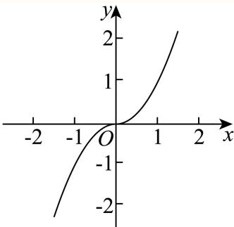
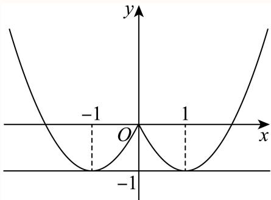

# 2025一模 函数与导数专题 · 教师版

> 本地预览：题目、答案及分类尚未全部审定。校对使用的PDF为高中工作台解析版，尚未逐区确认区级印刷原卷。

## 定义域、指数对数与分段求值

明确真数、底数及分段范围，由给值或参数约束求解。

### 嘉定 · 第1题

函数 $y = \log _ { 2 } ( x ^ { 2 } - 1 )$ )的定义域为

> 本题资料或解析有待核事项，预览不可作为已审定成品。

**考点：** 对数真数限制与定义域；二次不等式求解

**难度依据：** 真数大于零后直接解二次不等式

**核查说明：** 题干与解析已用于人工归类，尚未完成整题公式校净与独立数学终审。

【答案】$( - \infty , - 1 ) \cup ( 1 , + \infty )$

【解析】

利用对数函数的定义，列出不等式求解即得.

函数 $\ { \cdot } y = \log _ { 2 } ( x ^ { 2 } - 1 )$ 有意义，则 $\ : x ^ { 2 } - 1 > 0 \ :$ ，解得x < −1或x > 1，

所以函数 $: y = \log _ { 2 } ( x ^ { 2 } - 1 )$ 的定义域为 $( - \infty , - 1 ) \cup ( 1 , + \infty )$

故答案为： $( - \infty , - 1 ) \cup ( 1 , + \infty )$

### 嘉定 · 第13题

已知a为正数，则 $^ { * } a > 3 ^ { * }$ 是 ${ } ^ {  } a ^ { a } > a ^ { 3 } { } ^ { , }$ 的（ ）.

A. 充分非必要条件

B. 必要非充分条件

C. 充要条件

D. 既非充分也非必要条件

> 本题资料或解析有待核事项，预览不可作为已审定成品。

**考点：** 指数不等式的充分必要条件；按指数函数底数分类讨论；变底数指数大小比较

**难度依据：** 底数在零一之间时不等方向变化

**核查说明：** 题干与解析已用于人工归类，尚未完成整题公式校净与独立数学终审。

【答案】A

【解析】

根据给定条件，当 $a > 3$ 时，利用指数函数的单调性即可判断，当 $a ^ { a } > a ^ { 3 }$ 时，分类讨论，最后利用充分条件、必要条件的定义判断作答.

当 $a >$ 3时，所以 $\langle y = a ^ { x }$ 为增函数，所以 $a ^ { a } > a ^ { 3 }$ ，

当 $a ^ { a } > a ^ { 3 }$ 时，当a > 1时，则 $a > 3 ,$ ，当0 $< a <$ 1时，则 $a < 3$ ，此时0 $< a < 1$ ；

所以 $^ { * } a > 3 ^ { * }$ 是 ${ } ^ { \cdot } a ^ { a } > a ^ { 3 } { } ^ { , }$ ”的充分非必要条件.

故选：A.

### 奉贤 · 第4题

设 $f(x)=\begin{cases}\ln x+1,&x>0,\\2^x+1,&x\leq 0.\end{cases}$ 若 $f(x_0)=1$，则 $x_0=$______。

> 本题资料或解析有待核事项，预览不可作为已审定成品。

**考点：** 分段指数对数函数的给值求自变量

**难度依据：** 须分别检查两段方程与区间

**核查说明：** 题干与解析已用于人工归类，尚未完成整题公式校净与独立数学终审。；题干分段函数缺少x>0时ln x+1这一整支；已定向下载同名PDF，第1页文字层确认两支为ln x+1(x>0)、2^x+1(x≤0)，本分类未改底稿。；题干与解析已用于人工归类，尚未完成整题公式校净与独立数学终审。；题干分段函数缺少x>0时ln x+1这一整支；已定向下载同名PDF，第1页文字层确认两支为ln x+1(x>0)、2^x+1(x≤0)，本分类未改底稿。

【答案】1

【解析】

根据分段函数，分 $x _ { 0 } > 0$ 和 $\mathrm { { I } } x _ { 0 } \le 0$ 求解即可.

当 $x _ { 0 } > 0 \mathbb { H } \ b { \mathrm { J } }$ ， $f \left( x _ { 0 } \right) = \ln x _ { 0 } + 1 = 1$ ，解得： $x _ { 0 } = 1$ ，满足；

当 $x _ { 0 } \leq$ 0时， $f \left( x _ { 0 } \right) = 2 ^ { x _ { 0 } } + 1 = 1$ ，方程无解，

所以 $x _ { 0 } = 1$ ，

故答案为：1

### 奉贤 · 第14题

函数 $y = \log _ { 2 } \sin x + \log _ { 2 } \cos x$ ，则下列命题正确的是（ ）

A. 函数是偶函数

B. 函数定义域是 $\left( 0 , { \frac { \pi } { 2 } } \right)$

C. 函数最大值−1

D. 函数的最小正周期为π

> 本题资料或解析有待核事项，预览不可作为已审定成品。

**考点：** 复合对数函数定义域与周期；正弦余弦同正区域及二倍角最值

**难度依据：** 周期不能只看化简式还需保留原定义域

**核查说明：** 题干与解析已用于人工归类，尚未完成整题公式校净与独立数学终审。

【答案】C

【解析】

求出函数f(x)的定义域，可判断AB选项；利用二倍角的正弦公式以及正弦函数的有界性可判断C选项；利用正弦型函数的周期性可判断D选项.

设 $f \left( x \right) = \log _ { 2 } \sin x + \log _ { 2 } \cos x$ ，由 $\left\{ { \begin{array} { l } { \sin x > 0 } \\ { \cos x > 0 } \end{array} } \right.$ 可得 $2 k \pi < x < 2 k \pi + { \frac { \pi } { 2 } } ( k \in { \bf Z } )$

所以，函数f(x)的定义域为 $\left\{ x \Big \vert 2 k \pi < x < 2 k \pi + \frac { \pi } { 2 } , k \in \mathbf { Z } \right\}$ ，定义域不关于原点对称

所以，函数f(x)不是偶函数，A错B错；

当 $2 k \pi < x < 2 k \pi + \frac { \pi } { 2 } ( k \in { \bf Z } )$ 时，则 $\displaystyle { \mathfrak { k } } \pi < 2 x < 4 k \pi + \pi \left( k \in \mathbf { Z } \right)$

$$
f (x) = \log_ {2} (\sin x \cos x) = \log_ {2} \left(\frac {1}{2} \sin 2 x\right) \leq \log_ {2} \frac {1}{2} = - 1,
$$

当且仅当 $2 x = \frac { \pi } { 2 } + 4 k \pi \left( k \in \mathbf { Z } \right)$ 时，即当 $x = { \frac { \pi } { 4 } } + 2 k \pi \left( k \in { \mathbf { Z } } \right)$ 时，函数f(x)取最大值−1，C对；

因为 $f \left( 2 \pi + x \right) = \log _ { 2 } \sin \left( 2 \pi + x \right) + \log _ { 2 } \cos \left( 2 \pi + x \right) = \log _ { 2 } \sin x + \log _ { 2 } \cos x = f \left( x \right)$

结合函数f(x)的定义域可知，函数f(x)的最小正周期为2π，D错.故选：C.

### 奉贤 · 第17题

已知函数 $y = f \left( x \right)$ ，其中 $f \left( x \right) = a ^ { x }$ （常数 $[ a > 0$ 且 $. a \neq 1 )$ ）
(1) (6分)若函数 $\boldsymbol { \cdot } \boldsymbol { y } = \boldsymbol { f } \left( \boldsymbol { x } \right)$ 的图象过点(2,9)，求关于x的不等式 $f \left( \left| 2 x - 1 \right| \right) >$ 3的解集；
(2) (8分)若存在 ${ \bf \Phi } _ { : x } \in ( 0 , 1 ]$ ，使得数列f (1)、f (tx)、 $f \left( x ^ { 2 } + 2 \right)$ 是等比数列，求实数t的取值范围.

> 本题资料或解析有待核事项，预览不可作为已审定成品。

**考点：** （1）定底数后解绝对值不等式；（2）等比条件化为参数函数并求受限值域

**难度依据：** （1）定底数后解绝对值不等式；（2）等比条件化为参数函数并求受限值域

**核查说明：** 仅完成本题所述针对性校核；不代表其他题或全卷数学通过。；题干与解析已用于人工归类，尚未完成整题公式校净与独立数学终审。；第2问“存在x”变量被OCR写为冒号与乱码，须规范存在量词。；仅完成本题所述针对性校核；不代表其他题或全卷数学通过。；题干与解析已用于人工归类，尚未完成整题公式校净与独立数学终审。；第2问“存在x”变量被OCR写为冒号与乱码，须规范存在量词。

【解析】

(1) 若函数 $\boldsymbol { \cdot } \boldsymbol { y } = \boldsymbol { f } \left( \boldsymbol { x } \right)$ 的图象过点(2,9)，则 $f \left( 2 \right) = a ^ { 2 } = 9$

解得 $\ Q = 3 , a = - 3$ 舍去，所以 $f \left( x \right) = 3 ^ { x }$

由 $f \left( \left. 2 x - 1 \right. \right) = 3 ^ { \left. 2 x - 1 \right. } > \left. \begin{array} { r l r } \end{array} \right.$ 3得 $| 2 x - 1 | > 1$

解得 $x > 1$ 或 $\vert x < 0$

所以不等 $\vec { \pm } \hat { \zeta } f \left( | 2 x - 1 | \right) >$ 3的解集为 $\{ x | x > 1$ 1或 $x < 0 \}$ ；

(2) $f \left( 1 \right) = a , f \left( t x \right) = a ^ { t x } , f \left( x ^ { 2 } + 2 \right) = a ^ { x ^ { 2 } + 2 } ,$

若存在$x\in(0,1]$ ，使得数列f (1)、f (tx)、 $f \left( x ^ { 2 } + 2 \right)$ 是等比数列，

则 $\rfloor a ^ { 2 t x } = a ^ { x ^ { 2 } + 2 } \cdot a .$ ，可得 $2 t x = x ^ { 2 } + 3$

由 $\vert x \in ( 0 , 1 ]$ 可得t ${ \bf \tau } = \frac { x ^ { 2 } + 3 } { 2 x } = \frac { x } { 2 } + \frac { 3 } { 2 x } ,$ ，

$$
\text {令} g (x) = \frac {x}{2} + \frac {3}{2 x} (x \in (0, 1 ]), g ^ {\prime} (x) = \frac {1}{2} - \frac {3}{2 x ^ {2}} = \frac {x ^ {2} - 3}{2 x ^ {2}},
$$

当 $x \in ( 0 , 1 ]$ 时， $x ^ { 2 } \in ( 0 , 1 ]$ ，所以 $g ^ { \prime } \left( x \right) = \frac { x ^ { 2 } - 3 } { 2 x ^ { 2 } } < 0 .$ ，

可得 $\wp \left( x \right) = { \frac { x } { 2 } } + { \frac { 3 } { 2 x } }$ 在 $x \in ( 0 , 1 ]$ 上单调递减，所以 $g \left( x \right) \geq g \left( 1 \right) = 2$ 则实数t的取值范围 $[ 2 , + \infty )$

### 宝山 · 第8题

…
若 $9 ^ { a } = 4 ^ { b } = m$ ，且 ${ \frac { 1 } { a } } + { \frac { 1 } { b } } = 2$ ，则m = .

**考点：** 指数关系与对数换底

**难度依据：** 涉及指数关系与对数换底；难度为教师预估，需结合原题条件复核。

**核查说明：** 依据现有底稿归类，尚未逐页校卷、公式校净或独立数学终审。

【答案】6.

【解析】

利用换底公式可得 $\mathbf { \partial } \cdot a = { \frac { \lg m } { \lg 9 } } , b = { \frac { \lg m } { \lg 4 } }$ 根据题目条件结合对数的运算性质可得结果

$$
\because 9 ^ {a} = 4 ^ {b} = m > 0, \therefore a = \log_ {9} m = \frac {\lg m}{\lg 9}, b = \log_ {4} m = \frac {\lg m}{\lg 4},
$$

$$
\because \frac {1}{a} + \frac {1}{b} = 2,
$$

$$
\therefore \frac {\lg 9}{\lg m} + \frac {\lg 4}{\lg m} = \frac {\lg 9 + \lg 4}{\lg m} = \frac {\lg 3 6}{\lg m} = \log_ {m} 3 6 = 2,
$$

$$
\therefore m ^ {2} = 3 6,
$$

$$
\because m > 0, \therefore m = 6.
$$

故答案为：6.

### 崇明 · 第8题

已知 $f \left( x \right) = \left\{ { \begin{array} { l } { 2 ^ { x } - 1 , x > 1 } \\ { x - 1 , x \leq 1 } \end{array} } \right.$ ，关于x的方程f(x) = 2的解x =

**考点：** 分段函数方程

**难度依据：** 涉及分段函数方程；难度为教师预估，需结合原题条件复核。

**核查说明：** 依据现有底稿归类，尚未逐页校卷、公式校净或独立数学终审。

【答案】$\log _ { 2 } 3$

【解析】

根据分段函数的形式分段求解即可.

f(x) = 2等价于 $\left\{ { \begin{array} { l l } { 2 ^ { x } - 1 = 2 } \\ { x > 1 } \end{array} } \right.$ 或 $\left\{ { x - 1 = 2 \atop x \leq 1 } \right.$

故 $x = \log _ { 2 } 3$ ，

故答案为： $\log _ { 2 } 3$

### 徐汇 · 第2题

已知函数 $y=f(x)$，其中 $f(x)=\begin{cases}\ln x,&x>0,\\-1,&x\le0,\end{cases}$，则 $f(1)=$______。

> 本题资料或解析有待核事项，预览不可作为已审定成品。

**考点：** 分段对数函数代值

**难度依据：** 分段对数函数代值；按所需步骤与推理量估计

**核查说明：** 题干与解析已用于人工归类，尚未完成整题公式校净与独立数学终审。；分段函数只识别到x>0一段；题干其余分支缺失，须回源。；题干与解析已用于人工归类，尚未完成整题公式校净与独立数学终审。；分段函数只识别到x>0一段；题干其余分支缺失，须回源。

【答案】0

【解析】

根据分段函数解析式求函数值.

由解析式知f(1) = ln 1 = 0.

故答案为：0

### 松江 · 第3题

函数 $y = \log { ( 3 x + 1 ) } + \sqrt { 1 }$ −x的定义域是

> 本题资料或解析有待核事项，预览不可作为已审定成品。

**考点：** 对数根式定义域；定义域不等式组

**难度依据：** 对数根式定义域；定义域不等式组；按所需步骤与推理量估计

**核查说明：** 题干与解析已用于人工归类，尚未完成整题公式校净与独立数学终审。；题干根号覆盖范围错误，解析为√(1−x)，须回源。；题干与解析已用于人工归类，尚未完成整题公式校净与独立数学终审。；题干根号覆盖范围错误，解析为√(1−x)，须回源。

【答案】$\left( - { \frac { 1 } { 3 } } , 1 \right]$

【解析】

根据函数的解析式，列出使解析式有意义的不等式组，求出解集即可

要使函数 $\begin{array} { r } { \dot { \boldsymbol { y } } = \mathbb { g } \left( 3 \boldsymbol { x } + 1 \right) + \sqrt { 1 - \boldsymbol { x } } } \end{array}$ 有意义，则 $\left\{ { \begin{array} { l } { 3 x + 1 > 0 } \\ { 1 - x \geq 0 } \end{array} } \right.$ ，解得 $- { \frac { 1 } { 3 } } < x \leq 1$

即函数 $\begin{array} { r } { \dot { \boldsymbol { \cdot } } \boldsymbol { y } = \mathrm { l g } \left( 3 x + 1 \right) + \sqrt { 1 - x } } \end{array}$ 的定义域为 $\left( - { \frac { 1 } { 3 } } , 1 \right]$ .

故答案为： $\left( - { \frac { 1 } { 3 } } , 1 \right]$

### 浦东 · 第1题

若对数函数 $\langle y = \log _ { a } x ( a > 0 \mathbb { E } a \neq 1 )$ 的图象经过点(4, 2)，则实数a = .

> 本题资料或解析有待核事项，预览不可作为已审定成品。

**考点：** 对数函数代点求底数

**难度依据：** 对数函数代点求底数；按所需步骤与推理量估计

**核查说明：** 题干与解析已用于人工归类，尚未完成整题公式校净与独立数学终审。

【答案】2.

【解析】

直接将点代入计算即可.

将点(4, 2)代入 $. y = \log _ { a }$ x得 $2 = \log _ { a } 4$ ，解得a = 2

故答案为：2.

### 浦东 · 第8题

已知函数 $y = f \left( x \right)$ 的表达式为 $f \left( x \right) = { \left\{ { \left( { \frac { 1 } { 2 } } \right) } ^ { x } - 3 , x \leq 0 \right.} _ { x ^ { 2 } , x > 0 }  $ ，则不等式 $f \left( x \right) \leq 1$ 的解集为

> 本题资料或解析有待核事项，预览不可作为已审定成品。

**考点：** 分段函数不等式；指数和二次不等式

**难度依据：** 分段函数不等式；指数和二次不等式；按所需步骤与推理量估计

**核查说明：** 题干与解析已用于人工归类，尚未完成整题公式校净与独立数学终审。

【答案】[−2, 1].

【解析】

根据题意分 $\cdot x \leq 0 \hbar \mathbb { \cdot } \mathbb { 1 } x > 0$ 两种情况，结合指数函数单调性解不等式即可

$$
f (x) \leq 1
$$

若 $x \leq 0$ ，则 $\left( { \frac { 1 } { 2 } } \right) ^ { x } - 3 \leq 1$ 即 $\left( { \frac { 1 } { 2 } } \right) ^ { x } \leq 4 = \left( { \frac { 1 } { 2 } } \right) ^ { - 2 }$ ，解得− $\cdot 2 \leq x \leq 0 _ { \mathrm { { i } } }$

若 $x > 0 .$ ，则 $x ^ { 2 } \leq 1$ ，解得 $0 < x \le 1 ;$

综上所述：不等式 $f \left( x \right) \leq$ 1的解集为[−2, 1].

故答案为：[−2, 1].

### 虹口 · 第2题

函数 $\ y = \ln { \frac { x } { x - 1 } }$ 的定义域是

**考点：** 对数真数条件与分式不等式

**难度依据：** 涉及对数真数条件与分式不等式；难度为教师预估，需结合原题条件复核。

**核查说明：** 依据现有底稿归类，尚未逐页校卷、公式校净或独立数学终审。

【答案】$\left( - \infty , 0 \right) \cup \left( 1 , + \infty \right)$

【解析】

由对数函数的定义可得 $\frac { x } { x - 1 } > 0$ ，解不等式即可得出答案

函数 $\ y = \ln { \frac { x } { x - 1 } }$ 的定义域是 $\frac { x } { x - 1 } > 0$

所以 $x \left( x - 1 \right) > 0$ ，解得： $x > 1 \not \equiv \not \chi < 0$

所以函数的定义域为： $\left( - \infty , 0 \right) \cup \left( 1 , + \infty \right)$

故答案为： $\left( - \infty , 0 \right) \cup \left( 1 , + \infty \right)$

### 虹口 · 第5题

设a > 0且 $. a \neq 1$ ，则函数 $\{ y = 2 + \log _ { a }$ x的图像恒过的定点坐标为

**考点：** 对数函数图像定点

**难度依据：** 涉及对数函数图像定点；难度为教师预估，需结合原题条件复核。

**核查说明：** 依据现有底稿归类，尚未逐页校卷、公式校净或独立数学终审。

【答案】(1, 2).

【解析】

$\stackrel { \wedge } { \prec } x = 1$ ，求得y = 2恒成立，进而得到函数恒过定点，得到答案.

令x = 1，可得 $y = 2 + \log _ { a } 1$ = 2恒成立，

所以函数 $\begin{array} { r } { y = 2 + \log _ { a } : } \end{array}$ x的图象恒过定点(1,2).

故答案为：(1, 2).

### 金山 · 第3题

已知函数$y=f(x)$的表达式为$f(x)=\begin{cases}2^x,&x\leq2,\\\log_2 x,&x>2,\end{cases}$则$f(4)$的值为____。

> 本题资料或解析有待核事项，预览不可作为已审定成品。

**考点：** 分段函数求值

**难度依据：** 涉及分段函数求值；难度为教师预估，需结合原题条件复核。

**核查说明：** 分段函数另一支缺失，无法据现存题干求f(4)，须回源。；依据现有底稿归类，尚未逐页校卷、公式校净或独立数学终审。

【答案】2

【解析】

根据给定分段函数解析式，求函数值即可.

由题设 $f ( 4 ) = \log _ { 2 } 4 = 2 .$

故答案为：2

### 金山 · 第17题

已知常数 $. a > 1$ ，函数y = f(x)的表达式为 $f \left( x \right) = \log _ { a } \left( x + 2 \right) - \log _ { a } \left( 2 - x \right)$
(1) (6分)证明：函数 $y = f \left( x \right)$ 是奇函数；
(2) (8分)若函数y = f(x)在区间[0,1]上的最大值为2，求实数a的值

**考点：** （1）对数定义域与奇偶；（2）区间最值反求底数

**难度依据：** 涉及（1）对数定义域与奇偶；（2）区间最值反求底数；难度为教师预估，需结合原题条件复核。

**核查说明：** 依据现有底稿归类，尚未逐页校卷、公式校净或独立数学终审。

【解析】

(1) 由 $\displaystyle \int _ { 2 - x > 0 } ^ { x + 2 > 0 } \mathop { } ^ { \prime \boxplus } - 2 < x < 2 ,$

所以函数 $y = f \left( x \right)$ 的定义域为(−2,2)，关于原点对称，

$$
f (- x) = \log_ {a} (- x + 2) - \log_ {a} (2 + x) = - f (x),
$$

所以函数 $y = f \left( x \right)$ 是奇函数；

$$
f (x) = \log_ {a} (x + 2) - \log_ {a} (2 - x) = \log_ {a} \frac {x + 2}{2 - x}, \tag {2}
$$

$$
\text {令} u = - \frac {x - 2 + 4}{x - 2} = - 1 - \frac {4}{x - 2},
$$

则 $\lvert u = - 1 - \frac { 4 } { x - 2 }$ 在[0,1]上单调递增，

又 $y = \log _ { a } x \left( a > 1 \right)$ 为增函数，

所以 $f \left( x \right) = \log _ { a } \left( x + 2 \right) - \log _ { a } \left( 2 - x \right)$ 在[0,1]上单调递增，

其最大值为 $f \left( 1 \right) = \log _ { a } 3 = 2$

解得 $a = { \sqrt { 3 } } .$

### 长宁 · 第7题

已知 $| a \in \left\{ - 1 , - { \frac { 2 } { 3 } } , - { \frac { 1 } { 3 } } , { \frac { 1 } { 3 } } , { \frac { 2 } { 3 } } , 1 , 2 , 3 \right\}$ ,函数 $\mathbf { \dot { \boldsymbol { y } } } = \mathbf { \boldsymbol { x } } ^ { a }$ 的大致图像如图所示，则a =

**考点：** 结合奇偶性与单调性判断幂指数

**难度依据：** 幂函数图像辨识；结合奇偶性与单调性判断幂指数

【答案】$- { \frac { 2 } { 3 } }$

【解析】

根据图像的对称性，可得到函数的奇偶性；再由图像与坐标轴的关系，即可判断a的取值

因为图像关于y轴对称，所以函数是偶函数；

又因为图像与坐标轴无交点，所以指数a为负数.综上所述， $a = - { \frac { 2 } { 3 } } .$

故答案为： $- { \frac { 2 } { 3 } }$

### 闵行 · 第7题

已知函数 $\overset { } { \cdot } y = \left\{ \begin{array} { l l } { \log _ { 2 } x , } & { x > 0 } \\ { f \left( x \right) , } & { x < 0 } \end{array} \right.$ 为奇函数，则f (−8) =

**考点：** 奇偶性变换后代入对数分段

**难度依据：** 奇函数与分段求值；奇偶性变换后代入对数分段

【答案】−3

【解析】

首先求出当x = 8时的函数值，再根据奇函数的性质得解.

因为函数 $\overset { } { \underset { } { \cdot } } y = \left\{ \begin{array} { l l } { \log _ { 2 } x , } & { x > 0 } \\ { f \left( x \right) , } & { x < 0 } \end{array} \right.$ 为奇函数，

当x = 8时 $\mathbf { \dot { \boldsymbol { y } } } = \log _ { 2 } \mathbf { \boldsymbol { 8 } } = \log _ { 2 } \mathbf { 2 ^ { 3 } } = 3 \log _ { 2 } \mathbf { 2 } = \mathbf { 3 } ,$

所以f (−8) = −3.

故答案为：−3

### 闵行 · 第14题

下列函数中，在区间 $( 0 , + \infty )$ 上是严格减函数的为（ ）

A. $y = x ^ { \frac { 1 } { 2 } }$

B. $y = { \frac { 1 } { x ^ { 2 } + 1 } }$

C. $y = 2 ^ { x }$

D. $y = \lg \left. x \right.$

**考点：** 比较四种函数在正半轴单调性

**难度依据：** 基本函数单调性判断；比较四种函数在正半轴单调性

【答案】B

【解析】

利用解析式直接判断各选项中函数在 $( 0 , + \infty )$ 上的单调性即可.

对于A，函数 $\scriptstyle \left[ y \right] = x ^ { \frac { 1 } { 2 } }$ 在 $( 0 , + \infty )$ 上是严格增函数，A不是；

对于B，函数 $: y = { \frac { 1 } { x ^ { 2 } + 1 } }$ 在 $( 0 , + \infty )$ 上是严格减函数，B是；

对于C，函数 $\cdot y = 2 ^ { x } \mathcal { \overleftarrow { 1 } } \mathbb { E } ( 0 , + \infty )$ 上是严格增函数，C不是；

对于D，当 $x > 0 |$ 时， $y = \lg \left. x \right. = \lg x$ 在 $( 0 , + \infty )$ 上是严格增函数，D不是.

故选：B.

### 青浦 · 第11题

若函数 $\langle y = \log _ { \frac { 1 } { 2 } } \left( a x ^ { 2 } - 8 x + 1 5 \right)$ 在区间(1,2)上严格增，则实数a的取值范围

> 本题资料或解析有待核事项，预览不可作为已审定成品。

**考点：** 复合对数函数单调与定义域；区间恒成立的参数范围及开端点

**难度依据：** 内层须同时严格递减与真数恒正

**核查说明：** 题干与解析已用于人工归类，尚未完成整题公式校净与独立数学终审。；原解对数底数曾误写1/9但题干为1/2，需统一回核。；题干与解析已用于人工归类，尚未完成整题公式校净与独立数学终审。；原解对数底数曾误写1/9但题干为1/2，需统一回核。

【答案】$\left[ { \frac { 1 } { 4 } } , 2 \right]$

【解析】

由复合函数的单调性和定义域，有函数 $t = a x ^ { 2 } - 8 x + 1 5$ 在 区 间 (1, 2) 上 $\overrightarrow  \} ^ { \mathrm { ~ \scriptsize ~ 1 } \mathrm { { E } } }$ 格减，$a x ^ { 2 } - 8 x + 1 5 >$ 0在区间(1,2)上恒成立，利用导数和二次函数的性质求实数a的取值范围

函数 $\langle y = \log _ { \frac { 1 } { 9 } } \left( a x ^ { 2 } - 8 x + 1 5 \right)$ ，令 $\cdot t = a x ^ { 2 } - 8 x + 1 5$ ，则 $\boldsymbol { y } = \log _ { \frac { 1 } { 2 } } t$ ，

函数 $y = \log _ { \frac { 1 } { 2 } } \left( a x ^ { 2 } - 8 x + 1 5 \right)$ 在区间(1, 2)上严格增，

由函数 $[ y = \log _ { \frac { 1 } { 2 } }$ t在定义域上严格减，则函数 $t = a x ^ { 2 } - 8 x + 1 5$ 在区间(1,2)上严格减，

有 $t ^ { \prime } = 2 a x - 8 \leq 0$ 在区间(1,2)上恒成立，即 ${ \mathrm { l } } a \leq { \frac { 4 } { x } }$ 在(1,2)上恒成立，得 $a \leq 2$

又 $a x ^ { 2 } - 8 x + 1 5 > 0$ 在区间(1,2)上恒成立，则 $a > \frac { 8 } { x } - \frac { 1 5 } { x ^ { 2 } }$ 在(1,2)上恒成立，

令 ${ \bf \tilde { \rho } } s = \frac { 1 } { x }$ ，则 $\vert a > 8 s - 1 5 s ^ { 2 }$ 在 $\left( { \frac { 1 } { 2 } } , 1 \right)$ 上恒成立，

由二次函数的性质可得 $a \geq \frac { 8 } { 2 } - \frac { 1 5 } { 4 } = \frac { 1 } { 4 }$

所以实数a的取值范围为 $\left[ { \frac { 1 } { 4 } } , 2 \right]$

故答案为： $\left[ { \frac { 1 } { 4 } } , 2 \right]$

### 青浦 · 第13题

已知x, $y \in \mathbf { R }$ 且满足 $x > y _ { \mathrm { : } }$ ，则下列关系式恒成立的是（ ）.

A. $\frac { 1 } { x ^ { 2 } + 1 } < \frac { 1 } { y ^ { 2 } + 1 }$

B. $\ln \left( x ^ { 2 } + 1 \right) > \ln \left( y ^ { 2 } + 1 \right)$

C. $\sin x > \sin y$

D. $x ^ { 3 } > y ^ { 3 }$

> 本题资料或解析有待核事项，预览不可作为已审定成品。

**考点：** 基本函数全局单调性的反例辨析；实数序关系在函数映射下的保持

**难度依据：** 区分局部单调和全实数单调

**核查说明：** 题干与解析已用于人工归类，尚未完成整题公式校净与独立数学终审。

【答案】D

【解析】

利用不等式的性质，以及对数函数的性质、幂函数的性质、正弦函数的图象性质求解.

对A， $\mathbb { H } x = - 1 , y = - 2$ ，则 $\frac { 1 } { x ^ { 2 } + 1 } > \frac { 1 } { y ^ { 2 } + 1 }$ ，A错误；

对B，取 $\scriptstyle \left. x = - 1 , y = - 2 \right.$ ，则l $1 2 < \ln { 5 }$ ，即ln $\left( x ^ { 2 } + 1 \right) < \ln \left( y ^ { 2 } + 1 \right)$ )，B错误；

对C， $\sharp \chi = \frac { 5 \pi } { 6 } , y = \frac { 2 \pi } { 3 }$ ，满足 $x > y ,$ ， $\arcsin { \frac { 5 \pi } { 6 } } < \sin { \frac { 2 \pi } { 3 } }$ ，C错误；

对D，因为幂函数 $f ( x ) = x ^ { 3 }$ 在定义域R上单调递增，且 $x > y ,$ ，所以 $x ^ { 3 } > y ^ { 3 }$ ，D正确；故选：D.

### 黄浦 · 第9题

若 ${ \overline { { f \left( x \right) = x ^ { 3 } } } } , g \left( x \right) = { \left\{ \begin{array} { l l } { f \left( x \right) , x \geq 0 , } \\ { f \left( - x \right) , x < 0 } \end{array} \right. }$ 则不等 $\nexists \lor g ( x ) < - x$ 的解集为

**考点：** 分段求函数表达式和解集

**难度依据：** 分段函数与不等式；分段求函数表达式和解集

【答案】(−1, 0).

【解析】

先求出分段函 $\sharp \chi _ { g } ( x )$ 的解析式，再求不等 $\vec { \tau } \hat { \zeta } g \left( x \right) < - x$ 的解集.

$x \ge$ 0时， $g \left( x \right) = x ^ { 3 }$ 9

$x <$ 0时， $- x > 0 , g \left( x \right) = \left( - x \right) ^ { 3 } = - x ^ { 3 } ,$

$$
\therefore g \left(x\right) = \left\{ \begin{array}{l} x ^ {3}, x \geq 0, \\ - x ^ {3}, x <   0, \end{array} \right.
$$

由g (x) < −x得， $\left\{ \begin{array} { l } { x \geq 0 } \\ { x ^ { 3 } < - x } \end{array} \right. , \mathbb { O } \mathbb { E } \hat { \zeta } ^ { \left\{ x < 0 \right. }  - x ^ { \left. \bigotimes \right.} $

不等式组①无解；

不等式组②的解集为(−1,0)

综上，不等 $\nexists \zeta g ( x ) < - x$ 的解集为(−1, 0).

故答案为：(−1, 0).

## 奇偶、单调、对称与周期

利用对称和递推关系比较函数值，注意定义域与开端点。

### 嘉定 · 第9题

已知 $f \left( x \right) = \ln { \left( x + 1 \right) } , g \left( x \right) = \left\{ { f \left( x \right) } , x \geq 0 \atop f \left( - x \right) , x < 0  , \right.$ 则 $\mid g ( x ) > x + 2 -$ e的解集为

> 本题资料或解析有待核事项，预览不可作为已审定成品。

**考点：** 分段对数函数比较与构造函数；按自变量符号分类解函数不等式

**难度依据：** 两段处理不同且正半轴需用导数判单调

**核查说明：** 题干与解析已用于人工归类，尚未完成整题公式校净与独立数学终审。

【答案】$( - \infty , \mathbf { e } - 1 )$

【解析】

根据分段函数的性质，分情况整理不等式，当x ≥ 0时，整理不等式，构造函数，利用导数研究新函数的单调性，当x < 0时，利用中间值法，可得答案.

当 $x \geq 0 \mathbb { H } \mathbf { f }$ ，可得ln $( x + 1 ) > x + 2 - \mathrm { e }$ ，整理可得 $\ln \left( x + 1 \right) - \left( x + 1 \right) > 1 - \mathrm { e }$

令 $\cdot t = 1 + x \geq 1$ ，令 $h \left( t \right) = \ln t - t ,$ 求导可得 $h ^ { \prime } \left( t \right) = \frac { 1 } { t } - 1 = \frac { 1 - t } { t } < 0 ,$

所以函数 $h \left( t \right) \mathcal { \left[ 1 , + \infty \right) }$ 单调递减，令 $\mathbf { \tilde { \rho } } _ { } h \left( t \right) = 1 - \mathbf { e }$ ，解得 $t = { \bf e } .$ ，则 $x = { \mathrm { e } } - 1$ 1

此时不等 $\pounds \hat { \boldsymbol { \rho } } ( \boldsymbol { x } ) > \boldsymbol { x } + 2 - \mathrm { e }$ 的解集为 $[ 0 , \mathrm { e } - 1 )$ ；

当 $x <$ 0时，可得ln $( 1 - x ) > x + 2 - \mathrm { e }$ ，由 $\mathbf { \Phi } _ { - } - x > 1$ ，则 $\mathrm { n } \left( 1 - x \right) > 0$

易知 $| x + 2 - \mathbf { e } < 0$ ，此时不等式 $\ ` g ( x ) > x + 2 - { \epsilon }$ e的解集为 $( - \infty , 0 )$

综上所述，不等式 $\left( g \left( x \right) \right) > x + 2 - \mathrm { e }$ 的解集为 $( - \infty , \mathbf { e } - 1 )$ ).

故答案为： $( - \infty , \mathbf { e } - 1 )$

### 宝山 · 第5题

…
已知a, b为实数，且函数 $\langle y = x ^ { 2 } + a x + 1 , x \in [ b , 4 ]$ 是偶函数，则a − b =

**考点：** 偶函数定义域对称与二次函数参数

**难度依据：** 涉及偶函数定义域对称与二次函数参数；难度为教师预估，需结合原题条件复核。

**核查说明：** 依据现有底稿归类，尚未逐页校卷、公式校净或独立数学终审。

【答案】4.

【解析】

根据函数的奇偶性与二次函数的对称性即可得a,b的值，从而得所求.

因为函数 $\ t y = x ^ { 2 } + a x + 1 , x \in [ b , 4 ]$ 是偶函数，

所以函数定义域关于原点对称，且函数图象关于你y轴对称，

所以b = −4，且 $- { \frac { a } { 2 } } = 0 \Rightarrow a = 0 ,$

所以 $a - b = 0 - ( - 4 ) = 4 .$

故答案为：4.

### 崇明 · 第13题

下列函数中，在其定义域上既是奇函数又是严格增函数的是（　）。

A. $y=x^3$

B. $y=\mathrm e^x$

C. $y=\lg x$

D. $y=\sin x$

> 本题资料或解析有待核事项，预览不可作为已审定成品。

**考点：** 奇偶性与严格单调性

**难度依据：** 涉及奇偶性与严格单调性；难度为教师预估，需结合原题条件复核。

**核查说明：** 题干选项不完整，须核题图及原卷。；依据现有底稿归类，尚未逐页校卷、公式校净或独立数学终审。

【答案】A

【解析】

利用奇偶性的定义及基本函数的性质逐个判断即可.

对于A， $y = x ^ { 3 }$ 的定义域为R，且 $\left( - x \right) ^ { 3 } = - x ^ { 3 }$ ，所以 $. y = x ^ { 3 }$ 为奇函数，

又 $. y = x ^ { 3 }$ 是严格增函数，正确；

对于B，y = ex的定义域为R，且 $\mathrm { e } ^ { - x } \neq - \mathrm { e } ^ { x }$ ，所以 $\boldsymbol { \mathscr { s } } _ { } = \mathrm { e } ^ { x }$ 不为奇函数，错误；

对于C，y = lgx的定义域为 $( 0 , + \infty )$ ，不关于原点对称，

所以y = lgx不具有奇偶性，y = lgx是严格增函数，错误；

对于D，y = sinx的定义域为R，且sin(−x) = −sinx，所以y = sinx为奇函数，

但y = sinx为周期函数，不是定义域R上的严格增函数，错误.

故选：A

### 徐汇 · 第5题

设 $a , b \in \mathbf { R } , f \left( x \right) = x ^ { 3 } + 3 \sin x + b .$ .若函数 $y = f \left( x \right)$ 是定义在 $[ - a , 2 a - 1 ]$ 上的奇函数，则 $a + b =$

> 本题资料或解析有待核事项，预览不可作为已审定成品。

**考点：** 奇函数定义域对称与函数值

**难度依据：** 奇函数定义域对称与函数值；按所需步骤与推理量估计

**核查说明：** 题干与解析已用于人工归类，尚未完成整题公式校净与独立数学终审。

【答案】1.

【解析】

利用奇函数的定义域关于原点对称，且满足 $f \left( - x \right) + f \left( x \right) = 0$ ，即可求出结果.由函数 $\boldsymbol { \cdot } \boldsymbol { y } = \boldsymbol { f } \left( \boldsymbol { x } \right)$ 是定义在 $[ - a , 2 a - 1 ]$ 上的奇函数，可知−a + 2a − 1 = 0 ⇒ a = 1，再由 $\mid f \left( - x \right) + f \left( x \right) = \left( - x \right) ^ { 3 } + 3 \sin \left( - x \right) + b + x ^ { 3 } + 3 \sin x + b = 2 b = 0 \Rightarrow b = 0 ,$ 所以a + b = 1，

故答案为：1.

### 徐汇 · 第15题

已知函数 $y=f(x)$ 与它的导函数 $y=f'(x)$ 的定义域均为 $\mathbf R$。若函数 $y=f(x)$ 是偶函数且 $y=f'(x)$ 在 $(-\infty,0)$ 上是严格增函数，则下列各表中，可能成为 $y=f(x)$ 取值的是（　）。

A.

| $x$ | 1 | 2 | 3 | 4 |
|---|---|---|---|---|
| $f(x)$ | 2.8188 | 1.0000 | 0.3644 | 0.2468 |

B.

| $x$ | 1 | 2 | 3 | 4 |
|---|---|---|---|---|
| $f(x)$ | 0.7580 | 1.0000 | 1.3188 | 1.7979 |

C.

| $x$ | 1 | 2 | 3 | 4 |
|---|---|---|---|---|
| $f(x)$ | 2.4132 | 1.0000 | 1.5885 | 4.1116 |

D.

| $x$ | 1 | 2 | 3 | 4 |
|---|---|---|---|---|
| $f(x)$ | 0.8664 | 1.0000 | 1.1188 | 1.2240 |

> 本题资料或解析有待核事项，预览不可作为已审定成品。

**考点：** 偶函数导数与数据变化率

**难度依据：** 偶函数导数与数据变化率；按所需步骤与推理量估计

**核查说明：** 题干与解析已用于人工归类，尚未完成整题公式校净与独立数学终审。

【答案】B

【解析】

利用导函数的奇偶性和单调性以及正负取值，去分析原函数，即可得到判断函数 $y = f \left( x \right)$ 是偶函数，则 $f \left( - x \right) = f \left( x \right)$ ，两边求导得： $- f ^ { \prime } \left( - x \right) = f ^ { \prime } \left( x \right)$ 所以可知导函数 $y = f ^ { \prime } \left( x \right)$ 是奇函数，

由于函数 $y = f \left( x \right) ^ { \perp }$ 与它的导函数 $y = f ^ { \prime } \left( x \right)$ 的定义域均为R，

所以 $y = f ^ { \prime } \left( 0 \right) = 0$ ，又因为 $y = f ^ { \prime } \left( x \right)$ 在 $( - \infty , 0 )$ 上是严格增函数，

所以 $y = f ^ { \prime } \left( x \right)$ 在 $( 0 , + \infty )$ 上是严格增函数，

由于 $y = f \left( x \right)$ 是可导函数，所以它的图象是连续曲线，示意图如下：

则 $y = f ^ { \prime } \left( x \right)$ 在 $( 0 , + \infty )$ 上恒为正数且递增，

即 $y = f \left( x \right)$ 在 $( 0 , + \infty )$ 上单调递增，且变化率越来越大，

故AC显然错误，而D的变化率越来越小，所以只能选B，

故选：B.

### 普陀 · 第12题

设 $a > b > 0$ ，函数 $\boldsymbol { \mathfrak { y } } = \boldsymbol { \mathfrak { f } } \left( \boldsymbol { \mathfrak { x } } \right)$ 的表达式为 $f \left( x \right) = \ \left| x - { \frac { 1 } { x } } + \ln x \right|$ ，若 $f \left( a \right) = f \left( b \right)$ ，且关于x的方程$\left| x ^ { 2 } + a x + 2 a b \right| + \left| x ^ { 2 } - a x + 2 a b \right| = 2 a \left| x \right|$ 的整数解有且仅有4个，则a的取值范围是

> 本题资料或解析有待核事项，预览不可作为已审定成品。

**考点：** 单调函数倒数反对称关系；绝对值三角不等式等号与整数解；函数约束联动整数解计数

**难度依据：** 先推出ab为一再将四个整数根转为两个正整数解

**核查说明：** 仅修复所列OCR公式及其定界符错位；原解数学疑点和其他可渲染错识未因此消除。；题干与解析已用于人工归类，尚未完成整题公式校净与独立数学终审。；仅修复所列OCR公式及其定界符错位；原解数学疑点和其他可渲染错识未因此消除。；题干与解析已用于人工归类，尚未完成整题公式校净与独立数学终审。

【答案】$\left[ 3 , { \frac { 1 1 } { 3 } } \right)$

【解析】

令 $\mathbf { \dot { \sigma } } _ { g } ( x ) = x - { \frac { 1 } { x } } + \ln x .$ ，利用导数分析函数 ${ \bf \dot { \boldsymbol { g } } } \left( \boldsymbol { x } \right)$ 的单调性，作出函数f(x)的图象，结合已知条 件 分 析 得 出 $a b = 1$ ， 由 绝 对 值 三 角 不 等 式 分 析 得 出 $\left( x ^ { 2 } + 2 \right) ^ { 2 } - a ^ { 2 } x ^ { 2 } \le 0$ 令$p \left( x \right) = \left( x ^ { 2 } + 2 \right) ^ { 2 } - a ^ { 2 } x ^ { 2 }$ ，分析其奇偶性，可知，当 $x > 0 \mathbb { H } { \mathrm { , } } { \mathrm { ] } }$ ，满足不等 ${ \vec { x } } \mathbf { ( } a \geq x + { \frac { 2 } { x } }$ 的整数解有且只有2个，令 $h \left( x \right) = x + \frac { 2 } { x } ( x > 0 )$ ，数形结合可得出实数a的取值范围.

令 $\mathbf { \dot { \sigma } } _ { g } \left( x \right) = x - { \frac { 1 } { x } } + \ln x .$ ，其中 ${ \boldsymbol { \mathscr { x } } } > 0$ ，则 $g ^ { \prime } \left( x \right) = 1 + \frac { 1 } { x ^ { 2 } } + \frac { 1 } { x } >$ 0恒成立，

所以函数 $y \left( x \right) \# ( 0 , + \infty )$ 上单调递增，且 $g \left( 1 \right) = 0$

作出函数f(x)的图象如下图所示：

由a $> b >$ 0结合图可知， $0 < b < 1 < a _ { : }$ ，由 $f \left( a \right) = f \left( b \right)$ ，可得 $- g \left( b \right) = g \left( a \right)$

对任意的 $\left| x \in \left( 0 , + \infty \right) , g \left( { \frac { 1 } { x } } \right) = { \frac { 1 } { x } } - x + \ln { \frac { 1 } { x } } = { \frac { 1 } { x } } - x - \ln x = - g \left( x \right) \right|$

所以 $g \left( b \right) = - g \left( a \right) = g \left( \frac { 1 } { a } \right)$ ，故 $b = { \frac { 1 } { a } }$ ，即 $a b = 1$

由绝对值三角不等式可得

$$
\left| x ^ {2} + a x + 2 a b \right| + \left| x ^ {2} - a x + 2 a b \right| \geq \left| (x ^ {2} + a x + 2 a b) - (x ^ {2} - a x + 2 a b) \right| = 2 a | x |,
$$

当且仅当 $\left( x ^ { 2 } + a x + 2 a b \right) \left( x ^ { 2 } - a x + 2 a b \right) \leq 0 \sharp$ ，等号成 $\begin{array} { r } { \underline { { \dot { \Pi } } } . } \end{array}$ ，

即 $\left( x ^ { 2 } + a x + 2 \right) \left( x ^ { 2 } - a x + 2 \right) \leq 0$ ，即 $\left( x ^ { 2 } + 2 \right) ^ { 2 } - a ^ { 2 } x ^ { 2 } \leq 0 .$ ，

$\gamma p \left( x \right) = \left( x ^ { 2 } + 2 \right) ^ { 2 } - a ^ { 2 } x ^ { 2 }$ ，其 $\boldsymbol { \mathrm { \sf { F } } } \boldsymbol { x } \in \mathbf { R }$ ，则 $p \left( 0 \right) = 4 > 0$

则 $x = 0$ 不满足 $\left( x ^ { 2 } + 2 \right) ^ { 2 } - a ^ { 2 } x ^ { 2 } \leq 0 \quad$

则 $| p ( - x ) = [ ( - x ) ^ { 2 } + 2 ] ^ { 2 } - a ^ { 2 } \cdot ( - x ) ^ { 2 } = ( x ^ { 2 } + 2 ) ^ { 2 } - a ^ { 2 } x ^ { 2 } = p ( x ) ,$

所以函数p(x)为偶函数，

所以当 $x > 0$ 时，由 $(x^2+2)^2-a^2x^2\leq0$可得 $x ^ { 2 } + 2 \leq a x$ ，可得 $\cdot a \geq x + { \frac { 2 } { x } }$

$h \left( x \right) = x + \frac { 2 } { x }$ ，其中 $x > 0$ 则函数h(x)在 $\left( 0 , { \sqrt { 2 } } \right)$ 上单调递减，在 $\left( { \sqrt { 2 } } , + \infty \right)$ 上单调递

因为 $h \left( 1 \right) = 3 , h \left( 2 \right) = 3 , h \left( 3 \right) = 3 + \frac { 2 } { 3 } = \frac { 1 1 } { 3 } .$ ，则 $h \left( 1 \right) = h \left( 2 \right) < h \left( 3 \right)$

由题意可知，当 $x > 0 \sharp { \mathfrak { f } }$ ，满足不等 $a\geq x+\frac2x$ 的整数解有且只有2个，如下图所示：

所以 $h \left( 1 \right) \leq a < h \left( 3 \right)$ ，即3 ≤ $a < \frac { 1 1 } { 3 }$

综上所述，实数 的取值范围是 $\left[ 3 , { \frac { 1 1 } { 3 } } \right)$ .

故答案为： $\left[ 3 , { \frac { 1 1 } { 3 } } \right)$

关键点点睛：解本题的关键在于分析函数 $\overset { \cdot } { \boldsymbol { g } } \left( \boldsymbol { x } \right) = \boldsymbol { x } - \frac { 1 } { \boldsymbol { x } } + \ln \boldsymbol { x }$ 的单调性以及 $g \left( { \frac { 1 } { x } } \right) = - g \left( x \right)$ 得出 $a b = 1$ ，然后再求解不等式整数解的个数时，利用图象能够清晰地将不等关系利用图形的形式呈现得更为具体、直观.

## 二、选择题

### 普陀 · 第15题

设a > 0且 $a \neq 1$ ，k、m、n都是正整数，数列 $\left\{ a _ { n } \right\}$ 的通项公式为 $\mathfrak { l } a _ { n } = \left\{ \begin{array} { l l } { ( a - 6 ) n + 2 1 , ( 1 \leq n \leq m ) } \\ { a ^ { n - 3 } , ( n > m ) } \end{array} \right.$ ，记数列 $\left\{ a _ { n } \right\}$ 中前k项的最小值为 $ { \lvert h _ { k } }$ ，由所有 $h _ { k }$ 的值所组成的集合记为A，若集合A中仅有四个元素，则下列说法中错误的是（ ）

A. 当m = 3时，a的取值范围是(1,6)

B. 不存在a和m的值，使得 $. a _ { 4 } \notin A$

C. 当m = 4时，a的取值范围是(3, 6)

D. 存在a和m的值，使得 $\cdot a _ { 5 } \notin A$

> 本题资料或解析有待核事项，预览不可作为已审定成品。

**考点：** 分段数列前缀最小值的不同取值；分段线性指数函数的单调性；前缀最小值集合的元素计数

**难度依据：** 按底数及分段位置追踪最小值更新次数

**核查说明：** 题干与解析已用于人工归类，尚未完成整题公式校净与独立数学终审。；原解多处把通项讨论称为递推，部分分支解释跳步，需逐项核验前缀最小值集合。；题干与解析已用于人工归类，尚未完成整题公式校净与独立数学终审。；原解多处把通项讨论称为递推，部分分支解释跳步，需逐项核验前缀最小值集合。

【答案】C

【解析】

根据a不同的取值范围分析分段函数的性质，结合函数单调性，反证法，进而判断关于集合元素个数等命题的正确性，逐个判断真假即可.

对于A选项,当 $m = 3$ 时，对 ${ \vec { \mathbf { \tau } } } a \in ( 0 , 1 )$ )，根据分段函数的性质，会得到 $\displaystyle a _ { 1 } > a _ { 2 } > a _ { 3 } > . . . > a _ { n }$

由 $\mathbb { F } a \mathbb { E } ( 0 , 1 )$ )这个区间内，这样的递推会一直进行下去，所以集合A有无数个元素.

$\exists a \in ( 1 , 6 )$ 时，要满足 $a _ { 1 } > a _ { 2 } > a _ { 3 } > a _ { 4 }$ ，通过对分段函数的计算和分析，正好解得 $a \in ( 1 , 6 )$ 9

此时 $A = \{ a _ { 1 } , a _ { 2 } , a _ { 3 } , a _ { 4 } \}$ .并且当 $a \in [ 6 , + \infty )$ ，两个分段函数都是增函数，A中最多只存在两个元素.所以A选项正确.

对于B选项，当 $a \in ( 0 , 1 )$ 时，有 $a _ { 1 } > a _ { 2 } > a _ { 3 }$ 且 $a _ { 4 } > a _ { 5 } > a _ { 6 } > . . . > a _ { n }  0$

要想A有4个元素，根据函数的递推关系，如果 ${ \mathrm { : } } a _ { 3 } > 0$ ，那么根据函数性质会继续产生更多的元素，

所以必有 $\dot { \mathbf { \alpha } } a _ { 3 } \leq 0$ ，不然会有无数个元素.但是当a ≤ 0时，A中元素个数就不是4个了，

这就产生了矛盾，所以原命题正确，即B选项正确.

对于C选项，当 $a \in ( 0 , 1 )$ 时， $a _ { 1 } > a _ { 2 } > a _ { 3 } > a _ { 4 }$ ，令 $\cdot a _ { 4 } \leq 0$ ，通过对分段函数的计算解得$a \leq \frac { 3 } { 4 }$

由于 $a _ { 5 } > a _ { 6 } > . . . > a _ { n }  0$ ，此时 $A = \{ a _ { 1 } , a _ { 2 } , a _ { 3 } , a _ { 4 } \}$ ，这与选项中说的情况不符，所以C选项错误.

对于D选项，从前面的分析经验来看，要想 $a _ { 5 } \in A$ ，根据分段函数的性质，只能令 $\cdot m = 4$ $a _ { 5 } = a _ { 4 }$

由此得到方程 $4 ( a - 6 ) + 2 1 = a ^ { 2 }$ ，整理得 $\mathbf { \partial } : a ^ { 2 } - 4 a + 3 = 0$ ，解得 $\ Q = 1 \not \equiv \not \{ a = 3$

故选：C.

因为 $\lceil a \neq 1$ （根据前面的取值范围等条件），所以a = 3，D选项正确.

### 普陀 · 第18题

设函数 $\cdot y = f \left( x \right)$ 的表达式为 $f \left( x \right) = \sin \left( \omega x \right)$ ，其中 $\omega > 0$
(1) (6分)设ω = 1， $m \in \mathbf { R }$ ，若有且只有一个 $\cdot x _ { 0 } \in ( 0 , m )$ ，使得函数 $y = f \left( x + { \frac { \pi } { 4 } } \right)$ 取得最小值，求m的取值范围；
(2) (8分)若对任意的 $| x \in \mathrm { R } .$ ，皆有 $f \left( x \right) + f \left( \frac { 2 \pi } { 3 } - x \right) = 0$ 恒成立，且函数 $y = f \left( x \right)$ 在区间 $\left( - { \frac { \pi } { 8 } } , 0 \right)$ 上是严格增函数，求函数 $y = f \left( x \right)$ 的最小正周期.

> 本题资料或解析有待核事项，预览不可作为已审定成品。

**考点：** （1）开区间仅一个极小点；（2）恒等关系给离散频率再用单调区间限界

**难度依据：** （1）开区间仅一个极小点；（2）恒等关系给离散频率再用单调区间限界

**核查说明：** 题干与解析已用于人工归类，尚未完成整题公式校净与独立数学终审。；第2问恒等式右端MD误成0.5并有乱码；同名PDF文字层明确为0，须回源改底稿再发布。；题干与解析已用于人工归类，尚未完成整题公式校净与独立数学终审。；第2问恒等式右端MD误成0.5并有乱码；同名PDF文字层明确为0，须回源改底稿再发布。

【解析】

(1) 当ω = 1时， $f \left( x \right) = \sin { x }$

则 $y = f \left( x + { \frac { \pi } { 4 } } \right) = \sin \left( x + { \frac { \pi } { 4 } } \right)$

当 $x \in ( 0 , m )$ 时， $x + \frac { \pi } { 4 } \in \left( \frac { \pi } { 4 } , m + \frac { \pi } { 4 } \right)$ ，

因为有且只有一个 $\cdot x _ { 0 } \in ( 0 , m )$ 使得函数 $y = f \left( x + { \frac { \pi } { 4 } } \right)$ 取得最小值，

所以 $\frac { 3 \pi } { 2 } < m + \frac { \pi } { 4 } \leq \frac { 7 \pi } { 2 }$ ，解得 $\frac { 5 \pi } { 4 } < m \leq \frac { 1 3 \pi } { 4 }$

所以m的取值范围是 $\left( { \frac { 5 \pi } { 4 } } , { \frac { 1 3 \pi } { 4 } } \right]$

(2) 因为对任意 $x \in \mathrm { R } , f \left( x \right) + f \left( { \frac { 2 \pi } { 3 } } - x \right) = 0$ 成立，

所以f(x)的图像关于点 $\left( { \frac { \pi } { 3 } } , 0 \right)$ 对称，

则 ${ \boldsymbol { \upsilon } } \times { \frac { \pi } { 3 } } = k \pi , k \in \mathrm { Z } ,$

解得 $\omega = 3 k , k \in { \mathrm { Z } }$ ，又因为 $\omega > 0$

所 $\mathcal { L } \omega = 3 k , k \in \mathbb { N } ^ { * }$

由 $- { \frac { \pi } { 8 } } < x < 0 , \omega > 0$ ，可得 $- \frac { \omega \pi } { 8 } < \omega x < 0 .$

因为函数 $f \left( x \right) = \sin \left( \omega x \right)$ 在区间 $\left( - \frac { \pi } { 8 } , 0 \right)$ 上是严格增函数，

$\widehat { \vec { \mathbf { \nabla } } } \widehat { \mathbf { \nabla } } t = \omega x \overline { { \vec { \mathbf { \nabla } } \vec { \mathbf { \nabla } } } }$ 得，函数 $y = \sin t / \mathbb { E } \left( - \frac { \Omega \pi } { 8 } , 0 \right)$ 上严格单调递增，

所以 $- \frac { \pi } { 2 } \leq - \frac { \omega \pi } { 8 }$ ，所以 $. 0 < \omega \leq 4$

所以 $k = 1 , ~ \omega = 3 , ~ f \left( x \right) = \sin { 3 x }$

所以函数 $y = f \left( x \right)$ 的最小正周期 $T = { \frac { 2 \pi } { \omega } } = { \frac { 2 \pi } { 3 } }$ .

### 杨浦 · 第4题

已知函数 $\left[ { { y } \atop { y } } = { { x } ^ { 2 } } + a x + 1 \right]$ 是偶函数，则实数a的值为

> 本题资料或解析有待核事项，预览不可作为已审定成品。

**考点：** 偶函数与二次项系数

**难度依据：** 偶函数与二次项系数；按所需步骤与推理量估计

**核查说明：** 题干与解析已用于人工归类，尚未完成整题公式校净与独立数学终审。

【答案】0

【解析】

根据偶函数的性质即可求解.

由题意可知 $x \in \mathrm { R } , f \left( - x \right) = \left( - x \right) ^ { 2 } + a \left( - x \right) + 1 = x ^ { 2 } - a x + 1$

由于f(x)为偶函数，故 $f \left( x \right) = f \left( - x \right)$ ，即 $| x ^ { 2 } + a x + 1 = x ^ { 2 } - a x + 1$ ，即 $\lvert 2 a x = 0$

故答案为：0

### 松江 · 第9题

已知函数 $y = f \left( x \right)$ 的表达式为 $f \left( x \right) = \left\{ { \displaystyle \frac { 3 ^ { x } , x \ge 0 } { 3 ^ { x } } } , 1 \right\} \left. \qquad \right.$ 则满足 $f ( m ) \geq f ( m + 2 )$ 的实数m的最大值为

> 本题资料或解析有待核事项，预览不可作为已审定成品。

**考点：** 分段函数偶性及单调性；绝对值比较

**难度依据：** 分段函数偶性及单调性；绝对值比较；按所需步骤与推理量估计

**核查说明：** 题干与解析已用于人工归类，尚未完成整题公式校净与独立数学终审。；分段函数表达式严重损坏；不能仅依据解析补正文。；题干与解析已用于人工归类，尚未完成整题公式校净与独立数学终审。；分段函数表达式严重损坏；不能仅依据解析补正文。

【答案】−1.

【解析】

结合偶函数定义可得f(x)为偶函数，再利用指数函数对称性解出不等式即可得.

当x > 0时，有 $f \left( - x \right) = { \frac { 1 } { 3 ^ { - x } } } = 3 ^ { x } = f \left( x \right)$ ，又f (x)定义域为R，故f (x)为偶函数，

又当x > 0时，f(x)单调递增，故对 $f \left( m \right) \geq f \left( m + 2 \right)$ 有 $| m | \geq | m + 2 |$ |

即 $m ^ { 2 } \geq \left( m + 2 \right) ^ { 2 }$ ，即有 $4 m + 4 \leq 0$ ，解得 $: m \leq - 1$

故m的最大值为−1.

故答案为：−1.

### 松江 · 第16题

设函数y = f (x)与 $y = g \left( x \right)$ 均是定义在R上的函数，有以下两个命题：①若y = f (x)是周期函数，且是R上的减函数，则函数y = f(x)必为常值函数；②若对任意的a， $b \in \mathbf { R }$ ，有$\left| f \left( a \right) - f \left( b \right) \right| \leq \left| g \left( a \right) - g \left( b \right) \right|$ |成立，且 $y = g \left( x \right)$ 是R上的增函数，则 $y = f \left( x \right) - g \left( x \right)$ 是R上的增函数．则以下选项正确的是（ ）

A. ①是真命题，②是假命题

B. 两个都是真命题

C. ①是假命题，②是真命题

D. 两个都是假命题

> 本题资料或解析有待核事项，预览不可作为已审定成品。

**考点：** 周期单调函数与函数增量；命题判断与反例

**难度依据：** 周期单调函数与函数增量；命题判断与反例；按所需步骤与推理量估计

**核查说明：** 题干与解析已用于人工归类，尚未完成整题公式校净与独立数学终审。

【答案】A

【解析】

用反证法判断命题①，用反例判断命题②

①若y = f(x)是周期函数，设T是它的正周期，即 $f ( x ) = f ( x + T )$

$$
x _ {1} <   x _ {2}
$$

$$
f (x _ {1}) \neq f (x _ {2})
$$

$$
f (x _ {1}) \geq f (x _ {2})
$$

$$
f (x _ {1}) > f (x _ {2})
$$

$$
l n = \left[ \frac {x _ {2} - x _ {1}}{T} \right] + 1
$$

$$
\left[ \frac {x _ {2} - x _ {1}}{T} \right]
$$

$$
\frac {x _ {2} - x _ {1}}{T}
$$

$$
x _ {1} + n T > x _ {2}
$$

$$
f (x _ {1}) = f (x _ {1} + n T)
$$

所以 $f ( x _ { 1 } + n T ) > f ( x _ { 2 } )$ ，这是f(x)是减函数矛盾，所以 $f ( x _ { 1 } ) \neq f ( x _ { 2 } )$ 不成立，

所以 $f ( x _ { 1 } ) = f ( x _ { 2 } )$ ，即f(x)是常值函数，①是真命题；

②取 $f ( x ) = x , g ( x ) = 2 x$ ，则对任意的 $a , b , | f ( a ) - f ( b ) | = | a - b | , | g ( a ) - g ( b ) | = 2 | a - b |$

满足 $\left| f \left( a \right) - f \left( b \right) \right| \leq \left| g \left( a \right) - g \left( b \right) \right|$

但 $f ( x ) - g ( x ) = - x$ 是减函数，②是假命题

故选：A

## 三、解答题

### 虹口 · 第8题

已知$f(x)=\begin{cases}x^2-x,&x\geq0,\\f(-x),&x<0,\end{cases}$则$f(x)\leq6$的解集是____。

> 本题资料或解析有待核事项，预览不可作为已审定成品。

**考点：** 分段函数奇偶性与不等式

**难度依据：** 涉及分段函数奇偶性与不等式；难度为教师预估，需结合原题条件复核。

**核查说明：** 题干缺分段或奇偶条件，须回源。；依据现有底稿归类，尚未逐页校卷、公式校净或独立数学终审。

【答案】[−3, 3]

【解析】

首先求出当x < 0时的解析式，再根据解析式分段得到不等式组，解得即可.

因为 $f \left( x \right) = \left\{ { x } ^ { 2 } - { x } , { x } \geq 0 \right.$

设 $x < 0$ ，则 $- x > 0$ ，所以 $f \left( x \right) = \left( - x \right) ^ { 2 } - \left( - x \right) = x ^ { 2 } + x$ ，

所以 $f \left( x \right) = \left\{ { x } ^ { 2 } - { x } , { x } \geq 0 \right.$

不等 $\operatorname { \mathbb { T } } \mathrm { f } \left( x \right) \leq 6$ ，即 $\left\{ { x ^ { 2 } } - { x } \leq 6 \right.$ 或 $\displaystyle \left\{ { \boldsymbol { x } } ^ { 2 } + { \boldsymbol { x } } \leq 6 \right.$ ，解得 $0 \leq x \leq 3 \Sigma \varnothing \varnothing - 3 \leq x < 0$

综上可得 $f \left( x \right) \leq$ 6的解集[−3, 3].

故答案为：[−3, 3]

### 静安 · 第11题

记$f(x)=x^2+(a^2+b^2-1)x+a^2+2ab-b^2$。若函数$y=f(x)$是偶函数，则该函数图象与$y$轴交点的纵坐标的最大值为______。

> 本题资料或解析有待核事项，预览不可作为已审定成品。

**考点：** 由偶函数消一次项后参数化求最值

**难度依据：** 偶函数与二次型最值；由偶函数消一次项后参数化求最值

**核查说明：** 仅恢复题干；解析和其他题目未全面校净、未数学终审。；题干函数表达式严重损坏，原解中可见函数，须回原卷核对后补齐。；仅恢复题干；解析和其他题目未全面校净、未数学终审。；题干函数表达式严重损坏，原解中可见函数，须回原卷核对后补齐。

【答案】${ \sqrt { 2 } } .$

【解析】

由偶函数的性质可得出 $a ^ { 2 } + b ^ { 2 } = 1$ ，令 $a = \cos \theta , b = \sin \theta$ ，利用三角恒等变换结合正弦型函数的有界性可求得该函数图象与 轴交点的纵坐标的最大值

因为二次函数 $f \left( x \right) = x ^ { 2 } + { \left( a ^ { 2 } + b ^ { 2 } - 1 \right) } x + a ^ { 2 } + 2 a b - b ^ { 2 }$ 为偶函数，

则该函数的对称轴为直线 $\overset { \cdot } { x } = - \frac { a ^ { 2 } + b ^ { 2 } - 1 } { 2 } = 0 .$ ，可得 $a ^ { 2 } + b ^ { 2 } = 1$

$$
\text {令} a = \cos \theta , b = \sin \theta ,
$$

则

$$
a ^ {2} + 2 a b - b ^ {2} = \cos^ {2} \theta + 2 \sin \theta \cos \theta - \sin^ {2} \theta = \sin 2 \theta + \cos 2 \theta = \sqrt {2} \sin \left(2 \theta + \frac {\pi}{4}\right) \in [ - \sqrt {2}, \sqrt {2} ]
$$

因此，该函数图象与y轴交点的纵坐标 $\dot { a } ^ { 2 } + 2 a b - b ^ { 2 }$ 的最大值为 ${ \sqrt { 2 } }$

故答案为： ${ \sqrt { 2 } } .$

## 零点、极值与参数条件

将方程解数或最值存在性转化为图像与导数问题。

### 嘉定 · 第21题

设A为非空集合，函数f (x)的定义域为D.若存在 $\mathbf { \Phi } _ { \boldsymbol { x } _ { 0 } } \in \mathbf { D }$ 使得对任意的x ∈ D均有 $f \left( x \right) - f \left( x _ { 0 } \right) \in \mathrm { A }$ ，则称f(x0)为函数f(x)的一个A值，x0为相应的A值点.
(1) (4分)若 $A = [ - 2 , 0 ] , f ( x ) = \sin x$ .证明： $x _ { 0 } = 2 k \pi + \frac { 1 } { 2 } \pi , k \in { \bf Z }$ 是函数f (x)的一个A值点，并写出相应的A值；
(2) (6分)若 $A = [ 0 , + \infty ) , f ( x ) = - x , g ( x ) = x ^ { 2 } + x + 1$ .分别判断函数 ${ \bf \nabla } f \left( x \right) , g \left( x \right)$ 是否存在A值？
若存在，求出相应的A值点；若不存在，说明理由；
(3) (8分)若 $A = ( - \infty , 0 ]$ ，且函数 $f \left( x \right) = \ln x + a x ^ { 2 } \left( a \in \mathbf { R } \right)$ 存在A值，求函数f(x)的A值，并指出相应的A值点.

> 本题资料或解析有待核事项，预览不可作为已审定成品。

**考点：** （1）正弦值域验证A值；（2）线性与二次函数最小值辨析；（3）导数判定对数二次复合函数的最大值及取值点

**难度依据：** （1）正弦值域验证A值；（2）线性与二次函数最小值辨析；（3）导数判定对数二次复合函数的最大值及取值点

**核查说明：** 题干与解析已用于人工归类，尚未完成整题公式校净与独立数学终审。；原解声称列表但表格在MD缺失，需补单调性表或改为文字证明。；题干与解析已用于人工归类，尚未完成整题公式校净与独立数学终审。；原解声称列表但表格在MD缺失，需补单调性表或改为文字证明。

【解析】

(1) 函数f(x) = sin x的定义域为R.对 $x _ { 0 } = 2 k \pi + \frac { 1 } { 2 } \pi , k \in { \bf Z }$ ，以及任意 $\boldsymbol { x } \in \mathbf { R } .$

即 $f ( x ) - f \left( x _ { 0 } \right) \in A$ ，所以 $x _ { 0 } = 2 k \pi + \frac { 1 } { 2 } \pi$ ,k ∈ Z是函数f(x)的一个A值点， $f \left( x _ { 0 } \right) = 1$ 为相应的A值.

(2) 函数f(x) = −x的定义域为R.

对任意x0 ∈ R，取 $\scriptstyle { \mathscr { x } = { x _ { 0 } } + 2 }$ ，仍有 $x = x _ { 0 } + 2 \in \mathbf { R }$ ，但

f(x) − f (x0) = − (x0 + 2) − (−x0) = −2 ∉ A，

所以函数f(x)不存在A值.

函数 $\dot { \boldsymbol g } ( \boldsymbol x ) = \boldsymbol x ^ { 2 } + \boldsymbol x + \boldsymbol { \ O }$ 1的定义域为R.

$\forall g \left( x \right) = x ^ { 2 } + x + 1 = \left( x + { \frac { 1 } { 2 } } \right) ^ { 2 } + { \frac { 3 } { 4 } }$ 易知，

当 $x _ { 0 } = - \frac { 1 } { 2 }$ 时，对任意 $\mathbf { \boldsymbol { x } } \in \mathbf { \boldsymbol { R } } $ ，均有 $g \left( x \right) - g \left( x _ { 0 } \right) = \left( x + \frac { 1 } { 2 } \right) ^ { 2 } \geq 0$ ，即 $\begin{array} { r } { { { \mathfrak { l } } _ { g } } ( { x } ) - g \left( { { x } _ { 0 } } \right) \in A ; } \end{array}$

又对任意 $x _ { 0 } \neq - \frac { 1 } { 2 }$ $\mathbb { H } x = - \frac { 1 } { 2 }$

$$
\left. \right| g (x) - g \left(x _ {0}\right) = 0 - \left(x _ {0} + \frac {1}{2}\right) ^ {2} <   0,
$$

即 $\mathbb { J } _ { g ( x ) } - g \left( x _ { 0 } \right) \not \in A$ ，所以 $g \left( x _ { 0 } \right) = \frac { 3 } { 4 }$ 是函数g(x)仅有的一个A值，

$x _ { 0 } = - \frac { 1 } { 2 }$ 是相应的A值点.

(3) 函数 $f ( x ) = \ln x + a x ^ { 2 } ( a \in \mathbf { R } )$ 的定义域为 $( 0 , + \infty )$ ，

由题设，该函数存在A值，设相应A值点为 $x _ { 0 } \in ( 0 , + \infty )$ ，

则f(x) − f (x0) ∈ A即 $f ( x ) \leq f \left( x _ { 0 } \right)$ 对任意 $x \in ( 0 , + \infty )$ 成立，

故函数f(x)的A值即为最大值，A值点即最大值点.

$f ^ { \prime } \left( x \right) = \frac { 1 } { x } + 2 a x$ 令 ${ } ^ { \cdot } f ^ { \prime } ( x ) = 0 / { } _ { \mp } ^ { \boxplus } 2 a x ^ { 2 } + 1 = 0 ,$

显然当a ≥ 0时， $f ^ { \prime } ( x ) >$ 0恒成立，则函数f(x)在(0,+∞)上单调递增，此时f(x)无最大值，舍去，

所以 ${ a < 0 }$ ，解得 $x = { \sqrt { - { \frac { 1 } { 2 a } } } }$ ，列表如下：

所以若函数 $f ( x ) = \ln x + a x ^ { 2 }$ 存在A值，

则 $\begin{array} { r } { | a < 0 , } \end{array}$ A值为ln ${ \sqrt { - { \frac { 1 } { 2 a } } } } - { \frac { 1 } { 2 } }$ ，A值点为 $\sqrt { - \frac { 1 } { 2 a } }$

### 宝山 · 第14题

…
下列函数中，在区间 $( 0 , + \infty )$ 上是严格增函数且存在零点的是（ ）

A. $y = \mathbf { e } ^ { x }$

B. $y = \sqrt { x } + 2$

C. $y = - \log _ { \frac { 1 } { 7 } } x$

D. $y = ( x - 2 ) ^ { 2 }$

> 本题资料或解析有待核事项，预览不可作为已审定成品。

**考点：** 函数单调性与零点

**难度依据：** 涉及函数单调性与零点；难度为教师预估，需结合原题条件复核。

**核查说明：** 题干与解析中对数底数不一致，须回源。；依据现有底稿归类，尚未逐页校卷、公式校净或独立数学终审。

【答案】C

【解析】

根据函数的零点为方程的根，结合解析式判断函数的单调性，即可得答案.

对于A：因为 $y = \mathbf { e } ^ { x } > 0$ ，所以不存在零点，故A错误；

对于B：令 $y = \sqrt { x } + 2 = 0 \Rightarrow \sqrt { x }$ = −2没有实数解，所以不存在零点，故B错误；

对于C：令 $\mathbf { \tilde { \rho } } y = - \log _ { \frac { 1 } { \alpha } } x = 0 \Rightarrow x = 1$ ，所以零点为1，又因为 $y = - \log _ { \frac { 1 } { 2 } } x = \log _ { 2 } x $

所以 $y = - \log _ { \frac { 1 } { \alpha } } { x } \# ( 0 , + \infty )$ 为增函数，故C正确；

对于D： $y = ( x - 2 ) ^ { 2 } \overleftrightarrow { \pm } ( 2 , + \infty )$ 单调递增，在 $( - \infty , 2 )$ 单调递减，故D错误.

故选：C.

### 徐汇 · 第9题

设 $a \in \mathbf { R } , f \left( x \right) = x ^ { 2 } + a x + \ln x$ ，若函数y = f(x)存在两个不同的极值点，则a的取值范围为

> 本题资料或解析有待核事项，预览不可作为已审定成品。

**考点：** 导数零点与极值点个数

**难度依据：** 导数零点与极值点个数；按所需步骤与推理量估计

**核查说明：** 题干与解析已用于人工归类，尚未完成整题公式校净与独立数学终审。；原解称正半轴内有两个异号零点，且导数表达、二次式顶点有误识或错误，须回核。；题干与解析已用于人工归类，尚未完成整题公式校净与独立数学终审。；原解称正半轴内有两个异号零点，且导数表达、二次式顶点有误识或错误，须回核。

【答案】$\left( - \infty , - 2 { \sqrt { 2 } } \right)$

【解析】

函数y = f(x)存在两个不同的极值点等价于y = f′ (x)在(0,+∞)内有两个异号零点，进而转化 为 $f ^ { \prime } \left( x \right) = 0 / \mathbb { E } ( 0 , + \infty )$ 内有两个不等根即可求解.

解：易知函数 $f \left( x \right) = x ^ { 2 } + a x + \ln x$ 的定义域为 $( 0 , + \infty )$

f′ (x) = 2x + a + 1 2x2 + ax + 1 ，

因为函数 $y = f \left( x \right)$ 存在两个不同的极值点，

所以 ${ f ^ { \prime } } \left( x \right) = 0 / { \widehat { \pm } } ( 0 , + \infty )$ 内有两个不等根，

设 $z _ { g } \left( x \right) = 2 x ^ { 2 } + a x + 1 , \ x \in \left( 0 , + \infty \right)$ ，

则只需 $\left\{ { \begin{array} { l } { g ( 0 ) > 0 } \\ { \Delta > 0 } \\ { - { \cfrac { a } { 2 } } > 0 } \end{array} } \right.$ ，即 $\left\{ { { a ^ { 2 } } - 8 > 0 } \right.$

所以 $a < - 2 { \sqrt { 2 } }$ ，则a的取值范围为 $\left( - \infty , - 2 { \sqrt { 2 } } \right)$

故答案为： $\left( - \infty , - 2 { \sqrt { 2 } } \right)$

### 杨浦 · 第10题

已知 $\begin{array} { r } { | f \left( x \right) = \left\{ \begin{array} { l l } { x ^ { \frac { 1 } { 3 } } , } & { 0 \leq x \leq a , } \\ { \log _ { 3 } x , } & { x > a } \end{array} \right. } \end{array}$ ，其中实数 $. a > 0$ .若函数 $\dot { \boldsymbol { y } } = f \left( \boldsymbol { x } \right) - 2$ 有且仅有2个零点，则a的取值范围为

> 本题资料或解析有待核事项，预览不可作为已审定成品。

**考点：** 分段函数零点与参数范围

**难度依据：** 分段函数零点与参数范围；按所需步骤与推理量估计

**核查说明：** 题干与解析已用于人工归类，尚未完成整题公式校净与独立数学终审。

【答案】[8, 9).

【解析】

由题意可知f(x) = 2有两根，通过方程求解即可.

由题意可知： $f \left( x \right) = 2$ 有两根，结合 $f \left( x \right)$ 在[0, a]和 $\textstyle | ( a , + \infty )$ 都是单调递增，

所以 $. x ^ { \frac { 1 } { 3 } } = 2$ 有一解，解得： $x = 8$

$\log _ { 3 } x = 2$ 有一解，解得： $x = 9$

所以 $8 \leq a < 9$

故答案为：[8, 9).

### 浦东 · 第21题

过曲线y = f(x)上一点P作其切线，若恰有两条，则称P为f(x)的“A类点”；过曲线 $y = f ( x )$ 外一点 Q作其切线，若恰有三条，则称Q为f(x)的“B类点”；若点R为f(x)的“A类点”或“B类点”，且过R存 在两条相互垂直的切线，则称R为f(x)的“C类点”
(1) (4分)设 $f \left( x \right) = { \frac { 1 } { x ^ { 2 } } }$ ，判断点P(1,1)是否为f(x)的“A类点”，并说明理由；
(2) (6分)设 $f ( x ) = x ^ { 3 } - m x$ ，若点Q(2,0)为f(x)的“B类点”，且过点Q的三条切线的切点横坐标可构成等差数列，求实数m的值；
(3) (8分)设 $f \left( x \right) = \frac { x + 1 } { \mathrm { e } ^ { x } }$ ，证明：y轴上不存在f(x)的“C类点”

> 本题资料或解析有待核事项，预览不可作为已审定成品。

**考点：** （1）切点方程判断A类点；（2）三切线与等差根求参数；（3）切线斜率与垂直条件排除C类点

**难度依据：** 需将切线条数转为切点方程，并结合等差根及垂直条件证明。

**核查说明：** 题干与解析已用于人工归类，尚未完成整题公式校净与独立数学终审。；第（3）问原解将g(u)=b误写为g(u)=0；原题和推导须对照。；题干与解析已用于人工归类，尚未完成整题公式校净与独立数学终审。；第（3）问原解将g(u)=b误写为g(u)=0；原题和推导须对照。

【解析】

(1) 函数 $f \left( x \right) = { \frac { 1 } { x ^ { 2 } } } , f ( 1 ) = 1$ ，点P在f(x)上，求导得 $f ^ { \prime } \left( x \right) = - { \frac { 2 } { x ^ { 3 } } }$ 设切点为 $( a , f ( a ) )$ ，切线方程为 $| y - { \frac { 1 } { a ^ { 2 } } } = - { \frac { 2 } { a ^ { 3 } } } ( x - a )$ ，即 $y = - \frac { 2 } { a ^ { 3 } } x + \frac { 3 } { a ^ { 2 } }$ 由切线过P(1,1)，得 $a ^ { 3 } - 3 a + 2 = 0 , ( a - 1 ) ^ { 2 } ( a + 2 ) = 0 .$ ,解得a = 1或a = −2，

因此切线方程为 $y = - 2 x + 3 , y = \frac { 1 } { 4 } x + \frac { 3 } { 4 }$ ，所以点P为f(x)的“A类点”

(2) 函数 $f ( x ) = x ^ { 3 } - m x$ ，求导得 $f ^ { \prime } ( x ) = 3 x ^ { 2 } - m$ ，设切点为(t, f(t))，

切线方程为 $y - ( t ^ { 3 } - m t ) = ( 3 t ^ { 2 } - m ) ( x - t )$ ，即 $y = ( 3 t ^ { 2 } - m ) x - 2 t ^ { 3 }$

切线过Q(2,0)，则 $2 t ^ { 3 } - 6 t ^ { 2 } + 2 m = 0$

依题意，方程 $2 t ^ { 3 } - 6 t ^ { 2 } + 2 m = 0$ 有三个不同解，且成等差数列，设为 $\tau _ { 1 } , t _ { 2 } , t _ { 3 }$ ，公差为d，$2 t ^ { 3 } - 6 t ^ { 2 } + 2 m = 2 ( t - t _ { 1 } ) ( t - t _ { 2 } ) ( t - t _ { 3 } )$

$$
= 2 t ^ {3} - 2 \left(t _ {1} + t _ {2} + t _ {3}\right) t ^ {2} + 2 \left(t _ {1} t _ {2} + t _ {1} t _ {3} + t _ {2} t _ {3}\right) t - 2 t _ {1} t _ {2} t _ {3},
$$

因此 $\left\{ { \begin{array} { l } { t _ { 1 } + t _ { 2 } + t _ { 3 } = 3 } \\ { t _ { 1 } t _ { 2 } + t _ { 1 } t _ { 3 } + t _ { 2 } t _ { 3 } = 0 } \\ { t _ { 1 } t _ { 2 } t _ { 3 } = - m } \end{array} } \right.$ ，则 $t _ { 2 } = 1 , \ t _ { 1 } + t _ { 3 } = 2 , \therefore t _ { 1 } t _ { 3 } = - 2$ 则 $m = - t _ { 1 } t _ { 2 } t _ { 3 } = 2$

当m = 2时， $f ( x ) = x ^ { 3 } - 2 x$ ，不过Q(2, 0)，

(3) 假设y轴上存在函数 $f \left( x \right) = \frac { x + 1 } { \mathrm { e } ^ { x } }$ 的“C类点”，记为R，设坐标为(0,b)，

求导得 $f ^ { \prime } \left( x \right) = - \frac { x } { \mathrm { e } ^ { x } }$ ，设切点为 $( u , f ( u ) )$ ，切线方程为 $\vert y - { \frac { u + 1 } { \mathrm { e } ^ { u } } } = - { \frac { u } { \mathrm { e } ^ { u } } } ( x - u )$ 即 $\vert y = - \frac { u } { \mathrm { e } ^ { u } } x + \frac { u ^ { 2 } + u + 1 } { \mathrm { e } ^ { u } }$ ，由切线过R(0,b)，得 $b = { \frac { u ^ { 2 } + u + 1 } { \mathrm { e } ^ { u } } }$ ，此方程至少有两个不同解，$\dot { \mathbb { Z } } g \left( u \right) = \frac { u ^ { 2 } + u + 1 } { \mathrm { e } ^ { u } }$ ，则 $g ^ { \prime } \left( u \right) = \frac { u - u ^ { 2 } } { \mathrm { e } ^ { u } }$ ，由g′(u) = 0，得u = 0或u = 1，

$u \in ( - \infty , 0 ) \cup ( 1 , + \infty )$ 时， $g ^ { \prime } ( u ) < 0 _ { : }$ ，函数g(u)是 $( - \infty , 0 ) , ( 1 , + \infty )$ 上的严格减函数，$u \in ( 0 , 1 )$ 时， $g ^ { \prime } ( u ) > 0 , g ( u ) \dot { \mathcal { H } } ( 0 , 1 )$ 上的严格增函数，

函数g(u)的极小值g(0) = 1，极大值 $\mathbf { \sigma } _ { g \left( 1 \right) } = \frac { 3 } { \mathbf { \varepsilon } _ { \mathrm { { e } } } }$ ，又 $\displaystyle { { g } \left( - 1 \right) = { \mathrm { e } } > \frac { 3 } { \mathrm { e } } , g \left( 2 \right) = \frac { 6 } { \mathrm { e } ^ { 2 } } < 1 }$ 当b = 1或 $\frac { 3 } { \mathrm { e } }$ 时，方程 $g ( u ) = 0$ 有两个不同解，当 $b \in \left( 1 , \frac { 3 } { \mathrm { e } } \right)$ 时，方程 $g ( u ) = 0$ 有三个不同解，

当b = 1时， $R ( 0 , 1 )$ 在f(x)上，其余情况下R在f(x)外，则 $b \in \left[ 1 , \frac { 3 } { \mathrm { e } } \right)$

设两垂直切线的斜率为 $\boldsymbol { { \ k } } _ { 1 } , \boldsymbol { { k } } _ { 2 }$ ，对应方程的两根为 $u _ { 1 } , u _ { 2 }$

$$
\left| k _ {1} k _ {2} = - \frac {u _ {1}}{\mathrm{e} ^ {u _ {1}}} \cdot \left(- \frac {u _ {2}}{\mathrm{e} ^ {u _ {2}}}\right) = \frac {u _ {1} u _ {2}}{\mathrm{e} ^ {u _ {1} + u _ {2}}} = - 1, \text {由} b = \frac {u ^ {2} + u + 1}{\mathrm{e} ^ {u}}, \right.
$$

$\cdot \mathtt { e } ^ { u _ { 1 } + u _ { 2 } } = \mathtt { e } ^ { u _ { 1 } } \cdot \mathtt { e } ^ { u _ { 2 } } = \frac { ( u _ { 1 } ^ { 2 } + u _ { 1 } + 1 ) ( u _ { 2 } ^ { 2 } + u _ { 2 } + 1 ) } { b ^ { 2 } }$ ，则有 $\dot { b } ^ { 2 } = { \frac { ( u _ { 1 } ^ { 2 } + u _ { 1 } + 1 ) ( u _ { 2 } ^ { 2 } + u _ { 2 } + 1 ) } { - u _ { 1 } u _ { 2 } } }$ $\begin{array} { r } { \mathbb { H } u _ { 1 } u _ { 2 } = - \mathrm { e } ^ { u _ { 1 } + u _ { 2 } } < 0 } \end{array}$ ，得 $u _ { 1 } , u _ { 2 } \frac { \ d H _ { 1 } } { \ d H _ { 2 } } \ d H _ { 2 } ^ { \square }$ ，不妨设 $u _ { 1 } < 0 < u _ { 2 }$

由均值不等式知， $\frac { u _ { 1 } ^ { 2 } + u _ { 1 } + 1 } { - u _ { 1 } } = - u _ { 1 } + \frac { 1 } { - u _ { 1 } } - 1 \ge 1 , \frac { u _ { 2 } ^ { 2 } + u _ { 2 } + 1 } { u _ { 2 } } = u _ { 2 } + \frac { 1 } { u _ { 2 } } + 1 \ge 3 ,$ 则 $b ^ { 2 } \geq 3$ ，与 $b ^ { 2 } \in \left[ 1 , \frac { 9 } { \mathrm { e } ^ { 2 } } \right)$ 矛盾，即 $u _ { 1 } , u _ { 2 }$ 不存在，

所以y轴上不存在f(x)的“C类点”.

### 闵行 · 第18题

已知 $\begin{array} { r } { f \left( x \right) = \left\{ \begin{array} { l l } { x ^ { 2 } - a x , x \geq 0 } \\ { x + \displaystyle \frac { 1 } { x } , x < 0 } \end{array} \right. } \end{array}$
(1) (6分)若a = 1，求函数 $y = f ( x )$ 的值域；
(2) (8分)若存 $\mathrm { { \it ~  ~ } } \mathcal { ( \mathrm { { \bf ~ \oplus ~ } } ) } = ( 0 , \frac { \pi } { 4 } )$ ，使得 $f ( \sin \varphi ) = f ( \cos \varphi )$ ，求实数a的取值范围

**考点：** （1）分段求值域；（2）相等条件因式分解并求三角表达式范围

**难度依据：** 分段函数值域与三角参数；（1）分段求值域；（2）相等条件因式分解并求三角表达式范围

【解析】

(1) $\left\{ f \left( x \right) = { \left\{ \begin{array} { l l } { x ^ { 2 } - x , x \geq 0 } \\ { x + { \frac { 1 } { x } } , x < 0 } \end{array} \right. } \right.$ 当a = 1时，函数

当 $x \geq 1$ 0时， $f \left( x \right) = x ^ { 2 } - x = \left( x - { \frac { 1 } { 2 } } \right) ^ { 2 } - { \frac { 1 } { 4 } } \geq - { \frac { 1 } { 4 } }$ 当且仅当 $x = { \frac { 1 } { 2 } }$ 时取等号，1当 $x < 0$ 时， $f \left( x \right) = x + { \frac { 1 } { x } }$ 在 $( - \infty , - 1 ]$ 上单调递增，在[−1,0)上单调递减，

$$
f (x) \leq f (- 1) = - 2,
$$

所以函数 $y = f ( x )$ 的值域是 $( - \infty , - 2 ] \cup \left\lceil - \frac { 1 } { 4 } , + \infty \right\rceil$

(2) 当 $\varphi \in \left( 0 , \frac { \pi } { 4 } \right)$ 时， $\sin \varphi > 0 , \cos \varphi > 0$ ，由 $f ( \sin \varphi ) = f ( \cos \varphi )$ ，得 $f ( x ) = x ^ { 2 } - a x .$ 则 $\left| \sin ^ { 2 } \varphi - a \sin \varphi = \cos ^ { 2 } \varphi - a \cos \varphi \right.$ 整理得 $a = \sin \varphi + \cos \varphi = { \sqrt { 2 } } \sin \left( \varphi + { \frac { \pi } { 4 } } \right)$ 而 $\varphi + { \frac { \pi } { 4 } } \in \left( { \frac { \pi } { 4 } } , { \frac { \pi } { 2 } } \right)$ $\sin \left( \varphi + { \frac { \pi } { 4 } } \right) \in \left( { \frac { \sqrt { 2 } } { 2 } } , 1 \right)$ ，因此 $( a \in \left( 1 , { \sqrt { 2 } } \right)$

所以实数a的取值范围 $\left( 1 , { \sqrt { 2 } } \right)$

### 闵行 · 第21题

设函数y = f(x)的定义域为R，集合 $M = \{ x | f ( x ) = a , x \in \mathbf { R } \}$ ．若M中有且仅有一个元素，则称a为函数 $\left[ y = f \left( x \right) \right.$ 的一个“S值”
(1) (4分)设 $f \left( x \right) = x ^ { 2 } - 2 x$ ，求 $y = f \left( x \right)$ 的S值；
(2) (6分)设 $\cdot g \left( x \right) = 3 x ^ { 4 } - ( 4 k + 4 ) x ^ { 3 } + 6 k x ^ { 2 } + 1$ ，且 $0 < k \leq 1$ ，若 $y = g \left( x \right)$ 的函数值中不存在S值，求实数k取值的集合；
(3) (8分)已知定义域为R的函数 $\{ y = h \left( x \right)$ 的图象是一条连续曲线，且函数 $y = h \left( x \right)$ 的所有函数值均为S值，若 $m < n ,$ ，证明： $y = h \left( x \right) \# [ m , n ]$ 上为严格增函数的一个充要条件是 $\iota \left( m \right) < h \left( n \right)$

> 本题资料或解析有待核事项，预览不可作为已审定成品。

**考点：** （1）二次方程唯一解；（2）导数分析四次函数零点个数；（3）连续单射与严格单调

**难度依据：** 唯一原像S值与函数单调性；（1）二次方程唯一解；（2）导数分析四次函数零点个数；（3）连续单射与严格单调

**核查说明：** 第（3）问原解充分性与必要性标题颠倒，连续单射推出单调的依据未展开。

【解析】

(1) 由题设知： $f \left( x \right) = x ^ { 2 } - 2 x = a$ 有唯一解，

即 $\ ] x ^ { 2 } - 2 x - a = 0$ 有唯一解，所以 $\Delta = 2 ^ { 2 } + 4 a = 0$ ，解得： $a = - 1$

$$
y = f (x)
$$

(2) $g ^ { \prime } \left( x \right) = 1 2 x ^ { 3 } - 3 ( 4 k + 4 ) x ^ { 2 } + 1 2 k x = 1 2 x \left( x - 1 \right) ( x - k ) ,$

当 $0 < k < 1 \mathbb { H } \mathbf { \Sigma }$ ，由 $g ^ { \prime } \left( x \right) < 0$ 可得：x < 0或k $< x < 1$ ，由 $g ^ { \prime } \left( x \right) > 0$ 可得： $x >$ 1或0 $< x < i$ k9

所以g (x)在 $( - \infty , 0 ) , ( k , 1 )$ 上单调递减，在(0,k)，(1,+∞)上单调递增，

当x → −∞时， $g ( x )  + \infty$ ，当 $x \to \infty !$ 时， $g ( x )  + \infty$ ，且 $g \left( 0 \right) = 1 , g \left( 1 \right) = 2 k$ ，画简图如下：

若 $y = g \left( x \right)$ 的函数值中不存在S值，则 $\boldsymbol { \vert g ( x ) = a }$ 不存在唯一解，即 $| g ( 1 ) = g ( 0 )$

解得： $k = \frac 1 2$ ；

当 $k = 1$ 时， $g ^ { \prime } \left( x \right) = 1 2 x { { \left( x - 1 \right) } ^ { 2 } }$ ，令 $g ^ { \prime } \left( x \right) > 0$ ，则 $x > 0$ ，令 $g ^ { \prime } \left( x \right) < 0$ ，则 $x < 0$

所 $\mathscr { V } g \left( x \right)$ 在 $( - \infty , 0 )$ 上单调递减，在 $( 0 , + \infty )$ 上单调递增，此时存在 ${ \mathfrak { g } } ( 0 ) = a$ 有唯一解，不符合题意，所以k ≠ 1，实数k取值的集合为 $\left\{ { \frac { 1 } { 2 } } \right\}$

(3) 由函数 $y = h \left( x \right)$ 的图象是一条连续曲线，且函数 $? y = h \left( x \right)$ 的所有函数值均为S值可知，

$h \left( x \right) = a$ 的任一解均唯一，即 $y = h \left( x \right)$ 是单调函数.

充分性：若 $y = h \left( x \right) \# [ m , n ]$ 上为严格增函数，则对 $\forall m \leq x _ { 1 } < x _ { 2 } \leq n$

有h $. ( x _ { 1 } ) - h \left( x _ { 2 } \right) < 0$ ，即h $( m ) - h \left( n \right) < 0$ 成立，则有 $h \left( m \right) < h \left( n \right)$ ；

必要性：若 $y = h \left( x \right) \# [ m , n ]$ 上不为严格增函数，因为 $y = h \left( x \right)$ 是单调函数，则假设$y = h \left( x \right)$ 是单调减函数，

则对 $\forall m \leq x _ { 1 } < x _ { 2 } \leq n$ ，都有 $h \left( x _ { 1 } \right) - h \left( x _ { 2 } \right) > 0$ ，即 $h \left( m \right) - h \left( n \right) > 0 ,$ 成立，$\mathrel { \mathop {  } } h ( m ) < h ( n )$ 矛盾，所以假设不成立，即 $\mathfrak { k } y = h \left( x \right) \# [ m , n ] \pounds \forall \mathfrak { j } ^ { \mathtt { N } }$ 格增函数.得证.

### 青浦 · 第15题

已知函数 $\cdot y = f \left( x \right)$ 是定义在R上的奇函数，且当 $x > 0 \sharp { \mathfrak { f } }$ $f \left( x \right) = \left( x - 1 \right) \left( x - 3 \right) + 0 . 0 1$ ， 则关于函数 $\boldsymbol { \cdot } \boldsymbol { y } = \boldsymbol { f } \left( \boldsymbol { x } \right)$ 在R 上的零点的说法正确的是（ ）.

A. 有4个零点，其中只有一个零点在区间 $( - 3 , - 1 )$ 上

B. 有4个零点，其中两个零点在区间(−3,−1)上，另外两个零点在区间(1,3)上

C. 有5个零点，两个正零点中一个在区间(0,1)上，一个在区间 $( 3 , + \infty ) \mathrm { ~ \bot ~ }$

D. 有5 个零点，都不在(0, 1)上

> 本题资料或解析有待核事项，预览不可作为已审定成品。

**考点：** 奇函数零点对称与二次函数零点定位

**难度依据：** 不能漏原点零点且需判断正根区间

**核查说明：** 题干与解析已用于人工归类，尚未完成整题公式校净与独立数学终审。；原解把正半轴表达式延伸到0并称f(0)=3.01，与奇函数f(0)=0冲突；该处应为正分支延拓值，不可直接照抄。；题干与解析已用于人工归类，尚未完成整题公式校净与独立数学终审。；原解把正半轴表达式延伸到0并称f(0)=3.01，与奇函数f(0)=0冲突；该处应为正分支延拓值，不可直接照抄。

【答案】D

【解析】

根据题意，由函数零点的定义可判断x > 0时，函数f(x)有两个零点，然后结合函数奇偶性的性质，即可得到 $| x < 0 , x = |$ 0时的零点，从而得到结果.

由于函数 $y = f \left( x \right)$ 是定义在R上的奇函数，故 $f \left( 0 \right) = 0$ ，即0是函数的一个零点；

当x > 0时， $f \left( x \right) = \left( x - 1 \right) \left( x - 3 \right) + 0 . 0 1 = x ^ { 2 } - 4 x + 3 . 0 1 ,$

此 时 函 数 在 (0,2) 上 单 调 递 减 ， 在 (2,+∞) 上 单 调 递 增 ， 且$f \left( 0 \right) = 3 . 0 1 > 0 , f \left( 1 \right) = 0 . 0 1 > 0 , f \left( 2 \right) = - 0 . 9 9 < 0 .$

即此时函数在(1,2)和 $( 2 , + \infty )$ 内各有一个零点，在(0,1)上无零点，

又函数 $y = f \left( x \right)$ 是定义在R上的奇函数，

故函数在(−2,−1)和(−∞,−2)也内各有一个零点，

综合上述可知函数有5个零点，都不在(0,1)上

故选：D

### 黄浦 · 第12题

设常数b为整数，数列 $\left\{ a _ { n } \right\}$ 的通项公式为 $a _ { n } = \left( n + b \right) ^ { 2 } + { \frac { b } { 2 } }$ ，若 $a _ { m } + a _ { m + 1 } + a _ { m + 2 } \ \left( m \geq 1 \right.$ $m \in \mathbf { Z }$ ）的最小值为−7，则b＝

**考点：** 按对称轴位置及整数约束分类

**难度依据：** 离散二次数列三项和最值；按对称轴位置及整数约束分类

【答案】−6

【解析】

根据对称轴 $n = - b$ 在数轴上的位置分类讨论，结合二次函数的性质研究最值，进而求解由题意知b $\in \mathbf { Z } ,$

当− $\cdot b \leq 1$ ，即 $) \geq - 1$ 时，根据二次函数的性质可知，数列 $\{ a _ { n } \} \# [ 1 , + \infty )$ 上单调递增，

此时 $\dot { a } _ { m } + a _ { m + 1 } + a _ { m + 2 }$ 的最小值为 $a _ { 1 } + a _ { 2 } + a _ { 3 }$ ，故 $[ a _ { 1 } + a _ { 2 } + a _ { 3 } = - 7$

可得 $( 1 + b ) ^ { 2 } + { \frac { b } { 2 } } + ( 2 + b ) ^ { 2 } + { \frac { b } { 2 } } + ( 3 + b ) ^ { 2 } + { \frac { b } { 2 } } = - 7$ ，化简得 $2 b ^ { 2 } + 9 b + 1 4 = 0$

因为 $\Delta = 9 ^ { 2 } - 4 \times 2 \times 1 4 = - 3 1 < 0$ ，所以方程无解，故 $\cdot b \leq 1$ 不符合题意；

当 $- b \geq 2 ,$ ，即b ≤ −2时，根据二次函数的性质可知，

$a _ { m } + a _ { m + 1 } + a _ { m + 2 }$ 的最小值为 $\mathop { \large / } a _ { - b - 1 } + a _ { - b } + a _ { - b + 1 }$ ，故 $a _ { - b - 1 } + a _ { - b } + a _ { - b + 1 } = - 7 ,$

即 $( - 1 ) ^ { 2 } + { \frac { b } { 2 } } + { \frac { b } { 2 } } + 1 ^ { 2 } + { \frac { b } { 2 } } = - 7 .$ ，解得b = −6；

综上所述， $b = - 6 .$

故答案为：−6

## 二、选择题

### 黄浦 · 第21题

函数y = f (x)的定义域为D，在D上仅有一个极值点x0，方程f (x) = 0在D上仅有两解，分别为x1$\mathrm { ~ \textbf ~ { ~ } ~ } \cdot \mathbf { \Lambda } ^ { x _ { 2 } }$ ，且 $x _ { 1 } < x _ { 0 } < x _ { 2 }$ ．若 $\frac { x _ { 1 } + x _ { 2 } } { 2 } > x _ { 0 }$ ，则称函数y = f(x)在D上的极值点左偏移；若$\frac { x _ { 1 } + x _ { 2 } } { 2 } < x _ { 0 }$ ，则称函数 ${ \boldsymbol { \cdot } } { \boldsymbol { y } } = f \left( { \boldsymbol { x } } \right) { \overleftrightarrow { \mathbb { \pm } } } { \boldsymbol { D } }$ 上的极值点右偏移
(1) (4分)设 $f \left( x \right) = x ^ { 2 } - 1$ ，D = R，判断函数 $\boldsymbol { \mathfrak { y } } = \boldsymbol { \mathfrak { f } } \left( \boldsymbol { \mathfrak { x } } \right)$ 在D上的极值点是否左偏移或右偏移？
(2) (6分)设m > 0且m ≠ 1， $f \left( x \right) = x ^ { 3 } - m x ^ { 2 } - x + m$ ，D = (0, +∞)，求证：函数y = f (x)在D上的极值点右偏移；
(3) (8分)设a ∈ R，f (x) = ln x − ax，D = (0, +∞)，求证：当0 $< a < \mathbf { e } ^ { - 1 }$ 1时，函数 $\mathbf { \dot { \boldsymbol { y } } } = \mathbf { \boldsymbol { f } } \left( \mathbf { \boldsymbol { x } } \right) \hbar \mathbf { \overleftrightarrow { \boldsymbol { \mathrm { t } } } } \boldsymbol { D }$ 上的极值点左偏移

> 本题资料或解析有待核事项，预览不可作为已审定成品。

**考点：** （1）判断二次函数偏移；（2）导数判极值与中点比较；（3）构造对称差函数比较双零点

**难度依据：** 极值点偏移与零点比较；（1）判断二次函数偏移；（2）导数判极值与中点比较；（3）构造对称差函数比较双零点

**核查说明：** 第（3）问源解导数在极值点处等于零，误称全区间严格大于零；结论需规范证明。

【解析】

(1) 由 $f \left( x \right) = x ^ { 2 } - 1 = 0$ ，得到 $x ^ { 2 } = 1$ ，所以 $\langle x _ { 1 } = - 1 , x _ { 2 } = 1$ ，

又时 $f ^ { \prime } \left( x \right) = 2 x$ ，由 $f ^ { \prime } \left( x \right) = 2 x = 0$ ，得到x = 0，又当x < 0时， $f ^ { \prime } \left( x \right) = 2 x < 0$ ，当 $x > 0$ $f ^ { \prime } \left( x \right) = 2 x > 0 .$

所以 $f \left( x \right) = x ^ { 2 } - 1$ 只有一个极值点，且极值点为 $\scriptstyle \left| x _ { 0 } \right. = 0$ ，此时 $\overset { \cdot } { x } _ { 0 } = \frac { x _ { 1 } + x _ { 2 } } { 2 }$ 所以函数y = f(x)在D上的极值点不偏移.

(2) 因为 $\mid f \left( x \right) = x ^ { 3 } - m x ^ { 2 } - x + m = x ^ { 2 } ( x - m ) - ( x - m ) = ( x - m ) ( x - 1 ) ( x + 1 )$ $m > 0 .$ 且$m \neq 1 , D = ( 0 , + \infty )$

由f(x) = 0，得到 $x _ { 1 } = 1 , x _ { 2 } = m \not \exists \not \in { x } _ { 1 } = m , x _ { 2 } = 1$ ，则 $\left| x _ { 1 } + x _ { 2 } = m + 1 > 0 \right.$

又 $. f ^ { \prime } \left( x \right) = 3 x ^ { 2 } - 2 m x - 1 , \Delta = 4 m ^ { 2 } + 1 2 > 0 ,$ ，则 $f ^ { \prime } \left( x \right) = 3 x ^ { 2 } - 2 m x - 1 = 0$ 有两根，

不妨设为 $t _ { 1 } , t _ { 2 } ,$ ，且 $t _ { 1 } < t _ { 2 }$ ，又 $\stackrel { . } { t } _ { 1 } + t _ { 2 } = \frac { 2 m } { 3 } > 0 , t _ { 1 } t _ { 2 } = - \frac { 1 } { 3 } < 0$ ，所以 $t _ { 1 } < 0 < t _ { 2 }$

又 $x \in ( 0 , t _ { 2 } )$ 时， $f ^ { \prime } \left( x \right) < 0 , x \in \left( t _ { 2 } , + \infty \right)$ )时， $f ^ { \prime } \left( x \right) > 0$ ，所以函数 $y = f \left( x \right)$ 在D上只有一个极值点x0，且 $x _ { 0 } = t _ { 2 }$

又

$$
\begin{array}{l} f ^ {\prime} \left(\frac {x _ {1} + x _ {2}}{2}\right) = f \left(\frac {m + 1}{2}\right) = 3 \left(\frac {m + 1}{2}\right) ^ {2} - 2 m \left(\frac {m + 1}{2}\right) - 1 = - \frac {1}{4} m ^ {2} + \frac {1}{2} m - \frac {1}{4} = \\ - \frac {1}{4} (m - 1) ^ {2} <   0 \end{array}
$$

所以 $\frac { x _ { 1 } + x _ { 2 } } { 2 } < t _ { 2 } = x _ { 0 }$ ，故函数y = f(x)在D上的极值点右偏移.

(3) 由题知， $f ^ { \prime } \left( x \right) = \frac { 1 } { x } - a ,$ 令 $f ^ { \prime } \left( x \right) = \frac { 1 } { x } - a = 0$ ，得到 $| x = { \frac { 1 } { a } }$

当 $x \in \left( 0 , { \frac { 1 } { a } } \right)$ 时， $f ^ { \prime } \left( x \right) > 0$ ，当 $x \in \left( { \frac { 1 } { a } } , + \infty \right)$ 时， $f ^ { \prime } \left( x \right) < 0$ ，所以 $x = { \frac { 1 } { a } }$ 是

$f \left( x \right) = \ln x - a x$ 的极值点，

且f(x)在区间 $\left( 0 , { \frac { 1 } { a } } \right)$ 上单调递增，在区间 $\left( { \frac { 1 } { a } } , + \infty \right)$ 上单调递减，

又 $f \left( x _ { 0 } \right) = f \left( { \frac { 1 } { a } } \right) = \ln { \frac { 1 } { a } } - 1 > 0$ ，x → 0时， $f ( x )  - \infty , x  + \infty$ 时， $f ( x )  - \infty$ $f ( \mathrm { e } ) = \ln \mathrm { e } - a \mathrm { e } = 1 - a \mathrm { e } > 0 ,$

则 $f \left( x \right) = 0$ 有两个零点，不妨设为 $x _ { 1 } , x _ { 2 }$ ，且 $x _ { 1 } < x _ { 2 }$ ，所以 $) < x _ { 1 } < \mathsf { e } < x _ { 0 } = \frac { 1 } { a } < x _ { 2 }$ $f ( x _ { 1 } ) = f ( x _ { 2 } )$ ，

$$
\text {令} g (x) = f (x) - f \left({\frac {2}{a}} - x\right) = \ln x - a x - \ln \left({\frac {2}{a}} - x\right) + a \left({\frac {2}{a}} - x\right) \left(0 <   x <   {\frac {2}{a}}\right),
$$

$| g ^ { \prime } \left( x \right) = { \frac { 1 } { x } } - a + { \frac { 1 } { { \frac { 2 } { a } } - x } } - a = { \frac { 2 a { \left( x - { \frac { 1 } { a } } \right) } ^ { 2 } } { x { \left( { \frac { 2 } { a } } - x \right) } } } > 0 { \mathrm { f i f } } x \in { \left( 0 , { \frac { 2 } { a } } \right) }$ 恒成立，

所以 $g \left( x \right) = f \left( x \right) - f \left( { \frac { 2 } { a } } - x \right)$ 在区间 $\left( 0 , { \frac { 2 } { a } } \right)$ 上单调递增，

所以g $\left( { \frac { 1 } { a } } \right) > g \left( x _ { 1 } \right)$ ，即0 $> f \left( x _ { 1 } \right) - f \left( { \frac { 2 } { a } } - x _ { 1 } \right) = f \left( x _ { 2 } \right) - f \left( { \frac { 2 } { a } } - x _ { 1 } \right)$

故 $f \left( { \frac { 2 } { a } } - x _ { 1 } \right) > f \left( x _ { 2 } \right)$ ，又 ${ \frac { 2 } { a } } - x _ { 1 } > x _ { 0 } = { \frac { 1 } { a } } , x _ { 2 } > x _ { 0 } = { \frac { 1 } { a } }$

故 $\frac { 2 } { a } - x _ { 1 } < x _ { 2 }$ ，得到 $\frac { 1 } { a } < \frac { x _ { 1 } + x _ { 2 } } { 2 }$ ，即 $\vert x _ { 0 } < { \frac { x _ { 1 } + x _ { 2 } } { 2 } }$

所以当 $0 < a < \mathrm { e } ^ { - 1 }$ 时，函数 $y = f \left( x \right)$ 在D上的极值点左偏移

## 导数、切线、割线与比较证明

从切线或差商条件建立等式，结合导数分析及构造函数证明。

### 奉贤 · 第21题

若函数 $\boldsymbol { \cdot } \boldsymbol { y } = \boldsymbol { f } \left( \boldsymbol { x } \right)$ 的图象上存在k个不同点 $P _ { 1 \setminus } \ P _ { 2 \setminus } \ \cdots \ P _ { k } \left( k \geq 2 , k \in \mathbf { N } \right)$ 处的切线重合，则称该切线为函数 $y = f \left( x \right)$ 的一条k点切线，该函数具有k点切线性质
(1) (4分)判断函数 $y = x ^ { 2 } - 2 | x | , x \in \mathbf { R }$ 的奇偶性并写出它的一条2点切线方程（无需理由）；
(2) (6分)设 $f \left( x \right) = \mathrm { e } ^ { x } - \ln x$ ，判断函数 $y = f \left( x \right)$ 是否具有k点切线性质，并说明理由；
(3) (8分)设 $y \left( x \right) = \cos x + 2 x$ ，证明：对任意的 $m \ge 3 , m \in \mathbf { N }$ ，函数 $y = g \left( x \right)$ 具有m点切线性质，并求出所有相应的切线方程

> 本题资料或解析有待核事项，预览不可作为已审定成品。

**考点：** （1）偶性和双切线；（2）导数严格单调排除公切线；（3）比较斜率截距并用三角周期构造任意多个切点

**难度依据：** （1）偶性和双切线；（2）导数严格单调排除公切线；（3）比较斜率截距并用三角周期构造任意多个切点

**核查说明：** 题干与解析已用于人工归类，尚未完成整题公式校净与独立数学终审。；第3问题干g误写y，原解多处三角符号乱码，公切线论证待终审。；题干与解析已用于人工归类，尚未完成整题公式校净与独立数学终审。；第3问题干g误写y，原解多处三角符号乱码，公切线论证待终审。

【解析】

(1) 令h $( x ) = x ^ { 2 } - 2 \left| x \right|$ ，其中 $\mathbf { { \boldsymbol { x } } } \in \mathbf { { \boldsymbol { R } } }$ ，则h $( - x ) = ( - x ) ^ { 2 } - 2 \left| - x \right| = x ^ { 2 } - 2 \left| x \right| = h \left( x \right)$

$$
h (x) = x ^ {2} - 2 | x |
$$

$$
h \left(x\right) = \left\{ \begin{array}{l} x ^ {2} + 2 x, x \leq 0 \\ x ^ {2} - 2 x, x > 0 \end{array} \right.,
$$

由图可知，函数 $y = x ^ { 2 } - 2 \left| x \right|$ |的一条2点切线方程为 $y = - 1$

(2) 因为 $f \left( x \right) = \mathrm { e } ^ { x } - \ln x$ ，该函数的定义域为 $( 0 , + \infty )$ ，且 $f ^ { \prime } \left( x \right) = \mathrm { e } ^ { x } - \frac { 1 } { x }$

令 ${ \bf \nabla } \tilde { \bf \Delta } p \left( x \right) = { \bf e } ^ { x } - \frac { 1 } { x }$ ，其中 $\boldsymbol { \mathscr { x } } > 0$ ，则 $\left| p ^ { \prime } \left( x \right) \right. = \mathbf { e } ^ { x } + \frac { 1 } { x ^ { 2 } } > 0$

所以，函数 $f ^ { \prime } \left( x \right)$ 在 $( 0 , + \infty )$ 上为增函数，

因此，不可能存在a、 $b \in ( 0 , + \infty ) \operatorname { E } a \neq b ,$ ，使得 $f ^ { \prime } \left( a \right) = f ^ { \prime } \left( b \right)$ )，

因此，函数 $f \left( x \right) = \mathrm { e } ^ { x } - \ln x .$ 不具有k点性质.

(3) 取点 $P _ { 1 } ( x _ { 1 } , \cos x _ { 1 } + 2 x _ { 1 } ) , P _ { 2 } ( x _ { 2 } , \cos x _ { 2 } + 2 x _ { 2 } ) , P _ { 3 } ( x _ { 3 } , \cos x _ { 3 } + 2 x _ { 3 } )$

因为 $g \left( x \right) = \cos x + 2 x$ ，则 $g ^ { \prime } \left( x \right) = 2 - \sin x .$

所以，曲线 $y = g \left( x \right)$ 在点 $P _ { 1 }$ 处的切线方程为 $y - \cos x _ { 1 } - 2 x _ { 1 } = \left( 2 - \sin x _ { 1 } \right) \left( x - x _ { 1 } \right)$

即y = (2 − sin x1)x + x1 sin x1 + cos x1，

曲线 $\dot { \bar { z } } y = g \left( x \right)$ 在点 $P _ { 2 }$ 处的切线方程为 $y = ( 2 - \sin x _ { 2 } ) x + x _ { 2 } \sin x _ { 2 } + \cos x _ { 2 }$

曲线 $y = g \left( x \right)$ 在点 $P _ { 3 }$ 处的切线方程为 $y = ( 2 - \sin x _ { 3 } ) x + x _ { 3 } \sin x _ { 3 } + \cos x _ { 3 }$ 费

由题意可知，这三条切线重合，

x1 sin x1 + cos x1 = x2 sin x2 + cos x2 = x3 sin x3 + cos x3

由上得 $\sin x _ { 1 } = \sin x _ { 2 } = \sin x _ { 3 }$ ，则 $\log x _ { 1 } = \pm \cos x _ { 2 }$ 2 $\cos x _ { 2 } = \pm \cos x _ { 3 }$ $\cos x _ { 3 } = \pm \cos x _ { 1 }$

（i）若 $\begin{array} { r } { \ \mathrm { ~ : ~ } \cos x _ { 1 } = - \cos x _ { 2 } , \ \cos x _ { 2 } = - \cos x _ { 3 } , \ \cos x _ { 3 } = - \cos x _ { 1 } } \end{array}$

则 $\ l { \cos { x _ { 1 } } } = \cos { x _ { 2 } } = \cos { x _ { 3 } } = 0 { _ { ! } }$ ，所以， $x _ { 1 } \sin x _ { 1 } = x _ { 2 } \sin x _ { 2 } = x _ { 3 } \sin x _ { 3 }$

因为sin $x _ { 1 } = \sin x _ { 2 } = \sin x _ { 3 } \neq 0$ ，则 $x _ { 1 } = x _ { 2 } = x _ { 3 }$ （舍去）；

（ii）若 $\cos x _ { 1 } = \cos x _ { 2 }$ $\cos x _ { 2 } = \cos x _ { 3 }$ $\cos x _ { 3 } = \cos x _ { 1 } { \mathrm { ~ } } ^ { \circ }$ 中至少有一个成立，

不妨设 $\cos x _ { 1 } = \cos x _ { 2 }$ ，则 $x _ { 1 } \sin x _ { 1 } = x _ { 2 } \sin x _ { 2 }$ ，

若sin $x _ { 1 } = \sin x _ { 2 } \neq 0$ ，则 $x _ { 1 } = x _ { 2 } ~ ( \widehat { \pm } \pm )$ ），所以，sin $x _ { 1 } = \sin x _ { 2 } = 0$

故 $\begin{array} { r } { \cos x _ { 1 } = \cos x _ { 2 } = 1 \sharp \sharp \cos x _ { 1 } = \cos x _ { 2 } = - 1 . } \end{array}$

综上所述，m点切线方程为 $y = 2 x - 1$ 和 $y = 2 x + 1$

### 宝山 · 第21题

…
已知 $y = f ( x ) , y = g ( x )$ 都是定义在实数集上的可导函数. 对于正整数k，当m、n分别是y = f(x)和$y = g ( x )$ 的驻点时，记 $\Delta x = | m - n | ;$ ，若 $\Delta x \leq k$ ，则称f(x)和g(x)满足P(k)性质；当x1、 $\mathbf { \mathscr { x } } _ { 2 } \in \mathbf { \mathscr { R } }$ 且 $g ( x _ { 1 } ) \neq g ( x _ { 2 } )$ 时，记 $\Delta y = \left| { \frac { f ( x _ { 1 } ) - f ( x _ { 2 } ) } { g ( x _ { 1 } ) - g ( x _ { 2 } ) } } \right|$ ，若 $\Delta y \ge k$ ，则称f(x)和g(x)满足Q(k)性质
(1) (4分)若f(x) = 2x + 1，g(x) = x，判断f(x)和g(x)是否满足Q(2)性质，并说明理由；
(2) (6分)若 $f ( x ) = ( x - 1 ) ^ { 2 } , g ( x ) = \frac { a x + 1 } { e ^ { x } }$ ，且f(x)和g(x)满足P(1)性质，求实数a的取值范围；
(3) (8分)若y = f(x)的最小正周期为4，且g(−1) = f(−1)，g(1) = f(1).当 $\pmb { x } \in [ - 1 , 3 ] \mathbb { H }$ 时，y = f(x)的驻点与其两侧区间的部分数据如下表所示：

| $x$ | $-1$ | $(-1,1)$ | $1$ | $(1,3)$ | $3$ |
|---|---|---|---|---|---|
| $f'(x)$ | $0$ | $+$ | $0$ | $-$ | $0$ |
| $f(x)$ | 极小值$-1$ | | 极大值$1$ | | 极小值$-1$ |

已知f(x)和g(x)满足Q(k)性质，请写 $\mathbb { H } f ( x ) = g ( x )$ 的充要条件，并说明理由.

> 本题资料或解析有待核事项，预览不可作为已审定成品。

**考点：** （1）验证新定义；（2）驻点与距离；（3）割线比及函数相等证明

**难度依据：** 涉及（1）验证新定义；（2）驻点与距离；（3）割线比及函数相等证明；难度为教师预估，需结合原题条件复核。

**核查说明：** 已恢复缺失部分，但题干仍有OCR乱码，须校净后才能发布。；第（3）问驻点数据表缺失；原解极值符号前后冲突。；依据现有底稿归类，尚未逐页校卷、公式校净或独立数学终审。；已恢复缺失部分，但题干仍有OCR乱码，须校净后才能发布。；第（3）问驻点数据表缺失；原解极值符号前后冲突。

【解析】

(1) Δy = (2x1 + 1) − (2x2 + 1) x2 − x1 = 2(x1 − x2) x2 − x1 = 2 ≥ 2.

所以f(x)和g(x)是满足Q(2)性质.

(2) 由 $f ^ { \prime } ( x ) = 2 ( x - 1 )$ 可知，驻点m = 1，

又 $\cdot g ^ { \prime } \left( x \right) = \frac { a - 1 - a x } { e ^ { x } }$

当a = 0时，g(x)不存在驻点；

当a ≠ 0时，g(x)的驻点 $n = { \frac { a - 1 } { a } } $

由题意可知 $\left| { \frac { a - 1 } { a } } - 1 \right| \leq 1$

解得 $: a \in ( - \infty , - 1 ] \cup [ 1 , + \infty )$ ，

(3) f(x) = g(x)的充要条件是k = 1.

首先证明必要性：

当 $f ( x ) = g ( x )$ 时，由题意可知f(x)不是常函数，所以 $\Delta y = \left| { \frac { f ( x _ { 1 } ) - f ( x _ { 2 } ) } { g ( x _ { 1 } ) - g ( x _ { 2 } ) } } \right| = 1$ 因为f(x)和g(x)满足Q(k)性质，所以 $\Delta y \geq k .$ ，所以 $k \leq 1$

又k是正整数，故k = 1.

其次证明充分性：

由 题 意 可 知 −1 ≤ f(x) ≤ 1 ， g(−1) = f(−1) = −1 ， g(1) = f(1) = 1 ， 且$\left| { \frac { f ( x _ { 1 } ) - f ( x _ { 2 } ) } { g ( x _ { 1 } ) - g ( x _ { 2 } ) } } \right| \geq 1 ,$

① 当 $x \neq 4 k \pm 1 ( k \in \mathbf { Z } )$ ）时，可知 $\mathbb { J } g ( x ) \neq g ( - 1 )$ .

否则，若存在 $x _ { 0 } \neq 4 k \pm 1 ( k \in { \bf Z } )$ ），有 $\dot { g } ( x _ { 0 } ) = g ( - 1 ) = - 1$ ，

因为 $- 1 < f ( x _ { 0 } ) < 1$ ，所以 $\displaystyle \left| \frac { f ( x _ { 0 } ) - f ( 1 ) } { g ( x _ { 0 } ) - g ( 1 ) } \right| = \frac { | f ( x _ { 0 } ) - 1 | } { 2 } < 1$ 与已知矛盾.

同理， $g ( x ) \neq g ( 1 )$

故 f(x) − f(−1)( ) − (−1) = f(x) + 1g(x) + 1 = f(x) + 1|g(x) + 1| ≥ 1，

所以 $| g ( x ) + 1 | \leq f ( x ) + 1$ ，即 $- f ( x ) - 2 \leq g ( x ) \leq f ( x )$ .

同理， $\left| { \frac { f ( x ) - f ( 1 ) } { g ( x ) - g ( 1 ) } } \right| = \left| { \frac { f ( x ) - 1 } { g ( x ) - 1 } } \right| = { \frac { 1 - f ( x ) } { | g ( x ) - 1 | } } \geq 1$ ，得 $f ( x ) \leq g ( x ) \leq 2 - f ( x )$

所以f(x) = g(x).

②当x = 4k − 1（k ∈ Z）时，f(4k − 1) = −1，

任意t ∈ (−1,1)，有−1 < f(t) < 1，又由①可知， $f ( t ) = g ( t )$

若存在k ∈ Z, t0 ∈ (−1, 1)有g(4k − 1) = g(t0)，则g(4k − 1) ∈ (−1, 1)，

由已知 $\left| { \frac { f ( 4 k - 1 ) - f ( - 1 ) } { g ( 4 k - 1 ) - g ( - 1 ) } } \right| \geq 1$ ，其中f(4k − 1) = f(−1) = −1，

于是有0 ≥ 1，矛盾，所以g(4k − 1) ≠ g(t).

所以 $\left| { \frac { f ( 4 k - 1 ) - f ( t ) } { g ( 4 k - 1 ) - g ( t ) } } \right| = \left| { \frac { - 1 - f ( t ) } { g ( 4 k - 1 ) - g ( t ) } } \right| = { \frac { 1 + f ( t ) } { | g ( 4 k - 1 ) - f ( t ) | } } \geq 1 ,$

得 $- 1 \le g ( 4 k - 1 ) \le 1 + 2 f ( t )$

因 为 −1 < f(t) < 1 ， 所 以 $- 1 < 1 + 2 f ( t ) < 3$ ， 从 而 g(4k − 1) = −1 ， 即g(4k − 1) = f(4k − 1).

③当x = 4k + 1（k ∈ Z）时，f(4k + 1) = 1，

任意t ∈ (−1, 1)，有−1 < f(t) < 1，同理可得g(4k + 1) ≠ g(t)，

所以 f(4k + 1) − f(t)g(4k + 1) − g(t) = 1 − f(t)g(4k + 1) − g(t) = 1 − f(t)|g(4k + 1) − f(t)| ≥ 1，

得−1 + 2f(t) ≤ g(4k + 1) ≤ 1，

因 为 −1 < f(t) < 1 ， 所 以 $- 3 < 1 + 2 f ( t ) < 1$ ， 从 而 $g ( 4 k + 1 ) = - 1$ ， 即$g ( 4 k + 1 ) = f ( 4 k + 1 )$

综上，f(x) = g(x) .

（3）另解：（反证法）

由 题 意 可 知 −1 ≤ f(x) ≤ 1 ， g(−1) = f(−1) = −1 ， g(1) = f(1) = 1 ， 且$\left| { \frac { f ( x _ { 1 } ) - f ( x _ { 2 } ) } { g ( x _ { 1 } ) - g ( x _ { 2 } ) } } \right| \geq 1 .$

② 任意 $x \in ( - 1 , 1 )$ )时，可知g(x) ≠ g(−1).

否则，若存在 $x _ { 0 } \in \left( - 1 , 1 \right)$ ，使g(x0) = g(−1) = −1，

因为 $- 1 < f ( x _ { 0 } ) < 1$ ，所以 $\displaystyle \left| \frac { f ( x _ { 0 } ) - f ( 1 ) } { g ( x _ { 0 } ) - g ( 1 ) } \right| = \frac { | f ( x _ { 0 } ) - 1 | } { 2 } < 1$ 与已知矛盾.

同理， $g ( x ) \neq g ( 1 )$

②先证任意 $x \in ( - 1 , 1 )$ )时，有 $f ( x ) = g ( x )$

反证，若存在 $x _ { 0 } \in \left( - 1 , 1 \right)$ ，使 $f ( x _ { 0 } ) \neq g ( x _ { 0 } )$

若 $1 > f ( x _ { 0 } ) > g ( x _ { 0 } ) [$ 时，

则 $\left| { \frac { f ( x _ { 0 } ) - f ( 1 ) } { g ( x _ { 0 } ) - g ( 1 ) } } \right| = \left| { \frac { f ( x _ { 0 } ) - 1 } { g ( x _ { 0 } ) - 1 } } \right| < 1$ 与已知矛盾.

若 $- 1 < f ( x _ { 0 } ) < g ( x _ { 0 } ) \mathbb { H } \}$ ，

则 $\left| { \frac { f ( x _ { 0 } ) - f ( - 1 ) } { g ( x _ { 0 } ) - g ( - 1 ) } } \right| = \left| { \frac { f ( x _ { 0 } ) + 1 } { g ( x _ { 0 } ) + 1 } } \right| < 1$ 与已知矛盾.

由于 $\dot { \boldsymbol g } ( - 1 ) = \boldsymbol f ( - 1 ) = - 1 , \boldsymbol g ( 1 ) = \boldsymbol f ( 1 ) = 1$

可得，任意 $x \in [ - 1 , 1 ]$ 时，有 $f ( x ) = g ( x )$

③下证任意 $x \in ( - \infty , - 1 ) \cup ( 1 , + \infty ) \mathbb { H } \mathbb { 1 }$ ，有 $f ( x ) = g ( x )$

反证，若存在 $x _ { 0 } \in \left( - \infty , - 1 \right) \cup \left( 1 , + \infty \right)$ ，使 $f ( x _ { 0 } ) \neq g ( x _ { 0 } )$

由于− $\cdot 1 \leq f ( x ) \leq 1$ ，可得存在 $m \in [ - 1 , 1 ]$ ]满足 $f ( x _ { 0 } ) = f ( m ) = g ( m )$ .

则 $\left| \frac { f ( x _ { 0 } ) - f ( m ) } { g ( x _ { 0 } ) - g ( m ) } \right| = \left| \frac { 0 } { g ( x _ { 0 } ) - f ( x _ { 0 } ) } \right| < 1 $ 与已知矛盾.

综上， $f ( x ) = g ( x )$

### 崇明 · 第21题

定义：若曲线 $C _ { 1 }$ 和曲线 $C _ { 2 }$ 有公共点P，且曲线 $C _ { 1 }$ 在点P处的切线与曲线 $C _ { 2 }$ 在点P处的切线重合，则 称 $C _ { 1 }$ 与 $C _ { 2 }$ 在点P处“一线切”.
(1) (4分)已知圆 $( x - a ) ^ { 2 } + y ^ { 2 } = r ^ { 2 } ( r > 0 ) ^ { \underline { { H } } }$ 与曲线 $y = x ^ { 2 }$ 在点(1,1)处“一线切”，求实数a的值；
(2) (6分)设 $f ( x ) = x ^ { 2 } + 2 x + a , g ( x ) = \ln ( x + 1 )$ ，若曲线 $y = f ( x ) ^ { \perp }$ 与曲线 $y = g ( x )$ 在点P处“一线切”，求实数a的值；
(3) (8分)定义在R上的函数 $y = f ( x )$ 的图象为连续曲线，函数 $y = f ( x )$ 的导函数为 $\vert y = f ^ { \prime } ( x )$ ，对任意的 $| x \in \mathbf { R }$ ，都有 $\left\{ \begin{array} { l l } { \displaystyle | f ^ { \prime } ( x ) | \geq | f \left( x \right) } \\ { \displaystyle | f \left( x \right) | < \sqrt { 2 } } \end{array} \right.$ 成立.是否存在点P使得曲线 $\mathbf { \dot { y } } = f ( x ) \sin x$ 和曲线 $; y = 1$ 在点P处“一线切”？若存在，请求出点P的坐标，若不存在，请说明理由.

> 本题资料或解析有待核事项，预览不可作为已审定成品。

**考点：** （1）切线斜率；（2）曲线公切线；（3）导数条件下的公切线问题

**难度依据：** 涉及（1）切线斜率；（2）曲线公切线；（3）导数条件下的公切线问题；难度为教师预估，需结合原题条件复核。

**核查说明：** 第（3）问绝对值符号缺失，须回源。；依据现有底稿归类，尚未逐页校卷、公式校净或独立数学终审。

【解析】

(1) $y ^ { \prime } = 2 x$ ，所以曲线 $\dot { \boldsymbol { y } } = x ^ { 2 }$ 在点(1,1)处的切线方程为 $y - 1 = 2 ( x - 1 )$ ，

即 $2 x - y - 1 = 0 .$

因为圆 $( x - a ) ^ { 2 } + y ^ { 2 } = r ^ { 2 } ( r > 0 ) .$ 与曲线 $y = x ^ { 2 }$ 在点(1,1)处“一线切”，

所以直线 $2 x - y - 1 = 0 ^ { \underline { { i } } }$ 与圆 $( x - a ) ^ { 2 } + y ^ { 2 } = r ^ { 2 } ( r > 0 )$ 在点(1,1)处相切，

所以 $\left\{ { \begin{array} { l } { ( 1 - a ) ^ { 2 } + 1 = r ^ { 2 } } \\ { \displaystyle { \frac { | 2 a - 1 | } { \sqrt { 5 } } } = r } \end{array} } \right.$ ，所以a = 3.

(2) 设 $P ( x _ { 0 } , y _ { 0 } ) , f ^ { \prime } \left( x \right) = 2 x + 2 , g ^ { \prime } \left( x \right) = \frac { 1 } { x + 1 }$

由题意， ${ \left\{ \begin{array} { l l } { f ( x _ { 0 } ) = g ( x _ { 0 } ) } \\ { f ^ { \prime } ( x _ { 0 } ) = g ^ { \prime } ( x _ { 0 } ) } \end{array} \right. } ,$ 所以 $\left\{ { \begin{array} { l } { x _ { 0 } ^ { 2 } + 2 x _ { 0 } + a = \ln \left( x _ { 0 } + 1 \right) } \\ { \displaystyle 2 x _ { 0 } + 2 = { \frac { 1 } { x _ { 0 } + 1 } } } \end{array} } \right.$

解得 $x _ { 0 } = - 1 + { \frac { \sqrt { 2 } } { 2 } } , a = { \frac { 1 } { 2 } } - { \frac { 1 } { 2 } } \mathrm { l n } 2$

(3) 假设存在 $P ( x _ { 0 } , 1 )$ 满足题意，

则有 $f ( x _ { 0 } ) \sin x _ { 0 } = 1$ ，对函数 $y = f ( x ) \sin x$ 求导得： $y ^ { \prime } = f ^ { \prime } ( x ) \sin x + f ( x ) \cos x$

于是 $f ^ { \prime } ( x _ { 0 } ) \sin x _ { 0 } + f ( x _ { 0 } ) \cos x _ { 0 } = 0 , \mathbb { H } f ^ { \prime } ( x _ { 0 } ) \sin x _ { 0 } = - f ( x _ { 0 } ) \cos x _ { 0 }$

平方得 $\cdot [ f ^ { \prime } ( x _ { 0 } ) ] ^ { 2 } \sin ^ { 2 } x _ { 0 } = [ f ( x _ { 0 } ) ] ^ { 2 } \cos ^ { 2 } x _ { 0 } = [ f ( x _ { 0 } ) ] ^ { 2 } ( 1 - \sin ^ { 2 } x _ { 0 } )$

即有 $[ f ^ { \prime } ( x _ { 0 } ) ] ^ { 2 } \sin ^ { 2 } x _ { 0 } + [ f ( x _ { 0 } ) ] ^ { 2 } \sin ^ { 2 } x _ { 0 } = [ f ( x _ { 0 } ) ] ^ { 2 }$ ，因此 $f ^ { \prime } ( x _ { 0 } ) ] ^ { 2 } \cdot { \frac { 1 } { [ f ( x _ { 0 } ) ] ^ { 2 } } } + 1 = [ f ( x _ { 0 } ) ] ^ { 2 } ,$

整理得 $[ f ^ { \prime } ( x _ { 0 } ) ] ^ { 2 } + [ f ( x _ { 0 } ) ] ^ { 2 } = [ f ( x _ { 0 } ) ] ^ { 4 }$ ，而恒有 $\left| f ^ { \prime } \left( x \right) \right| \geq \left| f \left( x \right) \right|$ |成立，

则有 $[ f ^ { \prime } ( x _ { 0 } ) ] ^ { 2 } \geq [ f ( x _ { 0 } ) ] ^ { 2 }$ ，从而 $[ f ( x _ { 0 } ) ] ^ { 4 } \geq 2 [ f ( x _ { 0 } ) ] ^ { 2 }$ ，显然 $f ( x _ { 0 } ) \neq 0$

于是 $[ f ( x _ { 0 } ) ] ^ { 2 } \geq 2$ ，即 $f \left( x _ { 0 } \right) \mid \geq { \sqrt { 2 } } \overleftrightarrow { { \mathfrak { f } } } \left| f \left( x \right) \right| < { \sqrt { 2 } }$ 恒成立矛盾，

所以假设不成立，即不存在点P满足条件

### 徐汇 · 第21题

已知定义域为D的函数 $\mathbf { \boldsymbol { y } } = \mathbf { \boldsymbol { f } } \left( \boldsymbol { x } \right)$ ，其导函数为 $\begin{array} { r } { I y = f ^ { \prime } \left( x \right) } \end{array}$ ，若点(x0,y0)在导函数 $y = f ^ { \prime } \left( x \right)$ 图象上，且满足 $f ^ { \prime } \left( x _ { 0 } \right) \cdot f ^ { \prime } \left( y _ { 0 } \right) \geq 0$ ，则称 $\scriptstyle { \mathrm { \{ } } x _ { 0 } $ 为函数 $\boldsymbol { \cdot } \boldsymbol { y } = \boldsymbol { f } \left( \boldsymbol { x } \right)$ 的一个“T类数”，函数 $y = f \left( x \right)$ 的所有“T类数”构成的集合称为“T类集”.
(1) (4分)若 $ \dot { \cdot } f \left( x \right) = \sin { x }$ ，分别判断 $\frac { \pi } { 2 }$ 和 $\frac { 3 \pi } { 4 }$ 是否为函数 ${ \bf \dot { \boldsymbol { y } } } = f ( { \boldsymbol { x } } ) \mathbb { H } ^ { \cdot \cdot } { \boldsymbol { T } }$ 类数”，并说明理由；
(2) (6分)设 $\boldsymbol { \cdot } \boldsymbol { y } = \boldsymbol { f } ^ { \prime } \left( \boldsymbol { x } \right)$ 的图象在R上连续不断，集合 $M = \{ x \mid f ^ { \prime } ( x ) = 0 \}$ }.记函数 $\boldsymbol { \cdot } \boldsymbol { y } = \boldsymbol { f } \left( \boldsymbol { x } \right)$ 的“T类集”为集合S，若S ⊂ R，求证： $M \neq \emptyset ;$
(3) (8分)已知 $\mid f \left( x \right) = - \frac { 1 } { \omega } \mathrm { c o s } \left( \omega x + \varphi \right) \left( \omega > 0 \right)$ ，若函数y = f(x)的“T类集”为R时φ的取值构成集 合A，求当φ ∈ A时ω的最大值

> 本题资料或解析有待核事项，预览不可作为已审定成品。

**考点：** （1）T类数定义代入；（2）导函数连续与零点存在；（3）三角导函数复合条件与参数最值

**难度依据：** T类数与导函数复合；导数连续零点与三角函数值域；按所需步骤与推理量估计

**核查说明：** 题干与解析已用于人工归类，尚未完成整题公式校净与独立数学终审。；第（2）问S⊂R须回源核实是否为真包含；关系影响证明。；题干与解析已用于人工归类，尚未完成整题公式校净与独立数学终审。；第（2）问S⊂R须回源核实是否为真包含；关系影响证明。

【解析】

(1) ∵ $f ^ { \prime } \left( x \right) = \cos x , \cdot ; y _ { 0 } = f ^ { \prime } \left( { \frac { \pi } { 2 } } \right) = 0 , f ^ { \prime } \left( y _ { 0 } \right) = \cos 0 = 1$ ，

$\therefore f ^ { \prime } \left( x _ { 0 } \right) \cdot f ^ { \prime } \left( y _ { 0 } \right) = f ^ { \prime } \left( { \frac { \pi } { 2 } } \right) \cdot f ^ { \prime } \left( 0 \right) = 0 \geq 0 , { \therefore } \ { \frac { \pi } { 2 } }$ 是函数 $f \left( x \right) = \sin { x } |$ 的“T类数”；

$$
\because f ^ {\prime} (x) = \cos x \therefore y _ {1} = f ^ {\prime} \left(\frac {3 \pi}{4}\right) = - \frac {\sqrt {2}}{2}, f ^ {\prime} \left(y _ {1}\right) = \cos \left(- \frac {\sqrt {2}}{2}\right) > 0,
$$

$\therefore f ^ { \prime } \left( x _ { 1 } \right) \cdot f ^ { \prime } \left( y _ { 1 } \right) < 0 , \therefore { \frac { 3 \pi } { 4 } }$ 不是函数f (x) = sin x的“T类数”.

(2) 因为函数y = f(x)的“T类集”为集合S，且 $S \subset \mathbf { R }$

所以存在 $\mathbf { \Psi } _ { \mathbf { \mathcal { X } } 0 } \in \mathbf { \mathbb { R } } \mathbf { \Psi } _ { \mathbf { \mathcal { X } } }$ ，使得 $: y _ { 0 } = f ^ { \prime } ( x _ { 0 } ) \mathbb { H } f ^ { \prime } ( x _ { 0 } ) \cdot f ^ { \prime } ( y _ { 0 } ) < 0 ,$

若x0 = y0，则 $f ^ { \prime } \left( x _ { 0 } \right) \cdot f ^ { \prime } \left( y _ { 0 } \right) = \left[ f ^ { \prime } \left( y _ { 0 } \right) \right] ^ { 2 } \geq 0$ ，所以 $x _ { 0 } \neq y _ { 0 }$

因为函数y = f′ (x)的图象是连续不断的，

不妨设 $x _ { 0 } < y _ { 0 }$ ，由零点存在定理知，必存在 $x _ { 1 } \in ( x _ { 0 } , y _ { 0 } )$ 使得 $f ^ { \prime } \left( x _ { 1 } \right) = 0$

所以y = f′ (x)存在零点，即M ≠ ∅.

(3) $f \left( x \right) = - \frac { 1 } { \omega } \mathrm { c o s } \left( \omega x + \varphi \right) \left( \omega > 0 \right)$ ，则 $f ^ { \prime } \left( x \right) = \sin \left( \omega x + \varphi \right)$

先证明ω ≤ π：

因为函数 $f \left( x \right) = - \frac { 1 } { \omega } \mathrm { c o s } \left( \omega x + \varphi \right) \left( \omega > 0 \right)$ )的“T类集”为R，

所以对任意 $\boldsymbol { x } _ { 0 } \in \mathbf { R }$

$\widehat { \smile } y _ { 0 } = f ^ { \prime } \left( x _ { 0 } \right)$ ，则 $y _ { 0 } \cdot f ^ { \prime } \left( y _ { 0 } \right) \geq 0 ,$

因为函数 $f ^ { \prime } \left( x \right) = \sin \left( \omega x + \varphi \right) \left( \omega > 0 \right)$ 的值域为[−1,1]，

所以当 $y _ { 0 } \in ( 0 , 1 ]$ ]时，必有 $f ^ { \prime } \left( y _ { 0 } \right) \geq 0$

即 $f ^ { \prime } \left( x \right) = \sin \left( \omega x + \varphi \right) \geq 0 \left( \omega > 0 \right)$ 对于 $\dot { \boldsymbol { x } } \in ( 0 , 1 ]$ ]恒成立，

所以函数y = f′ (x)的最小正周期T应有 $\frac { T } { 2 } \geq 1 - 0 .$ ，即T $= \frac { 2 \pi } { \omega } \ge 2$ ，则 $\omega \leq \pi .$

再证明0 ∈ A，此时 $\left. f ^ { \prime } \left( x \right) = \sin \left( \omega x \right) \right.$ ，对于任意 $x _ { 0 } \in \mathbf { R } , f ^ { \prime } ( x _ { 0 } ) f ^ { \prime } ( y _ { 0 } ) = y _ { 0 } \sin \left( \omega y _ { 0 } \right)$

当 $y _ { 0 } = f ^ { \prime } \left( x _ { 0 } \right) \in \left[ 0 , 1 \right]$ 时， $0 \leq \omega y _ { 0 } \leq \omega \leq \pi$ ，则 $f ^ { \prime } \left( y _ { 0 } \right) \in [ 0 , 1 ] , f ^ { \prime } \left( x _ { 0 } \right) \cdot f ^ { \prime } \left( y _ { 0 } \right) \geq 0 ;$

当 $\mathrm { \Delta } \mathfrak { j } y _ { 0 } = f ^ { \prime } \left( x _ { 0 } \right) \in \left[ - 1 , 0 \right]$ ]时， $- \pi \leq - \omega \leq \omega y _ { 0 } \leq 0$ ，则 $f ^ { \prime } \left( y _ { 0 } \right) \in [ - 1 , 0 ] , f ^ { \prime } \left( x _ { 0 } \right) \cdot f ^ { \prime } \left( y _ { 0 } \right) \geq 0$

所以φ = 0时函数 $f \left( x \right) = - \frac { 1 } { \omega } \mathrm { c o s } \left( \omega x + \varphi \right) \left( \omega > 0 \right)$ )的“T类集”为R，即0 ∈ A.

我们不难发现，上述过程中 ${ \widehat { \vec { \times } } } \omega = \pi$ 也成立.因此，ω的最大值是π.

### 普陀 · 第16题

在平面直角坐标系中，将函数 $y=f(x)$ 的图象绕坐标原点 $O$ 逆时针旋转 $\frac{\pi}{4}$ 后，所得曲线仍然是某个函数的图象，则称函数 $y=f(x)$ 为“R函数”。对于命题：

①设 $m\in\mathbf R$，若函数 $g(x)=(m-1)x+\frac1x$ 为“R函数”，则 $m>1$；

②设 $k\in\mathbf R$，若函数 $h(x)=\frac{k(x+1)}{\mathrm e^x}$ 为“R函数”，则满足条件的 $k$ 的整数值至少有4个。

则下列结论中正确的是（　）。

A. ①为真②为真

B. ①为真②为假

C. ①为假②为真

D. ①为假②为假

> 本题资料或解析有待核事项，预览不可作为已审定成品。

**考点：** 旋转后仍为函数的图像判定；斜截线交点唯一性与导数参数范围

**难度依据：** 旋转定义转一一性再分别分析两种函数

**核查说明：** 仅修复所列OCR公式及其定界符错位；原解数学疑点和其他可渲染错识未因此消除。；仅核本题所列字段及页面；不等于全卷终审。；题干与解析已用于人工归类，尚未完成整题公式校净与独立数学终审。；原PDF第13页两行x-1为已确认笔误。已独立按旋转横坐标重推并统一为x+1，核实m=2、k∈[-e,0]及答案B均不变；证据见普陀16-原解笔误数学校订补丁.json。源错行保留在补丁而非当前解析正文。

【答案】B

【解析（回源校订）】

点 $(x,f(x))$ 绕原点逆时针旋转 $\frac\pi4$ 后，其横坐标为 $\frac{x-f(x)}{\sqrt2}$。旋转后的曲线仍为函数图像，等价于不同的 $x$ 对应不同的 $x-f(x)$，也就是函数 $f(x)-x$ 在原定义域上为一一对应。

①令 $G(x)=g(x)-x=(m-2)x+\frac1x$，$x\ne0$。

当 $m=2$ 时，$G(x)=\frac1x$ 在 $\mathbf R\setminus\{0\}$ 上为一一对应，满足条件。

当 $m>2$ 时，令 $c=m-2>0$。对任意 $t>2\sqrt c$，方程 $cx+\frac1x=t$ 等价于 $cx^2-tx+1=0$，有两个不同的正根，不满足一一对应。

当 $m<2$ 时，$c=m-2<0$。函数 $cx+\frac1x$ 在 $(-\infty,0)$ 和 $(0,+\infty)$ 上分别严格递减，且两个分支的值域均为 $\mathbf R$，因此任意水平直线均与两分支各交一次，也不满足条件。

所以 $g(x)$ 为“R函数”当且仅当 $m=2$。由 $m=2>1$，命题①正确。

②令 $H(x)=h(x)-x=\frac{k(x+1)}{\mathrm e^x}-x$，则

$$H'(x)=-kx\mathrm e^{-x}-1=-\frac{kx+\mathrm e^x}{\mathrm e^x}.$$

$H$ 在 $\mathbf R$ 上连续，一一对应等价于严格单调。又 $H'(0)=-1<0$，故若满足条件，则只能严格递减，从而必须对任意 $x\in\mathbf R$ 有 $kx+\mathrm e^x\ge0$。

当 $x>0$ 时，该条件为 $k\ge-\frac{\mathrm e^x}{x}$。令 $u(x)=\frac{\mathrm e^x}{x}$，有 $u'(x)=\frac{\mathrm e^x(x-1)}{x^2}$，故 $u$ 在 $(0,1)$ 上严格减，在 $(1,+\infty)$ 上严格增，最小值为 $u(1)=\mathrm e$。因此此部分条件等价于 $k\ge-\mathrm e$。

当 $x<0$ 时，该条件为 $k\le-\frac{\mathrm e^x}{x}$。右端恒正，且当 $x\to-\infty$ 时趋于0，所以此部分条件等价于 $k\le0$。当 $x=0$ 时原不等式恒成立。

因此必要条件为 $-\mathrm e\le k\le0$。

反过来，当 $-\mathrm e<k\le0$ 时，对任意 $x$ 均有 $H'(x)<0$；当 $k=-\mathrm e$ 时，$H'(x)\le0$，且只在 $x=1$ 处等于0，在该点两侧均严格为负，故 $H$ 仍在 $\mathbf R$ 上严格递减。区间内所有 $k$ 均满足条件。

综上，$h(x)$ 为“R函数”当且仅当 $k\in[-\mathrm e,0]$。符合条件的整数仅为 $-2,-1,0$，共3个，命题②错误。

故选B。

校订说明：原PDF中间两行的 $x-1$ 为笔误，已按题设统一为 $x+1$ 并独立复算；原导数、参数区间及答案B不变。原错行及原解析保留在回源补丁记录中，不作为当前解题步骤。

### 普陀 · 第21题

设t > 1，n ≥ 1， $n \in \mathbf { N } _ { : }$ ，若正项数列 $\left\{ a _ { n } \right\}$ 满足 $\frac { 1 } { t } a _ { n } < a _ { n + 1 } < a _ { n } .$ ，则称数列 $\left\{ a _ { n } \right\}$ 具有性质 $\mathbf { \partial } ^ { \ast } P \left( t \right) ^ { \ast }$
(1) (4分)设 $m \geq 1 , m \in \mathbf { N }$ ，若数列10，7，m，4，3具有性质 $^ { \ast } P ( 2 ) ^ { \ast }$ ，求满足条件的m的值；
(2) (6分)设数列{a }的通项公式为 $\left\{ a _ { n } \right\}$ $\lvert a _ { n } = \left( n + 1 \right) \left( \frac { t } { 9 } \right) ^ { n }$ ，问是否存在t使得数列 $\left\{ a _ { n } \right\}$ 具有性质 ${ } ^ { \ast } P \left( t \right)$ ”？若存在，求出满足条件的t的取值范围，若不存在，请说明理由；
(3) (8分)设函数y = f (x)的表达式为 $f \left( x \right) = \ln \left( \mathrm { e } ^ { x } - 1 \right) - \ln x$ ，数列 $\left\{ a _ { n } \right\}$ 的前n项和为 $S _ { n }$ ，且满足 $a _ { 1 } = { \frac { 2 } { 3 } } , a _ { n + 1 } = f ( a _ { n } )$ ，证明：数列 $\left\{ a _ { n } \right\}$ 具有性质 $^ { \ast } P ( 3 ) ^ { \ast }$ ，并比较 $S _ { n }$ 与 $1 - { \frac { 1 } { 3 ^ { n } } }$ 的大小.

> 本题资料或解析有待核事项，预览不可作为已审定成品。

**考点：** （1）按定义筛整数；（2）比值上下界求参数；（3）导数证明递推上下界并与等比级数比较

**难度依据：** （1）按定义筛整数；（2）比值上下界求参数；（3）导数证明递推上下界并与等比级数比较

**核查说明：** 题干与解析已用于人工归类，尚未完成整题公式校净与独立数学终审。；第2问通项的指数n漏识；原解把随n趋近9而不取9的界写成最大值并给t>3，t=3实际满足严格下界，须独立复核参数端点。；题干与解析已用于人工归类，尚未完成整题公式校净与独立数学终审。；第2问通项的指数n漏识；原解把随n趋近9而不取9的界写成最大值并给t>3，t=3实际满足严格下界，须独立复核参数端点。

【解析】

(1) 已知数列10, 7, m, 4, 3具有性质P (2)，

则
由
由 $| \frac { 1 } { 2 } \times 1 0 < 7 < 1 0 , ~ \frac { 1 } { 2 } \times 7 < m < 7 , ~ \frac { 1 } { 2 } m < 4 < m , ~ \frac { 1 } { 2 } \times 4 < 3 < 4 ,$ $\frac { 1 } { 2 } \times 7 < m < 7$ 可得 $\frac { 7 } { 2 } < m < 7$ $\frac { 1 } { 2 } m < 4 < m .$ ，可得 $4 < m < 8$

综合可得 $4 < m < 7 ,$ ，又因为 $m \in \mathbf { N }$ ，所以m = 5或m = 6；

(2) 假设存在t使得数列a 具有性质“P(t)”，

$$
\frac {1}{t} a _ {n} <   a _ {n + 1} <   a _ {n}, \text {即} \frac {1}{t} (n + 1) \left(\frac {t}{9}\right) ^ {n} <   (n + 2) \left(\frac {t}{9}\right) ^ {n + 1} <   (n + 1) \left(\frac {t}{9}\right) ^ {n}.
$$

由 1 (n + 1)( t9 < (n + 2) ( t9 n+1可得： $\frac { 1 } { t } ( n + 1 ) < ( n + 2 ) \frac { t } { 9 }$

即9 $\left( n + 1 \right) < t ^ { 2 } \left( n + 2 \right)$

所以 $t ^ { 2 } > \frac { 9 \left( n + 1 \right) } { n + 2 } = 9 - \frac { 9 } { n + 2 } , t ^ { 2 } > ( 9 - \frac { 9 } { n + 2 } ) _ { m a x }$ ,则 $t ^ { 2 } > 9$

所以 $; > 3 .$

$\mathbb { H } ( n + 2 ) \bigg ( \frac { t } { 9 } \bigg ) ^ { n + 1 } < ( n + 1 ) \bigg ( \frac { t } { 9 } \bigg ) ^ { n }$ ，可得t $< { \frac { 9 \left( n + 1 \right) } { n + 2 } }$

所以 $t < 9 - \frac { 9 } { n + 2 } , ~ t < ( 9 - \frac { 9 } { n + 2 } ) _ { m i n } .$ ,则 $t < 6 ,$

综上， $3 < t < 6 ,$

所以存在t使得数列 $\{ a _ { n } \}$ 具有性质 $\mathbf { \partial } ^ { \ast } P \left( t \right) ^ { \ast }$ ，t的取值范围是(3,6)；

(3) 令h (x) = x − ex + 1，则 $h ^ { \prime } \left( x \right) = 1 - \mathrm { e } ^ { x } < 0$

所以h(x)在(0,+∞)上单调递减，

所以h $\left( x \right) < h \left( 0 \right) = 0$ ，即 $x - \mathrm { e } ^ { x } + 1 < 0 .$

所以 $\mathrm { e } ^ { x } - 1 > x ,$

所以当x > 0时，ln $( \mathrm { e } ^ { x } - 1 ) > \ln x > 0$ ，故 $\ln { \left( \mathrm { e } ^ { x } - 1 \right) } - \ln { x } > 0$

所以 $f \left( x \right) = \ln \left( \mathrm { e } ^ { x } - 1 \right) - \ln x > 0$ ，且函数f(x)的定义域为 $( 0 , + \infty )$

$$
\text { 又 } a _ {n + 1} = f (a _ {n}), a _ {1} = \frac {2}{3} > 0,
$$

所以 $a _ { n } > 0 , n \in \mathrm { N } ^ { * }$ ，

因为 $\left| a _ { n + 1 } \right| = f \left( a _ { n } \right) = \ln \left( \mathrm { e } ^ { a _ { n } } - 1 \right) - \ln { a _ { n } }$ ，

所以 $a _ { n + 1 } - a _ { n } = \ln { ( \mathrm { e } ^ { a _ { n } } - 1 ) } - \ln { a _ { n } } - a _ { n } = \ln { ( \mathrm { e } ^ { a _ { n } } - 1 ) } - \ln { a _ { n } } \mathrm { e } ^ { a _ { n } } ,$

令 $\cdot g \left( x \right) = x \mathrm { e } ^ { x } - ( \mathrm { e } ^ { x } - 1 ) , x > 0 ,$

则 $g ^ { \prime } \left( x \right) = \mathrm { e } ^ { x } + x \mathrm { e } ^ { x } - \mathrm { e } ^ { x } = x \mathrm { e } ^ { x } > 0 ,$

所以函数 $: g \left( x \right) = x \mathrm { { e } } ^ { x } - ( \mathrm { { e } } ^ { x } - 1 ) \ddagger ( 0 , + \infty )$ 上单调递增，

所以当x > 0时， $g \left( x \right) > 0 ,$

所以当x > 0时， $\ln x \mathrm { e } ^ { x } > \ln ( \mathrm { e } ^ { x } - 1 ) , \forall a _ { n } > 0 ,$

故an+1 − an = ln (ean − 1) − ln an − an = ln (ean − 1) − ln anean < 0

所以 $. a _ { n + 1 } < a _ { n }$ 2

因为 $\scriptstyle { | a _ { n + 1 } = f \left( a _ { n } \right) }$ ，

所以 $a _ { n + 1 } - { \frac { 1 } { 3 } } a _ { n } = \ln { ( \mathrm { e } ^ { a _ { n } } - 1 ) } - \ln { a _ { n } } - { \frac { 1 } { 3 } } a _ { n }$

令m (x) = ln (ex − 1) − ln x − 13 x = ln (ex − 1) − ln xe 13 x， x > 0 ，

$$
\text {令} n (x) = \mathrm{e} ^ {x} - 1 - x \mathrm{e} ^ {\frac {1}{3} x}, x > 0
$$

$$
\left| n ^ {\prime} (x) = \mathrm{e} ^ {x} - \mathrm{e} ^ {\frac {1}{3} x} - \frac {1}{3} x \mathrm{e} ^ {\frac {1}{3} x} = \mathrm{e} ^ {\frac {1}{3} x} \left(\mathrm{e} ^ {\frac {2}{3} x} - 1 - \frac {1}{3} x\right), \right.
$$

令φ (x) = e 23 x − 1 − 1 x，x > 0，

则 $ \varphi ^ { \prime } ( x ) = \frac { 2 } { 3 } \mathrm { e } ^ { \frac { 2 } { 3 } x } - \frac { 1 } { 3 } > 0 ,$

所以函数 $\varphi \left( x \right) = { \mathrm { e } } ^ { \frac { 2 } { 3 } x } - 1 - \frac { 1 } { 3 } ;$ x在 $( 0 , + \infty )$ 上单调递增，

所以当x > 0时， $\varphi \left( x \right) = \mathrm { e } ^ { \frac { 2 } { 3 } x } - 1 - \frac { 1 } { 3 } x > 0 _ { ! }$

所以当x > 0时， $n ^ { \prime } \left( x \right) > 0$ ，

所以函数 $n \left( x \right) = \mathrm { e } ^ { x } - 1 - x \mathrm { e } ^ { \frac { 1 } { 3 } x } \overleftarrow { \ast } ( 0 , + \infty )$ 上单调递增，

所以当x > 0时， $n \left( x \right) > 0 .$

所以当 $x > 0 \sharp { \bmod { \bmod { \bmod { \bmod { \bmod { \bmod { \delta } } } } } } }$ $\mathrm { e } ^ { x } - 1 > x \mathrm { e } ^ { \frac { 1 } { 3 } x } > 0 .$ ，

故ln $( \mathrm { e } ^ { x } - 1 ) > \ln \left( x \mathrm { e } ^ { \frac { 1 } { 3 } x } \right)$

所以当x > 0时， $m \left( x \right) = \ln \left( \mathrm { e } ^ { x } - 1 \right) - \ln x - \frac { 1 } { 3 } x > 0 ,$

又 $. a _ { n } > 0 ,$ ，所以ln $( { \mathrm { e } } ^ { a _ { n } } - 1 ) - \ln a _ { n } - { \frac { 1 } { 3 } } a _ { n } > 0 ,$

所以 $a _ { n + 1 } > { \frac { 1 } { 3 } } a _ { n } .$

综上，数列 $\{ a _ { n } \}$ 具有性质“P(3)”，

因为 $\vert a _ { n + 1 } > \frac { 1 } { 3 } a _ { n }$ ，所以 $\frac { a _ { n + 1 } } { a _ { n } } > \frac { 1 } { 3 }$ ，

所以当 $n \geq 2 , n \in \mathrm { N } ^ { * } \mathbb { H } _ { 2 } ^ { }$ ， $a _ { n } = { \frac { a _ { n } } { a _ { n - 1 } } } \cdot { \frac { a _ { n - 1 } } { a _ { n - 2 } } } \cdot \cdot \cdot { \frac { a _ { 2 } } { a _ { 1 } } } a _ { 1 } > a _ { 1 } \left( { \frac { 1 } { 3 } } \right) ^ { n - 1 } = 2 { \left( { \frac { 1 } { 3 } } \right) } ^ { n } ,$

所以，当n = 1时， $S _ { 1 } = a _ { 1 } = \frac { 2 } { 3 } = 1 - \frac { 1 } { 3 }$

当 $n \geq 2 , n \in \mathrm { N } ^ { * }$ 时，

$$
S _ {n} = a _ {1} + a _ {2} + \dots + a _ {n} > \frac {2}{3} + 2 \left(\frac {1}{3}\right) ^ {2} + 2 \left(\frac {1}{3}\right) ^ {3} + \dots + 2 \left(\frac {1}{3}\right) ^ {n} = \frac {\frac {2}{3} \left(1 - \frac {1}{3 ^ {n}}\right)}{1 - \frac {1}{3}} = 1 -
$$

$$
\frac {1}{3 ^ {n}}
$$

所以 $S _ { n } \geq 1 - \frac { 1 } { 3 ^ { n } } ( n \in \mathbf { N } ^ { * } )$

综上，数列 $a _ { n }$ 具有性质 $^ { \ast } P \left( 3 \right) ^ { \ast }$ ，且 $S _ { n } \geq 1 - \frac { 1 } { 3 ^ { n } } ( n \in \mathbf { N } ^ { * } )$

### 杨浦 · 第21题

已知 $\left| y = f \left( x \right) \right.$ 是定义域为[0,1]的函数，实数 $\{ p \in ( 0 , 1 )$ ，称函数
$y = ( 1 - p ) f \left( 0 \right) + p f \left( x \right) - f \left( p x \right) , x \in \left[ 0 , 1 \right]$ 为函数 $\begin{array} { r } { \dot { \boldsymbol { y } } = \boldsymbol { f } ( \boldsymbol { x } ) \dot { \boldsymbol { \mathrm { H } } } ^ { \prime } \dot { \boldsymbol { \mathrm { J } } } ^ {  } \boldsymbol { p } \dot { \boldsymbol { \cdot } } } \end{array}$ -生成函数”，记作$y = F _ { p } \left( x \right) , x \in \left[ 0 , 1 \right]$
(1) (4分)若 ${ \bf \dot { \cdot } } f \left( x \right) = \cos 2 \pi x$ ，求函数 $\boldsymbol { \cdot } \boldsymbol { y } = F _ { \frac { 1 } { 2 } } \left( x \right)$ 的值域；
(2) (6分)若 $f \left( x \right) = a x ^ { 2 } + \ln \left( 1 + x \right)$ ，函数 $\boldsymbol { \cdot } \boldsymbol { y } = F _ { \frac { 1 } { 3 } } \left( x \right)$ 满足 $F _ { \frac { 1 } { 3 } } \left( x \right) \geq 0$ 对任意的0 $\leq x \leq 1$ 恒成立，求实数a的取值范围；
(3) (8分)若 $y = f \left( x \right)$ 满足： $\textcircled { 1 } f \left( 0 \right) = 0 ; \textcircled { 2 } y = f \left( x \right)$ 在(0,1)上存在导函 ${ \ddot { \Sigma } } \nabla y = f ^ { \prime } \left( x \right)$ ，且 $y = f ^ { \prime } \left( x \right)$ 在(0,1)上是严格增函数；③对于任意 $p \in ( 0 , 1 ) , y = f \left( x \right)$ 的“p-生成函数 $\ ' y = F _ { p } \left( x \right) , x \in \left[ 0 , 1 \right]$ ]的图像是一段连续曲线，求证：函数 $\wp = { \frac { f \left( x \right) } { x } }$ 在(0,1)上是严格增函数.

> 本题资料或解析有待核事项，预览不可作为已审定成品。

**考点：** （1）生成函数三角变换求值域；（2）对数不等式恒成立求参数；（3）导数严格递增与商函数单调性

**难度依据：** 依次处理三角代换、对数恒成立以及由导数递增证明商函数单调。

**核查说明：** 仅核本题所列字段及页面；不等于全卷终审。；题干与解析已用于人工归类，尚未完成整题公式校净与独立数学终审。；定义标题及第（3）问公式夹杂OCR噪声，需回源。；题干与解析已用于人工归类，尚未完成整题公式校净与独立数学终审。；定义标题及第（3）问公式夹杂OCR噪声，需回源。

【解析】

（1）
$$F_{\frac12}(x)=\left(1-\frac12\right)f(0)+\frac12f(x)-f\left(\frac12x\right)=\frac12\cos0+\frac12\cos2\pi x-\cos\pi x$$
$$=\cos^2\pi x-\cos\pi x=\left(\cos\pi x-\frac12\right)^2-\frac14,\quad x\in[0,1].$$

因为 $x\in[0,1]$，所以 $\pi x\in[0,\pi]$，$\cos\pi x\in[-1,1]$。

当 $\cos\pi x=\frac12$，即 $x=\frac13$ 时，取得最小值 $-\frac14$；当 $\cos\pi x=-1$，即 $x=1$ 时，取得最大值2。故值域为 $[-\frac14,2]$。

（2）$f(x)=ax^2+\ln(1+x)$，所以 $f(0)=0$，$f(\frac13x)=\frac19ax^2+\ln(1+\frac13x)$。

$$F_{\frac13}(x)=\frac23f(0)+\frac13f(x)-f\left(\frac13x\right)=\frac29ax^2+\frac13\ln(1+x)-\ln\left(1+\frac13x\right).$$

要求其对任意 $x\in[0,1]$ 非负。令

$$t(x)=\frac29ax^2+\frac13\ln(1+x)-\ln\left(1+\frac13x\right),\quad x\in[0,1].$$

则 $t(0)=0$，$t'(x)=\frac49ax+\frac1{3+3x}-\frac1{3+x}$，显然 $t'(0)=0$。

令 $q(x)=t'(x)$，则

$$q'(x)=\frac49a-\frac3{(3+3x)^2}+\frac1{(3+x)^2}.$$

令 $w(x)=q'(x)$，则

$$w'(x)=\frac{18}{(3+3x)^3}-\frac2{(3+x)^3}=\frac2{(\sqrt[3]3+\sqrt[3]3x)^3}-\frac2{(3+x)^3}.$$

令 $e(x)=\frac2{x^3}$，则 $e(x)$ 在 $(0,+\infty)$ 上严格减。

又 $r(x)=\sqrt[3]3+\sqrt[3]3x-(3+x)=\sqrt[3]3-3+(\sqrt[3]3-1)x$ 在 $[0,1]$ 上单调增，

$r(1)=\sqrt[3]3-3+\sqrt[3]3-1<0$，故 $\sqrt[3]3+\sqrt[3]3x<3+x$ 在 $[0,1]$ 上恒成立。

所以 $w'(x)=\frac2{(\sqrt[3]3+\sqrt[3]3x)^3}-\frac2{(3+x)^3}>0$，$q'(x)$ 在 $[0,1]$ 上单调递增。

其中 $q'(0)=\frac49a-\frac29$。若 $q'(0)\ge0$，即 $a\ge\frac12$，则 $q'(x)\ge0$ 在 $[0,1]$ 上恒成立，$t'(x)$ 在 $[0,1]$ 上单调递增，$t'(x)\ge t'(0)=0$，所以 $t(x)$ 在 $[0,1]$ 上单调递增，$t(x)\ge t(0)=0$，满足要求。

若 $a<\frac12$，则 $q'(0)=\frac49a-\frac29<0$，故存在适当的 $x_1\in(0,1)$，使得 $x\in(0,x_1)$ 时 $q'(x)<0$。故 $q(x)=t'(x)$ 在 $(0,x_1)$ 上单调递减，又 $t'(0)=0$，所以 $t(x)<0$ 在 $(0,x_1)$ 上恒成立，不合要求。

综上，$a$ 的取值范围为 $[\frac12,+\infty)$。

（3）$p\in(0,1)$，$F_p(x)=(1-p)f(0)+pf(x)-f(px)$，$x\in[0,1]$。

由于 $f(0)=0$，故 $F_p(x)=pf(x)-f(px)$。

$$F_p'(x)=pf'(x)-pf'(px)=p[f'(x)-f'(px)].$$

因为 $y=f'(x)$ 在 $(0,1)$ 上严格增，$x>px$，所以 $f'(x)-f'(px)>0$，$F_p'(x)>0$。

故 $F_p(x)=pf(x)-f(px)$ 在 $(0,1)$ 上单调递增，又 $F_p(0)=0$，故 $pf(x)>f(px)$ 在 $(0,1)$ 上恒成立。

两边同时除以 $px$，得 $\frac{f(x)}x>\frac{f(px)}{px}$。由于 $p$ 为 $(0,1)$ 上的任意数，故函数 $y=\frac{f(x)}x$ 在 $(0,1)$ 上是严格增函数。

### 松江 · 第21题

定义在D上的函数 $\cdot y = f \left( x \right)$ ，若对任意不同的两点 $A \left( x _ { 1 } , f \left( x _ { 1 } \right) \right) , B \left( x _ { 2 } , f \left( x _ { 2 } \right) \right) \left( x _ { 1 } < x _ { 2 } \right)$ ，都存在${ \boldsymbol x } _ { 0 } \in ( x _ { 1 } , x _ { 2 } )$ ，使得函数 $y = f \left( x \right)$ 在x 处的切线l与直线AB平行，则称函数 $\cdot y = f \left( x \right)$ 在D上处处相依，其中l称为直线AB的相依切线， $( x _ { 1 } , x _ { 2 } )$ 为函数 $\scriptstyle \left( y = f \left( x \right) \right.$ 在x 的相依区间．已知
$$
f (x) = - (a + 1) x ^ {2} + a x.
$$
(1) (4分)当a = 2时，函数 $F \left( x \right) = x ^ { 3 } + f \left( x \right)$ 在R上处处相依，证明：导函数 $\left[ { { y } = { F ^ { \prime } } \left( x \right) } \right.$ 在(0, 1)上有零点；
(2) (6分)若函数 ${ \tilde { \tau } } \left( x \right) = \ln x + { \frac { f \left( x \right) } { x ^ { 2 } } }$ 在 $( 0 , + \infty )$ 上处处相依，且对任意实数m、n， $m > n > 0$ 都有 $\frac { G \left( m \right) - G \left( n \right) } { m - n } \leq$ 1恒成立，求实数a的取值范围
(3) (8分)当a = 0时， $H \left( x \right) = \frac { \mathrm { e } ^ { x } } { \sqrt { - f \left( x \right) } } \left( x > 0 \right)$ $( x _ { 1 } , x _ { 2 } )$ 为函数 $\begin{array} { r } { \boldsymbol { y } = \boldsymbol { H } \left( \boldsymbol { x } \right) \mathcal { \left[ \pm \boldsymbol { x } \right. } \boldsymbol { x } _ { 0 } = 1 } \end{array}$ 的相依区间，证明： $x _ { 1 } + x _ { 2 } > 2$

> 本题资料或解析有待核事项，预览不可作为已审定成品。

**考点：** （1）相依切线与零点存在；（2）割线斜率上界与参数；（3）等值两点与对称比较

**难度依据：** 需理解切线新定义，将割线约束转化为导数问题，再证明等值点关系。

**核查说明：** 题干与解析已用于人工归类，尚未完成整题公式校净与独立数学终审。；题干G(x)名称以及切点x₀有乱码；第（2）问从割线关系推得全域导数界的量词论证须补。；题干与解析已用于人工归类，尚未完成整题公式校净与独立数学终审。；题干G(x)名称以及切点x₀有乱码；第（2）问从割线关系推得全域导数界的量词论证须补。

【解析】

(1) 当a = 2时， $F \left( x \right) = x ^ { 3 } - 3 x ^ { 2 } + 2 x$

∴ F′ (x) = 3x2 − 6x + 2，

所以 $F ^ { \prime } \left( 0 \right) = 2 > 0 , F ^ { \prime } \left( 1 \right) = - 1 < 0 $

即 $F ^ { \prime } \left( 0 \right) \cdot F ^ { \prime } \left( 1 \right) < 0$ ，又F(x)在R上处处相依，

所以函数 $\boldsymbol { \cdot } \boldsymbol { y } = \boldsymbol { F } ^ { \prime } \left( \boldsymbol { x } \right)$ 在(0, 1)上有零点.

$G \left( x \right) = \ln x + \frac { - ( a + 1 ) x ^ { 2 } + a x } { x ^ { 2 } } = \ln x + \frac { a } { x } - ( a + 1 ) , x \in ( 0 , + \infty ) ,$ $\therefore G ^ { \prime } \left( x \right) = \frac { 1 } { x } - \frac { a } { x ^ { 2 } } ,$

因为函数G(x)在 $( 0 , + \infty )$ 上处处相依，

所以 $\exists x _ { 0 } \in ( n , m ) , m > n > 0$ ，使得 ${ \frac { G \left( m \right) - G \left( n \right) } { m - n } } = G ^ { \prime } \left( x _ { 0 } \right)$

即 $\exists x _ { 0 } \in ( n , m )$ ，使得 $G ^ { \prime } \left( x _ { 0 } \right) \leq 1$ ，

$\therefore { \frac { 1 } { x } } - { \frac { a } { x ^ { 2 } } } \leq 1 , x _ { 0 } \in ( 0 , + \infty )$ ，即 $a \geq - x _ { 0 } ^ { 2 } + x _ { 0 } , x _ { 0 } \in ( 0 , + \infty )$

$$
\text {又} - x _ {0} ^ {2} + x _ {0} = - \left(x _ {0} - {\frac {1}{2}}\right) ^ {2} + {\frac {1}{4}} \leq {\frac {1}{4}},
$$

$$
\therefore a \geq \frac {1}{4}.
$$

所以实数 的取值范围为 $\left[ { \frac { 1 } { 4 } } , + \infty \right)$

(3) 当a = 0时， $H \left( x \right) = \frac { \mathrm { e } ^ { x } } { x } , x > 0$ ，则 $H ^ { \prime } \left( x \right) = { \frac { ( x - 1 ) \mathrm { e } ^ { x } } { x ^ { 2 } } }$ ，

因为 $( x _ { 1 } , x _ { 2 } )$ 为函数 $y = H \left( x \right)$ 的在 $x _ { 0 } = 1$ 的相依区间，

所以 $\frac { H \left( x _ { 2 } \right) - H \left( x _ { 1 } \right) } { x _ { 2 } - x _ { 1 } } = H ^ { \prime } \left( 1 \right)$ ，又H ′ (1) = 0，

则 $H \left( x _ { 1 } \right) = H \left( x _ { 2 } \right)$

因为 $0 < x < 1 , H ^ { \prime } \left( x \right) < 0$ ，即H(x)单调递减，

x > 1， $H ^ { \prime } \left( x \right) > 0 ,$ ，即H(x)单调递增，

所以0 $< x _ { 1 } < 1 < x _ { 2 }$ ，则1 $< 2 - x _ { 1 } < 2$

要证 $x _ { 1 } + x _ { 2 } > 2$ ，即证 $x _ { 2 } > 2 - x _ { 1 }$ ，即证 $H \left( x _ { 2 } \right) > H \left( 2 - x _ { 1 } \right)$ ，

即证 $H ( x _ { 1 } ) > H ( 2 - x _ { 1 } ) , 0 < x _ { 1 } < 1$

ex e2−x 令φ (x) = H (x) − H (2 − x) = , 0 < x < 1， x 2 − x

$$
\therefore \varphi^ {\prime} (x) = \frac {(x - 1) \left[ \mathrm{e} ^ {x} (x - 2) ^ {2} - x ^ {2} \mathrm{e} ^ {2 - x} \right]}{x ^ {2} (x - 2) ^ {2}},
$$

令 $\ : ( x ) = \mathrm { e } ^ { x } ( x - 2 ) ^ { 2 } - x ^ { 2 } \mathrm { e } ^ { 2 - x } , 0 < x < 1 \ :$ ，

$$
\therefore t ^ {\prime} (x) = \left(x ^ {2} - 2 x\right) \left(\mathrm{e} ^ {x} + \mathrm{e} ^ {2 - x}\right),
$$

因为 $\begin{array} { r } { \mathrm { 0 < } x < 1 , x ^ { 2 } - 2 x < 0 , \mathrm { e } ^ { x } + \mathrm { e } ^ { 2 - x } > \mathrm { 0 } . } \end{array}$

所以 $t ^ { \prime } \left( x \right) < 0$ ，即 ${ \bf \nabla } \cdot ( x ) \# ( 0 , 1 )$ 上单调递减，则t $( x ) > t ( 1 ) = 0$ •

所以 $\varphi ^ { \prime } \left( x \right) < 0$ ，即φ(x)在(0,1)上单调递减，

所以 $\varphi \left( x \right) > \varphi \left( 1 \right) = 0$ ，即 $H \left( x \right) > H \left( 2 - x \right)$ ，即证得 $H \left( x _ { 1 } \right) > H \left( 2 - x _ { 1 } \right)$ 成立.

从而证明得到 $x _ { 1 } + x _ { 2 } > 2$

### 虹口 · 第21题

设 $\overline { { a \in { \bf R } , F _ { a } \left( x \right) } } = \frac { f \left( x \right) - f \left( a \right) } { x - a } , x \in \left( a - 1 , a \right) \cup \left( a , a + 1 \right)$ ．若函数 $y = f \left( x \right)$ 满足 $F _ { a } \left( x \right) > 0$ 恒成 立，则称函数y = f (x)具有性质P (a)
(1) (4分)判断y = sinx是否具有性质P(0)，并说明理由；
(2) (6分)设 $f \left( x \right) = \mathrm { e } ^ { x } - x$ ，若函数 $\boldsymbol { \cdot } \boldsymbol { y } = \boldsymbol { f } \left( \boldsymbol { x } \right)$ 具有性质 $P \left( a \right)$ ，求实数a的取值范围；
(3) (8分)设函数y = f(x)的定义域为R，且对任意 ${ \bf { \dot { a } } } \in { \bf { R } }$ 以及 $t \in ( 0 , 1 )$ )，都有
$F _ { a } \left( a - t \right) < F _ { a } \left( a + t \right)$ ．若当x < 0时，恒有 $f \left( x \right) < 0$ ．求证：函数 $y = f \left( x \right)$ 对任意实数a均具有性质P (a)

**考点：** （1）差商新性质；（2）指数函数差商与参数；（3）差商比较证明

**难度依据：** 涉及（1）差商新性质；（2）指数函数差商与参数；（3）差商比较证明；难度为教师预估，需结合原题条件复核。

**核查说明：** 依据现有底稿归类，尚未逐页校卷、公式校净或独立数学终审。

【解析】

(1) 记 $\cdot F _ { 0 } \left( x \right) = \frac { \sin x - \sin 0 } { x - 0 } = \frac { \sin x } { x } , x \in ( - 1 , 0 ) \cup ( 0 , 1 )$

显然 $F _ { 0 } \left( - x \right) = { \frac { \sin \left( - x \right) } { - x } } = { \frac { \sin x } { x } }$ ，则其是偶函数.

当 $x \in ( 0 , 1 )$ 时， $\sin x > 0 ,$ ，故 $F _ { 0 } ( x ) > 0$

所以 $F _ { 0 } ( x ) > 0$ 对 $x \in ( - 1 , 0 ) \cup ( 0 , 1 )$ )恒成立， $y = \sin x$ 具有性质P(0).

(2) $f ^ { \prime } ( x ) = \mathrm { e } ^ { x } - 1$

当x > 0时 $f ^ { \prime } ( x ) > 0 , y = f ( x ) ^ { \overline { { \mathbb { M } } } }$ 格单调递增，

当x < 0时 $f ^ { \prime } ( x ) < 0 , y = f ( x ) ^ { \overline { { \mathbb { W } } } }$ 格单调递减.

若a ≥ 1，则a − 1 ≥ 0，函数y = f(x)在(a − 1,+∞)上严格单调递增， $F _ { a } ( x ) >$ 0恒成立，此时函数y = f(x)具有性质P(a).

若 ${ \dot { \mathbf { \zeta } } } a \leq 0 ,$ ，则函数y = f(x)在[a−1,a]上严格单调递减，

$$
F _ {a} \left(a - \frac {1}{2}\right) = \frac {f \left(a - \frac {1}{2}\right) - f (a)}{- \frac {1}{2}} <   0,
$$

故函数 $y = f ( x )$ 不具有性质 $P ( a )$ .

若 $0 < a < 1$ ，则函数y = f(x)在[a,a+1]上严格单调递增，

${ } ^ { \mathfrak { a } } F _ { a } ( x ) > \mathfrak { 1 }$ 0对x ∈ (a − 1, a) ∪ (a, a + 1)恒成立”等价 $\mathbb { F } ^ { \ast } f ( x ) < f ( a ) \mathbb { \forall } \mathbb { x } \in ( a - 1 , a )$ 恒成立”，而y = f(x)在[a−1,0]上严格单调递减，在[0,a]上严格单调递增，

故 $f ( a - 1 ) \leq f ( a )$ ，即 $| \mathrm { e } ^ { a - 1 } - ( a - 1 ) \leq \mathrm { e } ^ { a } - a \Leftrightarrow \mathrm { e } ^ { a } \geq { \frac { \mathrm { e } } { \mathrm { e } - 1 } } \Leftrightarrow a \geq \ln { \frac { \mathrm { e } } { \mathrm { e } - 1 } }$

即 $\ln \frac { \mathrm { ~ e ~ } } { \mathrm { ~ e ~ - ~ } 1 } \leq a < 1$

综上，a的取值范围是 $\left\lceil \ln \frac { \mathrm { ~ e ~ } } { \mathrm { ~ e ~ - ~ } 1 } , + \infty \right\rceil$

(3) 对任意a ∈ R及t ∈ (0, 1)，

都有 $F _ { a } \left( a - t \right) < F _ { a } \left( a + t \right) \Leftrightarrow \frac { f ( a - t ) - f ( a ) } { - t } < \frac { f ( a + t ) - f ( a ) } { t } ,$

即对任 $\vec { \Xi } \{ \in ( 0 , 1 ) , x \in \mathbf { R }$ 都有 $f ( x ) - f ( x - t ) < f ( x + t ) - f ( x ) ( * )$

假设存在b ∈ R使得 $y = f ( x )$ 不具有性质P(b)，

则存在 $x _ { 0 } \in ( b - 1 , b ) \cup ( b , b + 1 )$ 使得 ${ \bf \nabla } \cdot F _ { b } \left( x _ { 0 } \right) \leq 0 .$

若 $x _ { 0 } \in ( b - 1 , b )$ ，则 $b - x _ { 0 } \in ( 0 , 1 ) , f ( x _ { 0 } ) \geq f ( b )$

当 $f \left( x _ { 0 } \right) > f \left( b \right)$ 时，则 $\ddagger ( * ) \boxplus \boxplus \boxed { k } t = b - x _ { 0 } \in ( 0 , 1 )$

对任意 $\cdot n \geq 1 , n \in$ N有 $f ( b - ( n - 1 ) t ) - f ( b - n t ) < \cdot \cdot \cdot$

$$
<   f (b - t) - f (b - 2 t) <   f (b) - f \left(x _ {0}\right),
$$

于是 $\cdot f ( b ) - f ( b - n t ) < n [ f ( b ) - f \left( x _ { 0 } \right) ]$

即 $f ( b - n t ) - f ( b ) > n \left[ f \left( x _ { 0 } \right) - f ( b ) \right]$ .

而当 $n > \operatorname* { m a x } \left\{ { \frac { b } { t } } , { \frac { - f ( b ) } { f \left( x _ { 0 } \right) - f ( b ) } } \right\}$ 时， $b - n t < 0 , f ( b - n t ) < 0$

故有 $f ( b - n t ) - f ( b ) < - f ( b ) < n [ f \left( x _ { 0 } \right) - f ( b ) ]$ ，矛盾.

当 $f \left( x _ { 0 } \right) = f ( b )$ 时，记 $\ ! x _ { 1 } = { \frac { x _ { 0 } + b } { 2 } } > x _ { 0 } .$ ，则 $x _ { 1 } - x _ { 0 } = b - x _ { 1 } \in ( 0 , 1 )$

由(∗)得 $f ( x _ { 1 } - f ( x _ { 0 } ) < f ( b ) - f ( x _ { 1 } $ ，得

$$
f \left(x _ {1}\right) - f \left(x _ {0}\right) <   \frac {\left[ f \left(x _ {1}\right) - f \left(x _ {0}\right) \right] + \left[ f (b) - f \left(x _ {1}\right) \right]}{2} = 0,
$$

故 $\mathbf { \dot { \mathcal { f } } } \left( x _ { 0 } \right) > f ( x _ { 1 } ) , x _ { 1 } - x _ { 0 } \in ( 0 , 1 )$

与当 $f \left( x _ { 0 } \right) > f \left( b \right)$ 时同理可得矛盾.

若 $x _ { 0 } \in ( b , b + 1 )$ ，则 $x _ { 0 } - b \in ( 0 , 1 ) , f ( b ) \geq f \left( x _ { 0 } \right)$ ，与 $x _ { 0 } \in ( b - 1 , b )$ 时同理可得矛盾.

综上，假设不成立，即函数 $\cdot y = f ( x )$ 对任意实数a均具有性质P(a).

### 金山 · 第21题

对于函数 $y = f \left( x \right)$ 图像上不同的三点 $A \left( x _ { 1 } , y _ { 1 } \right) , B \left( x _ { 2 } , y _ { 2 } \right) , M \left( x _ { 0 } , y _ { 0 } \right)$ （其中 $x _ { 0 } \in \left( x _ { 1 } , x _ { 2 } \right) )$ ），记点M处的切线为l，若 $l / / A B$ ，则称M为函数 $y = f \left( x \right)$ 在区间 $( x _ { 1 } , x _ { 2 } )$ 上的“T点”．特别地，当$x _ { 0 } = { \frac { x _ { 1 } + x _ { 2 } } { 2 } }$ ，则称M为函数 $\boldsymbol { \cdot } \boldsymbol { y } = \boldsymbol { f } \left( \boldsymbol { x } \right)$ 在区间 $( x _ { 1 } , x _ { 2 } )$ 上的“和谐T点”
(1) (4分)设 $f \left( x \right) = x ^ { 2 } , M \left( x _ { 0 } , y _ { 0 } \right)$ 是函数 $\boldsymbol { \cdot } \boldsymbol { y } = \boldsymbol { f } \left( \boldsymbol { x } \right)$ 在区间 $( 0 , n )$ 上的“T点”，若 $f ^ { \prime } \left( x _ { 0 } \right) = 1$ ，求实数n的值；
(2) (6分)设 $f \left( x \right) = a \sin 2 x + \cos x + x - 1$ ，若函数 $\boldsymbol { \cdot } \boldsymbol { y } = \boldsymbol { f } \left( \boldsymbol { x } \right)$ 在区间(0, 2π)上恰有3个“T点”，求所有满足条件的实数a的值组成的集合；
(3) (8分)设 $f \left( x \right) = \ln x + b x ^ { 2 } \left( b \in \mathrm { R } \right)$ ，试探究函数 $y = f \left( x \right)$ )的定义域内是否存在一个包含“和谐T点”的区间 $] ( x _ { 1 } , x _ { 2 } )$ ，若存在，求出该区间 $\mathbb { J } ( x _ { 1 } , x _ { 2 } )$ ；若不存在，请说明理由

> 本题资料或解析有待核事项，预览不可作为已审定成品。

**考点：** （1）差商与导数；（2）三角方程根数；（3）对称差商与切线斜率

**难度依据：** 涉及（1）差商与导数；（2）三角方程根数；（3）对称差商与切线斜率；难度为教师预估，需结合原题条件复核。

**核查说明：** 第（2）问原解中部分三角方程混入π−1，须回源核对。；依据现有底稿归类，尚未逐页校卷、公式校净或独立数学终审。

【解析】

(1) $f ^ { \prime } \left( x \right) = 2 x$ ，由 $f ^ { \prime } \left( x _ { 0 } \right) = 1$ 可得 $x _ { 0 } = \frac { 1 } { 2 }$ ，而 $k _ { A B } = \frac { 0 - n ^ { 2 } } { 0 - n } = n$ 因为M为函数 $y = f \left( x \right)$ 在区间(0,n)上的“T点”，故 $n = f ^ { \prime } \left( x _ { 0 } \right) = 1$

(2) $f ^ { \prime } \left( x \right) = 2 a \cos 2 x - \sin x + 1$

因为函数 $y = f \left( x \right)$ 在区间(0, 2π)上恰有3个“T点”，

所以 $2 a \cos 2 x - \sin x + 1 = { \frac { f \left( 0 \right) - f \left( 2 \pi \right) } { 0 - 2 \pi } } = { \frac { 0 - 2 \pi } { 0 - 2 \pi } } =$ 1在(0,2π)上有三个不同的解故 $4 a \sin ^ { 2 } x + \sin x - 2 a = 0 \# ( 0 , 2 \pi )$ 上有三个不同的解，

设 $: t = \sin x , x \in ( 0 , 2 \pi )$ ，则 $t \in [ - 1 , 1 ]$ ，

则 $4 a t ^ { 2 } + t - 2 a = 0 \# [ - 1 , 1 ]$ ]上有两个不同的根 $t _ { 1 } , t _ { 2 }$

且其中有且只有一个根为−1或1或0，

若一个根为1，则 $| a = - { \frac { 1 } { 2 } }$ ，此时另一个根为 $- \frac 1 2$

此时 $\sin x = 1$ 有一根 $x = { \frac { \pi } { 2 } }$ $\sin x = - \frac { 1 } { 2 } \# ( 0 , 2 \pi )$ 上有两个不同的解 ${ \frac { 7 \pi } { 6 } } , { \frac { 1 1 \pi } { 6 } }$

$$
4 a \sin^ {2} x + \sin x + \pi - 1 - 2 a = 0 \text {在} (0, 2 \pi)
$$

若一个根为−1，则 $a = \frac { 1 } { 2 }$ ，此时另一个根为 $\frac { 1 } { 2 }$ ，

同理可得 $4 a \sin ^ { 2 } x + \sin x + \pi - 1 - 2 a = 0 \# ( 0 , 2 \pi )$ 上有三个不同的解；

若一个根为0，则 $| a = 0$ ，此时 $4 a t ^ { 2 } + t - 2 a = 0 \ddot { \pm } [ - 1 , 1 ]$ 上仅有一个根，舍；

综上， $a = \pm { \frac { 1 } { 2 } } .$

(3) $f ^ { \prime } \left( x \right) = \frac { 1 } { x } + 2 b x .$

若存在含“和谐T点”的区间 $( x _ { 1 } , x _ { 2 } )$ 则 $\left\{ \begin{array} { l l } { \displaystyle x _ { 0 } = \frac { x _ { 1 } + x _ { 2 } } { 2 } } \\ { \displaystyle \frac { 1 } { x _ { 0 } } + 2 b x _ { 0 } = \frac { \ln x _ { 1 } - \ln x _ { 2 } + b \left( x _ { 1 } ^ { 2 } - x _ { 2 } ^ { 2 } \right) } { x _ { 1 } - x _ { 2 } } } \end{array} \right. ,$

其 $\# 0 < x _ { 1 } < x _ { 2 }$

整理得到： ${ \frac { \ln x _ { 1 } - \ln x _ { 2 } } { x _ { 1 } - x _ { 2 } } } = { \frac { 2 } { x _ { 1 } + x _ { 2 } } }$ 即ln $\frac { x _ { 1 } } { x _ { 2 } } = \frac { 2 \left( \displaystyle \frac { x _ { 1 } } { x _ { 2 } } - 1 \right) } { \displaystyle \frac { x _ { 1 } } { x _ { 2 } } + 1 }$

设 $\mathbf { \Psi } : = \frac { x _ { 1 } } { x _ { 2 } } \in ( 0 , 1 )$ ，故 $\ln t = { \frac { 2 \left( t - 1 \right) } { t + 1 } }$ ，设 $s \left( t \right) = \ln t - \frac { 2 \left( t - 1 \right) } { t + 1 } , 0 < t < 1$ ，

则 $s ^ { \prime } \left( t \right) = \frac { \left( t - 1 \right) ^ { 2 } } { t \left( t + 1 \right) ^ { 2 } } > 0$ ，故s(t)在(0,1)上为增函数，故 $s \left( t \right) < s \left( 1 \right) = 0$

$^ { \mathrm { t } } \ / \backslash \ln t < { \frac { 2 \left( t - 1 \right) } { t + 1 } } , 0 < t < 1$ $\operatorname { t } \langle \ln t = { \frac { 2 \left( t - 1 \right) } { t + 1 } }$ 不成立，

故函数 $y = f \left( x \right)$ 的定义域内不存在一个包含“和谐T点”的区间 $( x _ { 1 } , x _ { 2 } )$

### 长宁 · 第3题

曲线y = lnx在点(1,0)处的切线方程为

**考点：** 求导并代入切线方程

**难度依据：** 对数函数切线；求导并代入切线方程

【答案】y = x − 1.

【解析】

求导，再根据导数的几何意义即可得解.

解： $y ^ { \prime } = { \frac { 1 } { x } }$

当x = 1时，y′ = 1，

所以曲线y = ln x在点(1, 0)处的切线方程为y = x − 1.

故答案为：y = x − 1.

### 长宁 · 第21题

双曲余弦函数 $\cosh x = { \frac { \mathrm { e } ^ { x } + \mathrm { e } ^ { - x } } { 2 } }$ ，双曲正弦函数 $\sinh x = { \frac { \mathrm { e } ^ { x } - \mathrm { e } ^ { - x } } { 2 } }$
(1) (4分)求函数 $\cosh x = { \frac { \mathrm { e } ^ { x } + \mathrm { e } ^ { - x } } { 2 } }$ 的单调增区间；
(2) (6分)若函数 $\mathrm { \Delta } y = \cosh 2 x - a \sinh x$ 在 $[ 0 , + \infty )$ 上的最小值是 $\frac 1 4$ ，求实数a的值；
(3) (8分)对任意 $x \in \mathbf { R } , \cosh \left( x \right) \geq \cos x + m x ^ { 2 }$ 恒成 $\begin{array} { r } { \dot { \overline { { \mathbf { \Gamma } } } } , } \end{array}$ ，求实数m的取值范围

> 本题资料或解析有待核事项，预览不可作为已审定成品。

**考点：** （1）导数与单调性；（2）换元求二次函数最值；（3）导数证明全域不等式

**难度依据：** 双曲函数换元及恒成立；（1）导数与单调性；（2）换元求二次函数最值；（3）导数证明全域不等式

**核查说明：** 第（3）问证明中根处符号表述有误，且第（2）问未单列a=0；待数学复核。

【解析】

(1) 由 $\cosh x = { \frac { \mathrm { e } ^ { x } + \mathrm { e } ^ { - x } } { 2 } } , x \in \mathbf { R } .$

则 $\left( \cosh x \right) ^ { \prime } = { \frac { \mathrm { e } ^ { x } - \mathrm { e } ^ { - x } } { 2 } }$ ，令 $\left( \cosh x \right) ^ { \prime } = 0$ ，解得x = 0，

当x > 0时， $\left( \cosh x \right) ^ { \prime } = \frac { \mathrm { e } ^ { x } - \mathrm { e } ^ { - x } } { 2 } > 0$ 则双曲余弦函数在(0,+∞)单调递增；

当x < 0时， ${ \bigl ( } \cosh x { \bigr ) } ^ { \prime } = { \frac { \mathrm { e } ^ { x } - \mathrm { e } ^ { - x } } { 2 } } < 0$ 则双曲余弦函数在(−∞,0)单调递减；

所以函数 $\cosh x = { \frac { \mathrm { e } ^ { x } + \mathrm { e } ^ { - x } } { 2 } }$ 的单调增区间是 $( 0 , + \infty )$

(2) $y = \cosh 2 x - a \sinh x = { \frac { \mathrm { e } ^ { 2 x } + \mathrm { e } ^ { - 2 x } } { 2 } } - a { \frac { \mathrm { e } ^ { x } - \mathrm { e } ^ { - x } } { 2 } } = { \frac { 1 } { 2 } } { \bigl ( } \mathrm { e } ^ { x } - \mathrm { e } ^ { - x } { \bigr ) } ^ { 2 } - { \frac { a } { 2 } } { \bigl ( } \mathrm { e } ^ { x } - \mathrm { e } ^ { - x } { \bigr ) } + 1 .$ $\mathfrak { P } t = \mathrm { e } ^ { x } - \mathrm { e } ^ { - x } , t ^ { \prime } = \mathrm { e } ^ { x } + \mathrm { e } ^ { - x } > 0 ,$

所以 $t = \mathrm { e } ^ { x } - \mathrm { e } ^ { - x }$ 在 $[ 0 , + \infty )$ 上是严格增函数，

则当 $x \in [ 0 , + \infty )$ 时， $t \in [ 0 , + \infty )$

函数 $\stackrel { \cdot } { y } = \frac { 1 } { 2 } t ^ { 2 } - \frac { a } { 2 } t + 1 = \frac { 1 } { 2 } \left( t - \frac { a } { 2 } \right) ^ { 2 } - \frac { 1 } { 8 } a ^ { 2 } + 1$

当a < 0时， $y = \frac { 1 } { 2 } t ^ { 2 } - \frac { a } { 2 } t + 1 ^ { \tt N E }$ 格增， $y _ { \mathrm { m i n } } = 1$ ，舍去，

当a > 0时， $y _ { \mathrm { m i n } } = - \frac { 1 } { 8 } a ^ { 2 } + 1 = \frac { 1 } { 4 }$ ，解得 $a = { \sqrt { 6 } }$

综上所述，实数a的值为 ${ \sqrt { 6 } } .$

(3) ①证明sinh (x) ≥ x ≥ sin x, x ∈ [0, +∞)，

令 ${ \bf \Pi } ^ { : } \left( x \right) = \sinh { \left( x \right) } - x , x \in [ 0 , + \infty ) ,$

ex + e−x 2√ex ⋅ e−x 则t′ (x) = cosh (x) − 1 = − 1 ≥ − 1 ≥ 0， 2 2

所以 $t \left( x \right) = \sinh \left( x \right) - x \ddagger [ 0 , + \infty )$ 上单调增，则t $\mathbf { \xi } ( x ) \geq t \left( 0 \right) = 0$

则当 $x \in [ 0 , + \infty ) , \ \sinh { ( x ) } - x \geq 0$ ，即sinh (x) ≥ x成立；

令s(x) = x − sin x, x ∈ [0, +∞)，

则 $s ^ { \prime } ( x ) = 1 - \cos x \geq 0 \quad$

所以 $s ( x ) \overleftarrow { \mathrm { i f } } [ 0 , + \infty )$ 上单调增，则 $s \left( x \right) \geq s \left( 0 \right) = 0$ 9

则当 $x \in [ 0 , + \infty )$ $x - \sin x \geq 0 _ { \mathrm { { i n } } } .$ ，即 $x \geq \sin x )$ 成立；

故sinh (x) ≥ x ≥ sin $x , x \in [ 0 , + \infty )$ ，得证.

②证明 $| \cosh ( x ) - \cos x - x ^ { 2 } \geq 0 ,$

令 $\begin{array} { r } { \mathrm { \tilde { { \varepsilon } } } _ { g } \left( x \right) = \cosh \left( x \right) - \cos x - x ^ { 2 } , g \left( 0 \right) = 0 , g ^ { \prime } \left( x \right) = \sinh \left( x \right) + \sin x - 2 x , g ^ { \prime } \left( 0 \right) = 0 , } \end{array}$

令 $\begin{array} { r } { \mathrm { \ i } \left( x \right) = g ^ { \prime } \left( x \right) = \sinh \left( x \right) + \sin x - 2 x , h ^ { \prime } \left( x \right) = \cosh \left( x \right) + \cos x - 2 \mathrm { \ i } } \end{array}$ 为偶函数.

令 $c \left( x \right) = h ^ { \prime } \left( x \right) = \cosh \left( x \right) + \cos x - 2 ,$ 且c(0) = 0，

则当 $x \in [ 0 , + \infty )$ 时，由①结论可知， $c ^ { \prime } \left( x \right) = \sinh \left( x \right) - \sin x \geq x - \sin x \geq 0 ,$

则 $| c ( x ) \geq c ( 0 ) = 0$ ，即当 $x \in [ 0 , + \infty )$ 时， $h ^ { \prime } ( x ) \geq 0 ,$

由偶函数性质得 $x \in \mathbf { R } , h ^ { \prime } \left( x \right) \geq 0$ ，从而 $g ^ { \prime } \left( x \right) = \sinh \left( x \right) + \sin x - 2 x$ 单调增， $\begin{array} { r } { \nabla g ^ { \prime } \left( 0 \right) = 0 . } \end{array}$

所以当 $x \in ( - \infty , 0 )$ 时， $g ^ { \prime } \left( x \right) < 0 , g ( x ) \# ( - \infty , 0 )$ 单调递减；

当x ∈ [0, +∞)时，g′ (x) ≥ 0，g(x)在[0, +∞)单调递增；

从而 $\begin{array} { r } { \dot { \boldsymbol { \lvert g } \left( \mathcal { x } \right) } \geq g \left( 0 \right) = \boldsymbol { 0 } , } \end{array}$ ，即有 $\operatorname { c o s h } \left( x \right) \geq \cos x + x ^ { 2 }$

③再证明：任意x ∈ R，当 $m \le 1$ 时， $\cosh \left( x \right) \geq \cos x + m x ^ { 2 }$ 恒成立.

$\mathtt { l } \mathtt { X } \varphi ( m ) = x ^ { 2 } m + \cos x - \cosh ( x ) , \ m \in ( - \infty , 1 ]$ ，其 $\boldsymbol { \mathrm { \sf { F } } } \boldsymbol { x } \in \mathbf { R }$

当x = 0时， $\varphi ( m ) = 0 \cdot m + \cos 0 - \cosh ( 0 ) = 0 , \cosh \left( x \right) \geq \cos x + m x ^ { 2 }$ 成立；

当x ≠ 0时， $x ^ { 2 } > 0 , \varphi ( m ) \# ( - \infty , 1 ]$ 单调递增，

则 $\varphi ( m ) \leq \varphi ( 1 ) = x ^ { 2 } + \cos x - \cosh ( x )$ ，由②已证 $x ^ { 2 } + \cos x - \cosh \left( x \right) \leq 0$

故φ(m) = x2m + cos x − cosh(x) ≤ 0，

即任意x ∈ R，当m ≤ 1时， $\cosh \left( x \right) \geq \cos x + m x ^ { 2 }$ 恒成立.

④再证明对任意的m > 1，都存在实数x，使得 $f \left( x \right) = \cosh \left( x \right) - \cos x - m x ^ { 2 } < 0 .$

令g1 (x) = cosh (x) − cos x − mx2, g1 (0) = 0, g′ (x) = sinh (x) + sin x − 2mx, g′ (0) = 0，

$\nmid \left( x \right) = g _ { 1 } ^ { \prime } \left( x \right) = \sinh \left( x \right) + \sin x - 2 m x , h _ { 1 } ^ { \prime } \left( x \right) = \cosh \left( x \right) + \cos x - 2 m .$ 为偶函数，

令c1 (x) = h′ (x) = cosh (x) + cos x − 2m，

则当 $| x \in [ 0 , + \infty ] \mathbb { H } \} , c _ { 1 } ^ { \prime } \left( x \right) = \sinh \left( x \right) - \sin x \geq x - \sin x \geq 0 ,$

所以 $. c _ { 1 } \left( x \right) = h _ { 1 } ^ { \prime } \left( x \right) = \cosh \left( x \right) + \cos x - 2 m$ 单调递增，

由于m > 1，所以c1 (0) = h′ (0) = 2 − 2m < 0，且当 $x \to + \infty , c _ { 1 } ( x ) \to + \infty$

(由于c (x) = cosh(x) + cosx − 2m是偶函数，由对称性以下只需要考虑 $x \geq 0 \mathbb { H } \mathbb { \mathrm { f } } . )$

所以存 $\begin{array} { r } { \left. \mathbb { E } x _ { 0 } > 0 \right. } \end{array}$ ，使得 $\mathsf { \Pi } _ { \mathsf { c } _ { 1 } } ^ { \mathsf { I } } \left( x _ { 0 } \right) = h _ { 1 } ^ { \prime } \left( x _ { 0 } \right) = c _ { 1 } \left( - x _ { 0 } \right) = 0$

从而当 $x \in [ 0 , x _ { 0 } ]$ ]时， $c _ { 1 } \left( x \right) \leq 0 ,$ ，即 $\begin{array} { r } { | h _ { 1 } ^ { ' } ( x ) \leq 0 , } \end{array}$ ，则 $| h _ { 1 } \left( x \right) \overleftarrow { \mathrm { i f } } [ 0 , x _ { 0 } ]$ ]单调递减；

当 $\vert x \in \left( x _ { 0 } , + \infty \right)$ 时， $c _ { 1 } \left( x \right) \geq 0 ,$ ，即 $| h _ { 1 } ^ { ' } ( x ) > 0$ ，则 $h _ { 1 } \left( x \right) \overleftarrow { \mathrm { i f } } \left( x _ { 0 } , + \infty \right)$ 单调递增；

又h (0) = 0,x → +∞时， $h _ { 1 } \left( x \right) \to + \infty .$

所以存在 $\dot { x } _ { 1 } > 0 ,$ ，使得 $\dot { \boldsymbol { \cdot } } h _ { 1 } \left( \boldsymbol { x } _ { 1 } \right) = 0 ,$ ，

即有当 $x \in [ 0 , x _ { 1 } ]$ ]时， $h _ { 1 } \left( x \right) \leq 0 _ { }$ ，即 $\begin{array} { r } { \mathbb { J } _ { g _ { 1 } ^ { ' } ( x ) } \le 0 , } \end{array}$ ，则 $\lvert _ { g _ { 1 } } ( x ) \rvert \mathbb { E } [ 0 , x _ { 1 } ]$ ]时单调递减；

当 $x \in ( x _ { 1 } , + \infty )$ 时， $h _ { 1 } \left( x \right) \geq 0 ,$ ，即 $\begin{array} { r } { | g _ { 1 } ^ { ' } ( x ) \ge 0 _ { : } } \end{array}$ ，则g (x)在(x ,+∞)时单调递增；

又 $g _ { 1 } ( 0 ) = 0 , x  + \infty$ 时， $g _ { 1 } ( x )  + \infty ,$

所以存在 $x _ { 2 } > 0 ;$ ，使得 $g _ { 1 } \left( x _ { 2 } \right) = 0$ ，当 $x \in ( 0 , x _ { 2 } )$ 时， $g _ { 1 } \left( x _ { 2 } \right) < 0 .$

对任意的 $m > 1$ ，都存在x，使得 $f \left( x \right) = \cosh \left( x \right) - \cos x - m x ^ { 2 } < 0 ,$ ，得证.

综上所述，实数m的取值范围为(−∞,1]

### 青浦 · 第21题

已知函数 $\boldsymbol { \cdot } \boldsymbol { y } = \boldsymbol { f } \left( \boldsymbol { x } \right)$ ，其中 $f \left( x \right) = \mathrm { e } ^ { x - 1 } - 2 \ln x + x$
(1) (4分)求函 ${ \ddot { \boldsymbol { \mathfrak { L } } } } \nabla y = f \left( { \boldsymbol { x } } \right)$ 的单调区间；
(2) (6分)设函数 $\left[ g \left( x \right) \right. = f \left( x \right) + 2 \ln { x }$ ，问:函数 $\scriptstyle \left( y = g \left( x \right) \right.$ 的图像上是否存在三点A,B,C，使得它们的横坐标成等差数列，且直线 AC的斜率等于 $y = g \left( x \right)$ 在点B处的切线的斜率? 若存在，求出所有满足条件的点B的坐标;若不存在，说明理由;
(3) (8分)证明: 函数 $\boldsymbol { \cdot } \boldsymbol { y } = \boldsymbol { f } \left( \boldsymbol { x } \right)$ 图像上任意一点都不落在函数 ${ \bf \langle } y = \left( x - 2 \right) ^ { 3 } - 3 \left( x - 2 \right)$ 图像的下方

> 本题资料或解析有待核事项，预览不可作为已审定成品。

**考点：** （1）导函数单调确定极值；（2）等距三点差商与切线斜率矛盾；（3）分区间并多次构造导函数证明图像比较

**难度依据：** （1）导函数单调确定极值；（2）等距三点差商与切线斜率矛盾；（3）分区间并多次构造导函数证明图像比较

**核查说明：** 题干与解析已用于人工归类，尚未完成整题公式校净与独立数学终审。；原解第3问写“3(x−2)²≤1”于(1,3]不成立，后续估计实际用≤3；须修正并核查证明。；题干与解析已用于人工归类，尚未完成整题公式校净与独立数学终审。；原解第3问写“3(x−2)²≤1”于(1,3]不成立，后续估计实际用≤3；须修正并核查证明。

【解析】

(1) f (x)定义域为 $( 0 , + \infty )$ $f ^ { \prime } \left( x \right) = \mathrm { e } ^ { x - 1 } - \frac { 2 } { x } + 1$

显然f′(x)在 $( 0 , + \infty )$ 上严格增，且 $f ^ { \prime } ( 1 ) = 0 .$

所以当 $x \in ( 0 , 1 )$ 时， $f ^ { \prime } ( x ) < 0 ;$ ；当 $x \in ( 1 , + \infty )$ 时， $f ^ { \prime } ( x ) > 0$

∴ f(x)的单调递减区间为(0,1)，单调递增区间为 $( 1 , + \infty )$

(2) $g \left( x \right) = f \left( x \right) + 2 \ln x = \mathrm { { e } } ^ { x - 1 } + x$ ，假设存在A,B,C三点满足条件，

设A,B,C三点的横坐标分别为 $s - t , s , s + t ( t \neq 0 )$

则g′ (s) = g (s + t) − g (s − t)2 ∴ es−1 + 1 = es−1+t − es−1−t + 1，

即 $\frac { \mathrm { e } ^ { t } - \mathrm { e } ^ { - t } } { 2 t } = 1$ ，即 $\begin{array} { r } { \mathrm { l e } ^ { t } - \mathrm { e } ^ { - t } = 2 t , } \end{array}$ 令 $h \left( t \right) = { { \mathrm { e } } ^ { t } } - { { \mathrm { e } } ^ { - t } } - 2 t$ ，则 $h ^ { \prime } \left( t \right) = \mathbf { e } ^ { t } + \mathbf { e } ^ { - t } - 2 \geq 0$ 当且仅当t = 0时等号成立，所以h(t)严格增，只有t = 0一个零点，矛盾，

所以不存在满足条件的 $A , B , C \equiv \sharp$ .

(3) 令 $F \left( x \right) = { { \mathrm { e } } ^ { x - 1 } } - { 2 \ln x } + 4 x - 6 - ( x - 2 ) ^ { 3 }$ ，只需证明当x > 0时， $F ( x ) \geq$ 0恒成立.

由 $\mathfrak { l } F \left( 1 \right) = 0 , F ^ { \prime } \left( x \right) = \mathrm { e } ^ { x - 1 } - \frac { 2 } { x } + 4 - 3 ( x - 2 ) ^ { 2 } , F ^ { \prime } \left( 1 \right) = 0 ,$

当 $x \in ( 0 , 1 )$ 时，显然 $F ^ { \prime } ( x )  \overline { { \} } } ^ { \mathrm { u } \mathrm { { z } } }$ 格增， $\therefore F ^ { \prime } ( x ) < 0 .$

当 $x \in ( 1 , + \infty )$ 是，分两段，

①当x ∈ (1, 3]时， $3 ( x - 2 ) ^ { 2 } \leq 1$ ，所以

$$
F ^ {\prime} (x) = \mathrm{e} ^ {x - 1} - \frac {2}{x} + 4 - 3 (x - 2) ^ {2} > 1 - 2 + 4 - 3 = 0;
$$

②当 $x \in ( 3 , + \infty )$ 时， $F ^ { \prime } \left( x \right) = \mathrm { e } ^ { x - 1 } - \frac { 2 } { r } + 4 - 3 ( x - 2 ) ^ { 2 } > \mathrm { e } ^ { x - 1 } - 3 ( x - 2 ) ^ { 2 } ,$

${ \mathfrak { F } } m ( x ) = \mathrm { e } ^ { x - 1 } - 3 ( x - 2 ) ^ { 2 }$ ，则 $m ^ { \prime } \left( x \right) = \mathrm { e } ^ { x - 1 } - 6 \left( x - 2 \right)$ ，再令 $n \left( x \right) = { { \mathrm { e } } ^ { x - 1 } } - 6 \left( x - 2 \right)$ 1

则 $n ^ { \prime } \left( x \right) = \mathrm { e } ^ { x - 1 } - 6$ ，当x > 3时， $n ^ { \prime } \left( x \right) > 0$ ，所以n(x)单调递增，

所以 $n \left( x \right) > n \left( 3 \right) = { \mathrm { e } } ^ { 2 } - 6 > 0$ ，即 $m ^ { \prime } \left( x \right) > 0$ ，所以m(x)单调递增，

所以 $m \left( x \right) > m \left( 3 \right) = { { \mathrm { e } } ^ { 2 } } - 3 > 0$ ，所以 $\mathrm { e } ^ { x - 1 } > 3 ( x - 2 ) ^ { 2 } , \therefore F ^ { \prime } ( x ) > 0 $

综上可知， $F ( x ) _ { \mathrm { m i n } } = F \left( 1 \right) = 0 ,$ ，

所以y = f(x)图像上任意一点都不落在函数 $: y = ( x - 2 ) ^ { 3 } - 3 ( x - 2 )$ 图像的下方.

### 静安 · 第7题

已知物体的位移d（单位：m）与时间t（单位：s）满足函数关系 $d = 5 \sin t - 2 \cos t$ ，则该物体在$t = { \frac { \pi } { 2 } } ( \mathbf { s } )$ 时刻的瞬时速度为 $\mathbf { ( m / s ) }$

**考点：** 对位移求导后代入时刻

**难度依据：** 瞬时速度与导数；对位移求导后代入时刻

【答案】2

【解析】

由瞬时速度的意义，求出函数在 $t = \frac { \pi } { 2 }$ 时的导数值即可.

函数 $d = 5 \sin t - 2 \cos t $ ，求导得 $d ^ { \prime } = 5 \cos t + 2 \sin t$ ，则 $\left. l ^ { \prime } \right| _ { t = \frac { \pi } { 2 } } = 5 \cos \frac { \pi } { 2 } + 2 \sin \frac { \pi } { 2 } = 2 ,$ 所以所求瞬时速度为 $2 \mathrm { m / s }$

故答案为：2

### 静安 · 第17题

设函数 $\mathbf { \nabla } \cdot f \left( x \right) = x + \frac { 4 } { x } , x \in \left( - \infty , 0 \right) \cup \left( 0 , + \infty \right) .$
(1) (6分)求函数 $\boldsymbol { \cdot } \boldsymbol { y } = \boldsymbol { f } \left( \boldsymbol { x } \right)$ 的单调区间；
(2) (8分)求不等 $\nexists \boldsymbol { f } \left( \boldsymbol { x } \right) < 2 \boldsymbol { x }$ 的解集.

**考点：** （1）导数求单调区间；（2）化分式不等式分区间求解

**难度依据：** 导数单调性与分式不等式；（1）导数求单调区间；（2）化分式不等式分区间求解

【解析】

(1) $y ^ { \prime } = 1 - { \frac { 4 } { x ^ { 2 } } }$

令 $\dot { \boldsymbol { \cdot } } \boldsymbol { y } ^ { \prime } = 1 - \frac { 4 } { x ^ { 2 } } > 0 .$ ，解得 $x < - 2$ 或者 $x > 2$

$\widehat { \vec { \triangledown } } y ^ { \prime } = 1 - \frac { 4 } { x ^ { 2 } } < 0 .$ ，解得− $- 2 < x < 0 \dag \hat { \chi } _ { } 0 < x < 2$ 4

所以，该函数的严格单调增区间为 $( - \infty , - 2 )$ 和 $| ( 2 , + \infty )$ ，严格单调减区间为(−2,0)和(0,2)

(2) $f ( x ) < 2 x$ ，即 $\mid x - { \frac { 4 } { x } } > 0 \mid$

${ \frac { x ^ { 2 } - 4 } { x } } > 0 .$ ，即x $\left( x ^ { 2 } - 4 \right) > 0$ ，利用穿根法解得 $x \in ( - 2 , 0 ) \cup ( 2 , + \infty )$

所以解集为 $( - 2 , 0 ) \cup ( 2 , + \infty )$ ).

### 静安 · 第20题

如图的封闭图形的边缘由抛物线Γ和垂直于拋物线对称轴的线段AB组成.已知 $| A B = 4$ ，拋物线的顶 点到线段AB所在直线的距离为2.

(1) (4分)请用数学符号语言表达这个封闭图形的边缘；
(2) (6分)在该封闭图形上截取一个矩形CDEF，其中点C､D在线段AB上，点E､F抛物线Γ上.求以矩形CDEF为侧面，CF为母线的圆柱的体积最大值；
(3) (8分)求证：抛物线Γ的任何两条相互垂直的切线的交点都在同一条直线上.

**考点：** （1）建立图形方程；（2）圆柱体积最值；（3）垂直切线交点轨迹

**难度依据：** 抛物线模型与切线；（1）建立图形方程；（2）圆柱体积最值；（3）垂直切线交点轨迹

【解析】

(1) 如图建立平面直角坐标系 $x O y$

设抛物线Γ的方程为 $y = a x ^ { 2 } , x \in [ - 2 , 2 ]$

则曲线Γ过点(2,2)，所以 $\displaystyle \left. 2 = 4 a \right.$ ，故 $\mathrm { \dot { \alpha } } a = \frac { 1 } { 2 }$

所以，曲线Γ的方程为 $\left| y = { \frac { 1 } { 2 } } x ^ { 2 } , x \in [ - 2 , 2 ] \right.$ ，

线段AB的方程为 $y = 2 , x \in [ - 2 , 2 ]$ ，

(2) 设 $E \left( x , y \right)$ ，则 $D E = 2 - { \frac { 1 } { 2 } } x ^ { 2 }$

以 $C F$ 为母线的圆柱的底面半径r 满足 $2 x = 2 \pi r _ { 1 }$ ，

所以 $\displaystyle { \boldsymbol { r } } _ { 1 } = { \frac { x } { \pi } }$

所以圆柱的体积 $V _ { 1 } = \pi \cdot \left( { \frac { x } { \pi } } \right) ^ { 2 } \cdot \left( 2 - { \frac { 1 } { 2 } } x ^ { 2 } \right) = { \frac { 1 } { \pi } } \left( 2 x ^ { 2 } - { \frac { 1 } { 2 } } x ^ { 4 } \right)$ .

所以 $V _ { 1 } = - \frac { 1 } { 2 \pi } \left( x ^ { 2 } - 2 \right) ^ { 2 } + \frac { 2 } { \pi }$ ，

所以，当 $\mathfrak { x } = \sqrt { 2 } \mathbb { H }$ 时，其体积取得最大值 $\frac { 2 } { \pi }$

(3) 证明： 因为函数 $y = { \frac { 1 } { 2 } } x ^ { ; }$ 2的导函数 $\boldsymbol { \cdot } \boldsymbol { y } ^ { \prime } = \boldsymbol { x }$

所以，抛物线Γ上任意一点 $( x , y )$ 的切线斜率为 $x _ { i }$ ，

$\sharp \ell _ { 1 } , l _ { 2 }$ 是抛物线Γ上两条相互垂直的切线，切点分别为 $( x _ { 1 } , y _ { 1 } ) , ( x _ { 2 } , y _ { 2 } )$ ，

则其方程分别为 $\begin{array} { r } { \vert l _ { 1 } ; y - y _ { 1 } = x _ { 1 } \left( x - x _ { 1 } \right) , l _ { 2 } ; y - y _ { 2 } = x _ { 2 } \left( x - x _ { 2 } \right) } \end{array}$ ，

且 $x _ { 1 } x _ { 2 } = - 1$

消去x，解得 $( x _ { 1 } - x _ { 2 } ) y = { \frac { 1 } { 2 } } x _ { 1 } x _ { 2 } \left( x _ { 1 } - x _ { 2 } \right)$ ，

因为 $x _ { 1 } \neq x _ { 2 } ,$ ，得 $y = - \frac 1 2$

故抛物线Γ的任何两条相互垂直的切线的交点都在直线 $: y = - \frac { 1 } { 2 } .$ 上.

## 建模与区间优化

解释模型变量及单位，将费用、速度或距离转化为函数最值。

### 嘉定 · 第11题

某公园为了美化环境，计划建造一座拱桥 $DACBE$。已知该桥的剖面如图所示，共包括一段圆弧形桥面 $\widehat{ACB}$ 和两段长度相等的直线型桥面 $AD,BE$。圆弧形桥面 $\widehat{ACB}$ 所在圆的半径为4米，圆心 $O$ 在 $DE$ 上，且 $AD$ 和 $BE$ 所在直线与圆 $O$ 分别在连接点 $A$ 和 $B$ 处相切。已知直线型桥面的修建费用是每米0.4万元，弧形桥面 $\widehat{ACB}$ 的修建费用是每米2.5万元，设 $\angle ADO=\theta$。根据空间限制及桥面坡度的限制，$\theta$ 的范围为 $\arcsin\frac13\le\theta\le\frac\pi6$，则当桥面修建总费用最低时 $\theta$ 的值为______。

> 本题资料或解析有待核事项，预览不可作为已审定成品。

**考点：** 实际费用函数建模与导数最值；切线长度和圆弧长度的三角表示

**难度依据：** 几何建模后在受限角区间内求最小费用

**核查说明：** 题干与解析已用于人工归类，尚未完成整题公式校净与独立数学终审。；桥面线段和圆弧名称存在错识，不能直接按当前题干发布。；题干与解析已用于人工归类，尚未完成整题公式校净与独立数学终审。；桥面线段和圆弧名称存在错识，不能直接按当前题干发布。

【答案】$\arcsin { \frac { 2 } { 5 } }$

【解析】

根据给定条件，结合弧长公式求出桥面修建总费用的函数关系f(θ)，再利用导数探讨函数最小值问题.

连接 $O A , O B$ ，依题意， $O A \bot A D , O B \bot B E$ ，则 $B E = A D = { \frac { O A } { \tan \theta } } = { \frac { 4 } { \tan \theta } }$

$\angle A O B = \pi - \left( \angle A O D + \angle B O E \right) = \pi - 2 \left( { \frac { \pi } { 2 } } - \theta \right) = 2 \theta$ AˆCB的长度为8θ，

则桥面修建总费用 $f \left( \theta \right) = 0 . 4 \times \frac { 8 } { \tan \theta } + 2 . 5 \times 8 \theta = \frac { 3 . 2 } { \tan \theta } + 2 0 \theta , \arcsin \frac { 1 } { 3 } \leq \theta \leq \frac { \pi } { 6 }$ ，

而 $f \left( \theta \right) = \frac { 3 . 2 \cos \theta } { \sin \theta } + 2 0 \theta$ ，求导得 $f ^ { \prime } \left( \theta \right) = \frac { 3 . 2 ( - \sin ^ { 2 } \theta - \cos ^ { 2 } \theta ) } { \sin ^ { 2 } \theta } + 2 0 = 2 0 - \frac { 3 . 2 } { \sin ^ { 2 } \theta } ,$

由 $\arcsin { \frac { 1 } { 3 } } \leq \theta \leq { \frac { \pi } { 6 } }$ ，得 $\frac { 1 } { 3 } \leq \sin \theta \leq \frac { 1 } { 2 }$ ，则 ${ \frac { 1 } { 9 } } \leq \sin ^ { 2 } \theta \leq { \frac { 1 } { 4 } }$ ，由 $f ^ { \prime } ( \theta ) = 0$ ，得 $\sin \theta = \frac { 2 } { 5 }$

当 $\frac { 1 } { 3 } \leq \sin \theta < \frac { 2 } { 5 }$ ，即 $\arcsin { \frac { 1 } { 3 } } \leq \theta < \arcsin { \frac { 2 } { 5 } }$ 时， $f ^ { \prime } ( \theta ) < 0$

当 $\frac { 2 } { 5 } < \sin \theta \leq \frac { 1 } { 2 }$ ，即 $\arcsin { \frac { 2 } { 5 } } < \theta \leq { \frac { \pi } { 6 } }$ 时， $f ^ { \prime } ( \theta ) > 0 .$

因此函数f(θ)在 $\left\lceil \arcsin { \frac { 1 } { 3 } } , \arcsin { \frac { 2 } { 5 } } \right)$ 上单调递减，在 $\left( \arcsin { \frac { 2 } { 5 } } , { \frac { \pi } { 6 } } \right)$ 上单调递增，

所以当且仅当 $\theta = \arcsin { \frac { 2 } { 5 } }$ 时，f(θ)取得最小值，即桥面修建总费用最低.

故答案为： $\arcsin { \frac { 2 } { 5 } }$

### 宝山 · 第11题

…
某物流公司为了扩大业务量，计划改造一间高为6米，底面积为24平方米，且背面靠墙的长方体形状的仓库.因仓库的背面靠墙，无须建造费用，设仓库前面墙体的长为x米 $( 4 \leq x \leq 6 )$ .现有甲、乙两支工程队参加竞标，甲队的报价方案为：仓库前面新建墙体每平方米400元，左右两面新建墙体每平方米300元，屋顶和地面以及其他共计28800元；乙队给出的整体报价为
$( 1 + \frac { 2 } { x } ) \ \times 6 k \times 1 0 ^ { 4 } \overrightarrow { \mathcal { T } } \ \left( k > 0 \right)$ .不考虑其他因素，若乙队要确保竞标成功，则实数k的取值范围 是

> 本题资料或解析有待核事项，预览不可作为已审定成品。

**考点：** 报价建模与区间最小值

**难度依据：** 涉及报价建模与区间最小值；难度为教师预估，需结合原题条件复核。

**核查说明：** 题干与解析对区间端点写法不一致，报价单位有识别乱码。；依据现有底稿归类，尚未逐页校卷、公式校净或独立数学终审。

【答案】$\left( 0 \mathrm { ~ , ~ } \frac { 2 } { 3 } \right)$

【解析】

根据题意得甲工程队整体报价，由题意可得 $( 1 + { \frac { 2 } { x } } ) \ \times 6 k \times 1 0 ^ { 4 } < 2 4 0 0 x + { \frac { 8 6 4 0 0 } { x } } + 2 8 8 0 0$ ，孤立参数根据对勾函数的性质确定函数 ${ \mathrm { \dot { y } } } = 2 4 x + 2 4 0 + { \frac { 3 8 4 } { x + 2 } } = 2 4 \left( x + 2 \right) + { \frac { 3 8 4 } { x + 2 } } + 1 9 2$ 单调性从而得最小值即可得实数k的取值范围.

若仓库前面墙体的长为x米 $\left( 4 < x < 6 \right)$ ），则左右两面墙宽度为 $\frac { 2 4 } { x }$

则甲工程整体报价为 $4 0 0 \times 6 x + 3 0 0 \times 6 \times { \frac { 2 4 } { x } } \times 2 + 2 8 8 0 0 = 2 4 0 0 x + { \frac { 8 6 4 0 0 } { x } } + 2 8 8 0 0 ,$

若 $\cal { Z }$ 队要确保竞标成功则 $( 1 + \frac { 2 } { x } ) \ \times 6 k \times 1 0 ^ { 4 } < 2 4 0 0 x + \frac { 8 6 4 0 0 } { x } + 2 8 8 0 0 ,$

所以 $6 k \times 1 0 ^ { 4 } < { \frac { 2 4 0 0 x + { \frac { 8 6 4 0 0 } { x } } + 2 8 8 0 0 } { 1 + { \frac { 2 } { x } } } } = { \frac { 2 4 x ^ { 2 } + 2 8 8 x + 8 6 4 } { x + 2 } } \times 1 0 ^ { 2 }$ ，则

$$
6 k \times 1 0 ^ {2} <   \frac {2 4 x ^ {2} + 2 8 8 x + 8 6 4}{x + 2} = \frac {2 4 x (x + 2) + 2 4 0 (x + 2) + 3 8 4}{x + 2} = 2 4 x + 2 4 0 + \frac {3 8 4}{x + 2},
$$

因为 $4 \le x \le 6$ ，所以函数 ${ \mathrm { \Delta } } \psi = 2 4 x + 2 4 0 + { \frac { 3 8 4 } { x + 2 } } = 2 4 \left( x + 2 \right) + { \frac { 3 8 4 } { x + 2 } } + 1 9 2 ,$

当且仅当 $2 4 \left( x + 2 \right) = \frac { 3 8 4 } { x + 2 }$ 时，即x = 2时，函数有最小值，

所以函数 $y = 2 4 \left( x + 2 \right) + \frac { 3 8 4 } { x + 2 } + 1 9 2$ 在[4,6]上单调递增，故

$$
y _ {\min} = 2 4 \times 6 + \frac {3 8 4}{6} + 1 9 2 = 4 0 0,
$$

故 $6 k \times 1 0 ^ { 2 } < 4 0 0$ ，则 $k < \frac { 2 } { 3 }$ ，所以实数k的取值范围是 $\left( 0 \mathrm { ~ , ~ } \frac { 2 } { 3 } \right)$

故答案为： $\left( 0 \mathrm { ~ , ~ } \frac { 2 } { 3 } \right)$

### 普陀 · 第11题

设t ∈ R，直线l: $x + y - t = 0 \div$ 与曲线 $C _ { 1 } { : } y = { \frac { 1 } { 4 } } x ^ { 2 } \left( 0 \leq x \leq 4 \right)$ )和曲线 $C _ { 2 } { : } y = 2 x ^ { \frac { 1 } { 2 } }$ 分别交于P、Q两 点，则|PQ|的最大值是

> 本题资料或解析有待核事项，预览不可作为已审定成品。

**考点：** 反函数图像对称与参数最值；垂直对称轴的截线长度

**难度依据：** 借互逆曲线对称性降为点到对称轴的距离

**核查说明：** 题干与解析已用于人工归类，尚未完成整题公式校净与独立数学终审。；原解联立方程中常数和换元后的常数有错识，须重排并复算。；题干与解析已用于人工归类，尚未完成整题公式校净与独立数学终审。；原解联立方程中常数和换元后的常数有错识，须重排并复算。

【答案】${ \sqrt { 2 } } .$

【解析】

根据题意可得曲线 $C _ { 1 } , C _ { 2 }$ 对应的函数关于直线 ${ \dot { \boldsymbol { \cdot } } } y = x .$ 对称，直线l关于直线 $\dot { \boldsymbol { { \mathfrak { z } } } } { \boldsymbol { y } } = { \boldsymbol { \mathfrak { x } } }$ 对称，从而可得 $P , Q$ 关于直线 ${ \dot { y } } = x$ 对称，利用直线与直线相交、曲线与直线相交得坐标，结合函数性质可得|PQ|的最值.

曲线 $C _ { 1 } : y = \frac { 1 } { 4 } x ^ { 2 } \left( 0 \leq x \leq 4 \right)$ )和曲线 $C _ { 2 } { : } y = 2 x ^ { \frac { 1 } { 2 } }$ 对应的函数互为反函数，则 $C _ { 1 } , C _ { 2 }$ 关于直线

y = x对称，

又 $\{ y = \frac { 1 } { 4 } x ^ { 2 }  \Rightarrow \{ x = 0 _ { \scriptscriptstyle \boxplus \atop y = 0 } \} \{ x = 4 \atop y = 4  ,$ 即两曲线交点坐标为 $O \left( 0 , 0 \right) , M \left( 4 , 4 \right)$

又直线l: $x + y - t = 0 .$ 与直线 $y = x$ 相互垂直，则直线l关于直线 $y = x \mathbb { M }$ 称，

所以 $P , Q$ 关于直线 $y = x$ 对称，设直线 $y = x ^ { \underline { { I } } }$ 与直线l相交与N，且 $P Q \bot O M \mp N$

$\left\{ x + y - t = 0 \atop y = x \right\} x = { \frac { t } { 2 } }$ ，则 $N \left( \frac { t } { 2 } , \frac { t } { 2 } \right)$ ，且 $\frac { t } { 2 } \in [ 0 , 4 ]$ ，所以 $t \in [ 0 , 8 ]$

联立 $\left\{ y = { \frac { 1 } { 4 } } x ^ { 2 } \right. \qquad \Rightarrow x ^ { 2 } + 4 x - t ^ { 2 } = 0 ,$ 解得 $x = { \frac { - 4 \pm { \sqrt { 1 6 + 1 6 t } } } { 2 } } = - 2 \pm 2 { \sqrt { 1 + t } } ,$

因为 $0 \leq x _ { P } \leq 4 , $ ，所以 $x _ { P } = - 2 + 2 { \sqrt { 1 + t } } .$

则|PQ| = 2 |PN| = 2√2 |xP − xN | = 2√2 2√1 + t − 2 − t = √2 4√1 + t − t − 4 ，

令 $\cdot m = { \sqrt { 1 + t } } , 0 \leq t \leq 8$ ，则1 $. \leq m \leq 3$ ，则 $t = m ^ { 2 } - 1$ ，

所以 $\left| 4 { \sqrt { 1 + t } } - t \right| = \left| 4 m - m ^ { 2 } + 1 \right| = \left| - ( m - 2 ) ^ { 2 } + 1 \right|$

因为 $1 \leq m \leq 3$ ，所 $\mathscr { L } \lambda - ( m - 2 ) ^ { 2 } + 1 \in [ 0 , 1 ]$ ，所以 $\big | - ( m - 2 ) ^ { 2 } + 1 \big | _ { \operatorname* { m a x } } = 1$

故 $P Q$ |的最大值为 ${ \sqrt { 2 } } .$ .

故答案为： ${ \sqrt { 2 } } .$

### 杨浦 · 第15题

小李研究数学建模“雨中行”问题，在作出“降雨强度保持不变”､“行走速度保持不变”､“将人体视作一个长方体”等合理假设的前提下，他设了变量：
并构建模型如下：
当人迎风行走时，人体总的淋雨量为 $\mathrm { \Sigma } [ T = \frac { p w D } { v } [ d v _ { r } + h \left( v _ { w } + v \right) ]$
根据模型，小李对“雨中行”作出如下解释：
①若两人结伴迎风行走，则体型较高大魁梧的人淋雨是较大；
②若某人迎风行走，则走得越快淋雨量越小，若背风行走，则走得越慢淋雨量越小；
③若某人迎风行走了10秒，则行走距离越长淋雨量越大
这些解释合理的个数为（ ）

A. 0

B. 1

C. 2

D. 3

> 本题资料或解析有待核事项，预览不可作为已审定成品。

**考点：** 淋雨模型变量比较与单调性

**难度依据：** 淋雨模型变量比较与单调性；按所需步骤与推理量估计

**核查说明：** 题干与解析已用于人工归类，尚未完成整题公式校净与独立数学终审。；模型变量解释表缺失，无法核实全部实际含义。；原解背风分支符号变化的文字表述有误，且变量表缺失，需回核。；题干与解析已用于人工归类，尚未完成整题公式校净与独立数学终审。；模型变量解释表缺失，无法核实全部实际含义。；原解背风分支符号变化的文字表述有误，且变量表缺失，需回核。

【答案】C

【解析】

利用作差法可以比较两人淋雨量判断①，结合函数的单调性可判断②③.①若两人结伴迎风行走，设体型较高大魁梧的人身高为 $\lvert h _ { 1 }$ ，宽度为w ，厚度为 $w _ { 1 }$ $\lvert d _ { 1 }$ ，另一人身高为h2，宽度为w2，厚度为 $\lvert d _ { 2 }$ ，则$\begin{array} { l } { \displaystyle { T _ { 1 } - T _ { 2 } = \frac { p w _ { 1 } D } { v } [ d _ { 1 } v _ { r } + h _ { 1 } \left( v _ { w } + v \right) ] - \frac { p w _ { 2 } D } { v } [ d _ { 2 } v _ { r } + h _ { 2 } \left( v _ { w } + v \right) ] = \frac { p D } { v } } } \\ { \displaystyle { \left[ v _ { r } \left( w _ { 1 } d _ { 1 } - w _ { 2 } d _ { 2 } \right) + \left( v _ { w } + v \right) \left( w _ { 1 } h _ { 1 } - w _ { 2 } h _ { 2 } \right) \right] } } \end{array}$ ，又 $h _ { 1 } > h _ { 2 } > 0 , w _ { 1 } > w _ { 2 } > 0 , d _ { 1 } > d _ { 2 } > 0 _ { }$ 则 $| w _ { 1 } d _ { 1 } > w _ { 2 } d _ { 2 } , ~ w _ { 1 } h _ { 1 } > w _ { 2 } h _ { 2 }$ 即 $1 T _ { 1 } - T _ { 2 } = \frac { p D } { v } [ v _ { r } \left( w _ { 1 } d _ { 1 } - w _ { 2 } d _ { 2 } \right) + \left( v _ { w } + v \right) \left( w _ { 1 } h _ { 1 } - w _ { 2 } h _ { 2 } \right) ] > 0 ,$ 即体型较高大魁梧的人淋雨是较大，①正确；②若某人迎风行走，则 $T = \frac { p w D } { v } [ d v _ { r } + h \left( v _ { w } + v \right) ] = \frac { p w D } { v } ( d v _ { r } + h v _ { w } ) + p w D h ,$ 则T随v的增大而减小，即走得越快淋雨量越小；若某人逆风行走，则 $T = \frac { p w D } { v } [ d v _ { r } + h \left( - v _ { w } + v \right) ] = \frac { p w D } { v } ( d v _ { r } - h v _ { w } ) + p w D h ,$ 当 $d v _ { r } - h v _ { w } >$ 0时，T随v的增大而减小，即走得越快淋雨量越小，当 $d v _ { r } - h v _ { w } <$ 0时，，T随v的增大而减小，即走得越慢淋雨量越小，当 $d v _ { r } - h v _ { w } =$ 0时，淋雨量与v无关，②错误；③若某人迎风行走了10秒，则 $\frac { D } { v } = 1 0$ 为定值，且 $\displaystyle v = { \frac { D } { 1 0 } }$ ，

则 $\left| T = 1 0 p w \right. \left\lceil d v _ { r } + h \left( v _ { w } + { \frac { D } { 1 0 } } \right) \right\rceil$

所以T随D的增大而增大，即行走距离越长淋雨量越大，③正确；

综上所述合理的解释有2个，

故选：C.

### 松江 · 第12题

交通信号灯由红灯、绿灯、黄灯组成．黄灯设置的时长与路口宽度、限定速度、停车距离有关．根据路况不同，道路的限定速度一般在30千米/小时至70千米/小时之间．由相关数据，驾驶员反应距离 $\dot { \mathbf { \sigma } } _ { s _ { 1 } }$ （单位：米）关于车速v（单位：米/秒）的函数模型为： $s _ { 1 } = 0 . 7 5 8 4 v ;$ ；刹车距离 $\dot { \mathbf { \sigma } } _ { s _ { 2 } }$ （单位：米）关于车速v（单位：米/秒）的函数模型为： $s _ { 2 } = 0 . 0 7 2 v ^ { 2 }$ ，反应距离与刹车距离之和称为停车距离．已知某个十字路口宽度为30米，为保证通行安全，黄灯亮的时间是允许限速车辆离停车线距离小于停车距离的汽车通过十字路口，则该路口黄灯亮的时间最多为 秒（结果精确到0.01秒）．

> 本题资料或解析有待核事项，预览不可作为已审定成品。

**考点：** 停车距离模型的时间优化

**难度依据：** 需建立速度与距离时间函数并比较区间；题意和源解有冲突，评级暂定。

**核查说明：** 题干与解析已用于人工归类，尚未完成整题公式校净与独立数学终审。；题目求时间最多，源解直接取最大速度而未比较整个速度区间，需独立检验。；按底稿模型比较区间端点，30 km/h对应约4.96秒，大于70 km/h约3.70秒；需回核正式题意，不能直接替换源答案。；题干与解析已用于人工归类，尚未完成整题公式校净与独立数学终审。；题目求时间最多，源解直接取最大速度而未比较整个速度区间，需独立检验。；按底稿模型比较区间端点，30 km/h对应约4.96秒，大于70 km/h约3.70秒；需回核正式题意，不能直接替换源答案。

【解析】

依题意求出反应距离 $S _ { 1 }$ ，刹车距离 $S _ { 2 }$ ，即可得到路程s，再根据速度、路程、时间的关系计算可得；

解：依题意当小汽车最大限速 $v = 7 0 \mathrm { { k m } / h }$ （约 $| 1 9 . 4 4 \mathrm { m / s } )$ ）时，

反应距离 $S _ { 1 } = 0 . 7 5 8 4 \times 1 9 . 4 4 \approx 1 4 . 7 4 3 2 \mathrm { m }$ ，刹车距离 $S _ { 2 } = 0 . 0 7 2 \times 1 9 . 4 4 ^ { 2 } \approx 2 7 . 2 0 9 8 \mathrm { m }$ 又路口宽度为30m，所以 $\displaystyle { \mathcal { S } } = 4 1 . 9 5 3 + 3 0 = 7 1 . 9 5 3 \mathrm { m }$ 所以时间 $| t = { \frac { s } { v } } = { \frac { 7 1 . 9 5 3 } { 1 9 . 4 4 } } \approx 3 . 7 0 { \mathrm { s } }$ 故答案为：3.70

## 二、选择题

### 虹口 · 第11题

2024年10月30日“神舟十九号”载人飞船发射成功，标志着中国空间站建设进入新阶段．在飞船竖直升空过程中，某位记者用照相机在同一位置以同一姿势连续拍照两次．已知“神舟十九号”飞船船体实际长度为H，且在照片上飞船船体长度为h，比较两张照片，相对于照片中的同一固定参照物飞船上升了m．假设该记者连按拍照键间的反应时间为t，并忽略相机曝光时长，若用平均速度估算瞬时速度，则拍照时飞船的瞬时速度为 ．（用含有H、h、m、t的式子表示）

**考点：** 比例尺与平均速度建模

**难度依据：** 涉及比例尺与平均速度建模；难度为教师预估，需结合原题条件复核。

**核查说明：** 依据现有底稿归类，尚未逐页校卷、公式校净或独立数学终审。

【答案】$\frac { H m } { h t }$

【解析】

先求出第二次拍照飞船的实际上升的高度，再由实际上升的高度除以该记者连按拍照键间的反应时间为t，即可求出拍照时飞船的瞬时速度.

设第二次拍照飞船的实际上升 $\vec { \rfloor } \boldsymbol { x } .$ ，

所以 ${ \frac { H } { h } } = { \frac { x } { m } }$ ，解得： $x = { \frac { H m } { h } }$ ，

所以拍照时飞船的瞬时速度为： $v = { \frac { x } { t } } = { \frac { H m } { h t } }$

故答案为： $\frac { H m } { h t }$

### 静安 · 第14题

污水处理厂通过清除污水中的污染物获得清洁用水并生产肥料.该厂的污水处理装置每小时从处理池清除掉12%的污染残留物.要使处理池中的污染物水平降到最初的10%，大约需要的时间为（ ）（参考数据： $\lg 0 . 8 8 \approx - 0 . 0 5 5 5 )$

A. 14小时

B. 18小时

C. 20小时

D. 24小时

**考点：** 建立指数模型并换底求时间

**难度依据：** 指数衰减与对数模型；建立指数模型并换底求时间

【解析】

分析可知，t小时后，处理池中的残留物为 $a ( 1 - 1 2 \% ) ^ { t }$ ，根据题意可得出关于t的等式，解之即可.

设处理池中的残留物初始时为a，则t小时后，处理池中的残留物为 $1 a ( 1 - 1 2 \% ) ^ { t }$

根据题意可得 $a ( 1 - 0 . 1 2 ) ^ { t } = 0 . 1 a$ ，即0.88t = 0.1，解得t $= \log _ { 0 . 8 8 } 0 . 1 = { \frac { \log 0 . 1 } { \log 0 . 8 8 } } \approx 1 8 .$

因此，要使处理池中的污染物水平降到最初的10%，大约需要的时间为18小时.

## 函数映射、迭代与抽象性质

处理有限映射计数、函数单值性、迭代与新定义性质。

### 嘉定 · 第16题

已知数列 $\left\{ a _ { n } \right\}$ 满足 $a _ { n + 1 } = r a _ { n } \left( 1 - a _ { n } \right) ( n = 1 , 2 , 3 , \cdot \cdot \cdot ) , a _ { 1 } \in ( 0 , 1 )$ ，给出以下四个结论：
①当r = 2时，存在有限个 $\mathbf { \dot { a } } _ { 1 }$ ，使得对任意正整数 $^ { \cdot _ { n , \cdot } }$ ，都有 $a _ { n + 1 } > a _ { n }$
②当r = 2时，存在 $\scriptstyle ( a _ { 1 }$ 和正整数P，当 $n > P \mathbb { H } ]$ ， $a _ { n + 1 } - a _ { n } < { \frac { 1 } { 2 0 2 5 } }$
③当r = 3时，存在a 和正整数 $P ,$ ，当 $n > P \mathbb { k }$ ， $a _ { n + 1 } = a _ { n }$
④当r = −3时，不存在a ，使得对任意正整数n，且 $. n \geq 3$ ，都有 $\dot { a } _ { n } > 0$
其中正确结论是（ ）.

A. ①②

B. ②③

C. ③④

D. ②④

> 本题资料或解析有待核事项，预览不可作为已审定成品。

**考点：** 二次迭代数列的不动点与单调性；二次迭代映射的区间不变性；递推命题的存在量词与反例构造

**难度依据：** 多参数迭代需结合不动点和首项反向构造

**核查说明：** 题干与解析已用于人工归类，尚未完成整题公式校净与独立数学终审。；原解由单调有界直接断言达到指定阈值未写明极限为1/2；④中a3又误写2/3，需补证校净。；题干与解析已用于人工归类，尚未完成整题公式校净与独立数学终审。；原解由单调有界直接断言达到指定阈值未写明极限为1/2；④中a3又误写2/3，需补证校净。

【答案】B

【解析】

对于①②，利用作差法可得一元二次不等式，求得数列中的项的取值范围，可得其正误；

对于③④，根据递推公式，利用赋值法求得当数列为常数列时所取的数值，进而求得首项，结合举例，可得答案.

对于①，当r = 2时， $a _ { n + 1 } = 2 a _ { n } \left( 1 - a _ { n } \right) , a _ { n + 1 } - a _ { n } = 2 a _ { n } \left( 1 - a _ { n } \right) - a _ { n } = a _ { n } - 2 a _ { n } ^ { 2 } > 0$ ，解得0 $< a _ { n } < { \frac { 1 } { 2 } }$

当0 $< a _ { 1 } < \frac { 1 } { 2 }$ 时， $a _ { n + 1 } - a _ { n } > 0 ( n \in \mathrm { N } ^ { * } )$ 恒成立，故①错误；

对于②，当r = 2时， $a _ { n + 1 } = 2 a _ { n } ( 1 - a _ { n } ) , a _ { n + 1 } - a _ { n } = a _ { n } - 2 a _ { n } ^ { 2 } < { \frac { 1 } { 2 0 2 5 } }$ ，解得

$$
a _ {n} <   \frac {1 - \sqrt {\frac {2 0 1 7}{2 0 2 5}}}{4} \text {或} a _ {n} > \frac {1 + \sqrt {\frac {2 0 1 7}{2 0 2 5}}}{4},
$$

易知 $) < \frac { 1 - \sqrt { \frac { 2 0 1 7 } { 2 0 2 5 } } } { 4 } < \frac { 1 + \sqrt { \frac { 2 0 1 7 } { 2 0 2 5 } } } { 4 } < \frac { 1 } { 2 }$ 由①可知，当 $0 < a _ { 1 } < \frac { 1 } { 2 }$ 时，数列 $\{ a _ { n } \}$ 单调递增， $0 < a _ { n } < { \frac { 1 } { 2 } }$

所以一定存在 $P \in \mathbf { N } ^ { * }$ ，当n > P时， ${ \frac { 1 + { \sqrt { \frac { 2 0 1 7 } { 2 0 2 5 } } } } { 4 } } < a _ { n } < { \frac { 1 } { 2 } }$ ，故②正确；

对于③，当r = 3时， $a _ { n + 1 } = 3 a _ { n } ( 1 - a _ { n } ) , \widehat { \vec { \triangledown } } a _ { n + 1 } = a _ { n } = x _ { 1 }$ ，可得 ${ \boldsymbol { x } } = 3 x \left( 1 - x \right)$ ，解得 $\dot { \boldsymbol { x } } = 0$ 或 $\frac { 2 } { 3 }$ ，

令 $\cdot 3 a _ { 1 } \left( 1 - a _ { 1 } \right) = \frac { 2 } { 3 }$ ，解得 $\langle a _ { 1 } = \frac { 1 } { 3 }$ 或 $\frac { 2 } { 3 }$ ，

当 $a _ { 1 } = \frac { 1 } { 3 }$ 时，可得当 $n >$ 1时， $a _ { n } = { \frac { 2 } { 3 } }$ ，故③正确；

对于④，当r = −3时， $a _ { n + 1 } = - 3 a _ { n } \left( 1 - a _ { n } \right)$ 令 $a _ { n + 1 } = a _ { n } = x $ ，则 $x = - 3 x \left( 1 - x \right)$ ，解得x = 0或 $\frac { 4 } { 3 }$ ，

令 $\dot { \mathbf { \zeta } } a _ { 3 } = \frac { 2 } { 3 }$ ，可得 $- 3 a _ { 2 } \left( 1 - a _ { 2 } \right) = \frac { 4 } { 3 }$ ，解得 $\mathbf { \tilde { \rho } } a _ { 2 } = - \frac { 1 } { 3 }$ 或 $\frac { 4 } { 3 }$ ，

令 $\mathrm { { \dot { a } _ { 2 } } = - \frac { 1 } { 3 } }$ ，可得 $- 3 a _ { 1 } \left( 1 - a _ { 1 } \right) = - \frac { 1 } { 3 }$ ，解得 $a _ { 1 } = { \frac { 3 \pm { \sqrt { 5 } } } { 6 } }$

当 $a _ { 1 } = \frac { 3 - \sqrt { 5 } } { 6 } \in ( 0 , 1 )$ 时，当 $n \geq$ 3时， $a _ { n } = { \frac { 4 } { 3 } } > 0$ ，故④错误.故选：B.

## 三、解答题

### 崇明 · 第12题

已知函数 $\cdot y = f ( x )$ 的定义域 $D = \{ 1 , 2 , 3 , 4 \}$ ，值域 $A = \{ 5 , 6 , 7 \}$ ，则函数 $\cdot y = f ( x )$ 为增函数的概率是

> 本题资料或解析有待核事项，预览不可作为已审定成品。

**考点：** 有限集合函数计数与单调性概率

**难度依据：** 涉及有限集合函数计数与单调性概率；难度为教师预估，需结合原题条件复核。

**核查说明：** 题称增函数而原解计数包含相等函数值，严格递增定义下不成立，须回核原题及术语。；依据现有底稿归类，尚未逐页校卷、公式校净或独立数学终审。

【答案】$\frac { 1 } { 1 2 }$

【解析】

求出所有函数的个数，再求出增函数的个数，利用古典概型的概率公式可求对应的概率.

若函数 $\langle y = f ( x )$ 的定义域为{1, 2, 3, 4}，值域为{5, 6, 7}，

则不同的函数的个数为 $\mathrm { C _ { 4 } ^ { 2 } \mathrm { P _ { 3 } ^ { 3 } = 3 6 } }$ ，

其中增函数共有3个：

（1） $f \left( 1 \right) = f ( 2 ) = 5 , f ( 3 ) = 6 , f ( 4 ) = 7 ;$

（2） $f \left( 1 \right) = 5 , f ( 2 ) = f ( 3 ) = 6 , f ( 4 ) = 7 ;$

（3） $f \left( 1 \right) = 5 , f ( 2 ) = 6 , f ( 3 ) = f ( 4 ) = 7 ;$

故所求概率为 ${ \frac { 3 } { 3 6 } } = { \frac { 1 } { 1 2 } }$ ，

故答案为： $\frac { 1 } { 1 2 }$

## 二、选择题

### 浦东 · 第16题

设函数 $\ b { \cdot } \ b { y } = \ b { F } \left( \ b { x } \right) , \ \ b { y } = \ b { G } \left( \ b { x } \right)$ 的定义域均为R，值域分别为A、B，且 $A \cap B = \emptyset$ ．若集合S满足以下两个条件：（1） $A \cup B \subseteq S ; ( 2 ) \complement _ { S } ( A \cup B )$ 是有限集，则称 $y = F ( x )$ 和 $y = G \left( x \right)$ 是S-互补函数给出以下两个命题：①存在函数 $\boldsymbol { \mathfrak { y } } = \boldsymbol { \mathfrak { f } } \left( \boldsymbol { \mathfrak { x } } \right)$ ，使得 $y = 2 ^ { f ( x ) }$ 和$y=\log_2 f(x)$是[0, 16]-互补函数；②存在函数 $\cdot y = g \left( x \right)$ ，使得y = sin g (x)和y = tan g (x)是 $[ 0 , + \infty )$ -互补函数．则（ ）

A. ①②都是真命题

B. ①是真命题，②是假命题

C. ①是假命题，②是真命题

D. ①②都是假命题

> 本题资料或解析有待核事项，预览不可作为已审定成品。

**考点：** S互补函数；值域构造与三角函数

**难度依据：** 需理解新定义并构造值域，尤其第二命题涉及递归区间构造；选项待核。

**核查说明：** 已恢复缺失部分，但题干仍有OCR乱码，须校净后才能发布。；题干与解析已用于人工归类，尚未完成整题公式校净与独立数学终审。；选择项C缺失；①中的对数底数丢失，需回核。；已恢复缺失部分，但题干仍有OCR乱码，须校净后才能发布。；题干与解析已用于人工归类，尚未完成整题公式校净与独立数学终审。；选择项C缺失；①中的对数底数丢失，需回核。

【答案】A

【解析】

对于①，取 $\ b { \mathscr { U } } = \ b { f } \left( \ b { x } \right)$ 的值域为(1,4)，得到 $y = 2 ^ { f ( x ) } \in ( 2 , 1 6 )$ )， $y = \log _ { 2 } f \left( x \right) \in \left( 0 , 2 \right)$ ，满足要求，①正确；对于②， $\mathbb { H } \mathbb { \chi } y = g \left( x \right)$ 是增函数， $t = g \left( x \right)$ ，先让 $y = g \left( x \right)$ )的值域包含 $\left[ { \frac { \pi } { 4 } } , { \frac { \pi } { 2 } } \right)$ ，根据正弦函数和正切函数的图象特征进行构造， 的值域有

$\left[ \arctan \left[ \sin \left( \arctan { \frac { \sqrt { 2 } } { 2 } } \right) \right] \right]$ $\arctan { \frac { \sqrt { 2 } } { 2 } } )$ 依次类推，得到答案

对于①，取 $\left\{ y = f \left( x \right) \right.$ 的值域为(1,4)，

故 $\langle y = 2 ^ { f ( x ) } \in ( 2 , 1 6 ) , y = \log _ { 2 } f ( x ) \in ( 0 , 2 ) _ { \mathrm { \Omega } }$

令 $\cdot S = [ 0 , 1 6 ] , A \in ( 2 , 1 6 ) , B \in ( 0 , 2 )$

满足 $A \cup B \subseteq ,$ S和 ${ \ I } \complement _ { S } \left( A \cup B \right)$ 是有限集，

从而 $y = 2 ^ { f ( x ) }$ 和 $\left. \vert y = \log _ { 2 } f \left( x \right) \right.$ 是[0,16]-互补函数，①正确；

对于②，取 $y = g \left( x \right)$ 是增函数， $t = g \left( x \right)$ ，由复合函数性质，

只需考虑 $y = \sin$ t和 $\boldsymbol { \lvert y = \mathrm { t a n } }$ t即可，

先让 $y = g \left( x \right)$ 的值域包含 $\left[ { \frac { \pi } { 4 } } , { \frac { \pi } { 2 } } \right)$ ，则 $y = \tan t > 1$ $y = \sin t \in \left[ { \frac { \sqrt { 2 } } { 2 } } , 1 \right)$

那么接下来考虑让 $\left( 0 , { \frac { \sqrt { 2 } } { 2 } } \right)$ 的部分被 $\boldsymbol { y } = \sin t \Re \mathbb { H } \boldsymbol { y } = \tan t \mathrm { { I } }$ 取得，

因为 $y = \tan$ t的值域没有 $\left\lceil { \frac { \sqrt { 2 } } { 2 } } , 1 \right\rceil$ 所以t的值域中没有 $\left[ \arctan { \frac { \sqrt { 2 } } { 2 } } , { \frac { \pi } { 4 } } \right)$

所以y = sint的值域没有 $\left[ \sin { \left( \arctan { \frac { \sqrt { 2 } } { 2 } } \right) } , \frac { \sqrt { 2 } } { 2 } \right)$

所以考虑让 $y = \tan \ i$ t的值域中有 $\left[ \sin { \left( \arctan { \frac { \sqrt { 2 } } { 2 } } \right) } , \frac { \sqrt { 2 } } { 2 } \right)$

则t的值域有 $\left[ \arctan \left[ \sin \left( \arctan { \frac { \sqrt { 2 } } { 2 } } \right) \right] , \arctan { \frac { \sqrt { 2 } } { 2 } } \right)$

依次类推，按照这样的方式构造下去，

可以得到满足题意的 $\left| y = g \left( x \right) \right.$ ，②正确.

故选：A

新定义问题的方法和技巧：

（1）可通过举例子的方式，将抽象的定义转化为具体的简单的应用，从而加深对信息的理解；

（2）可用 自 己的语言转述新信息所表达的内容，如果能清晰描述，那么说明对此信息理解的较为透彻；

（3）发现新信息与所学知识的联系，并从描述中体会信息的本质特征与规律；

（4）如果新信息是课本知识的推广，则要关注此信息与课本中概念的不同之处，以及什么情况下可以使用书上的概念.

## 三、解答题

### 青浦 · 第10题

已知函数 $y = f \left( x \right)$ 的定义域为{−2, −1, 1, 2}，值域为{−2, 2}，则满足条件的函数 $y = f \left( x \right)$ 最多有个.

> 本题资料或解析有待核事项，预览不可作为已审定成品。

**考点：** 有限集合上满射函数的计数；对应规则分类与排除常值函数

**难度依据：** 值域两个元素都须取得可用总数减两种常值

**核查说明：** 题干与解析已用于人工归类，尚未完成整题公式校净与独立数学终审。

【答案】14

【解析】

由函数的概念及分类加法计数原理、组合数计算得解.

由函数定义，转化为给− $\cdot 2 ,$ 2安排对应的自变量，每一种对应方式，即为一个函数，

给−2取3个自变量，则2对应1个自变量，有 $\mathrm { C _ { 4 } ^ { 3 } }$ 种，

给−2取2个自变量，则2对应2个自变量，有 $\mathrm { C _ { 4 } ^ { 2 } }$ 种，

给−2取1个自变量，则2对应3个自变量，有 $\mathrm { C _ { 4 } ^ { 1 } }$ 种，

所以由分类加法计数原理知，共有C3 $+ \mathrm { C } _ { 4 } ^ { 2 } + \mathrm { C } _ { 4 } ^ { 1 }$ = 14种不同的对应方式，

故答案为：14

### 青浦 · 第16题

对于数列 $\{a_n\}$，设数列 $\{a_n\}$ 的前 $n$ 项和为 $S_n$，给出下列两个命题：

①存在函数 $y=f(x)$，使得 $S_n=f(a_n)$；

②存在函数 $y=g(x)$，使得 $n=g(a_n)$。

则①是②的（　）。

A. 充分不必要条件

B. 必要不充分条件

C. 充要条件

D. 既不充分也不必要条件

> 本题资料或解析有待核事项，预览不可作为已审定成品。

**考点：** 前缀和与通项的函数对应；函数单值性及一一对应；两个存在命题的充分必要性；数列映射条件的反例与蕴含

**难度依据：** 零数列给反例且要证明反向映射可定义

**核查说明：** 题干与解析已用于人工归类，尚未完成整题公式校净与独立数学终审。；原解最后复合映射的书写不严谨，应从an互异保证Sn关于an可定义来证明。；题干与解析已用于人工归类，尚未完成整题公式校净与独立数学终审。；原解最后复合映射的书写不严谨，应从an互异保证Sn关于an可定义来证明。

【答案】B

【解析】

取特例可知①推不出②，根据反函数可知满足②能推出①，结合充分条件、必要条件的概念得 解.

取 $S _ { n } = a _ { n } = 0$ ，存在 $y = f ( x ) = 0$ ，使得 $S _ { n } = f \left( a _ { n } \right)$ 成立，

此时由函数定义知，不存在函数 $y = g \left( x \right)$ ，使得 $n = g \left( a _ { n } \right)$

当存在函数 ${ \boldsymbol { \cdot } } { \boldsymbol { y } } = { \boldsymbol { g } } \left( { \boldsymbol { x } } \right)$ ，使得 $n = g \left( a _ { n } \right)$ 成立时，

由于n与a 为一一对应关系，所 $\complement { \lambda } a _ { n }$ 就可以写成y = g(x)的反函数，

即 $a _ { n }$ 可以用n表示，即存在函数 $\dot { a } _ { n } = g ^ { - 1 } \left( n \right)$

所以存在 $S _ { n } = h ( n ) = f \left( a _ { n } \right) = f \left\{ g ^ { - 1 } ( n ) \right\}$

综上可知，①是②的必要不充分条件.

故选：B

关键点点睛：对于新概念问题需要去理解，本题理解了之后，可以根据函数的概念去判断①②之间的推出关系得解.

## 三、解答题

### 静安 · 第21题

如果函数 $\mathbf { \boldsymbol { y } } = \mathbf { \boldsymbol { f } } \left( \boldsymbol { x } \right)$ 满足以下两个条件，我们就称函数y = f (x)为U型函数.
①对任意的 $x \in [ 0 , 1 ]$ ，有 $f \left( x \right) \geq 1 , f \left( 1 \right) = 3 ;$
②对于任意的x, $y \in [ 0 , 1 ]$ ，若 $\dot { \boldsymbol { x } } + \boldsymbol { y } \le 1$ ，则 $f \left( x + y \right) \geq f \left( x \right) + f \left( y \right) - 1$
(1) $( 4 \ 4 ) y = 3 ^ { x }$ 是U型函数；
(2) (6分)U型函数y = f (x)在[0, 1]上为增函数；
(3) (8分)对于U型函数 $y = f \left( x \right)$ ，有 $f \left( { \frac { 1 } { 3 ^ { n } } } \right) \leq { \frac { 2 } { 3 ^ { n } } } + 1$ （n为正整数）.

> 本题资料或解析有待核事项，预览不可作为已审定成品。

**考点：** （1）验证定义；（2）由定义证明单调；（3）迭代不等式估计函数值

**难度依据：** U型函数性质与迭代不等式；（1）验证定义；（2）由定义证明单调；（3）迭代不等式估计函数值

**核查说明：** 各小问题干证明提示可能缺字；原解使用增函数概念需明确非严格单调。

【解析】

(1) 记 $f ( x ) = 3 ^ { x }$ ；

对任意的 $x \in [ 0 , 1 ]$ ，有 $f ( x ) = 3 ^ { x } \geq 1 , f ( 1 ) = 3 ^ { 1 } = 3$ ；

对于任意的 $x , y \in [ 0 , 1 ]$ ，

若 $x + y \leq 1$

$$
f (x + y) - f (x) - f (y) + 1 = 3 ^ {x + y} - 3 ^ {x} - 3 ^ {y} + 1 = \left(3 ^ {x} - 1\right) \left(3 ^ {y} - 1\right) \geq 0,
$$

即 $\mid f ( x + y ) \geq f ( x ) + f ( y ) - 1$

故函数y = 3x是U型函数.

(2) 设 $x _ { 1 } , x _ { 2 } \in [ 0 , 1 ]$ ，且 $. x _ { 1 } < x _ { 2 }$ ，则 $x _ { 2 } - x _ { 1 } \in [ 0 , 1 ]$ 因此 $\left[ f \left( x _ { 2 } \right) - f \left( x _ { 1 } \right) = f \left[ x _ { 1 } + \left( x _ { 2 } - x _ { 1 } \right) \right] - f \left( x _ { 1 } \right) \right.$ $\begin{array} { r } { \ge f \left( x _ { 1 } \right) + f \left( x _ { 2 } - x _ { 1 } \right) - 1 - f \left( x _ { 1 } \right) = f \left( x _ { 2 } - x _ { 1 } \right) - 1 \ge 0 , } \end{array}$ 可知y = f(x)在[0, 1]上为增函数.

(3) 因为 $f \left( { \frac { 1 } { 3 ^ { n - 1 } } } \right) = f \left( { \frac { 1 } { 3 ^ { n } } } + { \frac { 1 } { 3 ^ { n } } } + { \frac { 1 } { 3 ^ { n } } } \right) \geq f \left( { \frac { 1 } { 3 ^ { n } } } + { \frac { 1 } { 3 ^ { n } } } \right) + f \left( { \frac { 1 } { 3 ^ { n } } } \right) - 1 \geq 3 f \left( { \frac { 1 } { 3 ^ { n } } } \right) - 2 ,$ 所以 $f \left( { \frac { 1 } { 3 ^ { n } } } \right) \leq { \frac { 1 } { 3 } } f \left( { \frac { 1 } { 3 ^ { n - 1 } } } \right) + { \frac { 2 } { 3 } }$ $\leq { \frac { 1 } { 3 ^ { 2 } } } f \left( { \frac { 1 } { 3 ^ { n - 2 } } } \right) + { \frac { 2 } { 3 ^ { 2 } } } + { \frac { 2 } { 3 } }$ $\cdots \cdot \cdots \cdot \leq { \frac { 1 } { 3 ^ { n } } } f \left( { \frac { 1 } { 3 ^ { n - n } } } \right) + { \frac { 2 } { 3 ^ { n } } } + \cdots + { \frac { 2 } { 3 ^ { 2 } } } + { \frac { 2 } { 3 } }$ $= { \frac { 1 } { 3 ^ { n } } } \times 3 + 2 \times { \frac { { \frac { 1 } { 3 } } { \bigg ( } 1 - { \bigg ( } { \frac { 1 } { 3 } } { \bigg ) } ^ { n } { \bigg ) } } { 1 - { \frac { 1 } { 3 } } } } = { \frac { 2 } { 3 ^ { n } } } + 1$

### 黄浦 · 第16题

设函数 $y=f(x)$ 在区间 $I$ 上有导函数 $y=f'(x)$，且 $f'(x)<0$ 在区间 $I$ 上恒成立，对任意的 $x\in I$，有 $f(x)\in I$。对于各项均不相同的数列 $\{a_n\}$，$a_1\in I$，$a_{n+1}=f(a_n)$，下列结论正确的是（　）。

A. 数列 $\{a_{2n-1}\}$ 与 $\{a_{2n}\}$ 均是严格增数列

B. 数列 $\{a_{2n-1}\}$ 与 $\{a_{2n}\}$ 均是严格减数列

C. 数列 $\{a_{2n-1}\}$ 与 $\{a_{2n}\}$ 中的一个是严格增数列，另一个是严格减数列

D. 数列 $\{a_{2n-1}\}$ 与 $\{a_{2n}\}$ 均既不是严格增数列也不是严格减数列

> 本题资料或解析有待核事项，预览不可作为已审定成品。

**考点：** 利用复合函数单调性及相邻项关系

**难度依据：** 递减函数迭代与奇偶子列；利用复合函数单调性及相邻项关系

**核查说明：** 源解由单次奇偶项大小直接断言整个子列单调，缺少递推保持方向的论证。

【答案】C

【解析】

由条件易知函数 $y = f \left( x \right)$ 在I上严格递减，构造 $a _ { 2 n + 2 } - a _ { 2 n } = f ( a _ { 2 n + 1 } ) - f ( a _ { 2 n - 1 } )$ ，因数列$\{ a _ { n } \}$ 的各项均不相同，由 $a _ { 2 n + 1 } , a _ { 2 n - 1 }$ 的大小比较，利用函数单调性可得 $a _ { 2 n + 2 } , a _ { 2 n }$ 的大小关系，即得结论.

依题意，因 $f ^ { \prime } \left( x \right) < 0$ 在区间I上恒成立，则函数 $y = f \left( x \right)$ )在I上严格递减，

由 $\displaystyle { | a _ { 2 n + 2 } - a _ { 2 n } = f ( a _ { 2 n + 1 } ) - f ( a _ { 2 n - 1 } ) }$ $n \in \mathrm { N ^ { \ast } }$ ，因数列 $\{ a _ { n } \}$ 的各项均不相同，且 $. a _ { 1 } \in I ,$

若 $a _ { 2 n + 1 } > a _ { 2 n - 1 }$ ，则 $f ( a _ { 2 n + 1 } ) < f ( a _ { 2 n - 1 } )$ ，即 $\displaystyle { \lvert a _ { 2 n + 2 } < a _ { 2 n } }$ ，即此时数列 $\{ a _ { 2 n - 1 } \} ^ { \overline { { \mathtt { N E } } } }$ 格递增，数列$\left\{ a _ { 2 n } \right\}$ 严格递减；

若 $\dot { a } _ { 2 n + 1 } < a _ { 2 n - 1 }$ ，则 $f ( a _ { 2 n + 1 } ) > f ( a _ { 2 n - 1 } )$ ，即 $\displaystyle { \mathrm { I } a _ { 2 n + 2 } > a _ { 2 n } }$ ，即此时数列 $\left\{ a _ { 2 n - 1 } \right\}$ 严格递减，数列 $\{ a _ { 2 n } \} ^ { \mathbb { N } }$ 格递增.

综上所述，数列 $\left\{ a _ { 2 n - 1 } \right\}$ 与 $\left\{ a _ { 2 n } \right\}$ 中的一个是严格增数列，另一个是严格减数列.

故选：C.

思路点睛：本题主要考查利用函数单调性判断数列的单调性的应用，属于难题.

解题思路在于根据选项信息，考虑数列中连续偶数项的差，通过对应的连续奇数项的大小比较，借助于函数单调性得出偶数项的大小关系.

## 三、解答题

