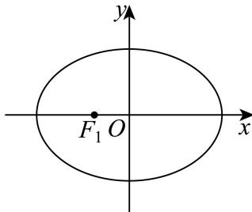
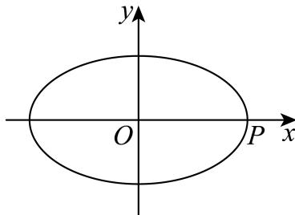
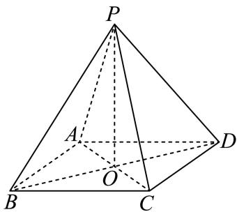
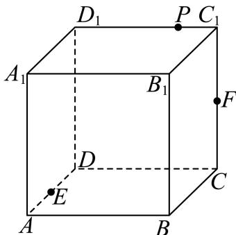
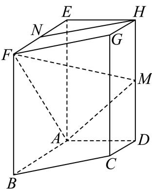
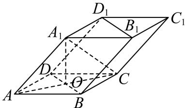
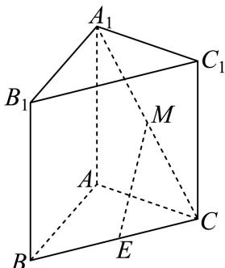

# 2025一模 向量专题 · 学生版

> 本地预览：题目、答案及分类尚未全部审定。校对使用的PDF为高中工作台解析版，尚未逐区确认区级印刷原卷。

## 坐标、共线与数量积基础

利用坐标或非正交基底计算数量积，区分向量模与投影。

### 奉贤 · 第8题

在复平面内，$O$ 为坐标原点，复数 $z_1=\mathrm i(-4-3\mathrm i)$，$z_2=12+5\mathrm i$ 对应的点分别为 $Z_1,Z_2$，其中 $\mathrm i$ 为虚数单位，则 $\langle\overrightarrow{OZ_1},\overrightarrow{OZ_2}\rangle$ 的大小为 ______。

> 本题资料或解析有待核事项，预览不可作为已审定成品。

### 奉贤 · 第12题

已知集合 $\mathbf { \partial } M = \{ P _ { 0 } , P _ { 1 } , P _ { 2 } , \cdots , P _ { n } \} , n \geq 2 , n \in \mathbf { N }$ 是由函数 $y = \cos x , x \in [ 0 , 2 \pi ]$ 的图象上两两不相同的点构成的点集，集合 $S = \left\{ a | a = { \overrightarrow { O P _ { 0 } } } \cdot { \overrightarrow { O P _ { i } } } , i = 0 , 1 , 2 , \cdots , n , n \geq 2 , n \in \mathbf { N } \right\}$ ，其中 $P _ { 0 } \left( 0 , 1 \right)$ $P _ { 1 } \left( \pi , - 1 \right)$ ．若集合S中的元素按照从小到大的顺序排列能构成公差为d的等差数列，当 $d \in \left\{ { \frac { 1 } { 2 } } , 1 \right\}$ 时，则符合条件的点集M的个数为

> 本题资料或解析有待核事项，预览不可作为已审定成品。

### 崇明 · 第7题

已知 $\vec { | a } = ( 1 , 2 ) , \vec { b } = ( 2 , k )$ ，如果 $\overrightarrow { a } / / \overrightarrow { b }$ ，那么实数k的值为

### 徐汇 · 第4题

已知向量 $\vec { a } = ( 2 , 5 , 1 ) , \vec { b } = ( 4 , m , 5 )$ ，若 ${ \vec { a } } \cdot { \vec { b } } = 3$ ，则实数m的值为

> 本题资料或解析有待核事项，预览不可作为已审定成品。

### 普陀 · 第9题

设λ ∈ R，在如图所示的平行六面体 $A B C D - A _ { 1 } B _ { 1 } C _ { 1 } D _ { 1 }$ 1中， $\angle A _ { 1 } A B = \angle A _ { 1 } A D = \angle B A D = { \frac { \pi } { 3 } } .$ $A A _ { 1 } = 2 , A B = A D = 1$ ，点M是棱 $C _ { 1 } D _ { 1 }$ 的中点， $\xrightarrow { \xrightarrow { } } { \lambda _ { 1 } N } = \overline { { \lambda A _ { 1 } D _ { 1 } } }$ ，若 $\stackrel { \longrightarrow } { A M } . \stackrel { \longrightarrow } { C N } = 2$ ，则λ的值为

> 本题资料或解析有待核事项，预览不可作为已审定成品。

### 杨浦 · 第6题

已知 $\left| { \vec { a } } \right| = \left| { \vec { b } } \right| = 1$ ，若 $\left( \overrightarrow { 2 a } - \overrightarrow { b } \right) \perp \overrightarrow { b }$ ，则向 $\textstyle { \overrightarrow { \operatorname { E q } } } { \overrightarrow { a } } .$ 与 $\overrightarrow { \vert b }$ 的夹角的余弦值为

> 本题资料或解析有待核事项，预览不可作为已审定成品。

### 金山 · 第2题

已知向量 $\overrightarrow { a } = ( 1 , 2 ) , \overrightarrow { b } = ( 3 , k )$ ， $\overrightarrow { \Pi } \overrightarrow { a } / \overrightarrow { b }$ ，则实数k =

### 长宁 · 第8题

已知向量 $\stackrel {  } { a } = ( 1 , 2 ) , \stackrel {  } { b } = ( 3 , - 1 )$ ，则向量 $\vec { b } \hbar \vec { \pm a }$ 方向上的投影的坐标是

### 青浦 · 第14题

若点 $P \left( x , y , z \right) \left( x y z \neq 0 \right)$ 关于xOy的对称点为A，关于z轴的对称点为B，则A、B两点的对称是（ ）

A. 关 $\operatorname { \mathbb { F } } _ { \mathbf { X } } \operatorname { O z } ^ { \mathrm { - } }$ 平面对称

B. 关于x轴对称

C. 关于y轴对称

D. 关于坐标原点对称

> 本题资料或解析有待核事项，预览不可作为已审定成品。

### 黄浦 · 第8题

在正四面体 $A B C D$ 中，点N是 $\triangle A B C$ 的中心，若 $\overrightarrow { D N } = \lambda \overrightarrow { D A } + \mu \overrightarrow { D B } + \nu \overrightarrow { B C } \left( \lambda , \mu , \nu \in \mathbf { R } \right)$ ，则$\lambda + \mu + \nu =$

## 投影、距离与平面几何范围

将数量积转为角度、投影或距离平方，研究全称约束和取等构形。

### 嘉定 · 第12题

已知实数 $\left[ x _ { 1 } , x _ { 2 } , y _ { 1 } , y _ { 2 } \right.$ 满足： $x _ { 1 } ^ { 2 } + y _ { 1 } ^ { 2 } = 1 , x _ { 2 } ^ { 2 } + y _ { 2 } ^ { 2 } = 1 , x _ { 1 } x _ { 2 } + y _ { 1 } y _ { 2 } = { \frac { 1 } { 2 } }$ ，则${ \frac { | x _ { 1 } + y _ { 1 } - 1 | } { \sqrt { 2 } } } + { \frac { | x _ { 2 } + y _ { 2 } - 1 | } { \sqrt { 2 } } }$ 的最小值为

> 本题资料或解析有待核事项，预览不可作为已审定成品。

### 宝山 · 第12题

已知平面向量$\vec a$、$\vec b$满足$|\vec a|=1$，$|\vec b|=m\in(1,2)$，且对任意单位向量$\vec c$，都有$|\vec a\cdot\vec c|+|\vec b\cdot\vec c|\leq\sqrt6$，则$\vec a\cdot\vec b$的最大值为______。（用含$m$的式子表示）

> 本题资料或解析有待核事项，预览不可作为已审定成品。

### 普陀 · 第10题

设平面上四点P、Q、M、N满足： $| P M | = | P N | = 4 , | P Q | = 2$ ，若 $\stackrel { \longrightarrow } { Q M } \cdot \stackrel { \longrightarrow } { Q N } = 0$ ，则 $\vert M N \vert$ |的最小值为

> 本题资料或解析有待核事项，预览不可作为已审定成品。

### 松江 · 第10题

已知点P为椭圆 ${ \frac { x ^ { 2 } } { 4 } } + { \frac { y ^ { 2 } } { 3 } } = 1$ 上任意一点，EF为圆 $N \colon ( x - 1 ) ^ { 2 } + y ^ { 2 } = 4$ 的任意一条直径，则 $\overrightarrow { P E } \cdot \overrightarrow { P F }$ 的取值范围是

> 本题资料或解析有待核事项，预览不可作为已审定成品。

### 松江 · 第11题

已知平面向量$\vec a$、$\vec b$的夹角为$\theta$，$\vec b-\vec a$与$\vec a$的夹角为$3\theta$，$|\vec a|=1$，$\vec a$和$\vec b-\vec a$在$\vec b$上的投影分别为$x$、$y$，则$x(y+\sin\theta)$的取值范围是______。

> 本题资料或解析有待核事项，预览不可作为已审定成品。

### 虹口 · 第17题

设 $\begin{array} { r } { f \left( x \right) = \sin \omega x ( \omega > 0 ) } \end{array}$
(1) (6分)当函数 $\boldsymbol { \cdot } \boldsymbol { y } = \boldsymbol { f } \left( \boldsymbol { x } \right)$ 的最小正周期为2π时，求 ${ \bf \dot { \boldsymbol { y } } } = f \left( { \boldsymbol { x } } \right) + \cos$ x在 $\left[ 0 , { \frac { \pi } { 2 } } \right]$ 上的最大值；
(2) (8分)若ω = 2，且在 $\triangle A B C \sharp$ ，角A、B、C所对的边长为a、b、c，锐角A满足
$f \left( A + { \frac { \pi } { 6 } } \right) = 0 , { \overrightarrow { A B } } \cdot { \overrightarrow { A C } } = 4$ ，求a的最小值

### 金山 · 第12题

已知 $O$ 为坐标原点，向量 $\overrightarrow{OA},\overrightarrow{OB}$ 满足 $|\overrightarrow{OA}|+|\overrightarrow{OB}|=8$，将 $\overrightarrow{OA}$ 绕点 $O$ 按逆时针方向旋转 $90^\circ$，得到向量 $\overrightarrow{OC}$。若 $\overrightarrow{OB}+\overrightarrow{OC}=(-3,3)$，$\vec i=(1,0)$，则 $(\overrightarrow{OA}+\overrightarrow{OB})\cdot\vec i$ 的最大值为______。

> 本题资料或解析有待核事项，预览不可作为已审定成品。

### 青浦 · 第12题

已知A,B,C是单位圆上任意不同三点，则 $\frac { { \overrightarrow { A B } } \cdot { \overrightarrow { A C } } } { \left| { \overrightarrow { A B } } \right| }$ 的取值范围是

> 本题资料或解析有待核事项，预览不可作为已审定成品。

### 静安 · 第18题

已知向量 ${ \vec { a } } = \left( \cos { \frac { 3 x } { 2 } } , \sin { \frac { 3 x } { 2 } } \right) , { \vec { b } } = \left( \cos { \frac { x } { 2 } } , - \sin { \frac { x } { 2 } } \right)$ ，且 $x \in \left[ 0 , { \frac { \pi } { 2 } } \right]$
(1) (6分)求→a ⋅→b 及 $\displaystyle { \vec { a } + \vec { b } }$ ；
(2) (8分) $\mathrm { i } \mathrm { \overrightarrow { L } } f \left( x \right) = \mathrm { \overrightarrow { { a } } } \cdot \mathrm { \overrightarrow { { b } } } - \left| \mathrm { \overrightarrow { { a } } } + \mathrm { \overrightarrow { { b } } } \right|$ ，求函数 $y = f \left( x \right)$ 的最小值.

> 本题资料或解析有待核事项，预览不可作为已审定成品。

## 圆锥曲线中的分点与向量条件

把向量模、垂直或数量积转化为弦与交点条件，完整保留大题。

### 嘉定 · 第20题

在平面直角坐标系 $x O y \boxplus$ ，已知椭圆Γ: $\frac { x ^ { 2 } } { 5 } + \frac { y ^ { 2 } } { 4 } = 1 , F _ { 1 } , F _ { 2 }$ 是其左､右焦点，过椭圆Γ右焦点 $F _ { 2 }$ 的直线PQ交椭圆于P,Q两点
(1) (4分)若− $\overrightarrow { P F _ { 1 } } \cdot \overrightarrow { P F _ { 2 } } = 3$ ，求点P的坐标；
(2) (6分)若 $\triangle F _ { 1 } P Q$ 的面积为 $\frac { 4 0 } { 2 1 }$ ，求直线PQ的方程；
(3) (8分)设直线l与椭圆Γ交于A,B两点，M为线段AB的中点.当 $k _ { O M } \cdot k _ { A B } = k _ { O A } \cdot k _ { O B }$ 时，$\triangle O A$ B的面积是否为定值？如果是，请求出这个定值；如果不是，请说明理由.

> 本题资料或解析有待核事项，预览不可作为已审定成品。

### 奉贤 · 第20题

椭圆Γ: ${ \frac { x ^ { 2 } } { a ^ { 2 } } } + y ^ { 2 } = 1 ( a > 1 )$ 的左右焦点分别为 $F _ { 1 } , F _ { 2 }$ ，设 $P \left( x _ { 0 } , y _ { 0 } \right)$ 是第一象限内椭圆上的一点，$P F _ { 1 }$ 的延长线交椭圆于点 $Q \left( x _ { 1 } , y _ { 1 } \right)$

(1) (4分)若椭圆的离心率 $\frac { \sqrt { 2 } } { 2 }$ ，求a的值；
(2) (6分) $\overleftrightarrow { \boldsymbol { \mathrm { f } } } a = \sqrt { 2 } , \overrightarrow { P Q } \cdot \overrightarrow { O F _ { 1 } } = \frac { 1 2 } { 5 }$ ，求x0；
(3) (8分)若a = 2，过点 $T \left( 0 , t \right)$ 的直线l与椭圆Γ交于M、N两点，且 $\vert M N \vert = 2$ ，则当 $t \geq 0 \mathbb { H }$ 时，判 断符合要求的直线有几条，说明理由？

> 本题资料或解析有待核事项，预览不可作为已审定成品。

### 宝山 · 第20题

…
已知椭圆 $\ : : \frac { x ^ { 2 } } { 9 } + \frac { y ^ { 2 } } { 3 } = 1 \ :$ ，直线l经过椭圆Γ的右顶点P且与椭圆交于另一点A，设线段AP的中点为M.

(1) (4分)求椭圆Γ的焦距和离心率；
(2) (6分)若 $k _ { O M } = - \frac { 1 } { 3 } .$ ，求直线AP的方程；
(3) (8分)过点P再作一条直线与椭圆Γ交于点B，线段BP的中点为N.若 $O M \bot O N$ ，则直线AB是否经过定点？若经过定点，求出定点坐标；若不经过定点，请说明理由

> 本题资料或解析有待核事项，预览不可作为已审定成品。

### 崇明 · 第20题

已知椭圆Γ: ${ \frac { y ^ { 2 } } { 4 } } + { \frac { x ^ { 2 } } { 3 } } = 1$ ，点 $F _ { 1 }$ 、 $F _ { 2 }$ 分别是椭圆的下焦点和上焦点，过点 $F _ { 2 }$ 的直线l与椭圆交于A、B两点
(1) (4分)若直线l平行于x轴，求线段AB的长；
(2) (6分)若点A在y轴左侧，且− ${ \overrightarrow { F _ { 1 } A } } \cdot { \overrightarrow { F _ { 2 } A } } = { \frac { 9 } { 4 } }$ ，求直线l的方程；
(3) (8分)已知椭圆上的点C满足 $| C A | = | C B |$ ，是否存在直线l使得△ABC的重心在x轴上？若存在，请求出直线l的方程，若不存在，请说明理由

> 本题资料或解析有待核事项，预览不可作为已审定成品。

### 普陀 · 第20题

设 $m > 0 , \ m > 0 , \ F _ { 1 \setminus } \ F _ { 2 }$ 分别是双曲线Γ: ${ \frac { x ^ { 2 } } { a ^ { 2 } } } - y ^ { 2 } = 1$ 的左、右焦点，直线 $l { : } x - m y - 2 = 0 { \stackrel { 4 } { - } }$ 经过 点 $F _ { 2 ^ { - } }$ 与Γ的右支交于A、B两点，点O是坐标原点.
(1) (4分)若点M是Γ上的一点， $\vert M F _ { 1 } \vert = 2$ ，求 $| M F _ { 2 }$ |的值；
(2) (6分)设λ、 $\mu \in \mathbf { R } _ { : }$ ，点P在直线 $\dot { z } x = 6 .$ 上，若点O、A、P、B满足： $\overrightarrow { O A } = \lambda \overrightarrow { B P } , \overrightarrow { O B } = \mu \overrightarrow { A P }$ 求点P的坐标；
(3) (8分)设AO的延长线与Γ交于G点，若向量− $\xrightarrow { }$ 与 $\overbrace { O B }$ 满足： $\overrightarrow { O A } \cdot \overrightarrow { O B } \geq 1 7$ ，求 $\triangle G A B$ 的面积S 的取值范围.

> 本题资料或解析有待核事项，预览不可作为已审定成品。

### 松江 · 第20题

如果一条双曲线的实轴和虚轴分别是一个椭圆的长轴和短轴，则称它们为“共轴”曲线．若双曲线 $C _ { 1 }$ 与椭圆 $C _ { 2 }$ 是“共轴”曲线，且椭圆 $C _ { 2 } \colon \frac { x ^ { 2 } } { 9 } + \frac { y ^ { 2 } } { b ^ { 2 } } = 1 ( 0 < b < 3 )$ $e _ { 1 } e _ { 2 } = { \frac { 4 { \sqrt { 5 } } } { 9 } } ( e _ { 1 }$ 、 $e _ { 2 }$ 分别为曲线 $\wp$ 、 $C _ { 2 }$ 的离心率）．已知点M(1,0)，点P为双曲线 $C _ { 1 }$ 上任意一点
(1) (4分)求双曲线 $C _ { 1 }$ 的方程；
(2) (6分)延长线段PM到点Q，且 $| P M | = 2 \left| M Q \right|$ ，若点Q在椭圆 $C _ { 2 }$ 上，试求点P的坐标；
(3) (8分)若点P在双曲线 $C _ { 1 }$ 的右支上，点A、B分别为双曲线 $C _ { 1 }$ 的左、右顶点，直线PM交双曲线的左支于点R，直线AP、BR的斜率分别为 $\mathit { \iota } _ { A P \setminus } \ k _ { B R }$ ．是否存在实数λ，使得 $k _ { A P } = \lambda k _ { B R } ?$ 若存在，求出λ的值；若不存在，请说明理由

> 本题资料或解析有待核事项，预览不可作为已审定成品。

### 浦东 · 第20题

已知椭圆 ${ \frac { x ^ { 2 } } { 8 } } + { \frac { y ^ { 2 } } { 4 } } = 1$ 的左、右焦点分别为 $F _ { \mathrm { 1 } } , \ F _ { \mathrm { 2 } }$ ，过坐标原点的直线交椭圆于A、B两点，点A在第一象限

(1) (4分)若 $| O A | = { \sqrt { 6 } } .$ ，求点A的坐标；
(2) (6分)求− $\xrightarrow { } { \overrightarrow { A F _ { 1 } } + 3 \overrightarrow { A F _ { 2 } } }$ 的取值范围；
(3) (8分)若 $A E \bot x$ 轴，垂足为 $E ,$ ，连结BE并延长交椭圆于点 $^ { C , }$ ，求 $\triangle A B C { \overrightarrow { \mathbb { H } } }$ 积的最大值

> 本题资料或解析有待核事项，预览不可作为已审定成品。

### 虹口 · 第20题

已知椭圆Γ: ${ \frac { x ^ { 2 } } { 4 } } + y ^ { 2 } = 1$ 1的左、右焦点分别为 $F _ { 1 } , F _ { 2 }$ ，右顶点为A，上顶点为B，设P为Γ上的一点(1) (4分)当 $P F _ { 1 } \bot F _ { 1 } F _ { 2 }$ 时，求 $| P F _ { 2 }$ |的值；
(2) (6分)若P点坐标为 $\left( 1 , { \frac { \sqrt { 3 } } { 2 } } \right)$ ，则在Γ上是否存在点Q使 $\triangle A P Q$ 的面积为 $\frac { { \sqrt { 3 } } + 1 } { 2 }$ ，若存在，请求出所有满足条件的点Q的坐标；若不存在，请说明理由；
(3) (8分)已知D点坐标为(0,m)，过点P和点D的直线l与椭圆Γ交于另一点T，当直线l与x轴和y轴 均不平行时，有 ${ \overrightarrow { P T } } \cdot \left( { \overrightarrow { B P } } + { \overrightarrow { B T } } \right) = 0$ ，求实数m的取值范围

> 本题资料或解析有待核事项，预览不可作为已审定成品。

### 闵行 · 第10题

已知 $\begin{array} { r l } { \ F _ { 1 } , } & { { } F _ { 2 } } \end{array}$ 分别为椭圆 ${ \frac { x ^ { 2 } } { 4 } } + { \frac { y ^ { 2 } } { 2 } } = 1$ 的左、右焦点，过 $F _ { 1 }$ 的直线交椭圆于A、B两点．若 $\overrightarrow { A F _ { 1 } } \cdot \overrightarrow { A F _ { 2 } } = 0$ ，则 $\overrightarrow { A F _ { 2 } } \cdot \overrightarrow { B F _ { 2 } }$

> 本题资料或解析有待核事项，预览不可作为已审定成品。

### 闵行 · 第20题

已知圆 $O \colon x ^ { 2 } + y ^ { 2 } = 1$ ，双曲线Γ: $x ^ { 2 } - { \frac { y ^ { 2 } } { b ^ { 2 } } } = 1$ ，直线l: $y = k x + b$ ，其中 ${ \mathbb X } \in { \mathbb R } , b > 0$
(1) (4分)当b = 2时，求双曲线Γ的离心率；
(2) (6分)若l与圆O相切，证明：l与双曲线Γ的左右两支各有一个公共点；
(3) (8分)设l与y轴交于点P，与圆O交于点A、B，与双曲线Γ的左右两支分别交于点C、D，四个点从左至右依次为C、A、B、D．当 $k = { \frac { \sqrt { 2 } } { 2 } }$ 时，是否存在实数b，使得 $\overrightarrow { P A } \cdot \overrightarrow { P C } = \overrightarrow { P B } \cdot \overrightarrow { P D } \vert$ 成立？若存在，求出b的值；若不存在，说明理由

## 空间位置、角度与距离

结合空间建系、法向量或线性表示处理角距及共面约束。

### 嘉定 · 第10题

已知空间向量 $\overrightarrow { O B _ { 1 } } , \overrightarrow { O B _ { 2 } } , \overrightarrow { O B _ { 3 } }$ 两两垂直，若空间点A满足 $\left| \overrightarrow { A B _ { 1 } } \right| = \left| \overrightarrow { A B _ { 2 } } \right| = \left| \overrightarrow { A B _ { 3 } } \right| = 1$ ，记$\overrightarrow { O P } = \overrightarrow { O B _ { 1 } } + \overrightarrow { O B _ { 2 } } + \overrightarrow { O B _ { 3 } }$ ，且 $\left| \begin{array} { l } { \longrightarrow } \\ { \vec { A P } } \end{array} \right| \le 1$ ，则 $\overrightarrow { O A }$ 的取值范围为

> 本题资料或解析有待核事项，预览不可作为已审定成品。

### 奉贤 · 第15题

在四棱锥 $S - A B C D$ 中，若 $\overrightarrow { S A } = x \overrightarrow { S B } + y \overrightarrow { S C } + z \overrightarrow { S D }$ ，则实数组(x, y, z)可能是（ ）

A. $( 1 , - 1 , 1 )$

B. $( 1 , 0 , - 1 )$

C. $( 1 , 0 , 0 )$

D. $( 1 , - 1 , - 1 )$

> 本题资料或解析有待核事项，预览不可作为已审定成品。

### 奉贤 · 第19题

如图为正四棱锥 $P - A B C D , O$ 为底面ABCD的中心

(1)图
(2)图
(1) (6分)求证： $C D / /$ 平面 $P A B ,$ 平面 $P A C \bot$ 平面PBD；
(2) (8分)设E为PB上的一点，− $\overrightarrow { B E } = \frac { 2 } { 3 } \overrightarrow { B P } .$
在下面两问中选一个，
①若 $A D = A P = 3 { \sqrt { 2 } } .$ ，求直线EC与平面BED所成角的大小
②已知平面ECD与平面ABCD所成锐二面角的大小为 $\arctan { \frac { \sqrt { 2 } } { 2 } }$ ，若 $A D = 3 { \sqrt { 2 } }$ ，求AP的长

> 本题资料或解析有待核事项，预览不可作为已审定成品。

### 宝山 · 第15题

…
如图，正四棱柱 $A B C D - A _ { 1 } B _ { 1 } C _ { 1 } D _ { 1 }$ 的底面ABCD边长为1，E为AD上任意一点，F为 $C C _ { 1 }$ 中点，若棱 $C _ { 1 } D _ { 1 }$ 上至少存在一点P使得 $P E \bot P F$ ，则棱长 $A A _ { 1 }$ 的最大值为（ ）

A. $\frac { \sqrt { 2 } } { 2 }$

B. 1

C. $\sqrt { 2 }$

D. 2

### 徐汇 · 第18题

如图，在四棱锥 $P - A B C D$ 中， $A D / / B C , \angle A D C = \angle P A B = \frac { \pi } { 2 } , B C = C D = \frac { 1 } { 2 } A D$ .E为棱AD的中点，异面直线PA与CD所成角的大小为 $\frac { \pi } { 2 }$

(1) (6分)求证： $C D / { \bar { \lambda } }$ 平面PBE；
(2) (8分)若二面角 $P - C D - A$ 的大小为 $\frac { \pi } { 4 }$ ，求直线PA与平面PCE所成角的正弦值.

> 本题资料或解析有待核事项，预览不可作为已审定成品。

### 杨浦 · 第17题

如图，在正方体 $A B C D - A _ { 1 } B _ { 1 } C _ { 1 } D _ { 1 }$ 中，点E、F分别是棱AB、BC的中点.

(1) (6分)求证： $E F \bot B D _ { 1 }$ ；
(2) (8分)求二面角 $B _ { 1 } - E F - B$ 的大小.

> 本题资料或解析有待核事项，预览不可作为已审定成品。

### 松江 · 第18题

如图，已知AB⊥平面ACD，AB∥DE， $\triangle A C D$ 为等边三角形， $A D = D E = 2 A B$ ，F为CD的中点

（1）求证：AF∥平面BCE；
（2）求直线AD和平面BCE所成角的正弦值

> 本题资料或解析有待核事项，预览不可作为已审定成品。

### 浦东 · 第11题

已知空间中三个单位向量 $\overrightarrow { O A _ { 1 } } \cdot \overrightarrow { O A _ { 2 } } \cdot \overrightarrow { O A _ { 3 } } , \overrightarrow { O A _ { 1 } } \cdot \overrightarrow { O A _ { 2 } } = \overrightarrow { O A _ { 2 } } \cdot \overrightarrow { O A _ { 3 } } = \overrightarrow { O A _ { 3 } } \cdot \overrightarrow { O A _ { 1 } } = 0$ ，P为空间中一点，且满足 $\left| \overrightarrow { O P } \cdot \overrightarrow { O A _ { 1 } } \right| = 1 , \left| \overrightarrow { O P } \cdot \overrightarrow { O A _ { 2 } } \right| = 2 , \left| \overrightarrow { O P } \cdot \overrightarrow { O A _ { 3 } } \right| = 3$ ，则点P个数的最大值为

> 本题资料或解析有待核事项，预览不可作为已审定成品。

### 虹口 · 第9题

如图，已知正三角形ABC和正方形BCDE的边长均为2，且二面角 $A - B C - D$ 的大小为 $\frac { \pi } { 6 }$ ，则${ \overrightarrow { A C } } . { \overrightarrow { B D } } =$

### 虹口 · 第15题

已知边长为2的正四面体A−BCD的内切球（球面与四面体四个面都相切的球）的球心为O，若空间中的动点P满足 $\overrightarrow { O P } = x \overrightarrow { O C } + y \overrightarrow { O B } + z \overrightarrow { O D } , x , y , z \in [ 0 , 1 ]$ ]，则点P的轨迹所形成的几何体的体积为（ ）

A. $\sqrt { 2 }$

B. $\frac { \sqrt { 2 } } { 3 }$

C. $2 \sqrt { 3 }$

D. $\frac { \sqrt { 3 } } { 3 }$

> 本题资料或解析有待核事项，预览不可作为已审定成品。

### 虹口 · 第18题

如图，已知在四棱柱 $A B C D - E F G H$ 中，EA⊥平面ABCD，N、M分别是EF、HD的中点

(1) (6分)求证： $H N / /$ 平面AFM；
(2) (8分)若底面ABCD为梯形， $A B / / C D , A B = E A = 2 , A D = D C = 1$ ，异面直线AB与EH所 成角为 $\frac { \pi } { 2 }$ ．求直线 $A N ^ { I }$ 与平面AFM所成角的正弦值

### 长宁 · 第12题

点P、M、N分别位于正方体 $A B C D - A ^ { \prime } B ^ { \prime } C ^ { \prime } D ^ { \prime }$ 的面上，AB = 1，则 $\overrightarrow { P M } \cdot \overrightarrow { P N }$ 的最小值是

> 本题资料或解析有待核事项，预览不可作为已审定成品。

### 长宁 · 第14题

已知非零空间向 $\sharp { \vec { a } } , { \vec { b } }$ 和→c，则下列说法正确的是（ ）

A. $\vec { \mathcal { G } } \vec { a } \perp \vec { b } , \vec { a } \perp \vec { c }$ ，则 $\vec { \vert b \vert } / \vec { \vert c }$

B. $\stackrel { \scriptscriptstyle + } { \vec { \tau } } \vec { a } \perp \vec { b } , \vec { a } \perp \vec { c }$ ,则 $\vec { b } \perp \vec { c }$

C. $\overrightarrow { \mathcal { H } } \overrightarrow { a } \perp \overrightarrow { b } , \overrightarrow { a } / / \overrightarrow { c }$ ，则 $\stackrel {  } { b } / / \stackrel {  } { c }$

D. $\overrightarrow { \mathcal { H } } \overrightarrow { a } \perp \overrightarrow { b } , \overrightarrow { a } / / \overrightarrow { c }$ ，则 $\vec { | b \perp c | }$

### 长宁 · 第18题

如图所示，四棱柱 $A B C D - A _ { 1 } B _ { 1 } C _ { 1 } D _ { 1 }$ 1的底面ABCD是正方形，O是底面的中心， $A _ { 1 } O \bot$ 平面$A B C D , A B = A A _ { 1 } = { \sqrt { 2 } }$

(1) (6分)求证： $A _ { 1 } C \bot$ 平面 $B D D _ { 1 } B _ { 1 }$ ；
(2) (8分)求直线 $O A _ { 1 }$ 1与平面 $A A _ { 1 } B$ 所成角的正弦值

> 本题资料或解析有待核事项，预览不可作为已审定成品。

### 闵行 · 第17题

在直三棱柱 $A B C - A _ { 1 } B _ { 1 } C _ { 1 }$ 中，AB = AC = 2， $A A _ { 1 } = 3$ $\angle B A C = 9 0 ^ { \circ }$ ，连接 $A _ { 1 } C _ { : }$ ，M、E分别为 $A _ { 1 } C$ 和BC的中点

(1) (6分)证明：直线 $E M / /$ 平面 $A _ { 1 } A B B _ { 1 }$ ；
(2) (8分)求二面角 $A _ { 1 } - B C - A$ 的大小

### 静安 · 第16题

在四棱锥 $P - A B C D$ 中， $\overrightarrow { A B } = ( 4 , - 2 , 3 ) , \overrightarrow { A D } = ( - 4 , 1 , 0 ) , \overrightarrow { A P } = ( - 6 , 2 , - 8 )$ ，则该四棱锥的高为（ ）

A. 4

B. 3

C. 2

D. 1

