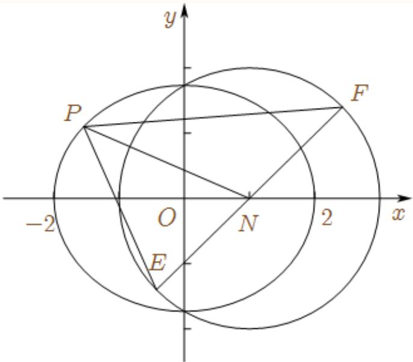
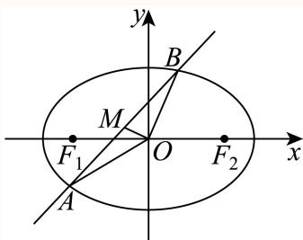
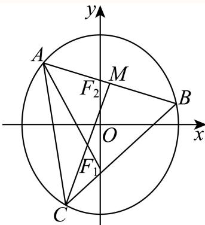
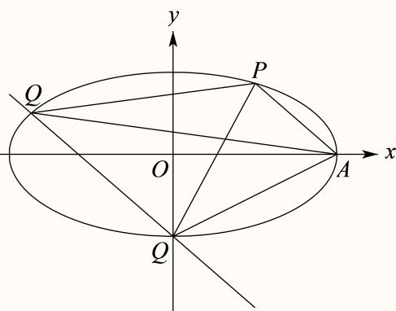
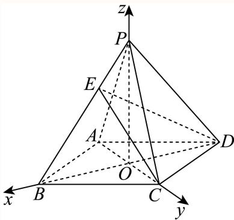
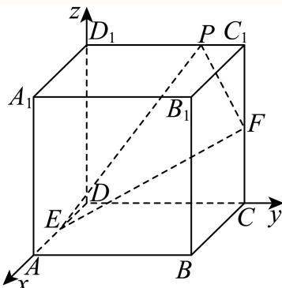
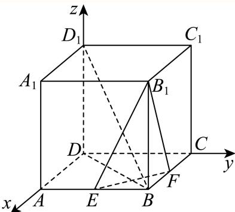
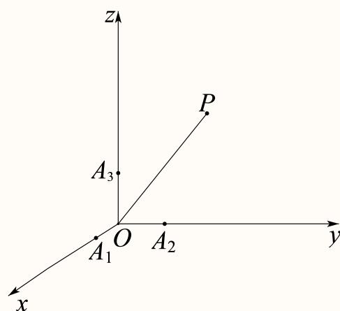
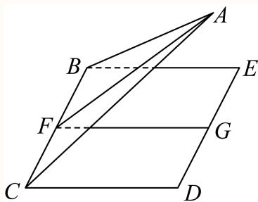

# 2025一模 向量专题 · 教师版

> 本地预览：题目、答案及分类尚未全部审定。校对使用的PDF为高中工作台解析版，尚未逐区确认区级印刷原卷。

## 坐标、共线与数量积基础

利用坐标或非正交基底计算数量积，区分向量模与投影。

### 奉贤 · 第8题

在复平面内，$O$ 为坐标原点，复数 $z_1=\mathrm i(-4-3\mathrm i)$，$z_2=12+5\mathrm i$ 对应的点分别为 $Z_1,Z_2$，其中 $\mathrm i$ 为虚数单位，则 $\langle\overrightarrow{OZ_1},\overrightarrow{OZ_2}\rangle$ 的大小为 ______。

> 本题资料或解析有待核事项，预览不可作为已审定成品。

**考点：** 复数运算与复平面坐标；坐标数量积求向量夹角

**难度依据：** 复数乘法转坐标后求余弦与夹角

**核查说明：** 仅核本题所列字段及页面；不等于全卷终审。；题干与解析已用于人工归类，尚未完成整题公式校净与独立数学终审。；题干夹角括号缺失，需规范向量夹角符号。；题干与解析已用于人工归类，尚未完成整题公式校净与独立数学终审。；题干夹角括号缺失，需规范向量夹角符号。 本次已按本机具名解析版PDF逐页视觉恢复题干：奉贤01为补集符号，第1页；奉贤08为两个位置向量夹角，第3页。此题题干缺项已解决，不代表原解析全量数学终审。

【解析】

由复数乘法运算求得 $z _ { 1 }$ ，进而得到 $\overrightarrow { O Z _ { 1 } } , \overrightarrow { O Z _ { 2 } }$ 利用向量数量积运算和模长公式求得$\cos \left. \overrightarrow { O Z _ { 1 } } , \overrightarrow { O Z _ { 2 } } \right.$ ，进而得到 $\left. \overrightarrow { O Z _ { 1 } } , \overrightarrow { O Z _ { 2 } } \right.$

因为 $\vert z _ { 1 } = \mathrm { i } \left( - 4 - 3 \mathrm { i } \right) = 3 - 4 \mathrm { i } , ~ z _ { 2 } = 1 2 + 5 \mathrm { i }$

所以 $\overrightarrow { O Z _ { 1 } } = ( 3 , - 4 ) , \overrightarrow { O Z _ { 2 } } = ( 1 2 , 5 )$

$$
\cos \left\langle \overrightarrow {O Z _ {1}}, \overrightarrow {O Z _ {2}} \right\rangle = \frac {\overrightarrow {O Z _ {1}} \cdot \overrightarrow {O Z _ {2}}}{\left| \overrightarrow {O Z _ {1}} \right| \left| \overrightarrow {O Z _ {2}} \right|} = \frac {3 \times 1 2 - 2 0}{\sqrt {3 ^ {2} + (- 4) ^ {2}} \times \sqrt {1 2 ^ {2} + 5 ^ {2}}} = \frac {1 6}{6 5},
$$

所以 $\left. { \overrightarrow { O Z _ { 1 } } } , { \overrightarrow { O Z _ { 2 } } } \right. = \operatorname { a r c c o s } { \frac { 1 6 } { 6 5 } } .$

### 奉贤 · 第12题

已知集合 $\mathbf { \partial } M = \{ P _ { 0 } , P _ { 1 } , P _ { 2 } , \cdots , P _ { n } \} , n \geq 2 , n \in \mathbf { N }$ 是由函数 $y = \cos x , x \in [ 0 , 2 \pi ]$ 的图象上两两不相同的点构成的点集，集合 $S = \left\{ a | a = { \overrightarrow { O P _ { 0 } } } \cdot { \overrightarrow { O P _ { i } } } , i = 0 , 1 , 2 , \cdots , n , n \geq 2 , n \in \mathbf { N } \right\}$ ，其中 $P _ { 0 } \left( 0 , 1 \right)$ $P _ { 1 } \left( \pi , - 1 \right)$ ．若集合S中的元素按照从小到大的顺序排列能构成公差为d的等差数列，当 $d \in \left\{ { \frac { 1 } { 2 } } , 1 \right\}$ 时，则符合条件的点集M的个数为

> 本题资料或解析有待核事项，预览不可作为已审定成品。

**考点：** 坐标数量积提取纵坐标；有限等差数列公差分类；余弦函数定值点枚举；有必选点约束的集合计数；点集到数集映射的重合与去重

**难度依据：** 公差两种情形下按同纵坐标点的非空选择计数

**核查说明：** 题干与解析已用于人工归类，尚未完成整题公式校净与独立数学终审。；原解多个余弦值与横坐标被错排，计数思路可辨但公式未校净。；题干与解析已用于人工归类，尚未完成整题公式校净与独立数学终审。；原解多个余弦值与横坐标被错排，计数思路可辨但公式未校净。

【答案】60.

【解析】

确定数列中最大值为1，最小值为−1，然后根据d分类得出等差数列，再由等差数列的项确定点 $P _ { i }$ 的横坐标的值，然后由M中对应点的的情形确定集合个数

由已知 $\vert a _ { 0 } = \overrightarrow { O P _ { 0 } } \cdot \overrightarrow { O P _ { 0 } } = 1 , a _ { 1 } = \overrightarrow { O P _ { 0 } } \cdot \overrightarrow { O P _ { 1 } } = - 1$

设 $P _ { i } ( x _ { i } , y _ { i } )$ ，则 $a _ { i } = \overrightarrow { O P _ { 0 } } \cdot \overrightarrow { O P _ { i } } = y _ { i }$ ，显然 $- 1 \leq y _ { i } \leq 1$

若 $\dot { \boldsymbol { d } } = 1$ ，则 $S = \{ - 1 , 0 , 1 \}$ ，因此有 $\dot { y } _ { i } = 0$

由 $\cos x _ { i } = 0 , x _ { i } \in [ 0 , 2 \pi ]$ 得 $x _ { i } = { \frac { \pi } { 2 } }$ 或 $\frac { 3 \pi } { 2 }$ ，对应 $Q _ { 1 } \left( \frac { \pi } { 2 } , 0 \right) , Q _ { 2 } \left( \frac { 3 \pi } { 2 } , 0 \right)$

同理 $Q _ { 3 } ( 2 \pi , 1 )$ 对应 $P _ { 0 }$ ，

集合M中已经含有点 $P _ { 0 } , P _ { 1 }$ ，

因此产生 $S = \{ - 1 , 0 , 1 \}$ 的集合M中，点 $Q _ { 3 }$ 可有也可没有， $Q _ { 1 } , Q _ { 2 }$ 至少有一个，

所以M的个数为 $2 \times 3 = 6$

若 $\dot { \boldsymbol { d } } = \frac { 1 } { 2 }$ ，则 $S = \left\{ - 1 , - \frac { 1 } { 2 } , 0 , \frac { 1 } { 2 } , 1 \right\}$

cos xi = 1 xi 2π 或 4π cos xi = 1 xi π 或 5π

对应点Q $\mathrm { ~ \ i ~ } \left( \frac { \pi } { 3 } , \frac { 1 } { 2 } \right) , Q _ { 5 } \left( \frac { 5 \pi } { 3 } , \frac { 1 } { 2 } \right) , Q _ { 6 } \left( \frac { 2 \pi } { 3 } , - \frac { 1 } { 2 } \right) , Q _ { 7 } \left( \frac { 4 \pi } { 3 } , - \frac { 1 } { 2 } \right)$

产生 $\left\{ - 1 , - \frac { 1 } { 2 } , 0 , \frac { 1 } { 2 } , 1 \right\}$ 的集合M中，点 ${ \bf \nabla } \cdot { \bf Q _ { 3 } }$ 可有也可没有， $Q _ { 1 } , Q _ { 2 }$ 至少有一个，

$Q _ { 4 } , Q _ { 5 }$ 中至少有一个， $Q _ { 6 } , Q _ { 7 }$ 中至少有一个，M的个数为 $2 \times 3 \times 3 \times 3 = 5 4$

综上，集合M的个数为 $6 + 5 4 = 6 0$

故答案为：60.

方法点睛：确定集合的个数即为确定集合中元素的可能性，本题中首先确定出最终等差数列的最大值和最小值，从而根据公差得出等差数列，由等差数列确定可能含有的点，从而得出集合个数

## 二、选择题

### 崇明 · 第7题

已知 $\vec { | a } = ( 1 , 2 ) , \vec { b } = ( 2 , k )$ ，如果 $\overrightarrow { a } / / \overrightarrow { b }$ ，那么实数k的值为

**考点：** 平面向量共线坐标条件

**难度依据：** 涉及平面向量共线坐标条件；难度为教师预估，需结合原题条件复核。

**核查说明：** 依据现有底稿归类，尚未逐页校卷、公式校净或独立数学终审。

【答案】4.

【解析】

根据向量的坐标表示即可.

由题意得1 $\mathbf { \nabla } \times k = 2 \times 2$ ，则k = 4.

故答案为：4.

### 徐汇 · 第4题

已知向量 $\vec { a } = ( 2 , 5 , 1 ) , \vec { b } = ( 4 , m , 5 )$ ，若 ${ \vec { a } } \cdot { \vec { b } } = 3$ ，则实数m的值为

> 本题资料或解析有待核事项，预览不可作为已审定成品。

**考点：** 空间向量数量积坐标运算

**难度依据：** 空间向量数量积坐标运算；按所需步骤与推理量估计

**核查说明：** 题干与解析已用于人工归类，尚未完成整题公式校净与独立数学终审。

【答案】−2

【解析】

利用空间向量的数量积的坐标运算公式即可求解.

因为 $\vec { \jmath _ { a } } = ( 2 , 5 , 1 ) , \vec { b } = ( 4 , m , 5 )$ ，所以 $\begin{array} { r } { \ell { \stackrel {  } { a } } \cdot { \stackrel {  } { b } } = 2 \times 4 + 5 m + 1 \times 5 = 5 m + 1 3 = 3 . } \end{array}$ 所以 $\scriptstyle { m = - 2 }$

故答案为：−2

### 普陀 · 第9题

设λ ∈ R，在如图所示的平行六面体 $A B C D - A _ { 1 } B _ { 1 } C _ { 1 } D _ { 1 }$ 1中， $\angle A _ { 1 } A B = \angle A _ { 1 } A D = \angle B A D = { \frac { \pi } { 3 } } .$ $A A _ { 1 } = 2 , A B = A D = 1$ ，点M是棱 $C _ { 1 } D _ { 1 }$ 的中点， $\xrightarrow { \xrightarrow { } } { \lambda _ { 1 } N } = \overline { { \lambda A _ { 1 } D _ { 1 } } }$ ，若 $\stackrel { \longrightarrow } { A M } . \stackrel { \longrightarrow } { C N } = 2$ ，则λ的值为

> 本题资料或解析有待核事项，预览不可作为已审定成品。

**考点：** 非正交空间基底的数量积展开；平行六面体中点与棱上点的向量表示

**难度依据：** 基底不正交需逐项计入夹角

**核查说明：** 仅修复所列OCR公式及其定界符错位；原解数学疑点和其他可渲染错识未因此消除。；题干与解析已用于人工归类，尚未完成整题公式校净与独立数学终审。；题干点N的向量等式严重错识，原解指向A1N=λA1D1，须视觉回核后修复。；仅修复所列OCR公式及其定界符错位；原解数学疑点和其他可渲染错识未因此消除。；题干与解析已用于人工归类，尚未完成整题公式校净与独立数学终审。；题干点N的向量等式严重错识，原解指向A1N=λA1D1，须视觉回核后修复。

【答案】$\frac 1 3$

【解析】

以 $\overrightarrow { A B } , \overrightarrow { A D } , \overrightarrow { A A _ { 1 } }$ 为基底表示 $\overrightarrow{AM},\overrightarrow{CN}$ ，结合题意运用数量积及向量数乘运算即可求解

$$
\overrightarrow {A _ {1} N} = \lambda \overrightarrow {A _ {1} D _ {1}} = \lambda \overrightarrow {A D},
$$

$$
\overrightarrow {A M} = \overrightarrow {A D _ {1}} + \overrightarrow {D _ {1} M} = \overrightarrow {A D} + \overrightarrow {A A _ {1}} + \frac {1}{2} \overrightarrow {A B},
$$

$$
\overrightarrow {C N} = \overrightarrow {A N} - \overrightarrow {A C} = \overrightarrow {A A _ {1}} + \overrightarrow {A _ {1} N} - \overrightarrow {A B} - \overrightarrow {A D}
$$

$$
= \overrightarrow {A A _ {1}} + \overrightarrow {\lambda A _ {1} D _ {1}} - \overrightarrow {A B} - \overrightarrow {A D} = \overrightarrow {A A _ {1}} + (\lambda - 1) \overrightarrow {A D} - \overrightarrow {A B},
$$

$$
\overrightarrow {A M} \cdot \overrightarrow {C N} = \left(\overrightarrow {A D} + \overrightarrow {A A _ {1}} + \frac {1}{2} \overrightarrow {A B}\right) \cdot \left(\overrightarrow {A A _ {1}} + (\lambda - 1) \overrightarrow {A D} - \overrightarrow {A B}\right) = 2,
$$

$$
\overrightarrow {A D} \cdot \overrightarrow {A A _ {1}} + (\lambda - 1) \overrightarrow {A D} ^ {2} - \overrightarrow {A D} \cdot \overrightarrow {A B} + \overrightarrow {A A _ {1}} ^ {2} + (\lambda - 1) \overrightarrow {A D} \cdot \overrightarrow {A A _ {1}} - \overrightarrow {A A _ {1}} \cdot \overrightarrow {A B} + \frac {1}{2} \overrightarrow {A B} \cdot \overrightarrow {A A _ {1}} +
$$

$$
\frac {1}{2} \overrightarrow {A B} \cdot (\lambda - 1) \overrightarrow {A D} - \frac {1}{2} \overrightarrow {A B} ^ {2} = 2
$$

由 $\stackrel { \triangledown } { | \angle A _ { 1 } A B = \angle A _ { 1 } A D = \angle B A D = \frac { \pi } { 3 } , } ~ A A _ { 1 } = 2 , ~ A B = A D = 1 ,$

$$
\begin{array}{l} 1 \times 2 \times \frac {1}{2} + (\lambda - 1) - 1 \times 1 \times \frac {1}{2} + 4 + (\lambda - 1) \times 1 \times 2 \times \frac {1}{2} - 2 \times 1 \times \frac {1}{2} + \frac {1}{2} \times 1 \times 2 \times \frac {1}{2} + \\ \frac {1}{2} (\lambda - 1) \times 1 \times 1 \times \frac {1}{2} - \frac {1}{2} \times 1 = 2 \end{array}
$$

${ \frac { 9 } { 4 } } ( \lambda - 1 ) + { \frac { 7 } { 2 } } = 2$ ，解得 $\lambda = \frac { 1 } { 3 }$

故答案为： $\frac 1 3$

### 杨浦 · 第6题

已知 $\left| { \vec { a } } \right| = \left| { \vec { b } } \right| = 1$ ，若 $\left( \overrightarrow { 2 a } - \overrightarrow { b } \right) \perp \overrightarrow { b }$ ，则向 $\textstyle { \overrightarrow { \operatorname { E q } } } { \overrightarrow { a } } .$ 与 $\overrightarrow { \vert b }$ 的夹角的余弦值为

> 本题资料或解析有待核事项，预览不可作为已审定成品。

**考点：** 垂直数量积与夹角

**难度依据：** 垂直数量积与夹角；按所需步骤与推理量估计

**核查说明：** 题干与解析已用于人工归类，尚未完成整题公式校净与独立数学终审。

【答案】${ \frac { 1 } { 2 } } .$

【解析】

设向量 $\overrightarrow { a } \overrightarrow { \ – \mathbf { \nabla } } \overrightarrow { b }$ 的夹角为θ，根据向量垂直运算可得答案.

设向量 $\vec { \cdot } \vec { a } \vec { \ – } \vec { \jmath } _ { b } ^ {  }$ 的夹角为 $\theta \left( \theta \in \left[ 0 , \pi \right] \right)$ 1

若 $\left( \overrightarrow { 2 a } - \overrightarrow { b } \right) \perp \overrightarrow { b }$ ，则 $\left( { \widehat { 2 a } } - { \overrightarrow { b } } \right) \cdot { \overrightarrow { b } } = 0 ,$

所以2→a ⋅→b −→b 2 = 2 →b 2 b cos θ − = 2 cos θ − 1 = 0，

可得 $\cos \theta = { \frac { 1 } { 2 } }$

故答案为： ${ \frac { 1 } { 2 } } .$

### 金山 · 第2题

已知向量 $\overrightarrow { a } = ( 1 , 2 ) , \overrightarrow { b } = ( 3 , k )$ ， $\overrightarrow { \Pi } \overrightarrow { a } / \overrightarrow { b }$ ，则实数k =

**考点：** 向量平行坐标条件

**难度依据：** 涉及向量平行坐标条件；难度为教师预估，需结合原题条件复核。

**核查说明：** 依据现有底稿归类，尚未逐页校卷、公式校净或独立数学终审。

【答案】6

【解析】

根据向量平行的坐标表示列方程求参数.

由题意 ${ \frac { 3 } { 1 } } = { \frac { k } { 2 } }$ ，则k = 6.

故答案为：6

### 长宁 · 第8题

已知向量 $\stackrel {  } { a } = ( 1 , 2 ) , \stackrel {  } { b } = ( 3 , - 1 )$ ，则向量 $\vec { b } \hbar \vec { \pm a }$ 方向上的投影的坐标是

**考点：** 利用数量积求投影

**难度依据：** 向量投影的坐标运算；利用数量积求投影

【答案】$\left( { \frac { 1 } { 5 } } , { \frac { 2 } { 5 } } \right)$

【解析】

利用向量的数量积运算以及投影坐标的概念求解

由 题 得 $\vec { a } \cdot \vec { b } = 1 \times 3 + 2 \times ( - 1 ) = 1 , | \vec { a } | = \sqrt { 5 } , | \vec { b } | = \sqrt { 1 0 }$ 所 以

$$
\cos <   \vec {a}, \vec {b} > = \frac {\vec {a} \cdot \vec {b}}{| \vec {a} | \cdot | \vec {b} |} = \frac {1}{\sqrt {5} \times \sqrt {1 0}} = \frac {\sqrt {2}}{1 0},
$$

与向 $\boldsymbol { \underline { { \mathbf { E } } } } \boldsymbol { \vec { a } }$ 的同向单位向量为 ${ \frac { \stackrel {  } { a } } { | \vec { a } | } } = ( { \frac { 1 } { \sqrt { 5 } } } , { \frac { 2 } { \sqrt { 5 } } } )$ ，

所 以 向 量 $\vec { b }$ 在 向 量 $\vec { a }$ 方 向 上 的 投 影 的 坐 标 为

$$
| \vec {b} | \cos <   \vec {a}, \vec {b} > \cdot \frac {\vec {a}}{| \vec {a} |} = \sqrt {1 0} \times \frac {\sqrt {2}}{1 0} \times \left(\frac {1}{\sqrt {5}}, \frac {2}{\sqrt {5}}\right) = \left(\frac {1}{5}, \frac {2}{5}\right).
$$

故答案为： $\left( { \frac { 1 } { 5 } } , { \frac { 2 } { 5 } } \right)$

### 青浦 · 第14题

若点 $P \left( x , y , z \right) \left( x y z \neq 0 \right)$ 关于xOy的对称点为A，关于z轴的对称点为B，则A、B两点的对称是（ ）

A. 关 $\operatorname { \mathbb { F } } _ { \mathbf { X } } \operatorname { O z } ^ { \mathrm { - } }$ 平面对称

B. 关于x轴对称

C. 关于y轴对称

D. 关于坐标原点对称

> 本题资料或解析有待核事项，预览不可作为已审定成品。

**考点：** 空间坐标轴平面对称；空间点的坐标与中心对称

**难度依据：** 坐标变号两次比较即可

**核查说明：** 题干与解析已用于人工归类，尚未完成整题公式校净与独立数学终审。

【答案】D

【解析】

运用空间向量坐标表示以及对称中的坐标特点可解.

点 $P \left( x , y , z \right) \left( x y z \neq 0 \right)$ 关于xOy的对称点为A，则A坐标 $( x , y , - z )$ ；

点 $P \left( x , y , z \right) \left( x y z \neq 0 \right)$ 关于z轴的对称点为B，则B坐标 $( - x , - y , z )$ ；

则根据坐标特点知道A、B两点关于原点对称.

故选：D

### 黄浦 · 第8题

在正四面体 $A B C D$ 中，点N是 $\triangle A B C$ 的中心，若 $\overrightarrow { D N } = \lambda \overrightarrow { D A } + \mu \overrightarrow { D B } + \nu \overrightarrow { B C } \left( \lambda , \mu , \nu \in \mathbf { R } \right)$ ，则$\lambda + \mu + \nu =$

**考点：** 由重心表示与向量基底求系数

**难度依据：** 正四面体中心的空间向量表示；由重心表示与向量基底求系数

【答案】${ \frac { 4 } { 3 } } .$

【解析】

依题意设 $O A = a , O B = b , O C = c$ ，利用勾股定理即可得到 $a = b = c$ ，设该正四面体的棱长为 ${ \sqrt { 2 } } ,$ ，求出点的坐标，结合 $\overrightarrow { D N } = \lambda \overrightarrow { D A } + \mu \overrightarrow { D B } + \nu \overrightarrow { B C }$ 利用空间向量法计算求解

因为在正四面体 $A B C D \ L \mathrm { \Sigma }$ ， $A B = B C = C A$ ，正四面体ABCD的顶点A，B，C分别在两两垂 直的三条射线 $O x , O y , O z \bot$

设 $O A = a , O B = b , O C = c ,$

由 $O A , O B , O C$ 两两垂直，得 $a ^ { 2 } + b ^ { 2 } = b ^ { 2 } + c ^ { 2 } = c ^ { 2 } + a ^ { 2 }$

所以 $a = b = c , $ ，即 $\begin{array} { r } { | O A = O B = O C , } \end{array}$ ，所以 $O - A B C$ 是正三棱锥，

设该正四面体的棱长为 ${ \overline { { \cdot } } } \sqrt { 2 } ,$ ，则 $a = b = c = 1$ ，于是 $A ( 1 , 0 , 0 ) , B ( 0 , 1 , 0 ) , C ( 0 , 0 , 1 ) , D ( 1 , 1 , 1 )$

又点N是 $\triangle A B C$ 的中心，所以 $N = \left( \frac { 1 } { 3 } , \frac { 1 } { 3 } , \frac { 1 } { 3 } \right)$

所以 $\overrightarrow { D N } = \left( - \frac { 2 } { 3 } , - \frac { 2 } { 3 } , - \frac { 2 } { 3 } \right) , \overrightarrow { D A } = ( 0 , - 1 , - 1 ) , \overrightarrow { D B } = ( - 1 , 0 , - 1 ) , \overrightarrow { B C } = ( 0 , - 1 , 1 )$

因为 $\overrightarrow { ^ { \vert D N } } = \lambda \overrightarrow { D A } + \mu \overrightarrow { D B } + \nu \overrightarrow { B C }$ ，所以

$$
\left(- \frac {2}{3}, - \frac {2}{3}, - \frac {2}{3}\right) = \lambda (0, - 1, - 1) + \mu (- 1, 0, - 1) + \nu (0, - 1, 1),
$$

可得 $\left\{ \begin{array} { l l } { - { \displaystyle \frac { 2 } { 3 } } = - \mu } \\ { - { \displaystyle \frac { 2 } { 3 } } = - \lambda - \nu } \\ { - { \displaystyle \frac { 2 } { 3 } } = - \lambda - \mu + \nu } \end{array} \right. ,$ 得 $\left\{ \begin{array} { l l } { \displaystyle \mu = \frac { 2 } { 3 } } \\ { \displaystyle \nu = \frac { 1 } { 3 } , } \\ { \displaystyle \lambda = \frac { 1 } { 3 } } \end{array} \right.$

可得 $\lambda + \mu + \nu = { \frac { 4 } { 3 } }$

故答案为： ${ \frac { 4 } { 3 } } .$

## 投影、距离与平面几何范围

将数量积转为角度、投影或距离平方，研究全称约束和取等构形。

### 嘉定 · 第12题

已知实数 $\left[ x _ { 1 } , x _ { 2 } , y _ { 1 } , y _ { 2 } \right.$ 满足： $x _ { 1 } ^ { 2 } + y _ { 1 } ^ { 2 } = 1 , x _ { 2 } ^ { 2 } + y _ { 2 } ^ { 2 } = 1 , x _ { 1 } x _ { 2 } + y _ { 1 } y _ { 2 } = { \frac { 1 } { 2 } }$ ，则${ \frac { | x _ { 1 } + y _ { 1 } - 1 | } { \sqrt { 2 } } } + { \frac { | x _ { 2 } + y _ { 2 } - 1 | } { \sqrt { 2 } } }$ 的最小值为

> 本题资料或解析有待核事项，预览不可作为已审定成品。

**考点：** 点线距离和与单位圆弦的几何转化；数量积确定圆心角；定角弦及投影的距离最值

**难度依据：** 绝对值转点线距离并区分两点位于直线同异侧

**核查说明：** 题干与解析已用于人工归类，尚未完成整题公式校净与独立数学终审。；原解几处角区间及同侧讨论有乱码，完整分类不等于已核证明。；题干与解析已用于人工归类，尚未完成整题公式校净与独立数学终审。；原解几处角区间及同侧讨论有乱码，完整分类不等于已核证明。

【答案】$\frac { { \sqrt { 6 } } - { \sqrt { 2 } } } { 4 }$

【解析】

设 $A ( x _ { 1 } , y _ { 1 } ) , B ( x _ { 2 } , y _ { 2 } )$ ，根据给定条件可得A,B为单位圆O上两点，且 $\angle A O B = 6 0 ^ { \circ }$ ，再利用${ \frac { | x _ { 1 } + y _ { 1 } - 1 | } { \sqrt { 2 } } } + { \frac { | x _ { 2 } + y _ { 2 } - 1 | } { \sqrt { 2 } } }$ 的几何意义转化为直线x $: + y - 1 = 0$ 与圆 $x ^ { 2 } + y ^ { 2 } = { \frac { 3 } { 4 } }$ 上点的距离最小值求解.

设 $A ( x _ { 1 } , y _ { 1 } ) , B ( x _ { 2 } , y _ { 2 } )$ ，则 $\overrightarrow { { O A } } = ( x _ { 1 } , y _ { 1 } ) , \overrightarrow { { O B } } = ( x _ { 2 } , y _ { 2 } )$ ，由 $x _ { 1 } ^ { 2 } + y _ { 1 } ^ { 2 } = 1 , x _ { 2 } ^ { 2 } + y _ { 2 } ^ { 2 } = 1$ $x _ { 1 } x _ { 2 } + y _ { 1 } y _ { 2 } = { \frac { 1 } { 2 } }$

得点A,B在单位圆 $x ^ { 2 } + y ^ { 2 } = 1 _ { - }$ 上，且 $\overrightarrow { O A } \cdot \overrightarrow { O B } = x _ { 1 } x _ { 2 } + y _ { 1 } y _ { 2 } = 1 \times 1 \times \cos \angle A O B = \frac { 1 } { 2 }$

即 $\angle A O B = 6 0 ^ { \circ }$ ，则 $\triangle A O B$ 为等边三角形， $| A B | = 1$ ，

${ \frac { | x _ { 1 } + y _ { 1 } - 1 | } { \sqrt { 2 } } } + { \frac { | x _ { 2 } + y _ { 2 } - 1 | } { \sqrt { 2 } } }$ 可视为点A,B到直线l： $x + y - 1 = 0$ 的距离 $d _ { 1 }$ 与 $d _ { 2 }$ 之和， 当点4 R在克线1同侧时

$$
(\cos \alpha , \sin \alpha), B \left(\cos \left(\alpha + \frac {\pi}{3}\right), \sin \left(\alpha + \frac {\pi}{3}\right)\right), 0 <   \alpha <   \frac {\pi}{6} \text {或} \frac {\pi}{2} <   \alpha <   \frac {5 \pi}{3}.
$$

当0 $< \alpha < \frac { \pi } { 6 }$ 时， $\frac { \pi } { 4 } < \alpha + \frac { \pi } { 4 } < \frac { 5 \pi } { 1 2 }$ ，则 $\sin \alpha + \cos \alpha = { \sqrt { 2 } } \sin \left( \alpha + { \frac { \pi } { 4 } } \right) > 1$

$$
\frac {7 \pi}{1 2} <   \alpha + \frac {\pi}{3} + \frac {\pi}{4} <   \frac {3 \pi}{4}, \sin \left(\alpha + \frac {\pi}{3}\right) + \cos \left(\alpha + \frac {\pi}{3}\right) = \sqrt {2} \sin \left(\alpha + \frac {\pi}{3} + \frac {\pi}{4}\right) > 1,
$$

$$
\cos {\frac {5 \pi}{1 2}} = \sin {\frac {\pi}{1 2}} = \sin \left(\frac {\pi}{3} - \frac {\pi}{4}\right) = \sin {\frac {\pi}{3}} \cos {\frac {\pi}{4}} - \cos {\frac {\pi}{3}} \sin {\frac {\pi}{4}} = \frac {\sqrt {6}}{4} - \frac {\sqrt {2}}{4} = \frac {\sqrt {6} - \sqrt {2}}{4},
$$

$$
\sin {\frac {5 \pi}{1 2}} = \cos {\frac {\pi}{1 2}} = \cos \left(\frac {\pi}{3} - \frac {\pi}{4}\right) = \cos {\frac {\pi}{3}} \cos {\frac {\pi}{4}} + \sin {\frac {\pi}{3}} \sin {\frac {\pi}{4}} = \frac {\sqrt {2}}{4} + \frac {\sqrt {6}}{4} = \frac {\sqrt {6} + \sqrt {2}}{4},
$$

$$
\text {是} d _ {1} + d _ {2} = \frac {\left| \sin \alpha + \cos \alpha - 1 \right|}{\sqrt {2}} + \frac {\left| \sin \left(\alpha + \frac {\pi}{3}\right) + \cos \left(\alpha + \frac {\pi}{3}\right) - 1 \right|}{\sqrt {2}}
$$

$$
= \frac {1}{\sqrt {2}} \left[ \sin \alpha + \cos \alpha + \sin \left(\alpha + \frac {\pi}{3}\right) + \cos \left(\alpha + \frac {\pi}{3}\right) - 2 \right] = \frac {1}{\sqrt {2}}
$$

$$
\left(\frac {3 - \sqrt {3}}{2} \sin \alpha + \frac {3 + \sqrt {3}}{2} \cos \alpha\right) - \sqrt {2}
$$

$$
= \frac {\sqrt {6}}{\sqrt {2}} \left(\frac {\sqrt {6} - \sqrt {2}}{4} \sin \alpha + \frac {\sqrt {6} + \sqrt {2}}{4} \cos \alpha\right) - \sqrt {2} = \sqrt {3} \sin \left(\alpha + \frac {5 \pi}{1 2}\right) - \sqrt {2},
$$

由0 $1 < \alpha < \frac { \pi } { 6 }$ ，得 $\frac { 5 \pi } { 1 2 } < \alpha + \frac { 5 \pi } { 1 2 } < \frac { 7 \pi } { 1 2 } , \frac { \sqrt { 6 } + \sqrt { 2 } } { 4 } < \sin \left( \alpha + \frac { 5 \pi } { 1 2 } \right) \le 1 ,$

$$
d _ {1} + d _ {2} > \frac {\sqrt {6} - \sqrt {2}}{4};
$$

当 π2 < α < 5π 时， $\frac { 3 \pi } { 4 } < \alpha + \frac { \pi } { 4 } < \frac { 2 3 \pi } { 1 2 }$ 则 $\sin \alpha + \cos \alpha = { \sqrt { 2 } } \sin \left( \alpha + { \frac { \pi } { 4 } } \right) < 1$

$$
\frac {1 3 \pi}{1 2} <   \alpha + \frac {\pi}{3} + \frac {\pi}{4} <   \frac {9 \pi}{4}, \sin \left(\alpha + \frac {\pi}{3}\right) + \cos \left(\alpha + \frac {\pi}{3}\right) = \sqrt {2} \sin \left(\alpha + \frac {\pi}{3} + \frac {\pi}{4}\right) <   1,
$$

$$
d _ {1} + d _ {2} = \frac {1}{\sqrt {2}} \Big [ 2 - \sin \alpha - \cos \alpha - \sin \left(\alpha + \frac {\pi}{3}\right) - \cos \left(\alpha + \frac {\pi}{3}\right) \Big ]
$$

$$
= \sqrt {2} - \frac {1}{\sqrt {2}} \left(\frac {3 - \sqrt {3}}{2} \sin \alpha + \frac {3 + \sqrt {3}}{2} \cos \alpha\right) = \sqrt {2} - \sqrt {3} \sin \left(\alpha + \frac {5 \pi}{1 2}\right),
$$

$$
\frac {1 1 \pi}{1 2} <   \alpha + \frac {5 \pi}{1 2} <   \frac {2 5 \pi}{1 2}, - 1 \leq \sin \left(\alpha + \frac {5 \pi}{1 2}\right) <   \frac {\sqrt {6} - \sqrt {2}}{4}, d _ {1} + d _ {2} > \frac {\sqrt {6} + \sqrt {2}}{4};
$$

当点A,B在直线l异侧时（包括点A,B之一在直线l上），

过A,B分别作 $A A ^ { \prime } \bot l , B B ^ { \prime } \bot l ,$ 垂足为A′,B′，令直线AB与直线l的夹角为θ $\left( { \frac { \pi } { 1 2 } } \leq \theta \leq { \frac { 5 \pi } { 1 2 } } \right)$ $d _ { 1 } + d _ { 2 } = | A B | \sin \theta = \sin \theta \geq \sin { \frac { \pi } { 1 2 } } = { \frac { { \sqrt { 6 } } - { \sqrt { 2 } } } { 4 } } ,$

所以 ${ \frac { | x _ { 1 } + y _ { 1 } - 1 | } { \sqrt { 2 } } } + { \frac { | x _ { 2 } + y _ { 2 } - 1 | } { \sqrt { 2 } } }$ 的最小值为 $\frac { { \sqrt { 6 } } - { \sqrt { 2 } } } { 4 }$

故答案为： $\frac { { \sqrt { 6 } } - { \sqrt { 2 } } } { 4 }$

关键点点睛：本题解题的关键是将 $\frac { | x _ { 1 } + y _ { 1 } - 1 | } { \sqrt { 2 } } + \frac { | x _ { 2 } + y _ { 2 } - 1 | } { \sqrt { 2 } }$ 的转化为点 $A ( x _ { 1 } , y _ { 1 } ) , B ( x _ { 2 } , y _ { 2 } )$ 两点到直线 $x + y - 1 = 0$ 的距离 $d _ { 1 } \mathscr { \varTheta } d _ { 2 }$ 之和.

## 二、选择题

### 宝山 · 第12题

已知平面向量$\vec a$、$\vec b$满足$|\vec a|=1$，$|\vec b|=m\in(1,2)$，且对任意单位向量$\vec c$，都有$|\vec a\cdot\vec c|+|\vec b\cdot\vec c|\leq\sqrt6$，则$\vec a\cdot\vec b$的最大值为______。（用含$m$的式子表示）

> 本题资料或解析有待核事项，预览不可作为已审定成品。

**考点：** 单位向量投影的全称约束与数量积最值

**难度依据：** 涉及单位向量投影的全称约束与数量积最值；难度为教师预估，需结合原题条件复核。

**核查说明：** 仅修复所列OCR公式及其定界符错位；原解数学疑点和其他可渲染错识未因此消除。；原解析保留在源字段及精确补丁old中；本题针对性纠错已独立复核，不外推为全卷数学终审。；原解以单一上界条件排除钝角的推理不充分，须复核全称约束及最值可取性。；依据现有底稿归类，尚未逐页校卷、公式校净或独立数学终审。；仅修复所列OCR公式及其定界符错位；原解数学疑点和其他可渲染错识未因此消除。；原解析保留在源字段及精确补丁old中；本题针对性纠错已独立复核，不外推为全卷数学终审。；原解以单一上界条件排除钝角的推理不充分，须复核全称约束及最值可取性。

【答案】

$$
\begin{cases}
m,&1<m\leq\sqrt6-1,\\
\dfrac{5-m^2}{2},&\sqrt6-1<m<2.
\end{cases}
$$

【解析·针对原解缺口重新证明】

原解由$|\vec a+\vec b|$的上界排除钝角，依据不充分。全称条件应同时控制$\vec a+\vec b$和$\vec a-\vec b$，因此先求投影绝对值之和的最大值。

对任意单位向量$\vec c$，有

$$
|\vec a\cdot\vec c|+|\vec b\cdot\vec c|
=\max\{(\vec a+\vec b)\cdot\vec c,(\vec a-\vec b)\cdot\vec c,(-\vec a+\vec b)\cdot\vec c,(-\vec a-\vec b)\cdot\vec c\}.
$$

由于$\vec v\cdot\vec c\leq|\vec v|$，且当$\vec c$与非零向量$\vec v$同向时等号成立，故

$$
\max_{|\vec c|=1}\bigl(|\vec a\cdot\vec c|+|\vec b\cdot\vec c|\bigr)
=\max\{|\vec a+\vec b|,|\vec a-\vec b|\}.
$$

令$u=|\vec a\cdot\vec b|$，则题设等价于

$$
1+m^2+2u\leq6.
$$

又$0\leq u\leq m$，所以

$$
\vec a\cdot\vec b\leq u\leq\min\left\{m,\frac{5-m^2}{2}\right\}.
$$

下面验证上界能取到。

当$1<m\leq\sqrt6-1$时，令$\vec a$、$\vec b$同向，则$\vec a\cdot\vec b=m$，且$|\vec a+\vec b|=1+m\leq\sqrt6$，$|\vec a-\vec b|=m-1<\sqrt6$，满足题设。

当$\sqrt6-1<m<2$时，令两向量夹角$\theta$满足

$$
\cos\theta=\frac{5-m^2}{2m}.
$$

此时$0<\dfrac{5-m^2}{2m}<1$，所取夹角存在，并有$\vec a\cdot\vec b=\dfrac{5-m^2}{2}$。又

$$
|\vec a+\vec b|^2=6,\qquad |\vec a-\vec b|^2=2m^2-4<6,
$$

故仍满足全称条件。两段在$m=\sqrt6-1$处相等，所求最大值如上。

本段为独立复算后重写的纠错解析，不冒充原PDF文字；原解完整留存于来源字段和补丁记录。

### 普陀 · 第10题

设平面上四点P、Q、M、N满足： $| P M | = | P N | = 4 , | P Q | = 2$ ，若 $\stackrel { \longrightarrow } { Q M } \cdot \stackrel { \longrightarrow } { Q N } = 0$ ，则 $\vert M N \vert$ |的最小值为

> 本题资料或解析有待核事项，预览不可作为已审定成品。

**考点：** 数量积零转直角圆周关系；双圆约束中的弦长最值

**难度依据：** 将垂直条件转圆再用距离约束确定最短弦

**核查说明：** 题干与解析已用于人工归类，尚未完成整题公式校净与独立数学终审。；原解将r²=8−2√7舍去却随后取其为最小值，又出现r>4的不可能分支；结论不能替代证明，须重核。；题干与解析已用于人工归类，尚未完成整题公式校净与独立数学终审。；原解将r²=8−2√7舍去却随后取其为最小值，又出现r>4的不可能分支；结论不能替代证明，须重核。

【解析】

首先分析向量关系，建立平面直角坐标系，设点的坐标，根据已知条件得到 $m = { \frac { 6 } { r \sin \theta } } .$ ，消去m得到 $\sin ^ { 2 } \theta = { \frac { 3 6 } { - r ^ { 4 } + 1 6 r ^ { 2 } } }$ ，借助三角函数的值域得到r的取值范围，最后最后求(MN)的最小值即可.

已知 $\overrightarrow { 1 Q M } \cdot \overrightarrow { Q N } = 0 .$ ，则这两个向量垂直，所 $\xrightarrow [ {  { Q M } \perp  { Q N } } ] { \longrightarrow }$ .则Q再以MN为直径的圆上.

以原点O建立平面直角坐标系，设 $M ( r , 0 )$ ，N(−r, 0)，P(0, m)，Q(r cos θ, r sin θ).

由 $O P ^ { 2 } + O M ^ { 2 } = 1 6 $ ，可得 $r ^ { 2 } + m ^ { 2 } = 1 6$ ，对于r2 $\cos ^ { 2 } \theta + ( r \sin \theta - m ) ^ { 2 } = 4 { \mathrm { . } }$

$\backprime ^ { 2 } + m ^ { 2 } = 1$ 6解出 $\mathsf { \Pi } _ { 1 } m = \pm { \sqrt { 1 6 - r ^ { 2 } } }$ ，代入 $\displaystyle { \sqrt { r ^ { 2 } \cos ^ { 2 } \theta + ( r \sin \theta - m ) ^ { 2 } } = 4 \sharp }$ ，经过化简可以得$m = { \frac { 6 } { r \sin \theta } }$

将 $\mathbf { \dot { \sigma } } m = { \frac { 6 } { r \sin \theta } }$ 代入 $\setminus r ^ { 2 } + m ^ { 2 } = 1 6$ ，得到 $r ^ { 2 } + \frac { 3 6 } { r ^ { 2 } \sin ^ { 2 } \theta } = 1 6$ ，进一步变形为$\sin ^ { 2 } \theta = { \frac { 3 6 } { - r ^ { 4 } + 1 6 r ^ { 2 } } } .$

因为 $\sin ^ { 2 } \theta \in ( 0 , 1 ]$ ，所以 $\frac { 3 6 } { - r ^ { 4 } + 1 6 r ^ { 2 } } \in ( 0 , 1 ]$ .

当 ${ \frac { 3 6 } { - r ^ { 4 } + 1 6 r ^ { 2 } } } = 1$ 时，解方程 $\displaystyle - r ^ { 4 } + 1 6 r ^ { 2 } - 3 6 = 0$

$\widehat { \sf x } t = r ^ { 2 }$ ，则方程变为 $- t ^ { 2 } + 1 6 t - 3 6 = 0$ ，可得 $\lvert { \cdot } t = 8 \pm 2 \sqrt { 7 }$

因为 $\begin{array} { r } { { \boldsymbol { \mathsf { t } } } = r ^ { 2 } > 0 } \end{array}$ ，所以 $r ^ { 2 } = 8 + 2 \sqrt { 7 } ( r ^ { 2 } = 8 - 2 \sqrt { 7 }$ 舍去），则 $r = \sqrt { 7 } + 1$ ；

当 ${ \frac { 3 6 } { - r ^ { 4 } + 1 6 r ^ { 2 } } } =$ 0时， $- r ^ { 4 } + 1 6 r ^ { 2 }  + \infty , r ^ { 2 }  + \infty , r  + \infty$ 或者 $r \to 0$

又因为 $r > 0$ 且存在其他条件限制，所以 $r \in \left\lceil \sqrt { 7 } - 1 , \sqrt { 7 } + 1 \right\rceil \cup ( 4 , + \infty )$

因为 $M N = 2 r$ ，当r取最小值 $r _ { \mathrm { m i n } } = \sqrt { 7 } - 1$ 时， $( M N ) _ { \mathrm { m i n } } = 2 \left( { \sqrt { 7 } } - 1 \right) = 2 { \sqrt { 7 } } - 2$

$$
2 \sqrt {7} - 2
$$

### 松江 · 第10题

已知点P为椭圆 ${ \frac { x ^ { 2 } } { 4 } } + { \frac { y ^ { 2 } } { 3 } } = 1$ 上任意一点，EF为圆 $N \colon ( x - 1 ) ^ { 2 } + y ^ { 2 } = 4$ 的任意一条直径，则 $\overrightarrow { P E } \cdot \overrightarrow { P F }$ 的取值范围是

> 本题资料或解析有待核事项，预览不可作为已审定成品。

**考点：** 数量积转距离平方；椭圆与焦点距离最值

**难度依据：** 数量积转距离平方；椭圆与焦点距离最值；按所需步骤与推理量估计

**核查说明：** 题干与解析已用于人工归类，尚未完成整题公式校净与独立数学终审。；解析中向量数量积与夹角余弦的符号步骤不一致，需审校。；题干与解析已用于人工归类，尚未完成整题公式校净与独立数学终审。；解析中向量数量积与夹角余弦的符号步骤不一致，需审校。

【答案】[−3,5]

【解析】

利用向量运算将 $\overrightarrow { P E } \cdot \overrightarrow { P F }$ 转化为 $| - 4 + | \overrightarrow { N P } | ^ { 2 } .$ ，通过求 $| N P |$ 的取值范围来求得正确答案圆N的圆心为N(1,0)，半径为2.

因为PE ⋅ PF = (NE − NP) ⋅ (NF − NP)= NE ⋅ NF − NP ⋅ (NE + NF) + NP−−→ → → → → → → → → → → →

$$
= - \left| \overrightarrow {N E} \right| \cdot \left| \overrightarrow {N F} \right| \cdot \cos \pi - 0 + \left| \overrightarrow {N P} \right| ^ {2} = - 4 + \left| \overrightarrow {N P} \right| ^ {2}.
$$

又因为椭圆 ${ \frac { x ^ { 2 } } { 4 } } + { \frac { y ^ { 2 } } { 3 } } = 1$ 的 $\quad | a = 2 , b = { \sqrt { 3 } } , c = 1$ $N \left( 1 ~ , ~ 0 \right)$ 为椭圆的右焦点，

$$
P \left(x _ {0}, y _ {0}\right), \frac {x _ {0} ^ {2}}{4} + \frac {y _ {0} ^ {2}}{3} = 1, y _ {0} ^ {2} = 3 \left(1 - \frac {x _ {0} ^ {2}}{4}\right) = 3 - \frac {3 x _ {0} ^ {2}}{4},
$$

$$
| N P | = \sqrt {\left(x _ {0} - 1\right) ^ {2} + y _ {0} ^ {2}} = \sqrt {x _ {0} ^ {2} - 2 x _ {0} + 1 + 3 - \frac {3 x _ {0} ^ {2}}{4}}
$$

$$
= \sqrt {\frac {x _ {0} ^ {2}}{4} - 2 x _ {0} + 4} = \sqrt {\frac {x _ {0} ^ {2} - 8 x _ {0} + 1 6}{4}} = \sqrt {\frac {(x _ {0} - 4) ^ {2}}{4}} = \frac {4 - x _ {0}}{2} = 2 - \frac {1}{2} x _ {0},
$$

$$
- 2 \leq x _ {0} \leq 2, - 1 \leq - \frac {1}{2} x _ {0} \leq 1, 1 \leq 2 - \frac {1}{2} x _ {0} \leq 3,
$$

所以 $N P | \in [ 1 , 3 ] , | N P | ^ { 2 } \in [ 1 , 9 ]$

$$
\therefore \overrightarrow {P E} \cdot \overrightarrow {P F} \in [ - 3, 5 ].
$$

故答案为：[−3,5]

### 松江 · 第11题

已知平面向量$\vec a$、$\vec b$的夹角为$\theta$，$\vec b-\vec a$与$\vec a$的夹角为$3\theta$，$|\vec a|=1$，$\vec a$和$\vec b-\vec a$在$\vec b$上的投影分别为$x$、$y$，则$x(y+\sin\theta)$的取值范围是______。

> 本题资料或解析有待核事项，预览不可作为已审定成品。

**考点：** 投影与向量三角形；正弦定理和三角最值

**难度依据：** 需从向量投影还原三角关系，再用正弦定理处理最值；原题符号待核，评级暂定。

**核查说明：** 仅恢复题干；解析和其他题目未全面校净、未数学终审。；原解仍有向量模长等乱码及其他未审内容，需继续回核。；仅核本题所列字段及页面；不等于全卷终审。；题干与解析已用于人工归类，尚未完成整题公式校净与独立数学终审。；题干向量和投影对象乱码，需核题图及原卷。；仅恢复题干；解析和其他题目未全面校净、未数学终审。；原解仍有向量模长等乱码及其他未审内容，需继续回核。；题干与解析已用于人工归类，尚未完成整题公式校净与独立数学终审。；题干向量和投影对象乱码，需核题图及原卷。

【答案】$\left(\frac{\sqrt3-1}{4},\frac{\sqrt2}{2}\right]$

【解析】

根据题意可知 $\vec b-\vec a$ 与 $\vec b$ 的夹角为 $2\theta$，根据正弦定理可得 $|\vec b-\vec a|=\frac1{2\cos\theta}$，再根据投影定义表示 $x,y$，最后化简 $x(y+\sin\theta)$ 并利用三角函数性质求解。

因为平面向量 $\vec a,\vec b$ 的夹角为 $\theta$，$\vec b-\vec a$ 与 $\vec a$ 的夹角为 $3\theta$，所以 $\vec b-\vec a$ 与 $\vec b$ 的夹角为 $2\theta$。

由正弦定理，$\frac{|\vec b-\vec a|}{\sin\theta}=\frac{|\vec a|}{\sin2\theta}$，且 $|\vec a|=1$，所以 $|\vec b-\vec a|=\frac1{2\cos\theta}$。

因为 $0<\theta<\pi,0<2\theta<\pi,0<3\theta<\pi$，所以 $0<\theta<\frac\pi3$。

$\vec a$ 在 $\vec b$ 上的投影为 $x=|\vec a|\cos\theta=\cos\theta$，

$\vec b-\vec a$ 在 $\vec b$ 上的投影为 $y=|\vec b-\vec a|\cos2\theta=\frac{\cos2\theta}{2\cos\theta}$。

所以

$$x(y+\sin\theta)=\cos\theta\left(\frac{\cos2\theta}{2\cos\theta}+\sin\theta\right)=\frac12\cos2\theta+\frac12\sin2\theta=\frac{\sqrt2}{2}\sin\left(2\theta+\frac\pi4\right).$$

因为 $0<\theta<\frac\pi3$，所以 $0<2\theta<\frac{2\pi}{3}$，$\frac\pi4<2\theta+\frac\pi4<\frac{11\pi}{12}$。

$$\frac{\sqrt2}{2}\sin\frac{11\pi}{12}=\frac{\sqrt2}{2}\sin\frac{2\pi}{3}\cos\frac\pi4+\frac{\sqrt2}{2}\cos\frac{2\pi}{3}\sin\frac\pi4=\frac{\sqrt3-1}{4}.$$

当 $2\theta+\frac\pi4=\frac\pi2$ 时取得最大值 $\frac{\sqrt2}{2}$。

故 $x(y+\sin\theta)$ 的取值范围为 $\left(\frac{\sqrt3-1}{4},\frac{\sqrt2}{2}\right]$。

关键点点睛：此题考查平面向量、向量投影和三角函数恒等变换，关键是根据投影概念表示出 $x,y$。

### 虹口 · 第17题

设 $\begin{array} { r } { f \left( x \right) = \sin \omega x ( \omega > 0 ) } \end{array}$
(1) (6分)当函数 $\boldsymbol { \cdot } \boldsymbol { y } = \boldsymbol { f } \left( \boldsymbol { x } \right)$ 的最小正周期为2π时，求 ${ \bf \dot { \boldsymbol { y } } } = f \left( { \boldsymbol { x } } \right) + \cos$ x在 $\left[ 0 , { \frac { \pi } { 2 } } \right]$ 上的最大值；
(2) (8分)若ω = 2，且在 $\triangle A B C \sharp$ ，角A、B、C所对的边长为a、b、c，锐角A满足
$f \left( A + { \frac { \pi } { 6 } } \right) = 0 , { \overrightarrow { A B } } \cdot { \overrightarrow { A C } } = 4$ ，求a的最小值

**考点：** （1）辅助角公式与最值；（2）定角数量积和边长下界

**难度依据：** 涉及（1）辅助角公式与最值；（2）定角数量积和边长下界；难度为教师预估，需结合原题条件复核。

**核查说明：** 依据现有底稿归类，尚未逐页校卷、公式校净或独立数学终审。

【解析】

(1) 因为 $f \left( x \right) = \sin \omega x ( \omega > 0 )$ 且函数 $y = f \left( x \right)$ 的最小正周期为2π，

所以 $. T = \frac { 2 \pi } { \omega } = 2 \pi$ ，解得 $\omega = 1$ ，所以 $f \left( x \right) = \sin { x }$

$$
\text {当} y = f (x) + \cos x = \sin x + \cos x = \sqrt {2} \sin \left(x + \frac {\pi}{4}\right)
$$

由 $x \in \left[ 0 , { \frac { \pi } { 2 } } \right]$ ，则 $x + { \frac { \pi } { 4 } } \in \left\lceil { \frac { \pi } { 4 } } , { \frac { 3 \pi } { 4 } } \right\rceil$

所以当 $x + { \frac { \pi } { 4 } } = { \frac { \pi } { 2 } }$ ，即 $x = { \frac { \pi } { 4 } }$ 时 $y = f \left( x \right) + \cos x$ 取得最大值 ${ \sqrt { 2 } } .$

(2) 当ω = 2时， $f \left( x \right) = \sin 2 x ,$ ，则f $\left( A + { \frac { \pi } { 6 } } \right) = \sin \left( 2 A + { \frac { \pi } { 3 } } \right) = 0 \quad$

因为0 $< A < \frac { \pi } { 2 }$ ，所以 $\frac { \pi } { 3 } < 2 A + \frac { \pi } { 3 } < \frac { 4 \pi } { 3 }$ ，则 $2 A + { \frac { \pi } { 3 } } = \pi .$ ，解得 $A = \frac { \pi } { 3 }$ ；

因为 ${ \overrightarrow { A B } } \cdot { \overrightarrow { A C } } = b c \cos A = { \frac { 1 } { 2 } } b c = 4$ ，所以 $b c = 8$

由余弦定理 $a ^ { 2 } = b ^ { 2 } + c ^ { 2 } - 2 b c \cos A$

所以 $a ^ { 2 } = b ^ { 2 } + c ^ { 2 } - 8 \geq 2 b c - 8 = 8$ ，所以 $a \geq 2 { \sqrt { 2 } }$ ，当且仅当 $b = c = 2 { \sqrt { 2 } }$ 时取等号，故a的最小值为 $2 { \sqrt { 2 } } .$

### 金山 · 第12题

已知 $O$ 为坐标原点，向量 $\overrightarrow{OA},\overrightarrow{OB}$ 满足 $|\overrightarrow{OA}|+|\overrightarrow{OB}|=8$，将 $\overrightarrow{OA}$ 绕点 $O$ 按逆时针方向旋转 $90^\circ$，得到向量 $\overrightarrow{OC}$。若 $\overrightarrow{OB}+\overrightarrow{OC}=(-3,3)$，$\vec i=(1,0)$，则 $(\overrightarrow{OA}+\overrightarrow{OB})\cdot\vec i$ 的最大值为______。

> 本题资料或解析有待核事项，预览不可作为已审定成品。

**考点：** 旋转坐标、椭圆轨迹与投影最值

**难度依据：** 涉及旋转坐标、椭圆轨迹与投影最值；难度为教师预估，需结合原题条件复核。

**核查说明：** 题干向量与模长条件识别不清，原解参数亦有冲突，须回源。；依据现有底稿归类，尚未逐页校卷、公式校净或独立数学终审。

【解析】

设 $A ( x , y )$ ，则 $\boldsymbol { C } ( - y , x )$ ，进而得 $B ( y - 3 , 3 - x )$ ，结合 $\left| { \overrightarrow { O A } } \right| + \left| { \overrightarrow { O B } } \right| = { \mathrm { i } }$ 8分析得到A的轨迹为一个椭圆，并确定椭圆的右顶点P坐标，再利用向量数量积的坐标表示，将问题化为求$y = - x + m +$ 3的截距最大，即m最大且该直线过P点，即可求最值

设 $A ( x , y )$ ，则 $C ( - y , x )$ ，故 $\overrightarrow { O B } + \overrightarrow { O C } = ( x _ { B } - y , y _ { B } + x ) = ( - 3 , 3 )$

所以 $\begin{array} { l } { { \left\{ { x _ { B } } - y = - 3 \right. } } \\ { { \left. y _ { B } + x = 3 \right. } } \end{array}$ ，则 $\left\{ { \begin{array} { l } { x _ { B } = y - 3 } \\ { y _ { B } = 3 - x } \end{array} } \right.$ ，故 $B ( y - 3 , 3 - x )$

由 $\overrightarrow { \vert O A \vert } + \overrightarrow { \vert O B \vert } = \sqrt { x ^ { 2 } + y ^ { 2 } } + \sqrt { ( x - 3 ) ^ { 2 } + ( y - 3 ) ^ { 2 } } = 8 ,$

即 $A ( x , y )$ 到原点距离与 $\therefore A ( x , y )$ 到(3,3)的距离之和为8，

易知A的轨迹为一个椭圆，且 $2 a = 8 \Rightarrow a = 4$ $2 c = 2 { \sqrt { 3 } } \Rightarrow c = { \sqrt { 3 } }$ ，如下图，

若P为椭圆的右顶点，则 $| O P | = { \frac { 8 - 3 { \sqrt { 2 } } } { 2 } } + 3 { \sqrt { 2 } } = { \frac { 8 + 3 { \sqrt { 2 } } } { 2 } }$ ，且直线 $O P \colon y = x$ 易知 $\displaystyle { v _ { P } = y _ { P } = \frac { | O P | } { \sqrt { 2 } } = \frac { 4 \sqrt { 2 } + 3 } { 2 } }$ ，即 $P \left( \frac { 4 \sqrt { 2 } + 3 } { 2 } , \frac { 4 \sqrt { 2 } + 3 } { 2 } \right)$

由 $\left( \overrightarrow { O A } + \overrightarrow { O B } \right) \cdot \overrightarrow { i } ^ { \cdot } = ( x + y - 3 , y - x + 3 ) \cdot ( 1 , 0 ) = x + y - 3$ 令 $m = x + y - 3 \textcircled { 1 }$

所以，要使 $\left( \overrightarrow { O A } + \overrightarrow { O B } \right) \cdot \overrightarrow { i }$ 最大，只需 $y = - x + m +$ 3的截距最大，即m最大，

结合图知，该直线过P点即可，将P代入①，有 $m = { \frac { 4 { \sqrt { 2 } } + 3 } { 2 } } + { \frac { 4 { \sqrt { 2 } } + 3 } { 2 } } - 3 = 4 { \sqrt { 2 } } .$

$$
4 \sqrt {2}
$$

关键点点睛：首先得到A的轨迹为一个椭圆及其右顶点坐标，再应用向量数量积的坐标表示化为求 $m = x + y - \vdots$ 3最大为关键.

## 二、选择题

### 青浦 · 第12题

已知A,B,C是单位圆上任意不同三点，则 $\frac { { \overrightarrow { A B } } \cdot { \overrightarrow { A C } } } { \left| { \overrightarrow { A B } } \right| }$ 的取值范围是

> 本题资料或解析有待核事项，预览不可作为已审定成品。

**考点：** 数量积除模转化为有向投影；单位圆上三点的投影范围

**难度依据：** 利用圆上投影上下界且审查互异点下端点可达性

**核查说明：** 仅修复所列OCR公式及其定界符错位；原解数学疑点和其他可渲染错识未因此消除。；原解析保留在源字段及精确补丁old中；本题针对性纠错已独立复核，不外推为全卷数学终审。；题干与解析已用于人工归类，尚未完成整题公式校净与独立数学终审。；原解取AB=2x后写0<x<1，漏了AB为直径时x=1情形；最终范围仍需补充该情形与端点不可达证明。；仅修复所列OCR公式及其定界符错位；原解数学疑点和其他可渲染错识未因此消除。；原解析保留在源字段及精确补丁old中；本题针对性纠错已独立复核，不外推为全卷数学终审。；题干与解析已用于人工归类，尚未完成整题公式校净与独立数学终审。；原解取AB=2x后写0<x<1，漏了AB为直径时x=1情形；最终范围仍需补充该情形与端点不可达证明。

【答案】$(-1,2)$。

【解析·补全直径情形和取值充分性】

设圆心为$O$，以$O$为原点，令$\vec u=\dfrac{\overrightarrow{AB}}{|\overrightarrow{AB}|}$，$s=\dfrac{|AB|}{2}$。由于$A\ne B$，有$0<s\leq1$。

由$|\overrightarrow{OA}|=|\overrightarrow{OB}|=1$及弦长关系，得

$$
\overrightarrow{OA}\cdot\vec u=-s.
$$

因此所求投影为

$$
r=\overrightarrow{AC}\cdot\vec u=s+\overrightarrow{OC}\cdot\vec u.
$$

由$-1\leq\overrightarrow{OC}\cdot\vec u\leq1$，得$r>-1$且$r\leq2$。

若$r=2$，则$s=1$且$\overrightarrow{OC}=\vec u$。这时$AB$为直径，$\overrightarrow{OB}=\vec u$，故$C=B$，与三点互异矛盾。因此$r<2$，包括直径情形在内均有$r\in(-1,2)$。

再验证区间内每个值都能取到。任取$r\in(-1,2)$，选取

$$
\max\{0,r-1\}<s<\min\{1,r+1\}.
$$

该开区间非空，且$0<s<1$。在单位圆上取

$$
A=(-s,\sqrt{1-s^2}),\qquad B=(s,\sqrt{1-s^2}).
$$

此时$\vec u=(1,0)$。由于$-1<r-s<1$，圆上横坐标为$r-s$的点有两个且互不相同。

$A$、$B$的横坐标不同，所以这两个候选点至多一个与$A$或$B$重合。选另一个作为$C$，便可保证三点互异，并有

$$
\frac{\overrightarrow{AB}\cdot\overrightarrow{AC}}{|\overrightarrow{AB}|}=s+(r-s)=r.
$$

综上，所求取值范围为$(-1,2)$。

本段为独立复算后补写的证明；原PDF解析未讨论$AB$为直径及全部中间值的达到性，原解完整留存于来源字段和补丁记录。

### 静安 · 第18题

已知向量 ${ \vec { a } } = \left( \cos { \frac { 3 x } { 2 } } , \sin { \frac { 3 x } { 2 } } \right) , { \vec { b } } = \left( \cos { \frac { x } { 2 } } , - \sin { \frac { x } { 2 } } \right)$ ，且 $x \in \left[ 0 , { \frac { \pi } { 2 } } \right]$
(1) (6分)求→a ⋅→b 及 $\displaystyle { \vec { a } + \vec { b } }$ ；
(2) (8分) $\mathrm { i } \mathrm { \overrightarrow { L } } f \left( x \right) = \mathrm { \overrightarrow { { a } } } \cdot \mathrm { \overrightarrow { { b } } } - \left| \mathrm { \overrightarrow { { a } } } + \mathrm { \overrightarrow { { b } } } \right|$ ，求函数 $y = f \left( x \right)$ 的最小值.

> 本题资料或解析有待核事项，预览不可作为已审定成品。

**考点：** （1）坐标数量积与模；（2）倍角换元求最值

**难度依据：** 向量数量积与三角最值；（1）坐标数量积与模；（2）倍角换元求最值

**核查说明：** 第（1）问向量和的模符号缺失，原解有模，须核原卷。

【解析】

(1) 由题意得→a $\cdot \stackrel {  } { b } = \cos \frac { 3 x } { 2 } \cos \frac { x } { 2 } - \sin \frac { 3 x } { 2 } \mathrm { s i n } \frac { x } { 2 } = \cos 2 x _  \mathrm  \scriptscriptstyle$

$$
\left| \stackrel {\rightarrow} {a} \right| = \sqrt {\cos^ {2} \frac {3 x}{2} + \sin^ {2} \frac {3 x}{2}} = 1, \left| \stackrel {\rightarrow} {b} \right| = \sqrt {\cos^ {2} \frac {x}{2} + \left(- \sin \frac {x}{2}\right) ^ {2}} = 1
$$

$$
\left| \overrightarrow {a} + \overrightarrow {b} \right| ^ {2} = \overrightarrow {a} ^ {2} + \overrightarrow {b} ^ {2} + 2 \overrightarrow {a} \cdot \overrightarrow {b} = 2 + 2 \overrightarrow {a} \cdot \overrightarrow {b}
$$

$$
= 2 + 2 \cos 2 x = 4 \cos^ {2} x,
$$

因为 $\left[ x \in \left[ 0 , { \frac { \pi } { 2 } } \right] \right]$ ，所以 $| { \vec { a } } + { \vec { b } } | = 2 \cos x$

$$
f (x) = \vec {a} \cdot \vec {b} - | \vec {a} + \vec {b} | = \cos 2 x - 2 \cos x = 2 \cos^ {2} x - 2 \cos x - 1 = 2 \left(\cos x - \frac {1}{2}\right) ^ {2} - \frac {3}{2},
$$

因为 $x \in \left[ 0 , { \frac { \pi } { 2 } } \right]$ ，则 $\cos x \in [ 0 , 1 ]$ ，则当 $\cos x = { \frac { 1 } { 2 } }$ ，即 $x = { \frac { \pi } { 3 } }$ 时，该函数取得最小值 $- { \frac { 3 } { 2 } }$

## 圆锥曲线中的分点与向量条件

把向量模、垂直或数量积转化为弦与交点条件，完整保留大题。

### 嘉定 · 第20题

在平面直角坐标系 $x O y \boxplus$ ，已知椭圆Γ: $\frac { x ^ { 2 } } { 5 } + \frac { y ^ { 2 } } { 4 } = 1 , F _ { 1 } , F _ { 2 }$ 是其左､右焦点，过椭圆Γ右焦点 $F _ { 2 }$ 的直线PQ交椭圆于P,Q两点
(1) (4分)若− $\overrightarrow { P F _ { 1 } } \cdot \overrightarrow { P F _ { 2 } } = 3$ ，求点P的坐标；
(2) (6分)若 $\triangle F _ { 1 } P Q$ 的面积为 $\frac { 4 0 } { 2 1 }$ ，求直线PQ的方程；
(3) (8分)设直线l与椭圆Γ交于A,B两点，M为线段AB的中点.当 $k _ { O M } \cdot k _ { A B } = k _ { O A } \cdot k _ { O B }$ 时，$\triangle O A$ B的面积是否为定值？如果是，请求出这个定值；如果不是，请说明理由.

> 本题资料或解析有待核事项，预览不可作为已审定成品。

**考点：** （1）数量积与椭圆联立求点；（2）韦达定理表示焦点弦面积；（3）点差法和斜率关系证明面积定值

**难度依据：** （1）数量积与椭圆联立求点；（2）韦达定理表示焦点弦面积；（3）点差法和斜率关系证明面积定值

**核查说明：** 题干与解析已用于人工归类，尚未完成整题公式校净与独立数学终审。

【解析】

(1) 易知 $F _ { 1 } \left( - 1 , 0 \right) , F _ { 2 } \left( 1 , 0 \right)$ ，设点 $P \left( x _ { 0 } , y _ { 0 } \right)$ ，

可得 $\frac { x _ { 0 } ^ { 2 } } { 5 } + \frac { y _ { 0 } ^ { 2 } } { 4 } = 1$ ，可得 $y _ { 0 } ^ { 2 } = 4 \left( 1 - { \frac { x _ { 0 } ^ { 2 } } { 5 } } \right)$ ，

则 $\overrightarrow { | P F _ { 1 } } = ( - 1 - x _ { 0 } , - y _ { 0 } ) , \overrightarrow { P F _ { 2 } } = ( 1 - x _ { 0 } , - y _ { 0 } ) _ { ; }$

所以 $\overrightarrow { P F _ { 1 } } \cdot \overrightarrow { P F _ { 2 } } = x _ { 0 } ^ { 2 } - 1 + y _ { 0 } ^ { 2 } = x _ { 0 } ^ { 2 } - 1 + 4 \left( 1 - \frac { x _ { 0 } ^ { 2 } } { 5 } \right) = \frac { x _ { 0 } ^ { 2 } } { 5 } + 3 = 3$ ，解得 $x _ { 0 } = 0$

可得 $y _ { 0 } = \pm 2$

即P (0, 2)或 $P \left( 0 , - 2 \right)$

(2) 设直线PQ的方程为x = my + 1， $P ( x _ { P } , y _ { P } ) , Q \left( x _ { Q } , y _ { Q } \right)$ ，

联立 $\left\{ { \frac { x ^ { 2 } } { 5 } } + { \frac { y ^ { 2 } } { 4 } } = 1 \right.$ 并整理可得 $\left( 4 m ^ { 2 } + 5 \right) y ^ { 2 } + 8 m y - 1 6 = 0$

所以 $y _ { P } + y _ { Q } = \frac { - 8 m } { 4 m ^ { 2 } + 5 } , y _ { P } y _ { Q } = \frac { - 1 6 } { 4 m ^ { 2 } + 5 } ,$

易知 $\triangle F _ { 1 } P Q$ 的面积为

$$
S _ {\triangle F _ {1} P Q} = \frac {1}{2} \left| F _ {1} F _ {2} \right| \left| y _ {P} - y _ {Q} \right| = \left| y _ {P} - y _ {Q} \right| = \sqrt {\left(y _ {P} + y _ {Q}\right) ^ {2} - 4 y _ {P} y _ {Q}} =
$$

$$
\begin{array}{l} \sqrt {\left(\frac {- 8 m}{4 m ^ {2} + 5}\right) ^ {2}} + \frac {6 4}{4 m ^ {2} + 5} \\ = \frac {8 \sqrt {5} \sqrt {m ^ {2} + 1}}{4 m ^ {2} + 5} = \frac {4 0}{2 1}, \end{array}
$$

解得 $m ^ { 2 } = 4$ ，即 $\mid m = \pm 2$ ；

所以直线PQ的方程为 $x - 2 y - 1 = 0 \not \equiv \not \{ x \} + 2 y - 1 = 0$

(3) 根据题意可知直线AB的斜率存在，

设直线AB的方程为 $\psi = k x + b , A ( x _ { 1 } , y _ { 1 } ) , B ( x _ { 2 } , y _ { 2 } )$ ，则M $\left( { \frac { x _ { 1 } + x _ { 2 } } { 2 } } , { \frac { y _ { 1 } + y _ { 2 } } { 2 } } \right)$ ，如下图所示：

易知 $\{ { \frac { x _ { 1 } ^ { 2 } } { 5 } } + { \frac { y _ { 1 } ^ { 2 } } { 4 } } = 1  \qquad \quad \quad \quad \quad \quad \quad \quad \quad \quad \quad \quad \quad \quad \quad \quad \quad \quad \quad \quad \quad \quad \quad \quad \quad \quad \quad  { }$ ，两式相减可得 ${ \frac { y _ { 1 } + y _ { 2 } } { x _ { 1 } + x _ { 2 } } } = - { \frac { 4 \left( x _ { 1 } - x _ { 2 } \right) } { 5 \left( y _ { 1 } - y _ { 2 } \right) } }$

由 $k _ { O M } = \frac { y _ { 1 } + y _ { 2 } } { x _ { 1 } + x _ { 2 } } , k _ { A B } = \frac { y _ { 1 } - y _ { 2 } } { x _ { 1 } - x _ { 2 } }$ ，所以可得 $\frac { y _ { 1 } + y _ { 2 } } { x _ { 1 } + x _ { 2 } } = k _ { O M } = - \frac { 4 \left( x _ { 1 } - x _ { 2 } \right) } { 5 \left( y _ { 1 } - y _ { 2 } \right) } = - \frac { 4 } { 5 k _ { A B } }$

； $k _ { O M } \cdot k _ { A B } = - \frac { 4 } { 5 }$ ，又 $k _ { O M } \cdot k _ { A B } = k _ { O A } \cdot k _ { O B }$ 可得 $k _ { O A } \cdot k _ { O B } = { \frac { y _ { 1 } } { x _ { 1 } } } \cdot { \frac { y _ { 2 } } { x _ { 2 } } } = { \frac { y _ { 1 } y _ { 2 } } { x _ { 1 } x _ { 2 } } } = - { \frac { 4 } { 5 } }$

$$
\frac {(k x _ {1} + b) (k x _ {2} + b)}{x _ {1} x _ {2}} = \frac {k ^ {2} x _ {1} x _ {2} + k b (x _ {1} + x _ {2}) + b ^ {2}}{x _ {1} x _ {2}} = - \frac {4}{5},
$$

联立 $\left\{ { \frac { x ^ { 2 } } { 5 } } + { \frac { y ^ { 2 } } { 4 } } = 1 \right.$ 整理可得 $\big ( 5 k ^ { 2 } + 4 \big ) x ^ { 2 } + 1 0 k b x + 5 b ^ { 2 } - 2 0 = 0 \mathrm { { , } }$

$\Delta = ( 1 0 k b ) ^ { 2 } - 4 \left( 5 k ^ { 2 } + 4 \right) \left( 5 b ^ { 2 } - 2 0 \right) = 4 0 0 k ^ { 2 } - 8 0 b ^ { 2 } + 3 2 0 > 0$ ，可得 $b ^ { 2 } < 5 k ^ { 2 } + 4$ ；

可得 $x _ { 1 } + x _ { 2 } = \frac { - 1 0 k b } { 5 k ^ { 2 } + 4 } , x _ { 1 } x _ { 2 } = \frac { 5 b ^ { 2 } - 2 0 } { 5 k ^ { 2 } + 4 } ;$

$$
\text {所以} \frac {k ^ {2} x _ {1} x _ {2} + k b (x _ {1} + x _ {2}) + b ^ {2}}{x _ {1} x _ {2}} = \frac {k ^ {2} \times \frac {5 b ^ {2} - 2 0}{5 k ^ {2} + 4} + k b \left(\frac {- 1 0 k b}{5 k ^ {2} + 4}\right) + b ^ {2}}{\frac {5 b ^ {2} - 2 0}{5 k ^ {2} + 4}} = - \frac {4}{5},
$$

整理可得 ${ \frac { 4 \left( b ^ { 2 } - 5 k ^ { 2 } \right) } { 5 \left( b ^ { 2 } - 4 \right) } } = - { \frac { 4 } { 5 } }$ ，即 $\begin{array} { r } { | 2 b ^ { 2 } = 5 k ^ { 2 } + 4 \rangle } \end{array}$

$$
\begin{array}{l} \text {易知} | A B | = \sqrt {1 + k ^ {2}} \sqrt {\left(x _ {1} + x _ {2}\right) ^ {2} - 4 x _ {1} x _ {2}} = \sqrt {1 + k ^ {2}} \sqrt {\left(\frac {- 1 0 k b}{5 k ^ {2} + 4}\right) ^ {2} - 4 \times \frac {5 b ^ {2} - 2 0}{5 k ^ {2} + 4}} \\ = \sqrt {1 + k ^ {2}} \frac {\sqrt {4 0 0 k ^ {2} - 8 0 b ^ {2} + 3 2 0}}{5 k ^ {2} + 4} = \sqrt {1 + k ^ {2}} \frac {\sqrt {4 0 (5 k ^ {2} + 4)}}{5 k ^ {2} + 4}; \end{array}
$$

原点O(0,0)到直线AB的距离为 $\mathsf { \Pi } \displaystyle d = \frac { | b | } { \sqrt { 1 + k ^ { 2 } } } $

所以△OAB的面积为

$$
S _ {\triangle O A B} = \frac {1}{2} | A B | d = \frac {1}{2} \times \sqrt {1 + k ^ {2}} \frac {\sqrt {4 0 (5 k ^ {2} + 4)}}{5 k ^ {2} + 4} \times \frac {| b |}{\sqrt {1 + k ^ {2}}} = \frac {| b | \sqrt {1 0 \times 2 b ^ {2}}}{2 b ^ {2}} = \sqrt {5};
$$

所以 $\triangle O A$ B的面积为定值，该定值为 ${ \sqrt { 5 } } .$

### 奉贤 · 第20题

椭圆Γ: ${ \frac { x ^ { 2 } } { a ^ { 2 } } } + y ^ { 2 } = 1 ( a > 1 )$ 的左右焦点分别为 $F _ { 1 } , F _ { 2 }$ ，设 $P \left( x _ { 0 } , y _ { 0 } \right)$ 是第一象限内椭圆上的一点，$P F _ { 1 }$ 的延长线交椭圆于点 $Q \left( x _ { 1 } , y _ { 1 } \right)$

(1) (4分)若椭圆的离心率 $\frac { \sqrt { 2 } } { 2 }$ ，求a的值；
(2) (6分) $\overleftrightarrow { \boldsymbol { \mathrm { f } } } a = \sqrt { 2 } , \overrightarrow { P Q } \cdot \overrightarrow { O F _ { 1 } } = \frac { 1 2 } { 5 }$ ，求x0；
(3) (8分)若a = 2，过点 $T \left( 0 , t \right)$ 的直线l与椭圆Γ交于M、N两点，且 $\vert M N \vert = 2$ ，则当 $t \geq 0 \mathbb { H }$ 时，判 断符合要求的直线有几条，说明理由？

> 本题资料或解析有待核事项，预览不可作为已审定成品。

**考点：** （1）离心率定参数；（2）向量约束与焦点弦联立；（3）按参数讨论定长弦数目并补竖直线

**难度依据：** （1）离心率定参数；（2）向量约束与焦点弦联立；（3）按参数讨论定长弦数目并补竖直线

**核查说明：** 题干与解析已用于人工归类，尚未完成整题公式校净与独立数学终审。；原解第3问竖直线讨论写成t>0但题设允许t=0，最后汇总包含t=0；须规范边界说明。；题干与解析已用于人工归类，尚未完成整题公式校净与独立数学终审。；原解第3问竖直线讨论写成t>0但题设允许t=0，最后汇总包含t=0；须规范边界说明。

【解析】

(1) 若 $\dot { \boldsymbol { e } } = \frac { \sqrt { 2 } } { 2 }$ ，则 ${ \frac { { \sqrt { a ^ { 2 } - 1 } } } { a } } = { \frac { \sqrt { 2 } } { 2 } }$ ，解得： $a = { \sqrt { 2 } } .$

(2) 若 ${ \dot { a } } = { \sqrt { 2 } } ,$ 则椭圆方程为： ${ \frac { x ^ { 2 } } { 2 } } + y ^ { 2 } = 1 { \mathrm { H } } c = 1$ ，由P点在第一象限可知PQ的斜率不为0设直线PQ的方程为： $x = k y - 1 ( k > 0 )$ ，直线 $P Q$ 与椭圆方程联立消去x得：

$$
(k ^ {2} + 2) y ^ {2} - 2 k y - 1 = 0,
$$

所以 $y _ { 0 } + y _ { 1 } = \frac { 2 k } { k ^ { 2 } + 2 } , y _ { 0 } y _ { 1 } = - \frac { 1 } { k ^ { 2 } + 2 } ,$

$$
\left| y _ {0} - y _ {1} \right| = \sqrt {\left(y _ {0} + y _ {1}\right) ^ {2} - 4 y _ {0} y _ {1}} = \sqrt {\left(\frac {2 k}{k ^ {2} + 2}\right) ^ {2} + \frac {4}{k ^ {2} + 2}} = \frac {\sqrt {8 k ^ {2} + 8}}{k ^ {2} + 2},
$$

因为 $\tan \angle P F _ { 1 } O = \frac { 1 } { k }$ ，所以 $\cos \angle P F _ { 1 } O = \frac { 1 } { \sqrt { 1 + \frac { 1 } { k ^ { 2 } } } } = k \sqrt { \frac { 1 } { k ^ { 2 } + 1 } } ,$

而

$$
\overrightarrow {P Q} \cdot \overrightarrow {O F _ {1}} = \left| \overrightarrow {P Q} \right| \left| \overrightarrow {O F _ {1}} \right| \cos \angle P F _ {1} O = \sqrt {1 + k ^ {2}} \times | y _ {0} - y _ {1} | \times k \sqrt {\frac {1}{k ^ {2} + 1}} = \sqrt {1 + k ^ {2}} \times
$$

$$
\frac {\sqrt {8 k ^ {2} + 8}}{k ^ {2} + 2} \times k \sqrt {\frac {1}{k ^ {2} + 1}} = \frac {1 2}{5}
$$

解得： $k = 2 { \sqrt { 2 } } ,$ ，把 $k = 2 \sqrt { 2 }$ 代入 $\begin{array} { r } { \big ( k ^ { 2 } + 2 \big ) y ^ { 2 } - 2 k y - 1 = 0 } \end{array}$ 0得：

$$
1 0 y ^ {2} - 4 \sqrt {2} y - 1 = 0 \Rightarrow y _ {0} = \frac {4 \sqrt {2} + \sqrt {7 2}}{2 0} = \frac {\sqrt {2}}{2},
$$

把 $\lfloor y _ { 0 } = { \frac { \sqrt { 2 } } { 2 } }$ 代入椭圆方程得： $x _ { 0 } = 1$

(3) 若 ${ \dot { a } } = 2 ,$ 则椭圆方程为： ${ \frac { x ^ { 2 } } { 4 } } + y ^ { 2 } = 1$ ，且 $b = 1$

当 $t \geq 0$ 且直线l斜率存在时，设直线l的方程为： $y = m x + t , ~ M ( x _ { 2 } , y _ { 2 } ) , N ( x _ { 3 } , y _ { 3 } )$

直线l与椭圆方程联立消去y得： $\big ( 4 m ^ { 2 } + 1 \big ) x ^ { 2 } + 8 m t x + 4 t ^ { 2 } - 4 = 0 ,$

所以 $x _ { 2 } + x _ { 3 } = \frac { - 8 m t } { 4 m ^ { 2 } + 1 } , x _ { 2 } x _ { 3 } = \frac { 4 t ^ { 2 } - 4 } { 4 m ^ { 2 } + 1 } ,$

$$
\left| x _ {2} - x _ {3} \right| = \sqrt {\left(x _ {2} + x _ {3}\right) ^ {2} - 4 x _ {2} x _ {3}} = \sqrt {\left(\frac {- 8 m t}{4 m ^ {2} + 1}\right) ^ {2} - 4 \times \frac {4 t ^ {2} - 4}{4 m ^ {2} + 1}} = \frac {\sqrt {6 4 m ^ {2} - 1 6 t ^ {2} + 1 6}}{4 m ^ {2} + 1}
$$

所以 $\vert M N \vert = \sqrt { 1 + m ^ { 2 } } \left. x _ { 2 } - x _ { 3 } \right. = \sqrt { 1 + m ^ { 2 } } \frac { \sqrt { 6 4 m ^ { 2 } - 1 6 t ^ { 2 } + 1 6 } } { 4 m ^ { 2 } + 1 } = 2 ,$ 整理得：

$$
(1 2 - 4 t ^ {2}) m ^ {2} - 4 t ^ {2} + 3 = 0,
$$

当 $1 2 - 4 t ^ { 2 } = 0 \not \exists \hat { \chi } \Delta = 4 \left( 4 t ^ { 2 } - 3 \right) \left( 1 2 - 4 t ^ { 2 } \right) <$ < 0时，即0 $\leq t < \frac { \sqrt { 3 } } { 2 }$ 或 $t \geq \sqrt { 3 } \mathbb { H }$ 时，

方程无解，所以不存在满足 $M N | = 2$ 的直线l；

当 $- 4 t ^ { 2 } + 3 = 0$ 即t $= { \frac { \sqrt { 3 } } { 2 } }$ 时，方程只有唯一的解 $: m = 0$ ，所以，存在一条满足 $M N | = 2 \sharp \sharp$ 直线l；

当 $\Delta = 4 \left( 4 t ^ { 2 } - 3 \right) \left( 1 2 - 4 t ^ { 2 } \right) > 0$ ，即 ${ \frac { \sqrt { 3 } } { 2 } } < t < { \sqrt { 3 } }$ 时，方程有两个不相等的实数解，

所以存在两条满足 $| M N | = 2$ 的直线l；

当 $t > 0$ 且直线l斜率不存在时，直线l即y轴，满足 $\vert M N \vert = 2$

综上所述：当 $0 \leq t < \frac { \sqrt { 3 } } { 2 }$ 或 $; \geq { \sqrt { 3 } }$ 时，存在一条满足|MN| = 2的直线l；

当 $t = { \frac { \sqrt { 3 } } { 2 } }$ 时，存在两条满足 $\vert M N \vert = 2$ 的直线l；

当 ${ \frac { \sqrt { 3 } } { 2 } } < t < { \sqrt { 3 } }$ 时，存在三条满足|MN| = 2的直线l.

### 宝山 · 第20题

…
已知椭圆 $\ : : \frac { x ^ { 2 } } { 9 } + \frac { y ^ { 2 } } { 3 } = 1 \ :$ ，直线l经过椭圆Γ的右顶点P且与椭圆交于另一点A，设线段AP的中点为M.

(1) (4分)求椭圆Γ的焦距和离心率；
(2) (6分)若 $k _ { O M } = - \frac { 1 } { 3 } .$ ，求直线AP的方程；
(3) (8分)过点P再作一条直线与椭圆Γ交于点B，线段BP的中点为N.若 $O M \bot O N$ ，则直线AB是否经过定点？若经过定点，求出定点坐标；若不经过定点，请说明理由

> 本题资料或解析有待核事项，预览不可作为已审定成品。

**考点：** （1）椭圆离心率；（2）弦中点斜率；（3）向量垂直与定点

**难度依据：** 涉及（1）椭圆离心率；（2）弦中点斜率；（3）向量垂直与定点；难度为教师预估，需结合原题条件复核。

**核查说明：** 仅修复所列OCR公式及其定界符错位；原解数学疑点和其他可渲染错识未因此消除。；第（3）问舍根及特殊位置须回核。；依据现有底稿归类，尚未逐页校卷、公式校净或独立数学终审。；仅修复所列OCR公式及其定界符错位；原解数学疑点和其他可渲染错识未因此消除。；第（3）问舍根及特殊位置须回核。

【解析】

(1) $\boxed { \ d } a = 3 , b = \sqrt { 3 } / \boxed { \sharp } c = \sqrt { a ^ { 2 } - b ^ { 2 } } = \sqrt { 6 } ,$ ，所以焦距 $\dot { 2 c } = 2 \sqrt { 6 }$ ，离心率 $e = { \frac { c } { a } } = { \frac { \sqrt { 6 } } { 3 } }$

(2)

$P \left( 3 , 0 \right)$ ，设直线AP的方程 $x = t y + 3$

与椭圆Γ: $: { \frac { x ^ { 2 } } { 9 } } + { \frac { y ^ { 2 } } { 3 } } = 1$ ，联立 ${ \left\{ \begin{array} { l l } { x = t y + 3 } \\ { { \frac { x ^ { 2 } } { 9 } } + { \frac { y ^ { 2 } } { 3 } } = 1 } \end{array} \right. }$ 得： $\frac { \left( t y + 3 \right) ^ { 2 } } { 9 } + \frac { y ^ { 2 } } { 3 } = 1$

整理得： $\ ( t ^ { 2 } + 3 ) y ^ { 2 } + 6 t y = 0$ $y _ { A } + y _ { P } = { \frac { - 6 t } { t ^ { 2 } + 3 } } , y _ { A } y _ { P } = 0$

因为点M与点P不重合，M为 $A P ^ { \varepsilon }$ 中点，所 $ \ [ \times \ - y _ { M } = \frac { y _ { A } + y _ { P } } { 2 } = \frac { - 3 t } { t ^ { 2 } + 3 }$

代入方程 $x = t y + 3$ ，解得 $x _ { M } = \frac { - 3 t ^ { 2 } } { t ^ { 2 } + 3 } + 3 = \frac { 9 } { t ^ { 2 } + 3 }$ 所以可得点M $\left( { \frac { 9 } { t ^ { 2 } + 3 } } , { \frac { - 3 t } { t ^ { 2 } + 3 } } \right)$

于是由 $k _ { O M } = \frac { - 3 t } { 9 } = - \frac { 1 } { 3 }$ 得 $\mathbf { \boldsymbol { \cdot } } t = 1$ ，直线AP的方程： $x - y - 3 = 0$

(3)

①当直线A 斜率存在时，设方程为： $y = k x + m$ ，与椭圆Γ: $\frac { x ^ { 2 } } { 9 } + \frac { y ^ { 2 } } { 3 } = 1$

联立 ${ \left\{ \begin{array} { l l } { y = k x + m } \\ { { \frac { x ^ { 2 } } { 9 } } + { \frac { y ^ { 2 } } { 3 } } = 1 } \end{array} \right. } ,$ 得： $\frac { x ^ { 2 } } { 9 } + \frac { ( k x + m ) ^ { 2 } } { 3 } = 1$

整理得： $\big ( 3 k ^ { 2 } + 1 \big ) x ^ { 2 } + 6 k m x + 3 m ^ { 2 } - 9 = 0 ,$

设A $( x _ { 1 } , y _ { 1 } ) , B \left( x _ { 2 } , y _ { 2 } \right)$ ，由韦达定理得 $\begin{cases}x_1+x_2=\dfrac{-6km}{3k^2+1},\\x_1x_2=\dfrac{3m^2-9}{3k^2+1}.\end{cases}$

且 $\Delta = 3 6 k ^ { 2 } m ^ { 2 } - 4 \left( 3 k ^ { 2 } + 1 \right) \left( 3 m ^ { 2 } - 9 \right) > 0 \nonumber$ ，化简得 $m ^ { 2 } - 9 k ^ { 2 } - 3 < 0$

又 $P \left( 3 , 0 \right)$ ，从而 $M \left( { \frac { x _ { 1 } + 3 } { 2 } } , { \frac { y _ { 1 } } { 2 } } \right)$ $N \left( { \frac { x _ { 2 } + 3 } { 2 } } , { \frac { y _ { 2 } } { 2 } } \right)$

由 $O M \bot O N ^ { \overline { { \Pi } } }$ 得 ${ \overrightarrow { O M } } \cdot { \overrightarrow { O N } } = 0$ ，从而 $\left( x _ { 1 } + 3 \right) \left( x _ { 2 } + 3 \right) + y _ { 1 } y _ { 2 } = 0$

又因为 $\begin{array} { r } { \lvert y _ { 1 } = k x _ { 1 } + m , y _ { 2 } = k x _ { 2 } + m , } \end{array}$

所以上式化为： $\left( x _ { 1 } + 3 \right) \left( x _ { 2 } + 3 \right) + \left( k x _ { 1 } + m \right) \left( k x _ { 2 } + m \right) = 0$

整理得： $\begin{array} { r } { \big ( k ^ { 2 } + 1 \big ) x _ { 1 } x _ { 2 } + \big ( k m + 3 \big ) \big ( x _ { 1 } + x _ { 2 } \big ) + m ^ { 2 } + 9 = 0 , } \end{array}$

韦达定理代入： $\frac { \left( k ^ { 2 } + 1 \right) \left( 3 m ^ { 2 } - 9 \right) } { 3 k ^ { 2 } + 1 } + \frac { - 6 k m \cdot \left( k m + 3 \right) } { 3 k ^ { 2 } + 1 } + m ^ { 2 } + 9 = 0 ,$

化简得： $9 k ^ { 2 } - 9 k m + 2 m ^ { 2 } = 0 .$

$\left( 3 k - 2 m \right) \left( 3 k - m \right) = 0$ ，所以 $m = 3 k \not \equiv \hat { \chi } m = \frac { 3 } { 2 } k$

当m = 3k时，直线AB为： $y = k x + 3 k = k \left( x + 3 \right)$

直线AB经过点(−3,0)，舍去；

当 $m = \frac { 3 } { 2 }$ k时，直线AB为： $y = k x + { \frac { 3 } { 2 } } k = k \left( x + { \frac { 3 } { 2 } } \right)$ ，

此时 $\frac 9 4 k ^ { 2 } - 9 k ^ { 2 } - 3 < 0 !$ 成立，直线AB经过定点 $\left( - \frac { 3 } { 2 } , 0 \right)$

②当直线AB斜率不存在时，设 $A ( m , n ) , \ B ( m , - n )$

则M $\bar { I } \left( \frac { m + 3 } { 2 } , \frac { n } { 2 } \right) , \ N \left( \frac { m + 3 } { 2 } , \frac { - n } { 2 } \right) , \ \overrightarrow { O M } = \left( \frac { m + 3 } { 2 } , \frac { n } { 2 } \right) , \ \overrightarrow { O N } = \left( \frac { m + 3 } { 2 } , \frac { - n } { 2 } \right)$

代入 $\overrightarrow { O M } \cdot \overrightarrow { O N } = 0 .$ ，得 $n ^ { 2 } = \left( m + 3 \right) ^ { 2 }$

与 ${ \frac { m ^ { 2 } } { 9 } } + { \frac { n ^ { 2 } } { 3 } } = 1$ 联立得： $2 m ^ { 2 } + 9 m + 9 = 0$ 解得 $m = - \frac { 3 } { 2 }$

此时直线AB也经过点 $\left( - \frac { 3 } { 2 } , 0 \right)$

综上，直线AB经过定点 $\left( - \frac { 3 } { 2 } , 0 \right)$

### 崇明 · 第20题

已知椭圆Γ: ${ \frac { y ^ { 2 } } { 4 } } + { \frac { x ^ { 2 } } { 3 } } = 1$ ，点 $F _ { 1 }$ 、 $F _ { 2 }$ 分别是椭圆的下焦点和上焦点，过点 $F _ { 2 }$ 的直线l与椭圆交于A、B两点
(1) (4分)若直线l平行于x轴，求线段AB的长；
(2) (6分)若点A在y轴左侧，且− ${ \overrightarrow { F _ { 1 } A } } \cdot { \overrightarrow { F _ { 2 } A } } = { \frac { 9 } { 4 } }$ ，求直线l的方程；
(3) (8分)已知椭圆上的点C满足 $| C A | = | C B |$ ，是否存在直线l使得△ABC的重心在x轴上？若存在，请求出直线l的方程，若不存在，请说明理由

> 本题资料或解析有待核事项，预览不可作为已审定成品。

**考点：** （1）焦点弦长；（2）数量积求弦；（3）等腰与重心条件

**难度依据：** 涉及（1）焦点弦长；（2）数量积求弦；（3）等腰与重心条件；难度为教师预估，需结合原题条件复核。

**核查说明：** 原解上焦点坐标及后续分母前后不一致，须回核。；依据现有底稿归类，尚未逐页校卷、公式校净或独立数学终审。

【解析】

(1) 由题意， $F _ { 1 } ( 0 , - 1 )$ 、 $F _ { 2 } ( 1 , 0 )$ ，所以直线l的方程是 $y = 1$ ，

代入 ${ \frac { y ^ { 2 } } { 4 } } + { \frac { x ^ { 2 } } { 3 } } = 1$ 中，得 $x = \pm \frac { 3 } { 2 }$ ，所以 $| A B | = 3$

(2) 设 $A ( x _ { 0 } , y _ { 0 } ) ( x _ { 0 } < 0 )$ ，则 $\overrightarrow { F _ { 1 } A } = ( x _ { 0 } , y _ { 0 } + 1 ) , \overrightarrow { F _ { 2 } A } = ( x _ { 0 } , y _ { 0 } - 1 )$

所以 $\overrightarrow { { \cal F } _ { 1 } A } \cdot \overrightarrow { { \cal F } _ { 2 } A } = x _ { 0 } ^ { 2 } + \left( y _ { 0 } + 1 \right) \left( y _ { 0 } - 1 \right) = \frac { 9 } { 4 }$

又 $\frac { y _ { 0 } ^ { 2 } } { 4 } + \frac { x _ { 0 } ^ { 2 } } { 3 } = 1$ ，所以 $\left\{ { x _ { 0 } = - { \frac { 3 } { 2 } } } \right.$ 所以A点坐标是 $\left( - { \frac { 3 } { 2 } } , 1 \right)$ 或 $\left( - { \frac { 3 } { 2 } } , - 1 \right)$

所以直线l的方程是 $y = 1 \textcircled { \sharp } \hat { \chi } y = \frac { 4 } { 3 } x + 1$

(3) 当直线l的斜率存在时，设直线l的方程为 $\textstyle | y = k x + 1$

代入 ${ \frac { y ^ { 2 } } { 4 } } + { \frac { x ^ { 2 } } { 3 } } = 1 \#$ ，得 $( 3 k ^ { 2 } + 4 ) x ^ { 2 } + 6 k x - 9 = 0$ ，此时 $\Delta = 1 4 4 k ^ { 2 } + 1 4 4 > 0$

设 $\cdot A ( x _ { 1 } , y _ { 1 } ) \cdot \ B ( x _ { 2 } , y _ { 2 } ) \cdot \ C ( x _ { 3 } , y _ { 3 } )$

则 $\lvert x _ { 1 } + x _ { 2 } = \frac { - 6 k } { 3 k ^ { 2 } + 4 }$ ，所以AB中点M $\left( { \frac { - 3 k } { 3 k ^ { 2 } + 4 } } , { \frac { 4 } { 3 k ^ { 2 } + 4 } } \right)$

又 $\triangle A B C$ 的重心在x轴上，所以 $y _ { 1 } + y _ { 2 } + y _ { 3 } = 0$

即 $k ( x _ { 1 } + x _ { 2 } ) + 2 + y _ { 3 } = 0$ ，故 $y _ { 3 } = - { \frac { 8 } { 3 k ^ { 2 } + 4 } } .$

因为 $| C A | = | C B |$ ，所以 $M C \bot A B$

所以 $\overrightarrow { M C } \cdot \overrightarrow { A B } = \left( x _ { 3 } + \frac { 3 k } { 3 k ^ { 2 } + 4 } , y _ { 3 } - \frac { 4 } { 3 k ^ { 2 } + 4 } \right) \cdot ( x _ { 1 } - x _ { 2 } , y _ { 1 } - y _ { 2 } ) _ { t w i t h }$

因为 $x _ { 1 } - x _ { 2 } \neq 0$ ，所以 $x _ { 3 } + { \frac { 3 k } { 3 k ^ { 2 } + 4 } } + { \bigg ( } y _ { 3 } - { \frac { 4 } { 3 k ^ { 2 } + 4 } } { \bigg ) } k = 0 ,$

所以 $x _ { 3 } = { \frac { 9 k } { 3 + 4 k ^ { 2 } } }$ ，所以 $C \left( \frac { 9 k } { 3 + 4 k ^ { 2 } } , - \frac { 8 } { 3 k ^ { 2 } + 4 } \right)$ ，

因为点C在椭圆上，所以 ${ \frac { \left( - { \frac { 8 } { 3 k ^ { 2 } + 4 } } \right) ^ { 2 } } { 4 } } + { \frac { \left( { \frac { 9 k } { 3 + 4 k ^ { 2 } } } \right) ^ { 2 } } { 3 } } = 1$ ，解得k = 0或 $k = \pm \frac { \sqrt { 3 } } { 3 }$ 当直线l的斜率不存在时，直线l的方程为 $x = 0$ 9

此时A、B恰为长轴顶点，点C为短轴顶点，满足题意

综上所述，存在直线l使得 $\triangle A B C$ 的重心在x轴上，

其方程为： $y = \pm { \frac { \sqrt { 3 } } { 3 } } x + 1$ 或 $y = 1$ 或 $x = 0$

### 普陀 · 第20题

设 $m > 0 , \ m > 0 , \ F _ { 1 \setminus } \ F _ { 2 }$ 分别是双曲线Γ: ${ \frac { x ^ { 2 } } { a ^ { 2 } } } - y ^ { 2 } = 1$ 的左、右焦点，直线 $l { : } x - m y - 2 = 0 { \stackrel { 4 } { - } }$ 经过 点 $F _ { 2 ^ { - } }$ 与Γ的右支交于A、B两点，点O是坐标原点.
(1) (4分)若点M是Γ上的一点， $\vert M F _ { 1 } \vert = 2$ ，求 $| M F _ { 2 }$ |的值；
(2) (6分)设λ、 $\mu \in \mathbf { R } _ { : }$ ，点P在直线 $\dot { z } x = 6 .$ 上，若点O、A、P、B满足： $\overrightarrow { O A } = \lambda \overrightarrow { B P } , \overrightarrow { O B } = \mu \overrightarrow { A P }$ 求点P的坐标；
(3) (8分)设AO的延长线与Γ交于G点，若向量− $\xrightarrow { }$ 与 $\overbrace { O B }$ 满足： $\overrightarrow { O A } \cdot \overrightarrow { O B } \geq 1 7$ ，求 $\triangle G A B$ 的面积S 的取值范围.

> 本题资料或解析有待核事项，预览不可作为已审定成品。

**考点：** （1）由焦点和定义求距离；（2）向量关系转平行四边形与中点；（3）数量积限定参数后求三角形面积范围

**难度依据：** （1）由焦点和定义求距离；（2）向量关系转平行四边形与中点；（3）数量积限定参数后求三角形面积范围

**核查说明：** 题干与解析已用于人工归类，尚未完成整题公式校净与独立数学终审。；题干a>0误写为重复m>0，部分向量标签残缺，需视觉回源。；题干与解析已用于人工归类，尚未完成整题公式校净与独立数学终审。；题干a>0误写为重复m>0，部分向量标签残缺，需视觉回源。

【解析】

(1) 双曲线 ${ \frac { x ^ { 2 } } { a ^ { 2 } } } - y ^ { 2 } = 1$ 的右焦点 $F _ { 2 }$ 的坐标为 $\left( \sqrt { a ^ { 2 } + 1 } , 0 \right)$

因为 $x - m y - 2 = ($ 0过点 $F _ { 2 }$ ，

所以 ${ \sqrt { a ^ { 2 } + 1 } } - 2 = 0$ ，所 $\lambda a = { \sqrt { 3 } }$

因为 $| M F _ { 1 } | = 2 < a + \sqrt { a ^ { 2 } + 1 } = \sqrt { 3 } + 2 ,$

所以点M在双曲线 ${ \frac { x ^ { 2 } } { a ^ { 2 } } } - y ^ { 2 }$ = 1的左支上，

由双曲线定义知 $| M F _ { 2 } | - | M F _ { 1 } | = 2 \sqrt { 3 }$ ，又 $\vert M F _ { 1 } \vert = 2$

所以 $| M F _ { 2 } | = 2 \sqrt { 3 } + 2 \ /$

(2) 由（1）知， $a = { \sqrt { 3 } } ,$ ，则双曲线Γ: ${ \frac { x ^ { 2 } } { 3 } } - y ^ { 2 } = 1$

联立 $\left\{ { \begin{array} { l l } { x - m y - 2 = 0 } \\ { x ^ { 2 } - 3 y ^ { 2 } = 3 } \end{array} } \right.$ ，消去x得 $\left( m ^ { 2 } - 3 \right) y ^ { 2 } + 4 m y + 1 = 0$

则 $| \Delta = 1 6 m ^ { 2 } - 4 m ^ { 2 } + 1 2 = 1 2 m ^ { 2 } + 1 2 > 0 ,$

设A $( x _ { 1 } , y _ { 1 } ) , B \left( x _ { 2 } , y _ { 2 } \right)$ ，则 $y _ { 1 } + y _ { 2 } = { \frac { - 4 m } { m ^ { 2 } - 3 } } , y _ { 1 } y _ { 2 } = { \frac { 1 } { m ^ { 2 } - 3 } } ,$

所以 $x _ { 1 } + x _ { 2 } = m y _ { 1 } + 2 + m y _ { 2 } + 2 = m \left( y _ { 1 } + y _ { 2 } \right) + 4 = { \frac { - \mathbf { 1 } { \overset { \triangledown } { \mathbf { \theta } } } } { m ^ { 2 } - 3 } } ,$

$$
x _ {1} x _ {2} = (m y _ {1} + 2) (m y _ {2} + 2) = m ^ {2} y _ {1} y _ {2} + 2 m (y _ {1} + y _ {2}) + 4 = \frac {- 3 m ^ {2} - 1 2}{m ^ {2} - 3},
$$

又 $y _ { 1 } y _ { 2 } < 0$ ，所 $\downarrow m ^ { 2 } < 3$

因为点O、A、P、B满足： $\overrightarrow { O A } = \lambda \overrightarrow { B P } , \overrightarrow { O B } = \mu \overrightarrow { A P } ,$

所以 $O A / / B P , O B / / A P$ ，所以四边形 $O A P B$ 为平行四边形，

故 $O P  A B _ { - } ^ { 1 }$ 互相平分，点P在直线 $x = 6 \mathrm { { E } }$

所以 ${ \frac { x _ { 1 } + x _ { 2 } } { 2 } } = { \frac { - 6 } { m ^ { 2 } - 3 } } = 3 \quad$ ，又 $m > 0$ ，所以 $m = 1$

所以点P的纵坐标为 $y _ { 1 } + y _ { 2 } = { \frac { - 4 } { 1 - 3 } } = 2 .$

所以点P的坐标为(6,2).

(3) 因为− $\overrightarrow { O A } \cdot \overrightarrow { O B } \geq 1 7$

所以 $x _ { 1 } x _ { 2 } + y _ { 1 } y _ { 2 } = { \frac { - 3 m ^ { 2 } - 1 2 } { m ^ { 2 } - 3 } } + { \frac { 1 } { m ^ { 2 } - 3 } } \geq 1 7 ,$

所以 $m ^ { 2 } \geq 2 ,$ ，又 $m ^ { 2 } < 3$ ，所以2 $\leq m ^ { 2 } < 3$

由双曲线的对称性可得 $G ( - x _ { 1 } , - y _ { 1 } ) , S _ { \triangle A G B } = 2 S _ { \triangle A O B }$ ，

所以 $S _ { \triangle A G B } = 2 S _ { \triangle A O B } = 2 \times \frac { 1 } { 2 } \times | O F | \times | y _ { 2 } - y _ { 1 } | = 2 | y _ { 2 } - y _ { 1 } |$

所以 $S _ { \triangle A G B } = 2 \sqrt { ( y _ { 2 } + y _ { 1 } ) ^ { 2 } - 4 y _ { 2 } y _ { 1 } } = 4 \sqrt { 3 } { \frac { \sqrt { m ^ { 2 } + 1 } } { 3 - m ^ { 2 } } }$ ，

${ \mathfrak { H } } t = { \sqrt { m ^ { 2 } + 1 } } , \ t \in \left\lceil { \sqrt { 3 } } , 2 \right\rceil$ ，即 $m ^ { 2 } = t ^ { 2 } - 1$

所以 $S _ { \triangle A G B } = { \frac { 4 \sqrt { 3 } t } { 4 - t ^ { 2 } } } = { \frac { 4 \sqrt { 3 } } { { \frac { 4 } { t } } - t } }$

因为 $\displaystyle y = { \frac { 4 } { t } } - 1$ t在区间 $\left[ { \sqrt { 3 } } , 2 \right)$ 上单调递减，当 $t \in \left[ \sqrt { 3 } , 2 \right)$ 时， $y = { \frac { 4 } { t } } - t > 0$

所以 $\displaystyle { \boldsymbol { \cdot } } { \boldsymbol { y } } = { \frac { 4 { \sqrt { 3 } } } { \displaystyle { \frac { 4 } { t } } - t } }$ 在 $\left[ { \sqrt { 3 } } , 2 \right)$ 上单调递增，所以 ${ \frac { 4 { \sqrt { 3 } } } { { \frac { 4 } { t } } - t } } \geq 1 2$

所以△GAB的面积S的取值范围为 $[ 1 2 , + \infty )$

### 松江 · 第20题

如果一条双曲线的实轴和虚轴分别是一个椭圆的长轴和短轴，则称它们为“共轴”曲线．若双曲线 $C _ { 1 }$ 与椭圆 $C _ { 2 }$ 是“共轴”曲线，且椭圆 $C _ { 2 } \colon \frac { x ^ { 2 } } { 9 } + \frac { y ^ { 2 } } { b ^ { 2 } } = 1 ( 0 < b < 3 )$ $e _ { 1 } e _ { 2 } = { \frac { 4 { \sqrt { 5 } } } { 9 } } ( e _ { 1 }$ 、 $e _ { 2 }$ 分别为曲线 $\wp$ 、 $C _ { 2 }$ 的离心率）．已知点M(1,0)，点P为双曲线 $C _ { 1 }$ 上任意一点
(1) (4分)求双曲线 $C _ { 1 }$ 的方程；
(2) (6分)延长线段PM到点Q，且 $| P M | = 2 \left| M Q \right|$ ，若点Q在椭圆 $C _ { 2 }$ 上，试求点P的坐标；
(3) (8分)若点P在双曲线 $C _ { 1 }$ 的右支上，点A、B分别为双曲线 $C _ { 1 }$ 的左、右顶点，直线PM交双曲线的左支于点R，直线AP、BR的斜率分别为 $\mathit { \iota } _ { A P \setminus } \ k _ { B R }$ ．是否存在实数λ，使得 $k _ { A P } = \lambda k _ { B R } ?$ 若存在，求出λ的值；若不存在，请说明理由

> 本题资料或解析有待核事项，预览不可作为已审定成品。

**考点：** （1）离心率积确定共轴曲线；（2）分点坐标与交点；（3）顶点相关斜率比例

**难度依据：** 需识别共轴关系、设分点并通过参数与韦达关系证明斜率比例。

**核查说明：** 题干与解析已用于人工归类，尚未完成整题公式校净与独立数学终审。；共轴关系的符号与下标有误识，需回源。；题干与解析已用于人工归类，尚未完成整题公式校净与独立数学终审。；共轴关系的符号与下标有误识，需回源。

【解析】

(1) 根据题意双曲线 $C _ { 2 } \colon \frac { x ^ { 2 } } { 9 } - \frac { y ^ { 2 } } { b ^ { 2 } } = 1 ( 0 < b < 3 )$ ，

因为 $\lceil e _ { 1 } e _ { 2 } = { \frac { { \sqrt { 9 - b ^ { 2 } } } } { 3 } } \times { \frac { { \sqrt { 9 + b ^ { 2 } } } } { 3 } } = { \frac { 4 { \sqrt { 5 } } } { 9 } }$ ，解得 $b = 1$

双曲线 $C _ { 1 }$ 的方程为 ${ \frac { x ^ { 2 } } { 9 } } - y ^ { 2 } = 1$ ；

(2)

由（1）知， $C _ { 1 } \colon \frac { x ^ { 2 } } { 9 } - y ^ { 2 } = 1 , C _ { 2 } \colon \frac { x ^ { 2 } } { 9 } + y ^ { 2 } = 1$

设 $P \left( x _ { 1 } , y _ { 1 } \right) , Q \left( x _ { 2 } , y _ { 2 } \right)$

已知 $M \left( 1 , 0 \right)$ ，又 $| P M | = 2 \left| M Q \right|$

所以 $x _ { 2 } = { \frac { 3 - x _ { 1 } } { 2 } } \ , y _ { 2 } = - { \frac { 1 } { 2 } } y _ { 1 }$ ，

由点Q在椭圆 $C _ { 2 } \bot$ ，则 ${ \frac { \left( { \frac { 3 - x _ { 1 } } { 2 } } \right) ^ { 2 } } { 9 } } + \left( - { \frac { 1 } { 2 } } y _ { 1 } \right) ^ { 2 } = 1$

又点P为双曲线 $C _ { 1 }$ 上任意一点，则 ${ \frac { x _ { 1 } ^ { 2 } } { 9 } } - y _ { 1 } ^ { 2 } = 1$ ，

联立，解得 $\left\{ \begin{array} { l l } { x _ { 1 } = 6 } \\ { y _ { 1 } = \pm { \sqrt { 3 } } } \end{array} \right.$ 或 $\left\{ { \begin{array} { l l } { x _ { 1 } = - 3 } \\ { y _ { 1 } = 0 } \end{array} } \right.$

当 $P \left( - 3 , 0 \right)$ 不满足题意，所以点P的坐标为 $\left( 6 , - { \sqrt { 3 } } \right)$ 或 $\left( 6 , { \sqrt { 3 } } \right)$ ；

(3) 当P、B重合时， $\lambda \in \mathrm { R }$ ；当P、B不重合时，存在实数λ = $\frac { 1 } { 2 }$ ，使得 $k _ { A P } = \frac { 1 } { 2 } k _ { B R }$ ，理由如下，

当P、B重合时，由题意 $k _ { B R } = 0$ ，则 $k _ { A P } = 0$ ，则 $\lambda \in \mathrm { R }$

当P、B不重合时， $k _ { B R } \neq 0$ ，设直线PR的方程为 $\begin{array} { r } { x = t y + 1 , P \left( x _ { 1 } , y _ { 1 } \right) , R \left( x _ { 3 } , y _ { 3 } \right) } \end{array}$

$\left\{ { \frac { x = t y + 1 } { 9 } } \right. \qquad { \mathrm { ~ } } x ^ { 2 } = 1 \qquad { \mathrm { ~ } }$ 得 $\ ( t ^ { 2 } - 9 ) y ^ { 2 } + 2 t y - 8 = 0$

因为双曲线的渐近线方程为 $\ I y = \pm \frac { x } { 3 }$

又直线PM交双曲线的左支于点R，右支于点P，所以 $t \in ( - 3 , 3 )$ ，

由韦达定理得， $y _ { 1 } + y _ { 3 } = { \frac { - 2 t } { t ^ { 2 } - 9 } } , y _ { 1 } y _ { 3 } = { \frac { - 8 } { t ^ { 2 } - 9 } }$ ，

$$
\frac {k _ {A P}}{k _ {B R}} = \frac {\frac {y _ {1}}{x _ {1} + 3}}{\frac {y _ {3}}{x _ {3} - 3}} = \frac {\frac {y _ {1}}{t y _ {1} + 4}}{\frac {y _ {3}}{t y _ {3} - 2}} = \frac {y _ {1}}{t y _ {1} + 4} \times \frac {t y _ {3} - 2}{y _ {3}} = \frac {t y _ {1} y _ {3} - 2 y _ {1}}{t y _ {1} y _ {3} + 4 y _ {3}}
$$

$$
= \frac {\frac {- 8 t}{t ^ {2} - 9} - 2 y _ {1}}{\frac {- 8 t}{t ^ {2} - 9} + 4 \left(\frac {- 2 t}{t ^ {2} - 9} - y _ {1}\right)} = \frac {- 8 t - 2 y _ {1} (t ^ {2} - 9)}{- 1 6 t - 4 y _ {1} (t ^ {2} - 9)} = \frac {1}{2} = \lambda ,
$$

所以存在实数 $\lambda = \frac { 1 } { 2 }$ ，使得k ${ \mathrm { \Delta } } _ { A P } = { \frac { 1 } { 2 } } k _ { B R }$

### 浦东 · 第20题

已知椭圆 ${ \frac { x ^ { 2 } } { 8 } } + { \frac { y ^ { 2 } } { 4 } } = 1$ 的左、右焦点分别为 $F _ { \mathrm { 1 } } , \ F _ { \mathrm { 2 } }$ ，过坐标原点的直线交椭圆于A、B两点，点A在第一象限

(1) (4分)若 $| O A | = { \sqrt { 6 } } .$ ，求点A的坐标；
(2) (6分)求− $\xrightarrow { } { \overrightarrow { A F _ { 1 } } + 3 \overrightarrow { A F _ { 2 } } }$ 的取值范围；
(3) (8分)若 $A E \bot x$ 轴，垂足为 $E ,$ ，连结BE并延长交椭圆于点 $^ { C , }$ ，求 $\triangle A B C { \overrightarrow { \mathbb { H } } }$ 积的最大值

> 本题资料或解析有待核事项，预览不可作为已审定成品。

**考点：** （1）椭圆与距离条件求点；（2）焦点向量模的取值范围；（3）椭圆弦与三角形面积最值

**难度依据：** 椭圆参数向量模与三角形面积；焦点向量模；按所需步骤与推理量估计

**核查说明：** 题干与解析已用于人工归类，尚未完成整题公式校净与独立数学终审。；第（2）问向量模符号丢失，须回源。；题干与解析已用于人工归类，尚未完成整题公式校净与独立数学终审。；第（2）问向量模符号丢失，须回源。

【解析】

(1) 由椭圆方程可知： $a = 2 { \sqrt { 2 } } , b = 2 , c = { \sqrt { a ^ { 2 } - b ^ { 2 } } } = 2$ ，则 $F _ { 1 } \left( - 2 , 0 \right) , F _ { 2 } \left( 2 , 0 \right)$

设直线 $O A \colon y = k x , k > 0 , A ( x _ { 0 } , y _ { 0 } ) , x _ { 0 } > 0 , y _ { 0 } > 0 ,$

可得 $\left\{ \begin{array} { l l } { y _ { 0 } = k x _ { 0 } } \\ { { \frac { x _ { 0 } ^ { 2 } } { 8 } } + { \frac { y _ { 0 } ^ { 2 } } { 4 } } = 1 } \end{array} \right. ,$ 解得 $x _ { 0 } ^ { 2 } = { \frac { 8 } { 1 + 2 k ^ { 2 } } }$

则 $\left. O A \right. = \sqrt { x _ { 0 } ^ { 2 } + y _ { 0 } ^ { 2 } } = \sqrt { x _ { 0 } ^ { 2 } + k ^ { 2 } x _ { 0 } ^ { 2 } } = 2 \sqrt { 2 } \sqrt { \frac { 1 + k ^ { 2 } } { 1 + 2 k ^ { 2 } } } = \sqrt { 6 } ,$ 解得 $k ^ { 2 } = { \frac { 1 } { 2 } } , k = { \frac { \sqrt { 2 } } { 2 } }$

则 $\textstyle | x _ { 0 } ^ { 2 } = 4$ ，即 $x _ { 0 } = 2 , y _ { 0 } = \frac { \sqrt { 2 } } { 2 } x _ { 0 } = \sqrt { 2 }$ ，所以 $A \left( 2 , { \sqrt { 2 } } \right)$

(2) 因为− $\overrightarrow { A F _ { 1 } } = ( - 2 - x _ { 0 } , - y _ { 0 } ) , \overrightarrow { A F _ { 2 } } = ( 2 - x _ { 0 } , - y _ { 0 } )$

可得 $\overrightarrow { A F _ { 1 } } + 3 \overrightarrow { A F _ { 2 } } = ( 4 - 4 x _ { 0 } , - 4 y _ { 0 } )$ ，

则 AF1 + 3AF2 = √(4 − 4x0)2 + (4y0)2 = 4√x20 + y20 − 2x0 + 1，−−→ →

因为 $\frac { x _ { 0 } ^ { 2 } } { 8 } + \frac { y _ { 0 } ^ { 2 } } { 4 } = 1$ ，则 $y _ { 0 } ^ { 2 } = 4 - { \frac { 1 } { 2 } } x _ { 0 } ^ { 2 } , x _ { 0 } \in \left( 0 , 2 { \sqrt { 2 } } \right)$ 2可得 $\left| \overrightarrow { A F _ { 1 } } + 3 \overrightarrow { A F _ { 2 } } \right| = 4 \sqrt { x _ { 0 } ^ { 2 } + 4 - \frac { 1 } { 2 } x _ { 0 } ^ { 2 } - 2 x _ { 0 } + 1 } = 4 \sqrt { \frac { 1 } { 2 } \left( x _ { 0 } - 2 \right) ^ { 2 } + 3 } \in \left[ 4 \sqrt { 3 } , 4 \sqrt { 5 } \right)$ 所以 $\left| \xrightarrow [ A F _ { 1 } + 3 A F _ { 2 } ] { } \right|$ 的取值范围为 $\left\lceil 4 { \sqrt { 3 } } , 4 { \sqrt { 5 } } \right)$

(3) 设 $C \left( x _ { 1 } , y _ { 1 } \right)$ 。

由题意可知： $A ( x _ { 0 } , y _ { 0 } ) , B ( - x _ { 0 } , - y _ { 0 } ) , E ( x _ { 0 } , 0 )$

则 $k = \frac { y _ { 0 } } { x _ { 0 } } , k _ { B C } = \frac { y _ { 0 } } { 2 x _ { 0 } } = \frac { 1 } { 2 }$ k，且 $\mathfrak { k } _ { A C } = \frac { y _ { 1 } - y _ { 0 } } { x _ { 1 } - x _ { 0 } } , \mathfrak { k } _ { B C } = \frac { y _ { 1 } + y _ { 0 } } { x _ { 1 } + x _ { 0 } }$

因为点A,C均在椭圆上，则 $\left\{ \begin{array} { l l } { \displaystyle \frac { x _ { 0 } ^ { 2 } } { 8 } + \frac { y _ { 0 } ^ { 2 } } { 4 } = 1 } \\ { \displaystyle \frac { x _ { 1 } ^ { 2 } } { 8 } + \frac { y _ { 1 } ^ { 2 } } { 4 } = 1 } \end{array} \right.$ ，两式相减得 $\frac { x _ { 1 } ^ { 2 } - x _ { 0 } ^ { 2 } } { 8 } + \frac { y _ { 1 } ^ { 2 } - y _ { 0 } ^ { 2 } } { 4 } = 0$

整理可得 $\frac { y _ { 1 } ^ { 2 } - y _ { 0 } ^ { 2 } } { x _ { 1 } ^ { 2 } - x _ { 0 } ^ { 2 } } = \frac { y _ { 1 } - y _ { 0 } } { x _ { 1 } - x _ { 0 } } \cdot \frac { y _ { 1 } + y _ { 0 } } { x _ { 1 } + x _ { 0 } } = - \frac { 1 } { 2 }$ ，即 $| k _ { A C } \cdot k _ { B C } = - \frac { 1 } { 2 }$

则 $k _ { A C } \left( \frac { 1 } { 2 } k \right) = - \frac { 1 } { 2 }$ ，即 $k _ { A C } \cdot k = - 1$ ，可知 $A B \bot A C$

又因为 $\tan \angle A B C = { \frac { k - { \frac { 1 } { 2 } } k } { 1 + k \times { \frac { 1 } { 2 } } k } } = { \frac { k } { k ^ { 2 } + 2 } }$ ，则 $A C | = | A B | \tan \angle A B C = \frac { k } { k ^ { 2 } + 2 } | A B | ,$

可得 $\triangle A B C$ 面积 $| S _ { \triangle A B C } = \frac { 1 } { 2 } | \stackrel { \sim } { A } | \boldsymbol { B } | \cdot | \boldsymbol { A } C | = \frac { 1 } { 2 } \times \frac { k } { k ^ { 2 } + 2 } | \boldsymbol { A } \boldsymbol { B } | ^ { 2 } = \frac { 1 } { 2 } \times \frac { k } { k ^ { 2 } + 2 } \times 4 | \boldsymbol { O } \boldsymbol { A } | ^ { 2 }$

$$
= \frac {2 k}{k ^ {2} + 2} \times 8 \left(\frac {1 + k ^ {2}}{1 + 2 k ^ {2}}\right) = \frac {1 6 (k ^ {3} + k)}{2 k ^ {4} + 5 k ^ {2} + 2},
$$

设 $f \left( k \right) = \frac { k ^ { 3 } + k } { 2 k ^ { 4 } + 5 k ^ { 2 } + 2 } , k > 0$ ，则 $f ^ { \prime } \left( k \right) = \frac { \left( 2 k ^ { 4 } + 3 k ^ { 2 } + 2 \right) \left( k + 1 \right) \left( 1 - k \right) } { \left( 2 k ^ { 4 } + 5 k ^ { 2 } + 2 \right) ^ { 2 } }$

当0 $< k <$ 1时， $f ^ { \prime } \left( k \right) > 0 ;$ ；当k > 1时， $f ^ { \prime } \left( k \right) < 0$ ；

可知f(k)在(0,1)内单调递增， $\textstyle { \overleftrightarrow { 1 } } ( 1 , + \infty )$ 内单调递减，则 $f \left( k \right) \leq f \left( 1 \right) = \frac { 2 } { 9 }$

所以 $\triangle A B C$ 面积的最大值为 $1 6 \times { \frac { 2 } { 9 } } = { \frac { 3 2 } { 9 } }$

### 虹口 · 第20题

已知椭圆Γ: ${ \frac { x ^ { 2 } } { 4 } } + y ^ { 2 } = 1$ 1的左、右焦点分别为 $F _ { 1 } , F _ { 2 }$ ，右顶点为A，上顶点为B，设P为Γ上的一点(1) (4分)当 $P F _ { 1 } \bot F _ { 1 } F _ { 2 }$ 时，求 $| P F _ { 2 }$ |的值；
(2) (6分)若P点坐标为 $\left( 1 , { \frac { \sqrt { 3 } } { 2 } } \right)$ ，则在Γ上是否存在点Q使 $\triangle A P Q$ 的面积为 $\frac { { \sqrt { 3 } } + 1 } { 2 }$ ，若存在，请求出所有满足条件的点Q的坐标；若不存在，请说明理由；
(3) (8分)已知D点坐标为(0,m)，过点P和点D的直线l与椭圆Γ交于另一点T，当直线l与x轴和y轴 均不平行时，有 ${ \overrightarrow { P T } } \cdot \left( { \overrightarrow { B P } } + { \overrightarrow { B T } } \right) = 0$ ，求实数m的取值范围

> 本题资料或解析有待核事项，预览不可作为已审定成品。

**考点：** （1）椭圆焦点；（2）定面积与交点；（3）数量积与中点参数范围

**难度依据：** 涉及（1）椭圆焦点；（2）定面积与交点；（3）数量积与中点参数范围；难度为教师预估，需结合原题条件复核。

**核查说明：** 第（2）问平行线距离公式中的符号与随后解出的q不一致，须回源核对。；依据现有底稿归类，尚未逐页校卷、公式校净或独立数学终审。

【解析】

(1) 由椭圆方程知：a = 2，b = 1， $c = { \sqrt { 3 } } .$ ，则 $F _ { 1 } \left( - { \sqrt { 3 } } , 0 \right)$

设 $P \left( - { \sqrt { 3 } } , y _ { P } \right)$ $\therefore { \frac { 3 } { 4 } } + y _ { P } ^ { 2 } = 1$ ，解得： $| y _ { P } | = { \frac { 1 } { 2 } }$ ，即 $\left| P F _ { 1 } \right| = \frac { 1 } { 2 }$

由椭圆定义知： $| P F _ { 2 } | = 2 a - | P F _ { 1 } | = 4 - { \frac { 1 } { 2 } } = { \frac { 7 } { 2 } } .$ .

(2) 由（1）知：A (2, 0)，

$$
\because P \left(1, \frac {\sqrt {3}}{2}\right), \therefore | A P | = \sqrt {(2 - 1) ^ {2} + \left(0 - \frac {\sqrt {3}}{2}\right) ^ {2}} = \frac {\sqrt {7}}{2};
$$

若存在点Q，使 $\triangle A P Q$ 的面积为 $\frac { { \sqrt { 3 } } + 1 } { 2 }$

则点Q到直线AP的距离 $\dot { d } = \frac { \sqrt { 3 } + 1 } { | A P | } = \frac { 2 \sqrt { 2 1 } + 2 \sqrt { 7 } } { 7 }$

$\cdot k _ { A P } = \frac { \frac { \sqrt { 3 } } { 2 } - 0 } { 1 - 2 } = - \frac { \sqrt { 3 } } { 2 }$ ，∴直线AP方程为： $y = - { \frac { \sqrt { 3 } } { 2 } } ( x - 2 )$ ，即 ${ \sqrt { 3 } } x + 2 y - 2 { \sqrt { 3 } } = 0$ 设平行于直线 $A P .$ 且到直线 的距离为 $\frac { 2 { \sqrt { 2 1 } } + 2 { \sqrt { 7 } } } { 7 }$ 的直线方程为 ${ \sqrt { 3 } } x + 2 y + q = 0$ 1$\therefore { \frac { \left| { \boldsymbol { q } } + 2 { \sqrt { 3 } } \right| } { \sqrt { 7 } } } = { \frac { 2 { \sqrt { 2 1 } } + 2 { \sqrt { 7 } } } { 7 } }$ 解得： $q = 2 \not \equiv \not \chi q = - 2 - 4 \sqrt { 3 }$ ；当q = 2时，直线方程为 $\sqrt { 3 } x + 2 y + 2 = 0$

$\left\{ { \begin{array} { l } { { \sqrt { 3 } } x + 2 y + 2 = 0 } \\ { { \frac { x ^ { 2 } } { 4 } } + y ^ { 2 } = 1 } \end{array} } \right.$ 得： $4 x ^ { 2 } + 4 { \sqrt { 3 } } x = 0$ ，解得： $x = 0 \not \equiv \not \chi _ { x } = - \sqrt { 3 } ,$

$\therefore y = - 1$ 或 $y = \frac 1 2$ ，∴点 $Q \left( 0 , - 1 \right) \stackrel { \triangledown } { \lrcorner } Q \left( - \sqrt { 3 } , \frac { 1 } { 2 } \right)$ ；

当 $q = - 2 - 4 \sqrt { 3 } \mathrm { \AA }$ 时，直线方程为 ${ \sqrt { 3 } } x + 2 y - 2 - 4 { \sqrt { 3 } } = 0$

由 $\left\{ { \begin{array} { l } { { \sqrt { 3 } } x + 2 y - 2 - 4 { \sqrt { 3 } } = 0 } \\ { { \frac { x ^ { 2 } } { 4 } } + y ^ { 2 } = 1 } \end{array} } \right.$ 得： $x ^ { 2 } - { \Big ( } 6 + { \sqrt { 3 } } { \Big ) } x + 1 2 + 4 { \sqrt { 3 } } = 0$ ，方程无解，

即直线 ${ \sqrt { 3 } } x + 2 y - 2 - 4 { \sqrt { 3 } } = 0 .$ 与椭圆Γ无交点，此时不存在满足题意的点Q；

综上所述：存在满足条件的点Q，Q点坐标为(0,−1)或 $\left( - { \sqrt { 3 } } , { \frac { 1 } { 2 } } \right)$

(3) 由题意可设直线l: $y = k x + m , P \left( x _ { 1 } , y _ { 1 } \right) , T \left( x _ { 2 } , y _ { 2 } \right)$

由 $\left\{ { \begin{array} { l } { y = k x + m } \\ { { \frac { x ^ { 2 } } { 4 } } + y ^ { 2 } = 1 } \end{array} } \right.$ 得： $\big ( 1 + 4 k ^ { 2 } \big ) x ^ { 2 } + 8 k m x + 4 m ^ { 2 } - 4 = 0 ,$

$\therefore \Delta = 1 6 \left( 1 + 4 k ^ { 2 } - m ^ { 2 } \right) > 0 ,$ ，即 $k ^ { 2 } > \frac { m ^ { 2 } - 1 } { 4 } , ~ \div . { } x _ { 1 } + x _ { 2 } = - \frac { 8 k m } { 1 + 4 k ^ { 2 } } , ~ x _ { 1 } x _ { 2 } = \frac { 4 m ^ { 2 } - 4 } { 1 + 4 k ^ { 2 } }$

设线段PT中点为G，则 $\overrightarrow { B P } + \overrightarrow { B T } = 2 \overrightarrow { B G } , \therefore \overrightarrow { P T } \cdot \left( \overrightarrow { B P } + \overrightarrow { B T } \right) = \overrightarrow { P T } \cdot 2 \overrightarrow { B G } = 0 ,$

$\therefore P T \bot B G$ ，又G为PT中点， $\therefore | B P | = | B T |$

$\because B ( 0 , 1 ) , \therefore ( x _ { 1 } - 0 ) ^ { 2 } + ( y _ { 1 } - 1 ) ^ { 2 } = ( x _ { 2 } - 0 ) ^ { 2 } + ( y _ { 2 } - 1 ) ^ { 2 } \nonumber$ ，即

$$
x _ {1} ^ {2} + (k x _ {1} + m - 1) ^ {2} = x _ {2} ^ {2} + (k x _ {2} + m - 1) ^ {2}, \therefore (1 + k ^ {2}) (x _ {1} ^ {2} - x _ {2} ^ {2}) = 2 k (m - 1) (x _ {2} - x _ {1})
$$

∵直线l与x轴和y轴均不平行， $\therefore x _ { 2 } - x _ { 1 } \neq 0 , ~ \therefore \left( 1 + k ^ { 2 } \right) \left( x _ { 1 } + x _ { 2 } \right) = - 2 k \left( m - 1 \right)$

$$
\therefore - \frac {8 k m (1 + k ^ {2})}{1 + 4 k ^ {2}} = - 2 k (m - 1),
$$

整理可得： $k ^ { 2 } = - \frac { 3 m + 1 } { 4 } > 0$ ，即 $m < - \frac { 1 } { 3 }$

$\therefore k ^ { 2 } > { \frac { m ^ { 2 } - 1 } { 4 } } , ~ \therefore { - \frac { 3 m + 1 } { 4 } } > { \frac { m ^ { 2 } - 1 } { 4 } }$ ，解得： $- 3 < m < - \frac { 1 } { 3 }$

即实数 的取值范围为 $\left( - 3 , - { \frac { 1 } { 3 } } \right)$

### 闵行 · 第10题

已知 $\begin{array} { r l } { \ F _ { 1 } , } & { { } F _ { 2 } } \end{array}$ 分别为椭圆 ${ \frac { x ^ { 2 } } { 4 } } + { \frac { y ^ { 2 } } { 2 } } = 1$ 的左、右焦点，过 $F _ { 1 }$ 的直线交椭圆于A、B两点．若 $\overrightarrow { A F _ { 1 } } \cdot \overrightarrow { A F _ { 2 } } = 0$ ，则 $\overrightarrow { A F _ { 2 } } \cdot \overrightarrow { B F _ { 2 } }$

> 本题资料或解析有待核事项，预览不可作为已审定成品。

**考点：** 由垂直定位短轴顶点并计算数量积

**难度依据：** 椭圆焦点与向量垂直；由垂直定位短轴顶点并计算数量积

**核查说明：** 仅修复所列OCR公式及其定界符错位；原解数学疑点和其他可渲染错识未因此消除。

【答案】4.

【解析】

首先求出 $F _ { \mathrm { 1 } } , \ F _ { \mathrm { 2 } }$ ，设 $A \left( x _ { 0 } , y _ { 0 } \right)$ ，根据数量积的坐标表示及 $\frac { x _ { 0 } ^ { 2 } } { 4 } + \frac { y _ { 0 } ^ { 2 } } { 2 } = 1$ 求出A点坐标，从而求出AB的方程，再联立直线与椭圆方程，求出B点坐标，最后由数量积的坐标表示计算可得.

椭圆 ${ \frac { x ^ { 2 } } { 4 } } + { \frac { y ^ { 2 } } { 2 } } = 1$ ，则 $F _ { 1 } \left( - { \sqrt { 2 } } , 0 \right) , F _ { 2 } \left( { \sqrt { 2 } } , 0 \right)$

设A $( x _ { 0 } , y _ { 0 } )$ ，因为 $\overrightarrow { A F _ { 1 } } \cdot \overrightarrow { A F _ { 2 } } = 0$ ，即 $\left( - \sqrt { 2 } - x _ { 0 } \right) \left( \sqrt { 2 } - x _ { 0 } \right) + ( - y _ { 0 } ) ^ { 2 } = 0 _ { : }$

即 $| x _ { 0 } ^ { 2 } + y _ { 0 } ^ { 2 } = 2$ ，又 $\frac { x _ { 0 } ^ { 2 } } { 4 } + \frac { y _ { 0 } ^ { 2 } } { 2 } = 1$ ，解得 $\left\{ { \begin{array} { l } { y _ { 0 } ^ { 2 } = 2 } \\ { x _ { 0 } ^ { 2 } = 0 } \end{array} } \right.$ 不妨取A $\left( 0 , { \sqrt { 2 } } \right)$

则AB的方程为 $y = x + { \sqrt { 2 } } ,$ ，由 ${ \left\{ \begin{array} { l l } { y = x + { \sqrt { 2 } } } \\ { { \frac { x ^ { 2 } } { 4 } } + { \frac { y ^ { 2 } } { 2 } } = 1 } \end{array} \right. } ,$ ，解得 $\left\{ { \begin{array} { l l } { x = 0 } \\ { y = { \sqrt { 2 } } } \end{array} } \right.$ 或 $\begin{cases}x=-\dfrac{4\sqrt2}{3},\\y=-\dfrac{\sqrt2}{3}.\end{cases}$

所以 $B \left( - { \frac { 4 { \sqrt { 2 } } } { 3 } } , - { \frac { \sqrt { 2 } } { 3 } } \right)$

所以 $\overrightarrow { A F _ { 2 } } = \Big ( \sqrt { 2 } , - \sqrt { 2 } \Big ) , \overrightarrow { B F _ { 2 } } = \Bigg ( \frac { 7 \sqrt { 2 } } { 3 } , \frac { \sqrt { 2 } } { 3 } \Bigg )$

所以 $\overrightarrow { A F _ { 2 } } \cdot \overrightarrow { B F _ { 2 } } = \frac { 7 \sqrt { 2 } } { 3 } \times \sqrt { 2 } - \sqrt { 2 } \times \frac { \sqrt { 2 } } { 3 } = 4 .$

故答案为：4.

### 闵行 · 第20题

已知圆 $O \colon x ^ { 2 } + y ^ { 2 } = 1$ ，双曲线Γ: $x ^ { 2 } - { \frac { y ^ { 2 } } { b ^ { 2 } } } = 1$ ，直线l: $y = k x + b$ ，其中 ${ \mathbb X } \in { \mathbb R } , b > 0$
(1) (4分)当b = 2时，求双曲线Γ的离心率；
(2) (6分)若l与圆O相切，证明：l与双曲线Γ的左右两支各有一个公共点；
(3) (8分)设l与y轴交于点P，与圆O交于点A、B，与双曲线Γ的左右两支分别交于点C、D，四个点从左至右依次为C、A、B、D．当 $k = { \frac { \sqrt { 2 } } { 2 } }$ 时，是否存在实数b，使得 $\overrightarrow { P A } \cdot \overrightarrow { P C } = \overrightarrow { P B } \cdot \overrightarrow { P D } \vert$ 成立？若存在，求出b的值；若不存在，说明理由

**考点：** （1）求离心率；（2）联立及根的符号证明交两支；（3）韦达定理与数量积求参数

**难度依据：** 直线与圆、双曲线交点关系；（1）求离心率；（2）联立及根的符号证明交两支；（3）韦达定理与数量积求参数

【解析】

(1) 由题意， $a ^ { 2 } = 1 , b ^ { 2 } = 4$ ，所以， $c ^ { 2 } = a ^ { 2 } + b ^ { 2 } = 5$

因此，双曲线Γ的离心率 $e = { \frac { c } { a } } = { \sqrt { 5 } } .$

(2) 由直线l与圆O相切，得 $\frac { | b | } { \sqrt { k ^ { 2 } + 1 } } = 1$ ，即 $b ^ { 2 } = k ^ { 2 } + 1 > 0$

联立 $\left\{ x ^ { 2 } - \frac { y ^ { 2 } } { b ^ { 2 } } = 1 , \gamma _ { \check { \mathbb { H } } } \big ( b ^ { 2 } - k ^ { 2 } \big ) x ^ { 2 } - 2 k b x - 2 b ^ { 2 } = 0 , \right.$

即 $x ^ { 2 } - 2 k b x - 2 b ^ { 2 } = 0$

该一元二次方程的判别式 $\Delta = 4 k ^ { 2 } b ^ { 2 } + 8 b ^ { 2 } = 4 b ^ { 2 } \left( k ^ { 2 } + 2 \right) > 0$

因此有两个不相等的实数根，

且两根之积为 $- 2 b ^ { 2 } < 0$ ，因此两根一正一负，

即l与双曲线Γ的左右两支各有一个公共点.

(3) 设 $4 ( x _ { 1 } , y _ { 1 } ) , B ( x _ { 2 } , y _ { 2 } ) , C ( x _ { 3 } , y _ { 3 } ) , D ( x _ { 4 } , y _ { 4 } ) _ { 1 }$ ，

联立 $\left\{ { x ^ { 2 } + y ^ { 2 } = 1 \atop y = k x + b } \right.$ ，得 $\big ( 1 + k ^ { 2 } \big ) x ^ { 2 } + 2 k b x + b ^ { 2 } - 1 = 0$ ，得 $\left\{ \begin{array} { l l } { \displaystyle x _ { 1 } + x _ { 2 } = \displaystyle \frac { - 2 k b } { 1 + k ^ { 2 } } } \\ { \displaystyle x _ { 1 } x _ { 2 } = \displaystyle \frac { b ^ { 2 } - 1 } { 1 + k ^ { 2 } } } \end{array} \right.$

由 $\Delta _ { 1 } > 0$ 可得 $b ^ { 2 } - k ^ { 2 } < 1$

联立 $\left\{ x ^ { 2 } - { \frac { y ^ { 2 } } { b ^ { 2 } } } = 1 \right.$ 得, $\ ( b ^ { 2 } - k ^ { 2 } ) x ^ { 2 } - 2 k b x - 2 b ^ { 2 } = 0 \quad$ ，得 $\left\{ \begin{array} { l l } { \displaystyle x _ { 3 } + x _ { 4 } = \frac { 2 k b } { b ^ { 2 } - k ^ { 2 } } , } \\ { \displaystyle x _ { 3 } x _ { 4 } = \frac { - 2 b ^ { 2 } } { b ^ { 2 } - k ^ { 2 } } . } \end{array} \right.$

$\Delta _ { 2 } > ($ 且分别交于左右两支可得 $\left\{ { 2 b ^ { 2 } - k ^ { 2 } > 0 } \right.$

又 $\overrightarrow { P A } \cdot \overrightarrow { P C } = \overrightarrow { P B } \cdot \overrightarrow { P D }$ ，又C、A、B、D四个点在同一直线上，

$$
\therefore | \overrightarrow {P A} | \cdot | \overrightarrow {P C} | = | \overrightarrow {P B} | \cdot | \overrightarrow {P D} | \Rightarrow \frac {| P A |}{| P B |} = \frac {| P D |}{| P C |} \Rightarrow \frac {| x _ {1} |}{| x _ {2} |} = \frac {| x _ {4} |}{| x _ {3} |},
$$

$\therefore { \frac { x _ { 1 } } { x _ { 2 } } } = { \frac { x _ { 4 } } { x _ { 3 } } }$ ，还可得 ${ \frac { x _ { 2 } } { x _ { 1 } } } = { \frac { x _ { 3 } } { x _ { 4 } } }$

$$
\therefore \frac {x _ {1}}{x _ {2}} + \frac {x _ {2}}{x _ {1}} = \frac {x _ {4}}{x _ {3}} + \frac {x _ {3}}{x _ {4}}, \frac {x _ {1} ^ {2} + x _ {2} ^ {2}}{x _ {1} x _ {2}} = \frac {x _ {3} ^ {2} + x _ {4} ^ {2}}{x _ {3} x _ {4}}, \frac {(x _ {1} + x _ {2}) ^ {2}}{x _ {1} x _ {2}} = \frac {(x _ {3} + x _ {4}) ^ {2}}{x _ {3} x _ {4}},
$$

即 ${ \frac { \left( { \cfrac { - 2 k b } { 1 + k ^ { 2 } } } \right) ^ { 2 } } { \cfrac { b ^ { 2 } - 1 } { 1 + k ^ { 2 } } } } = { \frac { \left( { \cfrac { 2 k b } { b ^ { 2 } - k ^ { 2 } } } \right) ^ { 2 } } { \cfrac { - 2 b ^ { 2 } } { b ^ { 2 } - k ^ { 2 } } } }$ 化简后可得: $: \frac { 2 b ^ { 2 } } { k ^ { 2 } + 1 } = \frac { b ^ { 2 } - 1 } { k ^ { 2 } - b ^ { 2 } }$ $k = { \frac { \sqrt { 2 } } { 2 } }$ 代入后化简可得 $: 4 b ^ { 4 } + b ^ { 2 } - 3 = 0$ ，解得 $\cdot b = \pm { \frac { \sqrt { 3 } } { 2 } }$ ，由 $b > 0 _ { : }$ ，得 $b = { \frac { \sqrt { 3 } } { 2 } }$ 经检验，此时l与Γ两支分别有交点，

$\therefore b = { \frac { \sqrt { 3 } } { 2 } }$ 为唯一满足条件的实数b.

## 空间位置、角度与距离

结合空间建系、法向量或线性表示处理角距及共面约束。

### 嘉定 · 第10题

已知空间向量 $\overrightarrow { O B _ { 1 } } , \overrightarrow { O B _ { 2 } } , \overrightarrow { O B _ { 3 } }$ 两两垂直，若空间点A满足 $\left| \overrightarrow { A B _ { 1 } } \right| = \left| \overrightarrow { A B _ { 2 } } \right| = \left| \overrightarrow { A B _ { 3 } } \right| = 1$ ，记$\overrightarrow { O P } = \overrightarrow { O B _ { 1 } } + \overrightarrow { O B _ { 2 } } + \overrightarrow { O B _ { 3 } }$ ，且 $\left| \begin{array} { l } { \longrightarrow } \\ { \vec { A P } } \end{array} \right| \le 1$ ，则 $\overrightarrow { O A }$ 的取值范围为

> 本题资料或解析有待核事项，预览不可作为已审定成品。

**考点：** 空间正交向量数量积与模平方恒等式；等距点约束的空间度量

**难度依据：** 须将三组距离条件合并消去交叉项

**核查说明：** 题干与解析已用于人工归类，尚未完成整题公式校净与独立数学终审。；题干末尾将模长写成向量的取值范围；原PDF文字层及解析均有模长线，应回核后修复。；题干与解析已用于人工归类，尚未完成整题公式校净与独立数学终审。；题干末尾将模长写成向量的取值范围；原PDF文字层及解析均有模长线，应回核后修复。

【答案】$\left[ 1 , { \frac { \sqrt { 6 } } { 2 } } \right]$

【解析】

根据给定条件，利用空间向量模的意义及数量积的运算律求得 $| \overrightarrow { O A } | ^ { 2 } = \frac { 3 - | \overrightarrow { A P } | ^ { 2 } } { 2 }$ 进而求出范围.

由空间向量 $\overrightarrow { { \cdot } O B _ { 1 } } , \overrightarrow { O B _ { 2 } } , \overrightarrow { O B _ { 3 } }$ 两两垂直，得 $\overrightarrow { O B _ { 1 } } \cdot \overrightarrow { O B _ { 2 } } = \overrightarrow { O B _ { 2 } } \cdot \overrightarrow { O B _ { 3 } } = \overrightarrow { O B _ { 3 } } \cdot \overrightarrow { O B _ { 1 } } = 0$

又 AB1 = AB2 = AB3 = 1，OP = OB1 + OB2 + OB3，

则3 = |AB1|2 + |AB2|2 + |AB3|2 = (OB1 − OA)2 + (OB2 − OA)2 + (OB3 − OA)2−−→ → → → → → → → →

$$
= 3 \overrightarrow {| O A |} ^ {2} - 2 \overrightarrow {O A} \cdot \left(\overrightarrow {O B _ {1}} + \overrightarrow {O B _ {2}} + \overrightarrow {O B _ {3}}\right) + \overrightarrow {| O B _ {1} |} ^ {2} + \overrightarrow {| O B _ {2} |} ^ {2} + \overrightarrow {| O B _ {3} |} ^ {2}
$$

$$
= 3 \overrightarrow {| O A | ^ {2}} - 2 \overrightarrow {O A} \cdot \overrightarrow {O P} + \left(\overrightarrow {O B _ {1}} + \overrightarrow {O B _ {2}} + \overrightarrow {O B _ {3}}\right) ^ {2} - 2 \left(\overrightarrow {O B _ {1}} \cdot \overrightarrow {O B _ {2}} + \overrightarrow {O B _ {2}} \cdot \overrightarrow {O B _ {3}} + \overrightarrow {O B _ {3}} \cdot \overrightarrow {O B _ {1}}\right)
$$

$$
= 3 | \overrightarrow {O A} | ^ {2} - 2 \overrightarrow {O A} \cdot \overrightarrow {O P} + | \overrightarrow {O P} | ^ {2} = 2 | \overrightarrow {O A} | ^ {2} + | \overrightarrow {O A} | ^ {2} - 2 \overrightarrow {O A} \cdot \overrightarrow {O P} + | \overrightarrow {O P} | ^ {2}
$$

$= 2 | \overrightarrow { O A } | ^ { 2 } + \left( \overrightarrow { O A } - \overrightarrow { O P } \right) ^ { 2 } = 2 | \overrightarrow { O A } | ^ { 2 } + | \overrightarrow { A P } | ^ { 2 }$ 而0 $\leq | { \overrightarrow { A P } } | \leq 1$

因此 $| \overrightarrow { O A } | ^ { 2 } = \frac { 3 - | \overrightarrow { A P } | ^ { 2 } } { 2 } \in \left[ 1 , \frac { 3 } { 2 } \right] , \overrightarrow { | O A } | \in \left[ 1 , \frac { \sqrt { 6 } } { 2 } \right]$

所以 $\overrightarrow { \ O A }$ |的取值范围为 $\left[ 1 , { \frac { \sqrt { 6 } } { 2 } } \right]$

故答案为： $\left[ 1 , { \frac { \sqrt { 6 } } { 2 } } \right]$

### 奉贤 · 第15题

在四棱锥 $S - A B C D$ 中，若 $\overrightarrow { S A } = x \overrightarrow { S B } + y \overrightarrow { S C } + z \overrightarrow { S D }$ ，则实数组(x, y, z)可能是（ ）

A. $( 1 , - 1 , 1 )$

B. $( 1 , 0 , - 1 )$

C. $( 1 , 0 , 0 )$

D. $( 1 , - 1 , - 1 )$

> 本题资料或解析有待核事项，预览不可作为已审定成品。

**考点：** 空间向量线性表示与共面约束；四棱锥底面形状的可实现性

**难度依据：** 向量线性式须检验能否构成真实四棱锥

**核查说明：** 题干与解析已用于人工归类，尚未完成整题公式校净与独立数学终审。

【答案】A

【解析】

利用底面是平行四边形判断A，根据向量的线性运算与向量的共线与共面性质判断B、C、D

对于选项A，若底面ABCD是平行四边形，设 $A C \cap B D = O$ ，则 $| \overrightarrow { S A } + \overrightarrow { S C } = 2 \overrightarrow { S O } = \overrightarrow { S B } + \overrightarrow { S D }$

因此 $\overrightarrow { S A } = \overrightarrow { S B } + \overrightarrow { S D } - \overrightarrow { S C }$ ，即 $( x , y , z ) = ( 1 , - 1 , 1 )$ ，故A正确；

对于选项B，若 $( x , y , z ) = ( 1 , 0 , - 1 )$ ，则 $| x \overrightarrow { S B } + y \overrightarrow { S C } + z \overrightarrow { S D } = \overrightarrow { S B } - \overrightarrow { S D } = \overrightarrow { D B } \neq \overrightarrow { S A }$ ，故B错误；

对于选项C，若 $( x , y , z ) = ( 1 , 0 , 0 )$ ，则 $\overrightarrow { x S B } + \overrightarrow { y S C } + z \overrightarrow { S D } = \overrightarrow { S B } \neq \overrightarrow { S A }$ ，故C错误；

对于选项D，若 $( x , y , z ) = ( 1 , - 1 , - 1 )$ ，则 $| x \overrightarrow { S B } + y \overrightarrow { S C } + z \overrightarrow { S D } = \overrightarrow { S B } - \overrightarrow { S C } - \overrightarrow { S D } = \overrightarrow { C B } - \overrightarrow { S D }$ 但 $B C \notin$ 平面SAD，即 $\overrightarrow { S A } , \overrightarrow { S D } , \overrightarrow { C B }$ 不共面，因此 $\overrightarrow { S A } = \overrightarrow { C B } - \overrightarrow { S D }$ 不可能成立，故D错误故选：A

### 奉贤 · 第19题

如图为正四棱锥 $P - A B C D , O$ 为底面ABCD的中心

(1)图
(2)图
(1) (6分)求证： $C D / /$ 平面 $P A B ,$ 平面 $P A C \bot$ 平面PBD；
(2) (8分)设E为PB上的一点，− $\overrightarrow { B E } = \frac { 2 } { 3 } \overrightarrow { B P } .$
在下面两问中选一个，
①若 $A D = A P = 3 { \sqrt { 2 } } .$ ，求直线EC与平面BED所成角的大小
②已知平面ECD与平面ABCD所成锐二面角的大小为 $\arctan { \frac { \sqrt { 2 } } { 2 } }$ ，若 $A D = 3 { \sqrt { 2 } }$ ，求AP的长

> 本题资料或解析有待核事项，预览不可作为已审定成品。

**考点：** （1）证明线面平行与面面垂直；（2）选①建立坐标求线面角，选②由二面角反求棱长

**难度依据：** （1）证明线面平行与面面垂直；（2）选①建立坐标求线面角，选②由二面角反求棱长

**核查说明：** 题干与解析已用于人工归类，尚未完成整题公式校净与独立数学终审。；题干同时有图1图2和两种选做题，考点已分别标注，不得漏掉选②。；题干与解析已用于人工归类，尚未完成整题公式校净与独立数学终审。；题干同时有图1图2和两种选做题，考点已分别标注，不得漏掉选②。

【解析】

(1) 因为底面 $A B C D$ 是正方形，所以 $A B / / C D$

AB ⊂平面 $P A B _ { \mathrm { i } }$ $C D \notin$ 平面 $P A B _ { \mathrm { i } }$

所以 $C D / \mathrm { / }$ 平面 $P A B ;$

$A C \bot B D ,$ ，由四棱锥 $P - A B C D$ 是正四棱锥，

可得 $P O \bot$ 平面ABCD， $A C \subset$ 平面 $A B C D$ ，所以 $P O \bot A C$

由 $P O \cap B D = O , \ P O , B D \subset$ 平面 $P B D$ ，

所以AC⊥平面PBD，

又因为 $A C \subset$ 平面 $P A C ,$ 所以平面 $P A C \bot$ 平面 $P B D$ ；

(2) 选①，如图，以O点为原点， $O B , O C , O P$ 所在的直线分别为 $x , y ,$ z轴的

正方向建立空间直角坐标系，由 $A D = A P = 3 { \sqrt { 2 } } ,$ ，得

$$
B (3, 0, 0), C (0, 3, 0), P (0, 0, 3), A (0, - 3, 0),
$$

$$
\overrightarrow {B P} = (- 3, 0, 3), \overrightarrow {A C} = (0, 6, 0),
$$

由 $| \overrightarrow { B E } = \frac { 2 } { 3 } \overrightarrow { B P } = \frac { 2 } { 3 } ( - 3 , 0 , 3 ) = ( - 2 , 0 , 2 )$ 得 $E \left( 1 , 0 , 2 \right)$

所以 $\overrightarrow { E C } = ( - 1 , 3 , - 2 )$

因为 $A C \bot$ 平面 $P B D$ ，即 $A C \bot$ 平面 $B E D$

所以 $\xrightarrow [ A C ] { }$ 是平面BED的一个法向量，

设直线 $E C .$ 与平面BED所成角为θ，

$$
\sin \theta = \left| \cos \left\langle \overrightarrow {A C}, \overrightarrow {E C} \right\rangle \right| = \left| \frac {\overrightarrow {A C} \cdot \overrightarrow {E C}}{\left| \overrightarrow {A C} \right| \cdot \left| \overrightarrow {E C} \right|} \right| = \frac {1 8}{6 \cdot \sqrt {1 + 9 + 4}} = \frac {3 \sqrt {1 4}}{1 4},
$$

由 $1 \theta \in [ 0 ^ { \circ } , 9 0 ^ { \circ } ]$ ，得 $\cdot \theta = \arcsin { \frac { 3 { \sqrt { 1 4 } } } { 1 4 } }$

所以直线EC与平面BED所成角为 $\arcsin { \frac { 3 { \sqrt { 1 4 } } } { 1 4 } }$ ；

选②，同①以O点为原点， $\vec { O B } , \vec { O C } , \vec { O P }$ 所在的直线分别为 $x , y ,$ z轴的

正方向建立空间直角坐标系，设 $A P = a \left( a > 3 \right)$ ，得

B (3, 0, 0), D (−3, 0, 0), C (0, 3, 0), P (0, 0, √a2 − 9)，

BP = (−3, 0, √a2 − 9)，→

由 $\overrightarrow { B E } = \frac { 2 } { 3 } \overrightarrow { B P } = \frac { 2 } { 3 } \Big ( - 3 , 0 , \sqrt { a ^ { 2 } - 9 } \Big ) = \left( - 2 , 0 , \frac { 2 \sqrt { a ^ { 2 } - 9 } } { 3 } \right)$ 得E $\left( 1 , 0 , { \frac { 2 { \sqrt { a ^ { 2 } - 9 } } } { 3 } } \right)$

所以 $\overrightarrow { E C } = \left( - 1 , 3 , - \frac { 2 \sqrt { a ^ { 2 } - 9 } } { 3 } \right) , \overrightarrow { C D } = \left( - 3 , - 3 , 0 \right)$

$\vec { \mathbb { E } } \vec { n } = ( x , y , z )$ 为平面ECD的一个法向量，

− $\left\{ \begin{array} { l l } { \overrightarrow { C D } \cdot \overrightarrow { n } = 0 , } \\ { \overrightarrow { E C } \cdot \overrightarrow { n } = 0 } \end{array} \right.$ $\left\{ { - 3 x - 3 y = 0 \atop - x + 3 y - { \frac { 2 { \sqrt { a ^ { 2 } - 9 } } } { 3 } } z = 0 }  \right. $ 则− 得 令x = 1得 $y = - 1 , z = \frac { - 6 } { \sqrt { a ^ { 2 } - 9 } } { } ,$

所 ${ \vec { \operatorname { L } } } { \vec { \operatorname { L } } } = \left( 1 , - 1 , { \frac { - 6 } { \sqrt { a ^ { 2 } - 9 } } } \right)$ ，因为 $P O \bot$ 平面 $A B C D$

所以 $\overrightarrow { P O } = ( 0 , 0 , - 1 )$ 是平面ABCD的一个法向量，

设平面 $E C D -$ 与平面 $A B C D$ 所成锐二面角的大小为θ，得 $\cos \theta = { \frac { 2 } { \sqrt { 6 } } }$ ，

6 →n ⋅ PO−→ 由cos θ = cos ⟨→n, PO = = √a2 − 9 = 2 →n − PO 1 1 + 1 + 362 − 9 √6

解得 $a = 3 { \sqrt { 2 } } .$ ，即 $A P = 3 { \sqrt { 2 } }$

### 宝山 · 第15题

…
如图，正四棱柱 $A B C D - A _ { 1 } B _ { 1 } C _ { 1 } D _ { 1 }$ 的底面ABCD边长为1，E为AD上任意一点，F为 $C C _ { 1 }$ 中点，若棱 $C _ { 1 } D _ { 1 }$ 上至少存在一点P使得 $P E \bot P F$ ，则棱长 $A A _ { 1 }$ 的最大值为（ ）

A. $\frac { \sqrt { 2 } } { 2 }$

B. 1

C. $\sqrt { 2 }$

D. 2

**考点：** 空间直角条件与坐标判别

**难度依据：** 涉及空间直角条件与坐标判别；难度为教师预估，需结合原题条件复核。

**核查说明：** 依据现有底稿归类，尚未逐页校卷、公式校净或独立数学终审。

【答案】A

【解析】

建立空间直角坐标系，设出点P、E、F的坐标，结合已知条件得到方程 $n ^ { 2 } - n + 2 h ^ { 2 } = 0$ ，根据方程解的情况求出h的取值范围即可求解.

根据已知条件，以D为坐标原点，DA、 $\mathit { D C } , \ \mathit { D D } _ { 1 }$ 分别为x、y、z轴的空间直角坐标系，

设正四棱柱的高为2h，令E (m, 0, 0)，F (0, 1, h)，P (0, n, 2h)，

所以 $\overrightarrow { P E } = ( m , - n , - 2 h ) , \overrightarrow { P F } = ( 0 , 1 - n , - h )$

因为 $P E \bot P F$ ，所以 $\overrightarrow { P E } \cdot \overrightarrow { P F } = 0$ ，即 $- n \left( 1 - n \right) + \left( - 2 h \right) \cdot \left( - h \right) = 0$

整理得： $n ^ { 2 } - n + 2 h ^ { 2 } = 0$ ，因为棱 $C _ { 1 } D _ { 1 }$ 上至少存在一点P使得 $P E \bot P F .$

所以关于 得的方程 $n ^ { 2 } - n + 2 h ^ { 2 } = 0$ ，n至少有一个解，

即 $\Delta = ( - 1 ) ^ { 2 } - 4 \times 1 \times 2 h ^ { 2 } \geq 0 \quad$ ，整理得： $1 - 8 h ^ { 2 } \ge 0$ ，解得 $- \frac { \sqrt { 2 } } { 4 } \leq h \leq \frac { \sqrt { 2 } } { 4 }$

又因为 $h > 0$ ，所以 $\dot { 0 } < h \leq \frac { \sqrt { 2 } } { 4 }$ ，所以棱长 $A A _ { 1 }$ 的最大值为 $2 h = 2 \times { \frac { \sqrt { 2 } } { 4 } } = { \frac { \sqrt { 2 } } { 2 } }$ 故选：A

### 徐汇 · 第18题

如图，在四棱锥 $P - A B C D$ 中， $A D / / B C , \angle A D C = \angle P A B = \frac { \pi } { 2 } , B C = C D = \frac { 1 } { 2 } A D$ .E为棱AD的中点，异面直线PA与CD所成角的大小为 $\frac { \pi } { 2 }$

(1) (6分)求证： $C D / { \bar { \lambda } }$ 平面PBE；
(2) (8分)若二面角 $P - C D - A$ 的大小为 $\frac { \pi } { 4 }$ ，求直线PA与平面PCE所成角的正弦值.

> 本题资料或解析有待核事项，预览不可作为已审定成品。

**考点：** （1）中点与线面平行判定；（2）二面角转线面角

**难度依据：** 线面平行与二面角及线面角；空间法向量求线面角；按所需步骤与推理量估计

**核查说明：** 题干与解析已用于人工归类，尚未完成整题公式校净与独立数学终审。

【解析】

(1) 因为 $A D / / B C , B C = \frac { 1 } { 2 } A D$ ,E为棱AD的中点，

所以 $B C / / E D$ 且 $B C = E D$ ，所以四边形BCDE是平行四边形.

所以 $C D / / B E$ ，又 $B E \subset$ 平面 $P B E , C D$ 不在平面PBE上，

由线面平行的判定定理知， $C D / /$ 平面PBE.

(2) 解法一：因为 $\angle P A B = { \frac { \pi } { 2 } }$ ，即 $P A \bot A B ,$ ，且异面直线PA与CD所成的角为 $\frac { \pi } { 2 }$ ，即 $P A \bot C D$ ，

又 $A B \cap C D = M , A B , C D \subset \exists \overrightarrow { \mathbb { E } } \overrightarrow { \mathbb { E } } \overrightarrow { \mathbb { E } } A B C D , A P \perp$ 平面 $A B C D$

又 $C D \bot A D$ ，由三垂线定理可得 $C D \bot P D$

因此 $\angle P D A$ 是二面角 $P - C D - A$ 的平面角， $\angle P D A = { \frac { \pi } { 4 } }$ ，所以 $P A = A D$

不妨设 $A D = 2 a$ ，则 $B C = C D = { \frac { 1 } { 2 } } A D = a .$

以A为坐标原点，平行于CD的直线为x轴，AD所在直线为y轴，AP所在直线为z轴，

建立如图所示的空间直角坐标系，

所以 $P \left( 0 , 0 , 2 a \right) , E \left( 0 , a , 0 \right) , C \left( - a , 2 a , 0 \right)$ ，（其 $\# a > 0 )$ )，

则 $| \overrightarrow { E C } = ( - a , a , 0 ) , \overrightarrow { P E } = ( 0 , a , - 2 a ) , \overrightarrow { A P } = ( 0 , 0 , 2 a )$

设平面PCE的一个法向量为 $\vec { \mid n } = ( x , y , z )$

则 $\left\{ { \begin{array} { l } { { \vec { n } } \cdot { \overrightarrow { P E } } = 0 } \\ { { \vec { n } } \cdot { \overrightarrow { E C } } = 0 } \end{array} } \right. ,$ 可得 $\left\{ { \begin{array} { l } { y - 2 z = 0 } \\ { - x + y = 0 } \end{array} } \right.$

令y = 2，则 $x = 2 , z = 1$ ，可 $\stackrel {  } { \uparrow } \stackrel {  } { \vec { \cdot } } \vec { n } = ( 2 , 2 , 1 )$

设直线PA与平面PCE所成角为θ，

AP ⋅ n → 2 1 则sin θ = cos = = = 3 × 2 3 AP →n

即直线 $P A {  }$ 平面PCE所成角的正弦值为 $\frac 1 3$

解法二：过A作 $A H \bot C E$ ，交CE的延长线于H，连接PH，

由（1）知： $C D / / B E$

因为 $P A \bot C D$ ，所以 $P A \bot B E$

因为 $\angle A D C = \angle P A B = { \frac { \pi } { 2 } }$ ，即 $P A \bot A B$

又 $A B \cap B E = B , A B , B E \subset$ 平面 $A B C D$ ，所以 $P A \bot$ 平面 $A B C D$

因为 $C E \subset$ 平面 $A B C D$ ，所以 $P A \bot C E$

又AH是PH在平面 $A B C D$ 上的射影，由三垂线定理知， $P H \bot C E$

又 $P A \cap P H = P$ ，所以 $C E \bot$ 平面 $P A H$

再过A作 $A I \bot P H$ ，交 $P H \mp I$

因为 $C E \bot$ 平面 $P A H , A I \subset$ 平面 $P A H$ ，所以 $A I \bot C E$

又 $P H \cap C E = H .$ ，所以 $A I \perp$ 平面 $P C E$ ，所以 $\angle A P I$ 即为直线PA与平面PCE的所成角，

因为 $^ { \prime } C D \bot A D , P A \bot$ 平面 $A B C D$ ，由三垂线定理 $C D \bot P D$

因此 $\angle P D A$ 是二面角 $P - C D - A$ 的平面角， $\angle P D A = { \frac { \pi } { 4 } }$

设 $B C = C D = { \frac { 1 } { 2 } } A D = x \left( x > 0 \right)$ ，则 $A D = P A = 2 x$

因为 $B C = C D , C D \bot A D .$ ,所以四边形BCDE为正方形，

所以 $\angle C E D = \angle A E H = { \frac { \pi } { 4 } }$

所以 $A H = { \frac { \sqrt { 2 } } { 2 } } x$ ，所以 $\tan \angle A P I = \tan \angle A P H = { \frac { A H } { P A } } = { \frac { { \frac { { \sqrt { 2 } } } { 2 } } x } { 2 x } } = { \frac { \sqrt { 2 } } { 4 } }$

所以 $\sin \angle A P I = { \frac { 1 } { 3 } }$

即直线 $P A -$ 与平面PCE所成角的正弦值为 $\frac 1 3$

### 杨浦 · 第17题

如图，在正方体 $A B C D - A _ { 1 } B _ { 1 } C _ { 1 } D _ { 1 }$ 中，点E、F分别是棱AB、BC的中点.

(1) (6分)求证： $E F \bot B D _ { 1 }$ ；
(2) (8分)求二面角 $B _ { 1 } - E F - B$ 的大小.

> 本题资料或解析有待核事项，预览不可作为已审定成品。

**考点：** （1）正方体线线垂直；（2）二面角

**难度依据：** 正方体垂直与二面角；向量证明垂直；按所需步骤与推理量估计

**核查说明：** 题干与解析已用于人工归类，尚未完成整题公式校净与独立数学终审。

【解析】

(1) 如图所示，连接AC，BD， $B _ { 1 } D _ { 1 }$ ，

由 $1 B C D - A _ { 1 } B _ { 1 } C _ { 1 } D _ { 1 }$ 为正方体，

可知 $A C \bot B D$ • $D D _ { 1 \perp }$ 平面 $A B C D$ ，又∵ $E F \subset$ 平面 $A B C D$

$$
\therefore D D _ {1} \perp E F,
$$

$\because E , \ F$ 分别为AB，BC中点，

$$
\therefore E F \parallel A C, \therefore E F \perp B D,
$$

$\because B D \cap D D _ { 1 } = D ,$ ，且BD， $D D _ { 1 } \subset$ 平面 $B D D _ { 1 } B _ { 1 }$

$\therefore E F \bot$ 平面 $B D D _ { 1 } B _ { 1 }$ ，

$\because B D _ { 1 } \subset$ 平面 $B D D _ { 1 } B _ { 1 }$ ，

$\therefore E F \bot B D _ { 1 }$ ；

(2) 设正方体 $A B C D - A _ { 1 } B _ { 1 } C _ { 1 } D _ { 1 }$ 棱长为4，

法一：

如图所示，设 $E F \cap B D = M$ ，连接 $B _ { 1 } M$

由（1）得 $E F \bot$ 平面 $B D D _ { 1 } B _ { 1 }$ ，

$\because B M , B _ { 1 } M \subset$ 平面 $B D D _ { 1 } B _ { 1 }$

$$
\therefore B M \perp E F, B _ {1} M \perp E F,
$$

∴二面角 $B _ { 1 } - E F -$ B的平面角即为 $\angle B _ { 1 } M B$

又 $B B _ { 1 } \bot B M _ { \cdot }$

在Rt $\triangle B B _ { 1 }$ M中， $B M = \frac { 1 } { 4 } B D = \frac { 1 } { 4 } \sqrt { A B ^ { 2 } + A D ^ { 2 } } = \sqrt { 2 } , B B _ { 1 } = 4 ,$

所以 $B _ { 1 } M = \sqrt { B _ { 1 } B ^ { 2 } + B M ^ { 2 } } = \sqrt { 4 ^ { 2 } + \sqrt { 2 } ^ { 2 } } = 3 \sqrt { 2 } ,$ ，所以 $\cos \angle B _ { 1 } M B = \frac { B M } { B _ { 1 } M } = \frac { 1 } { 3 }$

所以二面角 $B _ { 1 } - E F$ −B的余弦值为 $\frac 1 3$ ，即二面角 $B _ { 1 } - E F -$ B的大小为 $\operatorname { a r c c o s } { \frac { 1 } { 3 } }$ ；

法二：

如图所示，以点D为坐标原点，DA，DC， $D D _ { 1 }$ 方向分别为x轴，y轴，z轴建立空间直角坐标系 $D - x y z$

则B (4, 4, 0)，E (4, 2, 0)，F (2, 4, 0)， $B _ { 1 } \left( 4 , 4 , 4 \right)$ ，

即 $| \overrightarrow { E F } = ( - 2 , 2 , 0 ) , \overrightarrow { E B _ { 1 } } = ( 0 , 2 , 4 )$

设平面 $B _ { 1 } E F$ 的法向 $\stackrel { \triangledown } { \equiv } \vec { n } = ( x , y , z )$ ，则 $\left\{ \begin{array} { l } { \overrightarrow { E F } \bot \overrightarrow { n } } \\ { \overrightarrow { E B _ { 1 } } \bot \overrightarrow { n } } \end{array} \right. ,$ 则 $\left\{ { \begin{array} { l } { { \overrightarrow { E F } } \cdot { \overrightarrow { n } } = - 2 x + 2 y = 0 } \\ { { \overrightarrow { E B _ { 1 } } } \cdot { \overrightarrow { n } } = 2 y + 4 z = 0 } \end{array} } \right.$

令 $z = - 1$ ，则 $\vec { | n } = ( 2 , 2 , - 1 )$

易知平面 $B E F$ 的一个法向量为 $\overrightarrow { m } = \overrightarrow { B B _ { 1 } } = ( 0 , 0 , 4 )$

$$
\therefore \cos \left\langle \overrightarrow {n}, \overrightarrow {m} \right\rangle = \frac {\overrightarrow {n} \cdot \overrightarrow {m}}{\left| \overrightarrow {n} \right| \cdot \left| \overrightarrow {m} \right|} = \frac {- 4}{\sqrt {2 ^ {2} + 2 ^ {2} + (- 1) ^ {2}} \cdot 4} = - \frac {1}{3},
$$

∵二面角 $B _ { 1 } - E F - B$ 为锐二面角，

∴二面角 $B _ { 1 } - E F -$ B的余弦值为 $\frac 1 3$ ，

即二面角 $B _ { 1 } - E F - B$ 的大小为 $\operatorname { a r c c o s } { \frac { 1 } { 3 } }$

### 松江 · 第18题

如图，已知AB⊥平面ACD，AB∥DE， $\triangle A C D$ 为等边三角形， $A D = D E = 2 A B$ ，F为CD的中点

（1）求证：AF∥平面BCE；
（2）求直线AD和平面BCE所成角的正弦值

> 本题资料或解析有待核事项，预览不可作为已审定成品。

**考点：** （1）中点连线与线面平行；（2）空间向量求线面角

**难度依据：** 线面平行及线面角；空间法向量；按所需步骤与推理量估计

**核查说明：** 题干与解析已用于人工归类，尚未完成整题公式校净与独立数学终审。

【解析】

（1）取CE的中点M，证明四边形BMFA为平行四边形，然后得：AF∥BM，进而得出答案.

（2）要求直线AD和平面BCE所成角的正弦值，通过建立空间直角坐标系，用向量法即可得出答案.

（1）取CE的中点M，连接BM,FM，因为 F为CD的中点.所以 $F M \| D E$ ，且 $F M = { \frac { 1 } { 2 } } D E$ 又因为 $A B \| D E$ ，AD = DE = 2AB，所以 $F M \| A B$ ，且 $F M = A B$

故四边形BMFA为平行四边形.所以AF∥BM

又因为 $B M \subset { \overline { { \Psi } } } { \overline { { \mathbb { H } } } } B C E$ ， AF ⊄平面BCE.

所以AF∥平面BCE.

（2）因为 $A B \bot$ 平面ACD， $\triangle A C D$ 为等边三角形.

以A为坐标原点，建立空间直角坐标系，如下图所示.

设 $A D = D E = 2 A B = 2 a$ ，

则A(0, 0, 0) ，D(0, 2a, 0)，E(0, 2a, 2a)，B(0, 0, a)，C (√3a, a, 0)

则 $\stackrel { \longrightarrow } { | A D } = ( 0 , 2 a , 0 )$ $\overrightarrow { B C } = \left( \sqrt { 3 } a , a , - a \right) , \overrightarrow { B E } = ( 0 , 2 a , a )$

设平面BCE的法向量为 $\vec { \Xi } = ( x , y , z )$ ，则

$$
\left\{ \begin{array}{l} \overrightarrow {n} \cdot \overrightarrow {B C} = 0 \\ \overrightarrow {n} \cdot \overrightarrow {B E} = 0 \end{array} \right.
$$

令 $y = 1$ ，得： $z = - 2 , x = - \sqrt { 3 }$ ，所 $\overrightarrow { \vert n } = \left( - \sqrt { 3 } , 1 , - 2 \right)$

设直线AD和平面BCE所成角为θ，则 $\sin \theta = { \frac { \left| { \overrightarrow { n } } \cdot { \overrightarrow { A D } } \right| } { \left| { \overrightarrow { n } } \right| \cdot \left| { \overrightarrow { A D } } \right| } } = { \frac { 2 a } { 2 a \times 2 { \sqrt { 2 } } } } = { \frac { \sqrt { 2 } } { 4 } }$

本题主要考查直线与平面平行及直线与平面所成角的知识，属于中档题目.

### 浦东 · 第11题

已知空间中三个单位向量 $\overrightarrow { O A _ { 1 } } \cdot \overrightarrow { O A _ { 2 } } \cdot \overrightarrow { O A _ { 3 } } , \overrightarrow { O A _ { 1 } } \cdot \overrightarrow { O A _ { 2 } } = \overrightarrow { O A _ { 2 } } \cdot \overrightarrow { O A _ { 3 } } = \overrightarrow { O A _ { 3 } } \cdot \overrightarrow { O A _ { 1 } } = 0$ ，P为空间中一点，且满足 $\left| \overrightarrow { O P } \cdot \overrightarrow { O A _ { 1 } } \right| = 1 , \left| \overrightarrow { O P } \cdot \overrightarrow { O A _ { 2 } } \right| = 2 , \left| \overrightarrow { O P } \cdot \overrightarrow { O A _ { 3 } } \right| = 3$ ，则点P个数的最大值为

> 本题资料或解析有待核事项，预览不可作为已审定成品。

**考点：** 正交单位向量与空间坐标计数

**难度依据：** 正交单位向量与空间坐标计数；按所需步骤与推理量估计

**核查说明：** 仅修复所列OCR公式及其定界符错位；原解数学疑点和其他可渲染错识未因此消除。；题干与解析已用于人工归类，尚未完成整题公式校净与独立数学终审。；向量之间连接符错误，须校正原始符号。；仅修复所列OCR公式及其定界符错位；原解数学疑点和其他可渲染错识未因此消除。；题干与解析已用于人工归类，尚未完成整题公式校净与独立数学终审。；向量之间连接符错误，须校正原始符号。

【答案】8.

【解析】

以O为原点，分别以 $\overrightarrow { \backslash O A _ { 1 } } \cdot \overrightarrow { O A _ { 2 } } \cdot \overrightarrow { O A _ { 3 } }$ 的方向为x轴、y轴、z轴的正方向建立空间直角坐标系，设 $P ( x , y , z )$ ，表示各向量坐标，利用数量积的坐标表示可得结果.

由题意得， $\overrightarrow { O A _ { 1 } } \bot \overrightarrow { O A _ { 2 } } , \overrightarrow { O A _ { 2 } } \bot \overrightarrow { O A _ { 3 } } , \overrightarrow { O A _ { 3 } } \bot \overrightarrow { O A _ { 1 } }$ ，且 $\left| \overrightarrow { O A _ { 1 } } \right| = \left| \overrightarrow { O A _ { 2 } } \right| = \left| \overrightarrow { O A _ { 3 } } \right| = 1 .$

以O为原点，分别以 $\overrightarrow{OA_1},\overrightarrow{OA_2},\overrightarrow{OA_3}$ 的方向为x轴、y轴、z轴的正方向建立空间直角坐标系，则 $\overrightarrow { O A _ { 1 } } = ( 1 , 0 , 0 ) , \overrightarrow { O A _ { 2 } } = ( 0 , 1 , 0 ) , \overrightarrow { O A _ { 3 } } = ( 0 , 0 , 1 )$

设 $P ( x , y , z )$ ，则 $\overrightarrow { \vert O P } = ( x , y , z )$

$$
\therefore \left| \overrightarrow {O P} \cdot \overrightarrow {O A _ {1}} \right| = | x | = 1, \quad \left| \overrightarrow {O P} \cdot \overrightarrow {O A _ {2}} \right| = | y | = 2, \quad \left| \overrightarrow {O P} \cdot \overrightarrow {O A _ {3}} \right| = | z | = 3,
$$

$$
\therefore x = \pm 1, y = \pm 2, z = \pm 3,
$$

∴点P坐标可能为(1, 2, 3)，(−1, 2, 3)，(1, −2, 3)，(−1, −2, 3)，(1, 2, −3)，(−1, 2, −3)，

$$
(1, - 2, - 3), (- 1, - 2, - 3),
$$

故点P个数的最大值为8.

故答案为：8.

### 虹口 · 第9题

如图，已知正三角形ABC和正方形BCDE的边长均为2，且二面角 $A - B C - D$ 的大小为 $\frac { \pi } { 6 }$ ，则${ \overrightarrow { A C } } . { \overrightarrow { B D } } =$

**考点：** 二面角与空间向量数量积

**难度依据：** 涉及二面角与空间向量数量积；难度为教师预估，需结合原题条件复核。

**核查说明：** 依据现有底稿归类，尚未逐页校卷、公式校净或独立数学终审。

【答案】−1.

【解析】

设 $F , G$ 分别为 $B C , D E$ 的中点，连接 $A F , F G ,$ ，分析可得 $\angle A F G$ 为二面角 $A - B C - D$ 的平面角，进而结合空间向量的线性运算及数量积求解即可

设 $F , G$ 分别为BC,DE的中点，连接 $A F , F G$

在正三角形ABC中， $A { \cal F } \bot B { \cal C } , A { \cal F } = \sqrt { 3 } .$

在正方形BCDE中， $F G / / C D , F G \bot B C , F G = C D = 2$

所以 $\angle A F G$ 为二面角 $A - B C - D$ 的平面角，即 $\angle A F G = { \frac { \pi } { 6 } }$

$$
\overrightarrow {A C} \cdot \overrightarrow {B D} = \left(\overrightarrow {A F} + \overrightarrow {F C}\right) \cdot \left(\overrightarrow {B C} + \overrightarrow {C D}\right) = \left(\overrightarrow {A F} + \frac {1}{2} \overrightarrow {B C}\right) \cdot \left(\overrightarrow {B C} + \overrightarrow {F G}\right)
$$

$$
\overrightarrow {A F} \cdot \overrightarrow {B C} + \overrightarrow {A F} \cdot \overrightarrow {F G} + \frac {1}{2} \overrightarrow {B C} ^ {2} + \frac {1}{2} \overrightarrow {B C} \cdot \overrightarrow {F G} = \sqrt {3} \times 2 \times \left(- \cos \frac {\pi}{6}\right) + \frac {1}{2} \times 2 ^ {2} = - 1.
$$

故答案为：−1.

### 虹口 · 第15题

已知边长为2的正四面体A−BCD的内切球（球面与四面体四个面都相切的球）的球心为O，若空间中的动点P满足 $\overrightarrow { O P } = x \overrightarrow { O C } + y \overrightarrow { O B } + z \overrightarrow { O D } , x , y , z \in [ 0 , 1 ]$ ]，则点P的轨迹所形成的几何体的体积为（ ）

A. $\sqrt { 2 }$

B. $\frac { \sqrt { 2 } } { 3 }$

C. $2 \sqrt { 3 }$

D. $\frac { \sqrt { 3 } } { 3 }$

> 本题资料或解析有待核事项，预览不可作为已审定成品。

**考点：** 空间向量与平行六面体体积

**难度依据：** 涉及空间向量与平行六面体体积；难度为教师预估，需结合原题条件复核。

**核查说明：** 仅修复所列OCR公式及其定界符错位；原解数学疑点和其他可渲染错识未因此消除。；依据现有底稿归类，尚未逐页校卷、公式校净或独立数学终审。

【答案】A

【解析】

点P的轨迹是以 $|OC|,|OB|,|OD|$为邻边的平行六面体，求出以 $| O C | , | O B |$ 为邻边的平行四边形面积和点D到平面BOC距离，由柱体的体积公式即可得出答案

空间中的动点P满足 $\overrightarrow { O P } = x \overrightarrow { O C } + y \overrightarrow { O B } + z \overrightarrow { O D } , x , y , z \in [ 0 , 1 ]$ ，

则点P的轨迹是以 $| O C | , | O B | , | O D |$ |为邻边的平行六面体，

将正四面体 $A - B C D$ 放入如图所示的正方体 $A _ { 1 } B C _ { 1 } D - A B _ { 1 } C D _ { 1 } \sharp$ 中，

则正四面体 $A - B C D$ 的内切球心O为正方体的中心，

设正方体的棱长为a，所 $\ { } ^ { \ ' } a ^ { 2 } = 2$ ，所 $\downarrow a = \sqrt { 2 }$ ，

以 $D _ { 1 }$ 为坐标原点，建立如图所示的空间直角坐标系，

所以 $D \left( 0 , 0 , { \sqrt { 2 } } \right) , B \left( { \sqrt { 2 } } , { \sqrt { 2 } } , { \sqrt { 2 } } \right) , C \left( 0 , { \sqrt { 2 } } , 0 \right) , A \left( { \sqrt { 2 } } , 0 , 0 \right) , O \left( { \frac { { \sqrt { 2 } } } { 2 } } , { \frac { { \sqrt { 2 } } } { 2 } } , { \frac { { \sqrt { 2 } } } { 2 } } \right)$

$$
\overrightarrow {O B} = \left(\frac {\sqrt {2}}{2}, \frac {\sqrt {2}}{2}, \frac {\sqrt {2}}{2}\right), \overrightarrow {O C} = \left(- \frac {\sqrt {2}}{2}, \frac {\sqrt {2}}{2}, - \frac {\sqrt {2}}{2}\right), \overrightarrow {B C} = (- \sqrt {2}, 0, - \sqrt {2}).
$$

$$
\left| \overrightarrow {O B} \right| = \sqrt {\left(\frac {\sqrt {2}}{2}\right) ^ {2} + \left(\frac {\sqrt {2}}{2}\right) ^ {2} + \left(\frac {\sqrt {2}}{2}\right) ^ {2}} = \frac {\sqrt {6}}{2},
$$

$$
\left| \overrightarrow {O C} \right| = \sqrt {\left(- \frac {\sqrt {2}}{2}\right) ^ {2} + \left(\frac {\sqrt {2}}{2}\right) ^ {2} + \left(- \frac {\sqrt {2}}{2}\right) ^ {2}} = \frac {\sqrt {6}}{2},
$$

$$
\left| \overrightarrow {B C} \right| = \sqrt {\left(- \sqrt {2}\right) ^ {2} + \left(- \sqrt {2}\right) ^ {2}} = 2,
$$

$$
\cos \angle B O C = \frac {\left| \overrightarrow {O B} \right| ^ {2} + \left| \overrightarrow {O C} \right| ^ {2} - \left| \overrightarrow {B C} \right| ^ {2}}{2 \left| \overrightarrow {O B} \right| \cdot \left| \overrightarrow {O C} \right|} = \frac {\left(\frac {\sqrt {6}}{2}\right) ^ {2} + \left(\frac {\sqrt {6}}{2}\right) ^ {2} - 2 ^ {2}}{2 \times \frac {\sqrt {6}}{2} \times \frac {\sqrt {6}}{2}} = - \frac {1}{3},
$$

所以 $\sin \angle B O C = \sqrt { 1 - \cos ^ { 2 } \angle B O C } = \frac { 2 \sqrt { 2 } } { 3 } ,$ ，

所以 $\mathbb { \backslash } | O C | , | O B |$ 为邻边的平行四边形面积为：

$$
S = 2 \times \frac {1}{2} \cdot \left| \overrightarrow {O B} \right| \cdot \left| \overrightarrow {O C} \right| \sin \angle B O C = \left(\frac {\sqrt {6}}{2}\right) ^ {2} \times \frac {2 \sqrt {2}}{3} = \sqrt {2},
$$

设平面BOC的法向量为 $\vec { \vert n \vert } = ( x , y , z )$

→ √2 √2 √2 →n ⋅ OB = x + y + z = 0 则 2 2 2 →n ⋅ OC =−→ √2 x + √2 y − √2 = 0 2 2 2

取 $x = 1$ ，可得 $y = 0 , z = - 1$ ，所以 $\vec { n } = ( 1 , 0 , - 1 )$ , $\overrightarrow { D B } = \left( \sqrt { 2 } , \sqrt { 2 } , 0 \right)$

又因为点D到平面BOC距离为 $\dot { \iota } = \frac { \left| \overrightarrow { n } \cdot \overrightarrow { D B } \right| } { \left| \overrightarrow { n } \right| } = \frac { \sqrt { 2 } } { \sqrt { 2 } } = 1$

以 $| O C | , | O B | , | O D |$ |为邻边的平行六面体的体积为： $V = S \cdot d = { \sqrt { 2 } } \times 1 = { \sqrt { 2 } } .$

故选：A.

### 虹口 · 第18题

如图，已知在四棱柱 $A B C D - E F G H$ 中，EA⊥平面ABCD，N、M分别是EF、HD的中点

(1) (6分)求证： $H N / /$ 平面AFM；
(2) (8分)若底面ABCD为梯形， $A B / / C D , A B = E A = 2 , A D = D C = 1$ ，异面直线AB与EH所 成角为 $\frac { \pi } { 2 }$ ．求直线 $A N ^ { I }$ 与平面AFM所成角的正弦值

**考点：** （1）中点构造平行；（2）空间坐标求线面角

**难度依据：** 涉及（1）中点构造平行；（2）空间坐标求线面角；难度为教师预估，需结合原题条件复核。

**核查说明：** 依据现有底稿归类，尚未逐页校卷、公式校净或独立数学终审。

【解析】

(1) 连接BE交AF于点O，连接ON，OM，

在四棱柱 $A B C D - E F G H \uparrow$ ，四边形ABFE，ADHE为平行四边形，所以O为AF的中点，

又N、M分别是EF、HD的中点，

所以 $. O N / / A .$ E且 $O N = { \frac { 1 } { 2 } } A E$ $H M / / A E$ 且 $H M = { \frac { 1 } { 2 } } A E$

所以 $O N / / H M$ 且 $O N = H M$ ，所以四边形ONHM为平行四边形，

所以 $H N / / O M$ ，又HN ⊄平面AFM， $O M \subset$ 平面AFM，所以 $H N / /$ 平面 $A F M$ ；

(2) 因为异面直线 $A B  E H$ 所成角为 $\frac { \pi } { 2 }$ ，又 $A D / / E H$

所以 $\angle B A D$ 即为异面直线AB与EH所成角，即 $\angle B A D = \frac { \pi } { 2 }$ ，即 $| A B \bot A D$ $\zeta E A \bot$ 平面 $A B C D$

如图建立空间直角坐标系，则A (0, 0, 0)，N (1, 0, 2)，F (2, 0, 2)，M (0, 1, 1)，

所以 $\stackrel {  } { A N } = ( 1 , 0 , 2 )$ 9 $\stackrel {  } { A F } = ( 2 , 0 , 2 )$ $\stackrel { \longrightarrow } { A M } = ( 0 , 1 , 1 )$

设平面AFM的法向量为 $\vec { n } = ( x , y , z )$ ，则 $\left\{ { \begin{array} { l } { { \vec { n } } \cdot { \overrightarrow { A F } } = 2 x + 2 z = 0 } \\ { { \vec { n } } \cdot { \overrightarrow { A M } } = y + z = 0 } \end{array} } \right.$ ， $\overrightarrow { \chi _ { n } } = \left( 1 , 1 , - 1 \right)$

设直线AN与平面AFM所成角为θ，则 $\sin \theta = { \frac { \left| { \overrightarrow { A N } } \cdot { \overrightarrow { n } } \right| } { \left| { \overrightarrow { A N } } \right| \cdot \left| { \overrightarrow { n } } \right| } } = { \frac { 1 } { { \sqrt { 3 } } \times { \sqrt { 5 } } } } = { \frac { \sqrt { 1 5 } } { 1 5 } } .$ 所以直线AN与平面AFM所成角的正弦值为 $\frac { \sqrt { 1 5 } } { 1 5 }$

### 长宁 · 第12题

点P、M、N分别位于正方体 $A B C D - A ^ { \prime } B ^ { \prime } C ^ { \prime } D ^ { \prime }$ 的面上，AB = 1，则 $\overrightarrow { P M } \cdot \overrightarrow { P N }$ 的最小值是

> 本题资料或解析有待核事项，预览不可作为已审定成品。

**考点：** 建立空间坐标并处理表面约束

**难度依据：** 正方体表面数量积最值；建立空间坐标并处理表面约束

**核查说明：** 源解析由整体下界直接推断最优点位于同一面，论证不足；答案需独立复核。

【答案】$- \frac 1 2$

【解析】

建立空间直角坐标系可得 $\xrightarrow [ { P M } ] { } \xrightarrow [ { P N } ] { }$ 的坐标表达式，配方后可得最值.

如图建立以D为原点的空间直角坐标系，

设 $\boldsymbol { P } \left( x _ { 0 } , y _ { 0 } , z _ { 0 } \right) , \boldsymbol { M } \left( x _ { 1 } , y _ { 1 } , z _ { 1 } \right) , \boldsymbol { N } \left( x _ { 2 } , y _ { 2 } , z _ { 2 } \right)$ ，其中 $x _ { i } , y _ { i } , z _ { i } \left( i = 0 , 1 , 2 \right) \in \left[ 0 , 1 \right]$

$$
\overrightarrow {P M} = \left(x _ {1} - x _ {0}, y _ {1} - y _ {0}, z _ {1} - z _ {0}\right), \overrightarrow {P N} = \left(x _ {2} - x _ {0}, y _ {2} - y _ {0}, z _ {2} - z _ {0}\right)
$$

$$
\overrightarrow {| P M} \cdot \overrightarrow {P N} = (x _ {1} - x _ {0}) (x _ {2} - x _ {0}) + (y _ {1} - y _ {0}) (y _ {2} - y _ {0}) + (z _ {1} - z _ {0}) (z _ {2} - z _ {0})
$$

$$
\begin{array}{l} = \left(x _ {0} - \frac {x _ {1} + x _ {2}}{2}\right) ^ {2} + \left(y _ {0} - \frac {y _ {1} + y _ {2}}{2}\right) ^ {2} + \left(z _ {0} - \frac {z _ {1} + z _ {2}}{2}\right) ^ {2} \\ + x _ {1} x _ {2} - \frac {(x _ {1} + x _ {2}) ^ {2}}{4} + y _ {1} y _ {2} - \frac {(y _ {1} + y _ {2}) ^ {2}}{4} \\ + z _ {1} z _ {2} - \frac {(z _ {1} + z _ {2}) ^ {2}}{4} \geq x _ {1} x _ {2} - \frac {(x _ {1} + x _ {2}) ^ {2}}{4} + y _ {1} y _ {2} - \frac {(y _ {1} + y _ {2}) ^ {2}}{4} + z _ {1} z _ {2} - \frac {(z _ {1} + z _ {2}) ^ {2}}{4} \\ = - \frac {(x _ {1} - x _ {2}) ^ {2}}{4} - \frac {(y _ {1} - y _ {2}) ^ {2}}{4} - \frac {(z _ {1} - z _ {2}) ^ {2}}{4} = - \frac {1}{4} \left[ (x _ {1} - x _ {2}) ^ {2} + (y _ {1} - y _ {2}) ^ {2} + (z _ {1} - z _ {2}) ^ {2} \right] \end{array}
$$

$$
- \frac {1}{4} \left| \overrightarrow {M N} \right| ^ {2},
$$

$$
\text {仅当} x _ {0} = \frac {x _ {1} + x _ {2}}{2}, y _ {0} = \frac {y _ {1} + y _ {2}}{2}, z _ {0} = \frac {z _ {1} + z _ {2}}{2}
$$

则为使 $\overrightarrow { P M } \cdot \overrightarrow { P N }$ 最小，则应使 $\boxed { M N }$ 尽量的大，且P为MN中点.

又点P、M、N均位于正方体表面上，则P、M、N在正方体同一面上，

则当 $\boxed { M N }$ 为正方体一面的对角线，P为对角线中点时，满足题意此时 $\left| { \overrightarrow { M N } } \right| = { \sqrt { 2 } } ,$ 则 $- \frac { 1 } { 4 } \left| \overrightarrow { M N } \right| ^ { 2 } \geq - \frac { 1 } { 2 }$

故答案为： $- \frac 1 2$

关键点睛：本题解题的关键是建立坐标系利用坐标计算得 $\overrightarrow { P M } \cdot \overrightarrow { P N } \geq - \frac { 1 } { 4 } \left| \overrightarrow { M N } \right| ^ { 2 }$ ，再由取等条件得到P、M、N位置关系从而得解.

## 二、选择题

### 长宁 · 第14题

已知非零空间向 $\sharp { \vec { a } } , { \vec { b } }$ 和→c，则下列说法正确的是（ ）

A. $\vec { \mathcal { G } } \vec { a } \perp \vec { b } , \vec { a } \perp \vec { c }$ ，则 $\vec { \vert b \vert } / \vec { \vert c }$

B. $\stackrel { \scriptscriptstyle + } { \vec { \tau } } \vec { a } \perp \vec { b } , \vec { a } \perp \vec { c }$ ,则 $\vec { b } \perp \vec { c }$

C. $\overrightarrow { \mathcal { H } } \overrightarrow { a } \perp \overrightarrow { b } , \overrightarrow { a } / / \overrightarrow { c }$ ，则 $\stackrel {  } { b } / / \stackrel {  } { c }$

D. $\overrightarrow { \mathcal { H } } \overrightarrow { a } \perp \overrightarrow { b } , \overrightarrow { a } / / \overrightarrow { c }$ ，则 $\vec { | b \perp c | }$

**考点：** 判断平行垂直命题与充分必要性

**难度依据：** 空间向量平行垂直的逻辑关系；判断平行垂直命题与充分必要性

【答案】D

【解析】

根据空间向量平行与垂直的定义判断即可.

若→a $\perp \vec { b } , \vec { a } \perp \vec { c }$ ，则 $\vec { \mathfrak { b } } / / \vec { c } \vec { \mathfrak { x } } \vec { b }$ 与→c不共线，故选项A与B错误；

故选：D.

若→a $\perp \vec { b } , \vec { a } / / \vec { c }$ ，则 $\vec { b } \perp \vec { c }$ ，故选项C错误，选项D正确.

### 长宁 · 第18题

如图所示，四棱柱 $A B C D - A _ { 1 } B _ { 1 } C _ { 1 } D _ { 1 }$ 1的底面ABCD是正方形，O是底面的中心， $A _ { 1 } O \bot$ 平面$A B C D , A B = A A _ { 1 } = { \sqrt { 2 } }$

(1) (6分)求证： $A _ { 1 } C \bot$ 平面 $B D D _ { 1 } B _ { 1 }$ ；
(2) (8分)求直线 $O A _ { 1 }$ 1与平面 $A A _ { 1 } B$ 所成角的正弦值

> 本题资料或解析有待核事项，预览不可作为已审定成品。

**考点：** （1）证明线面垂直；（2）空间向量或体积法求线面角

**难度依据：** 棱柱线面垂直与线面角；（1）证明线面垂直；（2）空间向量或体积法求线面角

**核查说明：** 仅修复所列OCR公式及其定界符错位；原解数学疑点和其他可渲染错识未因此消除。

【解析】

(1) 因为ABCD是正方形，所以 $A C \bot B D , O A = O C = 1$

因为 $A _ { 1 } O _ { - }$ ⊥底面 $A B C D$

所以 $A _ { 1 } O \bot B D$ ，又 $A _ { 1 } O \cap A C = O , A _ { 1 } O , A C$ 在平面 $A A _ { 1 } C \mathbb { N }$

所以 $B D \perp$ 平面 $A A _ { 1 } C , A _ { 1 } C$ 在平面 $A A _ { 1 } C \mathbb { N }$

所以 $B D \bot A _ { 1 } C$

由 $A A _ { 1 } = \sqrt { 2 } , O A = O C = 1 , A _ { 1 } O \bot$ 底面 $A B C D$

可得 $A _ { 1 } O = 1 , A _ { 1 } C = { \sqrt { 2 } }$

所以 $A A _ { 1 } ^ { 2 } + A _ { 1 } C ^ { 2 } = A C ^ { 2 }$ ，即有 $A A _ { 1 } \bot A _ { 1 } C ,$

因为 $A A _ { 1 } / / B B _ { 1 }$ ，所以 $B B _ { 1 } \bot A _ { 1 } C$

$B B _ { 1 }$ 和 $B D '$ 在平面 $B D D _ { 1 } B _ { 1 }$ 内，且 $B B _ { 1 } \cap B D = B$

所以 $A _ { 1 } C \bot$ 平面 $B D D _ { 1 } B _ { 1 }$

(2) 方法1：设点O到平面 $A A _ { 1 }$ B的距离为h，

$$
V _ {O - A _ {1} A B} = \frac {1}{3} \cdot S _ {A O B} \cdot O A _ {1} = \frac {1}{3} \cdot S _ {A A _ {1} B} \cdot h
$$

由题可知 $| O A _ { 1 } = 1 , S _ { A O B } = { \frac { 1 } { 2 } } , S _ { A A 1 B } = { \frac { 1 } { 2 } } \times { \sqrt { 2 } } \times { \sqrt { 2 } } \times { \frac { \sqrt { 3 } } { 2 } } = { \frac { \sqrt { 3 } } { 2 } }$

所以 $h = { \frac { 1 \times 1 } { \sqrt { 3 } } } = { \frac { \sqrt { 3 } } { 3 } }$

得直线 $O A _ { 1 }$ 与平面 $A A _ { 1 } B$ 所成角θ的正弦值sin $\theta = \frac { h } { O A _ { 1 } } = \frac { \sqrt { 3 } } { 3 }$

方法2：（建系）

以O为原点，射线 $; O A , ~ O B , ~ O A _ { 1 }$ 为x轴、y轴、z轴的正半轴，建立空间直角坐标系

可得 $A \left( 1 , 0 , 0 \right) , B \left( 0 , 1 , 0 \right) , A _ { 1 } \left( 0 , 0 , 1 \right)$

则 $\overrightarrow { \vert O A _ { 1 } } = ( 0 , 0 , 1 ) , \overrightarrow { A A _ { 1 } } = ( - 1 , 0 , 1 ) , \overrightarrow { A B } = ( - 1 , 1 , 0 )$

设平面 $A A _ { 1 }$ B的一个法向量为 $\vec { n } = ( x , y , z )$ 1

则 $\begin{cases}\vec n\cdot\overrightarrow{AA_1}=-x+z=0,\\\vec n\cdot\overrightarrow{AB}=-x+y=0.\end{cases}$ 令 $x = 1$ 可得 ${ \vec { n } } = ( 1 , 1 , 1 )$

直线 $; O A _ { 1 }$ 与平面 $A A _ { 1 } I$ B所成角θ的正弦值等于向量 $\overrightarrow { O A _ { 1 } }$ 与平面法向量→n的夹角余弦值的绝对

$$
\sin \theta = | \cos \left\langle \overrightarrow {O A _ {1}}, \overrightarrow {n} \right\rangle | = \left| \frac {\overrightarrow {O A _ {1}} \cdot \overrightarrow {n}}{| \overrightarrow {O A _ {1}} | \cdot | \overrightarrow {n} |} \right| = \frac {1}{\sqrt {3}} = \frac {\sqrt {3}}{3}.
$$

### 闵行 · 第17题

在直三棱柱 $A B C - A _ { 1 } B _ { 1 } C _ { 1 }$ 中，AB = AC = 2， $A A _ { 1 } = 3$ $\angle B A C = 9 0 ^ { \circ }$ ，连接 $A _ { 1 } C _ { : }$ ，M、E分别为 $A _ { 1 } C$ 和BC的中点

(1) (6分)证明：直线 $E M / /$ 平面 $A _ { 1 } A B B _ { 1 }$ ；
(2) (8分)求二面角 $A _ { 1 } - B C - A$ 的大小

**考点：** （1）中位线证明线面平行；（2）空间法向量求二面角

**难度依据：** 棱柱线面平行与二面角；（1）中位线证明线面平行；（2）空间法向量求二面角

【解析】

(1) 证明：如图所示：

连接 $A _ { 1 } B ,$ 因为M、E分别为 $A _ { 1 } C$ 和BC的中点，

所以 $A _ { 1 } B / / M E$ ，又 $A _ { 1 } B$ ⊂平面 $A _ { 1 } A B B _ { 1 }$ 1 $M E \notin$ 平面 $A _ { 1 } A B B _ { 1 }$

所以直线 $E M / / { \vec { \cdot } } $ 面 $A _ { 1 } A B B _ { 1 }$ ；

(2) 建立如图所示空间直角坐标系，

则 $\left| A _ { 1 } ( 0 , 0 , 3 ) , B ( 2 , 0 , 0 ) , C ( 0 , 2 , 0 ) \right.$

所以 $\overrightarrow { \cdot B C } = ( - 2 , 2 , 0 ) , \overrightarrow { B A _ { 1 } } = ( - 2 , 0 , 3 ) ,$

设平面 $A _ { 1 } B C$ 的一个法向量为 $\vec { m } = ( x , y , z )$

$\left\{ \begin{array} { l l } { \overrightarrow { B C } \cdot \overrightarrow { m } = 0 } \\ { \overrightarrow { B A _ { 1 } } \cdot \overrightarrow { m } = 0 } \end{array} \right.$ ，即 $\left\{ { \begin{array} { l } { - 2 x + 2 y = 0 } \\ { - 2 x + 3 z = 0 } \end{array} } \right.$

令 $x = 1$ ，得 $y = 1 , z = \frac { 2 } { 3 }$ ，则 ${ \vec { m } } = \left( 1 , 1 , { \frac { 2 } { 3 } } \right)$

易知平面ABC的一个法向量为： $\stackrel {  } { n } = ( 0 , 0 , 1 )$ ，

设二面角 $A _ { 1 } - B C - A$ 的大小为θ，

→m ⋅→n √22 则 cos θ = cos ⟨→m,→n⟩ = →m ⋅ →n 11

二面角 $A _ { 1 } - B C - A$ 的大小为 $\operatorname { a r c c o s } { \frac { \sqrt { 2 2 } } { 1 1 } }$ .

### 静安 · 第16题

在四棱锥 $P - A B C D$ 中， $\overrightarrow { A B } = ( 4 , - 2 , 3 ) , \overrightarrow { A D } = ( - 4 , 1 , 0 ) , \overrightarrow { A P } = ( - 6 , 2 , - 8 )$ ，则该四棱锥的高为（ ）

A. 4

B. 3

C. 2

D. 1

**考点：** 法向量与投影求点面距离

**难度依据：** 法向量求棱锥高度；法向量与投影求点面距离

【答案】C

【解析】

求出平面ABCD的一个法向量，再利用点到平面的距离公式即可得到答案设平面ABCD的一个法向量 $\vec { \mathfrak { i } } \vec { n } = ( x , y , z )$

则 $\left\{ { \begin{array} { l } { { \vec { n } } \cdot { \overrightarrow { A B } } = 4 x - 2 y + 3 z = 0 } \\ { { \vec { n } } \cdot { \overrightarrow { A D } } = - 4 x + y = 0 } \end{array} } \right.$ 令 $y = 1 2 ,$ 则 $x = 3 , z = 4$ ，即 $\vec { \mathrm { \Delta } n } = ( 3 , 1 2 , 4 )$

所以该四棱锥的高 $h = \frac { \overrightarrow { | A P \cdot \overrightarrow { n } | } } { \vert \overrightarrow { n } \vert } = \frac { \vert - 6 \times 3 + 1 2 \times 2 - 8 \times 4 \vert } { \sqrt { 3 ^ { 2 } + 1 2 ^ { 2 } + 4 ^ { 2 } } } = 2 .$

故选：C.

## 三、解答题

