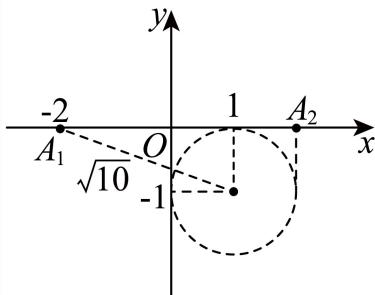

# 2025一模 复数专题 · 教师版

> 本地预览：题目、答案及分类尚未全部审定。校对使用的PDF为高中工作台解析版，尚未逐区确认区级印刷原卷。

## 复数运算、共轭与模

从复数相等、共轭及模的恒等式出发，保留纯虚数的虚部非零条件。

### 嘉定 · 第3题

如果复数 $z$ 满足 $\mathrm i\,\overline z=1+2\mathrm i$（$\mathrm i$ 为虚数单位），则 $z=$______。

> 本题资料或解析有待核事项，预览不可作为已审定成品。

**考点：** 共轭复数与复数除法

**难度依据：** 先除以虚数单位再取共轭

**核查说明：** 题干与解析已用于人工归类，尚未完成整题公式校净与独立数学终审。；题干共轭符号OCR写为上标短横，发布前须规范为共轭复数。；题干与解析已用于人工归类，尚未完成整题公式校净与独立数学终审。；题干共轭符号OCR写为上标短横，发布前须规范为共轭复数。

【答案】$2+\mathrm i$

【解析】

根据给定条件，利用复数除法求出 $\overline z$，进而求出复数 $z$。

依题意，

$$\overline z=\frac{1+2\mathrm i}{\mathrm i}=\frac{(1+2\mathrm i)(-\mathrm i)}{\mathrm i(-\mathrm i)}=2-\mathrm i.$$

所以 $z=2+\mathrm i$。

故答案为：$2+\mathrm i$。

### 宝山 · 第3题

…
设i为虚数单位，若(a − 2) + (2a − 1)i为纯虚数，则实数a = .

**考点：** 纯虚数实部为零与虚部非零

**难度依据：** 涉及纯虚数实部为零与虚部非零；难度为教师预估，需结合原题条件复核。

**核查说明：** 依据现有底稿归类，尚未逐页校卷、公式校净或独立数学终审。

【答案】2

【解析】

根据已知条件，列出方程即可求解.

因为 $( a - 2 ) + ( 2 a - 1 ) \mathrm { i }$ i为纯虚数，所以 $\left\{ { \begin{array} { l l } { 2 a - 1 \neq 0 } \\ { a - 2 = 0 } \end{array} } \right.$ ，即 $\left\{ { a \neq \frac { 1 } { 2 } } \right.$ ，

所以a = 2.

故答案为：2

### 崇明 · 第3题

若复数z满足2z + z¯ = 1 + i其中i为虚数单位，则z = .

**考点：** 共轭复数方程与实虚部分离

**难度依据：** 涉及共轭复数方程与实虚部分离；难度为教师预估，需结合原题条件复核。

**核查说明：** 依据现有底稿归类，尚未逐页校卷、公式校净或独立数学终审。

【答案】${ \frac { 1 } { 3 } } + i$

【解析】

设 $z = a + b i ( a , \ b \in R )$ ，根据实虚部分别相等可解.

解: $z = a + b i ( a , \ b \in R )$ ，则 $\bar { z } = a - b i ( a , \ b \in R )$

所以， $2 a + 2 b i + a - b i = 1 + i , a = \frac { 1 } { 3 } , b = 1$

$$
z = \frac {1}{3} + i,
$$

故答案为： ${ \frac { 1 } { 3 } } + i$

根据复数相等求复数，解决的关键是实虚部分别相等求解；基础题.

### 徐汇 · 第8题

已知复数z1和复数z2满足 $z _ { 1 } + z _ { 2 } = 3 + 4 \mathbf { i } , \overline { { z _ { 1 } } } - \overline { { z _ { 2 } } } = - 2 + \mathbf { i }$ （i为虚数单位），则 z21 − z22 = .

> 本题资料或解析有待核事项，预览不可作为已审定成品。

**考点：** 共轭与平方差的模

**难度依据：** 共轭与平方差的模；按所需步骤与推理量估计

**核查说明：** 题干与解析已用于人工归类，尚未完成整题公式校净与独立数学终审。；题干目标的模号缺失，解析计算的是平方差的模，须回源。；原解将复数差与其共轭之差直接等同；该步一般不成立，须校对。；题干与解析已用于人工归类，尚未完成整题公式校净与独立数学终审。；题干目标的模号缺失，解析计算的是平方差的模，须回源。；原解将复数差与其共轭之差直接等同；该步一般不成立，须校对。

【答案】$5 { \sqrt { 5 } } .$

【解析】

${ \stackrel { \wedge } { \times } } z _ { 1 } = a + b \mathrm { i } , z _ { 2 } = c + d \mathrm { i } { \mathrm { ~ , ~ } } a , b , c , d \in \mathrm { R }$ ，由复数的减法与共轭复数的概念可得

$z _ { 1 } - z _ { 2 } = { \overline { { z _ { 1 } } } } - { \overline { { z _ { 2 } } } }$ ，结合复数的乘方运算性质、复数的乘法法则、复数的模长即可得求解 $\left| z _ { 1 } ^ { 2 } - z _ { 2 } ^ { 2 } \right|$ 的值.

设 $z _ { 1 } = a + b \mathrm { i } , z _ { 2 } = c + d \mathrm { i } , a , b , c , d \in \mathrm { R } ,$

则z − z = (a − c) + (b − d)i, z − z = (a − bi) − (c − di) = (a − c) − (b − d)i，–

所以 $\begin{array} { r } { \left. z _ { 1 } - z _ { 2 } = \overline { { z _ { 1 } } } - \overline { { z _ { 2 } } } , \right. } \end{array}$

因为 $z _ { 1 } + z _ { 2 } = 3 + 4 \mathrm { i } , \overline { { z _ { 1 } } } - \overline { { z _ { 2 } } } = - 2 + \mathrm { i } ,$

所以z2 − z2 = (z1 + z2) (z1 − z2) = (3 + 4i) (−2 − i) = −6 − 3i − 8i − 4i2 = −2 − 11i，

则 z2 − z2 = |−2 − 11i| = √(−2)2 + (−11)2 = 5√5.

故答案为： $5 { \sqrt { 5 } } .$

### 普陀 · 第3题

设i为虚数单位，若复数z满足 $z \cdot { \overline { { z } } } + z - { \overline { { z } } } = 4 + 2 \mathrm { i }$ ，则|z| = .

> 本题资料或解析有待核事项，预览不可作为已审定成品。

**考点：** 复数相等与共轭乘积求模

**难度依据：** 取实部即可识别模平方

**核查说明：** 题干与解析已用于人工归类，尚未完成整题公式校净与独立数学终审。

【答案】2.

【解析】

设复数 $z = a + b \mathrm { i } , \ a , b \in \mathrm { R }$ ,计算出 $z \cdot { \overline { { z } } } + z - { \overline { { z } } } = a ^ { 2 } + b ^ { 2 } + 2 b \mathrm { i }$ ，利用复数相等求出a、b，即得|z|.

设复数 $z = a + b \mathrm { i } , \ a , b \in \mathrm { R }$ ,则–z = a − bi，

所以z ⋅ –z + z − –z = (a + bi) (a − bi) + a + bi − (a − bi) = a2 + b2 + 2bi，

因为 $| z \cdot { \overline { { z } } } + z - { \overline { { z } } } = 4 + 2 \mathrm { i } , $

所以 $a ^ { 2 } + b ^ { 2 } + 2 b \mathrm { i } = 4 + 2 \mathrm { i }$

则 $\left\{ { a ^ { 2 } + b ^ { 2 } = 4 \atop 2 b = 2 } \right.$ ，解得 $\left\{ \begin{array} { l l } { a = \pm { \sqrt { 3 } } } \\ { b = 1 } \end{array} \right.$

所以 $| z | = { \sqrt { \left( \pm { \sqrt { 3 } } \right) ^ { 2 } + 1 ^ { 2 } } } = 2$

故答案为：2.

### 松江 · 第5题

若复数z满足i⋅z = 2+3i（其中i是虚数单位），则复数z的共轭复数–z =

> 本题资料或解析有待核事项，预览不可作为已审定成品。

**考点：** 复数除法与共轭

**难度依据：** 复数除法与共轭；按所需步骤与推理量估计

**核查说明：** 题干与解析已用于人工归类，尚未完成整题公式校净与独立数学终审。

【答案】3+2i.

【解析】

利用复数的除法运算得到z，根据共轭复数的定义即可得到结果.

由题意得， $z = { \frac { 2 + 3 \mathrm { i } } { \mathrm { i } } } = { \frac { ( 2 + 3 \mathrm { i } ) \mathrm { i } } { \mathrm { i } ^ { 2 } } } = { \frac { - 3 + 2 \mathrm { i } } { - 1 } } = 3 - 2 \mathrm { i } ,$

∴–z = 3 + 2i.

故答案为：3+2i.

### 浦东 · 第3题

已知复数 $z _ { 1 } = 3 + \mathrm { i }$ $z _ { 2 } = a + 4 \mathrm { i }$ ${ \boldsymbol { a } } \in \mathbf { R }$ ，若 $z _ { 1 } - z _ { 2 }$ 为纯虚数，则 $| z _ { 2 } | =$

> 本题资料或解析有待核事项，预览不可作为已审定成品。

**考点：** 纯虚数条件与复数模

**难度依据：** 纯虚数条件与复数模；按所需步骤与推理量估计

**核查说明：** 题干与解析已用于人工归类，尚未完成整题公式校净与独立数学终审。

【答案】5.

【解析】

由纯虚数的概念得到a = 3，再由模长计算求解即可；

z1 − z2 = 3 + i − (a + 4i) = 3 − a − 3i，

因为 $z _ { 1 } - z _ { 2 }$ 为纯虚数，所以 $. a = 3$ .

所以 $z _ { 2 } = a + 4 \mathrm { i } = 3 + 4 \mathrm { i }$ ，所以 $\left| z _ { 2 } \right| = \sqrt { 3 ^ { 2 } + 4 ^ { 2 } } = 5$

故答案为：5.

### 金山 · 第4题

已知复数z = 2+i，其中i为虚数单位，则|iz|的值为

**考点：** 复数运算与模

**难度依据：** 涉及复数运算与模；难度为教师预估，需结合原题条件复核。

**核查说明：** 依据现有底稿归类，尚未逐页校卷、公式校净或独立数学终审。

【答案】${ \sqrt { 5 } } .$

【解析】

先由z = 2+i，利用复数乘法求出iz，再用模长公式求其模长即得.

由z = 2 + i，可得 $\mathrm { i } z = \mathrm { i } ( 2 + \mathrm { i } ) = - 1 + 2 \mathrm { i }$ ，

故 $| \mathrm { i } z | = \sqrt { ( - 1 ) ^ { 2 } + 2 ^ { 2 } } = \sqrt { 5 } .$

故答案为： ${ \sqrt { 5 } } .$

### 长宁 · 第13题

已知复数z和–z，则下列说法正确的是（ ）

A. z + –z 一定是实数

B. $z - { \overline { { z } } } -$ 定是虚数

C. 若 $z + { \overline { { z } } } = 0$ ，则z是纯虚数

D. 若 $z - { \overline { { z } } } = 0$ ，则z是纯虚数

**考点：** 判断复数实部虚部及纯虚数条件

**难度依据：** 共轭复数与分类；判断复数实部虚部及纯虚数条件

【答案】A

【解析】
根据复数的加减法，结合虚数和纯虚数的定义即可逐一求解.
设 $z = a + b \mathrm { i } , b , a \in \mathrm { R }$ ,则 $\bar { z } = a - b \mathrm { i }$ ,故 $z + { \overline { { z } } } = 2 a$ 为实数，故A正确，
对于B， $z - { \overline { { z } } } = 2 b \mathrm { i }$ ，当b = 0时，此时z−–z为实数，故B错误，
对于C， $z + { \overline { { z } } } = 2 a = 0$ ,则a = 0，当b = 0时，此时z为实数，C错误，
对于D, $z - { \overline { { z } } } = 2 b \mathrm { i } = 0$ ，则b = 0，则z是实数，故D错误，
故选：A

### 青浦 · 第1题

在复平面内，复数 $z = 1 + \frac { 1 } { 2 } \mathrm { i }$ （其中 i是虚数单位）的共轭复数对应的点位于第 象限.

> 本题资料或解析有待核事项，预览不可作为已审定成品。

**考点：** 共轭复数的坐标与象限

**难度依据：** 虚部反号即可判断

**核查说明：** 题干与解析已用于人工归类，尚未完成整题公式校净与独立数学终审。

【答案】四

【解析】

求出复数的共轭复数即可得解.

因为 $z = 1 + { \frac { 1 } { 2 } } \mathrm { i } .$

所以– $\bar { \dot { \tau } } = 1 - \frac { 1 } { 2 } \mathrm { i }$

所以复数–z对应的点在第四象限.

故答案为：四

### 静安 · 第3题

已知i是虚数单位，(m+i)(1−2i)是纯虚数，则实数m的值为

**考点：** 实部为零且虚部非零

**难度依据：** 复数运算与纯虚数；实部为零且虚部非零

【答案】−2.

【解析】

根据复数的乘法运算和复数分类即可得到答案.

(m + i) (1 − 2i) = m + 2 + (1 − 2m)i，

因为其为纯虚数，则m+2 = 0且 $1 - 2 m \neq 0$ ，解得m = −2.

故答案为：−2.

## 复平面坐标、变换与轨迹

将运算或模条件翻译为点、圆及共轭对称，完整保留交叉知识条件。

### 奉贤 · 第8题

在复平面内，$O$ 为坐标原点，复数 $z_1=\mathrm i(-4-3\mathrm i)$，$z_2=12+5\mathrm i$ 对应的点分别为 $Z_1,Z_2$，其中 $\mathrm i$ 为虚数单位，则 $\langle\overrightarrow{OZ_1},\overrightarrow{OZ_2}\rangle$ 的大小为 ______。

> 本题资料或解析有待核事项，预览不可作为已审定成品。

**考点：** 复数运算与复平面坐标；坐标数量积求向量夹角

**难度依据：** 复数乘法转坐标后求余弦与夹角

**核查说明：** 仅核本题所列字段及页面；不等于全卷终审。；题干与解析已用于人工归类，尚未完成整题公式校净与独立数学终审。；题干夹角括号缺失，需规范向量夹角符号。；题干与解析已用于人工归类，尚未完成整题公式校净与独立数学终审。；题干夹角括号缺失，需规范向量夹角符号。 本次已按本机具名解析版PDF逐页视觉恢复题干：奉贤01为补集符号，第1页；奉贤08为两个位置向量夹角，第3页。此题题干缺项已解决，不代表原解析全量数学终审。

【解析】

由复数乘法运算求得 $z _ { 1 }$ ，进而得到 $\overrightarrow { O Z _ { 1 } } , \overrightarrow { O Z _ { 2 } }$ 利用向量数量积运算和模长公式求得$\cos \left. \overrightarrow { O Z _ { 1 } } , \overrightarrow { O Z _ { 2 } } \right.$ ，进而得到 $\left. \overrightarrow { O Z _ { 1 } } , \overrightarrow { O Z _ { 2 } } \right.$

因为 $\vert z _ { 1 } = \mathrm { i } \left( - 4 - 3 \mathrm { i } \right) = 3 - 4 \mathrm { i } , ~ z _ { 2 } = 1 2 + 5 \mathrm { i }$

所以 $\overrightarrow { O Z _ { 1 } } = ( 3 , - 4 ) , \overrightarrow { O Z _ { 2 } } = ( 1 2 , 5 )$

$$
\cos \left\langle \overrightarrow {O Z _ {1}}, \overrightarrow {O Z _ {2}} \right\rangle = \frac {\overrightarrow {O Z _ {1}} \cdot \overrightarrow {O Z _ {2}}}{\left| \overrightarrow {O Z _ {1}} \right| \left| \overrightarrow {O Z _ {2}} \right|} = \frac {3 \times 1 2 - 2 0}{\sqrt {3 ^ {2} + (- 4) ^ {2}} \times \sqrt {1 2 ^ {2} + 5 ^ {2}}} = \frac {1 6}{6 5},
$$

所以 $\left. { \overrightarrow { O Z _ { 1 } } } , { \overrightarrow { O Z _ { 2 } } } \right. = \operatorname { a r c c o s } { \frac { 1 6 } { 6 5 } } .$

### 杨浦 · 第12题

已知实数 $a>0$，$\mathrm{i}$ 是虚数单位，设集合 $A=\{z\mid z=w+\frac1w,\ |w|>1,\ w\in\mathbf C,\ z\in\mathbf C\}$，集合 $B=\{z\mid |z-1+\mathrm{i}|=a,\ z\in\mathbf C\}$。如果 $B\subseteq A$，则 $a$ 的取值范围为______。

> 本题资料或解析有待核事项，预览不可作为已审定成品。

**考点：** 复变换与几何轨迹；圆与实轴线段相离；集合包含

**难度依据：** 需确定复变换值域并将包含问题转为圆与线段的位置关系；长解细节待审。

**核查说明：** 原MD漏失A的定义及a>0条件；从同名PDF文字层恢复完整题干。PDF第4页底部印刷裁切，A定义未完整可见，不能称已全题视觉确认。；题干与解析已用于人工归类，尚未完成整题公式校净与独立数学终审。；解法二纯虚数分支对q<0的构造及负实数分支符号存在问题，需审解；结论不据此改写。；原MD漏失A的定义及a>0条件；从同名PDF文字层恢复完整题干。PDF第4页底部印刷裁切，A定义未完整可见，不能称已全题视觉确认。；题干与解析已用于人工归类，尚未完成整题公式校净与独立数学终审。；解法二纯虚数分支对q<0的构造及负实数分支符号存在问题，需审解；结论不据此改写。

【答案】$( 0 , 1 ) \cup \left( \sqrt { 1 0 } , + \infty \right)$

【解析】

解法一：明确集合A，B的几何意义，数形结合，根据几何意义即可求得参数范围.

解法二：先证明不属于A的复数z，恰好是那些区间[−2,2]上的实数，再利用该结论得到取值范围.

解法一：由于 $| w | > 1$ ，设 $w = r ( \cos \theta + \mathrm { i } \sin \theta ) , r > 1$ ，

$$
w + \frac {1}{w} = r (\cos \theta + \mathrm{i} \sin \theta) + \frac {1}{r (\cos \theta + \mathrm{i} \sin \theta)}
$$

$$
= r (\cos \theta + \mathrm{i} \sin \theta) + \frac {\cos \theta - \mathrm{i} \sin \theta}{r} = \left(r + \frac {1}{r}\right) \cos \alpha + \mathrm{i} \left(r - \frac {1}{r}\right) \sin \alpha ,
$$

设z对应点(x, y)，则 $x = \left( r + { \frac { 1 } { r } } \right) \cos \alpha , y = \left( r - { \frac { 1 } { r } } \right) \sin \alpha$

所以 ${ \frac { x ^ { 2 } } { \left( r + { \frac { 1 } { r } } \right) ^ { 2 } } } + { \frac { y ^ { 2 } } { \left( r - { \frac { 1 } { r } } \right) ^ { 2 } } } = 1$ ，其中 $r + \frac { 1 } { r } > 2 , r - \frac { 1 } { r } > 0$

当 $r > 1  { \mathbb { H } } )$ ，该方程的几何意义为表示所有椭圆的并集，

即平面上除去线段 $A _ { 1 } A _ { 2 }$ 的点的集合，其中 $A _ { 1 } ( - 2 , 0 ) , A _ { 2 } ( 2 , 0 )$

集合 $B = \{ z \mid | z - 1 + \mathbf { i } | = a , z \in \mathbf { C } \}$ 表示复平面上的圆，圆心为(1,−1)，半径为a，

如果 $B \subseteq A$ ，则该圆与线段 $A _ { 1 } A _ { 2 }$ 无公共点，

结合图形可知a的取值范围为(0,1)∪ $\left( { \sqrt { 1 0 } } , + \infty \right)$ ；

解法二：

先证明：不属于A的复数z，恰好是那些区间[−2,2]上的实数.

下设z是复数.

①情况一：z不是实数，也不是纯虚数.

设 ${ \boldsymbol { \cdot } } { \boldsymbol { z } } = r \cdot \mathrm { e } ^ { \mathrm { i } \alpha } \left( r \geq 0 , \alpha \in \mathbf { R } \right) , z ^ { 2 } - 4 = R \cdot \mathrm { e } ^ { \mathrm { i } \beta } \left( R \geq 0 , \beta \in \mathbf { R } \right)$ ，并令 $w _ { 1 } = { \frac { r \cdot \mathrm { e } ^ { \mathrm { i } \alpha } + { \sqrt { R } } \cdot \mathrm { e } ^ { \mathrm { i } \cdot { \frac { \beta } { 2 } } } } { 2 } }$ $w _ { 2 } = { \frac { r \cdot \mathrm { e } ^ { \mathrm { i } \alpha } - { \sqrt { R } } \cdot \mathrm { e } ^ { \mathrm { i } \cdot { \frac { \beta } { 2 } } } } { 2 } }$

则对 $k = 1 , 2 ,$ ，有 $\left( w _ { k } - { \frac { z } { 2 } } \right) ^ { 2 } = \left( w _ { k } - { \frac { r \cdot \mathrm { e } ^ { \mathrm { i } \alpha } } { 2 } } \right) ^ { 2 } = \left( { \frac { { \sqrt { R } } \cdot \mathrm { e } ^ { \mathrm { i } { \frac { \beta } { 2 } } } } { 2 } } \right) ^ { 2 } = { \frac { R \cdot \mathrm { e } ^ { \mathrm { i } \beta } } { 4 } } = { \frac { z ^ { 2 } - 4 } { 4 } }$ ，即

$$
w _ {k} ^ {2} - z \cdot w _ {k} + 1 = 0.
$$

假设 $w _ { k } = 0$ ，则 $| 0 = w _ { k } ^ { 2 } - z \cdot w _ { k } + 1 = 0 ^ { 2 } - z \cdot 0 + 1 = 1$ ，矛盾，所以 $w _ { k } \neq 0$ ，从而 $w _ { k } + \frac { 1 } { w _ { k } } = z .$

又因为 $\mathfrak { w } _ { 1 } \mathfrak { w } _ { 2 } = \frac { \left( r \cdot \mathrm { e } ^ { \mathrm { i } \alpha } \right) ^ { 2 } - \left( \sqrt { R } \cdot \mathrm { e } ^ { \mathrm { i } \cdot \frac { \beta } { 2 } } \right) ^ { 2 } } { 4 } = \frac { z ^ { 2 } - R \cdot \mathrm { e } ^ { \mathrm { i } \beta } } { 4 } = \frac { z ^ { 2 } - \left( z ^ { 2 } - 4 \right) } { 4 } = 1 ,$

所以 $1 = | 1 | = | w _ { 1 } w _ { 2 } | = | w _ { 1 } | | w _ { 2 } | .$

此时，假设 $| w _ { 1 } | = | w _ { 2 } | = 1 \colon$ ：由于

$$
w _ {1} = \frac {r \mathrm{e} ^ {\mathrm{i} \alpha} + \sqrt {R} \mathrm{e} ^ {\mathrm{i} \cdot \frac {\beta}{2}}}{2} = \left(\frac {r}{2} \cos \alpha + \frac {\sqrt {R}}{2} \cos \frac {\beta}{2}\right) + \left(\frac {r}{2} \sin \alpha + \frac {\sqrt {R}}{2} \sin \frac {\beta}{2}\right) \mathrm{i},
$$

故

$$
\begin{array}{l} 1 = 1 ^ {2} = | w _ {1} | ^ {2} = \left(\frac {r}{2} \cos \alpha + \frac {\sqrt {R}}{2} \cos \frac {\beta}{2}\right) ^ {2} + \left(\frac {r}{2} \sin \alpha + \frac {\sqrt {R}}{2} \sin \frac {\beta}{2}\right) ^ {2} = \frac {r ^ {2}}{4} + \frac {R}{4} + \frac {r \sqrt {R}}{2} \cos \\ \left(\alpha - \frac {\beta}{2}\right) \end{array}
$$

同理，根据 $| w _ { 2 } | = 1$ 可以得到 $1 = { \frac { r ^ { 2 } } { 4 } } + { \frac { R } { 4 } } - { \frac { r { \sqrt { R } } } { 2 } } \mathrm { c o s } \left( \alpha - { \frac { \beta } { 2 } } \right)$

对 $. = { \frac { r ^ { 2 } } { 4 } } + { \frac { R } { 4 } } + { \frac { r { \sqrt { R } } } { 2 } } \cos \left( \alpha - { \frac { \beta } { 2 } } \right)$ 和1 $= { \frac { r ^ { 2 } } { 4 } } + { \frac { R } { 4 } } - { \frac { r { \sqrt { R } } } { 2 } } \cos \left( \alpha - { \frac { \beta } { 2 } } \right)$ 相加和相减，

就能得到 $1 = { \frac { r ^ { 2 } } { 4 } } + { \frac { R } { 4 } } , { \frac { r { \sqrt { R } } } { 2 } } \mathrm { c o s } \left( \alpha - { \frac { \beta } { 2 } } \right) = 0 .$

若假设R = 0，则 $( z - 2 ) ( z + 2 ) = z ^ { 2 } - 4 = R \mathrm { e } ^ { \mathrm { i } \beta } = 0$ ，从而 $z = 2$ 或 $z = - 2$

这和情况一的定义矛盾，所以 $R > 0$

若假设 $\boldsymbol { r } = 0$ ，则 $z = r \cdot \mathrm { e } ^ { \mathrm { i } \alpha } = 0$ ，从而 $z = 0$ ，这和情况一的定义矛盾，所以 $r > 0$

这就得到 $\frac { r \sqrt { R } } { 2 } > 0 .$ ，所以 $\cos \left( \alpha - { \frac { \beta } { 2 } } \right)$ = 0，所以 $\frac { \beta } { 2 } = \alpha + \left( 2 m - 1 \right) \cdot \frac { \pi } { 2 } ( m \in \mathbf { Z } )$

即 $\displaystyle | \beta = 2 \alpha + ( 2 m - 1 ) \pi \left( m \in \mathbf { Z } \right)$

这就得到

R (reiα)2 ⋅ ei(2m−1)π R 2 − 4 = ⋅ eiβ = ⋅ ei(2α+(2m−1)π) = e2iα ⋅ ei(2m−1)π z2 2 i(2m−1)π r2 r2 所以 $z ^ { 2 } - 4 = { \frac { R } { r ^ { 2 } } } i$ z2或 $z ^ { 2 } - 4 = - { \frac { R } { r ^ { 2 } } } z ^ { 2 }$ ，无论哪种情况都能得到 $z ^ { 2 }$ 是实数，故可设 $z ^ { 2 } = c \in \mathbf { R }$ 若 $c \geq 0 .$ ，则 $0 = z ^ { 2 } - c = \left( z - { \sqrt { c } } \right) \left( z + { \sqrt { c } } \right)$ ，得 $z = \pm \sqrt { { \mathfrak { c } } }$ c是实数，这和情况一的定义矛盾. 若 $c < 0 _ { : }$ ，则 $0 = z ^ { 2 } - c = \left( z - \mathrm { i } { \sqrt { c } } \right) \left( z + \mathrm { i } { \sqrt { c } } \right)$ ，得 $z = \pm \mathrm { i } \sqrt { }$ c是纯虚数，这和情况一的定义矛 盾.

故前面的假设 $| w _ { 1 } | = | w _ { 2 } | = 1$ 不成立，所以结合 $\mathrm { ~ l ~ } = \left| w _ { 1 } \right| \left| w _ { 2 } \right|$ |可知，

一定存在k = 1,2使得 $| w _ { k } | > 1$ ，结合 $w _ { k } + \frac { 1 } { w _ { k } } = z ^ { \boxplus } \ddot { \star } \boxed { \| } z \in A$

②情况二：z是纯虚数.

此时设 $z = \dot { q 1 } ( q \neq 0 )$ ，则 $w = \frac { q + \sqrt { q ^ { 2 } + 4 } } { 2 }$ i满 $\dot { \Xi } | w | = { \frac { q + \sqrt { q ^ { 2 } + 4 } } { 2 } } > { \frac { 0 + \sqrt { 0 + 4 } } { 2 } } = 1$

$$
\begin{array}{l} {w + \frac {1}{w} = \frac {q + \sqrt {q ^ {2} + 4}}{2} \mathrm{i} + \frac {1}{\frac {q + \sqrt {q ^ {2} + 4}}{2} \mathrm{i}} = \frac {q + \sqrt {q ^ {2} + 4}}{2} \mathrm{i} - \frac {2}{q + \sqrt {q ^ {2} + 4}} \mathrm{i} = \frac {q + \sqrt {q ^ {2} + 4}}{2} \mathrm{i}} \\ {- \frac {\sqrt {q ^ {2} + 4} - q}{2} \mathrm{i} = q \mathrm{i} = z} \end{array}
$$

故 $z \in A .$

③情况三：z是实数， $\mathrm { { E } } z > 2 .$

此时 $w = \frac { z + \sqrt { z ^ { 2 } - 4 } } { 2 }$ 满足 $| w | = \left| { \frac { z + { \sqrt { z ^ { 2 } - 4 } } } { 2 } } \right| = { \frac { z + { \sqrt { z ^ { 2 } - 4 } } } { 2 } } > { \frac { 2 + { \sqrt { 2 ^ { 2 } - 4 } } } { 2 } } = 1 ,$

且 $\lfloor w + { \frac { 1 } { w } } = { \frac { z + { \sqrt { z ^ { 2 } - 4 } } } { 2 } } + { \frac { 2 } { z + { \sqrt { z ^ { 2 } - 4 } } } } = { \frac { z + { \sqrt { z ^ { 2 } - 4 } } } { 2 } } + { \frac { z - { \sqrt { z ^ { 2 } - 4 } } } { 2 } } = z ,$ ，故 $( z \in A$

④情况四：z是实数，且 $z < - 2$

此时 $w = \frac { - z + \sqrt { z ^ { 2 } - 4 } } { 2 }$ 满足

$$
| w | = \left| \frac {- z + \sqrt {z ^ {2} - 4}}{2} \right| = \frac {(- z) + \sqrt {(- z) ^ {2} - 4}}{2} > \frac {2 + \sqrt {2 ^ {2} - 4}}{2} = 1,
$$

且 $w + \frac { 1 } { w } = \frac { z - \sqrt { z ^ { 2 } - 4 } } { 2 } + \frac { 2 } { z - \sqrt { z ^ { 2 } - 4 } } = \frac { z - \sqrt { z ^ { 2 } - 4 } } { 2 } + \frac { z + \sqrt { z ^ { 2 } - 4 } } { 2 } = z ,$ ，故 $z \in A$

⑤情况五：z是实数， $\mathrm { E } z \in [ - 2 , 2 ]$

假设 $z \in A .$ 则存在复数w使得 $| w | > 1$ ，且 ${ \boldsymbol { \cdot } } { \boldsymbol { w } } + { \frac { 1 } { w } } = { \boldsymbol { z } } ,$ ，设 $w = r _ { 0 } \cdot \mathrm { e } ^ { \mathrm { i } \theta } \left( r _ { 0 } > 1 , \theta \in \mathbf { R } \right)$

$$
| z = w + \frac {1}{w} = r _ {0} \mathrm{e} ^ {\mathrm{i} \theta} + \frac {1}{r _ {0} \cdot \mathrm{e} ^ {\mathrm{i} \theta}} = r _ {0} \mathrm{e} ^ {\mathrm{i} \theta} + \frac {1}{r _ {0}} \mathrm{e} ^ {- \mathrm{i} \theta} = \left(r _ {0} + \frac {1}{r _ {0}}\right) \cos \theta + \mathrm{i} \left(r _ {0} - \frac {1}{r _ {0}}\right) \sin \theta .
$$

从而 $\left( r _ { 0 } + { \frac { 1 } { r _ { 0 } } } \right) \cos \theta = z , \left( r _ { 0 } - { \frac { 1 } { r _ { 0 } } } \right) \sin \theta = 0$ 而由 $r _ { 0 } > 1$ 可知 $\vert r _ { 0 } - \frac { 1 } { r _ { 0 } } > 1 - \frac { 1 } { 1 } = 0 .$ 所以 $\sin \theta = 0$ ，故 $| \cos \theta | = 1$

这就得到 ${ \mathrm { ~ : } } \geq | z | = \left| \left( r _ { 0 } + { \frac { 1 } { r _ { 0 } } } \right) \cos \theta \right| = r _ { 0 } + { \frac { 1 } { r _ { 0 } } } = { \frac { ( r _ { 0 } - 1 ) ^ { 2 } + 2 r _ { 0 } } { r _ { 0 } } } > { \frac { 2 r _ { 0 } } { r _ { 0 } } } = 2 ,$ ，矛盾.所以假设不成立，从而z ∉ A.

综合上面五种情况，就得到了结论：不属于A的复数z，恰好是那些区间[−2,2]上的实数现在回到原题，结合上面的结论，条件等价于B中包含的每个实数都不属于[−2,2].

一方面，若B中包含一个实数z，满足 $- 2 \leq z \leq 2$

则 $| a = | z - 1 + \mathbf { i } | = { \sqrt { ( z - 1 ) ^ { 2 } + 1 } } \geq 1 \quad$

$a = | z - 1 + \mathrm { i } | = { \sqrt { \left( z - 1 \right) ^ { 2 } + 1 } } = { \sqrt { \left( z + 2 \right) \left( z - 4 \right) + 1 0 } } \leq { \sqrt { 1 0 } }$ ，从而1 $\leq a \leq { \sqrt { 1 0 } } .$

另一方面，若 $1 \leq a \leq \sqrt { 1 0 }$ ，则实数 $z = 1 - \sqrt { a ^ { 2 } - 1 }$ 1满足

$$
z = 1 - \sqrt {a ^ {2} - 1} \geq 1 - \sqrt {\left(\sqrt {1 0}\right) ^ {2} - 1} = 1 - \sqrt {9} = - 2, z = 1 - \sqrt {a ^ {2} - 1} \leq 1 \leq 2.
$$

故B中包含一个实数z，满 $\begin{array} { r } { \mathbb { E } - 2 \le z \le 2 } \end{array}$

这就说明，B中包含一个实数z满足−2 ≤ z ≤ 2的充要条件是1 $\leq a \leq { \sqrt { 1 0 } } .$

所以a的取值范围是 $( 0 , 1 ) \cup \left( \sqrt { 1 0 } , + \infty \right)$

故答案为： $( 0 , 1 ) \cup \left( \sqrt { 1 0 } , + \infty \right)$

关键点点睛：本题的关键在于对复数知识和三角恒等变换的使用.

## 二、选择题

### 浦东 · 第12题

已知在复数集中，等式 $x ^ { 4 } + a _ { 3 } x ^ { 3 } + a _ { 2 } x ^ { 2 } + a _ { 1 } x + a _ { 0 } = \left( x - z _ { 1 } \right) \left( x - z _ { 2 } \right) \left( x - z _ { 3 } \right) \left( x - z _ { 4 } \right)$ 对任意复数x恒成立，复数 $z _ { 1 } , ~ z _ { 2 } , ~ z _ { 3 } , ~ z _ { 4 }$ 在复平面上对应的4个点为某个单位圆内接正方形的4个顶点，$\{ a _ { 0 } , a _ { 1 } , a _ { 2 } , a _ { 3 } \} \subset \{ n | 1 \leq n \leq 2 0 2 4 , n \in \bf { Z } \}$ ，则满足条件的不同集合 $\{ a _ { 0 } , a _ { 1 } , a _ { 2 } , a _ { 3 } \}$ 个数为

> 本题资料或解析有待核事项，预览不可作为已审定成品。

**考点：** 复根与正方形共轭对称；整数参数计数

**难度依据：** 需利用复根的共轭对称、正方形结构和整数约束分类计数；题意与答案待核。

**核查说明：** 题干与解析已用于人工归类，尚未完成整题公式校净与独立数学终审。；源解以系数集合元素互异性排除圆心参数a=-1；底稿未明确要求各系数互异，该情形系数集合{2,4,6}满足当前字面条件，可能影响答案，须核原卷及独立复算。；题干与解析已用于人工归类，尚未完成整题公式校净与独立数学终审。；源解以系数集合元素互异性排除圆心参数a=-1；底稿未明确要求各系数互异，该情形系数集合{2,4,6}满足当前字面条件，可能影响答案，须核原卷及独立复算。

【答案】10.

【解析】

由一元二次方程，复数根互为共轭复数根，一元四次方程可以分解为两个一元二次方程，因此四个根应该两两互为共轭复数根（或实数根），因此圆心在x轴上，据此分类讨论可求得结论.

$$
x ^ {4} + a _ {3} x ^ {3} + a _ {2} x ^ {2} + a _ {1} x + a _ {0} = (x - z _ {1}) (x - z _ {2}) (x - z _ {3}) (x - z _ {4})
$$

$$
= x ^ {4} - (z _ {1} + z _ {2} + z _ {3} + z _ {4}) x ^ {3} + (z _ {1} z _ {2} + z _ {1} z _ {3} + z _ {1} z _ {4} + z _ {2} z _ {3} + z _ {2} z _ {4} + z _ {3} z _ {4}) x ^ {2}
$$

$$
- \left(z _ {1} z _ {2} z _ {3} + z _ {1} z _ {2} z _ {4} + z _ {2} z _ {3} z _ {4}\right) x + z _ {1} z _ {2} z _ {3} z _ {4},
$$

对 比系数可得a0 = z1z2z3z4，a1 = − (z1z2z3 + z1z2z4 + z2z3z4)，

$$
a _ {2} = z _ {1} z _ {2} + z _ {1} z _ {3} + z _ {1} z _ {4} + z _ {2} z _ {3} + z _ {2} z _ {4} + z _ {3} z _ {4}, a _ {3} = - \left(z _ {1} + z _ {2} + z _ {3} + z _ {4}\right),
$$

复数 $z _ { 1 } , ~ z _ { 2 } , ~ z _ { 3 } , ~ z _ { 4 }$ 在复平面上对应的4个点为某个单位圆内接正方形的4个顶点情况1，四个根两两互为共轭复数，故圆心在x轴上，设单位的圆心为(a,0)，

不妨设 $z _ { 1 } = a + \frac { \sqrt { 2 } } { 2 } + \frac { \sqrt { 2 } } { 2 } \mathrm { i } , ~ z _ { 2 } = a - \frac { \sqrt { 2 } } { 2 } + \frac { \sqrt { 2 } } { 2 } \mathrm { i } ,$

$$
z _ {3} = a - \frac {\sqrt {2}}{2} - \frac {\sqrt {2}}{2} \mathrm{i}, z _ {4} = a + \frac {\sqrt {2}}{2} + \frac {\sqrt {2}}{2} \mathrm{i},
$$

$$
a _ {0} = z _ {1} z _ {2} z _ {3} z _ {4} = \left(a + \frac {\sqrt {2}}{2} + \frac {\sqrt {2}}{2} \mathrm{i}\right) \left(a - \frac {\sqrt {2}}{2} + \frac {\sqrt {2}}{2} \mathrm{i}\right) \left(a - \frac {\sqrt {2}}{2} - \frac {\sqrt {2}}{2} \mathrm{i}\right)
$$

$$
\left(a + \frac {\sqrt {2}}{2} + \frac {\sqrt {2}}{2} \mathrm{i}\right)
$$

$$
= \left[ \left(a + \frac {\sqrt {2}}{2} \mathrm{i}\right) ^ {2} - \frac {1}{2} \right] \left[ \left(a - \frac {\sqrt {2}}{2} \mathrm{i}\right) ^ {2} - \frac {1}{2} \right] = \left[ a ^ {2} + \sqrt {2} a \mathrm{i} - 1 \right] \left[ a ^ {2} - \sqrt {2} a \mathrm{i} - 1 \right]
$$

$$
\left[ (a ^ {2} - 1) + \sqrt {2} a \mathrm{i} \right] \left[ (a ^ {2} - 1) - \sqrt {2} a \mathrm{i} \right] = (a ^ {2} - 1) ^ {2} + 2 a ^ {2} = a ^ {4} + 1,
$$

类似计算可得 $\dot { \bf { \sigma } } a _ { 1 } = - \left( z _ { 1 } z _ { 2 } z _ { 3 } + z _ { 1 } z _ { 2 } z _ { 4 } + z _ { 2 } z _ { 3 } z _ { 4 } \right) = - 4 a ^ { 3 } ,$

$$
a _ {2} = z _ {1} z _ {2} + z _ {1} z _ {3} + z _ {1} z _ {4} + z _ {2} z _ {3} + z _ {2} z _ {4} + z _ {3} z _ {4} = 6 a ^ {2}, \quad a _ {3} = - (z _ {1} + z _ {2} + z _ {3} + z _ {4}) = - 4 a,
$$

因为 $\{ a _ { 0 } , a _ { 1 } , a _ { 2 } , a _ { 3 } \} \subset \{ n | 1 \leq n \leq 2 0 2 4 , n \in \bf { Z } \}$

所以a只能为负整数，又集合元素的互异性，从而可得 $\cdot a = - 2 , - 3 , - 4 , - 5 , - 6$ ，此时集合

$\{ a _ { 0 } , a _ { 1 } , a _ { 2 } , a _ { 3 } \}$ 的个数为5个，

情况2，四个根有2个为实数，另外2个为共轭复数故圆心在x轴上，设单位的圆心为(a,0)，不妨设 $z _ { 1 } = a - 1 , ~ z _ { 2 } = a + \mathrm { i } , ~ z _ { 3 } = a + 1 , ~ z _ { 4 } = a - \mathrm { i } ,$

计算可得 $\cdot a _ { 0 } = z _ { 1 } z _ { 2 } z _ { 3 } z _ { 4 } = a ^ { 4 } - 1 , a _ { 1 } = - \left( z _ { 1 } z _ { 2 } z _ { 3 } + z _ { 1 } z _ { 2 } z _ { 4 } + z _ { 2 } z _ { 3 } z _ { 4 } \right) = - 4 a ^ { 3 } ,$

$$
a _ {2} = z _ {1} z _ {2} + z _ {1} z _ {3} + z _ {1} z _ {4} + z _ {2} z _ {3} + z _ {2} z _ {4} + z _ {3} z _ {4} = 6 a ^ {2}, a _ {3} = - (z _ {1} + z _ {2} + z _ {3} + z _ {4}) = - 4 a,
$$

因为 $\{ a _ { 0 } , a _ { 1 } , a _ { 2 } , a _ { 3 } \} \subset \{ n | 1 \leq n \leq 2 0 2 4 , n \in \bf { Z } \}$ ，所以a只能为负整数，又集合元素的互异性，从而可得 $\cdot a = - 2 , - 3 , - 4 , - 5 , - 6$ ，此时集合 $\{ a _ { 0 } , a _ { 1 } , a _ { 2 } , a _ { 3 } \}$ 的个数为5个，

综上：满足条件的不同 $\{ a _ { 0 } , a _ { 1 } , a _ { 2 } , a _ { 3 } \}$ 的个数为10.

故答案为：10.

关键点点睛：重点在于一元二次方程，复数根互为共轭复数根，进而确定一元四次方程可以 分解为两个一元二次方程，从而4个根两两互为共轭复数根，进而确定圆心，从而分类讨论求 解.

## 二、选择题

### 虹口 · 第7题

已知非零复数z满足|z − 1| = 1,|–z − i| = 1，则z的虚部为

> 本题资料或解析有待核事项，预览不可作为已审定成品。

**考点：** 共轭复数模与几何轨迹

**难度依据：** 涉及共轭复数模与几何轨迹；难度为教师预估，需结合原题条件复核。

**核查说明：** 原解先设实部、虚部均非零，是否允许此假设需核验。；依据现有底稿归类，尚未逐页校卷、公式校净或独立数学终审。

【解析】

设 $z = a + b \mathrm { i } \left( a b \neq 0 \right)$ ，根据复数的模得到方程组，解得即可.

设 $z = a + b \mathrm { i } \left( a b \neq 0 \right)$ ，则 $\overrightharpoon { z } = a - b \mathrm { i }$

因为 $| z - 1 | = 1 , | \overline { { z } } - \mathbf { i } | = 1$ ，所以 $\left\{ \begin{array} { l l } { \sqrt { \left( a - 1 \right) ^ { 2 } + b ^ { 2 } } = 1 } \\ { \sqrt { a ^ { 2 } + \left( - b - 1 \right) ^ { 2 } } = 1 } \end{array} \right.$ ，解得 $\left\{ { a = 1 \atop b = - 1 } \right.$ 或1 $\left\{ { a = 0 } \atop { b = 0 }  \right.$ （舍去），

所以z = 1 − i，则z的虚部为−1.

### 黄浦 · 第10题

i为虚数单位，若复数 $z _ { 1 }$ 满足 $| z _ { 1 } - 1 + \mathbf { i } | \leq { \sqrt { 2 } }$ ，复数 $\scriptstyle z _ { 2 }$ 满足 $\left| z _ { 2 } \right| = \left| z _ { 2 } + 1 - \mathrm { i } \right|$ ，则 $| z _ { 1 } - z _ { 2 } |$ |的最小值 为

**考点：** 转化圆面到直线距离

**难度依据：** 复数轨迹间最短距离；转化圆面到直线距离

【答案】$\frac { \sqrt { 2 } } { 2 }$

【解析】

设 ${ \bf \ddot { z } } _ { 1 } = a _ { 1 } + b _ { 1 } { \bf \dot { i } } , a _ { 1 } , b _ { 1 } \in { \bf R } , z _ { 2 } = a _ { 2 } + b _ { 2 } { \bf \dot { i } } , a _ { 2 } , b _ { 2 } \in { \bf R }$ ，由题设易得z 对应的点 $( a _ { 1 } , b _ { 1 } )$ )的轨迹是以(1,−1)为圆心， $\downarrow \downarrow r = \sqrt { 2 }$ 为半径的圆面（包括边界）内， $z _ { 2 }$ 对应的点 $( a _ { 2 } , b _ { 2 } )$ 是直线$x - y + 1 = 0 \pm { \frac { - 5 } { \cdots } }$ ，进而结合圆上一点到直线上一点的距离最值问题求解即可

设 $z _ { 1 } = a _ { 1 } + b _ { 1 } \mathrm { i } , \ a _ { 1 } , b _ { 1 } \in \mathbf { R } .$

则 $| z _ { 1 } - 1 + \mathrm { i } = a _ { 1 } + b _ { 1 } \mathrm { i } - 1 + \mathrm { i } = ( a _ { 1 } - 1 ) + ( b _ { 1 } + 1 ) \mathrm { i } ,$

由 $| z _ { 1 } - 1 + \mathrm { i } | \leq \sqrt { 2 }$ ，得 ${ \sqrt { \left( a _ { 1 } - 1 \right) ^ { 2 } + \left( b _ { 1 } + 1 \right) ^ { 2 } } } \leq { \sqrt { 2 } } ,$

即 $\left( a _ { 1 } - 1 \right) ^ { 2 } + \left( b _ { 1 } + 1 \right) ^ { 2 } \leq 2 ,$

则复数 $z _ { 1 }$ 对应的点 $( a _ { 1 } , b _ { 1 } )$ 的轨迹是以(1,−1)为圆心，以 ${ \sqrt { r } } = { \sqrt { 2 } }$ 为半径的圆面（包括边界）内，

设 $\cdot z _ { 2 } = a _ { 2 } + b _ { 2 } \mathbf { i } , ~ a _ { 2 } , b _ { 2 } \in { \bf R } , ~ \ b \| z _ { 2 } + 1 - \mathbf { i } = a _ { 2 } + b _ { 2 } \mathbf { i } + 1 - \mathbf { i } = ( a _ { 2 } + 1 ) + ( b _ { 2 } - 1 ) \mathbf { i } ,$

由 $| z _ { 2 } | = | z _ { 2 } + 1 - \mathrm { i } |$ ，得 ${ \sqrt { a _ { 2 } ^ { 2 } + b _ { 2 } ^ { 2 } } } = { \sqrt { ( a _ { 2 } + 1 ) ^ { 2 } + ( b _ { 2 } - 1 ) ^ { 2 } } }$ ，

整理得， $a _ { 2 } - b _ { 2 } + 1 = 0$

则复数 $\dot { z } _ { 2 }$ 对应的点 $( a _ { 2 } , b _ { 2 } )$ 是直线x − y + 1 = 0上一点，

又z1 − z2 = a1 + b1i − (a2 + b2i) = (a1 − a2) + (b1 − b2)i，

所以 $\left| z _ { 1 } - z _ { 2 } \right| = { \sqrt { \left( a _ { 1 } - a _ { 2 } \right) ^ { 2 } + \left( b _ { 1 } - b _ { 2 } \right) ^ { 2 } } }$ 表示点 $( a _ { 1 } , b _ { 1 } ) ^ { l }$ 与点 $( a _ { 2 } , b _ { 2 } )$ 之间的距离，

因为圆心(1,−1)到直线 $x - y + 1 = 0$ 的距离为 $d = { \frac { | 1 + 1 + 1 | } { \sqrt { 2 } } } = { \frac { 3 { \sqrt { 2 } } } { 2 } }$

所以 $| z _ { 1 } - z _ { 2 } |$ |的最小值为 $d - r = { \frac { 3 { \sqrt { 2 } } } { 2 } } - { \sqrt { 2 } } = { \frac { \sqrt { 2 } } { 2 } }$

故答案为： $\frac { \sqrt { 2 } } { 2 }$

## 虚数幂周期与不同值计数

利用i的周期先确定可能值，再判断不同复数及重复情况。

### 闵行 · 第9题

已知 $f \left( n \right) = \mathrm { i } ^ { n + 1 } + \mathrm { i } ^ { n + 2 } + \mathrm { i } ^ { n + 3 } + \mathrm { i } ^ { n + 4 } + \mathrm { i } ^ { n + 5 }$ （i为虚数单位，n为正整数），当 $n _ { 1 } , ~ n _ { 2 }$ 取遍所有正整数时， $f \left( n _ { 1 } \right) + f \left( n _ { 2 } \right)$ 的值中不同虚数的个数为

**考点：** 利用i的周期确定不同复数值

**难度依据：** 虚数幂周期与计数；利用i的周期确定不同复数值

【解析】

由i的整数次幂的周期性求出f(n)的取值集合，进而列举出所有结果即可得解

依题意， $n \in \mathrm { N ^ { * } , ~ i ^ { 4 n - 3 } = i , i ^ { 4 n - 2 } = - 1 , i ^ { 4 n - 1 } = - i , i ^ { 4 n } = 1 }$ ，则 $\mathrm { i } ^ { 4 n - 3 } + \mathrm { i } ^ { 4 n - 2 } + \mathrm { i } ^ { 4 n - 1 } + \mathrm { i } ^ { 4 n } = 0$ 1

$$
n \in \mathrm{N} ^ {*}, f (n) = \mathrm{i} ^ {n + 1} + \mathrm{i} ^ {n + 2} + \mathrm{i} ^ {n + 3} + \mathrm{i} ^ {n + 4} + \mathrm{i} ^ {n + 5} = \mathrm{i} ^ {n + 1} \in \{- 1, - \mathrm{i}, 1, \mathrm{i} \}
$$

所以 $f ( n _ { 1 } ) + f ( n _ { 2 } )$ 的值中不同虚数有： $- 2 \mathrm { i } , 2 \mathrm { i } , - 1 - \mathrm { i } , - 1 + \mathrm { i } , 1 - \mathrm { i } , 1 + \mathrm { i }$ ，共6个.故答案为：6

