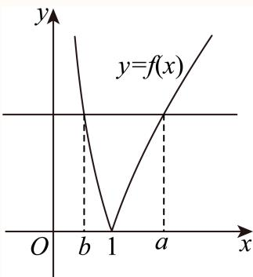

# 2025一模 新定义与综合专题 · 教师版

> 本地预览：题目、答案及分类尚未全部审定。校对使用的PDF为高中工作台解析版，尚未逐区确认区级印刷原卷。

## 新定义数列、映射与量词

展开定义中的全称存在条件，以具体构造和反例判断性质。

### 嘉定 · 第16题

已知数列 $\left\{ a _ { n } \right\}$ 满足 $a _ { n + 1 } = r a _ { n } \left( 1 - a _ { n } \right) ( n = 1 , 2 , 3 , \cdot \cdot \cdot ) , a _ { 1 } \in ( 0 , 1 )$ ，给出以下四个结论：
①当r = 2时，存在有限个 $\mathbf { \dot { a } } _ { 1 }$ ，使得对任意正整数 $^ { \cdot _ { n , \cdot } }$ ，都有 $a _ { n + 1 } > a _ { n }$
②当r = 2时，存在 $\scriptstyle ( a _ { 1 }$ 和正整数P，当 $n > P \mathbb { H } ]$ ， $a _ { n + 1 } - a _ { n } < { \frac { 1 } { 2 0 2 5 } }$
③当r = 3时，存在a 和正整数 $P ,$ ，当 $n > P \mathbb { k }$ ， $a _ { n + 1 } = a _ { n }$
④当r = −3时，不存在a ，使得对任意正整数n，且 $. n \geq 3$ ，都有 $\dot { a } _ { n } > 0$
其中正确结论是（ ）.

A. ①②

B. ②③

C. ③④

D. ②④

> 本题资料或解析有待核事项，预览不可作为已审定成品。

**考点：** 二次迭代数列的不动点与单调性；二次迭代映射的区间不变性；递推命题的存在量词与反例构造

**难度依据：** 多参数迭代需结合不动点和首项反向构造

**核查说明：** 题干与解析已用于人工归类，尚未完成整题公式校净与独立数学终审。；原解由单调有界直接断言达到指定阈值未写明极限为1/2；④中a3又误写2/3，需补证校净。；题干与解析已用于人工归类，尚未完成整题公式校净与独立数学终审。；原解由单调有界直接断言达到指定阈值未写明极限为1/2；④中a3又误写2/3，需补证校净。

【答案】B

【解析】

对于①②，利用作差法可得一元二次不等式，求得数列中的项的取值范围，可得其正误；

对于③④，根据递推公式，利用赋值法求得当数列为常数列时所取的数值，进而求得首项，结合举例，可得答案.

对于①，当r = 2时， $a _ { n + 1 } = 2 a _ { n } \left( 1 - a _ { n } \right) , a _ { n + 1 } - a _ { n } = 2 a _ { n } \left( 1 - a _ { n } \right) - a _ { n } = a _ { n } - 2 a _ { n } ^ { 2 } > 0$ ，解得0 $< a _ { n } < { \frac { 1 } { 2 } }$

当0 $< a _ { 1 } < \frac { 1 } { 2 }$ 时， $a _ { n + 1 } - a _ { n } > 0 ( n \in \mathrm { N } ^ { * } )$ 恒成立，故①错误；

对于②，当r = 2时， $a _ { n + 1 } = 2 a _ { n } ( 1 - a _ { n } ) , a _ { n + 1 } - a _ { n } = a _ { n } - 2 a _ { n } ^ { 2 } < { \frac { 1 } { 2 0 2 5 } }$ ，解得

$$
a _ {n} <   \frac {1 - \sqrt {\frac {2 0 1 7}{2 0 2 5}}}{4} \text {或} a _ {n} > \frac {1 + \sqrt {\frac {2 0 1 7}{2 0 2 5}}}{4},
$$

易知 $) < \frac { 1 - \sqrt { \frac { 2 0 1 7 } { 2 0 2 5 } } } { 4 } < \frac { 1 + \sqrt { \frac { 2 0 1 7 } { 2 0 2 5 } } } { 4 } < \frac { 1 } { 2 }$ 由①可知，当 $0 < a _ { 1 } < \frac { 1 } { 2 }$ 时，数列 $\{ a _ { n } \}$ 单调递增， $0 < a _ { n } < { \frac { 1 } { 2 } }$

所以一定存在 $P \in \mathbf { N } ^ { * }$ ，当n > P时， ${ \frac { 1 + { \sqrt { \frac { 2 0 1 7 } { 2 0 2 5 } } } } { 4 } } < a _ { n } < { \frac { 1 } { 2 } }$ ，故②正确；

对于③，当r = 3时， $a _ { n + 1 } = 3 a _ { n } ( 1 - a _ { n } ) , \widehat { \vec { \triangledown } } a _ { n + 1 } = a _ { n } = x _ { 1 }$ ，可得 ${ \boldsymbol { x } } = 3 x \left( 1 - x \right)$ ，解得 $\dot { \boldsymbol { x } } = 0$ 或 $\frac { 2 } { 3 }$ ，

令 $\cdot 3 a _ { 1 } \left( 1 - a _ { 1 } \right) = \frac { 2 } { 3 }$ ，解得 $\langle a _ { 1 } = \frac { 1 } { 3 }$ 或 $\frac { 2 } { 3 }$ ，

当 $a _ { 1 } = \frac { 1 } { 3 }$ 时，可得当 $n >$ 1时， $a _ { n } = { \frac { 2 } { 3 } }$ ，故③正确；

对于④，当r = −3时， $a _ { n + 1 } = - 3 a _ { n } \left( 1 - a _ { n } \right)$ 令 $a _ { n + 1 } = a _ { n } = x $ ，则 $x = - 3 x \left( 1 - x \right)$ ，解得x = 0或 $\frac { 4 } { 3 }$ ，

令 $\dot { \mathbf { \zeta } } a _ { 3 } = \frac { 2 } { 3 }$ ，可得 $- 3 a _ { 2 } \left( 1 - a _ { 2 } \right) = \frac { 4 } { 3 }$ ，解得 $\mathbf { \tilde { \rho } } a _ { 2 } = - \frac { 1 } { 3 }$ 或 $\frac { 4 } { 3 }$ ，

令 $\mathrm { { \dot { a } _ { 2 } } = - \frac { 1 } { 3 } }$ ，可得 $- 3 a _ { 1 } \left( 1 - a _ { 1 } \right) = - \frac { 1 } { 3 }$ ，解得 $a _ { 1 } = { \frac { 3 \pm { \sqrt { 5 } } } { 6 } }$

当 $a _ { 1 } = \frac { 3 - \sqrt { 5 } } { 6 } \in ( 0 , 1 )$ 时，当 $n \geq$ 3时， $a _ { n } = { \frac { 4 } { 3 } } > 0$ ，故④错误.故选：B.

## 三、解答题

### 奉贤 · 第16题

已知数列 $\left\{ a _ { n } \right\}$ 不是常数列，前n项和为 $S _ { n } , \ a _ { n } > 0$ ．若对任意正整数n，存在正整数m，使得$| S _ { n } - a _ { m } | < a _ { 1 }$ ，则称 $\left\{ a _ { n } \right\}$ 是“可控数列”．现给出两个命题：
①若各项均为正整数的等差数列 $\left\{ a _ { n } \right\}$ 满足公差 $d = 3$ ，则 $\left\{ a _ { n } \right\}$ 是“可控数列”；
②若等比数列 $\left\{ a _ { n } \right\}$ 是“可控数列”，则其公比 $q \in \left( 0 , \frac { 1 } { 2 } \right]$
则下列判断正确的是（ ）

A. ①与②均为真命题

B. ①与②均为假命题

C. ①为假命题，②为真命题

D. ①为真命题，②为假命题

> 本题资料或解析有待核事项，预览不可作为已审定成品。

**考点：** 可控数列的等差反例与等比参数；全称存在量词下的数列逼近；绝对值邻近条件与几何和界

**难度依据：** 需理解每个n可另选m的量词并验证反例与参数

**核查说明：** 题干与解析已用于人工归类，尚未完成整题公式校净与独立数学终审。；原解排除q>1时疑似把“对每个n存在m”换成固定m后令n增大，量词证明需独立核查，不按原解直接定稿。；题干与解析已用于人工归类，尚未完成整题公式校净与独立数学终审。；原解排除q>1时疑似把“对每个n存在m”换成固定m后令n增大，量词证明需独立核查，不按原解直接定稿。

【答案】C

【解析】

给出①的反例，然后结合可控数列的含义以及等比数列的性质证明②是真命题，即可得到答案.

对于①，由于数列 $a _ { n } = 3 n -$ 2的各项均为正整数，且公差 $d = 3$

但对 $S _ { 2 } = 1 + 4 = 5$ ，有 $\left| 7 - 3 m \right| \neq$ 0对任意正整数m恒成立（否则 $m = \frac { 7 } { 3 }$ ，矛盾），

故对 $n = 2 !$ 时有 $| S _ { 2 } - a _ { m } | = | 5 - ( 3 m - 2 ) | = | 7 - 3 m | \geq 1 = a _ { 1 }$

这表明 $\{ a _ { n } \}$ 不是“可控数列”，故①错误；

对于②，若等比数列 $\left\{ a _ { n } \right\}$ 是“可控数列”，由于数列 $\{ a _ { n } \}$ 不是常数列， $a _ { n } > 0$ ，故公比 $_ { i q } \neq 1$ 所以 $S _ { n } = { \frac { a _ { 1 } \left( q ^ { n } - 1 \right) } { q - 1 } }$ ,

$$
\left| S _ {n} - a _ {m} \right| <   a _ {1} \Leftrightarrow \left| \frac {a _ {1} \left(q ^ {n} - 1\right)}{q - 1} - a _ {1} q ^ {m - 1} \right| <   a _ {1} \Leftrightarrow \left| \frac {1 - q ^ {n}}{1 - q} - q ^ {m - 1} \right| <   1,
$$

$$
\left| q ^ {m - 1} - 1 <   \frac {1 - q ^ {n}}{1 - q} <   q ^ {m - 1} + 1, m \in \mathrm{N} ^ {*} \right.
$$

当 $q > 1$ 时，则 $| q ^ { m - 1 } - 1 < \frac { 1 - q ^ { n } } { 1 - q } < q ^ { m - 1 } + 1 , m \in \mathbb { N } ^ { * } \Leftrightarrow q ^ { n } < 1 + ( q - 1 ) \left( q ^ { m - 1 } + 1 \right) , ( * )$ $\tilde { \cdot } q ^ { n } \geq 1 + \left( q - 1 \right) \left( q ^ { m - 1 } + 1 \right)$ ，则可知当 $n \geq \log _ { q } \left[ 1 + ( q - 1 ) \left( q ^ { m - 1 } + 1 \right) \right]$ 时，(∗)不成立；$0 < q <$ 1时， $q ^ { m - 1 } - 1 \leq 0 < \frac { 1 - q ^ { n } } { 1 - q }$ 显然成立，而对 $\mp \frac { 1 - q ^ { n } } { 1 - q } < q ^ { m - 1 } + 1$ 1恒成立，

由于 $f \left( n \right) = \frac { 1 - q ^ { n } } { 1 - q }$ 为严格增数列，且 $n \to + \infty$ 时， $f ( n ) = \frac { 1 - \stackrel { \textstyle { \cdot } } { q } ^ { n } } { 1 - q }  \frac { 1 } { 1 - q }$

故问题等价于存在 $. m \in \mathbf { N } ^ { * }$ ，使得 $\frac { 1 - q ^ { n } } { 1 - q } < q ^ { m - 1 } + 1$ ，

记 $\mathsf { \Pi } ^ { \mathsf { \Pi } } ( g ( m ) = q ^ { m - 1 } + 1$ ，随m的增大， $g \left( m \right)$ 减小，故 $g ( m ) _ { \mathrm { m a x } } = g ( 1 ) = 2$

故只需 $\frac { 1 } { 1 - q } \leq 2$ ，解得 $0 < q \leq \frac { 1 } { 2 }$ ，故②正确.

综上，①是假命题，②是真命题.

故选：C.

关键点点睛：本题的关键在于②的判断，解答时要利用等比数列的性质并结合不等式恒成立进行求解.

## 三、解答题

### 崇明 · 第16题

已知数列 $\left\{ a _ { n } \right\}$ ，若存在数列 $\left\{ b _ { n } \right\}$ 满足对任意正整数n，都有 $\left( a _ { n } - b _ { n } \right) \left( a _ { n + 1 } - b _ { n + 1 } \right) < 0$ ，则称数列$\left\{ b _ { n } \right\}$ 是 $\left\{ a _ { n } \right\}$ 的交错数列.有下列两个命题：①对任意给定的等差数列 $\left\{ a _ { n } \right\}$ ，不存在等差数列 $\left\{ b _ { n } \right\}$ ，使得 $\left\{ b _ { n } \right\}$ 是 $\left\{ a _ { n } \right\}$ 的交错数列；②对任意给定的等比数列 $\left\{ a _ { n } \right\}$ ，都存在等比数列 $\left\{ b _ { n } \right\}$ ，使得 $\left\{ b _ { n } \right\}$ 是 $\left\{ a _ { n } \right\}$ 的交错数列.下列结论正确的是（ ）

A. ①与②都是真命题；

B. ①为真命题，②为假命题；

C. ①为假命题，②为真命题；

D. $\textcircled { 1 } \frac { \ d H } { \ d z }$ ②都是假命题

> 本题资料或解析有待核事项，预览不可作为已审定成品。

**考点：** 交错数列定义与等差等比构造

**难度依据：** 涉及交错数列定义与等差等比构造；难度为教师预估，需结合原题条件复核。

**核查说明：** 原解对公比q<0仅称由对称性成立，缺少明确构造或证明，须补证。；依据现有底稿归类，尚未逐页校卷、公式校净或独立数学终审。

【答案】A

【解析】

对于①：根据等差数列通项公式为一次函数形式分析判断；对于②：根据等比数列通项公式为指数型，并举例说明即可.

对于①：因为数列 $\{ a _ { n } \} , \{ b _ { n } \}$ 均为等差数列，

设 $a _ { n } = k n + m , b _ { n } = c n + d ,$ ，则 $a _ { n } - b _ { n } = ( k - c ) n + m - d ,$

若 $\ : \dot { k } - c > 0 \ :$ ，可知当 $n > - \frac { m - d } { k - c }$ 时， $a _ { n } - b _ { n } >$ 0恒成 $\vdots \vdots$ ，不满足交错数列；

若 $k - c = 0$ ，可知 $\boldsymbol { { \mathrm { I } } a _ { n } } - \boldsymbol { b _ { n } }$ 的符号不变，不满足交错数列；

若 $k - c < 0$ ，可知当 $n > - \frac { m - d } { k - c }$ 时， $a _ { n } - b _ { n } <$ 0恒成 $\vdots \vdots$ ，不满足交错数列；

综上所述：对任意等差数列 $\{ a _ { n } \} , \{ b _ { n } \} , \{ b _ { n } \}$ 均不是 $\{ a _ { n } \}$ 的交错数列，故①正确；

对于②：因为数列 $\{ a _ { n } \}$ 为等比数列，设 $a _ { n } = a q ^ { n } , a q \neq 0$ ，等比数列 $\left\{ a _ { n } \right\}$ 的公比为 $\mathsf { I }$

不妨假设 $a > 0 , q > 0 , b _ { n } = a ( - 2 q ) ^ { n }$ ，此时等比数列 $\{ b _ { n } \}$ 的公比为 $- 2 q < 0$

当n为奇数，则 $| b _ { n } = - a q ^ { n } \cdot 2 ^ { n } < a q ^ { n } = a _ { n } ;$ ；

当 $n$ 为偶数，则 $b _ { n } = a q ^ { n } \cdot 2 ^ { n } > a q ^ { n } = a _ { n }$ ；

满足 $\left\{ b _ { n } \right\}$ 是 $\{ a _ { n } \}$ 的交错数列，

若等比数列 $\left\{ a _ { n } \right\}$ 的公比为 $q < 0$ ，根据对称结构，上述结论依然成立，

同理若 $\dot { a } < 0 , q > 0 , b _ { n } = a ( - 2 q ) ^ { n }$ ，此时等比数列 $\left\{ b _ { n } \right\}$ 的公比为 $- 2 q < 0$

当 $n$ 为奇数，则 $b _ { n } = - a q ^ { n } \cdot 2 ^ { n } > a q ^ { n } = a _ { n }$ ；

当 $n$ 为偶数，则 $b _ { n } = a q ^ { n } \cdot 2 ^ { n } < a q ^ { n } = a _ { n }$ ；

满足 $\left\{ b _ { n } \right\}$ 是 $\{ a _ { n } \}$ 的交错数列，

若等比数列 $\{ a _ { n } \}$ 的公比为 $q < 0 ,$ ，根据对称结构，上述结论依然成立，

综上所述：对任意给定的等比数列 $\{ a _ { n } \}$ ，都存在等比数列 $\left\{ b _ { n } \right\}$ ，使得 $\left\{ b _ { n } \right\}$ 是 $\{ a _ { n } \}$ 的交错数列，故②正确；

故选：A.

关键点点睛：数列是特殊的函数，根据数列的特性，准确构造相应的函数，借助函数性质分析求解是解题的关键，背景函数的条件，应紧扣题中的限制条件.

## 三、解答题

### 徐汇 · 第12题

已知定义域为A = {1,2,3}的函数 $\cdot y = f \left( x \right)$ 的值域也是A，所有这样的函数 $y = f \left( x \right)$ 形成全集B.设非空集合 $C \subseteq B$ 且$\overline{C}$中的每一个函数都是C中的两个函数（可以相同）的复合函数，则集合C的元素个数的最小值为

> 本题资料或解析有待核事项，预览不可作为已审定成品。

**考点：** 有限集合与函数复合；函数复合计数

**难度依据：** 需要理解复合与有限集合约束并分情形构造；题干符号待核，评级暂定。

**核查说明：** 已恢复缺失部分，但题干仍有OCR乱码，须校净后才能发布。；题干与解析已用于人工归类，尚未完成整题公式校净与独立数学终审。；题干C与补集的区别在解析中严重丢失，按底稿字面恒等函数构成单元素集合已满足，源答案2不适用于该字面题意；须回源确认定义。；已恢复缺失部分，但题干仍有OCR乱码，须校净后才能发布。；题干与解析已用于人工归类，尚未完成整题公式校净与独立数学终审。；题干C与补集的区别在解析中严重丢失，按底稿字面恒等函数构成单元素集合已满足，源答案2不适用于该字面题意；须回源确认定义。

【答案】2.

【解析】

根据题意可得集合B有6个不同的元素，且非空集合 $C \subseteq B , \ { \overline { { C } } } \subseteq B \mathbb { H } { \overline { { C } } } \cup C = B$ ，对C分类讨论可求得集合 的元素个数的最小值

因为定义域为 $A = \{ 1 , 2 , 3 \}$ 的函数 $\boldsymbol { \cdot } \boldsymbol { y } = \boldsymbol { f } \left( \boldsymbol { x } \right)$ 的值域也是A，

所以这样的不同的函数有 $\mathrm { A _ { 3 } ^ { 3 } } = 6 \mathrm { \uparrow }$ ，所以集合B有6个不同的元素，

又非空集合 $\cdot C \subseteq B , \ { \overline { { C } } } \subseteq B \mathbb { H } { \overline { { C } } } \cup C = B ,$

又C中的每一个函数都是C中的两个函数（可以相同）的复合函数，–

若C中只有1个函数，则 $| \overline { { C } } |$ 中有5个函数，

又C中函数与自身的复合函数只能表示一个函数，故不能得到 $| \overline { { C } } |$ 中5个函数，不符合题意，

若C中只有2个函数，则C中有4个函数，–

若C中2个函数的复合函数有 $2 \times 2 = 4$ ，如果这4个函数是C中4个函数时，符合题意，此时只–

需验证即可.

6个不同函数为 $f _ { 1 } ( x ) \colon 1 \to 1 , 2 \to 2 , 3 \to 3 , f _ { 2 } ( x ) \colon 1 \to 1 , 2 \to 3 , 3 \to 2$

$$
f _ {3} (x): 1 \rightarrow 2, 2 \rightarrow 1, 3 \rightarrow 3, f _ {4} (x): 1 \rightarrow 2, 2 \rightarrow 3, 3 \rightarrow 1,
$$

f5(x): 1 → 3, 2 → 1, 3 → 2， $f _ { 6 } ( x ) \colon 1 \to 3 , 2 \to 2 , 3 \to 1$

若 $C = \{ f _ { 4 } ( x ) , f _ { 6 } ( x ) \}$ ，此时 $\mathsf { F } \overline { { C } } = \{ f _ { 1 } ( x ) , f _ { 2 } ( x ) , f _ { 3 } ( x ) , f _ { 5 } ( x ) \}$ ，

$$
f _ {6} (f _ {6} (x)) = f _ {1} (x), \quad f _ {4} (f _ {6} (x)) = f _ {2} (x),
$$

$$
f _ {6} (f _ {4} (x)) = f _ {3} (x), \quad f _ {4} (f _ {4} (x)) = f _ {5} (x),
$$

所以集合C的元素个数的最小值为2.

故答案为：2.

方法点睛：利用已知先确定集合B有6个不同的元素，按照C中函数是C中函数的复合函数，找到两集合元素的关系，验证即可.

## 二、选择题

### 徐汇 · 第16题

已知数列 $\left\{ a _ { n } \right\}$ 的前n项和为 $S _ { n }$ ，设 $t _ { n } = { \frac { S _ { n } } { n } }$ （n为正整数）.若存在常数c，使得任意两两不相等的正整数 $\because \ : j , k ,$ 都有 $( i - j ) t _ { k } + ( j - k ) t _ { i } + ( k - i ) t _ { j } = c ,$ ，则称数列 $\left\{ a _ { n } \right\}$ 为“轮换均值数列”.现有下列两个命题：①任意等差数列 $\left\{ a _ { n } \right\}$ 都是“轮换均值数列”.②存在公比不为1的等比数列 $\left\{ b _ { n } \right\}$ 是“轮换均值数列”.则下列说法正确的是（ ）

A. ①是真命题，②是假命题

B. ①是假命题，②是真命题

C. ①､②都是真命题

D. ①､②都是假命题

> 本题资料或解析有待核事项，预览不可作为已审定成品。

**考点：** 前项均值与等差等比数列；轮换均值定义

**难度依据：** 需把新定义转成数列关系并逐项论证；关键符号和一项证明待核。

**核查说明：** 题干与解析已用于人工归类，尚未完成整题公式校净与独立数学终审。；题干i、j、k处有乱码，源解关于②仅称很难成立而缺严格证明，须回源及审解。；题干与解析已用于人工归类，尚未完成整题公式校净与独立数学终审。；题干i、j、k处有乱码，源解关于②仅称很难成立而缺严格证明，须回源及审解。

【答案】A

【解析】

根 据 题 意 ， 对 于 ① ， 设 等 差 数 列 $\left\{ a _ { n } \right\}$ 的 公 差 为 d ， 由 等 差 数 列 的 性 质 可 得$( i - j ) t _ { k } + ( j - k ) t _ { i } + ( k - i ) t _ { j } = 0 \bar { \mathsf { E } }$ 可得 $c = 0$ ，即可得①正确；对于②，设等比数列 $\left\{ b _ { n } \right\}$ 的公比为q，由等比数列的通项公式分析 $( i - j ) t _ { 1 } + ( j - k ) t _ { 1 } + ( k - i ) t _ { 1 } = 0$ ，可得 $\cdot c = 0$ ，可得②不正确，综合即可得答案.对于①，设等差数列 $\{ a _ { n } \}$ 的公差为d，则 $t _ { n } = { \frac { S _ { n } } { n } } = { \frac { n a _ { 1 } + { \frac { n \left( n - 1 \right) } { 2 } } d } { n } } = a _ { 1 } + { \frac { n - 1 } { 2 } } d ,$ 代入 $( i - j ) t _ { k } + ( j - k ) t _ { i } + ( k - i ) t _ { j } = c$ 可得 $( i - j ) a _ { 1 } + \frac { ( i - j ) \left( k - 1 \right) } { 2 } d + ( j - k ) a _ { 1 } + \frac { ( j - k ) \left( i - 1 \right) } { 2 } d + ( k - i ) a _ { 1 } + \frac { ( k - i ) \left( j - 1 \right) } { 2 } d$ $( i - j ) \left[ a _ { 1 } + \frac { ( k - 1 ) } { 2 } d \right] ^ { - } + ( j - k ) \left[ a _ { 1 } + \frac { ( i - 1 ) } { 2 } d \right] + ( k - i ) \left[ a _ { 1 } + \frac { ( j - 1 ) } { 2 } d \right]$ $= a _ { 1 } \left[ \left( i - j \right) + \left( j - k \right) + \left( k - i \right) \right] + { \frac { d } { 2 } } [ \left( i - j \right) \left( k - 1 \right) + \left( j - k \right) \left( i - 1 \right) + \left( k - i \right) \left( j - 1 \right) ]$ $= a _ { 1 } \times 0 + { \frac { d } { 2 } } [ i k - i - j k + j + j i - j - k i + k + k j - k - i j + i ]$ $= \frac { d } { 2 } \times 0 = 0$ 即可得到c = 0，①正确；对于②，设等比数列 $\left\{ b _ { n } \right\}$ 的公比为q，则 $\left| t _ { n } = { \frac { S _ { n } } { n } } = { \frac { b _ { 1 } \left( 1 - q ^ { n } \right) } { n \left( 1 - q \right) } } \right.$ 代入 $( i - j ) t _ { k } + ( j - k ) t _ { i } + ( k - i ) t _ { j } = c ,$ 可得 $( i - j ) \times { \frac { b _ { 1 } \left( 1 - q ^ { k } \right) } { k \left( 1 - q \right) } } + ( j - k ) \times { \frac { b _ { 1 } \left( 1 - q ^ { i } \right) } { i \left( 1 - q \right) } } + ( k - i ) \times { \frac { b _ { 1 } \left( 1 - q ^ { j } \right) } { j \left( 1 - q \right) } }$ $= \frac { b _ { 1 } } { 1 - q } \left[ \left( i - j \right) \times \frac { \left( 1 - q ^ { k } \right) } { k } + \left( j - k \right) \times \frac { \left( 1 - q ^ { i } \right) } { i } + \left( k - i \right) \times \frac { \left( 1 - q ^ { j } \right) } { j } \right]$ 要使其为常数，化简后会发现很难对于任意的i,j,k都满足为常数（因为公比 $\dot { \boldsymbol { \mathbf { \rho } } } _ { i } q \neq 1 )$ 故不存在公比不为1的等比数列 $\left\{ b _ { n } \right\}$ 是“轮换均值数列.②不正确.故选：A

## 三、解答题

### 普陀 · 第12题

设 $a > b > 0$ ，函数 $\boldsymbol { \mathfrak { y } } = \boldsymbol { \mathfrak { f } } \left( \boldsymbol { \mathfrak { x } } \right)$ 的表达式为 $f \left( x \right) = \ \left| x - { \frac { 1 } { x } } + \ln x \right|$ ，若 $f \left( a \right) = f \left( b \right)$ ，且关于x的方程$\left| x ^ { 2 } + a x + 2 a b \right| + \left| x ^ { 2 } - a x + 2 a b \right| = 2 a \left| x \right|$ 的整数解有且仅有4个，则a的取值范围是

> 本题资料或解析有待核事项，预览不可作为已审定成品。

**考点：** 单调函数倒数反对称关系；绝对值三角不等式等号与整数解；函数约束联动整数解计数

**难度依据：** 先推出ab为一再将四个整数根转为两个正整数解

**核查说明：** 仅修复所列OCR公式及其定界符错位；原解数学疑点和其他可渲染错识未因此消除。；题干与解析已用于人工归类，尚未完成整题公式校净与独立数学终审。；仅修复所列OCR公式及其定界符错位；原解数学疑点和其他可渲染错识未因此消除。；题干与解析已用于人工归类，尚未完成整题公式校净与独立数学终审。

【答案】$\left[ 3 , { \frac { 1 1 } { 3 } } \right)$

【解析】

令 $\mathbf { \dot { \sigma } } _ { g } ( x ) = x - { \frac { 1 } { x } } + \ln x .$ ，利用导数分析函数 ${ \bf \dot { \boldsymbol { g } } } \left( \boldsymbol { x } \right)$ 的单调性，作出函数f(x)的图象，结合已知条 件 分 析 得 出 $a b = 1$ ， 由 绝 对 值 三 角 不 等 式 分 析 得 出 $\left( x ^ { 2 } + 2 \right) ^ { 2 } - a ^ { 2 } x ^ { 2 } \le 0$ 令$p \left( x \right) = \left( x ^ { 2 } + 2 \right) ^ { 2 } - a ^ { 2 } x ^ { 2 }$ ，分析其奇偶性，可知，当 $x > 0 \mathbb { H } { \mathrm { , } } { \mathrm { ] } }$ ，满足不等 ${ \vec { x } } \mathbf { ( } a \geq x + { \frac { 2 } { x } }$ 的整数解有且只有2个，令 $h \left( x \right) = x + \frac { 2 } { x } ( x > 0 )$ ，数形结合可得出实数a的取值范围.

令 $\mathbf { \dot { \sigma } } _ { g } \left( x \right) = x - { \frac { 1 } { x } } + \ln x .$ ，其中 ${ \boldsymbol { \mathscr { x } } } > 0$ ，则 $g ^ { \prime } \left( x \right) = 1 + \frac { 1 } { x ^ { 2 } } + \frac { 1 } { x } >$ 0恒成立，

所以函数 $y \left( x \right) \# ( 0 , + \infty )$ 上单调递增，且 $g \left( 1 \right) = 0$

作出函数f(x)的图象如下图所示：

由a $> b >$ 0结合图可知， $0 < b < 1 < a _ { : }$ ，由 $f \left( a \right) = f \left( b \right)$ ，可得 $- g \left( b \right) = g \left( a \right)$

对任意的 $\left| x \in \left( 0 , + \infty \right) , g \left( { \frac { 1 } { x } } \right) = { \frac { 1 } { x } } - x + \ln { \frac { 1 } { x } } = { \frac { 1 } { x } } - x - \ln x = - g \left( x \right) \right|$

所以 $g \left( b \right) = - g \left( a \right) = g \left( \frac { 1 } { a } \right)$ ，故 $b = { \frac { 1 } { a } }$ ，即 $a b = 1$

由绝对值三角不等式可得

$$
\left| x ^ {2} + a x + 2 a b \right| + \left| x ^ {2} - a x + 2 a b \right| \geq \left| (x ^ {2} + a x + 2 a b) - (x ^ {2} - a x + 2 a b) \right| = 2 a | x |,
$$

当且仅当 $\left( x ^ { 2 } + a x + 2 a b \right) \left( x ^ { 2 } - a x + 2 a b \right) \leq 0 \sharp$ ，等号成 $\begin{array} { r } { \underline { { \dot { \Pi } } } . } \end{array}$ ，

即 $\left( x ^ { 2 } + a x + 2 \right) \left( x ^ { 2 } - a x + 2 \right) \leq 0$ ，即 $\left( x ^ { 2 } + 2 \right) ^ { 2 } - a ^ { 2 } x ^ { 2 } \leq 0 .$ ，

$\gamma p \left( x \right) = \left( x ^ { 2 } + 2 \right) ^ { 2 } - a ^ { 2 } x ^ { 2 }$ ，其 $\boldsymbol { \mathrm { \sf { F } } } \boldsymbol { x } \in \mathbf { R }$ ，则 $p \left( 0 \right) = 4 > 0$

则 $x = 0$ 不满足 $\left( x ^ { 2 } + 2 \right) ^ { 2 } - a ^ { 2 } x ^ { 2 } \leq 0 \quad$

则 $| p ( - x ) = [ ( - x ) ^ { 2 } + 2 ] ^ { 2 } - a ^ { 2 } \cdot ( - x ) ^ { 2 } = ( x ^ { 2 } + 2 ) ^ { 2 } - a ^ { 2 } x ^ { 2 } = p ( x ) ,$

所以函数p(x)为偶函数，

所以当 $x > 0$ 时，由 $(x^2+2)^2-a^2x^2\leq0$可得 $x ^ { 2 } + 2 \leq a x$ ，可得 $\cdot a \geq x + { \frac { 2 } { x } }$

$h \left( x \right) = x + \frac { 2 } { x }$ ，其中 $x > 0$ 则函数h(x)在 $\left( 0 , { \sqrt { 2 } } \right)$ 上单调递减，在 $\left( { \sqrt { 2 } } , + \infty \right)$ 上单调递

因为 $h \left( 1 \right) = 3 , h \left( 2 \right) = 3 , h \left( 3 \right) = 3 + \frac { 2 } { 3 } = \frac { 1 1 } { 3 } .$ ，则 $h \left( 1 \right) = h \left( 2 \right) < h \left( 3 \right)$

由题意可知，当 $x > 0 \sharp { \mathfrak { f } }$ ，满足不等 $a\geq x+\frac2x$ 的整数解有且只有2个，如下图所示：

所以 $h \left( 1 \right) \leq a < h \left( 3 \right)$ ，即3 ≤ $a < \frac { 1 1 } { 3 }$

综上所述，实数 的取值范围是 $\left[ 3 , { \frac { 1 1 } { 3 } } \right)$ .

故答案为： $\left[ 3 , { \frac { 1 1 } { 3 } } \right)$

关键点点睛：解本题的关键在于分析函数 $\overset { \cdot } { \boldsymbol { g } } \left( \boldsymbol { x } \right) = \boldsymbol { x } - \frac { 1 } { \boldsymbol { x } } + \ln \boldsymbol { x }$ 的单调性以及 $g \left( { \frac { 1 } { x } } \right) = - g \left( x \right)$ 得出 $a b = 1$ ，然后再求解不等式整数解的个数时，利用图象能够清晰地将不等关系利用图形的形式呈现得更为具体、直观.

## 二、选择题

### 普陀 · 第21题

设t > 1，n ≥ 1， $n \in \mathbf { N } _ { : }$ ，若正项数列 $\left\{ a _ { n } \right\}$ 满足 $\frac { 1 } { t } a _ { n } < a _ { n + 1 } < a _ { n } .$ ，则称数列 $\left\{ a _ { n } \right\}$ 具有性质 $\mathbf { \partial } ^ { \ast } P \left( t \right) ^ { \ast }$
(1) (4分)设 $m \geq 1 , m \in \mathbf { N }$ ，若数列10，7，m，4，3具有性质 $^ { \ast } P ( 2 ) ^ { \ast }$ ，求满足条件的m的值；
(2) (6分)设数列{a }的通项公式为 $\left\{ a _ { n } \right\}$ $\lvert a _ { n } = \left( n + 1 \right) \left( \frac { t } { 9 } \right) ^ { n }$ ，问是否存在t使得数列 $\left\{ a _ { n } \right\}$ 具有性质 ${ } ^ { \ast } P \left( t \right)$ ”？若存在，求出满足条件的t的取值范围，若不存在，请说明理由；
(3) (8分)设函数y = f (x)的表达式为 $f \left( x \right) = \ln \left( \mathrm { e } ^ { x } - 1 \right) - \ln x$ ，数列 $\left\{ a _ { n } \right\}$ 的前n项和为 $S _ { n }$ ，且满足 $a _ { 1 } = { \frac { 2 } { 3 } } , a _ { n + 1 } = f ( a _ { n } )$ ，证明：数列 $\left\{ a _ { n } \right\}$ 具有性质 $^ { \ast } P ( 3 ) ^ { \ast }$ ，并比较 $S _ { n }$ 与 $1 - { \frac { 1 } { 3 ^ { n } } }$ 的大小.

> 本题资料或解析有待核事项，预览不可作为已审定成品。

**考点：** （1）按定义筛整数；（2）比值上下界求参数；（3）导数证明递推上下界并与等比级数比较

**难度依据：** （1）按定义筛整数；（2）比值上下界求参数；（3）导数证明递推上下界并与等比级数比较

**核查说明：** 题干与解析已用于人工归类，尚未完成整题公式校净与独立数学终审。；第2问通项的指数n漏识；原解把随n趋近9而不取9的界写成最大值并给t>3，t=3实际满足严格下界，须独立复核参数端点。；题干与解析已用于人工归类，尚未完成整题公式校净与独立数学终审。；第2问通项的指数n漏识；原解把随n趋近9而不取9的界写成最大值并给t>3，t=3实际满足严格下界，须独立复核参数端点。

【解析】

(1) 已知数列10, 7, m, 4, 3具有性质P (2)，

则
由
由 $| \frac { 1 } { 2 } \times 1 0 < 7 < 1 0 , ~ \frac { 1 } { 2 } \times 7 < m < 7 , ~ \frac { 1 } { 2 } m < 4 < m , ~ \frac { 1 } { 2 } \times 4 < 3 < 4 ,$ $\frac { 1 } { 2 } \times 7 < m < 7$ 可得 $\frac { 7 } { 2 } < m < 7$ $\frac { 1 } { 2 } m < 4 < m .$ ，可得 $4 < m < 8$

综合可得 $4 < m < 7 ,$ ，又因为 $m \in \mathbf { N }$ ，所以m = 5或m = 6；

(2) 假设存在t使得数列a 具有性质“P(t)”，

$$
\frac {1}{t} a _ {n} <   a _ {n + 1} <   a _ {n}, \text {即} \frac {1}{t} (n + 1) \left(\frac {t}{9}\right) ^ {n} <   (n + 2) \left(\frac {t}{9}\right) ^ {n + 1} <   (n + 1) \left(\frac {t}{9}\right) ^ {n}.
$$

由 1 (n + 1)( t9 < (n + 2) ( t9 n+1可得： $\frac { 1 } { t } ( n + 1 ) < ( n + 2 ) \frac { t } { 9 }$

即9 $\left( n + 1 \right) < t ^ { 2 } \left( n + 2 \right)$

所以 $t ^ { 2 } > \frac { 9 \left( n + 1 \right) } { n + 2 } = 9 - \frac { 9 } { n + 2 } , t ^ { 2 } > ( 9 - \frac { 9 } { n + 2 } ) _ { m a x }$ ,则 $t ^ { 2 } > 9$

所以 $; > 3 .$

$\mathbb { H } ( n + 2 ) \bigg ( \frac { t } { 9 } \bigg ) ^ { n + 1 } < ( n + 1 ) \bigg ( \frac { t } { 9 } \bigg ) ^ { n }$ ，可得t $< { \frac { 9 \left( n + 1 \right) } { n + 2 } }$

所以 $t < 9 - \frac { 9 } { n + 2 } , ~ t < ( 9 - \frac { 9 } { n + 2 } ) _ { m i n } .$ ,则 $t < 6 ,$

综上， $3 < t < 6 ,$

所以存在t使得数列 $\{ a _ { n } \}$ 具有性质 $\mathbf { \partial } ^ { \ast } P \left( t \right) ^ { \ast }$ ，t的取值范围是(3,6)；

(3) 令h (x) = x − ex + 1，则 $h ^ { \prime } \left( x \right) = 1 - \mathrm { e } ^ { x } < 0$

所以h(x)在(0,+∞)上单调递减，

所以h $\left( x \right) < h \left( 0 \right) = 0$ ，即 $x - \mathrm { e } ^ { x } + 1 < 0 .$

所以 $\mathrm { e } ^ { x } - 1 > x ,$

所以当x > 0时，ln $( \mathrm { e } ^ { x } - 1 ) > \ln x > 0$ ，故 $\ln { \left( \mathrm { e } ^ { x } - 1 \right) } - \ln { x } > 0$

所以 $f \left( x \right) = \ln \left( \mathrm { e } ^ { x } - 1 \right) - \ln x > 0$ ，且函数f(x)的定义域为 $( 0 , + \infty )$

$$
\text { 又 } a _ {n + 1} = f (a _ {n}), a _ {1} = \frac {2}{3} > 0,
$$

所以 $a _ { n } > 0 , n \in \mathrm { N } ^ { * }$ ，

因为 $\left| a _ { n + 1 } \right| = f \left( a _ { n } \right) = \ln \left( \mathrm { e } ^ { a _ { n } } - 1 \right) - \ln { a _ { n } }$ ，

所以 $a _ { n + 1 } - a _ { n } = \ln { ( \mathrm { e } ^ { a _ { n } } - 1 ) } - \ln { a _ { n } } - a _ { n } = \ln { ( \mathrm { e } ^ { a _ { n } } - 1 ) } - \ln { a _ { n } } \mathrm { e } ^ { a _ { n } } ,$

令 $\cdot g \left( x \right) = x \mathrm { e } ^ { x } - ( \mathrm { e } ^ { x } - 1 ) , x > 0 ,$

则 $g ^ { \prime } \left( x \right) = \mathrm { e } ^ { x } + x \mathrm { e } ^ { x } - \mathrm { e } ^ { x } = x \mathrm { e } ^ { x } > 0 ,$

所以函数 $: g \left( x \right) = x \mathrm { { e } } ^ { x } - ( \mathrm { { e } } ^ { x } - 1 ) \ddagger ( 0 , + \infty )$ 上单调递增，

所以当x > 0时， $g \left( x \right) > 0 ,$

所以当x > 0时， $\ln x \mathrm { e } ^ { x } > \ln ( \mathrm { e } ^ { x } - 1 ) , \forall a _ { n } > 0 ,$

故an+1 − an = ln (ean − 1) − ln an − an = ln (ean − 1) − ln anean < 0

所以 $. a _ { n + 1 } < a _ { n }$ 2

因为 $\scriptstyle { | a _ { n + 1 } = f \left( a _ { n } \right) }$ ，

所以 $a _ { n + 1 } - { \frac { 1 } { 3 } } a _ { n } = \ln { ( \mathrm { e } ^ { a _ { n } } - 1 ) } - \ln { a _ { n } } - { \frac { 1 } { 3 } } a _ { n }$

令m (x) = ln (ex − 1) − ln x − 13 x = ln (ex − 1) − ln xe 13 x， x > 0 ，

$$
\text {令} n (x) = \mathrm{e} ^ {x} - 1 - x \mathrm{e} ^ {\frac {1}{3} x}, x > 0
$$

$$
\left| n ^ {\prime} (x) = \mathrm{e} ^ {x} - \mathrm{e} ^ {\frac {1}{3} x} - \frac {1}{3} x \mathrm{e} ^ {\frac {1}{3} x} = \mathrm{e} ^ {\frac {1}{3} x} \left(\mathrm{e} ^ {\frac {2}{3} x} - 1 - \frac {1}{3} x\right), \right.
$$

令φ (x) = e 23 x − 1 − 1 x，x > 0，

则 $ \varphi ^ { \prime } ( x ) = \frac { 2 } { 3 } \mathrm { e } ^ { \frac { 2 } { 3 } x } - \frac { 1 } { 3 } > 0 ,$

所以函数 $\varphi \left( x \right) = { \mathrm { e } } ^ { \frac { 2 } { 3 } x } - 1 - \frac { 1 } { 3 } ;$ x在 $( 0 , + \infty )$ 上单调递增，

所以当x > 0时， $\varphi \left( x \right) = \mathrm { e } ^ { \frac { 2 } { 3 } x } - 1 - \frac { 1 } { 3 } x > 0 _ { ! }$

所以当x > 0时， $n ^ { \prime } \left( x \right) > 0$ ，

所以函数 $n \left( x \right) = \mathrm { e } ^ { x } - 1 - x \mathrm { e } ^ { \frac { 1 } { 3 } x } \overleftarrow { \ast } ( 0 , + \infty )$ 上单调递增，

所以当x > 0时， $n \left( x \right) > 0 .$

所以当 $x > 0 \sharp { \bmod { \bmod { \bmod { \bmod { \bmod { \bmod { \delta } } } } } } }$ $\mathrm { e } ^ { x } - 1 > x \mathrm { e } ^ { \frac { 1 } { 3 } x } > 0 .$ ，

故ln $( \mathrm { e } ^ { x } - 1 ) > \ln \left( x \mathrm { e } ^ { \frac { 1 } { 3 } x } \right)$

所以当x > 0时， $m \left( x \right) = \ln \left( \mathrm { e } ^ { x } - 1 \right) - \ln x - \frac { 1 } { 3 } x > 0 ,$

又 $. a _ { n } > 0 ,$ ，所以ln $( { \mathrm { e } } ^ { a _ { n } } - 1 ) - \ln a _ { n } - { \frac { 1 } { 3 } } a _ { n } > 0 ,$

所以 $a _ { n + 1 } > { \frac { 1 } { 3 } } a _ { n } .$

综上，数列 $\{ a _ { n } \}$ 具有性质“P(3)”，

因为 $\vert a _ { n + 1 } > \frac { 1 } { 3 } a _ { n }$ ，所以 $\frac { a _ { n + 1 } } { a _ { n } } > \frac { 1 } { 3 }$ ，

所以当 $n \geq 2 , n \in \mathrm { N } ^ { * } \mathbb { H } _ { 2 } ^ { }$ ， $a _ { n } = { \frac { a _ { n } } { a _ { n - 1 } } } \cdot { \frac { a _ { n - 1 } } { a _ { n - 2 } } } \cdot \cdot \cdot { \frac { a _ { 2 } } { a _ { 1 } } } a _ { 1 } > a _ { 1 } \left( { \frac { 1 } { 3 } } \right) ^ { n - 1 } = 2 { \left( { \frac { 1 } { 3 } } \right) } ^ { n } ,$

所以，当n = 1时， $S _ { 1 } = a _ { 1 } = \frac { 2 } { 3 } = 1 - \frac { 1 } { 3 }$

当 $n \geq 2 , n \in \mathrm { N } ^ { * }$ 时，

$$
S _ {n} = a _ {1} + a _ {2} + \dots + a _ {n} > \frac {2}{3} + 2 \left(\frac {1}{3}\right) ^ {2} + 2 \left(\frac {1}{3}\right) ^ {3} + \dots + 2 \left(\frac {1}{3}\right) ^ {n} = \frac {\frac {2}{3} \left(1 - \frac {1}{3 ^ {n}}\right)}{1 - \frac {1}{3}} = 1 -
$$

$$
\frac {1}{3 ^ {n}}
$$

所以 $S _ { n } \geq 1 - \frac { 1 } { 3 ^ { n } } ( n \in \mathbf { N } ^ { * } )$

综上，数列 $a _ { n }$ 具有性质 $^ { \ast } P \left( 3 \right) ^ { \ast }$ ，且 $S _ { n } \geq 1 - \frac { 1 } { 3 ^ { n } } ( n \in \mathbf { N } ^ { * } )$

### 长宁 · 第16题

数列 $\left\{ a _ { n } \right\}$ 为严格增数列，且对任意的正整数n，都有 $\frac { a _ { n + 1 } } { n + 1 } \geq \frac { a _ { n } } { n }$ ，则称数列 $\left\{ a _ { n } \right\}$ 满足“性质 $\Omega ^ { \ast }$ ①存在等差数列 $\left\{ a _ { n } \right\}$ 满足“性质 $\Omega ^ { \ast }$ ；
②任意等比数列 $\left\{ a _ { n } \right\}$ ，若首项 $a _ { 1 } > 0$ ，则 $\left\{ a _ { n } \right\}$ 满足“性质 $\Omega ^ { \ast }$ ；
下列选项中正确的是（ ）

A. ①是真命题，②是真命题；

B. ①是真命题，②是假命题；

C. ①是假命题，②是真命题；

D. ①是假命题，②是假命题

> 本题资料或解析有待核事项，预览不可作为已审定成品。

**考点：** 构造等差例子与等比反例

**难度依据：** 新定义数列的单调与比值性质；构造等差例子与等比反例

**核查说明：** 源解析等差构造仅写d≥a1，未完整说明严格递增所需d>0；题目定义符号存在识别噪声。

【解析】

根据等差数列基本量的计算即可判断①，根据等比数列为常数列时，即可判断②.

设等差数列的首项和公差分别为 $\tan , d ,$

若等差数列 $\{ a _ { n } \}$ 满足“性质Ω”；

由 ${ \frac { a _ { n + 1 } } { n + 1 } } \geq { \frac { a _ { n } } { n } } { \overline { { \mathbb { H } } } }$ 得 ${ \frac { a _ { n } + d } { n + 1 } } \geq { \frac { a _ { n } } { n } }$ ，故 $n a _ { n } + n d \geq n a _ { n } + a _ { n }$ ，即 $\lceil n d \geq a _ { 1 } + ( n - 1 ) d \Rightarrow d \geq a _ { 1 }$

，故只需要 $d \geq a _ { 1 }$ 即可满足“性质Ω”；故①是真命题，

设等比数列 $\{ a _ { n } \} = ( \frac 3 2 ) ^ { n }$ ，则 $\frac { 9 } { 8 } = \frac { a _ { 2 } } { 2 } < \frac { a _ { 1 } } { 1 } = \frac { 3 } { 2 }$ ，

因此存在等比数列 $\{ a _ { n } \}$ 不满足“性质 $\Omega ^ { \ast } ;$ ；故②是假命题

## 三、解答题

### 闵行 · 第16题

已知数列 $\{a_n\}$ 满足 $a_{n+1}=|a_n+1|+\lambda|a_n-1|$，其中 $\lambda$ 为常数。对于下述两个命题：

①对于任意的 $\lambda>0$，任意的 $a_1\in\mathbf R$，都有 $\{a_n\}$ 是严格增数列；

②对于任意的 $\lambda<0$，存在 $a_1\in\mathbf R$，使得 $\{a_n\}$ 是严格减数列。

以下说法正确的为（　）。

A. ①真命题；②假命题

B. ①假命题；②真命题

C. ①真命题；②真命题

D. ①假命题；②假命题

> 本题资料或解析有待核事项，预览不可作为已审定成品。

**考点：** 按参数和数值范围讨论递推增量

**难度依据：** 绝对值递推数列单调性；按参数和数值范围讨论递推增量

**核查说明：** D选项缺失；源解析中一处绝对值不等式不成立，需回原卷及独立复核。

【答案】A

【解析】

对于①，当λ > 0时， $a _ { n + 1 } = \left| a _ { n } + 1 \right| + \lambda \left| a _ { n } - 1 \right| \geq \left| a _ { n } + 1 \right|$ ，然后作差证明数列的单调性；对于②，当 $\lambda = - 1$ 时，容易发现无论 ${ \bf \dot { a } } _ { 1 }$ 为何值， $\{ a _ { n } \}$ 最终恒为常数.

对于①， $\lambda > 0$ 时， $a _ { n + 1 } = | a _ { n } + 1 | + \lambda | a _ { n } - 1 | \geq | a _ { n } + 1 | , \ a _ { n + 1 } - a _ { n } \geq | a _ { n } + 1 | - a _ { n } \geq | a _ { n } - 1 |$

$a _ { n } <$ 0时， $a _ { n + 1 } - a _ { n } > 0 ; ~ a _ { n } \geq$ 0时， $| a _ { n } + 1 | - a _ { n } = 1$ ，也有 $a _ { n + 1 } - a _ { n } > 0$ ，故①为真命题.

对于②，λ = −1时， $a _ { n + 1 } = | a _ { n } + 1 | - | a _ { n } - 1 | , \ a _ { 2 } = | a _ { 1 } + 1 | - | a _ { 1 } - 1 | .$

当 $\lvert a _ { 1 } < - 1$ 时， $a _ { 2 } { = } { - } 2 , a _ { 3 } { = } { - } 2 , \{ a _ { n } \}$ 不严格递减；

当 $a _ { 1 } >$ 1时， $a _ { 2 } = 2 , ~ a _ { 3 } = 2 , ~ \{ a _ { n } \}$ 不严格递减；

当 $\begin{array} { r } { - 1 \le a _ { 1 } \le \dot { } } \end{array}$ 1时， $a _ { 2 } = a _ { 1 } + 1 + a _ { 1 } - 1 = 2 a _ { 1 }$ ，

若 $\dot { \mathbf { \zeta } } a _ { 2 } < a _ { 1 }$ ，则 $- 1 \leq a _ { 1 } < 0$

同理当 $a _ { n } \in [ - 1 , 0 )$ 时， $a _ { n + 1 } = 2 a _ { n }$ ，

则存在 $N \in \mathbf { N } _ { + }$ ，使得 $a _ { N } < - 1$

则 $| a _ { N + 1 } = | a _ { N } + 1 | - | a _ { N } - 1 | = - 2 , ~ a _ { N + 2 } = - 2 , ~ \{ a _ { n } \}$ 不严格递减.

综上所述，λ = −1时， $\{ a _ { n } \}$ 不可能是严格递减数列.故②为假命题.

故选：A.

关键点点睛：本题对①的分析得关键是对 $\dot { a } _ { n }$ 分类讨论，分 $u _ { n } <$ < 0和 $\left| a _ { n } \geq \right.$ 0研究即可.

## 三、解答题

### 青浦 · 第16题

对于数列 $\{a_n\}$，设数列 $\{a_n\}$ 的前 $n$ 项和为 $S_n$，给出下列两个命题：

①存在函数 $y=f(x)$，使得 $S_n=f(a_n)$；

②存在函数 $y=g(x)$，使得 $n=g(a_n)$。

则①是②的（　）。

A. 充分不必要条件

B. 必要不充分条件

C. 充要条件

D. 既不充分也不必要条件

> 本题资料或解析有待核事项，预览不可作为已审定成品。

**考点：** 前缀和与通项的函数对应；函数单值性及一一对应；两个存在命题的充分必要性；数列映射条件的反例与蕴含

**难度依据：** 零数列给反例且要证明反向映射可定义

**核查说明：** 题干与解析已用于人工归类，尚未完成整题公式校净与独立数学终审。；原解最后复合映射的书写不严谨，应从an互异保证Sn关于an可定义来证明。；题干与解析已用于人工归类，尚未完成整题公式校净与独立数学终审。；原解最后复合映射的书写不严谨，应从an互异保证Sn关于an可定义来证明。

【答案】B

【解析】

取特例可知①推不出②，根据反函数可知满足②能推出①，结合充分条件、必要条件的概念得 解.

取 $S _ { n } = a _ { n } = 0$ ，存在 $y = f ( x ) = 0$ ，使得 $S _ { n } = f \left( a _ { n } \right)$ 成立，

此时由函数定义知，不存在函数 $y = g \left( x \right)$ ，使得 $n = g \left( a _ { n } \right)$

当存在函数 ${ \boldsymbol { \cdot } } { \boldsymbol { y } } = { \boldsymbol { g } } \left( { \boldsymbol { x } } \right)$ ，使得 $n = g \left( a _ { n } \right)$ 成立时，

由于n与a 为一一对应关系，所 $\complement { \lambda } a _ { n }$ 就可以写成y = g(x)的反函数，

即 $a _ { n }$ 可以用n表示，即存在函数 $\dot { a } _ { n } = g ^ { - 1 } \left( n \right)$

所以存在 $S _ { n } = h ( n ) = f \left( a _ { n } \right) = f \left\{ g ^ { - 1 } ( n ) \right\}$

综上可知，①是②的必要不充分条件.

故选：B

关键点点睛：对于新概念问题需要去理解，本题理解了之后，可以根据函数的概念去判断①②之间的推出关系得解.

## 三、解答题

## 切线、割线与差商的刻画

把新定义翻译为斜率或导数条件，保留完整多小问研究。

### 奉贤 · 第21题

若函数 $\boldsymbol { \cdot } \boldsymbol { y } = \boldsymbol { f } \left( \boldsymbol { x } \right)$ 的图象上存在k个不同点 $P _ { 1 \setminus } \ P _ { 2 \setminus } \ \cdots \ P _ { k } \left( k \geq 2 , k \in \mathbf { N } \right)$ 处的切线重合，则称该切线为函数 $y = f \left( x \right)$ 的一条k点切线，该函数具有k点切线性质
(1) (4分)判断函数 $y = x ^ { 2 } - 2 | x | , x \in \mathbf { R }$ 的奇偶性并写出它的一条2点切线方程（无需理由）；
(2) (6分)设 $f \left( x \right) = \mathrm { e } ^ { x } - \ln x$ ，判断函数 $y = f \left( x \right)$ 是否具有k点切线性质，并说明理由；
(3) (8分)设 $y \left( x \right) = \cos x + 2 x$ ，证明：对任意的 $m \ge 3 , m \in \mathbf { N }$ ，函数 $y = g \left( x \right)$ 具有m点切线性质，并求出所有相应的切线方程

> 本题资料或解析有待核事项，预览不可作为已审定成品。

**考点：** （1）偶性和双切线；（2）导数严格单调排除公切线；（3）比较斜率截距并用三角周期构造任意多个切点

**难度依据：** （1）偶性和双切线；（2）导数严格单调排除公切线；（3）比较斜率截距并用三角周期构造任意多个切点

**核查说明：** 题干与解析已用于人工归类，尚未完成整题公式校净与独立数学终审。；第3问题干g误写y，原解多处三角符号乱码，公切线论证待终审。；题干与解析已用于人工归类，尚未完成整题公式校净与独立数学终审。；第3问题干g误写y，原解多处三角符号乱码，公切线论证待终审。

【解析】

(1) 令h $( x ) = x ^ { 2 } - 2 \left| x \right|$ ，其中 $\mathbf { { \boldsymbol { x } } } \in \mathbf { { \boldsymbol { R } } }$ ，则h $( - x ) = ( - x ) ^ { 2 } - 2 \left| - x \right| = x ^ { 2 } - 2 \left| x \right| = h \left( x \right)$

$$
h (x) = x ^ {2} - 2 | x |
$$

$$
h \left(x\right) = \left\{ \begin{array}{l} x ^ {2} + 2 x, x \leq 0 \\ x ^ {2} - 2 x, x > 0 \end{array} \right.,
$$

由图可知，函数 $y = x ^ { 2 } - 2 \left| x \right|$ |的一条2点切线方程为 $y = - 1$

(2) 因为 $f \left( x \right) = \mathrm { e } ^ { x } - \ln x$ ，该函数的定义域为 $( 0 , + \infty )$ ，且 $f ^ { \prime } \left( x \right) = \mathrm { e } ^ { x } - \frac { 1 } { x }$

令 ${ \bf \nabla } \tilde { \bf \Delta } p \left( x \right) = { \bf e } ^ { x } - \frac { 1 } { x }$ ，其中 $\boldsymbol { \mathscr { x } } > 0$ ，则 $\left| p ^ { \prime } \left( x \right) \right. = \mathbf { e } ^ { x } + \frac { 1 } { x ^ { 2 } } > 0$

所以，函数 $f ^ { \prime } \left( x \right)$ 在 $( 0 , + \infty )$ 上为增函数，

因此，不可能存在a、 $b \in ( 0 , + \infty ) \operatorname { E } a \neq b ,$ ，使得 $f ^ { \prime } \left( a \right) = f ^ { \prime } \left( b \right)$ )，

因此，函数 $f \left( x \right) = \mathrm { e } ^ { x } - \ln x .$ 不具有k点性质.

(3) 取点 $P _ { 1 } ( x _ { 1 } , \cos x _ { 1 } + 2 x _ { 1 } ) , P _ { 2 } ( x _ { 2 } , \cos x _ { 2 } + 2 x _ { 2 } ) , P _ { 3 } ( x _ { 3 } , \cos x _ { 3 } + 2 x _ { 3 } )$

因为 $g \left( x \right) = \cos x + 2 x$ ，则 $g ^ { \prime } \left( x \right) = 2 - \sin x .$

所以，曲线 $y = g \left( x \right)$ 在点 $P _ { 1 }$ 处的切线方程为 $y - \cos x _ { 1 } - 2 x _ { 1 } = \left( 2 - \sin x _ { 1 } \right) \left( x - x _ { 1 } \right)$

即y = (2 − sin x1)x + x1 sin x1 + cos x1，

曲线 $\dot { \bar { z } } y = g \left( x \right)$ 在点 $P _ { 2 }$ 处的切线方程为 $y = ( 2 - \sin x _ { 2 } ) x + x _ { 2 } \sin x _ { 2 } + \cos x _ { 2 }$

曲线 $y = g \left( x \right)$ 在点 $P _ { 3 }$ 处的切线方程为 $y = ( 2 - \sin x _ { 3 } ) x + x _ { 3 } \sin x _ { 3 } + \cos x _ { 3 }$ 费

由题意可知，这三条切线重合，

x1 sin x1 + cos x1 = x2 sin x2 + cos x2 = x3 sin x3 + cos x3

由上得 $\sin x _ { 1 } = \sin x _ { 2 } = \sin x _ { 3 }$ ，则 $\log x _ { 1 } = \pm \cos x _ { 2 }$ 2 $\cos x _ { 2 } = \pm \cos x _ { 3 }$ $\cos x _ { 3 } = \pm \cos x _ { 1 }$

（i）若 $\begin{array} { r } { \ \mathrm { ~ : ~ } \cos x _ { 1 } = - \cos x _ { 2 } , \ \cos x _ { 2 } = - \cos x _ { 3 } , \ \cos x _ { 3 } = - \cos x _ { 1 } } \end{array}$

则 $\ l { \cos { x _ { 1 } } } = \cos { x _ { 2 } } = \cos { x _ { 3 } } = 0 { _ { ! } }$ ，所以， $x _ { 1 } \sin x _ { 1 } = x _ { 2 } \sin x _ { 2 } = x _ { 3 } \sin x _ { 3 }$

因为sin $x _ { 1 } = \sin x _ { 2 } = \sin x _ { 3 } \neq 0$ ，则 $x _ { 1 } = x _ { 2 } = x _ { 3 }$ （舍去）；

（ii）若 $\cos x _ { 1 } = \cos x _ { 2 }$ $\cos x _ { 2 } = \cos x _ { 3 }$ $\cos x _ { 3 } = \cos x _ { 1 } { \mathrm { ~ } } ^ { \circ }$ 中至少有一个成立，

不妨设 $\cos x _ { 1 } = \cos x _ { 2 }$ ，则 $x _ { 1 } \sin x _ { 1 } = x _ { 2 } \sin x _ { 2 }$ ，

若sin $x _ { 1 } = \sin x _ { 2 } \neq 0$ ，则 $x _ { 1 } = x _ { 2 } ~ ( \widehat { \pm } \pm )$ ），所以，sin $x _ { 1 } = \sin x _ { 2 } = 0$

故 $\begin{array} { r } { \cos x _ { 1 } = \cos x _ { 2 } = 1 \sharp \sharp \cos x _ { 1 } = \cos x _ { 2 } = - 1 . } \end{array}$

综上所述，m点切线方程为 $y = 2 x - 1$ 和 $y = 2 x + 1$

### 宝山 · 第21题

…
已知 $y = f ( x ) , y = g ( x )$ 都是定义在实数集上的可导函数. 对于正整数k，当m、n分别是y = f(x)和$y = g ( x )$ 的驻点时，记 $\Delta x = | m - n | ;$ ，若 $\Delta x \leq k$ ，则称f(x)和g(x)满足P(k)性质；当x1、 $\mathbf { \mathscr { x } } _ { 2 } \in \mathbf { \mathscr { R } }$ 且 $g ( x _ { 1 } ) \neq g ( x _ { 2 } )$ 时，记 $\Delta y = \left| { \frac { f ( x _ { 1 } ) - f ( x _ { 2 } ) } { g ( x _ { 1 } ) - g ( x _ { 2 } ) } } \right|$ ，若 $\Delta y \ge k$ ，则称f(x)和g(x)满足Q(k)性质
(1) (4分)若f(x) = 2x + 1，g(x) = x，判断f(x)和g(x)是否满足Q(2)性质，并说明理由；
(2) (6分)若 $f ( x ) = ( x - 1 ) ^ { 2 } , g ( x ) = \frac { a x + 1 } { e ^ { x } }$ ，且f(x)和g(x)满足P(1)性质，求实数a的取值范围；
(3) (8分)若y = f(x)的最小正周期为4，且g(−1) = f(−1)，g(1) = f(1).当 $\pmb { x } \in [ - 1 , 3 ] \mathbb { H }$ 时，y = f(x)的驻点与其两侧区间的部分数据如下表所示：

| $x$ | $-1$ | $(-1,1)$ | $1$ | $(1,3)$ | $3$ |
|---|---|---|---|---|---|
| $f'(x)$ | $0$ | $+$ | $0$ | $-$ | $0$ |
| $f(x)$ | 极小值$-1$ | | 极大值$1$ | | 极小值$-1$ |

已知f(x)和g(x)满足Q(k)性质，请写 $\mathbb { H } f ( x ) = g ( x )$ 的充要条件，并说明理由.

> 本题资料或解析有待核事项，预览不可作为已审定成品。

**考点：** （1）验证新定义；（2）驻点与距离；（3）割线比及函数相等证明

**难度依据：** 涉及（1）验证新定义；（2）驻点与距离；（3）割线比及函数相等证明；难度为教师预估，需结合原题条件复核。

**核查说明：** 已恢复缺失部分，但题干仍有OCR乱码，须校净后才能发布。；第（3）问驻点数据表缺失；原解极值符号前后冲突。；依据现有底稿归类，尚未逐页校卷、公式校净或独立数学终审。；已恢复缺失部分，但题干仍有OCR乱码，须校净后才能发布。；第（3）问驻点数据表缺失；原解极值符号前后冲突。

【解析】

(1) Δy = (2x1 + 1) − (2x2 + 1) x2 − x1 = 2(x1 − x2) x2 − x1 = 2 ≥ 2.

所以f(x)和g(x)是满足Q(2)性质.

(2) 由 $f ^ { \prime } ( x ) = 2 ( x - 1 )$ 可知，驻点m = 1，

又 $\cdot g ^ { \prime } \left( x \right) = \frac { a - 1 - a x } { e ^ { x } }$

当a = 0时，g(x)不存在驻点；

当a ≠ 0时，g(x)的驻点 $n = { \frac { a - 1 } { a } } $

由题意可知 $\left| { \frac { a - 1 } { a } } - 1 \right| \leq 1$

解得 $: a \in ( - \infty , - 1 ] \cup [ 1 , + \infty )$ ，

(3) f(x) = g(x)的充要条件是k = 1.

首先证明必要性：

当 $f ( x ) = g ( x )$ 时，由题意可知f(x)不是常函数，所以 $\Delta y = \left| { \frac { f ( x _ { 1 } ) - f ( x _ { 2 } ) } { g ( x _ { 1 } ) - g ( x _ { 2 } ) } } \right| = 1$ 因为f(x)和g(x)满足Q(k)性质，所以 $\Delta y \geq k .$ ，所以 $k \leq 1$

又k是正整数，故k = 1.

其次证明充分性：

由 题 意 可 知 −1 ≤ f(x) ≤ 1 ， g(−1) = f(−1) = −1 ， g(1) = f(1) = 1 ， 且$\left| { \frac { f ( x _ { 1 } ) - f ( x _ { 2 } ) } { g ( x _ { 1 } ) - g ( x _ { 2 } ) } } \right| \geq 1 ,$

① 当 $x \neq 4 k \pm 1 ( k \in \mathbf { Z } )$ ）时，可知 $\mathbb { J } g ( x ) \neq g ( - 1 )$ .

否则，若存在 $x _ { 0 } \neq 4 k \pm 1 ( k \in { \bf Z } )$ ），有 $\dot { g } ( x _ { 0 } ) = g ( - 1 ) = - 1$ ，

因为 $- 1 < f ( x _ { 0 } ) < 1$ ，所以 $\displaystyle \left| \frac { f ( x _ { 0 } ) - f ( 1 ) } { g ( x _ { 0 } ) - g ( 1 ) } \right| = \frac { | f ( x _ { 0 } ) - 1 | } { 2 } < 1$ 与已知矛盾.

同理， $g ( x ) \neq g ( 1 )$

故 f(x) − f(−1)( ) − (−1) = f(x) + 1g(x) + 1 = f(x) + 1|g(x) + 1| ≥ 1，

所以 $| g ( x ) + 1 | \leq f ( x ) + 1$ ，即 $- f ( x ) - 2 \leq g ( x ) \leq f ( x )$ .

同理， $\left| { \frac { f ( x ) - f ( 1 ) } { g ( x ) - g ( 1 ) } } \right| = \left| { \frac { f ( x ) - 1 } { g ( x ) - 1 } } \right| = { \frac { 1 - f ( x ) } { | g ( x ) - 1 | } } \geq 1$ ，得 $f ( x ) \leq g ( x ) \leq 2 - f ( x )$

所以f(x) = g(x).

②当x = 4k − 1（k ∈ Z）时，f(4k − 1) = −1，

任意t ∈ (−1,1)，有−1 < f(t) < 1，又由①可知， $f ( t ) = g ( t )$

若存在k ∈ Z, t0 ∈ (−1, 1)有g(4k − 1) = g(t0)，则g(4k − 1) ∈ (−1, 1)，

由已知 $\left| { \frac { f ( 4 k - 1 ) - f ( - 1 ) } { g ( 4 k - 1 ) - g ( - 1 ) } } \right| \geq 1$ ，其中f(4k − 1) = f(−1) = −1，

于是有0 ≥ 1，矛盾，所以g(4k − 1) ≠ g(t).

所以 $\left| { \frac { f ( 4 k - 1 ) - f ( t ) } { g ( 4 k - 1 ) - g ( t ) } } \right| = \left| { \frac { - 1 - f ( t ) } { g ( 4 k - 1 ) - g ( t ) } } \right| = { \frac { 1 + f ( t ) } { | g ( 4 k - 1 ) - f ( t ) | } } \geq 1 ,$

得 $- 1 \le g ( 4 k - 1 ) \le 1 + 2 f ( t )$

因 为 −1 < f(t) < 1 ， 所 以 $- 1 < 1 + 2 f ( t ) < 3$ ， 从 而 g(4k − 1) = −1 ， 即g(4k − 1) = f(4k − 1).

③当x = 4k + 1（k ∈ Z）时，f(4k + 1) = 1，

任意t ∈ (−1, 1)，有−1 < f(t) < 1，同理可得g(4k + 1) ≠ g(t)，

所以 f(4k + 1) − f(t)g(4k + 1) − g(t) = 1 − f(t)g(4k + 1) − g(t) = 1 − f(t)|g(4k + 1) − f(t)| ≥ 1，

得−1 + 2f(t) ≤ g(4k + 1) ≤ 1，

因 为 −1 < f(t) < 1 ， 所 以 $- 3 < 1 + 2 f ( t ) < 1$ ， 从 而 $g ( 4 k + 1 ) = - 1$ ， 即$g ( 4 k + 1 ) = f ( 4 k + 1 )$

综上，f(x) = g(x) .

（3）另解：（反证法）

由 题 意 可 知 −1 ≤ f(x) ≤ 1 ， g(−1) = f(−1) = −1 ， g(1) = f(1) = 1 ， 且$\left| { \frac { f ( x _ { 1 } ) - f ( x _ { 2 } ) } { g ( x _ { 1 } ) - g ( x _ { 2 } ) } } \right| \geq 1 .$

② 任意 $x \in ( - 1 , 1 )$ )时，可知g(x) ≠ g(−1).

否则，若存在 $x _ { 0 } \in \left( - 1 , 1 \right)$ ，使g(x0) = g(−1) = −1，

因为 $- 1 < f ( x _ { 0 } ) < 1$ ，所以 $\displaystyle \left| \frac { f ( x _ { 0 } ) - f ( 1 ) } { g ( x _ { 0 } ) - g ( 1 ) } \right| = \frac { | f ( x _ { 0 } ) - 1 | } { 2 } < 1$ 与已知矛盾.

同理， $g ( x ) \neq g ( 1 )$

②先证任意 $x \in ( - 1 , 1 )$ )时，有 $f ( x ) = g ( x )$

反证，若存在 $x _ { 0 } \in \left( - 1 , 1 \right)$ ，使 $f ( x _ { 0 } ) \neq g ( x _ { 0 } )$

若 $1 > f ( x _ { 0 } ) > g ( x _ { 0 } ) [$ 时，

则 $\left| { \frac { f ( x _ { 0 } ) - f ( 1 ) } { g ( x _ { 0 } ) - g ( 1 ) } } \right| = \left| { \frac { f ( x _ { 0 } ) - 1 } { g ( x _ { 0 } ) - 1 } } \right| < 1$ 与已知矛盾.

若 $- 1 < f ( x _ { 0 } ) < g ( x _ { 0 } ) \mathbb { H } \}$ ，

则 $\left| { \frac { f ( x _ { 0 } ) - f ( - 1 ) } { g ( x _ { 0 } ) - g ( - 1 ) } } \right| = \left| { \frac { f ( x _ { 0 } ) + 1 } { g ( x _ { 0 } ) + 1 } } \right| < 1$ 与已知矛盾.

由于 $\dot { \boldsymbol g } ( - 1 ) = \boldsymbol f ( - 1 ) = - 1 , \boldsymbol g ( 1 ) = \boldsymbol f ( 1 ) = 1$

可得，任意 $x \in [ - 1 , 1 ]$ 时，有 $f ( x ) = g ( x )$

③下证任意 $x \in ( - \infty , - 1 ) \cup ( 1 , + \infty ) \mathbb { H } \mathbb { 1 }$ ，有 $f ( x ) = g ( x )$

反证，若存在 $x _ { 0 } \in \left( - \infty , - 1 \right) \cup \left( 1 , + \infty \right)$ ，使 $f ( x _ { 0 } ) \neq g ( x _ { 0 } )$

由于− $\cdot 1 \leq f ( x ) \leq 1$ ，可得存在 $m \in [ - 1 , 1 ]$ ]满足 $f ( x _ { 0 } ) = f ( m ) = g ( m )$ .

则 $\left| \frac { f ( x _ { 0 } ) - f ( m ) } { g ( x _ { 0 } ) - g ( m ) } \right| = \left| \frac { 0 } { g ( x _ { 0 } ) - f ( x _ { 0 } ) } \right| < 1 $ 与已知矛盾.

综上， $f ( x ) = g ( x )$

### 崇明 · 第21题

定义：若曲线 $C _ { 1 }$ 和曲线 $C _ { 2 }$ 有公共点P，且曲线 $C _ { 1 }$ 在点P处的切线与曲线 $C _ { 2 }$ 在点P处的切线重合，则 称 $C _ { 1 }$ 与 $C _ { 2 }$ 在点P处“一线切”.
(1) (4分)已知圆 $( x - a ) ^ { 2 } + y ^ { 2 } = r ^ { 2 } ( r > 0 ) ^ { \underline { { H } } }$ 与曲线 $y = x ^ { 2 }$ 在点(1,1)处“一线切”，求实数a的值；
(2) (6分)设 $f ( x ) = x ^ { 2 } + 2 x + a , g ( x ) = \ln ( x + 1 )$ ，若曲线 $y = f ( x ) ^ { \perp }$ 与曲线 $y = g ( x )$ 在点P处“一线切”，求实数a的值；
(3) (8分)定义在R上的函数 $y = f ( x )$ 的图象为连续曲线，函数 $y = f ( x )$ 的导函数为 $\vert y = f ^ { \prime } ( x )$ ，对任意的 $| x \in \mathbf { R }$ ，都有 $\left\{ \begin{array} { l l } { \displaystyle | f ^ { \prime } ( x ) | \geq | f \left( x \right) } \\ { \displaystyle | f \left( x \right) | < \sqrt { 2 } } \end{array} \right.$ 成立.是否存在点P使得曲线 $\mathbf { \dot { y } } = f ( x ) \sin x$ 和曲线 $; y = 1$ 在点P处“一线切”？若存在，请求出点P的坐标，若不存在，请说明理由.

> 本题资料或解析有待核事项，预览不可作为已审定成品。

**考点：** （1）切线斜率；（2）曲线公切线；（3）导数条件下的公切线问题

**难度依据：** 涉及（1）切线斜率；（2）曲线公切线；（3）导数条件下的公切线问题；难度为教师预估，需结合原题条件复核。

**核查说明：** 第（3）问绝对值符号缺失，须回源。；依据现有底稿归类，尚未逐页校卷、公式校净或独立数学终审。

【解析】

(1) $y ^ { \prime } = 2 x$ ，所以曲线 $\dot { \boldsymbol { y } } = x ^ { 2 }$ 在点(1,1)处的切线方程为 $y - 1 = 2 ( x - 1 )$ ，

即 $2 x - y - 1 = 0 .$

因为圆 $( x - a ) ^ { 2 } + y ^ { 2 } = r ^ { 2 } ( r > 0 ) .$ 与曲线 $y = x ^ { 2 }$ 在点(1,1)处“一线切”，

所以直线 $2 x - y - 1 = 0 ^ { \underline { { i } } }$ 与圆 $( x - a ) ^ { 2 } + y ^ { 2 } = r ^ { 2 } ( r > 0 )$ 在点(1,1)处相切，

所以 $\left\{ { \begin{array} { l } { ( 1 - a ) ^ { 2 } + 1 = r ^ { 2 } } \\ { \displaystyle { \frac { | 2 a - 1 | } { \sqrt { 5 } } } = r } \end{array} } \right.$ ，所以a = 3.

(2) 设 $P ( x _ { 0 } , y _ { 0 } ) , f ^ { \prime } \left( x \right) = 2 x + 2 , g ^ { \prime } \left( x \right) = \frac { 1 } { x + 1 }$

由题意， ${ \left\{ \begin{array} { l l } { f ( x _ { 0 } ) = g ( x _ { 0 } ) } \\ { f ^ { \prime } ( x _ { 0 } ) = g ^ { \prime } ( x _ { 0 } ) } \end{array} \right. } ,$ 所以 $\left\{ { \begin{array} { l } { x _ { 0 } ^ { 2 } + 2 x _ { 0 } + a = \ln \left( x _ { 0 } + 1 \right) } \\ { \displaystyle 2 x _ { 0 } + 2 = { \frac { 1 } { x _ { 0 } + 1 } } } \end{array} } \right.$

解得 $x _ { 0 } = - 1 + { \frac { \sqrt { 2 } } { 2 } } , a = { \frac { 1 } { 2 } } - { \frac { 1 } { 2 } } \mathrm { l n } 2$

(3) 假设存在 $P ( x _ { 0 } , 1 )$ 满足题意，

则有 $f ( x _ { 0 } ) \sin x _ { 0 } = 1$ ，对函数 $y = f ( x ) \sin x$ 求导得： $y ^ { \prime } = f ^ { \prime } ( x ) \sin x + f ( x ) \cos x$

于是 $f ^ { \prime } ( x _ { 0 } ) \sin x _ { 0 } + f ( x _ { 0 } ) \cos x _ { 0 } = 0 , \mathbb { H } f ^ { \prime } ( x _ { 0 } ) \sin x _ { 0 } = - f ( x _ { 0 } ) \cos x _ { 0 }$

平方得 $\cdot [ f ^ { \prime } ( x _ { 0 } ) ] ^ { 2 } \sin ^ { 2 } x _ { 0 } = [ f ( x _ { 0 } ) ] ^ { 2 } \cos ^ { 2 } x _ { 0 } = [ f ( x _ { 0 } ) ] ^ { 2 } ( 1 - \sin ^ { 2 } x _ { 0 } )$

即有 $[ f ^ { \prime } ( x _ { 0 } ) ] ^ { 2 } \sin ^ { 2 } x _ { 0 } + [ f ( x _ { 0 } ) ] ^ { 2 } \sin ^ { 2 } x _ { 0 } = [ f ( x _ { 0 } ) ] ^ { 2 }$ ，因此 $f ^ { \prime } ( x _ { 0 } ) ] ^ { 2 } \cdot { \frac { 1 } { [ f ( x _ { 0 } ) ] ^ { 2 } } } + 1 = [ f ( x _ { 0 } ) ] ^ { 2 } ,$

整理得 $[ f ^ { \prime } ( x _ { 0 } ) ] ^ { 2 } + [ f ( x _ { 0 } ) ] ^ { 2 } = [ f ( x _ { 0 } ) ] ^ { 4 }$ ，而恒有 $\left| f ^ { \prime } \left( x \right) \right| \geq \left| f \left( x \right) \right|$ |成立，

则有 $[ f ^ { \prime } ( x _ { 0 } ) ] ^ { 2 } \geq [ f ( x _ { 0 } ) ] ^ { 2 }$ ，从而 $[ f ( x _ { 0 } ) ] ^ { 4 } \geq 2 [ f ( x _ { 0 } ) ] ^ { 2 }$ ，显然 $f ( x _ { 0 } ) \neq 0$

于是 $[ f ( x _ { 0 } ) ] ^ { 2 } \geq 2$ ，即 $f \left( x _ { 0 } \right) \mid \geq { \sqrt { 2 } } \overleftrightarrow { { \mathfrak { f } } } \left| f \left( x \right) \right| < { \sqrt { 2 } }$ 恒成立矛盾，

所以假设不成立，即不存在点P满足条件

### 松江 · 第21题

定义在D上的函数 $\cdot y = f \left( x \right)$ ，若对任意不同的两点 $A \left( x _ { 1 } , f \left( x _ { 1 } \right) \right) , B \left( x _ { 2 } , f \left( x _ { 2 } \right) \right) \left( x _ { 1 } < x _ { 2 } \right)$ ，都存在${ \boldsymbol x } _ { 0 } \in ( x _ { 1 } , x _ { 2 } )$ ，使得函数 $y = f \left( x \right)$ 在x 处的切线l与直线AB平行，则称函数 $\cdot y = f \left( x \right)$ 在D上处处相依，其中l称为直线AB的相依切线， $( x _ { 1 } , x _ { 2 } )$ 为函数 $\scriptstyle \left( y = f \left( x \right) \right.$ 在x 的相依区间．已知
$$
f (x) = - (a + 1) x ^ {2} + a x.
$$
(1) (4分)当a = 2时，函数 $F \left( x \right) = x ^ { 3 } + f \left( x \right)$ 在R上处处相依，证明：导函数 $\left[ { { y } = { F ^ { \prime } } \left( x \right) } \right.$ 在(0, 1)上有零点；
(2) (6分)若函数 ${ \tilde { \tau } } \left( x \right) = \ln x + { \frac { f \left( x \right) } { x ^ { 2 } } }$ 在 $( 0 , + \infty )$ 上处处相依，且对任意实数m、n， $m > n > 0$ 都有 $\frac { G \left( m \right) - G \left( n \right) } { m - n } \leq$ 1恒成立，求实数a的取值范围
(3) (8分)当a = 0时， $H \left( x \right) = \frac { \mathrm { e } ^ { x } } { \sqrt { - f \left( x \right) } } \left( x > 0 \right)$ $( x _ { 1 } , x _ { 2 } )$ 为函数 $\begin{array} { r } { \boldsymbol { y } = \boldsymbol { H } \left( \boldsymbol { x } \right) \mathcal { \left[ \pm \boldsymbol { x } \right. } \boldsymbol { x } _ { 0 } = 1 } \end{array}$ 的相依区间，证明： $x _ { 1 } + x _ { 2 } > 2$

> 本题资料或解析有待核事项，预览不可作为已审定成品。

**考点：** （1）相依切线与零点存在；（2）割线斜率上界与参数；（3）等值两点与对称比较

**难度依据：** 需理解切线新定义，将割线约束转化为导数问题，再证明等值点关系。

**核查说明：** 题干与解析已用于人工归类，尚未完成整题公式校净与独立数学终审。；题干G(x)名称以及切点x₀有乱码；第（2）问从割线关系推得全域导数界的量词论证须补。；题干与解析已用于人工归类，尚未完成整题公式校净与独立数学终审。；题干G(x)名称以及切点x₀有乱码；第（2）问从割线关系推得全域导数界的量词论证须补。

【解析】

(1) 当a = 2时， $F \left( x \right) = x ^ { 3 } - 3 x ^ { 2 } + 2 x$

∴ F′ (x) = 3x2 − 6x + 2，

所以 $F ^ { \prime } \left( 0 \right) = 2 > 0 , F ^ { \prime } \left( 1 \right) = - 1 < 0 $

即 $F ^ { \prime } \left( 0 \right) \cdot F ^ { \prime } \left( 1 \right) < 0$ ，又F(x)在R上处处相依，

所以函数 $\boldsymbol { \cdot } \boldsymbol { y } = \boldsymbol { F } ^ { \prime } \left( \boldsymbol { x } \right)$ 在(0, 1)上有零点.

$G \left( x \right) = \ln x + \frac { - ( a + 1 ) x ^ { 2 } + a x } { x ^ { 2 } } = \ln x + \frac { a } { x } - ( a + 1 ) , x \in ( 0 , + \infty ) ,$ $\therefore G ^ { \prime } \left( x \right) = \frac { 1 } { x } - \frac { a } { x ^ { 2 } } ,$

因为函数G(x)在 $( 0 , + \infty )$ 上处处相依，

所以 $\exists x _ { 0 } \in ( n , m ) , m > n > 0$ ，使得 ${ \frac { G \left( m \right) - G \left( n \right) } { m - n } } = G ^ { \prime } \left( x _ { 0 } \right)$

即 $\exists x _ { 0 } \in ( n , m )$ ，使得 $G ^ { \prime } \left( x _ { 0 } \right) \leq 1$ ，

$\therefore { \frac { 1 } { x } } - { \frac { a } { x ^ { 2 } } } \leq 1 , x _ { 0 } \in ( 0 , + \infty )$ ，即 $a \geq - x _ { 0 } ^ { 2 } + x _ { 0 } , x _ { 0 } \in ( 0 , + \infty )$

$$
\text {又} - x _ {0} ^ {2} + x _ {0} = - \left(x _ {0} - {\frac {1}{2}}\right) ^ {2} + {\frac {1}{4}} \leq {\frac {1}{4}},
$$

$$
\therefore a \geq \frac {1}{4}.
$$

所以实数 的取值范围为 $\left[ { \frac { 1 } { 4 } } , + \infty \right)$

(3) 当a = 0时， $H \left( x \right) = \frac { \mathrm { e } ^ { x } } { x } , x > 0$ ，则 $H ^ { \prime } \left( x \right) = { \frac { ( x - 1 ) \mathrm { e } ^ { x } } { x ^ { 2 } } }$ ，

因为 $( x _ { 1 } , x _ { 2 } )$ 为函数 $y = H \left( x \right)$ 的在 $x _ { 0 } = 1$ 的相依区间，

所以 $\frac { H \left( x _ { 2 } \right) - H \left( x _ { 1 } \right) } { x _ { 2 } - x _ { 1 } } = H ^ { \prime } \left( 1 \right)$ ，又H ′ (1) = 0，

则 $H \left( x _ { 1 } \right) = H \left( x _ { 2 } \right)$

因为 $0 < x < 1 , H ^ { \prime } \left( x \right) < 0$ ，即H(x)单调递减，

x > 1， $H ^ { \prime } \left( x \right) > 0 ,$ ，即H(x)单调递增，

所以0 $< x _ { 1 } < 1 < x _ { 2 }$ ，则1 $< 2 - x _ { 1 } < 2$

要证 $x _ { 1 } + x _ { 2 } > 2$ ，即证 $x _ { 2 } > 2 - x _ { 1 }$ ，即证 $H \left( x _ { 2 } \right) > H \left( 2 - x _ { 1 } \right)$ ，

即证 $H ( x _ { 1 } ) > H ( 2 - x _ { 1 } ) , 0 < x _ { 1 } < 1$

ex e2−x 令φ (x) = H (x) − H (2 − x) = , 0 < x < 1， x 2 − x

$$
\therefore \varphi^ {\prime} (x) = \frac {(x - 1) \left[ \mathrm{e} ^ {x} (x - 2) ^ {2} - x ^ {2} \mathrm{e} ^ {2 - x} \right]}{x ^ {2} (x - 2) ^ {2}},
$$

令 $\ : ( x ) = \mathrm { e } ^ { x } ( x - 2 ) ^ { 2 } - x ^ { 2 } \mathrm { e } ^ { 2 - x } , 0 < x < 1 \ :$ ，

$$
\therefore t ^ {\prime} (x) = \left(x ^ {2} - 2 x\right) \left(\mathrm{e} ^ {x} + \mathrm{e} ^ {2 - x}\right),
$$

因为 $\begin{array} { r } { \mathrm { 0 < } x < 1 , x ^ { 2 } - 2 x < 0 , \mathrm { e } ^ { x } + \mathrm { e } ^ { 2 - x } > \mathrm { 0 } . } \end{array}$

所以 $t ^ { \prime } \left( x \right) < 0$ ，即 ${ \bf \nabla } \cdot ( x ) \# ( 0 , 1 )$ 上单调递减，则t $( x ) > t ( 1 ) = 0$ •

所以 $\varphi ^ { \prime } \left( x \right) < 0$ ，即φ(x)在(0,1)上单调递减，

所以 $\varphi \left( x \right) > \varphi \left( 1 \right) = 0$ ，即 $H \left( x \right) > H \left( 2 - x \right)$ ，即证得 $H \left( x _ { 1 } \right) > H \left( 2 - x _ { 1 } \right)$ 成立.

从而证明得到 $x _ { 1 } + x _ { 2 } > 2$

### 浦东 · 第21题

过曲线y = f(x)上一点P作其切线，若恰有两条，则称P为f(x)的“A类点”；过曲线 $y = f ( x )$ 外一点 Q作其切线，若恰有三条，则称Q为f(x)的“B类点”；若点R为f(x)的“A类点”或“B类点”，且过R存 在两条相互垂直的切线，则称R为f(x)的“C类点”
(1) (4分)设 $f \left( x \right) = { \frac { 1 } { x ^ { 2 } } }$ ，判断点P(1,1)是否为f(x)的“A类点”，并说明理由；
(2) (6分)设 $f ( x ) = x ^ { 3 } - m x$ ，若点Q(2,0)为f(x)的“B类点”，且过点Q的三条切线的切点横坐标可构成等差数列，求实数m的值；
(3) (8分)设 $f \left( x \right) = \frac { x + 1 } { \mathrm { e } ^ { x } }$ ，证明：y轴上不存在f(x)的“C类点”

> 本题资料或解析有待核事项，预览不可作为已审定成品。

**考点：** （1）切点方程判断A类点；（2）三切线与等差根求参数；（3）切线斜率与垂直条件排除C类点

**难度依据：** 需将切线条数转为切点方程，并结合等差根及垂直条件证明。

**核查说明：** 题干与解析已用于人工归类，尚未完成整题公式校净与独立数学终审。；第（3）问原解将g(u)=b误写为g(u)=0；原题和推导须对照。；题干与解析已用于人工归类，尚未完成整题公式校净与独立数学终审。；第（3）问原解将g(u)=b误写为g(u)=0；原题和推导须对照。

【解析】

(1) 函数 $f \left( x \right) = { \frac { 1 } { x ^ { 2 } } } , f ( 1 ) = 1$ ，点P在f(x)上，求导得 $f ^ { \prime } \left( x \right) = - { \frac { 2 } { x ^ { 3 } } }$ 设切点为 $( a , f ( a ) )$ ，切线方程为 $| y - { \frac { 1 } { a ^ { 2 } } } = - { \frac { 2 } { a ^ { 3 } } } ( x - a )$ ，即 $y = - \frac { 2 } { a ^ { 3 } } x + \frac { 3 } { a ^ { 2 } }$ 由切线过P(1,1)，得 $a ^ { 3 } - 3 a + 2 = 0 , ( a - 1 ) ^ { 2 } ( a + 2 ) = 0 .$ ,解得a = 1或a = −2，

因此切线方程为 $y = - 2 x + 3 , y = \frac { 1 } { 4 } x + \frac { 3 } { 4 }$ ，所以点P为f(x)的“A类点”

(2) 函数 $f ( x ) = x ^ { 3 } - m x$ ，求导得 $f ^ { \prime } ( x ) = 3 x ^ { 2 } - m$ ，设切点为(t, f(t))，

切线方程为 $y - ( t ^ { 3 } - m t ) = ( 3 t ^ { 2 } - m ) ( x - t )$ ，即 $y = ( 3 t ^ { 2 } - m ) x - 2 t ^ { 3 }$

切线过Q(2,0)，则 $2 t ^ { 3 } - 6 t ^ { 2 } + 2 m = 0$

依题意，方程 $2 t ^ { 3 } - 6 t ^ { 2 } + 2 m = 0$ 有三个不同解，且成等差数列，设为 $\tau _ { 1 } , t _ { 2 } , t _ { 3 }$ ，公差为d，$2 t ^ { 3 } - 6 t ^ { 2 } + 2 m = 2 ( t - t _ { 1 } ) ( t - t _ { 2 } ) ( t - t _ { 3 } )$

$$
= 2 t ^ {3} - 2 \left(t _ {1} + t _ {2} + t _ {3}\right) t ^ {2} + 2 \left(t _ {1} t _ {2} + t _ {1} t _ {3} + t _ {2} t _ {3}\right) t - 2 t _ {1} t _ {2} t _ {3},
$$

因此 $\left\{ { \begin{array} { l } { t _ { 1 } + t _ { 2 } + t _ { 3 } = 3 } \\ { t _ { 1 } t _ { 2 } + t _ { 1 } t _ { 3 } + t _ { 2 } t _ { 3 } = 0 } \\ { t _ { 1 } t _ { 2 } t _ { 3 } = - m } \end{array} } \right.$ ，则 $t _ { 2 } = 1 , \ t _ { 1 } + t _ { 3 } = 2 , \therefore t _ { 1 } t _ { 3 } = - 2$ 则 $m = - t _ { 1 } t _ { 2 } t _ { 3 } = 2$

当m = 2时， $f ( x ) = x ^ { 3 } - 2 x$ ，不过Q(2, 0)，

(3) 假设y轴上存在函数 $f \left( x \right) = \frac { x + 1 } { \mathrm { e } ^ { x } }$ 的“C类点”，记为R，设坐标为(0,b)，

求导得 $f ^ { \prime } \left( x \right) = - \frac { x } { \mathrm { e } ^ { x } }$ ，设切点为 $( u , f ( u ) )$ ，切线方程为 $\vert y - { \frac { u + 1 } { \mathrm { e } ^ { u } } } = - { \frac { u } { \mathrm { e } ^ { u } } } ( x - u )$ 即 $\vert y = - \frac { u } { \mathrm { e } ^ { u } } x + \frac { u ^ { 2 } + u + 1 } { \mathrm { e } ^ { u } }$ ，由切线过R(0,b)，得 $b = { \frac { u ^ { 2 } + u + 1 } { \mathrm { e } ^ { u } } }$ ，此方程至少有两个不同解，$\dot { \mathbb { Z } } g \left( u \right) = \frac { u ^ { 2 } + u + 1 } { \mathrm { e } ^ { u } }$ ，则 $g ^ { \prime } \left( u \right) = \frac { u - u ^ { 2 } } { \mathrm { e } ^ { u } }$ ，由g′(u) = 0，得u = 0或u = 1，

$u \in ( - \infty , 0 ) \cup ( 1 , + \infty )$ 时， $g ^ { \prime } ( u ) < 0 _ { : }$ ，函数g(u)是 $( - \infty , 0 ) , ( 1 , + \infty )$ 上的严格减函数，$u \in ( 0 , 1 )$ 时， $g ^ { \prime } ( u ) > 0 , g ( u ) \dot { \mathcal { H } } ( 0 , 1 )$ 上的严格增函数，

函数g(u)的极小值g(0) = 1，极大值 $\mathbf { \sigma } _ { g \left( 1 \right) } = \frac { 3 } { \mathbf { \varepsilon } _ { \mathrm { { e } } } }$ ，又 $\displaystyle { { g } \left( - 1 \right) = { \mathrm { e } } > \frac { 3 } { \mathrm { e } } , g \left( 2 \right) = \frac { 6 } { \mathrm { e } ^ { 2 } } < 1 }$ 当b = 1或 $\frac { 3 } { \mathrm { e } }$ 时，方程 $g ( u ) = 0$ 有两个不同解，当 $b \in \left( 1 , \frac { 3 } { \mathrm { e } } \right)$ 时，方程 $g ( u ) = 0$ 有三个不同解，

当b = 1时， $R ( 0 , 1 )$ 在f(x)上，其余情况下R在f(x)外，则 $b \in \left[ 1 , \frac { 3 } { \mathrm { e } } \right)$

设两垂直切线的斜率为 $\boldsymbol { { \ k } } _ { 1 } , \boldsymbol { { k } } _ { 2 }$ ，对应方程的两根为 $u _ { 1 } , u _ { 2 }$

$$
\left| k _ {1} k _ {2} = - \frac {u _ {1}}{\mathrm{e} ^ {u _ {1}}} \cdot \left(- \frac {u _ {2}}{\mathrm{e} ^ {u _ {2}}}\right) = \frac {u _ {1} u _ {2}}{\mathrm{e} ^ {u _ {1} + u _ {2}}} = - 1, \text {由} b = \frac {u ^ {2} + u + 1}{\mathrm{e} ^ {u}}, \right.
$$

$\cdot \mathtt { e } ^ { u _ { 1 } + u _ { 2 } } = \mathtt { e } ^ { u _ { 1 } } \cdot \mathtt { e } ^ { u _ { 2 } } = \frac { ( u _ { 1 } ^ { 2 } + u _ { 1 } + 1 ) ( u _ { 2 } ^ { 2 } + u _ { 2 } + 1 ) } { b ^ { 2 } }$ ，则有 $\dot { b } ^ { 2 } = { \frac { ( u _ { 1 } ^ { 2 } + u _ { 1 } + 1 ) ( u _ { 2 } ^ { 2 } + u _ { 2 } + 1 ) } { - u _ { 1 } u _ { 2 } } }$ $\begin{array} { r } { \mathbb { H } u _ { 1 } u _ { 2 } = - \mathrm { e } ^ { u _ { 1 } + u _ { 2 } } < 0 } \end{array}$ ，得 $u _ { 1 } , u _ { 2 } \frac { \ d H _ { 1 } } { \ d H _ { 2 } } \ d H _ { 2 } ^ { \square }$ ，不妨设 $u _ { 1 } < 0 < u _ { 2 }$

由均值不等式知， $\frac { u _ { 1 } ^ { 2 } + u _ { 1 } + 1 } { - u _ { 1 } } = - u _ { 1 } + \frac { 1 } { - u _ { 1 } } - 1 \ge 1 , \frac { u _ { 2 } ^ { 2 } + u _ { 2 } + 1 } { u _ { 2 } } = u _ { 2 } + \frac { 1 } { u _ { 2 } } + 1 \ge 3 ,$ 则 $b ^ { 2 } \geq 3$ ，与 $b ^ { 2 } \in \left[ 1 , \frac { 9 } { \mathrm { e } ^ { 2 } } \right)$ 矛盾，即 $u _ { 1 } , u _ { 2 }$ 不存在，

所以y轴上不存在f(x)的“C类点”.

### 虹口 · 第21题

设 $\overline { { a \in { \bf R } , F _ { a } \left( x \right) } } = \frac { f \left( x \right) - f \left( a \right) } { x - a } , x \in \left( a - 1 , a \right) \cup \left( a , a + 1 \right)$ ．若函数 $y = f \left( x \right)$ 满足 $F _ { a } \left( x \right) > 0$ 恒成 立，则称函数y = f (x)具有性质P (a)
(1) (4分)判断y = sinx是否具有性质P(0)，并说明理由；
(2) (6分)设 $f \left( x \right) = \mathrm { e } ^ { x } - x$ ，若函数 $\boldsymbol { \cdot } \boldsymbol { y } = \boldsymbol { f } \left( \boldsymbol { x } \right)$ 具有性质 $P \left( a \right)$ ，求实数a的取值范围；
(3) (8分)设函数y = f(x)的定义域为R，且对任意 ${ \bf { \dot { a } } } \in { \bf { R } }$ 以及 $t \in ( 0 , 1 )$ )，都有
$F _ { a } \left( a - t \right) < F _ { a } \left( a + t \right)$ ．若当x < 0时，恒有 $f \left( x \right) < 0$ ．求证：函数 $y = f \left( x \right)$ 对任意实数a均具有性质P (a)

**考点：** （1）差商新性质；（2）指数函数差商与参数；（3）差商比较证明

**难度依据：** 涉及（1）差商新性质；（2）指数函数差商与参数；（3）差商比较证明；难度为教师预估，需结合原题条件复核。

**核查说明：** 依据现有底稿归类，尚未逐页校卷、公式校净或独立数学终审。

【解析】

(1) 记 $\cdot F _ { 0 } \left( x \right) = \frac { \sin x - \sin 0 } { x - 0 } = \frac { \sin x } { x } , x \in ( - 1 , 0 ) \cup ( 0 , 1 )$

显然 $F _ { 0 } \left( - x \right) = { \frac { \sin \left( - x \right) } { - x } } = { \frac { \sin x } { x } }$ ，则其是偶函数.

当 $x \in ( 0 , 1 )$ 时， $\sin x > 0 ,$ ，故 $F _ { 0 } ( x ) > 0$

所以 $F _ { 0 } ( x ) > 0$ 对 $x \in ( - 1 , 0 ) \cup ( 0 , 1 )$ )恒成立， $y = \sin x$ 具有性质P(0).

(2) $f ^ { \prime } ( x ) = \mathrm { e } ^ { x } - 1$

当x > 0时 $f ^ { \prime } ( x ) > 0 , y = f ( x ) ^ { \overline { { \mathbb { M } } } }$ 格单调递增，

当x < 0时 $f ^ { \prime } ( x ) < 0 , y = f ( x ) ^ { \overline { { \mathbb { W } } } }$ 格单调递减.

若a ≥ 1，则a − 1 ≥ 0，函数y = f(x)在(a − 1,+∞)上严格单调递增， $F _ { a } ( x ) >$ 0恒成立，此时函数y = f(x)具有性质P(a).

若 ${ \dot { \mathbf { \zeta } } } a \leq 0 ,$ ，则函数y = f(x)在[a−1,a]上严格单调递减，

$$
F _ {a} \left(a - \frac {1}{2}\right) = \frac {f \left(a - \frac {1}{2}\right) - f (a)}{- \frac {1}{2}} <   0,
$$

故函数 $y = f ( x )$ 不具有性质 $P ( a )$ .

若 $0 < a < 1$ ，则函数y = f(x)在[a,a+1]上严格单调递增，

${ } ^ { \mathfrak { a } } F _ { a } ( x ) > \mathfrak { 1 }$ 0对x ∈ (a − 1, a) ∪ (a, a + 1)恒成立”等价 $\mathbb { F } ^ { \ast } f ( x ) < f ( a ) \mathbb { \forall } \mathbb { x } \in ( a - 1 , a )$ 恒成立”，而y = f(x)在[a−1,0]上严格单调递减，在[0,a]上严格单调递增，

故 $f ( a - 1 ) \leq f ( a )$ ，即 $| \mathrm { e } ^ { a - 1 } - ( a - 1 ) \leq \mathrm { e } ^ { a } - a \Leftrightarrow \mathrm { e } ^ { a } \geq { \frac { \mathrm { e } } { \mathrm { e } - 1 } } \Leftrightarrow a \geq \ln { \frac { \mathrm { e } } { \mathrm { e } - 1 } }$

即 $\ln \frac { \mathrm { ~ e ~ } } { \mathrm { ~ e ~ - ~ } 1 } \leq a < 1$

综上，a的取值范围是 $\left\lceil \ln \frac { \mathrm { ~ e ~ } } { \mathrm { ~ e ~ - ~ } 1 } , + \infty \right\rceil$

(3) 对任意a ∈ R及t ∈ (0, 1)，

都有 $F _ { a } \left( a - t \right) < F _ { a } \left( a + t \right) \Leftrightarrow \frac { f ( a - t ) - f ( a ) } { - t } < \frac { f ( a + t ) - f ( a ) } { t } ,$

即对任 $\vec { \Xi } \{ \in ( 0 , 1 ) , x \in \mathbf { R }$ 都有 $f ( x ) - f ( x - t ) < f ( x + t ) - f ( x ) ( * )$

假设存在b ∈ R使得 $y = f ( x )$ 不具有性质P(b)，

则存在 $x _ { 0 } \in ( b - 1 , b ) \cup ( b , b + 1 )$ 使得 ${ \bf \nabla } \cdot F _ { b } \left( x _ { 0 } \right) \leq 0 .$

若 $x _ { 0 } \in ( b - 1 , b )$ ，则 $b - x _ { 0 } \in ( 0 , 1 ) , f ( x _ { 0 } ) \geq f ( b )$

当 $f \left( x _ { 0 } \right) > f \left( b \right)$ 时，则 $\ddagger ( * ) \boxplus \boxplus \boxed { k } t = b - x _ { 0 } \in ( 0 , 1 )$

对任意 $\cdot n \geq 1 , n \in$ N有 $f ( b - ( n - 1 ) t ) - f ( b - n t ) < \cdot \cdot \cdot$

$$
<   f (b - t) - f (b - 2 t) <   f (b) - f \left(x _ {0}\right),
$$

于是 $\cdot f ( b ) - f ( b - n t ) < n [ f ( b ) - f \left( x _ { 0 } \right) ]$

即 $f ( b - n t ) - f ( b ) > n \left[ f \left( x _ { 0 } \right) - f ( b ) \right]$ .

而当 $n > \operatorname* { m a x } \left\{ { \frac { b } { t } } , { \frac { - f ( b ) } { f \left( x _ { 0 } \right) - f ( b ) } } \right\}$ 时， $b - n t < 0 , f ( b - n t ) < 0$

故有 $f ( b - n t ) - f ( b ) < - f ( b ) < n [ f \left( x _ { 0 } \right) - f ( b ) ]$ ，矛盾.

当 $f \left( x _ { 0 } \right) = f ( b )$ 时，记 $\ ! x _ { 1 } = { \frac { x _ { 0 } + b } { 2 } } > x _ { 0 } .$ ，则 $x _ { 1 } - x _ { 0 } = b - x _ { 1 } \in ( 0 , 1 )$

由(∗)得 $f ( x _ { 1 } - f ( x _ { 0 } ) < f ( b ) - f ( x _ { 1 } $ ，得

$$
f \left(x _ {1}\right) - f \left(x _ {0}\right) <   \frac {\left[ f \left(x _ {1}\right) - f \left(x _ {0}\right) \right] + \left[ f (b) - f \left(x _ {1}\right) \right]}{2} = 0,
$$

故 $\mathbf { \dot { \mathcal { f } } } \left( x _ { 0 } \right) > f ( x _ { 1 } ) , x _ { 1 } - x _ { 0 } \in ( 0 , 1 )$

与当 $f \left( x _ { 0 } \right) > f \left( b \right)$ 时同理可得矛盾.

若 $x _ { 0 } \in ( b , b + 1 )$ ，则 $x _ { 0 } - b \in ( 0 , 1 ) , f ( b ) \geq f \left( x _ { 0 } \right)$ ，与 $x _ { 0 } \in ( b - 1 , b )$ 时同理可得矛盾.

综上，假设不成立，即函数 $\cdot y = f ( x )$ 对任意实数a均具有性质P(a).

### 金山 · 第21题

对于函数 $y = f \left( x \right)$ 图像上不同的三点 $A \left( x _ { 1 } , y _ { 1 } \right) , B \left( x _ { 2 } , y _ { 2 } \right) , M \left( x _ { 0 } , y _ { 0 } \right)$ （其中 $x _ { 0 } \in \left( x _ { 1 } , x _ { 2 } \right) )$ ），记点M处的切线为l，若 $l / / A B$ ，则称M为函数 $y = f \left( x \right)$ 在区间 $( x _ { 1 } , x _ { 2 } )$ 上的“T点”．特别地，当$x _ { 0 } = { \frac { x _ { 1 } + x _ { 2 } } { 2 } }$ ，则称M为函数 $\boldsymbol { \cdot } \boldsymbol { y } = \boldsymbol { f } \left( \boldsymbol { x } \right)$ 在区间 $( x _ { 1 } , x _ { 2 } )$ 上的“和谐T点”
(1) (4分)设 $f \left( x \right) = x ^ { 2 } , M \left( x _ { 0 } , y _ { 0 } \right)$ 是函数 $\boldsymbol { \cdot } \boldsymbol { y } = \boldsymbol { f } \left( \boldsymbol { x } \right)$ 在区间 $( 0 , n )$ 上的“T点”，若 $f ^ { \prime } \left( x _ { 0 } \right) = 1$ ，求实数n的值；
(2) (6分)设 $f \left( x \right) = a \sin 2 x + \cos x + x - 1$ ，若函数 $\boldsymbol { \cdot } \boldsymbol { y } = \boldsymbol { f } \left( \boldsymbol { x } \right)$ 在区间(0, 2π)上恰有3个“T点”，求所有满足条件的实数a的值组成的集合；
(3) (8分)设 $f \left( x \right) = \ln x + b x ^ { 2 } \left( b \in \mathrm { R } \right)$ ，试探究函数 $y = f \left( x \right)$ )的定义域内是否存在一个包含“和谐T点”的区间 $] ( x _ { 1 } , x _ { 2 } )$ ，若存在，求出该区间 $\mathbb { J } ( x _ { 1 } , x _ { 2 } )$ ；若不存在，请说明理由

> 本题资料或解析有待核事项，预览不可作为已审定成品。

**考点：** （1）差商与导数；（2）三角方程根数；（3）对称差商与切线斜率

**难度依据：** 涉及（1）差商与导数；（2）三角方程根数；（3）对称差商与切线斜率；难度为教师预估，需结合原题条件复核。

**核查说明：** 第（2）问原解中部分三角方程混入π−1，须回源核对。；依据现有底稿归类，尚未逐页校卷、公式校净或独立数学终审。

【解析】

(1) $f ^ { \prime } \left( x \right) = 2 x$ ，由 $f ^ { \prime } \left( x _ { 0 } \right) = 1$ 可得 $x _ { 0 } = \frac { 1 } { 2 }$ ，而 $k _ { A B } = \frac { 0 - n ^ { 2 } } { 0 - n } = n$ 因为M为函数 $y = f \left( x \right)$ 在区间(0,n)上的“T点”，故 $n = f ^ { \prime } \left( x _ { 0 } \right) = 1$

(2) $f ^ { \prime } \left( x \right) = 2 a \cos 2 x - \sin x + 1$

因为函数 $y = f \left( x \right)$ 在区间(0, 2π)上恰有3个“T点”，

所以 $2 a \cos 2 x - \sin x + 1 = { \frac { f \left( 0 \right) - f \left( 2 \pi \right) } { 0 - 2 \pi } } = { \frac { 0 - 2 \pi } { 0 - 2 \pi } } =$ 1在(0,2π)上有三个不同的解故 $4 a \sin ^ { 2 } x + \sin x - 2 a = 0 \# ( 0 , 2 \pi )$ 上有三个不同的解，

设 $: t = \sin x , x \in ( 0 , 2 \pi )$ ，则 $t \in [ - 1 , 1 ]$ ，

则 $4 a t ^ { 2 } + t - 2 a = 0 \# [ - 1 , 1 ]$ ]上有两个不同的根 $t _ { 1 } , t _ { 2 }$

且其中有且只有一个根为−1或1或0，

若一个根为1，则 $| a = - { \frac { 1 } { 2 } }$ ，此时另一个根为 $- \frac 1 2$

此时 $\sin x = 1$ 有一根 $x = { \frac { \pi } { 2 } }$ $\sin x = - \frac { 1 } { 2 } \# ( 0 , 2 \pi )$ 上有两个不同的解 ${ \frac { 7 \pi } { 6 } } , { \frac { 1 1 \pi } { 6 } }$

$$
4 a \sin^ {2} x + \sin x + \pi - 1 - 2 a = 0 \text {在} (0, 2 \pi)
$$

若一个根为−1，则 $a = \frac { 1 } { 2 }$ ，此时另一个根为 $\frac { 1 } { 2 }$ ，

同理可得 $4 a \sin ^ { 2 } x + \sin x + \pi - 1 - 2 a = 0 \# ( 0 , 2 \pi )$ 上有三个不同的解；

若一个根为0，则 $| a = 0$ ，此时 $4 a t ^ { 2 } + t - 2 a = 0 \ddot { \pm } [ - 1 , 1 ]$ 上仅有一个根，舍；

综上， $a = \pm { \frac { 1 } { 2 } } .$

(3) $f ^ { \prime } \left( x \right) = \frac { 1 } { x } + 2 b x .$

若存在含“和谐T点”的区间 $( x _ { 1 } , x _ { 2 } )$ 则 $\left\{ \begin{array} { l l } { \displaystyle x _ { 0 } = \frac { x _ { 1 } + x _ { 2 } } { 2 } } \\ { \displaystyle \frac { 1 } { x _ { 0 } } + 2 b x _ { 0 } = \frac { \ln x _ { 1 } - \ln x _ { 2 } + b \left( x _ { 1 } ^ { 2 } - x _ { 2 } ^ { 2 } \right) } { x _ { 1 } - x _ { 2 } } } \end{array} \right. ,$

其 $\# 0 < x _ { 1 } < x _ { 2 }$

整理得到： ${ \frac { \ln x _ { 1 } - \ln x _ { 2 } } { x _ { 1 } - x _ { 2 } } } = { \frac { 2 } { x _ { 1 } + x _ { 2 } } }$ 即ln $\frac { x _ { 1 } } { x _ { 2 } } = \frac { 2 \left( \displaystyle \frac { x _ { 1 } } { x _ { 2 } } - 1 \right) } { \displaystyle \frac { x _ { 1 } } { x _ { 2 } } + 1 }$

设 $\mathbf { \Psi } : = \frac { x _ { 1 } } { x _ { 2 } } \in ( 0 , 1 )$ ，故 $\ln t = { \frac { 2 \left( t - 1 \right) } { t + 1 } }$ ，设 $s \left( t \right) = \ln t - \frac { 2 \left( t - 1 \right) } { t + 1 } , 0 < t < 1$ ，

则 $s ^ { \prime } \left( t \right) = \frac { \left( t - 1 \right) ^ { 2 } } { t \left( t + 1 \right) ^ { 2 } } > 0$ ，故s(t)在(0,1)上为增函数，故 $s \left( t \right) < s \left( 1 \right) = 0$

$^ { \mathrm { t } } \ / \backslash \ln t < { \frac { 2 \left( t - 1 \right) } { t + 1 } } , 0 < t < 1$ $\operatorname { t } \langle \ln t = { \frac { 2 \left( t - 1 \right) } { t + 1 } }$ 不成立，

故函数 $y = f \left( x \right)$ 的定义域内不存在一个包含“和谐T点”的区间 $( x _ { 1 } , x _ { 2 } )$

## 函数图像、值域与零点结构

辨认新定义对应的单值性、最值、值域或零点条件。

### 嘉定 · 第21题

设A为非空集合，函数f (x)的定义域为D.若存在 $\mathbf { \Phi } _ { \boldsymbol { x } _ { 0 } } \in \mathbf { D }$ 使得对任意的x ∈ D均有 $f \left( x \right) - f \left( x _ { 0 } \right) \in \mathrm { A }$ ，则称f(x0)为函数f(x)的一个A值，x0为相应的A值点.
(1) (4分)若 $A = [ - 2 , 0 ] , f ( x ) = \sin x$ .证明： $x _ { 0 } = 2 k \pi + \frac { 1 } { 2 } \pi , k \in { \bf Z }$ 是函数f (x)的一个A值点，并写出相应的A值；
(2) (6分)若 $A = [ 0 , + \infty ) , f ( x ) = - x , g ( x ) = x ^ { 2 } + x + 1$ .分别判断函数 ${ \bf \nabla } f \left( x \right) , g \left( x \right)$ 是否存在A值？
若存在，求出相应的A值点；若不存在，说明理由；
(3) (8分)若 $A = ( - \infty , 0 ]$ ，且函数 $f \left( x \right) = \ln x + a x ^ { 2 } \left( a \in \mathbf { R } \right)$ 存在A值，求函数f(x)的A值，并指出相应的A值点.

> 本题资料或解析有待核事项，预览不可作为已审定成品。

**考点：** （1）正弦值域验证A值；（2）线性与二次函数最小值辨析；（3）导数判定对数二次复合函数的最大值及取值点

**难度依据：** （1）正弦值域验证A值；（2）线性与二次函数最小值辨析；（3）导数判定对数二次复合函数的最大值及取值点

**核查说明：** 题干与解析已用于人工归类，尚未完成整题公式校净与独立数学终审。；原解声称列表但表格在MD缺失，需补单调性表或改为文字证明。；题干与解析已用于人工归类，尚未完成整题公式校净与独立数学终审。；原解声称列表但表格在MD缺失，需补单调性表或改为文字证明。

【解析】

(1) 函数f(x) = sin x的定义域为R.对 $x _ { 0 } = 2 k \pi + \frac { 1 } { 2 } \pi , k \in { \bf Z }$ ，以及任意 $\boldsymbol { x } \in \mathbf { R } .$

即 $f ( x ) - f \left( x _ { 0 } \right) \in A$ ，所以 $x _ { 0 } = 2 k \pi + \frac { 1 } { 2 } \pi$ ,k ∈ Z是函数f(x)的一个A值点， $f \left( x _ { 0 } \right) = 1$ 为相应的A值.

(2) 函数f(x) = −x的定义域为R.

对任意x0 ∈ R，取 $\scriptstyle { \mathscr { x } = { x _ { 0 } } + 2 }$ ，仍有 $x = x _ { 0 } + 2 \in \mathbf { R }$ ，但

f(x) − f (x0) = − (x0 + 2) − (−x0) = −2 ∉ A，

所以函数f(x)不存在A值.

函数 $\dot { \boldsymbol g } ( \boldsymbol x ) = \boldsymbol x ^ { 2 } + \boldsymbol x + \boldsymbol { \ O }$ 1的定义域为R.

$\forall g \left( x \right) = x ^ { 2 } + x + 1 = \left( x + { \frac { 1 } { 2 } } \right) ^ { 2 } + { \frac { 3 } { 4 } }$ 易知，

当 $x _ { 0 } = - \frac { 1 } { 2 }$ 时，对任意 $\mathbf { \boldsymbol { x } } \in \mathbf { \boldsymbol { R } } $ ，均有 $g \left( x \right) - g \left( x _ { 0 } \right) = \left( x + \frac { 1 } { 2 } \right) ^ { 2 } \geq 0$ ，即 $\begin{array} { r } { { { \mathfrak { l } } _ { g } } ( { x } ) - g \left( { { x } _ { 0 } } \right) \in A ; } \end{array}$

又对任意 $x _ { 0 } \neq - \frac { 1 } { 2 }$ $\mathbb { H } x = - \frac { 1 } { 2 }$

$$
\left. \right| g (x) - g \left(x _ {0}\right) = 0 - \left(x _ {0} + \frac {1}{2}\right) ^ {2} <   0,
$$

即 $\mathbb { J } _ { g ( x ) } - g \left( x _ { 0 } \right) \not \in A$ ，所以 $g \left( x _ { 0 } \right) = \frac { 3 } { 4 }$ 是函数g(x)仅有的一个A值，

$x _ { 0 } = - \frac { 1 } { 2 }$ 是相应的A值点.

(3) 函数 $f ( x ) = \ln x + a x ^ { 2 } ( a \in \mathbf { R } )$ 的定义域为 $( 0 , + \infty )$ ，

由题设，该函数存在A值，设相应A值点为 $x _ { 0 } \in ( 0 , + \infty )$ ，

则f(x) − f (x0) ∈ A即 $f ( x ) \leq f \left( x _ { 0 } \right)$ 对任意 $x \in ( 0 , + \infty )$ 成立，

故函数f(x)的A值即为最大值，A值点即最大值点.

$f ^ { \prime } \left( x \right) = \frac { 1 } { x } + 2 a x$ 令 ${ } ^ { \cdot } f ^ { \prime } ( x ) = 0 / { } _ { \mp } ^ { \boxplus } 2 a x ^ { 2 } + 1 = 0 ,$

显然当a ≥ 0时， $f ^ { \prime } ( x ) >$ 0恒成立，则函数f(x)在(0,+∞)上单调递增，此时f(x)无最大值，舍去，

所以 ${ a < 0 }$ ，解得 $x = { \sqrt { - { \frac { 1 } { 2 a } } } }$ ，列表如下：

所以若函数 $f ( x ) = \ln x + a x ^ { 2 }$ 存在A值，

则 $\begin{array} { r } { | a < 0 , } \end{array}$ A值为ln ${ \sqrt { - { \frac { 1 } { 2 a } } } } - { \frac { 1 } { 2 } }$ ，A值点为 $\sqrt { - \frac { 1 } { 2 a } }$

### 徐汇 · 第21题

已知定义域为D的函数 $\mathbf { \boldsymbol { y } } = \mathbf { \boldsymbol { f } } \left( \boldsymbol { x } \right)$ ，其导函数为 $\begin{array} { r } { I y = f ^ { \prime } \left( x \right) } \end{array}$ ，若点(x0,y0)在导函数 $y = f ^ { \prime } \left( x \right)$ 图象上，且满足 $f ^ { \prime } \left( x _ { 0 } \right) \cdot f ^ { \prime } \left( y _ { 0 } \right) \geq 0$ ，则称 $\scriptstyle { \mathrm { \{ } } x _ { 0 } $ 为函数 $\boldsymbol { \cdot } \boldsymbol { y } = \boldsymbol { f } \left( \boldsymbol { x } \right)$ 的一个“T类数”，函数 $y = f \left( x \right)$ 的所有“T类数”构成的集合称为“T类集”.
(1) (4分)若 $ \dot { \cdot } f \left( x \right) = \sin { x }$ ，分别判断 $\frac { \pi } { 2 }$ 和 $\frac { 3 \pi } { 4 }$ 是否为函数 ${ \bf \dot { \boldsymbol { y } } } = f ( { \boldsymbol { x } } ) \mathbb { H } ^ { \cdot \cdot } { \boldsymbol { T } }$ 类数”，并说明理由；
(2) (6分)设 $\boldsymbol { \cdot } \boldsymbol { y } = \boldsymbol { f } ^ { \prime } \left( \boldsymbol { x } \right)$ 的图象在R上连续不断，集合 $M = \{ x \mid f ^ { \prime } ( x ) = 0 \}$ }.记函数 $\boldsymbol { \cdot } \boldsymbol { y } = \boldsymbol { f } \left( \boldsymbol { x } \right)$ 的“T类集”为集合S，若S ⊂ R，求证： $M \neq \emptyset ;$
(3) (8分)已知 $\mid f \left( x \right) = - \frac { 1 } { \omega } \mathrm { c o s } \left( \omega x + \varphi \right) \left( \omega > 0 \right)$ ，若函数y = f(x)的“T类集”为R时φ的取值构成集 合A，求当φ ∈ A时ω的最大值

> 本题资料或解析有待核事项，预览不可作为已审定成品。

**考点：** （1）T类数定义代入；（2）导函数连续与零点存在；（3）三角导函数复合条件与参数最值

**难度依据：** T类数与导函数复合；导数连续零点与三角函数值域；按所需步骤与推理量估计

**核查说明：** 题干与解析已用于人工归类，尚未完成整题公式校净与独立数学终审。；第（2）问S⊂R须回源核实是否为真包含；关系影响证明。；题干与解析已用于人工归类，尚未完成整题公式校净与独立数学终审。；第（2）问S⊂R须回源核实是否为真包含；关系影响证明。

【解析】

(1) ∵ $f ^ { \prime } \left( x \right) = \cos x , \cdot ; y _ { 0 } = f ^ { \prime } \left( { \frac { \pi } { 2 } } \right) = 0 , f ^ { \prime } \left( y _ { 0 } \right) = \cos 0 = 1$ ，

$\therefore f ^ { \prime } \left( x _ { 0 } \right) \cdot f ^ { \prime } \left( y _ { 0 } \right) = f ^ { \prime } \left( { \frac { \pi } { 2 } } \right) \cdot f ^ { \prime } \left( 0 \right) = 0 \geq 0 , { \therefore } \ { \frac { \pi } { 2 } }$ 是函数 $f \left( x \right) = \sin { x } |$ 的“T类数”；

$$
\because f ^ {\prime} (x) = \cos x \therefore y _ {1} = f ^ {\prime} \left(\frac {3 \pi}{4}\right) = - \frac {\sqrt {2}}{2}, f ^ {\prime} \left(y _ {1}\right) = \cos \left(- \frac {\sqrt {2}}{2}\right) > 0,
$$

$\therefore f ^ { \prime } \left( x _ { 1 } \right) \cdot f ^ { \prime } \left( y _ { 1 } \right) < 0 , \therefore { \frac { 3 \pi } { 4 } }$ 不是函数f (x) = sin x的“T类数”.

(2) 因为函数y = f(x)的“T类集”为集合S，且 $S \subset \mathbf { R }$

所以存在 $\mathbf { \Psi } _ { \mathbf { \mathcal { X } } 0 } \in \mathbf { \mathbb { R } } \mathbf { \Psi } _ { \mathbf { \mathcal { X } } }$ ，使得 $: y _ { 0 } = f ^ { \prime } ( x _ { 0 } ) \mathbb { H } f ^ { \prime } ( x _ { 0 } ) \cdot f ^ { \prime } ( y _ { 0 } ) < 0 ,$

若x0 = y0，则 $f ^ { \prime } \left( x _ { 0 } \right) \cdot f ^ { \prime } \left( y _ { 0 } \right) = \left[ f ^ { \prime } \left( y _ { 0 } \right) \right] ^ { 2 } \geq 0$ ，所以 $x _ { 0 } \neq y _ { 0 }$

因为函数y = f′ (x)的图象是连续不断的，

不妨设 $x _ { 0 } < y _ { 0 }$ ，由零点存在定理知，必存在 $x _ { 1 } \in ( x _ { 0 } , y _ { 0 } )$ 使得 $f ^ { \prime } \left( x _ { 1 } \right) = 0$

所以y = f′ (x)存在零点，即M ≠ ∅.

(3) $f \left( x \right) = - \frac { 1 } { \omega } \mathrm { c o s } \left( \omega x + \varphi \right) \left( \omega > 0 \right)$ ，则 $f ^ { \prime } \left( x \right) = \sin \left( \omega x + \varphi \right)$

先证明ω ≤ π：

因为函数 $f \left( x \right) = - \frac { 1 } { \omega } \mathrm { c o s } \left( \omega x + \varphi \right) \left( \omega > 0 \right)$ )的“T类集”为R，

所以对任意 $\boldsymbol { x } _ { 0 } \in \mathbf { R }$

$\widehat { \smile } y _ { 0 } = f ^ { \prime } \left( x _ { 0 } \right)$ ，则 $y _ { 0 } \cdot f ^ { \prime } \left( y _ { 0 } \right) \geq 0 ,$

因为函数 $f ^ { \prime } \left( x \right) = \sin \left( \omega x + \varphi \right) \left( \omega > 0 \right)$ 的值域为[−1,1]，

所以当 $y _ { 0 } \in ( 0 , 1 ]$ ]时，必有 $f ^ { \prime } \left( y _ { 0 } \right) \geq 0$

即 $f ^ { \prime } \left( x \right) = \sin \left( \omega x + \varphi \right) \geq 0 \left( \omega > 0 \right)$ 对于 $\dot { \boldsymbol { x } } \in ( 0 , 1 ]$ ]恒成立，

所以函数y = f′ (x)的最小正周期T应有 $\frac { T } { 2 } \geq 1 - 0 .$ ，即T $= \frac { 2 \pi } { \omega } \ge 2$ ，则 $\omega \leq \pi .$

再证明0 ∈ A，此时 $\left. f ^ { \prime } \left( x \right) = \sin \left( \omega x \right) \right.$ ，对于任意 $x _ { 0 } \in \mathbf { R } , f ^ { \prime } ( x _ { 0 } ) f ^ { \prime } ( y _ { 0 } ) = y _ { 0 } \sin \left( \omega y _ { 0 } \right)$

当 $y _ { 0 } = f ^ { \prime } \left( x _ { 0 } \right) \in \left[ 0 , 1 \right]$ 时， $0 \leq \omega y _ { 0 } \leq \omega \leq \pi$ ，则 $f ^ { \prime } \left( y _ { 0 } \right) \in [ 0 , 1 ] , f ^ { \prime } \left( x _ { 0 } \right) \cdot f ^ { \prime } \left( y _ { 0 } \right) \geq 0 ;$

当 $\mathrm { \Delta } \mathfrak { j } y _ { 0 } = f ^ { \prime } \left( x _ { 0 } \right) \in \left[ - 1 , 0 \right]$ ]时， $- \pi \leq - \omega \leq \omega y _ { 0 } \leq 0$ ，则 $f ^ { \prime } \left( y _ { 0 } \right) \in [ - 1 , 0 ] , f ^ { \prime } \left( x _ { 0 } \right) \cdot f ^ { \prime } \left( y _ { 0 } \right) \geq 0$

所以φ = 0时函数 $f \left( x \right) = - \frac { 1 } { \omega } \mathrm { c o s } \left( \omega x + \varphi \right) \left( \omega > 0 \right)$ )的“T类集”为R，即0 ∈ A.

我们不难发现，上述过程中 ${ \widehat { \vec { \times } } } \omega = \pi$ 也成立.因此，ω的最大值是π.

### 普陀 · 第16题

在平面直角坐标系中，将函数 $y=f(x)$ 的图象绕坐标原点 $O$ 逆时针旋转 $\frac{\pi}{4}$ 后，所得曲线仍然是某个函数的图象，则称函数 $y=f(x)$ 为“R函数”。对于命题：

①设 $m\in\mathbf R$，若函数 $g(x)=(m-1)x+\frac1x$ 为“R函数”，则 $m>1$；

②设 $k\in\mathbf R$，若函数 $h(x)=\frac{k(x+1)}{\mathrm e^x}$ 为“R函数”，则满足条件的 $k$ 的整数值至少有4个。

则下列结论中正确的是（　）。

A. ①为真②为真

B. ①为真②为假

C. ①为假②为真

D. ①为假②为假

> 本题资料或解析有待核事项，预览不可作为已审定成品。

**考点：** 旋转后仍为函数的图像判定；斜截线交点唯一性与导数参数范围

**难度依据：** 旋转定义转一一性再分别分析两种函数

**核查说明：** 仅修复所列OCR公式及其定界符错位；原解数学疑点和其他可渲染错识未因此消除。；仅核本题所列字段及页面；不等于全卷终审。；题干与解析已用于人工归类，尚未完成整题公式校净与独立数学终审。；原PDF第13页两行x-1为已确认笔误。已独立按旋转横坐标重推并统一为x+1，核实m=2、k∈[-e,0]及答案B均不变；证据见普陀16-原解笔误数学校订补丁.json。源错行保留在补丁而非当前解析正文。

【答案】B

【解析（回源校订）】

点 $(x,f(x))$ 绕原点逆时针旋转 $\frac\pi4$ 后，其横坐标为 $\frac{x-f(x)}{\sqrt2}$。旋转后的曲线仍为函数图像，等价于不同的 $x$ 对应不同的 $x-f(x)$，也就是函数 $f(x)-x$ 在原定义域上为一一对应。

①令 $G(x)=g(x)-x=(m-2)x+\frac1x$，$x\ne0$。

当 $m=2$ 时，$G(x)=\frac1x$ 在 $\mathbf R\setminus\{0\}$ 上为一一对应，满足条件。

当 $m>2$ 时，令 $c=m-2>0$。对任意 $t>2\sqrt c$，方程 $cx+\frac1x=t$ 等价于 $cx^2-tx+1=0$，有两个不同的正根，不满足一一对应。

当 $m<2$ 时，$c=m-2<0$。函数 $cx+\frac1x$ 在 $(-\infty,0)$ 和 $(0,+\infty)$ 上分别严格递减，且两个分支的值域均为 $\mathbf R$，因此任意水平直线均与两分支各交一次，也不满足条件。

所以 $g(x)$ 为“R函数”当且仅当 $m=2$。由 $m=2>1$，命题①正确。

②令 $H(x)=h(x)-x=\frac{k(x+1)}{\mathrm e^x}-x$，则

$$H'(x)=-kx\mathrm e^{-x}-1=-\frac{kx+\mathrm e^x}{\mathrm e^x}.$$

$H$ 在 $\mathbf R$ 上连续，一一对应等价于严格单调。又 $H'(0)=-1<0$，故若满足条件，则只能严格递减，从而必须对任意 $x\in\mathbf R$ 有 $kx+\mathrm e^x\ge0$。

当 $x>0$ 时，该条件为 $k\ge-\frac{\mathrm e^x}{x}$。令 $u(x)=\frac{\mathrm e^x}{x}$，有 $u'(x)=\frac{\mathrm e^x(x-1)}{x^2}$，故 $u$ 在 $(0,1)$ 上严格减，在 $(1,+\infty)$ 上严格增，最小值为 $u(1)=\mathrm e$。因此此部分条件等价于 $k\ge-\mathrm e$。

当 $x<0$ 时，该条件为 $k\le-\frac{\mathrm e^x}{x}$。右端恒正，且当 $x\to-\infty$ 时趋于0，所以此部分条件等价于 $k\le0$。当 $x=0$ 时原不等式恒成立。

因此必要条件为 $-\mathrm e\le k\le0$。

反过来，当 $-\mathrm e<k\le0$ 时，对任意 $x$ 均有 $H'(x)<0$；当 $k=-\mathrm e$ 时，$H'(x)\le0$，且只在 $x=1$ 处等于0，在该点两侧均严格为负，故 $H$ 仍在 $\mathbf R$ 上严格递减。区间内所有 $k$ 均满足条件。

综上，$h(x)$ 为“R函数”当且仅当 $k\in[-\mathrm e,0]$。符合条件的整数仅为 $-2,-1,0$，共3个，命题②错误。

故选B。

校订说明：原PDF中间两行的 $x-1$ 为笔误，已按题设统一为 $x+1$ 并独立复算；原导数、参数区间及答案B不变。原错行及原解析保留在回源补丁记录中，不作为当前解题步骤。

### 浦东 · 第16题

设函数 $\ b { \cdot } \ b { y } = \ b { F } \left( \ b { x } \right) , \ \ b { y } = \ b { G } \left( \ b { x } \right)$ 的定义域均为R，值域分别为A、B，且 $A \cap B = \emptyset$ ．若集合S满足以下两个条件：（1） $A \cup B \subseteq S ; ( 2 ) \complement _ { S } ( A \cup B )$ 是有限集，则称 $y = F ( x )$ 和 $y = G \left( x \right)$ 是S-互补函数给出以下两个命题：①存在函数 $\boldsymbol { \mathfrak { y } } = \boldsymbol { \mathfrak { f } } \left( \boldsymbol { \mathfrak { x } } \right)$ ，使得 $y = 2 ^ { f ( x ) }$ 和$y=\log_2 f(x)$是[0, 16]-互补函数；②存在函数 $\cdot y = g \left( x \right)$ ，使得y = sin g (x)和y = tan g (x)是 $[ 0 , + \infty )$ -互补函数．则（ ）

A. ①②都是真命题

B. ①是真命题，②是假命题

C. ①是假命题，②是真命题

D. ①②都是假命题

> 本题资料或解析有待核事项，预览不可作为已审定成品。

**考点：** S互补函数；值域构造与三角函数

**难度依据：** 需理解新定义并构造值域，尤其第二命题涉及递归区间构造；选项待核。

**核查说明：** 已恢复缺失部分，但题干仍有OCR乱码，须校净后才能发布。；题干与解析已用于人工归类，尚未完成整题公式校净与独立数学终审。；选择项C缺失；①中的对数底数丢失，需回核。；已恢复缺失部分，但题干仍有OCR乱码，须校净后才能发布。；题干与解析已用于人工归类，尚未完成整题公式校净与独立数学终审。；选择项C缺失；①中的对数底数丢失，需回核。

【答案】A

【解析】

对于①，取 $\ b { \mathscr { U } } = \ b { f } \left( \ b { x } \right)$ 的值域为(1,4)，得到 $y = 2 ^ { f ( x ) } \in ( 2 , 1 6 )$ )， $y = \log _ { 2 } f \left( x \right) \in \left( 0 , 2 \right)$ ，满足要求，①正确；对于②， $\mathbb { H } \mathbb { \chi } y = g \left( x \right)$ 是增函数， $t = g \left( x \right)$ ，先让 $y = g \left( x \right)$ )的值域包含 $\left[ { \frac { \pi } { 4 } } , { \frac { \pi } { 2 } } \right)$ ，根据正弦函数和正切函数的图象特征进行构造， 的值域有

$\left[ \arctan \left[ \sin \left( \arctan { \frac { \sqrt { 2 } } { 2 } } \right) \right] \right]$ $\arctan { \frac { \sqrt { 2 } } { 2 } } )$ 依次类推，得到答案

对于①，取 $\left\{ y = f \left( x \right) \right.$ 的值域为(1,4)，

故 $\langle y = 2 ^ { f ( x ) } \in ( 2 , 1 6 ) , y = \log _ { 2 } f ( x ) \in ( 0 , 2 ) _ { \mathrm { \Omega } }$

令 $\cdot S = [ 0 , 1 6 ] , A \in ( 2 , 1 6 ) , B \in ( 0 , 2 )$

满足 $A \cup B \subseteq ,$ S和 ${ \ I } \complement _ { S } \left( A \cup B \right)$ 是有限集，

从而 $y = 2 ^ { f ( x ) }$ 和 $\left. \vert y = \log _ { 2 } f \left( x \right) \right.$ 是[0,16]-互补函数，①正确；

对于②，取 $y = g \left( x \right)$ 是增函数， $t = g \left( x \right)$ ，由复合函数性质，

只需考虑 $y = \sin$ t和 $\boldsymbol { \lvert y = \mathrm { t a n } }$ t即可，

先让 $y = g \left( x \right)$ 的值域包含 $\left[ { \frac { \pi } { 4 } } , { \frac { \pi } { 2 } } \right)$ ，则 $y = \tan t > 1$ $y = \sin t \in \left[ { \frac { \sqrt { 2 } } { 2 } } , 1 \right)$

那么接下来考虑让 $\left( 0 , { \frac { \sqrt { 2 } } { 2 } } \right)$ 的部分被 $\boldsymbol { y } = \sin t \Re \mathbb { H } \boldsymbol { y } = \tan t \mathrm { { I } }$ 取得，

因为 $y = \tan$ t的值域没有 $\left\lceil { \frac { \sqrt { 2 } } { 2 } } , 1 \right\rceil$ 所以t的值域中没有 $\left[ \arctan { \frac { \sqrt { 2 } } { 2 } } , { \frac { \pi } { 4 } } \right)$

所以y = sint的值域没有 $\left[ \sin { \left( \arctan { \frac { \sqrt { 2 } } { 2 } } \right) } , \frac { \sqrt { 2 } } { 2 } \right)$

所以考虑让 $y = \tan \ i$ t的值域中有 $\left[ \sin { \left( \arctan { \frac { \sqrt { 2 } } { 2 } } \right) } , \frac { \sqrt { 2 } } { 2 } \right)$

则t的值域有 $\left[ \arctan \left[ \sin \left( \arctan { \frac { \sqrt { 2 } } { 2 } } \right) \right] , \arctan { \frac { \sqrt { 2 } } { 2 } } \right)$

依次类推，按照这样的方式构造下去，

可以得到满足题意的 $\left| y = g \left( x \right) \right.$ ，②正确.

故选：A

新定义问题的方法和技巧：

（1）可通过举例子的方式，将抽象的定义转化为具体的简单的应用，从而加深对信息的理解；

（2）可用 自 己的语言转述新信息所表达的内容，如果能清晰描述，那么说明对此信息理解的较为透彻；

（3）发现新信息与所学知识的联系，并从描述中体会信息的本质特征与规律；

（4）如果新信息是课本知识的推广，则要关注此信息与课本中概念的不同之处，以及什么情况下可以使用书上的概念.

## 三、解答题

### 闵行 · 第21题

设函数y = f(x)的定义域为R，集合 $M = \{ x | f ( x ) = a , x \in \mathbf { R } \}$ ．若M中有且仅有一个元素，则称a为函数 $\left[ y = f \left( x \right) \right.$ 的一个“S值”
(1) (4分)设 $f \left( x \right) = x ^ { 2 } - 2 x$ ，求 $y = f \left( x \right)$ 的S值；
(2) (6分)设 $\cdot g \left( x \right) = 3 x ^ { 4 } - ( 4 k + 4 ) x ^ { 3 } + 6 k x ^ { 2 } + 1$ ，且 $0 < k \leq 1$ ，若 $y = g \left( x \right)$ 的函数值中不存在S值，求实数k取值的集合；
(3) (8分)已知定义域为R的函数 $\{ y = h \left( x \right)$ 的图象是一条连续曲线，且函数 $y = h \left( x \right)$ 的所有函数值均为S值，若 $m < n ,$ ，证明： $y = h \left( x \right) \# [ m , n ]$ 上为严格增函数的一个充要条件是 $\iota \left( m \right) < h \left( n \right)$

> 本题资料或解析有待核事项，预览不可作为已审定成品。

**考点：** （1）二次方程唯一解；（2）导数分析四次函数零点个数；（3）连续单射与严格单调

**难度依据：** 唯一原像S值与函数单调性；（1）二次方程唯一解；（2）导数分析四次函数零点个数；（3）连续单射与严格单调

**核查说明：** 第（3）问原解充分性与必要性标题颠倒，连续单射推出单调的依据未展开。

【解析】

(1) 由题设知： $f \left( x \right) = x ^ { 2 } - 2 x = a$ 有唯一解，

即 $\ ] x ^ { 2 } - 2 x - a = 0$ 有唯一解，所以 $\Delta = 2 ^ { 2 } + 4 a = 0$ ，解得： $a = - 1$

$$
y = f (x)
$$

(2) $g ^ { \prime } \left( x \right) = 1 2 x ^ { 3 } - 3 ( 4 k + 4 ) x ^ { 2 } + 1 2 k x = 1 2 x \left( x - 1 \right) ( x - k ) ,$

当 $0 < k < 1 \mathbb { H } \mathbf { \Sigma }$ ，由 $g ^ { \prime } \left( x \right) < 0$ 可得：x < 0或k $< x < 1$ ，由 $g ^ { \prime } \left( x \right) > 0$ 可得： $x >$ 1或0 $< x < i$ k9

所以g (x)在 $( - \infty , 0 ) , ( k , 1 )$ 上单调递减，在(0,k)，(1,+∞)上单调递增，

当x → −∞时， $g ( x )  + \infty$ ，当 $x \to \infty !$ 时， $g ( x )  + \infty$ ，且 $g \left( 0 \right) = 1 , g \left( 1 \right) = 2 k$ ，画简图如下：

若 $y = g \left( x \right)$ 的函数值中不存在S值，则 $\boldsymbol { \vert g ( x ) = a }$ 不存在唯一解，即 $| g ( 1 ) = g ( 0 )$

解得： $k = \frac 1 2$ ；

当 $k = 1$ 时， $g ^ { \prime } \left( x \right) = 1 2 x { { \left( x - 1 \right) } ^ { 2 } }$ ，令 $g ^ { \prime } \left( x \right) > 0$ ，则 $x > 0$ ，令 $g ^ { \prime } \left( x \right) < 0$ ，则 $x < 0$

所 $\mathscr { V } g \left( x \right)$ 在 $( - \infty , 0 )$ 上单调递减，在 $( 0 , + \infty )$ 上单调递增，此时存在 ${ \mathfrak { g } } ( 0 ) = a$ 有唯一解，不符合题意，所以k ≠ 1，实数k取值的集合为 $\left\{ { \frac { 1 } { 2 } } \right\}$

(3) 由函数 $y = h \left( x \right)$ 的图象是一条连续曲线，且函数 $? y = h \left( x \right)$ 的所有函数值均为S值可知，

$h \left( x \right) = a$ 的任一解均唯一，即 $y = h \left( x \right)$ 是单调函数.

充分性：若 $y = h \left( x \right) \# [ m , n ]$ 上为严格增函数，则对 $\forall m \leq x _ { 1 } < x _ { 2 } \leq n$

有h $. ( x _ { 1 } ) - h \left( x _ { 2 } \right) < 0$ ，即h $( m ) - h \left( n \right) < 0$ 成立，则有 $h \left( m \right) < h \left( n \right)$ ；

必要性：若 $y = h \left( x \right) \# [ m , n ]$ 上不为严格增函数，因为 $y = h \left( x \right)$ 是单调函数，则假设$y = h \left( x \right)$ 是单调减函数，

则对 $\forall m \leq x _ { 1 } < x _ { 2 } \leq n$ ，都有 $h \left( x _ { 1 } \right) - h \left( x _ { 2 } \right) > 0$ ，即 $h \left( m \right) - h \left( n \right) > 0 ,$ 成立，$\mathrel { \mathop {  } } h ( m ) < h ( n )$ 矛盾，所以假设不成立，即 $\mathfrak { k } y = h \left( x \right) \# [ m , n ] \pounds \forall \mathfrak { j } ^ { \mathtt { N } }$ 格增函数.得证.

### 黄浦 · 第21题

函数y = f (x)的定义域为D，在D上仅有一个极值点x0，方程f (x) = 0在D上仅有两解，分别为x1$\mathrm { ~ \textbf ~ { ~ } ~ } \cdot \mathbf { \Lambda } ^ { x _ { 2 } }$ ，且 $x _ { 1 } < x _ { 0 } < x _ { 2 }$ ．若 $\frac { x _ { 1 } + x _ { 2 } } { 2 } > x _ { 0 }$ ，则称函数y = f(x)在D上的极值点左偏移；若$\frac { x _ { 1 } + x _ { 2 } } { 2 } < x _ { 0 }$ ，则称函数 ${ \boldsymbol { \cdot } } { \boldsymbol { y } } = f \left( { \boldsymbol { x } } \right) { \overleftrightarrow { \mathbb { \pm } } } { \boldsymbol { D } }$ 上的极值点右偏移
(1) (4分)设 $f \left( x \right) = x ^ { 2 } - 1$ ，D = R，判断函数 $\boldsymbol { \mathfrak { y } } = \boldsymbol { \mathfrak { f } } \left( \boldsymbol { \mathfrak { x } } \right)$ 在D上的极值点是否左偏移或右偏移？
(2) (6分)设m > 0且m ≠ 1， $f \left( x \right) = x ^ { 3 } - m x ^ { 2 } - x + m$ ，D = (0, +∞)，求证：函数y = f (x)在D上的极值点右偏移；
(3) (8分)设a ∈ R，f (x) = ln x − ax，D = (0, +∞)，求证：当0 $< a < \mathbf { e } ^ { - 1 }$ 1时，函数 $\mathbf { \dot { \boldsymbol { y } } } = \mathbf { \boldsymbol { f } } \left( \mathbf { \boldsymbol { x } } \right) \hbar \mathbf { \overleftrightarrow { \boldsymbol { \mathrm { t } } } } \boldsymbol { D }$ 上的极值点左偏移

> 本题资料或解析有待核事项，预览不可作为已审定成品。

**考点：** （1）判断二次函数偏移；（2）导数判极值与中点比较；（3）构造对称差函数比较双零点

**难度依据：** 极值点偏移与零点比较；（1）判断二次函数偏移；（2）导数判极值与中点比较；（3）构造对称差函数比较双零点

**核查说明：** 第（3）问源解导数在极值点处等于零，误称全区间严格大于零；结论需规范证明。

【解析】

(1) 由 $f \left( x \right) = x ^ { 2 } - 1 = 0$ ，得到 $x ^ { 2 } = 1$ ，所以 $\langle x _ { 1 } = - 1 , x _ { 2 } = 1$ ，

又时 $f ^ { \prime } \left( x \right) = 2 x$ ，由 $f ^ { \prime } \left( x \right) = 2 x = 0$ ，得到x = 0，又当x < 0时， $f ^ { \prime } \left( x \right) = 2 x < 0$ ，当 $x > 0$ $f ^ { \prime } \left( x \right) = 2 x > 0 .$

所以 $f \left( x \right) = x ^ { 2 } - 1$ 只有一个极值点，且极值点为 $\scriptstyle \left| x _ { 0 } \right. = 0$ ，此时 $\overset { \cdot } { x } _ { 0 } = \frac { x _ { 1 } + x _ { 2 } } { 2 }$ 所以函数y = f(x)在D上的极值点不偏移.

(2) 因为 $\mid f \left( x \right) = x ^ { 3 } - m x ^ { 2 } - x + m = x ^ { 2 } ( x - m ) - ( x - m ) = ( x - m ) ( x - 1 ) ( x + 1 )$ $m > 0 .$ 且$m \neq 1 , D = ( 0 , + \infty )$

由f(x) = 0，得到 $x _ { 1 } = 1 , x _ { 2 } = m \not \exists \not \in { x } _ { 1 } = m , x _ { 2 } = 1$ ，则 $\left| x _ { 1 } + x _ { 2 } = m + 1 > 0 \right.$

又 $. f ^ { \prime } \left( x \right) = 3 x ^ { 2 } - 2 m x - 1 , \Delta = 4 m ^ { 2 } + 1 2 > 0 ,$ ，则 $f ^ { \prime } \left( x \right) = 3 x ^ { 2 } - 2 m x - 1 = 0$ 有两根，

不妨设为 $t _ { 1 } , t _ { 2 } ,$ ，且 $t _ { 1 } < t _ { 2 }$ ，又 $\stackrel { . } { t } _ { 1 } + t _ { 2 } = \frac { 2 m } { 3 } > 0 , t _ { 1 } t _ { 2 } = - \frac { 1 } { 3 } < 0$ ，所以 $t _ { 1 } < 0 < t _ { 2 }$

又 $x \in ( 0 , t _ { 2 } )$ 时， $f ^ { \prime } \left( x \right) < 0 , x \in \left( t _ { 2 } , + \infty \right)$ )时， $f ^ { \prime } \left( x \right) > 0$ ，所以函数 $y = f \left( x \right)$ 在D上只有一个极值点x0，且 $x _ { 0 } = t _ { 2 }$

又

$$
\begin{array}{l} f ^ {\prime} \left(\frac {x _ {1} + x _ {2}}{2}\right) = f \left(\frac {m + 1}{2}\right) = 3 \left(\frac {m + 1}{2}\right) ^ {2} - 2 m \left(\frac {m + 1}{2}\right) - 1 = - \frac {1}{4} m ^ {2} + \frac {1}{2} m - \frac {1}{4} = \\ - \frac {1}{4} (m - 1) ^ {2} <   0 \end{array}
$$

所以 $\frac { x _ { 1 } + x _ { 2 } } { 2 } < t _ { 2 } = x _ { 0 }$ ，故函数y = f(x)在D上的极值点右偏移.

(3) 由题知， $f ^ { \prime } \left( x \right) = \frac { 1 } { x } - a ,$ 令 $f ^ { \prime } \left( x \right) = \frac { 1 } { x } - a = 0$ ，得到 $| x = { \frac { 1 } { a } }$

当 $x \in \left( 0 , { \frac { 1 } { a } } \right)$ 时， $f ^ { \prime } \left( x \right) > 0$ ，当 $x \in \left( { \frac { 1 } { a } } , + \infty \right)$ 时， $f ^ { \prime } \left( x \right) < 0$ ，所以 $x = { \frac { 1 } { a } }$ 是

$f \left( x \right) = \ln x - a x$ 的极值点，

且f(x)在区间 $\left( 0 , { \frac { 1 } { a } } \right)$ 上单调递增，在区间 $\left( { \frac { 1 } { a } } , + \infty \right)$ 上单调递减，

又 $f \left( x _ { 0 } \right) = f \left( { \frac { 1 } { a } } \right) = \ln { \frac { 1 } { a } } - 1 > 0$ ，x → 0时， $f ( x )  - \infty , x  + \infty$ 时， $f ( x )  - \infty$ $f ( \mathrm { e } ) = \ln \mathrm { e } - a \mathrm { e } = 1 - a \mathrm { e } > 0 ,$

则 $f \left( x \right) = 0$ 有两个零点，不妨设为 $x _ { 1 } , x _ { 2 }$ ，且 $x _ { 1 } < x _ { 2 }$ ，所以 $) < x _ { 1 } < \mathsf { e } < x _ { 0 } = \frac { 1 } { a } < x _ { 2 }$ $f ( x _ { 1 } ) = f ( x _ { 2 } )$ ，

$$
\text {令} g (x) = f (x) - f \left({\frac {2}{a}} - x\right) = \ln x - a x - \ln \left({\frac {2}{a}} - x\right) + a \left({\frac {2}{a}} - x\right) \left(0 <   x <   {\frac {2}{a}}\right),
$$

$| g ^ { \prime } \left( x \right) = { \frac { 1 } { x } } - a + { \frac { 1 } { { \frac { 2 } { a } } - x } } - a = { \frac { 2 a { \left( x - { \frac { 1 } { a } } \right) } ^ { 2 } } { x { \left( { \frac { 2 } { a } } - x \right) } } } > 0 { \mathrm { f i f } } x \in { \left( 0 , { \frac { 2 } { a } } \right) }$ 恒成立，

所以 $g \left( x \right) = f \left( x \right) - f \left( { \frac { 2 } { a } } - x \right)$ 在区间 $\left( 0 , { \frac { 2 } { a } } \right)$ 上单调递增，

所以g $\left( { \frac { 1 } { a } } \right) > g \left( x _ { 1 } \right)$ ，即0 $> f \left( x _ { 1 } \right) - f \left( { \frac { 2 } { a } } - x _ { 1 } \right) = f \left( x _ { 2 } \right) - f \left( { \frac { 2 } { a } } - x _ { 1 } \right)$

故 $f \left( { \frac { 2 } { a } } - x _ { 1 } \right) > f \left( x _ { 2 } \right)$ ，又 ${ \frac { 2 } { a } } - x _ { 1 } > x _ { 0 } = { \frac { 1 } { a } } , x _ { 2 } > x _ { 0 } = { \frac { 1 } { a } }$

故 $\frac { 2 } { a } - x _ { 1 } < x _ { 2 }$ ，得到 $\frac { 1 } { a } < \frac { x _ { 1 } + x _ { 2 } } { 2 }$ ，即 $\vert x _ { 0 } < { \frac { x _ { 1 } + x _ { 2 } } { 2 } }$

所以当 $0 < a < \mathrm { e } ^ { - 1 }$ 时，函数 $y = f \left( x \right)$ 在D上的极值点左偏移

## 函数方程与迭代不等式

从新性质推导函数关系，再用迭代或恒等式证明结论。

### 杨浦 · 第21题

已知 $\left| y = f \left( x \right) \right.$ 是定义域为[0,1]的函数，实数 $\{ p \in ( 0 , 1 )$ ，称函数
$y = ( 1 - p ) f \left( 0 \right) + p f \left( x \right) - f \left( p x \right) , x \in \left[ 0 , 1 \right]$ 为函数 $\begin{array} { r } { \dot { \boldsymbol { y } } = \boldsymbol { f } ( \boldsymbol { x } ) \dot { \boldsymbol { \mathrm { H } } } ^ { \prime } \dot { \boldsymbol { \mathrm { J } } } ^ {  } \boldsymbol { p } \dot { \boldsymbol { \cdot } } } \end{array}$ -生成函数”，记作$y = F _ { p } \left( x \right) , x \in \left[ 0 , 1 \right]$
(1) (4分)若 ${ \bf \dot { \cdot } } f \left( x \right) = \cos 2 \pi x$ ，求函数 $\boldsymbol { \cdot } \boldsymbol { y } = F _ { \frac { 1 } { 2 } } \left( x \right)$ 的值域；
(2) (6分)若 $f \left( x \right) = a x ^ { 2 } + \ln \left( 1 + x \right)$ ，函数 $\boldsymbol { \cdot } \boldsymbol { y } = F _ { \frac { 1 } { 3 } } \left( x \right)$ 满足 $F _ { \frac { 1 } { 3 } } \left( x \right) \geq 0$ 对任意的0 $\leq x \leq 1$ 恒成立，求实数a的取值范围；
(3) (8分)若 $y = f \left( x \right)$ 满足： $\textcircled { 1 } f \left( 0 \right) = 0 ; \textcircled { 2 } y = f \left( x \right)$ 在(0,1)上存在导函 ${ \ddot { \Sigma } } \nabla y = f ^ { \prime } \left( x \right)$ ，且 $y = f ^ { \prime } \left( x \right)$ 在(0,1)上是严格增函数；③对于任意 $p \in ( 0 , 1 ) , y = f \left( x \right)$ 的“p-生成函数 $\ ' y = F _ { p } \left( x \right) , x \in \left[ 0 , 1 \right]$ ]的图像是一段连续曲线，求证：函数 $\wp = { \frac { f \left( x \right) } { x } }$ 在(0,1)上是严格增函数.

> 本题资料或解析有待核事项，预览不可作为已审定成品。

**考点：** （1）生成函数三角变换求值域；（2）对数不等式恒成立求参数；（3）导数严格递增与商函数单调性

**难度依据：** 依次处理三角代换、对数恒成立以及由导数递增证明商函数单调。

**核查说明：** 仅核本题所列字段及页面；不等于全卷终审。；题干与解析已用于人工归类，尚未完成整题公式校净与独立数学终审。；定义标题及第（3）问公式夹杂OCR噪声，需回源。；题干与解析已用于人工归类，尚未完成整题公式校净与独立数学终审。；定义标题及第（3）问公式夹杂OCR噪声，需回源。

【解析】

（1）
$$F_{\frac12}(x)=\left(1-\frac12\right)f(0)+\frac12f(x)-f\left(\frac12x\right)=\frac12\cos0+\frac12\cos2\pi x-\cos\pi x$$
$$=\cos^2\pi x-\cos\pi x=\left(\cos\pi x-\frac12\right)^2-\frac14,\quad x\in[0,1].$$

因为 $x\in[0,1]$，所以 $\pi x\in[0,\pi]$，$\cos\pi x\in[-1,1]$。

当 $\cos\pi x=\frac12$，即 $x=\frac13$ 时，取得最小值 $-\frac14$；当 $\cos\pi x=-1$，即 $x=1$ 时，取得最大值2。故值域为 $[-\frac14,2]$。

（2）$f(x)=ax^2+\ln(1+x)$，所以 $f(0)=0$，$f(\frac13x)=\frac19ax^2+\ln(1+\frac13x)$。

$$F_{\frac13}(x)=\frac23f(0)+\frac13f(x)-f\left(\frac13x\right)=\frac29ax^2+\frac13\ln(1+x)-\ln\left(1+\frac13x\right).$$

要求其对任意 $x\in[0,1]$ 非负。令

$$t(x)=\frac29ax^2+\frac13\ln(1+x)-\ln\left(1+\frac13x\right),\quad x\in[0,1].$$

则 $t(0)=0$，$t'(x)=\frac49ax+\frac1{3+3x}-\frac1{3+x}$，显然 $t'(0)=0$。

令 $q(x)=t'(x)$，则

$$q'(x)=\frac49a-\frac3{(3+3x)^2}+\frac1{(3+x)^2}.$$

令 $w(x)=q'(x)$，则

$$w'(x)=\frac{18}{(3+3x)^3}-\frac2{(3+x)^3}=\frac2{(\sqrt[3]3+\sqrt[3]3x)^3}-\frac2{(3+x)^3}.$$

令 $e(x)=\frac2{x^3}$，则 $e(x)$ 在 $(0,+\infty)$ 上严格减。

又 $r(x)=\sqrt[3]3+\sqrt[3]3x-(3+x)=\sqrt[3]3-3+(\sqrt[3]3-1)x$ 在 $[0,1]$ 上单调增，

$r(1)=\sqrt[3]3-3+\sqrt[3]3-1<0$，故 $\sqrt[3]3+\sqrt[3]3x<3+x$ 在 $[0,1]$ 上恒成立。

所以 $w'(x)=\frac2{(\sqrt[3]3+\sqrt[3]3x)^3}-\frac2{(3+x)^3}>0$，$q'(x)$ 在 $[0,1]$ 上单调递增。

其中 $q'(0)=\frac49a-\frac29$。若 $q'(0)\ge0$，即 $a\ge\frac12$，则 $q'(x)\ge0$ 在 $[0,1]$ 上恒成立，$t'(x)$ 在 $[0,1]$ 上单调递增，$t'(x)\ge t'(0)=0$，所以 $t(x)$ 在 $[0,1]$ 上单调递增，$t(x)\ge t(0)=0$，满足要求。

若 $a<\frac12$，则 $q'(0)=\frac49a-\frac29<0$，故存在适当的 $x_1\in(0,1)$，使得 $x\in(0,x_1)$ 时 $q'(x)<0$。故 $q(x)=t'(x)$ 在 $(0,x_1)$ 上单调递减，又 $t'(0)=0$，所以 $t(x)<0$ 在 $(0,x_1)$ 上恒成立，不合要求。

综上，$a$ 的取值范围为 $[\frac12,+\infty)$。

（3）$p\in(0,1)$，$F_p(x)=(1-p)f(0)+pf(x)-f(px)$，$x\in[0,1]$。

由于 $f(0)=0$，故 $F_p(x)=pf(x)-f(px)$。

$$F_p'(x)=pf'(x)-pf'(px)=p[f'(x)-f'(px)].$$

因为 $y=f'(x)$ 在 $(0,1)$ 上严格增，$x>px$，所以 $f'(x)-f'(px)>0$，$F_p'(x)>0$。

故 $F_p(x)=pf(x)-f(px)$ 在 $(0,1)$ 上单调递增，又 $F_p(0)=0$，故 $pf(x)>f(px)$ 在 $(0,1)$ 上恒成立。

两边同时除以 $px$，得 $\frac{f(x)}x>\frac{f(px)}{px}$。由于 $p$ 为 $(0,1)$ 上的任意数，故函数 $y=\frac{f(x)}x$ 在 $(0,1)$ 上是严格增函数。

### 静安 · 第21题

如果函数 $\mathbf { \boldsymbol { y } } = \mathbf { \boldsymbol { f } } \left( \boldsymbol { x } \right)$ 满足以下两个条件，我们就称函数y = f (x)为U型函数.
①对任意的 $x \in [ 0 , 1 ]$ ，有 $f \left( x \right) \geq 1 , f \left( 1 \right) = 3 ;$
②对于任意的x, $y \in [ 0 , 1 ]$ ，若 $\dot { \boldsymbol { x } } + \boldsymbol { y } \le 1$ ，则 $f \left( x + y \right) \geq f \left( x \right) + f \left( y \right) - 1$
(1) $( 4 \ 4 ) y = 3 ^ { x }$ 是U型函数；
(2) (6分)U型函数y = f (x)在[0, 1]上为增函数；
(3) (8分)对于U型函数 $y = f \left( x \right)$ ，有 $f \left( { \frac { 1 } { 3 ^ { n } } } \right) \leq { \frac { 2 } { 3 ^ { n } } } + 1$ （n为正整数）.

> 本题资料或解析有待核事项，预览不可作为已审定成品。

**考点：** （1）验证定义；（2）由定义证明单调；（3）迭代不等式估计函数值

**难度依据：** U型函数性质与迭代不等式；（1）验证定义；（2）由定义证明单调；（3）迭代不等式估计函数值

**核查说明：** 各小问题干证明提示可能缺字；原解使用增函数概念需明确非严格单调。

【解析】

(1) 记 $f ( x ) = 3 ^ { x }$ ；

对任意的 $x \in [ 0 , 1 ]$ ，有 $f ( x ) = 3 ^ { x } \geq 1 , f ( 1 ) = 3 ^ { 1 } = 3$ ；

对于任意的 $x , y \in [ 0 , 1 ]$ ，

若 $x + y \leq 1$

$$
f (x + y) - f (x) - f (y) + 1 = 3 ^ {x + y} - 3 ^ {x} - 3 ^ {y} + 1 = \left(3 ^ {x} - 1\right) \left(3 ^ {y} - 1\right) \geq 0,
$$

即 $\mid f ( x + y ) \geq f ( x ) + f ( y ) - 1$

故函数y = 3x是U型函数.

(2) 设 $x _ { 1 } , x _ { 2 } \in [ 0 , 1 ]$ ，且 $. x _ { 1 } < x _ { 2 }$ ，则 $x _ { 2 } - x _ { 1 } \in [ 0 , 1 ]$ 因此 $\left[ f \left( x _ { 2 } \right) - f \left( x _ { 1 } \right) = f \left[ x _ { 1 } + \left( x _ { 2 } - x _ { 1 } \right) \right] - f \left( x _ { 1 } \right) \right.$ $\begin{array} { r } { \ge f \left( x _ { 1 } \right) + f \left( x _ { 2 } - x _ { 1 } \right) - 1 - f \left( x _ { 1 } \right) = f \left( x _ { 2 } - x _ { 1 } \right) - 1 \ge 0 , } \end{array}$ 可知y = f(x)在[0, 1]上为增函数.

(3) 因为 $f \left( { \frac { 1 } { 3 ^ { n - 1 } } } \right) = f \left( { \frac { 1 } { 3 ^ { n } } } + { \frac { 1 } { 3 ^ { n } } } + { \frac { 1 } { 3 ^ { n } } } \right) \geq f \left( { \frac { 1 } { 3 ^ { n } } } + { \frac { 1 } { 3 ^ { n } } } \right) + f \left( { \frac { 1 } { 3 ^ { n } } } \right) - 1 \geq 3 f \left( { \frac { 1 } { 3 ^ { n } } } \right) - 2 ,$ 所以 $f \left( { \frac { 1 } { 3 ^ { n } } } \right) \leq { \frac { 1 } { 3 } } f \left( { \frac { 1 } { 3 ^ { n - 1 } } } \right) + { \frac { 2 } { 3 } }$ $\leq { \frac { 1 } { 3 ^ { 2 } } } f \left( { \frac { 1 } { 3 ^ { n - 2 } } } \right) + { \frac { 2 } { 3 ^ { 2 } } } + { \frac { 2 } { 3 } }$ $\cdots \cdot \cdots \cdot \leq { \frac { 1 } { 3 ^ { n } } } f \left( { \frac { 1 } { 3 ^ { n - n } } } \right) + { \frac { 2 } { 3 ^ { n } } } + \cdots + { \frac { 2 } { 3 ^ { 2 } } } + { \frac { 2 } { 3 } }$ $= { \frac { 1 } { 3 ^ { n } } } \times 3 + 2 \times { \frac { { \frac { 1 } { 3 } } { \bigg ( } 1 - { \bigg ( } { \frac { 1 } { 3 } } { \bigg ) } ^ { n } { \bigg ) } } { 1 - { \frac { 1 } { 3 } } } } = { \frac { 2 } { 3 ^ { n } } } + 1$

