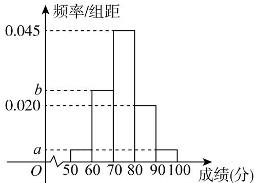

# 2025一模 概率与统计专题 · 学生版

> 本地预览：题目、答案及分类尚未全部审定。校对使用的PDF为高中工作台解析版，尚未逐区确认区级印刷原卷。

## 数据排序、统计量与分布图

依据中位数、百分位数和方差定义读图，区分估计和精确计算。

### 宝山 · 第6题

…
某运动员在某次男子10米气手枪射击比赛中的得分数据（单位：环）为：9.6，9.9，9.2，9.4，9.9，10.1，10.2，9.7，9.6，9.3，10.0，10.4，则这组数据的第25百分位数为

### 崇明 · 第10题

某校四个植树小队，在植树节这天种下柏树的棵数分别为10,x,10,8，若这组数据的中位数和平均数相等，那么x =

### 徐汇 · 第7题

某景点对30天内每天的游客人数（单位：万人）进行统计，得到样本的茎叶图（如下表），则该样本的第75百分位数是______。

| 茎 | 叶 |
|---|---|
| 1 | 2 5 |
| 2 | 0 2 3 3 |
| 3 | 1 2 4 4 8 9 |
| 4 | 5 5 5 7 7 8 8 9 |
| 5 | 0 0 1 1 4 7 9 |
| 6 | 1 7 8 |

> 本题资料或解析有待核事项，预览不可作为已审定成品。

### 普陀 · 第14题

某机构对2014年至2023年的中国新能源汽车的年销售量进行了统计，结果如图所示（单位：万辆），则下列结论中正确的是（ ）

原图所列中国新能源汽车年销售量数据如下（单位：万辆；按原图年份顺序列示）：

| 年份 | 年销售量 |
|---|---|
| 2014 | 7.5 |
| 2015 | 33.1 |
| 2016 | 50.7 |
| 2017 | 77.7 |
| 2018 | 125.6 |
| 2019 | 120.6 |
| 2020 | 136.6 |
| 2021 | 352.1 |
| 2022 | 688.7 |
| 2023 | 728 |

A. 这十年中国新能源汽车年销售量的中位数为123

B. 这十年中国新能源汽车年销售量的极差为721

C. 这十年中国新能源汽车年销售量的第70百分位数为136.6

D. 这十年中的前五年的年销售量的方差小于后五年的年销售量的方差

> 本题资料或解析有待核事项，预览不可作为已审定成品。

### 杨浦 · 第8题

某次杨浦区高三质量调研数学试卷中的填空题第八题，答对得5分，答错或不答得0分，全区共4000人参加调研，该题的答题正确率是60%，则该次调研中全区同学该题得分的方差为

> 本题资料或解析有待核事项，预览不可作为已审定成品。

### 浦东 · 第15题

对一组数据3，3，3，1，1，5，5，2，4，若任意去掉其中一个数据，剩余数据的统计量一定会发生变化的为（ ）

A. 中位数

B. 众数

C. 平均数

D. 方差

> 本题资料或解析有待核事项，预览不可作为已审定成品。

### 黄浦 · 第7题

从A校高一年级学生中抽取66名学生测量他们的身高，其中最大值为184cm，最小值152cm，绘制身高频率分布直方图，若组距为3，且第一组下限为151.5，则组数为

## 古典概型、独立与事件关系

明确样本空间，用交并补关系检验互斥、对立和独立。

### 嘉定 · 第15题

假定生男生女是等可能的，设事件A：一个家庭中既有男孩又有女孩；事件B:一个家庭中最多有一个女孩.针对下列两种情形：①家庭中有2个小孩；②家庭中有3个小孩，下面说法正确是（ ）.

A. ①中事件A与事件B相互独立､②中的事件A与事件B相互独立

B. ①中事件A与事件B不相互独立､②中的事件A与事件B相互独立

C. ①中事件A与事件B相互独立､②中的事件A与事件B不相互独立

D. ①中事件A与事件B不相互独立､②中的事件A与事件B不相互独立

> 本题资料或解析有待核事项，预览不可作为已审定成品。

### 崇明 · 第12题

已知函数 $\cdot y = f ( x )$ 的定义域 $D = \{ 1 , 2 , 3 , 4 \}$ ，值域 $A = \{ 5 , 6 , 7 \}$ ，则函数 $\cdot y = f ( x )$ 为增函数的概率是

> 本题资料或解析有待核事项，预览不可作为已审定成品。

### 崇明 · 第15题

抛掷一红一绿两颗质地均匀的骰子，记录骰子朝上面的点数，若用x表示红色骰子的点数，用y表示绿色骰子的点数，用 $( x , y )$ 表示一次试验结果，设事件 $E \colon x + y = 8$ ；事件F：至少有一颗点数为6；事件 $G \colon x > 4$ ；事件 $H \colon y \leq 4$ .则下列说法正确的是（ ）

A. 事件E与事件F为互斥事件

B. 事件F与事件G为互斥事件

C. 事件E与事件G相互独立

D. 事件G与事件H相互独立

> 本题资料或解析有待核事项，预览不可作为已审定成品。

### 徐汇 · 第14题

一个不透明的盒子中装有若干个红球和5个黑球，这些球除颜色外均相同.每次将球充分搅匀后，任意摸出1个球记下颜色后再放回盒子.经过重复摸球足够多次试验后发现，摸到黑球的频率稳定在0.1左右，则据此估计盒子中红球的个数约为（ ）

A. 40个

B. 45个

C. 50个

D. 55个

> 本题资料或解析有待核事项，预览不可作为已审定成品。

### 杨浦 · 第14题

如果A､B是独立事件，A,B分别是A､B的对立事件，那么以下等式不一定成立的是（ ）.

A. $P \left( A \cap B \right) = P \left( A \right) P \left( B \right)$

B. $P \left( { \overline { { A } } } \cap B \right) = P \left( { \overline { { A } } } \right) P \left( B \right)$

C. $P \left( A \cup B \right) = P \left( A \right) + P \left( B \right)$

D. $P \left( { \overline { { A } } } \cap { \overline { { B } } } \right) = \left[ 1 - P \left( A \right) \right] \left[ 1 - P \left( B \right) \right]$

> 本题资料或解析有待核事项，预览不可作为已审定成品。

### 松江 · 第15题

抛掷三枚硬币，若记“出现三个正面”、“两个正面一个反面”和“两个反面一个正面”分别为事件A、B和C，则下列说法错误的是（ ）

A. 事件A、B和C两两互斥

B. $P \left( A \right) + P \left( B \right) + P \left( C \right) = \frac { 7 } { 8 }$

C. 事件A与事件 $B \cup C$ 是对立事件

D. 事件 $A \cup B { \stackrel {  } { \exists } } B \cup C$ 相互独立

> 本题资料或解析有待核事项，预览不可作为已审定成品。

### 虹口 · 第14题

已知事件A和事件B满足A∩B = ∅，则下列说法正确的是（ ）

A. 事件A和事件B独立

B. 事件A和事件B互斥

C. 事件A和事件B对立

D. 事件A和事件B互斥

> 本题资料或解析有待核事项，预览不可作为已审定成品。

### 金山 · 第11题

抛掷一枚质地均匀的硬币n次（其中n为大于等于2的整数），设事件A：n次中既有正面朝上又有反面朝上，事件B：n次中至多有一次正面朝上，若事件A与事件B是独立的，则n的值为

> 本题资料或解析有待核事项，预览不可作为已审定成品。

### 长宁 · 第5题

投掷两枚质地均匀的骰子，观察掷得的点数，则掷得的点数之和为7的概率是

### 长宁 · 第11题

设O为坐标原点，从集合{1,2,3,4,5,6,7,8,9}中任取两个不同的元素x、y，组成A、B两点的坐标$( x , y ) , ( y , x )$ ，则 $S _ { \triangle A O B } \leq$ 10的概率为

### 黄浦 · 第13题

掷一颗质地均匀的骰子，观察朝上面的点数．设事件E：点数是奇数，事件F：点数是偶数，事件G：点数是3的倍数，事件H：点数是4．下列每对事件中，不是互斥事件的为（ ）

A. E与F

B. F与G

C. E与H

D. G与H

## 比赛、交替试验与方案概率

按终止规则分类，处理条件胜率、轮次求和和公平分配。

### 嘉定 · 第19题

在一场盛大的电竞比赛中，有两支实力强劲的队伍甲和乙进行对决.比赛采用5局3胜制，最终的胜者将赢得10万元奖金，比赛过程中，每局比赛双方获胜的概率相互独立且甲队每局获胜概率为0.4，乙队每局获胜概率为0.6.比赛开始后，甲队先连胜两局，此时，主办方记录了两队队员在这两局比赛中的一些数据.甲队队员的击杀数（单位：个）数据如下：24, 31, 31, 36, 36, 37, 39, 44, 49, 50；乙队队员的击杀数（单位：个）数据如下：8,13,14,16,23,26,28,33,38,39.然而此时比赛场地突发技术故障，比赛不得不中止.请回答以下问题：
(1) (4分)根据目前情况（甲队已连胜两局），写出甲､乙两队“采用5局3胜制”的比赛结果的样本空间；
(2) (4分)根据所给数据，绘制甲､乙两队队员的击杀数分布的茎叶图；
(3) (6分)在目前情况下（甲队已连胜两局），估算甲乙两队获胜概率，并据此分配10万元奖金.

> 本题资料或解析有待核事项，预览不可作为已审定成品。

### 奉贤 · 第9题

甲乙两人下棋，每局两人获胜的可能性一样，某一天两人要进行一场三局两胜的比赛，最终胜者赢得100元奖金，第一局比赛甲获胜，后因为有其他事情而中止比赛，则甲应该分 元奖金才公平？

> 本题资料或解析有待核事项，预览不可作为已审定成品。

### 宝山 · 第19题

…
甲乙两人轮流掷质地均匀的骰子，每人每次掷两颗
(1) (4分)甲掷一次，求两颗骰子点数不同的概率；
(2) (4分)甲乙各掷一次，求甲的点数和恰好比乙的点数和大7的概率；
(3) (6分)若第一次掷出点数之和大于6的人为胜者，同时比赛结束；否则，由另一人继续投掷，直到比赛结束.例如，甲乙先后轮流掷出的点数之和为：5、4、3、7，此时乙为胜者.设甲先投掷，求甲最终获胜的概率.

### 徐汇 · 第19题

某企业招聘员工，指定“英语听说”､“信息技术”､“逻辑推理”作为三门考试课程，有两种考试方案.方案一：参加三门课程的考试，至少有两门及格为通过；
方案二：在三门课程中，随机选取两门，并参加这两门课程的考试，两门都及格为通过
假设某应聘者参加三门指定课程考试及格的概率分别是 $. p _ { 1 } , p _ { 2 } , p _ { 3 } \left( p _ { 1 } \in ( 0 , 1 ) , i = 1 , 2 , 3 \right)$ )，且三门课程考试是否及格相互之间没有影响
(1) (6分)分别求该应聘者选方案一考试通过的概率 $: T _ { 1 }$ 和选方案二考试通过的概率 $\it { \Delta } T _ { 2 }$ ；
(2) (8分)试比较该应聘者在上述两种方案下考试通过的概率的大小，并说明理由.

> 本题资料或解析有待核事项，预览不可作为已审定成品。

### 普陀 · 第19题

机器人竞技是继电子竞技之后热门的科技竞技项目.某区为了参加市机器人竞技总决赛，开展了区内选拔赛，其中A、B、C、D四人进入区内个人组决赛，按照规则每人与其他三人各进行一场比赛，且这三场比赛互相独立.下表统计的是A在近期热身中分别与B、C、D三人比赛的情况.

| 对手 | B | C | D |
| --- | ---: | ---: | ---: |
| 比赛的次数 | 12 | 10 | 15 |
| A获胜的次数 | 4 | 5 | 12 |

(1) (6分)根据表格中的数据，试估计在区内决赛中A至少获胜一场的概率；
(2) (8分)根据表格中的数据，请给B、C、D三人设计一个出场顺序，使得A在这三场比赛中连胜两场的概率最大，并说明理由.

> 本题资料或解析有待核事项，预览不可作为已审定成品。

### 浦东 · 第19题

申辉中学为期两周的高一、高二年级校园篮球赛告一段落．高一小A、高二小B分别荣获了高一年级和高二年级比赛的年级MVP（最有价值球员）．以下是他们在各自8场比赛的二分球和三分球出手次数及其命中率

| 人物 | 二分球出手 | 二分球命中率 | 三分球出手 | 三分球命中率 |
|---|---|---|---|---|
| 小A | 100次 | 80% | 100次 | 40% |
| 小B | 190次 | 70% | 10次 | 30% |

现以两人的总投篮命中率（二分球+三分球）较高者评为校MVP（总投篮命中率=总命中次数÷总出手次数）
(1) (4分)小C认为，目测小A的二分球命中率和三分球命中率均高于小B，此次必定能评为校MVP，试通过计算判断小C的想法是否准确？
(2) (10分)小D是游戏爱好者，设置了一款由游戏人物小a、小b轮流投篮对战游戏，游戏规则如下：①游戏中小a的命中率始终为0.4，小b的命中率始终为0.3，②游戏中投篮总次数最多为$k \left( 3 \leq k \leq 2 0 , k \in \mathbf { Z } \right)$ 次，且同一个游戏人物不允许连续投篮．③游戏中若投篮命中，则游戏结束，投中者获得胜利；若直至第k次投篮都没有命中，则规定第二次投篮者获胜．若每次游戏对战前必须设置“第一次投篮人物”和“k”的值，请解答以下两个问题
（ⅰ）若小a第一次投篮，请证明小a获胜概率大；
（ⅱ）若小b第一次投篮，试问谁的获胜概率大？并说明理由

> 本题资料或解析有待核事项，预览不可作为已审定成品。

## 分层抽样、统计估计与方差合并

完整呈现统计大题，核对频率分组、抽样比例及方差修正。

### 奉贤 · 第18题

某芯片代工厂生产甲、乙两种型号的芯片，为了解芯片的某项指标，从这两种芯片中各抽取100件进行检测，获得该项指标的频率分布直方图，如图所示：

假设数据在组内均匀分布，以样本估计总体，以事件发生的频率作为相应事件发生的概率
(1) (6分)求频率分布直方图中x的值并估计乙型芯片该项指标的平均值（同一组中的数据用该组区间的中点值为代表）；
(2) (8分)已知甲型芯片指标在[80, 100)为航天级芯片，乙型芯片指标在[60, 70)为航天为航天级芯片．现分别采用分层抽样的方式，从甲型芯片指标在[70,90)内取2件，乙型芯片指标在[50,70)内取4件，再从这6件中任取2件，求至少有一件为航天级芯片的概率

> 本题资料或解析有待核事项，预览不可作为已审定成品。

### 崇明 · 第19题

王老师将全班40名学生的高一数学期中考试（满分100分）成绩分成5组，绘制成如图所示的频率分布直方图，现将[50, 60)记作第一组，[60, 70)、[70, 80)、[80, 90)、[90, 100]分别记作第二、三、四、五组．已知第一组、第二组的频率之和为0.3，第一组和第五组的频率相同

(1) (4分)估计此次考试成绩的平均值（同一组数据用该组数据的中点值代替）；
(2) (5分)王老师将测试成绩在[80, 90)和[90, 100]内的试卷进行分析，再从中选2人的试卷进行优秀答卷展示，求被选中进行优秀答卷展示的这2人的测试成绩至少1个在[90,100]内的概率；
(3) (5分)已知第二组考生成绩的平均数和方差分别为65和40，第四组考生成绩的平均数和方差分别为83和70，据此计算第二组和第四组所有学生成绩的方差

### 杨浦 · 第19题

为加强学生睡眠监测督导，学校对高中三个年级学生的日均睡眠时间进行调查.根据分层随机抽样法，学校在高一､高二和高三年级中共抽取了100名学生的日均睡眠时间作为样本，其中高一35人，高二33人.已知该校高三年级一共512人.
(1) (4分)学校高中三个年级一共有多少个学生？
(2) (4分)若抽取100名学生的样本极差为2，数据如下表所示（其中 $x < 1 0 , n$ 是正整数）

| 日均睡眠时间（小时） | $x$ | 8.5 | 9 | 9.5 | 10 |
|---|---|---|---|---|---|
| 学生数量 | $n$ | 32 | 13 | 11 | 4 |

求该样本的第40百分位数。
(3) (6分)从这100名学生的样本中随机抽取三个学生的日均睡眠时间，求其中至少有1个数据来自高三学生的概率.

> 本题资料或解析有待核事项，预览不可作为已审定成品。

### 松江 · 第17题

某日用品按行业质量标准分成五个等级，等级系数X依次为1、2、3、4、5，现从一批该日用品中随机抽取20件，对其等级系数进行统计分析，得到频率分布表如下：

| $X$ | $1$ | $2$ | $3$ | $4$ | $5$ |
|---|---|---|---|---|---|
| $f$ | $a$ | $0.2$ | $0.45$ | $b$ | $c$ |

(1) (6分)若所抽取的20件日用品中，等级系数为4的恰有3件，等级系数为5的恰有2件，求a、b、c的值；
(2) (8分)在（1）的条件下，将等级系数为4的3件日用品记为 $x _ { 1 } , \ x _ { 2 } , \ x _ { 3 }$ ，等级系数为5的2件日用品记为y1、y2，现从x1、x2、x3、y1、y2这5件日用品中任取两件（假定每件日用品被取出的可能性相同），写出所有可能的结果，并求这两件日用品的等级系数恰好相等的概率

> 本题资料或解析有待核事项，预览不可作为已审定成品。

### 虹口 · 第19题

2024年法国奥运会落下帷幕．某平台为了解观众对本次奥运会的满意度，随机调查了本市1000名观众 ， 得 到 他 们 对 本 届 奥 运 会 的 满 意 度 评 分 （ 满 分 100 分 ）， 平 台 将 评 分 分 为[50, 60)、 [60, 70)、 [70, 80)、 [80, 90)、 [90, 100]共5层，绘制成频率分布直方图（如图1所示）．并在这些评分中以分层抽样的方式从这5层中再抽取了共20名观众的评分，绘制成茎叶图，但由于某种原因茎叶图受到了污损，可见部分信息如图2所示

图1

图2
(1) (4分)求图2中这20名观众的满意度评分的第35百分位数；
(2) (4分)若从图2中的20名观众中再任选取3人做深度采访，求其中至少有1名观众的评分大于等于90分的概率；
(3) (6分)已知这1000名观众的评分位于[50, 80)上的均值为67，方差为64.7，位于[50, 100]上的均值为73，方差为134.6，求这1000名观众的评分位于[80, 100]上的均值与方差

> 本题资料或解析有待核事项，预览不可作为已审定成品。

### 金山 · 第19题

某高中举行了一次知识竞赛．为了了解本次竞赛成绩情况，从中抽取了部分学生的成绩作为样本进行统计．将成绩进行整理后，依次分为五组（[50, 60), [60, 70), [70, 80), [80, 90), [90, 100]），其中第1组的频率为第2组和第4组频率的等比中项．请根据下面的频率分布直方图（如图所示）解决下列问题：

(1) (4分)求a、b的值；
(2) (4分)从样本数据在[50,60),[70,80)两个小组内的学生中，用分层抽样的方法抽取7名学生，再从这7名学生中随机选出2人，求选出的两人恰好来自不同小组的概率；
(3) (6分)某老师在此次竞赛成绩中抽取了10名学生的分数： $x _ { 1 } , x _ { 2 } , x _ { 3 } , \cdots , x _ { 1 0 } ,$ 已知这10个分数的平均数x = 88，方差– $s ^ { 2 } = 2 5$ ，若剔除其中的95和81两个分数，求剩余8个分数的平均数与方差

### 长宁 · 第19题

2024年第七届中国国际进口博览会（简称进博会）于11月5日至10日在上海国家会展中心举行.为了解进博会参会者的年龄结构，某机构随机抽取了年龄在15-75岁之间的200名参会者进行调查，并按年龄绘制了频率分布直方图，分组区间为[15, 25), [25, 35), [35, 45), [45, 55), [55, 65), [65, 75].把年龄落在区间[15,35)内的人称为“青年人”，把年龄落在区间[35,65)内的人称为“中年人”，把年龄落在[65, 75]内的人称为“老年人”.

200名参会者的频率分布直方图
(1) (4分)求所抽取的“青年人”的人数；
(2) (10分)以分层抽样的方式从“青年人”“中年人”“老年人”中抽取10名参会者做进一步访谈，发现其中女性共4人，这4人中有3人是“中年人”.再用抽签法从所抽取的10名参会者中任选2人.
①简述如何采用抽签法任选2人；
②设事件A：2人均为“中年人”，事件B：2人中至少有1人为男性，判断事件A与事件B是否独立，并说明理由.

### 闵行 · 第19题

为了解某市高三学生的睡眠时长，从该市6.6万名高三学生中随机抽取600人，统计他们的日均睡眠时长及分布人数如下表所示：

| 睡眠时长（小时） | $[4,6)$ | $[6,8)$ | $[8,10]$ |
|---|---|---|---|
| 人数 | 150 | 270 | 180 |

注：睡眠时长在[8, 10]的为睡眠充足，在[6, 8)的为睡眠良好，在[4, 6)的为睡眠不足
(1) (4分)估计该市6.6万名高三学生中日均睡眠时长大于等于6小时的人数约为多少？
(2) (4分)估计该市高三学生日均睡眠时长；
(3) (6分)若从这600名学生中利用分层抽样的方法抽取20人，再从这20人中随机抽取4人做进一步访谈调查，求这4人中既有睡眠充足，又有睡眠良好，也有睡眠不足学生的概率

> 本题资料或解析有待核事项，预览不可作为已审定成品。

### 青浦 · 第19题

第七届中国国际进口博览会于 2024 年 11 月 5 日至 10 日在上海举办，某公司生产的 A、B 、C 三款产品在博览会上亮相，每一种产品均有普通装和精品装两种款式，该公司每天产量如下表: （单位:个）

|  | 产品A | 产品B | 产品C |
| --- | ---: | ---: | ---: |
| 普通装 | $n$ | 180 | 400 |
| 精品装 | 300 | 420 | 600 |

现采用分层抽样的方法在某一天生产的产品中抽取 100 个，其中 B款产品有30个
(1) (4分)求 n的值；
(2) (4分)用分层抽样的方法在C款产品中抽取一个容量为5的样本，从样本中任取 2个产品，求其中至少有一个精品装产品的概率;
(3) (6分)对抽取到的 B款产品样本中某种指标进行统计，普通装产品的平均数为10，方差为2，精品装产品的平均数为12，方差为1.8，试估计这天生产的 B款产品的某种指标的总体方差 （精确到 0.01 ）.

> 本题资料或解析有待核事项，预览不可作为已审定成品。

### 黄浦 · 第19题

A校高一年级共有学生330名，为了解该校高一年级学生的身高情况，学校采用分层随机抽样的方法抽取66名学生，其中女生32名，男生34名，测量他们的身高
(1) (4分)该校高一学生中男、女生各有多少名？
(2) (4分)若从这66名学生中随机抽取两名，求这两名都是男生的概率；
(3) (6分)在32名女生身高的数据中，其中一个数据记录有误，错将165cm记录为156cm，由错误数据求得这32个数据的平均数为161cm，方差为23.6875，求原始数据的平均数及方差．（平均数结果保留精确值，方差结果精确到0.01）

