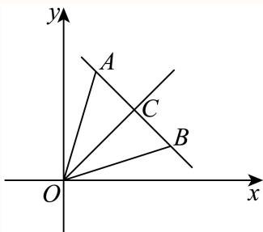

# 2025一模 概率与统计专题 · 教师版

> 本地预览：题目、答案及分类尚未全部审定。校对使用的PDF为高中工作台解析版，尚未逐区确认区级印刷原卷。

## 数据排序、统计量与分布图

依据中位数、百分位数和方差定义读图，区分估计和精确计算。

### 宝山 · 第6题

…
某运动员在某次男子10米气手枪射击比赛中的得分数据（单位：环）为：9.6，9.9，9.2，9.4，9.9，10.1，10.2，9.7，9.6，9.3，10.0，10.4，则这组数据的第25百分位数为

**考点：** 数据排序与百分位数

**难度依据：** 涉及数据排序与百分位数；难度为教师预估，需结合原题条件复核。

**核查说明：** 依据现有底稿归类，尚未逐页校卷、公式校净或独立数学终审。

【答案】9.5.

【解析】

将数据从小到大排序，再根据百分位数的概念求解即可

分数据从小到大为：9.2，9.3，9.4，9.6，9.6，9.7，9.9，9.9，10.0，10.1，10.2，10.4，

共12个数，则 $1 2 \times 2 5 \% = 3 .$

所以这组数据的第25百分位数为 $\frac { 9 . 4 + 9 . 6 } { 2 } = 9 . 5$

故答案为：9.5.

### 崇明 · 第10题

某校四个植树小队，在植树节这天种下柏树的棵数分别为10,x,10,8，若这组数据的中位数和平均数相等，那么x =

**考点：** 平均数与中位数的排序分类

**难度依据：** 涉及平均数与中位数的排序分类；难度为教师预估，需结合原题条件复核。

**核查说明：** 依据现有底稿归类，尚未逐页校卷、公式校净或独立数学终审。

【答案】12或8.

【解析】

利用平均数，中位数的性质结合分类讨论求解即可.

当x ≤ 8时，将数据进行排列，得到x,8,10,10，

因为这组数据的中位数和平均数相等，所以 ${ \frac { 2 8 + x } { 4 } } = { \frac { 8 + 1 0 } { 2 } }$ ，解得x = 8，

当8 < x < 10时，将数据进行排列，得到8,x,10,10，

因为这组数据的中位数和平均数相等，所以 ${ \frac { 2 8 + x } { 4 } } = { \frac { x + 1 0 } { 2 } }$

解得 $x = 8$ ，与范围不符，故排除

当 $x \geq 1 0 \mathbb { H } ]$ ，将数据进行排列，得到8,10,10,x，

因为这组数据的中位数和平均数相等，所以 ${ \frac { 2 8 + x } { 4 } } = { \frac { 1 0 + 1 0 } { 2 } }$

解得 $x = 1 2$ ，经检验，x = 8和x = 12均符合题意.

故答案为：12或8.

### 徐汇 · 第7题

某景点对30天内每天的游客人数（单位：万人）进行统计，得到样本的茎叶图（如下表），则该样本的第75百分位数是______。

| 茎 | 叶 |
|---|---|
| 1 | 2 5 |
| 2 | 0 2 3 3 |
| 3 | 1 2 4 4 8 9 |
| 4 | 5 5 5 7 7 8 8 9 |
| 5 | 0 0 1 1 4 7 9 |
| 6 | 1 7 8 |

> 本题资料或解析有待核事项，预览不可作为已审定成品。

**考点：** 茎叶图百分位数

**难度依据：** 茎叶图百分位数；按所需步骤与推理量估计

**核查说明：** 题干与解析已用于人工归类，尚未完成整题公式校净与独立数学终审。；茎叶图未呈现，无法凭底稿复核百分位数。；题干与解析已用于人工归类，尚未完成整题公式校净与独立数学终审。；茎叶图未呈现，无法凭底稿复核百分位数。

【答案】51.

【解析】

根据百分位数的定义求解即可.

因为30 × 75% = 22.5，

所以该样本的第75百分位数是按照从小到大的顺序排列的第23个数，即为51.

故答案为：51.

### 普陀 · 第14题

某机构对2014年至2023年的中国新能源汽车的年销售量进行了统计，结果如图所示（单位：万辆），则下列结论中正确的是（ ）

原图所列中国新能源汽车年销售量数据如下（单位：万辆；按原图年份顺序列示）：

| 年份 | 年销售量 |
|---|---|
| 2014 | 7.5 |
| 2015 | 33.1 |
| 2016 | 50.7 |
| 2017 | 77.7 |
| 2018 | 125.6 |
| 2019 | 120.6 |
| 2020 | 136.6 |
| 2021 | 352.1 |
| 2022 | 688.7 |
| 2023 | 728 |

A. 这十年中国新能源汽车年销售量的中位数为123

B. 这十年中国新能源汽车年销售量的极差为721

C. 这十年中国新能源汽车年销售量的第70百分位数为136.6

D. 这十年中的前五年的年销售量的方差小于后五年的年销售量的方差

> 本题资料或解析有待核事项，预览不可作为已审定成品。

**考点：** 统计图读数与中位数百分位数方差

**难度依据：** 逐个核对统计量并比较数据波动

**核查说明：** 题干与解析已用于人工归类，尚未完成整题公式校净与独立数学终审。；题干统计图在MD未保留图片引用；已定位同名PDF第9页，须提取原统计图后才能发布。；题干与解析已用于人工归类，尚未完成整题公式校净与独立数学终审。；题干统计图在MD未保留图片引用；已定位同名PDF第9页，须提取原统计图后才能发布。

【答案】D

【解析】

由图表提取数据并按照由小到大排列，根据中位线、极差与百分位数定义，结合方差的性质，可得答案.

由图可得数据为：7.5, 33.1, 50.7, 77.7, 120.6, 125.6, 136.6, 352.1, 688.7, 728，

对于A，这十年中国新能源汽车年销售量的中位数为 ${ \frac { 1 2 5 . 6 + 1 2 0 . 6 } { 2 } } = 1 2 3 . 1$ ，故A错误；

对于B，这十年中国新能源汽车年销售量的极差为728−7.5 = 720.5，故B错误；对于C，由 ${ \frac { 7 0 } { 1 0 0 } } \times 1 0 = 7$ 则这十年中国新能源汽车年销售量的第70百分位数为$\frac { 1 3 6 . 6 + 3 5 2 . 1 } { 2 } = 2 4 4 . 3 5$ ，故C错误；对于D，由图表易知前五年的数据比后五年的数据稳定，则前五年的方差小于后五年的方差，故D正确.

故选：D.

### 杨浦 · 第8题

某次杨浦区高三质量调研数学试卷中的填空题第八题，答对得5分，答错或不答得0分，全区共4000人参加调研，该题的答题正确率是60%，则该次调研中全区同学该题得分的方差为

> 本题资料或解析有待核事项，预览不可作为已审定成品。

**考点：** 二点分布的方差

**难度依据：** 二点分布的方差；按所需步骤与推理量估计

**核查说明：** 题干与解析已用于人工归类，尚未完成整题公式校净与独立数学终审。；区名为脱敏占位符，来源身份须回核。；原解均值一处误写为345，按列式应为3；原解方差计算使用3。；题干与解析已用于人工归类，尚未完成整题公式校净与独立数学终审。；区名为脱敏占位符，来源身份须回核。；原解均值一处误写为345，按列式应为3；原解方差计算使用3。

【答案】6.

【解析】

根据平均数和方差的定义计算求解即可.

同全区同学中答对的人数为 $4 0 0 0 \times 6 0 \% = 2 4 0 0$ 人，答错或不答的人数为1600人，

所以全区同学该题得分的平均数为 $\frac { 2 4 0 0 \times 5 + 1 6 0 0 \times 0 } { 4 0 0 0 } = 3 4 5$ ，

则全区同学该题得分的方差为 ${ \frac { 2 4 0 0 \times ( 5 - 3 ) ^ { 2 } + 1 6 0 0 \times ( 0 - 3 ) ^ { 2 } } { 4 0 0 0 } } = 6 .$

故答案为：6.

### 浦东 · 第15题

对一组数据3，3，3，1，1，5，5，2，4，若任意去掉其中一个数据，剩余数据的统计量一定会发生变化的为（ ）

A. 中位数

B. 众数

C. 平均数

D. 方差

> 本题资料或解析有待核事项，预览不可作为已审定成品。

**考点：** 均值中位数众数与方差变化

**难度依据：** 均值中位数众数与方差变化；按所需步骤与推理量估计

**核查说明：** 题干与解析已用于人工归类，尚未完成整题公式校净与独立数学终审。；源解析仅凭波动变化断言方差变化，需直接计算验证。；题干与解析已用于人工归类，尚未完成整题公式校净与独立数学终审。；源解析仅凭波动变化断言方差变化，需直接计算验证。

【答案】D

【解析】

求出给定数据组的中位数、众数、平均数，举例说明判断ABC；利用数据的波动大小判断D.数据由小到大排列为：1，1，2，3，3，3，4，5，5，其中位数、众数、平均数都为3，去掉数据1，剩余数据的中位数、众数都不变；去掉数据3，剩余数据的平均数不变，ABC不是；若任意去掉其中一个数据，剩余数据的波动性发生变化，方差一定发生变化，D是.故选：D

### 黄浦 · 第7题

从A校高一年级学生中抽取66名学生测量他们的身高，其中最大值为184cm，最小值152cm，绘制身高频率分布直方图，若组距为3，且第一组下限为151.5，则组数为

**考点：** 由数据范围和组距计算组数

**难度依据：** 频率分布组距与组数；由数据范围和组距计算组数

【答案】11

【解析】

根据组距即可求解.

第一组下限为151.5，组距为3，所以 $1 5 1 . 5 + 3 \times 1 0 = 1 8 1 . 5$

故第11组的下限为181.5，因此组数为11，

故答案为：11

## 古典概型、独立与事件关系

明确样本空间，用交并补关系检验互斥、对立和独立。

### 嘉定 · 第15题

假定生男生女是等可能的，设事件A：一个家庭中既有男孩又有女孩；事件B:一个家庭中最多有一个女孩.针对下列两种情形：①家庭中有2个小孩；②家庭中有3个小孩，下面说法正确是（ ）.

A. ①中事件A与事件B相互独立､②中的事件A与事件B相互独立

B. ①中事件A与事件B不相互独立､②中的事件A与事件B相互独立

C. ①中事件A与事件B相互独立､②中的事件A与事件B不相互独立

D. ①中事件A与事件B不相互独立､②中的事件A与事件B不相互独立

> 本题资料或解析有待核事项，预览不可作为已审定成品。

**考点：** 枚举样本空间与事件独立性判定

**难度依据：** 儿童数改变需分别计算交事件概率

**核查说明：** 题干与解析已用于人工归类，尚未完成整题公式校净与独立数学终审。

【答案】B

【解析】

分别写出①②对应的样本空间，再利用相互独立事件计算判断.

若家庭中有两个小孩，样本空间为Ω = {(男,男)，(男,女)，(女,男)，(女,女)}，共4种情况，

A = {(男,女)，(女,男)}，B = {(男,男)，(男,女)，(女,男)}，AB = {(男,女)，(女,男)}，

则 $P \left( A \right) = \frac { 2 } { 4 } = \frac { 1 } { 2 } , P \left( B \right) = \frac { 3 } { 4 } , P \left( A B \right) = \frac { 2 } { 4 } = \frac { 1 } { 2 } \neq P \left( A \right) P \left( B \right)$ 事件A与事件B不相互独立，AC错误；

若家庭中有三个小孩，样本空间为Ω = {(男,男,男)，(男,男,女)，(男,女,男)，(女,男,男)，

(男,女,女)，(女,男,女)，(女,女,男)，(女,女,女)}，共8种情况，

A = {(男,男,女)，(男,女,男)，(女,男,男)，(男,女,女)，(女,男,女)，(女,女,男)}，

B = {(男,男,男)，(男,男,女)，(男,女,男)，(女,男,男)}，AB = {(男,男,女)，(男,女,男)，(女,男,男)}，

$P \left( A \right) = \frac { 6 } { 8 } = \frac { 3 } { 4 } , P \left( B \right) = \frac { 4 } { 8 } = \frac { 1 } { 2 } , P \left( A B \right) = \frac { 3 } { 8 } = P \left( A \right) P \left( B \right)$ ，事件A与事件B相互独立B正确，D错误.

故选：B

### 崇明 · 第12题

已知函数 $\cdot y = f ( x )$ 的定义域 $D = \{ 1 , 2 , 3 , 4 \}$ ，值域 $A = \{ 5 , 6 , 7 \}$ ，则函数 $\cdot y = f ( x )$ 为增函数的概率是

> 本题资料或解析有待核事项，预览不可作为已审定成品。

**考点：** 有限集合函数计数与单调性概率

**难度依据：** 涉及有限集合函数计数与单调性概率；难度为教师预估，需结合原题条件复核。

**核查说明：** 题称增函数而原解计数包含相等函数值，严格递增定义下不成立，须回核原题及术语。；依据现有底稿归类，尚未逐页校卷、公式校净或独立数学终审。

【答案】$\frac { 1 } { 1 2 }$

【解析】

求出所有函数的个数，再求出增函数的个数，利用古典概型的概率公式可求对应的概率.

若函数 $\langle y = f ( x )$ 的定义域为{1, 2, 3, 4}，值域为{5, 6, 7}，

则不同的函数的个数为 $\mathrm { C _ { 4 } ^ { 2 } \mathrm { P _ { 3 } ^ { 3 } = 3 6 } }$ ，

其中增函数共有3个：

（1） $f \left( 1 \right) = f ( 2 ) = 5 , f ( 3 ) = 6 , f ( 4 ) = 7 ;$

（2） $f \left( 1 \right) = 5 , f ( 2 ) = f ( 3 ) = 6 , f ( 4 ) = 7 ;$

（3） $f \left( 1 \right) = 5 , f ( 2 ) = 6 , f ( 3 ) = f ( 4 ) = 7 ;$

故所求概率为 ${ \frac { 3 } { 3 6 } } = { \frac { 1 } { 1 2 } }$ ，

故答案为： $\frac { 1 } { 1 2 }$

## 二、选择题

### 崇明 · 第15题

抛掷一红一绿两颗质地均匀的骰子，记录骰子朝上面的点数，若用x表示红色骰子的点数，用y表示绿色骰子的点数，用 $( x , y )$ 表示一次试验结果，设事件 $E \colon x + y = 8$ ；事件F：至少有一颗点数为6；事件 $G \colon x > 4$ ；事件 $H \colon y \leq 4$ .则下列说法正确的是（ ）

A. 事件E与事件F为互斥事件

B. 事件F与事件G为互斥事件

C. 事件E与事件G相互独立

D. 事件G与事件H相互独立

> 本题资料或解析有待核事项，预览不可作为已审定成品。

**考点：** 互斥与独立事件判定

**难度依据：** 涉及互斥与独立事件判定；难度为教师预估，需结合原题条件复核。

**核查说明：** 原解对事件H的不等式与列举结果不一致，须回核原题。；依据现有底稿归类，尚未逐页校卷、公式校净或独立数学终审。

【答案】D

【解析】

A选项，写出事件E,F包含的情况，得到 $E \cap F \neq \emptyset$ ，A错误；B选项，写出事件G包含的情况，结合A选项，得到 $F \cap G \neq \emptyset$ ，B错误；C选项，写出事件 $E \cap G$ 包含的情况，故$P \left( E G \right) \neq P \left( E \right) P \left( G \right)$ ，C错误；D选项，写出事件H和 $G \cap H$ 包含的情况，得到$P \left( G \cap H \right) = P \left( G \right) P \left( H \right)$ ，D正确.

A选项，事件 $E \colon x + y = 8$ 包含的情况有(2, 6), (3, 5), (4, 4), (5, 3), (6, 2)，

事件F：至少有一颗点数为6包含的情况有

(1, 6), (2, 6), (3, 6), (4, 6), (5, 6), (6, 6), (6, 1), (6, 2), (6, 3), (6, 4), (6, 5)，

故 $E \cap F \neq \emptyset$ ，事件E与事件F不为互斥事件，A错误；

B选项，事件G:x > 4包含的情况有

(5, 1), (5, 2), (5, 3), (5, 4), (5, 5), (5, 6), (6, 1), (6, 2), (6, 3), (6, 4), (6, 5), (6, 6)，

故 $F \cap G \neq \emptyset$ ，事件F与事件G不为互斥事件，B错误；

C选项，抛掷一红一绿两颗质地均匀的骰子，共有6×6 = 36种情况，

故 $P \left( E \right) = \frac { 5 } { 3 6 } , P \left( G \right) = \frac { 1 2 } { 3 6 } = \frac { 1 } { 3 }$

事件 $E \cap G$ 包含的情况为 $( 5 , 3 ) , ( 6 , 2 )$ ，故 $P \left( E G \right) = \frac { 2 } { 3 6 } = \frac { 1 } { 1 8 }$

故 $P \left( E G \right) \neq P \left( E \right) P \left( G \right)$ ，故事件E与事件G不相互独立，C错误；

D选项，事件 $H \colon y \leq 4$ 包含的情况有

(1, 1), (1, 2), (1, 3), (2, 1), (2, 2), (2, 3), (3, 1), (3, 2), (3, 3), (4, 1), (4, 2), (4, 3)，

(5, 1), (5, 2), (5, 3), (6, 1), (6, 2), (6, 3)，共18种情况，

故 $P \left( H \right) = \frac { 1 8 } { 3 6 } = \frac { 1 } { 2 }$

事件G ∩ H包含的情况有：(5, 1), (5, 2), (5, 3), (6, 1), (6, 2), (6, 3)，

故 $P \left( G \cap H \right) = \frac { 6 } { 3 6 } = \frac { 1 } { 6 } .$ ，

故选：D

因为 $P \left( G \cap H \right) = P \left( G \right) P \left( H \right)$ ，所以事件G与事件H相互独立，D正确

### 徐汇 · 第14题

一个不透明的盒子中装有若干个红球和5个黑球，这些球除颜色外均相同.每次将球充分搅匀后，任意摸出1个球记下颜色后再放回盒子.经过重复摸球足够多次试验后发现，摸到黑球的频率稳定在0.1左右，则据此估计盒子中红球的个数约为（ ）

A. 40个

B. 45个

C. 50个

D. 55个

> 本题资料或解析有待核事项，预览不可作为已审定成品。

**考点：** 频率估计概率与古典概型

**难度依据：** 频率估计概率与古典概型；按所需步骤与推理量估计

**核查说明：** 题干与解析已用于人工归类，尚未完成整题公式校净与独立数学终审。

【答案】B

【解析】

因为重复摸球次数足够多，所以将频率视为概率，应用古典概型概率的计算公式计算即可.设红球个数为a，

由题意可得： $\frac { 5 } { a + 5 } = 0 . 1$ ，解得：a = 45.

故选：B

### 杨浦 · 第14题

如果A､B是独立事件，A,B分别是A､B的对立事件，那么以下等式不一定成立的是（ ）.

A. $P \left( A \cap B \right) = P \left( A \right) P \left( B \right)$

B. $P \left( { \overline { { A } } } \cap B \right) = P \left( { \overline { { A } } } \right) P \left( B \right)$

C. $P \left( A \cup B \right) = P \left( A \right) + P \left( B \right)$

D. $P \left( { \overline { { A } } } \cap { \overline { { B } } } \right) = \left[ 1 - P \left( A \right) \right] \left[ 1 - P \left( B \right) \right]$

> 本题资料或解析有待核事项，预览不可作为已审定成品。

**考点：** 独立事件与对立事件

**难度依据：** 独立事件与对立事件；按所需步骤与推理量估计

**核查说明：** 题干与解析已用于人工归类，尚未完成整题公式校净与独立数学终审。；题干对立事件记号与原解部分上划线有识别缺损。；题干与解析已用于人工归类，尚未完成整题公式校净与独立数学终审。；题干对立事件记号与原解部分上划线有识别缺损。

【答案】C

【解析】

根据相互独立事件的定义以及性质，即可结合选项逐一求解.

对于A,由于A､B是独立事件，故 $P \left( A \cap B \right) = P \left( A \right) P \left( B \right)$ ，A正确，

对于B，由于A､B是独立事件，则 ${ \overline { { A } } } , B$ 也是相互独立事件，故 $P \left( { \overline { { A } } } \cap B \right) = P \left( { \overline { { A } } } \right) P \left( B \right)$ ，B正确，

对于C， $P \left( A \cup B \right) = P \left( A \right) + P \left( B \right) - P \left( A \cap B \right)$ ,故由 $\operatorname { F } P \left( A \cap B \right)$ )不一定为0，故C错误，对于D, 由于A､B是独立事件，则A,B也是相互独立事件，

P (A ∩ B) = P (A)P (B) = [1 − P (A)] [1 − P (B)],D正确，–

故选：C

### 松江 · 第15题

抛掷三枚硬币，若记“出现三个正面”、“两个正面一个反面”和“两个反面一个正面”分别为事件A、B和C，则下列说法错误的是（ ）

A. 事件A、B和C两两互斥

B. $P \left( A \right) + P \left( B \right) + P \left( C \right) = \frac { 7 } { 8 }$

C. 事件A与事件 $B \cup C$ 是对立事件

D. 事件 $A \cup B { \stackrel {  } { \exists } } B \cup C$ 相互独立

> 本题资料或解析有待核事项，预览不可作为已审定成品。

**考点：** 互斥对立与独立事件

**难度依据：** 互斥对立与独立事件；按所需步骤与推理量估计

**核查说明：** 题干与解析已用于人工归类，尚未完成整题公式校净与独立数学终审。；D选项事件符号识别损坏，须回源。；题干与解析已用于人工归类，尚未完成整题公式校净与独立数学终审。；D选项事件符号识别损坏，须回源。

【答案】C

【解析】

利用互斥事件的定义判断A，；利用互斥事件概率加法公式求解判断B；利用对立事件的定义判断C；利用相互独立事件判断D.

抛掷三枚硬币，样本空间Ω = {(正,正,正),(正,正,反),(正,反,正),(反,正,正),

(正,反,反),(反,正,反),(反,反,正),(反,反,反)}，共8个样本点，

事件 $A = \{ ( \overline { { \mathbb { E } } } , \overline { { \mathbb { E } } } , \overline { { \mathbb { E } } } ) \}$ }， $B = \{ ( \overline { { \mathrm { I E } } } , \overline { { \mathrm { I E } } } , \overline { { \mathrm { \Omega } } } )$ ,(正,反,正),(反,正,正)}， $C = \{ ( \overline { { \mathbb { L } } } , \overline { { \mathbb { L } } } , \overline { { \mathbb { L } } } ) , ( \overline { { \mathbb { L } } } , \overline { { \mathbb { L } } } , \overline { { \mathbb { L } } } ) , ( \overline { { \mathbb { L } } } .$ 反,正)}，

对于A，事件A,B,C中任何两个事件都不能同时发生，事件A,B,C两两互斥，A正确；

对于B， $P \left( A \right) + P \left( B \right) + P \left( C \right) = \frac { 1 } { 8 } + \frac { 3 } { 8 } + \frac { 3 } { 8 } = \frac { 7 } { 8 }$ ，B正确；

对于C，事件A与 $B \cup C { \overline { { \mathsf { H } } } }$ 以同时不发生，事件A与事件 $B \cup C$ 不是对立事件，C错误；

对于D， $P \left( A + B \right) = P \left( A \right) + P \left( B \right) = \frac { 1 } { 8 } + \frac { 3 } { 8 } = \frac { 1 } { 2 } ,$

$$
P (B + C) = P (B) + P (C) = \frac {3}{8} + \frac {3}{8} = \frac {3}{4},
$$

$P \left[ ( A \cup B ) \cap ( B \cup C ) \right] = P \left( B \right) = { \frac { 3 } { 8 } } = P \left( A \cup B \right) P \left( B \cup C \right)$ ，则事件A∪B，B∪C相互独立，D正确.

故选：C

### 虹口 · 第14题

已知事件A和事件B满足A∩B = ∅，则下列说法正确的是（ ）

A. 事件A和事件B独立

B. 事件A和事件B互斥

C. 事件A和事件B对立

D. 事件A和事件B互斥

> 本题资料或解析有待核事项，预览不可作为已审定成品。

**考点：** 互斥、独立与对立事件

**难度依据：** 涉及互斥、独立与对立事件；难度为教师预估，需结合原题条件复核。

**核查说明：** 选项B、D识别相同，须回源核对。；依据现有底稿归类，尚未逐页校卷、公式校净或独立数学终审。

【答案】B

【解析】

根据互斥事件、相互独立事件的定义判断即可.

因为事件A和事件B满足A∩B = ∅，则一定可以得到事件A和事件B互斥，但不一定对立，故B正确，C错误；

因为 $P \left( A B \right) = 0$ ，当 $P \left( A \right)$ ，P(B)不为0时，事件A和事件B不独立，故A错误；

抛掷一枚骰子，记出现1点为事件A，出现2点为事件B，

故选：B

则A = {2, 3, 4, 5, 6}，– $\overline { { B } } = \{ 1 , 3 , 4 , 5 , 6 \}$ ，显然事件A和事件 $\overline { { B } }$ 不互斥，故D错误.

### 金山 · 第11题

抛掷一枚质地均匀的硬币n次（其中n为大于等于2的整数），设事件A：n次中既有正面朝上又有反面朝上，事件B：n次中至多有一次正面朝上，若事件A与事件B是独立的，则n的值为

> 本题资料或解析有待核事项，预览不可作为已审定成品。

**考点：** 独立事件与硬币次数

**难度依据：** 涉及独立事件与硬币次数；难度为教师预估，需结合原题条件复核。

**核查说明：** 原解仅由两个函数均递增断言解唯一，论证不足。；依据现有底稿归类，尚未逐页校卷、公式校净或独立数学终审。

【答案】3

【解析】

通过古典概率的计算公式计算 $P ( A ) , P ( B ) , P \left( A B \right)$ ，由A,B独立得 $P \left( A \right) \cdot P \left( B \right) = P \left( A B \right)$ 解方程即可.

由题意可知： $P \left( A \right) = \frac { 2 ^ { n } - 2 } { 2 ^ { n } } , P \left( B \right) = \frac { 1 + n } { 2 ^ { n } } , P \left( A B \right) = \frac { n } { 2 ^ { n } }$

因为A,B独立，所以 $P \left( A \right) \cdot P \left( B \right) = P \left( A B \right)$

即 ${ \frac { 2 ^ { n } - 2 } { 2 ^ { n } } } \cdot { \frac { 1 + n } { 2 ^ { n } } } = { \frac { n } { 2 ^ { n } } } \Rightarrow 2 ^ { n - 1 } = n + 1$ ，结合 $\cdot 2 ^ { n - 1 } , n + 1$ 均随n的增大而增大，$n = 3 .$

故答案为：3

### 长宁 · 第5题

投掷两枚质地均匀的骰子，观察掷得的点数，则掷得的点数之和为7的概率是

**考点：** 枚举点数和为7的结果

**难度依据：** 骰子古典概型；枚举点数和为7的结果

【答案】$\frac { 1 } { 6 }$

【解析】

由题可得投掷两枚质地均匀的骰子所对应点数的总情况数，然后可得掷得的点数之和为7的情况数，据此可得答案.

一枚骰子的点数有6种情况，则两枚骰子点数所对应总情况为36种.

又注意到点数之和为7的情况有：1，6；6，1；2，5；5，2；3，4；4，3共6种，

则掷得的点数之和为7的概率是 ${ \frac { 6 } { 3 6 } } = { \frac { 1 } { 6 } }$

故答案为： $\frac { 1 } { 6 }$

### 长宁 · 第11题

设O为坐标原点，从集合{1,2,3,4,5,6,7,8,9}中任取两个不同的元素x、y，组成A、B两点的坐标$( x , y ) , ( y , x )$ ，则 $S _ { \triangle A O B } \leq$ 10的概率为

**考点：** 化面积约束为整数对不等式并枚举

**难度依据：** 坐标面积与古典概型；化面积约束为整数对不等式并枚举

【答案】${ \frac { 1 3 } { 3 6 } } .$

【解析】

设AB与直线y = x的交点为C，由面积关系可得 $\left| \begin{array} { r l r } { x ^ { 2 } - y ^ { 2 } } \end{array} \right| \le 2 0$ ，列表，结合古典概型运算求解

设AB与直线y = x的交点为C，由题意知A，B关于y = x对称，

可知C为线段AB的中点，且 $O C \bot A B$ ，则C $\left( { \frac { x + y } { 2 } } , { \frac { x + y } { 2 } } \right)$

$$
| A B | = \sqrt {(x - y) ^ {2} + (y - x) ^ {2}} = \sqrt {2} | x - y |, | O C | = \sqrt {\left(\frac {x + y}{2}\right) ^ {2} + \left(\frac {x + y}{2}\right) ^ {2}}
$$

$$
= \frac {\sqrt {2}}{2} | x + y |,
$$

则 $S _ { \triangle A O B } = { \frac { 1 } { 2 } } | A B | \cdot | O C | = { \frac { 1 } { 2 } } \left| x ^ { 2 } - y ^ { 2 } \right| \leq 1 0$ ，即 $\left| ~ x ^ { 2 } - y ^ { 2 } \right| \leq 2 0$

列表可得：

设样本空间为Ω， $S _ { \triangle A O B } \leq 1 0 $ 为事件A，

可得 ${ \mathit { n } } \left( \Omega \right) = 7 2 , { \mathit { n } } \left( A \right) = 2 6$

所以所求概率为 $P = \frac { n \left( A \right) } { n \left( \Omega \right) } = \frac { 2 6 } { 7 2 } = \frac { 1 3 } { 3 6 }$

故答案为： ${ \frac { 1 3 } { 3 6 } } .$

### 黄浦 · 第13题

掷一颗质地均匀的骰子，观察朝上面的点数．设事件E：点数是奇数，事件F：点数是偶数，事件G：点数是3的倍数，事件H：点数是4．下列每对事件中，不是互斥事件的为（ ）

A. E与F

B. F与G

C. E与H

D. G与H

**考点：** 以骰子样本空间判断交事件

**难度依据：** 互斥事件判断；以骰子样本空间判断交事件

【答案】B

【解析】

根据条件，利用互斥事件的定义，对各个选项逐一分析判断，即可求解.对于选项A，因为事件E和事件F不能同时发生，所以E与F互斥，故选项A错误，对于选项B，当朝上面的点数为6时，F与G同时发生，即F与G不是互斥事件，所以选项B正确，对于选项C，因为事件E和事件H不能同时发生，所以E与H互斥，故选项C错误，对于选项D，因为事件G和事件H不能同时发生，所以G与H互斥，故选项D错误，故选：B.

## 比赛、交替试验与方案概率

按终止规则分类，处理条件胜率、轮次求和和公平分配。

### 嘉定 · 第19题

在一场盛大的电竞比赛中，有两支实力强劲的队伍甲和乙进行对决.比赛采用5局3胜制，最终的胜者将赢得10万元奖金，比赛过程中，每局比赛双方获胜的概率相互独立且甲队每局获胜概率为0.4，乙队每局获胜概率为0.6.比赛开始后，甲队先连胜两局，此时，主办方记录了两队队员在这两局比赛中的一些数据.甲队队员的击杀数（单位：个）数据如下：24, 31, 31, 36, 36, 37, 39, 44, 49, 50；乙队队员的击杀数（单位：个）数据如下：8,13,14,16,23,26,28,33,38,39.然而此时比赛场地突发技术故障，比赛不得不中止.请回答以下问题：
(1) (4分)根据目前情况（甲队已连胜两局），写出甲､乙两队“采用5局3胜制”的比赛结果的样本空间；
(2) (4分)根据所给数据，绘制甲､乙两队队员的击杀数分布的茎叶图；
(3) (6分)在目前情况下（甲队已连胜两局），估算甲乙两队获胜概率，并据此分配10万元奖金.

> 本题资料或解析有待核事项，预览不可作为已审定成品。

**考点：** （1）列出比赛结束路径；（2）制作背靠背茎叶图；（3）用乙连胜补事件计算概率与奖金

**难度依据：** （1）列出比赛结束路径；（2）制作背靠背茎叶图；（3）用乙连胜补事件计算概率与奖金

**核查说明：** 题干与解析已用于人工归类，尚未完成整题公式校净与独立数学终审。

【解析】

(1) 用 $A _ { i } ( i = 1 , 2 , 3 , 4 , 5 )$ 表示甲队在第i局获胜，则 $\textstyle { \overline { { A _ { i } } } }$ 表示乙队第i局获胜，所以所求样本空间Ω = $\left\{ A _ { 1 } A _ { 2 } A _ { 3 } , A _ { 1 } A _ { 2 } \overline { { { A _ { 3 } } } } A _ { 4 } , A _ { 1 } A _ { 2 } \overline { { { A _ { 3 } } } } \overline { { { A _ { 4 } } } } A _ { 5 } , A _ { 1 } A _ { 2 } \overline { { { A _ { 3 } } } } \overline { { { A _ { 4 } } } } \overline { { { A _ { 5 } } } } \right\}$

(2) 甲､乙两队队员的击杀数分布的茎叶图，如图，

$$
\begin{array}{c c c c c c c c c} \text {乙队} & & & & \text {甲队} \\ \hline & & 8 & 0 & & & & & \\ 6 & 4 & 3 & 1 & & & & & \\ 8 & 6 & 3 & 2 & 4 & & & & \\ 9 & 8 & 3 & 3 & 1 & 1 & 6 & 6 & 7 & 9 \\ & & & 4 & 4 & 9 & & & \\ & & & 5 & 0 & & & & \end{array}
$$

(3) 乙队获胜的事件为B，则 $B = \overline { { A _ { 3 } } } \overline { { A _ { 4 } } } \overline { { A _ { 5 } } } , P \left( B \right) = P \left( \overline { { A _ { 3 } } } \right) P \left( \overline { { A _ { 4 } } } \right) P \left( \overline { { A _ { 5 } } } \right) = 0 \cdot 6 ^ { 3 } = 0 . 2 1 6 $ 因此甲队获胜的概率为 $P \left( { \overline { { B } } } \right) = 1 - P \left( B \right) = 0 . 7 8 4$

由此分配10万元奖金，甲队分得0 $. 7 8 4 \times 1 0 = 7 . 8 4 ~ ( \overline { { { \mathcal { H } } } } \overline { { { \mathcal { T } } } } )$ ），乙队分得2.16万元.

### 奉贤 · 第9题

甲乙两人下棋，每局两人获胜的可能性一样，某一天两人要进行一场三局两胜的比赛，最终胜者赢得100元奖金，第一局比赛甲获胜，后因为有其他事情而中止比赛，则甲应该分 元奖金才公平？

> 本题资料或解析有待核事项，预览不可作为已审定成品。

**考点：** 中止赛制的条件胜率和公平分奖

**难度依据：** 当前比分下用乙再连胜的补事件

**核查说明：** 题干与解析已用于人工归类，尚未完成整题公式校净与独立数学终审。

【答案】75.

【解析】

分别求出甲、乙最终获胜的概率，即可求出答案.

乙最后获胜的情况为第二局、第三局必须乙胜，其概率为： ${ \frac { 1 } { 2 } } \times { \frac { 1 } { 2 } } = { \frac { 1 } { 4 } }$

即甲最终获胜的概率为 $\frac 3 4$ ，乙最终获胜的概率为 $\frac 1 4$

故甲的奖金为 $1 0 0 \times { \frac { 3 } { 4 } } = 7 5 { \overline { { \mathcal { T } } } }$

故答案为：75.

### 宝山 · 第19题

…
甲乙两人轮流掷质地均匀的骰子，每人每次掷两颗
(1) (4分)甲掷一次，求两颗骰子点数不同的概率；
(2) (4分)甲乙各掷一次，求甲的点数和恰好比乙的点数和大7的概率；
(3) (6分)若第一次掷出点数之和大于6的人为胜者，同时比赛结束；否则，由另一人继续投掷，直到比赛结束.例如，甲乙先后轮流掷出的点数之和为：5、4、3、7，此时乙为胜者.设甲先投掷，求甲最终获胜的概率.

**考点：** （1）骰子点数概率；（2）点数和差计数；（3）轮流比赛与等比级数

**难度依据：** 涉及（1）骰子点数概率；（2）点数和差计数；（3）轮流比赛与等比级数；难度为教师预估，需结合原题条件复核。

**核查说明：** 依据现有底稿归类，尚未逐页校卷、公式校净或独立数学终审。

【解析】

(1) 甲掷一次，两颗骰子点数相等的概率为 ${ \frac { 6 } { 6 \times 6 } } = { \frac { 1 } { 6 } }$ 所以两颗骰子点数不同的概率为 $1 - { \frac { 1 } { 6 } } = { \frac { 5 } { 6 } }$

(2) 甲的点数和恰好比乙的点数和大7点的情形如下表：

| 甲的点数 | 乙的点数 | 甲的点数和 | 乙的点数和 |
|---|---|---|---|
| (3,6)、(4,5)、(5,4)、(6,3) | (1,1) | 9 | 2 |
| (4,6)、(5,5)、(6,4) | (1,2)、(2,1) | 10 | 3 |
| (5,6)、(6,5) | (1,3)、(2,2)、(3,1) | 11 | 4 |
| (6,6) | (1,4)、(2,3)、(3,2)、(4,1) | 12 | 5 |

所以 $P = { \frac { 4 \times 1 + 3 \times 2 + 2 \times 3 + 1 \times 4 } { 6 ^ { 4 } } } = { \frac { 5 } { 3 2 4 } }$

另解：设掷一次两颗骰子的点数和为X，则 $X = 2 , 3 , 4 \ , \ \cdots , 1 2$

$$
P (X = 2) = P (X = 1 2) = \frac {1 \times 1}{6 \times 6} = \frac {1}{3 6};
$$

$$
P (X = 3) = P (X = 1 1) = \frac {2}{6 \times 6} = \frac {1}{1 8};
$$

$$
P (X = 4) = P (X = 1 0) = \frac {3}{6 \times 6} = \frac {1}{1 2};
$$

$$
P (X = 5) = P (X = 9) = \frac {4}{6 \times 6} = \frac {1}{9};
$$

$$
P (X = 6) = P (X = 8) = \frac {5}{6 \times 6} = \frac {5}{3 6};
$$

$$
P (X = 7) = \frac {6}{6 \times 6} = \frac {1}{6}.
$$

所以甲的点数和恰好比乙的点数和大7点的概率为

$$
\frac {1}{3 6} \times \frac {1}{9} + \frac {1}{1 8} \times \frac {1}{1 2} + \frac {1}{1 2} \times \frac {1}{1 8} + \frac {1}{9} \times \frac {1}{3 6} = \frac {5}{3 2 4}.
$$

(3) 由（2）可知掷两颗骰子点数和大于6的概率为

$$
\sum_ {i = 7} ^ {1 2} P (X = i) = \frac {1}{6} + \frac {5}{3 6} + \frac {1}{9} + \frac {1}{1 2} + \frac {1}{1 8} + \frac {1}{3 6} = \frac {7}{1 2}.
$$

若甲第一轮获胜，概率为 $P _ { 1 } = { \frac { 7 } { 1 2 } }$ ；

若甲第二轮获胜，即第一轮投掷后两人的点数和都不大于6，概率为 $P _ { 2 } = \left( { \frac { 5 } { 1 2 } } \right) ^ { 2 } \times { \frac { 7 } { 1 2 } }$ 若甲第三轮获胜，即前两轮投掷后两人的点数和都不大于6，概率为 $P _ { 3 } = \left( { \frac { 5 } { 1 2 } } \right) ^ { 4 } \times { \frac { 7 } { 1 2 } }$ ；

由以上可得，若甲第 $n \left( n \ge 1 \right)$ 轮获胜，即前 $n - 1$ 轮投掷后两人的点数和都不大于6，概率为 $P _ { n } = \left\lceil \left( { \frac { 5 } { 1 2 } } \right) ^ { 2 } \right\rceil ^ { n - 1 } \times { \frac { 7 } { 1 2 } } = \left( { \frac { 5 } { 1 2 } } \right) ^ { 2 n - 2 } \times { \frac { 7 } { 1 2 } }$

于是， $P _ { 1 } , P _ { 2 } , P _ { 3 } , \cdots , P _ { n } , \cdots$ ⋯组成一个以 $\frac { 7 } { 1 2 }$ 为首项， $\left( { \frac { 5 } { 1 2 } } \right) ^ { 2 }$ 为公比的无穷等比数列.

$$
P _ {1} + P _ {2} + P _ {3} + \dots + P _ {n} = \frac {\frac {7}{1 2} \times \left[ 1 - \left(\frac {5}{1 2}\right) ^ {2 n} \right]}{1 - \left(\frac {5}{1 2}\right) ^ {2}},
$$

所以甲最终获胜的总概率为 $P _ { 1 } + P _ { 2 } + P _ { 3 } + \cdots + P _ { n } + \cdots = { \frac { \frac { 7 } { 1 2 } } { 1 - \left( { \frac { 5 } { 1 2 } } \right) ^ { 2 } } } = { \frac { 1 2 } { 1 7 } } .$

### 徐汇 · 第19题

某企业招聘员工，指定“英语听说”､“信息技术”､“逻辑推理”作为三门考试课程，有两种考试方案.方案一：参加三门课程的考试，至少有两门及格为通过；
方案二：在三门课程中，随机选取两门，并参加这两门课程的考试，两门都及格为通过
假设某应聘者参加三门指定课程考试及格的概率分别是 $. p _ { 1 } , p _ { 2 } , p _ { 3 } \left( p _ { 1 } \in ( 0 , 1 ) , i = 1 , 2 , 3 \right)$ )，且三门课程考试是否及格相互之间没有影响
(1) (6分)分别求该应聘者选方案一考试通过的概率 $: T _ { 1 }$ 和选方案二考试通过的概率 $\it { \Delta } T _ { 2 }$ ；
(2) (8分)试比较该应聘者在上述两种方案下考试通过的概率的大小，并说明理由.

> 本题资料或解析有待核事项，预览不可作为已审定成品。

**考点：** （1）互相独立事件的方案概率；（2）作差比较方案

**难度依据：** 独立事件分类与方案概率比较；按所需步骤与推理量估计

**核查说明：** 题干与解析已用于人工归类，尚未完成整题公式校净与独立数学终审。；题干概率参数的下标与量词识别不一致，须对照原卷。；题干与解析已用于人工归类，尚未完成整题公式校净与独立数学终审。；题干概率参数的下标与量词识别不一致，须对照原卷。

【解析】

(1) 记该应聘者对三门指定课程考试及格的事件分别为 $A , B , C ,$

则 $P \left( A \right) = p _ { 1 } , P \left( B \right) = p _ { 2 } , P \left( C \right) = p _ { 3 } .$

应聘者选方案一考试通过的概率

$$
\begin{array}{l} T _ {1} = P \left(A \cap B \cap \overline {{C}}\right) + P \left(\overline {{A}} \cap B \cap C\right) + P \left(A \cap \overline {{B}} \cap C\right) + P \left(A \cap B \cap C\right) \\ = p _ {1} p _ {2} \left(1 - p _ {3}\right) + p _ {2} p _ {3} \left(1 - p _ {1}\right) + p _ {1} p _ {3} \left(1 - p _ {2}\right) + p _ {1} p _ {2} p _ {3} \\ = p _ {1} p _ {2} + p _ {2} p _ {3} + p _ {3} p _ {1} - 2 p _ {1} p _ {2} p _ {3} \end{array}
$$

应聘者选方案二考试通过的概率

$$
\begin{array}{l} T _ {2} = \frac {1}{3} P (A \cap B) + \frac {1}{3} P (B \cap C) + \frac {1}{3} P (A \cap C) \\ = \frac {1}{3} (p _ {1} p _ {2} + p _ {2} p _ {3} + p _ {3} p _ {1}). \end{array}
$$

$$
\begin{array}{l} (2) T _ {1} - T _ {2} = \frac {2}{3} (p _ {1} p _ {2} + p _ {2} p _ {3} + p _ {3} p _ {1}) - 2 p _ {1} p _ {2} p _ {3} \\ = \frac {2}{3} [ p _ {1} p _ {2} (1 - p _ {3}) + p _ {2} p _ {3} (1 - p _ {1}) + p _ {3} p _ {1} (1 - p _ {2}) ], \end{array}
$$

因为 $\vert p _ { 1 } , p _ { 2 } , p _ { 3 } \in ( 0 , 1 )$ ，所以 $T _ { 1 } - T _ { 2 } > 0$ ,即 $\lceil T _ { 1 } > T _ { 2 }$

故 $\mathrm { T } _ { 1 } > \mathrm { T } _ { 2 }$ ，即选方案一，该应聘者考试通过的概率较大.

### 普陀 · 第19题

机器人竞技是继电子竞技之后热门的科技竞技项目.某区为了参加市机器人竞技总决赛，开展了区内选拔赛，其中A、B、C、D四人进入区内个人组决赛，按照规则每人与其他三人各进行一场比赛，且这三场比赛互相独立.下表统计的是A在近期热身中分别与B、C、D三人比赛的情况.

| 对手 | B | C | D |
| --- | ---: | ---: | ---: |
| 比赛的次数 | 12 | 10 | 15 |
| A获胜的次数 | 4 | 5 | 12 |

(1) (6分)根据表格中的数据，试估计在区内决赛中A至少获胜一场的概率；
(2) (8分)根据表格中的数据，请给B、C、D三人设计一个出场顺序，使得A在这三场比赛中连胜两场的概率最大，并说明理由.

> 本题资料或解析有待核事项，预览不可作为已审定成品。

**考点：** （1）频率估计概率并求至少一胜；（2）按不同中间选手比较相邻两胜概率

**难度依据：** （1）频率估计概率并求至少一胜；（2）按不同中间选手比较相邻两胜概率

**核查说明：** 题干与解析已用于人工归类，尚未完成整题公式校净与独立数学终审。；题干说下表但MD没有表格或题图；同名PDF已定位原表，且“连胜两场”是否含三连胜需明确语义，原解只算恰好相邻两胜。；题干与解析已用于人工归类，尚未完成整题公式校净与独立数学终审。；题干说下表但MD没有表格或题图；同名PDF已定位原表，且“连胜两场”是否含三连胜需明确语义，原解只算恰好相邻两胜。

【解析】

(1)由表格可估计A与B的比赛中A获胜的概率 (1) 由表格可估计A与B的比赛中A获胜的概率 $P _ { 1 } = { \frac { 4 } { 1 2 } } = { \frac { 1 } { 3 } }$

A与C的比赛中A获胜的概率 $P _ { 2 } = { \frac { 5 } { 1 0 } } = { \frac { 1 } { 2 } }$ ，A与D的比赛中A获胜的概率 $P _ { 3 } = { \frac { 1 2 } { 1 5 } } = { \frac { 4 } { 5 } } .$ 则估计在区内决赛中A三场全输的概率 $\overline { { P ^ { \prime } } } = \left( 1 - P _ { 1 } \right) \left( 1 - P _ { 2 } \right) \left( 1 - P _ { 3 } \right) = \frac { 2 } { 3 } \times \frac { 1 } { 2 } \times \frac { 1 } { 5 } = \frac { 1 } { 1 5 }$

所以估计在区内决赛中A至少获胜一场的概率 $P = 1 - P ^ { \prime } = { \frac { 1 4 } { 1 5 } }$

(2) ①当比赛安排为BCD时，A连胜两场的概率为 $P _ { 1 } P _ { 2 } ( 1 - P _ { 3 } ) + ( 1 - P _ { 1 } ) P _ { 2 } P _ { 3 } = { \frac { 3 } { 1 0 } }$ ②当比赛安排为BDC时，A连胜两场的概率为 $P _ { 1 } P _ { 3 } ( 1 - P _ { 2 } ) + ( 1 - P _ { 1 } ) P _ { 3 } P _ { 2 } = \frac { 2 } { 5 } ;$ ③当比赛安排为CBD时，A连胜两场的概率为 $P _ { 2 } P _ { 1 } ( 1 - P _ { 3 } ) + ( 1 - P _ { 2 } ) P _ { 1 } P _ { 3 } = \frac { 1 } { 6 } ;$ ④当比赛安排为CDB时，A连胜两场的概率为 $P _ { 2 } P _ { 3 } \left( 1 - P _ { 1 } \right) + ( 1 - P _ { 2 } ) P _ { 3 } P _ { 1 } = \frac { 2 } { 5 }$ ⑤当比赛安排为DBC时，A连胜两场的概率为 $P _ { 3 } P _ { 1 } ( 1 - P _ { 2 } ) + ( 1 - P _ { 3 } ) P _ { 1 } P _ { 2 } = \frac { 1 } { 6 } ;$ ⑥当比赛安排为DCB时，A连胜两场的概率为 $P _ { 3 } P _ { 2 } \left( 1 - P _ { 1 } \right) + ( 1 - P _ { 3 } ) P _ { 2 } P _ { 1 } = \frac { 3 } { 1 0 }$ 由 $\frac { 1 } { 6 } < \frac { 3 } { 1 0 } < \frac { 2 } { 5 }$ ，则当比赛安排为CDB或BDC时，A连胜两场的概率最大

### 浦东 · 第19题

申辉中学为期两周的高一、高二年级校园篮球赛告一段落．高一小A、高二小B分别荣获了高一年级和高二年级比赛的年级MVP（最有价值球员）．以下是他们在各自8场比赛的二分球和三分球出手次数及其命中率

| 人物 | 二分球出手 | 二分球命中率 | 三分球出手 | 三分球命中率 |
|---|---|---|---|---|
| 小A | 100次 | 80% | 100次 | 40% |
| 小B | 190次 | 70% | 10次 | 30% |

现以两人的总投篮命中率（二分球+三分球）较高者评为校MVP（总投篮命中率=总命中次数÷总出手次数）
(1) (4分)小C认为，目测小A的二分球命中率和三分球命中率均高于小B，此次必定能评为校MVP，试通过计算判断小C的想法是否准确？
(2) (10分)小D是游戏爱好者，设置了一款由游戏人物小a、小b轮流投篮对战游戏，游戏规则如下：①游戏中小a的命中率始终为0.4，小b的命中率始终为0.3，②游戏中投篮总次数最多为$k \left( 3 \leq k \leq 2 0 , k \in \mathbf { Z } \right)$ 次，且同一个游戏人物不允许连续投篮．③游戏中若投篮命中，则游戏结束，投中者获得胜利；若直至第k次投篮都没有命中，则规定第二次投篮者获胜．若每次游戏对战前必须设置“第一次投篮人物”和“k”的值，请解答以下两个问题
（ⅰ）若小a第一次投篮，请证明小a获胜概率大；
（ⅱ）若小b第一次投篮，试问谁的获胜概率大？并说明理由

> 本题资料或解析有待核事项，预览不可作为已审定成品。

**考点：** （1）按出手次数加权求命中率；（2）①先手概率；②交替事件与末次规则分类

**难度依据：** 需分别处理加权命中率及有限轮交替事件，并区分先后手与轮数。

**核查说明：** 题干与解析已用于人工归类，尚未完成整题公式校净与独立数学终审。；第（1）问原始命中率数据表缺失，不能单凭解析重建为题干。；题干与解析已用于人工归类，尚未完成整题公式校净与独立数学终审。；第（1）问原始命中率数据表缺失，不能单凭解析重建为题干。

【解析】

(1) 由题意小A总出手200次，命中120次，命中率为： $\frac { 1 2 0 } { 2 0 0 } = 6 0 \%$ 小B总出手200次，命中136次，命中率为 $\frac { 1 3 6 } { 2 0 0 } = 6 8 \% > 6 0 \%$ 故小B获校MVP，所以小C的想法不正确；

(2) （ⅰ）证明：若第一次投篮人物为小a， $k \left( 3 \leq k \leq 2 0 , k \in \mathbf { Z } \right)$

小a获胜的概率为 $P _ { a } ,$ 小b获胜的概率为1−Pa，

$$
\left| P _ {a} \geq 0. 4 + 0. 7 \times 0. 6 \times 0. 4 = 0. 5 6 8 > 0. 5 > 1 - P _ {a}, \right.
$$

所以若小a第一次投篮，小a获胜概率大，

（ⅱ）若第一次投篮人物为小b， $k \left( 3 \leq k \leq 2 0 , k \in \mathbf { Z } \right)$

小b获胜的概率为P ，小a获胜的概率为1−P ，

则 $P _ { b } = 0 . 3 + 0 . 3 \times ( 0 . 7 \times 0 . 6 ) + \cdot \cdot \cdot 0 . 3 \times ( 0 . 7 \times 0 . 6 ) ^ { m }$

$$
= \frac {0 . 3 \times [ 1 - 0 . 4 2 ^ {m + 1} ]}{0 . 5 8} = \frac {1 5}{2 9} (1 - 0. 4 2 ^ {m + 1}),
$$

其中 $\mathfrak { i } m = \left\{ \begin{array} { l l } { \displaystyle \frac { k - 2 } { 2 } , k \in \{ 4 , 6 , 8 , 1 0 , 1 2 , 1 4 , 1 6 , 1 8 , 2 0 \} } \\ { \displaystyle \frac { k - 1 } { 2 } , k \in \{ 3 , 5 , 7 , 9 , 1 1 , 1 3 , 1 5 , 1 7 , 1 9 \} } \end{array} \right.$

由指数函数的单调性可知： $P _ { b } = \frac { 1 5 } { 2 9 } \big ( 1 - 0 . 4 2 ^ { m + 1 } \big )$ 随着m的增大而增大，计算可得： $f \left( 2 \right) < 0 . 5 < f \left( 3 \right)$

所以当 $m \geq 3$ 也就是 $7 \leq k \leq 2 0$ 0时， $P _ { b } > 0 . 5 > 1 - P _ { b }$

当 $m < 3$ 也就是 $3 \leq k \leq$ 6时， $P _ { b } < 0 . 5 < 1 - P _ { b }$

综上：若小b第一次投篮， $k \in \{ 3 , 4 , 5 , 6 \}$ 时，小a获胜概率大，

$k \in \{ k | 7 \leq k \leq 2 0 , k \in \mathrm { Z } \}$ 时，小b获胜概率大.

## 分层抽样、统计估计与方差合并

完整呈现统计大题，核对频率分组、抽样比例及方差修正。

### 奉贤 · 第18题

某芯片代工厂生产甲、乙两种型号的芯片，为了解芯片的某项指标，从这两种芯片中各抽取100件进行检测，获得该项指标的频率分布直方图，如图所示：

假设数据在组内均匀分布，以样本估计总体，以事件发生的频率作为相应事件发生的概率
(1) (6分)求频率分布直方图中x的值并估计乙型芯片该项指标的平均值（同一组中的数据用该组区间的中点值为代表）；
(2) (8分)已知甲型芯片指标在[80, 100)为航天级芯片，乙型芯片指标在[60, 70)为航天为航天级芯片．现分别采用分层抽样的方式，从甲型芯片指标在[70,90)内取2件，乙型芯片指标在[50,70)内取4件，再从这6件中任取2件，求至少有一件为航天级芯片的概率

> 本题资料或解析有待核事项，预览不可作为已审定成品。

**考点：** （1）直方图面积归一与组中值均值；（2）分层确定样本组成再算至少一个事件

**难度依据：** （1）直方图面积归一与组中值均值；（2）分层确定样本组成再算至少一个事件

**核查说明：** 题干与解析已用于人工归类，尚未完成整题公式校净与独立数学终审。；解析第2问乙型芯片误写甲型且存在枚举乱码，须校净。；题干与解析已用于人工归类，尚未完成整题公式校净与独立数学终审。；解析第2问乙型芯片误写甲型且存在枚举乱码，须校净。

【解析】

(1) 由题意得 $1 0 \times ( 0 . 0 0 2 + 0 . 0 0 5 + 0 . 0 2 3 + 0 . 0 2 5 + 0 . 0 2 5 + x ) = 1$ ，解得 ${ \boldsymbol { x } } = 0 . 0 2 0$ 由频率分布直方图得乙型芯片该项指标的平均值：

$$
\overline {{{x}}} = (2 5 \times 0. 0 0 2 + 3 5 \times 0. 0 2 6 + 4 5 \times 0. 0 3 2 + 5 5 \times 0. 0 3 0 + 6 5 \times 0. 0 1 0) \times 1 0 = 4 7.
$$

(2) 根据分层抽样得，来自甲型芯片指标在[70,80)和[80,90)的各1件，分别记为A和B，来自甲型芯片指标在[50,60)和[60,70)分别为3件和1件，分别记为 $\begin{array} { r } { { I C _ { 1 } , \ C _ { 2 } , \ C _ { 3 } \# \mathbb { D } } } \end{array}$ 7从中任取2件，样本空间可记为 $\Omega = \{ ( A , B ) , ~ ( A , C _ { 1 } ) , ~ ( A , C _ { 2 } ) , ~ ( A , C _ { 3 } ) , ~ ( A , D ) , ~ ( B , C _ { 1 } )$ ，$( B , C _ { 2 } ) , ~ ( B , C _ { 3 } ) , ~ ( B , D ) , ~ ( C _ { 1 } , C _ { 2 } ) , ~ ( C _ { 1 } , C _ { 3 } ) , ~ ( C _ { 1 } , D ) , ~ ( C _ { 2 } , C _ { 3 } ) , ~ ( C _ { 2 } , D ) , ~ ( C _ { 3 } , D ) \}$ 共15个，记事件E：至少有一件为航天级芯片,则 $E = \{ ( A , B ) , ~ ( A , D ) , ~ ( B , C _ { 1 } ) , ~ ( B , C _ { 2 } ) , ~ ( B , C _ { 3 } )$ $( B , D ) , ~ ( C _ { 1 } , D ) , ~ ( C _ { 2 } , D ) , ~ ( C _ { 3 } , D ) \}$ }共9个，所以 $P \left( E \right) = \frac { 9 } { 1 5 } = \frac { 3 } { 5 }$

### 崇明 · 第19题

王老师将全班40名学生的高一数学期中考试（满分100分）成绩分成5组，绘制成如图所示的频率分布直方图，现将[50, 60)记作第一组，[60, 70)、[70, 80)、[80, 90)、[90, 100]分别记作第二、三、四、五组．已知第一组、第二组的频率之和为0.3，第一组和第五组的频率相同

(1) (4分)估计此次考试成绩的平均值（同一组数据用该组数据的中点值代替）；
(2) (5分)王老师将测试成绩在[80, 90)和[90, 100]内的试卷进行分析，再从中选2人的试卷进行优秀答卷展示，求被选中进行优秀答卷展示的这2人的测试成绩至少1个在[90,100]内的概率；
(3) (5分)已知第二组考生成绩的平均数和方差分别为65和40，第四组考生成绩的平均数和方差分别为83和70，据此计算第二组和第四组所有学生成绩的方差

**考点：** （1）频率直方图估计；（2）组合概率；（3）合并方差

**难度依据：** 涉及（1）频率直方图估计；（2）组合概率；（3）合并方差；难度为教师预估，需结合原题条件复核。

**核查说明：** 依据现有底稿归类，尚未逐页校卷、公式校净或独立数学终审。

【解析】

(1) 由题意得 $\left\{ { 1 0 a + 1 0 b = 0 . 3 \atop 1 0 ( 0 . 0 4 5 + 0 . 0 2 0 + a ) = 0 . 7 } \right.$ 解得 $\left\{ { a = 0 . 0 0 5 , } \atop { b = 0 . 0 2 5 . } \right.$

所以平均数等 $\mp 5 5 \times 0 . 0 5 + 6 5 \times 0 . 2 5 + 7 5 \times 0 . 4 5 + 8 5 \times 0 . 2 + 9 5 \times 0 . 0 5 = 7 4 . 5$

(2) 由题意，[80, 90)内有8人，[90, 100]内有2人，

所以被选中进行优秀答卷展示的这2人的测试成绩至少1个在[90,100]内的概率为

1 $- \ : \frac { \mathrm { C } _ { 8 } ^ { 2 } } { \mathrm { C } _ { 1 0 } ^ { 2 } } = \frac { 1 7 } { 4 5 } .$

(3) 设第二组、第四组的平均数与方差分别为 $\bar { \jmath _ { x _ { 1 } , x _ { 2 } , s _ { 1 } ^ { 2 } , s _ { 2 } ^ { 2 } } }$ ，

由题意，第二组、第四组分别有10人和8人，

所以成绩在第二组、第四组的平均数 $t \overline { { x } } = \frac { 6 5 \times 1 0 + 8 3 \times 8 } { 1 0 + 8 } = 7 3$

成绩在第二组、第四组的方差 $s ^ { 2 } = { \frac { 1 } { 1 8 } } \left\lceil \sum _ { i = 1 } ^ { 1 0 } \left( x _ { i } - { \overline { { x } } } \right) ^ { 2 } + \sum _ { j = 1 } ^ { 8 } \left( y _ { j } - { \overline { { x } } } \right) ^ { 2 } \right\rceil$

$$
= \frac {1}{1 8} \left\{ \right.\left\{\sum_ {i = 1} ^ {1 0} \left[ (x _ {i} - \overline {{x _ {1}}}) + (\overline {{x _ {1}}} - \overline {{x}}) \right] ^ {2} + \sum_ {j = 1} ^ {8} \left[ (y _ {j} - \overline {{x _ {2}}}) + (\overline {{x _ {2}}} - \overline {{x}}) \right] ^ {2} \right\}
$$

$$
= \frac {5}{9} \left[ s _ {1} ^ {2} + (\overline {{x _ {1}}} - \overline {{x}}) ^ {2} \right] + \frac {4}{9} \left[ s _ {2} ^ {2} + (\overline {{x _ {2}}} - \overline {{x}}) ^ {2} \right]
$$

$$
= \frac {5}{9} \times [ 4 0 + (6 5 - 7 3) ^ {2} ] + \frac {4}{9} \times [ 7 0 + (8 3 - 7 3) ^ {2} ] = \frac {4 0 0}{3}
$$

故估计成绩在第二组、第四组的方差是 $\frac { 4 0 0 } { 3 }$

### 杨浦 · 第19题

为加强学生睡眠监测督导，学校对高中三个年级学生的日均睡眠时间进行调查.根据分层随机抽样法，学校在高一､高二和高三年级中共抽取了100名学生的日均睡眠时间作为样本，其中高一35人，高二33人.已知该校高三年级一共512人.
(1) (4分)学校高中三个年级一共有多少个学生？
(2) (4分)若抽取100名学生的样本极差为2，数据如下表所示（其中 $x < 1 0 , n$ 是正整数）

| 日均睡眠时间（小时） | $x$ | 8.5 | 9 | 9.5 | 10 |
|---|---|---|---|---|---|
| 学生数量 | $n$ | 32 | 13 | 11 | 4 |

求该样本的第40百分位数。
(3) (6分)从这100名学生的样本中随机抽取三个学生的日均睡眠时间，求其中至少有1个数据来自高三学生的概率.

> 本题资料或解析有待核事项，预览不可作为已审定成品。

**考点：** （1）分层抽样估计总体；（2）极差与百分位数；（3）抽样概率及对立事件

**难度依据：** 分层抽样百分位及古典概型；按所需步骤与推理量估计

**核查说明：** 仅修复所列OCR公式及其定界符错位；原解数学疑点和其他可渲染错识未因此消除。；题干与解析已用于人工归类，尚未完成整题公式校净与独立数学终审。；第（2）问数据表缺失，无法核百分位。；仅修复所列OCR公式及其定界符错位；原解数学疑点和其他可渲染错识未因此消除。；题干与解析已用于人工归类，尚未完成整题公式校净与独立数学终审。；第（2）问数据表缺失，无法核百分位。

【解析】

(1) 设学校高中三个年级一共有N个学生,

因为采用分层抽样法抽取一个容量为100的样本，

在高一年级抽取了35人，高二年级抽取了33人，

所以高三抽取的人数为： $100-35-33=32$

又因为高三年级一共512人，所以有： $\frac { 3 2 } { 5 1 2 } = \frac { 1 0 0 } { N }$ ，解得 $N = 1 6 0 0$

所以学校高中三个年级一共有1600个学生.

(2) 因为抽取100名学生的样本极差为2， $x < 1 0 , n$ 所以 $1 0 - x = 2 \Rightarrow x = 8$

$$
n = 1 0 0 - 3 2 - 1 3 - 1 1 - 4 = 4 0.
$$

又因为 $1 0 0 \times 0 . 4 = 4 0 .$ ，所以样本的第40百分位数为： ${ \frac { 8 + 8 . 5 } { 2 } } = 8 . 2 5 .$

(3) 因为100名学生的样本中随机抽取三个学生的总情况数为： $C _ { 1 0 0 } ^ { 3 } = 1 6 1 7 0 0 .$

其中至少有1个数据来自高三学生的情况为： $C _ { 3 2 } ^ { 1 } \cdot C _ { 6 8 } ^ { 2 } + C _ { 3 2 } ^ { 2 } \cdot C _ { 6 8 } ^ { 1 } + C _ { 3 2 } ^ { 3 } = 1 1 1 5 8 4$ 所以至少有1个数据来自高三学生的概率为：

$$
P = \frac {C _ {3 2} ^ {1} \cdot C _ {6 8} ^ {2} + C _ {3 2} ^ {2} \cdot C _ {6 8} ^ {1} + C _ {3 2} ^ {3}}{C _ {1 0 0} ^ {3}} = \frac {1 1 1 5 8 4}{1 6 1 7 0 0} = \frac {2 5 3 6}{3 6 7 5}.
$$

### 松江 · 第17题

某日用品按行业质量标准分成五个等级，等级系数X依次为1、2、3、4、5，现从一批该日用品中随机抽取20件，对其等级系数进行统计分析，得到频率分布表如下：

| $X$ | $1$ | $2$ | $3$ | $4$ | $5$ |
|---|---|---|---|---|---|
| $f$ | $a$ | $0.2$ | $0.45$ | $b$ | $c$ |

(1) (6分)若所抽取的20件日用品中，等级系数为4的恰有3件，等级系数为5的恰有2件，求a、b、c的值；
(2) (8分)在（1）的条件下，将等级系数为4的3件日用品记为 $x _ { 1 } , \ x _ { 2 } , \ x _ { 3 }$ ，等级系数为5的2件日用品记为y1、y2，现从x1、x2、x3、y1、y2这5件日用品中任取两件（假定每件日用品被取出的可能性相同），写出所有可能的结果，并求这两件日用品的等级系数恰好相等的概率

> 本题资料或解析有待核事项，预览不可作为已审定成品。

**考点：** （1）频率和确定缺项；（2）枚举两件同等级的概率

**难度依据：** 频率表与古典概型；按所需步骤与推理量估计

**核查说明：** 题干与解析已用于人工归类，尚未完成整题公式校净与独立数学终审。；频率表缺失，第（1）问不能完整作答。；题干与解析已用于人工归类，尚未完成整题公式校净与独立数学终审。；频率表缺失，第（1）问不能完整作答。

【解析】

(1) 因为等级系数为4的恰有3件，所以 $b = { \frac { 3 } { 2 0 } } = 0 . 1 5 ;$

等级系数为5的恰有2件，所以 $. c = { \frac { 2 } { 2 0 } } = 0 . 1 ;$

因为 $\displaystyle { | a + 0 . 2 + 0 . 4 5 + b + c = 1 }$ ，所以 $. a = 0 . 1$

(2) $\mathcal { M } x _ { 1 } , \ x _ { 2 } , \ x _ { 3 } , \ y _ { 1 } , \ y _ { 2 } \}$ 这5件日用品中任取两件，所有可能得结果有：

$\{ x _ { 1 } , x _ { 2 } \} , \{ x _ { 1 } , x _ { 3 } \} , \{ x _ { 1 } , y _ { 1 } \} , \{ x _ { 1 } , y _ { 2 } \} , \{ x _ { 2 } , x _ { 3 } \} , \{ x _ { 2 } , y _ { 1 } \} , \{ x _ { 2 } , y _ { 2 } \} , \{ x _ { 3 } , y _ { 1 } \} , \{ x _ { 3 } , y _ { 2 } \}$ $\{ y _ { 1 } , y _ { 2 } \}$ 共10种情况.

这两件日用品的等级系数恰好相等的结果有： $\{ x _ { 1 } , x _ { 2 } \} , ~ \{ x _ { 1 } , x _ { 3 } \} , ~ \{ x _ { 2 } , x _ { 3 } \} , ~ \{ y _ { 1 } , y _ { 2 } \}$ ，共4个.

$$
P = \frac {4}{1 0} = 0. 4.
$$

因为每种结果出现的可能性相同，所以这两件日用品的等级系数恰好相等的概率为：

### 虹口 · 第19题

2024年法国奥运会落下帷幕．某平台为了解观众对本次奥运会的满意度，随机调查了本市1000名观众 ， 得 到 他 们 对 本 届 奥 运 会 的 满 意 度 评 分 （ 满 分 100 分 ）， 平 台 将 评 分 分 为[50, 60)、 [60, 70)、 [70, 80)、 [80, 90)、 [90, 100]共5层，绘制成频率分布直方图（如图1所示）．并在这些评分中以分层抽样的方式从这5层中再抽取了共20名观众的评分，绘制成茎叶图，但由于某种原因茎叶图受到了污损，可见部分信息如图2所示

图1

图2
(1) (4分)求图2中这20名观众的满意度评分的第35百分位数；
(2) (4分)若从图2中的20名观众中再任选取3人做深度采访，求其中至少有1名观众的评分大于等于90分的概率；
(3) (6分)已知这1000名观众的评分位于[50, 80)上的均值为67，方差为64.7，位于[50, 100]上的均值为73，方差为134.6，求这1000名观众的评分位于[80, 100]上的均值与方差

> 本题资料或解析有待核事项，预览不可作为已审定成品。

**考点：** （1）茎叶图与百分位数；（2）组合概率；（3）合并方差

**难度依据：** 涉及（1）茎叶图与百分位数；（2）组合概率；（3）合并方差；难度为教师预估，需结合原题条件复核。

**核查说明：** 第（1）问解析中平均数误识为平方数。；依据现有底稿归类，尚未逐页校卷、公式校净或独立数学终审。

【解析】

(1) $\because 2 0 \times 0 . 3 5 = 7 ,$

∴第35百分位数为第7,8两个数的平方数 ${ \frac { 6 5 + 7 1 } { 2 } } = 6 8$

(2) 由图1可知，图2中[90, 100]有2人，

所以从图2中的20名观众中再任选取3人做深度采访，求其中至少有1名观众的评分大于等于90分设为事件A，

所以 $P \left( A \right) = 1 - \frac { \mathrm { C _ { 1 8 } ^ { 3 } } } { \mathrm { C _ { 2 0 } ^ { 3 } } } = 1 - \frac { 6 8 } { 9 5 } = \frac { 2 7 } { 9 5 } .$

(3) 由题意可知：落在[50,80)的频率为 $0 . 1 + 0 . 2 5 + 0 . 3 5 = 0 . 7$ ，落在[80, 100]的频率为0.3，

因为这1000名观众的评分位于[50,80)上的均值为67，方差为64.7，

位于[50, 100]上的均值为73，方差为134.6，

所以x1– $= 6 7 , s _ { 1 } ^ { 2 } = 6 4 . 7 , \overline { { x } } = 7 3 , s ^ { 2 } = 1 3 4 . 6 ,$

设这1000名观众的评分位于[80,100]上的均值与方差分别为 $\overline { { x _ { 2 } } } , s _ { 2 } ^ { 2 }$

所以x – $= 7 3 = \frac { 0 . 7 } { 0 . 7 + 0 . 3 } \times { 6 7 } + \frac { 0 . 3 } { 0 . 7 + 0 . 3 } \cdot \overline { { x _ { 2 } } } ,$ ，解得： ${ \overline { { x _ { 2 } } } } = 8 7 .$

$$
s ^ {2} = \frac {0 . 7}{0 . 7 + 0 . 3} \left[ 6 4. 7 + (6 7 - 7 3) ^ {2} \right] + \frac {0 . 3}{0 . 7 + 0 . 3} \left[ s _ {2} ^ {2} + (8 7 - 7 3) ^ {2} \right] = 1 3 4. 6,
$$

解得： $s _ { 2 } ^ { 2 } = 1 7 . 7 .$

这1000名观众的评分位于[80,100]上的均值与方差分别为87，17.7.

### 金山 · 第19题

某高中举行了一次知识竞赛．为了了解本次竞赛成绩情况，从中抽取了部分学生的成绩作为样本进行统计．将成绩进行整理后，依次分为五组（[50, 60), [60, 70), [70, 80), [80, 90), [90, 100]），其中第1组的频率为第2组和第4组频率的等比中项．请根据下面的频率分布直方图（如图所示）解决下列问题：

(1) (4分)求a、b的值；
(2) (4分)从样本数据在[50,60),[70,80)两个小组内的学生中，用分层抽样的方法抽取7名学生，再从这7名学生中随机选出2人，求选出的两人恰好来自不同小组的概率；
(3) (6分)某老师在此次竞赛成绩中抽取了10名学生的分数： $x _ { 1 } , x _ { 2 } , x _ { 3 } , \cdots , x _ { 1 0 } ,$ 已知这10个分数的平均数x = 88，方差– $s ^ { 2 } = 2 5$ ，若剔除其中的95和81两个分数，求剩余8个分数的平均数与方差

**考点：** （1）频率直方图与等比关系；（2）分层抽样概率；（3）剔除数据后的方差

**难度依据：** 涉及（1）频率直方图与等比关系；（2）分层抽样概率；（3）剔除数据后的方差；难度为教师预估，需结合原题条件复核。

**核查说明：** 依据现有底稿归类，尚未逐页校卷、公式校净或独立数学终审。

【解析】

(1) 由题设 $( 0 . 0 1 6 + a + 0 . 0 4 + 0 . 0 0 8 + b ) \times 1 0 = 1$ ，且 $( 0 . 0 1 6 \times 1 0 ) ^ { 2 } = 1 0 a \times 0 . 0 0 8 \times 1 0$ 所 ${ \updownarrow } a + b = 0 . 0 3 6$ 且 $a = 0 . 0 3 2 ,$ ，故b = 0.004，所 $\ ! { \ ! } a = 0 . 0 3 2 , \ : \ : b = 0 . 0 0 4 .$

(2) 由题图知：在[50, 60), [70, 80)两个小组内的学生人数比为2: 5，所以抽取7名学生中，来 自[50, 60), [70, 80)的分别为2人、5人，随机选出2人，两人恰好来自不同小组的概率 ${ \frac { \mathrm { C _ { 2 } ^ { 1 } C _ { 5 } ^ { 1 } } } { \mathrm { C _ { 7 } ^ { 2 } } } } = { \frac { 1 0 } { 2 1 } }$

(3) 由题设得 $x _ { 1 } + x _ { 2 } + x _ { 3 } + \cdot \cdot \cdot + x _ { 1 0 } = 8 8 0 _ { : }$

10s2 = (x1 − 88)2 + (x2 − 88)2 + ⋯ + (x10 − 88)2 = 250， 假设剔除的两个为 $| x _ { 1 } = 8 1 , x _ { 2 } = 9 5$ ，则平均值为 ${ \frac { 8 8 0 - 9 5 - 8 1 } { 8 } } = 8 8 $ 此时方差为

$$
\frac {(x _ {3} - 8 8) ^ {2} + (x _ {4} - 8 8) ^ {2} + \cdots + (x _ {1 0} - 8 8) ^ {2}}{8} = \frac {2 5 0 - (9 5 - 8 8) ^ {2} - (8 1 - 8 8) ^ {2}}{8} = 1 9.
$$

### 长宁 · 第19题

2024年第七届中国国际进口博览会（简称进博会）于11月5日至10日在上海国家会展中心举行.为了解进博会参会者的年龄结构，某机构随机抽取了年龄在15-75岁之间的200名参会者进行调查，并按年龄绘制了频率分布直方图，分组区间为[15, 25), [25, 35), [35, 45), [45, 55), [55, 65), [65, 75].把年龄落在区间[15,35)内的人称为“青年人”，把年龄落在区间[35,65)内的人称为“中年人”，把年龄落在[65, 75]内的人称为“老年人”.

200名参会者的频率分布直方图
(1) (4分)求所抽取的“青年人”的人数；
(2) (10分)以分层抽样的方式从“青年人”“中年人”“老年人”中抽取10名参会者做进一步访谈，发现其中女性共4人，这4人中有3人是“中年人”.再用抽签法从所抽取的10名参会者中任选2人.
①简述如何采用抽签法任选2人；
②设事件A：2人均为“中年人”，事件B：2人中至少有1人为男性，判断事件A与事件B是否独立，并说明理由.

**考点：** （1）直方图读数；（2）①设计抽样②求概率并判断独立

**难度依据：** 直方图与抽样概率；（1）直方图读数；（2）①设计抽样②求概率并判断独立

【解析】

(1) 由频率分布直方图可得 $( 2 a + 0 . 0 1 \times 2 + 0 . 0 1 5 \times 2 ) \times 1 0 = 1$ ，解得： $a = 0 . 0 2 5$ 又“青年人”占比为 $( 0 . 0 1 5 + 0 . 0 2 5 ) \times 1 0 = 0 . 4 ,$ 所以所抽取的“青年人”人数为 $2 0 0 \times 0 . 4 = 8 0 \lambda$ ；

(2) ①先将10名参会者进行编号：1、2、⋯、10，并将10个号码写在完全相同的纸片上放入某容器中充分混合均匀，再取出2张，2张纸片上所对应的参会者就是要选取的人②“青年人”“中年人”“老年人”的人数之比为 $0 . 0 4 \colon 0 . 0 5 \colon 0 . 0 1 = 4 \colon 5 \colon 1$

所以10人中“中年人”共有5人，

2人均为“中年人”的概率 $P \left( A \right) = \frac { \mathrm { C } _ { 5 } ^ { 2 } } { \mathrm { C } _ { 1 0 } ^ { 2 } } = \frac { 2 } { 9 } .$

2人中至少有1人为男性的概率 $P \left( B \right) = 1 - \frac { \mathrm { C } _ { 4 } ^ { 2 } } { \mathrm { C } _ { 1 0 } ^ { 2 } } = \frac { 1 3 } { 1 5 }$

2人均为“中年人”且至少有1人为男性的概率 $P \left( A \cap B \right) = \frac { \mathrm { C } _ { 2 } ^ { 2 } + \mathrm { C } _ { 2 } ^ { 1 } \mathrm { C } _ { 3 } ^ { 1 } } { \mathrm { C } _ { 1 0 } ^ { 2 } } = \frac { 7 } { 4 5 }$ 因为 $P \left( A \cap B \right) \neq P \left( A \right) \cdot P \left( B \right)$ ，所以事件A与事件B不独立.

### 闵行 · 第19题

为了解某市高三学生的睡眠时长，从该市6.6万名高三学生中随机抽取600人，统计他们的日均睡眠时长及分布人数如下表所示：

| 睡眠时长（小时） | $[4,6)$ | $[6,8)$ | $[8,10]$ |
|---|---|---|---|
| 人数 | 150 | 270 | 180 |

注：睡眠时长在[8, 10]的为睡眠充足，在[6, 8)的为睡眠良好，在[4, 6)的为睡眠不足
(1) (4分)估计该市6.6万名高三学生中日均睡眠时长大于等于6小时的人数约为多少？
(2) (4分)估计该市高三学生日均睡眠时长；
(3) (6分)若从这600名学生中利用分层抽样的方法抽取20人，再从这20人中随机抽取4人做进一步访谈调查，求这4人中既有睡眠充足，又有睡眠良好，也有睡眠不足学生的概率

> 本题资料或解析有待核事项，预览不可作为已审定成品。

**考点：** （1）样本估计总体；（2）组中值估计均值；（3）分层抽样后分类计数

**难度依据：** 分组统计、分层抽样与概率；（1）样本估计总体；（2）组中值估计均值；（3）分层抽样后分类计数

**核查说明：** 题干统计表缺失，解析可见各组人数但不能替代原表，需回原卷。

【解析】

(1) 由题知，随机抽取的600人中日均睡眠时长大于等于6小时的人数为270 $+ 1 8 0 = 4 5 0 ( \lambda )$ 所以估计该市6.6万名高三学生中日均睡眠时长大于等于6小时的人数约为6 $. 6 \times { \frac { 4 5 0 } { 6 0 0 } } = 4 . 9 5$ （万人）；

(2) 随机抽取的600人的日均睡眠时长为 $\frac { 1 5 0 \times 5 + 2 7 0 \times 7 + 1 8 0 \times 9 } { 6 0 0 } = 7 . 1 ( / J \backslash \mathbb H \mathbb H )$ 所以估计该市高三学生日均睡眠时长约为7.1（小时）；

(3) 从这600名学生中利用分层抽样的方法抽取20人，抽样比例为 ${ \frac { 2 0 } { 6 0 0 } } = { \frac { 1 } { 3 0 } }$ ，

所以睡眠时长在[4,6)抽取 $1 5 0 \times \frac { 1 } { 3 0 } = 5 ( \lambda )$

睡眠时长在[6,8)抽取 $2 7 0 \times \frac { 1 } { 3 0 } = 9 ( \lambda )$

睡眠时长在[8,10]抽取 $1 8 0 \times \frac { 1 } { 3 0 } = 6 ( \lambda )$ ），

则从这20人中随机抽取4人，这4人中既有睡眠充足，又有睡眠良好，也有睡眠不足学生的概率为 $\frac { \mathrm { C _ { 5 } ^ { 2 } C _ { 9 } ^ { 1 } C _ { 6 } ^ { 1 } } + \mathrm { C _ { 5 } ^ { 1 } C _ { 9 } ^ { 2 } C _ { 6 } ^ { 1 } } + \mathrm { C _ { 5 } ^ { 1 } C _ { 9 } ^ { 1 } C _ { 6 } ^ { 2 } } } { \mathrm { C _ { 2 0 } ^ { 4 } } } = \frac { 9 } { 1 9 }$

### 青浦 · 第19题

第七届中国国际进口博览会于 2024 年 11 月 5 日至 10 日在上海举办，某公司生产的 A、B 、C 三款产品在博览会上亮相，每一种产品均有普通装和精品装两种款式，该公司每天产量如下表: （单位:个）

|  | 产品A | 产品B | 产品C |
| --- | ---: | ---: | ---: |
| 普通装 | $n$ | 180 | 400 |
| 精品装 | 300 | 420 | 600 |

现采用分层抽样的方法在某一天生产的产品中抽取 100 个，其中 B款产品有30个
(1) (4分)求 n的值；
(2) (4分)用分层抽样的方法在C款产品中抽取一个容量为5的样本，从样本中任取 2个产品，求其中至少有一个精品装产品的概率;
(3) (6分)对抽取到的 B款产品样本中某种指标进行统计，普通装产品的平均数为10，方差为2，精品装产品的平均数为12，方差为1.8，试估计这天生产的 B款产品的某种指标的总体方差 （精确到 0.01 ）.

> 本题资料或解析有待核事项，预览不可作为已审定成品。

**考点：** （1）按抽样比例反求产量；（2）分层样本中的至少一件概率；（3）组内方差与组间均值差加权合并

**难度依据：** （1）按抽样比例反求产量；（2）分层样本中的至少一件概率；（3）组内方差与组间均值差加权合并

**核查说明：** 题干与解析已用于人工归类，尚未完成整题公式校净与独立数学终审。；题干产量表在MD缺失；已定位同名PDF文字层：普通装A=n、B=180、C=400，精品装A=300、B=420、C=600，须恢复原表。；题干与解析已用于人工归类，尚未完成整题公式校净与独立数学终审。；题干产量表在MD缺失；已定位同名PDF文字层：普通装A=n、B=180、C=400，精品装A=300、B=420、C=600，须恢复原表。

【解析】

(1) 由题意可知，该工厂一天所生产的产品数为

$$
n + 3 0 0 + 1 8 0 + 4 2 0 + 4 0 0 + 6 0 0 = n + 1 9 0 0.
$$

现采用分层抽样的方法在这一天生产的产品中抽取100个，其中B款产品有30个，

则 ${ \frac { 1 8 0 + 4 2 0 } { n + 1 9 0 0 } } = { \frac { 3 0 } { 1 0 0 } }$ ，解得 $n = 1 0 0$

(2) 设所抽取的样本中有p个精品装产品，则 ${ \frac { p } { 5 } } = { \frac { 6 0 0 } { 1 0 0 0 } }$ ，解得p = 3,

所以容量为5的样本中，有3个精品装产品，2个普通装产品.

因此从样本中任取 2个产品，至少有1个精品装产品的概率为 $\frac { \mathrm { C } _ { 5 } ^ { 2 } - \mathrm { C } _ { 2 } ^ { 2 } } { \mathrm { C } _ { 5 } ^ { 2 } } = \frac { 9 } { 1 0 } .$

(3) 由题意，某项指标总体的平均数为 ${ \frac { 1 8 0 \times 1 0 + 4 2 0 \times 1 2 } { 6 0 0 } } = 1 1 . 4$ 所以由分层抽样的总体方差公式可得

$$
\begin{array}{l} s ^ {2} = \frac {1 8 0}{6 0 0} \left[ 2 + (1 1. 4 - 1 0) ^ {2} \right] + \frac {4 2 0}{6 0 0} \left[ 1. 8 + (1 1. 4 - 1 2) ^ {2} \right] \\ = \frac {1 8 0}{6 0 0} \times \frac {9 9}{2 5} + \frac {4 2 0}{6 0 0} \times \frac {5 4}{2 5} = \frac {6 7 5}{2 5 0} = 2. 7 0 \end{array}
$$

### 黄浦 · 第19题

A校高一年级共有学生330名，为了解该校高一年级学生的身高情况，学校采用分层随机抽样的方法抽取66名学生，其中女生32名，男生34名，测量他们的身高
(1) (4分)该校高一学生中男、女生各有多少名？
(2) (4分)若从这66名学生中随机抽取两名，求这两名都是男生的概率；
(3) (6分)在32名女生身高的数据中，其中一个数据记录有误，错将165cm记录为156cm，由错误数据求得这32个数据的平均数为161cm，方差为23.6875，求原始数据的平均数及方差．（平均数结果保留精确值，方差结果精确到0.01）

**考点：** （1）样本比例估计人数；（2）组合计数求概率；（3）修正均值和方差

**难度依据：** 分层抽样、概率与方差修正；（1）样本比例估计人数；（2）组合计数求概率；（3）修正均值和方差

【解析】

(1) 根据题意可知，抽样比为5:1，所以该校高一学生中男生有34×5 = 170名，女生有 $3 2 \times 5 = 1 6 0$ 名；

(2) 从这66名学生中随机抽取两名共有 $\mathrm { \dot { C } _ { 6 6 } ^ { 2 } }$ 种，两名都是男生的抽法共有 $\mathrm { \dot { C } _ { 3 4 } ^ { 2 } }$ 种，所以这两名都是男生的概率为 $P = { \frac { \mathrm { C _ { 3 4 } ^ { 2 } } } { \mathrm { C _ { 6 6 } ^ { 2 } } } } = { \frac { 1 7 } { 6 5 } }$

(3) 根据题意可设正确的31个数据为 $\begin{array} { r } { | x _ { 1 } , x _ { 2 } , \cdots , } \end{array}$ x31，易知 $| \sum _ { i = 1 } ^ { 3 1 } x _ { i } + 1 5 6 = 3 2 \times 1 6 1$ ，可得 $\sum _ { i = 1 } ^ { 3 1 } x _ { i } = 4 9 9 6 .$ 所以原始数据平均值为 ${ \frac { 1 } { 3 2 } } { \bigg ( } \sum _ { i = 1 } ^ { 3 1 } x _ { i } + 1 6 5 { \bigg ) } = 1 6 1 . 2 8 1 2 5$ 由方差定义可得 ${ \frac { 1 } { 3 2 } } \biggl [ \sum _ { i = 1 } ^ { 3 1 } { ( x _ { i } - 1 6 1 ) ^ { 2 } } + { ( 1 5 6 - 1 6 1 ) ^ { 2 } } \biggr ] = 2 3 . 6 8 7 5$ 因此 $\sum _ { i = 1 } ^ { 3 1 } { \bigl ( } x _ { i } - 1 6 1 { \bigr ) } ^ { 2 } = \sum _ { i = 1 } ^ { 3 1 } x _ { i } ^ { 2 } - 2 \times 1 6 1 \sum _ { i = 1 } ^ { 3 1 } x _ { i } + 3 1 \times 1 6 1 ^ { 2 } = 7 3 3$ ，可得$\sum _ { i = 1 } ^ { 3 1 } x _ { i } ^ { 2 } = 2 \times 1 6 1 \sum _ { i = 1 } ^ { 3 1 } x _ { i } - 3 1 \times 1 6 1 ^ { 2 } + 7 3 3 = 8 0 5 8 9 4 ;$ 原始数据的方差为 ${ \frac { 1 } { 3 2 } } \left[ \sum _ { i = 1 } ^ { 3 1 } { \big ( } x _ { i } - 1 6 1 . 2 8 1 2 5 { \big ) } ^ { 2 } + { \big ( } 1 6 5 - 1 6 1 . 2 8 1 2 5 { \big ) } ^ { 2 } \right]$ $= \frac { 1 } { 3 2 } \bigg [ \sum _ { i = 1 } ^ { 3 1 } x _ { i } ^ { 2 } - 2 \times 1 6 1 . 2 8 1 2 5 \sum _ { i = 1 } ^ { 3 1 } x _ { i } + 3 1 \times 1 6 1 . 2 8 1 2 5 ^ { 2 } + 3 . 7 1 8 7 5 ^ { 2 } \bigg ]$ $\approx { \frac { 1 } { 3 2 } } \times 7 4 6 . 4 6 8 7 5 \approx 2 3 . 3 3$ 即原始数据的方差为23.33.

