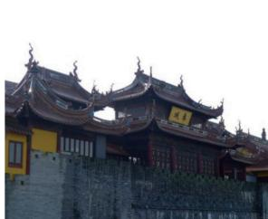
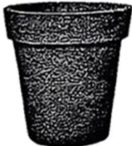
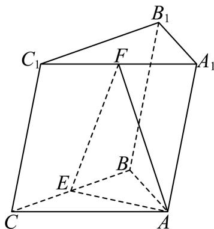
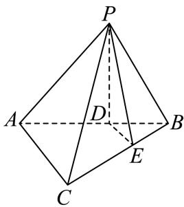
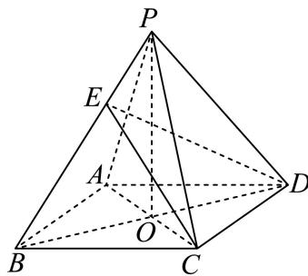
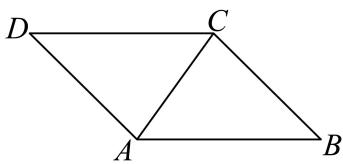
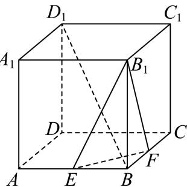
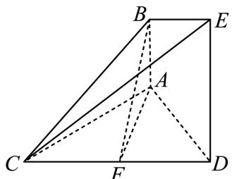
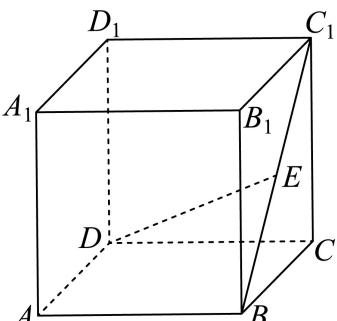

# 2025一模 立体几何专题 · 学生版

> 本地预览：题目、答案及分类尚未全部审定。校对使用的PDF为高中工作台解析版，尚未逐区确认区级印刷原卷。

## 旋转体、展开图与面积体积

由母线、半径、高或展开关系计算几何量；组合与挖空须辨明边界。

### 嘉定 · 第6题

已知圆锥的母线长为2，底面半径为1，则圆锥的侧面积为

> 本题资料或解析有待核事项，预览不可作为已审定成品。

### 奉贤 · 第11题

上海市奉贤区奉城镇的古建筑万佛阁（图1）的屋檐下常系挂风铃（图2），风吹铃动，悦耳清脆，亦称惊鸟铃，一般一个惊鸟铃由铜铸造而成，由铃身和铃舌组成，为了知道一个惊鸟铃的质量，可以通过计算该惊鸟铃的体积，然后由物理学知识计算出该惊鸟铃的质量，因此我们需要作出一些合理的假设：
假设1：铃身且可近似看作由一个较大的圆锥挖去一个较小的圆锥；
假设2：两圆锥的轴在同一条直线上；
假设3：铃身内部有一个挂铃舌的部位的体积忽略不计截面图如下（图3），其中 $\Im O _ { 1 } O _ { 3 } = 2 0 \mathrm { c m }$ 1 $O _ { 2 } O _ { 3 } = 1 8 \mathrm { { c m } }$ $A B = 1 6 \mathrm { c m }$ ，则制作100个这样的惊鸟铃的铃身至少需要 千克铜．（铜的密度为8 $. 9 \mathrm { { g } / \mathrm { { c m } ^ { 3 } ) } }$ （结果精确到个位）

图1

图2

图3

> 本题资料或解析有待核事项，预览不可作为已审定成品。

### 宝山 · 第10题

…
将棱长为2的正四面体绕着它的某一条棱旋转一周所得的几何体的体积为

### 徐汇 · 第11题

徐汇滨江作为2024年上海国际鲜花展的三个主会场之一，吸引了广大市民前往观展并拍照留念.图中的花盆是种植鲜花的常见容器，它可视作两个圆台的组合体，上面圆台的上､下底面直径分别为
30cm和26cm，下面圆台的上､下底面直径分别为24cm和18cm，且两个圆台侧面展开图的圆弧所对 的圆心角相等.若上面圆台的高为8cm，则该花盆上､下两部分母线长的总和为 cm.

> 本题资料或解析有待核事项，预览不可作为已审定成品。

### 普陀 · 第8题

若圆锥PO的体积为 $\frac { 2 { \sqrt { 2 } } \pi } { 3 }$ ，它的母线与底面所成的角的余弦值为 $\frac 1 3$ ，则圆锥PO的表面积为

> 本题资料或解析有待核事项，预览不可作为已审定成品。

### 杨浦 · 第7题

已知一个正四棱锥的每一条棱长都为2，则该四棱锥的体积为

> 本题资料或解析有待核事项，预览不可作为已审定成品。

### 杨浦 · 第9题

将一个半径为1的球形石材加工成一个圆柱形摆件，则该圆柱形摆件侧面积的最大值为

> 本题资料或解析有待核事项，预览不可作为已审定成品。

### 松江 · 第6题

已知一个圆锥的底面半径为3，其侧面积为15π，则该圆锥的高为

> 本题资料或解析有待核事项，预览不可作为已审定成品。

### 浦东 · 第18题

如图，已知AB为圆柱 $O O _ { 1 }$ 底面圆O的直径， $O A = 2$ ，母线 $A A _ { 1 }$ 长为3，点P为底面圆O的圆周上一点

(1) (6分)若 $\angle B O P = 9 0 ^ { \circ }$ ，求三棱锥 $A - P B A _ { 1 }$ 的体积；
(2) (8分)若 $\angle B O P = 6 0 ^ { \circ }$ ，求异面直线 $A _ { 1 } B {  } A P$ 所成的角的余弦值

> 本题资料或解析有待核事项，预览不可作为已审定成品。

### 虹口 · 第6题

若某圆锥的底面半径为1，高为1，则该圆锥的侧面积为 ．（结果保留π）

### 金山 · 第7题

已知某圆锥的侧面展开图是圆心角为 $\sqrt { 2 } \pi$ ，半径为2的扇形，则该圆锥的母线与底面所成角的大小

### 金山 · 第15题

古希腊数学家阿波罗尼奥斯用不同的平面截同一圆锥，得到了圆锥曲线，其中的一种如图所示．用过M点且垂直于圆锥底面的平面截两个全等的对顶圆锥得到双曲线的一部分，已知高 $P O = 2$ ，底面圆的半径为4，M为母线PB的中点，平面与底面的交线 $E F \bot A B$ ，则双曲线的两条渐近线所成角的余弦值为（ ）

A. $\frac { 5 } { 6 }$

B. $\frac { 4 } { 5 }$

C. $\frac 3 4$

D. $\frac { 3 } { 5 }$

### 长宁 · 第2题

已知圆锥的底面半径为1，母线长为2，则该圆锥的体积是 （结果保留π）

### 闵行 · 第5题

已知圆锥的高为8，底面半径为6，则该圆锥的侧面积为

### 青浦 · 第8题

已知圆柱M的底面半径为3，高为 ${ \sqrt { 3 } } ,$ ，圆锥N的底面直径和母线长相等. 若圆柱M 和圆锥N的体积相同，则圆锥N的底面半径为

> 本题资料或解析有待核事项，预览不可作为已审定成品。

### 黄浦 · 第4题

若圆柱的底面半径与高均为1，则其侧面积为

## 空间位置判定与综合证明

依据判定定理和中点构造证明平行垂直；保留体积计算等前置小问，区分给定角度与要求求角。

### 嘉定 · 第14题

已知α,β是两个不同的平面，a，b是两条不同的直线，下列条件中，一定得到直线l⊥α的是（ ）

A. $\alpha \perp \beta , l / / \beta$

B. $l \perp a , a / / \alpha$

C. $l / / a , a \bot \alpha$

D. $l \bot a , l \bot b , a \subset \alpha , b \subset \alpha$

> 本题资料或解析有待核事项，预览不可作为已审定成品。

### 嘉定 · 第17题

如图所示，在三棱柱 $A B C - A _ { 1 } B _ { 1 } C _ { 1 }$ 中， $A B = A C$ ，侧面 $B B _ { 1 } C _ { 1 } C \bot$ 底面ABC，点E､F分别为梭BC和 $A _ { 1 } C _ { 1 }$ 的中点.

(1) (6分)若底面 $\triangle A B C$ 为边长为2的正三角形，且 $C C _ { 1 } = B C$ ，侧棱 $C C _ { 1 }$ 与底面ABC所成的角为$6 0 ^ { \circ }$ ，求三棱柱 $A B C - A _ { 1 } B _ { 1 } C _ { 1 }$ 的体积；
(2) (8分)求证： $E F / /$ 平面 $A A _ { 1 } B _ { 1 } B _ { \cdot }$

> 本题资料或解析有待核事项，预览不可作为已审定成品。

### 奉贤 · 第15题

在四棱锥 $S - A B C D$ 中，若 $\overrightarrow { S A } = x \overrightarrow { S B } + y \overrightarrow { S C } + z \overrightarrow { S D }$ ，则实数组(x, y, z)可能是（ ）

A. $( 1 , - 1 , 1 )$

B. $( 1 , 0 , - 1 )$

C. $( 1 , 0 , 0 )$

D. $( 1 , - 1 , - 1 )$

> 本题资料或解析有待核事项，预览不可作为已审定成品。

### 崇明 · 第14题

已知直线l和平面α，则“l垂直于α内的两条直线”是“l⊥α”的（ ）

A. 充分非必要条件

B. 必要非充分条件

C. 充要条件

D. 非充分非必要条件

### 徐汇 · 第6题

已知m,n为空间中两条不同的直线，α,β为两个不同的平面，若 $m \subset \alpha , \alpha \cap \beta = n$ ，则 $m / / n$ 是 $m / / \beta$ 的 条件.（填：“充分非必要”､“必要非充分”、“充要”、“既非充分又非必要”中的一个）

> 本题资料或解析有待核事项，预览不可作为已审定成品。

### 浦东 · 第14题

设m、n为两条直线，α、β为两个平面，且 $\alpha \cap \beta = n$ ．下述四个命题中为假命题的是（ ）

A. 若 $m \bot \alpha ,$ ，则 $m \perp n$

B. 若 $\dot { m } / / \alpha$ ，则 $\scriptstyle | m / / n$

C. 若 $\dot { \cdot } _ { m } / / \alpha$ 且 $. m / / \beta ,$ ，则 $m / / n$

D. 若 $m / / n ,$ ，则 $| m / / \alpha$ 或 $m / / \beta$

> 本题资料或解析有待核事项，预览不可作为已审定成品。

### 长宁 · 第14题

已知非零空间向 $\sharp { \vec { a } } , { \vec { b } }$ 和→c，则下列说法正确的是（ ）

A. $\vec { \mathcal { G } } \vec { a } \perp \vec { b } , \vec { a } \perp \vec { c }$ ，则 $\vec { \vert b \vert } / \vec { \vert c }$

B. $\stackrel { \scriptscriptstyle + } { \vec { \tau } } \vec { a } \perp \vec { b } , \vec { a } \perp \vec { c }$ ,则 $\vec { b } \perp \vec { c }$

C. $\overrightarrow { \mathcal { H } } \overrightarrow { a } \perp \overrightarrow { b } , \overrightarrow { a } / / \overrightarrow { c }$ ，则 $\stackrel {  } { b } / / \stackrel {  } { c }$

D. $\overrightarrow { \mathcal { H } } \overrightarrow { a } \perp \overrightarrow { b } , \overrightarrow { a } / / \overrightarrow { c }$ ，则 $\vec { | b \perp c | }$

### 闵行 · 第13题

在空间中，“$a,b$ 为异面直线”是“$a,b$ 不相交”的（　）。

A. 充分非必要条件

B. 必要非充分条件

C. 充要条件

D. 既非充分又非必要条件

> 本题资料或解析有待核事项，预览不可作为已审定成品。

### 青浦 · 第18题

如图，在三棱锥 $P - A B C$ 中，平面 $P A B \bot$ 平面 $A B C , A B = 6 , B C = 2 { \sqrt { 3 } } , A C = 2 { \sqrt { 6 } } , D .$ 、E分别为线段AB、BC上的点，且 $A D = 2 D B , C E = 2 E B , P D \bot A C .$
(1) (6分)求证： $D E / /$ 平面 $P A C ;$
(2) (8分)求证： $P D \perp$ 平面 $A B C$

> 本题资料或解析有待核事项，预览不可作为已审定成品。

## 角度、距离与空间综合证明

完整保留空间大题，联系中点构造、建系法和等体积法求角距。

### 奉贤 · 第19题

如图为正四棱锥 $P - A B C D , O$ 为底面ABCD的中心

(1)图
(2)图
(1) (6分)求证： $C D / /$ 平面 $P A B ,$ 平面 $P A C \bot$ 平面PBD；
(2) (8分)设E为PB上的一点，− $\overrightarrow { B E } = \frac { 2 } { 3 } \overrightarrow { B P } .$
在下面两问中选一个，
①若 $A D = A P = 3 { \sqrt { 2 } } .$ ，求直线EC与平面BED所成角的大小
②已知平面ECD与平面ABCD所成锐二面角的大小为 $\arctan { \frac { \sqrt { 2 } } { 2 } }$ ，若 $A D = 3 { \sqrt { 2 } }$ ，求AP的长

> 本题资料或解析有待核事项，预览不可作为已审定成品。

### 宝山 · 第17题

…
如图，四棱锥 $P - A B C D$ 中，底面ABCD为矩形， $P A = P B = A D = 3$ $A B = 4$ ，且该四棱锥的体积为 $4 { \sqrt { 5 } } .$

(1) (6分)证明：平面PAB⊥底面 $A B C D$ ；
(2) (8分)求异面直线PC和AB所成角的余弦值.

### 崇明 · 第17题

如图，在直三棱柱 $A B C - A _ { 1 } B _ { 1 } C _ { 1 }$ 中，E、F分别为 $A _ { 1 } C _ { 1 }$ 、BC的中点， $A A _ { 1 } = A B = B C = 2 \quad$ $C _ { 1 } F \bot A B .$

(1) (6分)求证： $C _ { 1 } F / /$ 平面ABE；
(2) (8分)求点C到平面ABE的距离.

> 本题资料或解析有待核事项，预览不可作为已审定成品。

### 徐汇 · 第18题

如图，在四棱锥 $P - A B C D$ 中， $A D / / B C , \angle A D C = \angle P A B = \frac { \pi } { 2 } , B C = C D = \frac { 1 } { 2 } A D$ .E为棱AD的中点，异面直线PA与CD所成角的大小为 $\frac { \pi } { 2 }$

(1) (6分)求证： $C D / { \bar { \lambda } }$ 平面PBE；
(2) (8分)若二面角 $P - C D - A$ 的大小为 $\frac { \pi } { 4 }$ ，求直线PA与平面PCE所成角的正弦值.

> 本题资料或解析有待核事项，预览不可作为已审定成品。

### 普陀 · 第17题

图1所示的平行四边形ABCD中， $C A = C B = 1 , \ C D = { \sqrt { 2 } }$ 现将 $\triangle D A C$ 沿AC折起，得到如图2所示的三棱锥 $P - A B C$ ，记棱PC的中点为M，且. $. P B = { \sqrt { 3 } }$

图1

图2
(1) (6分)求证： $A M \bot B C$ ；
(2) (8分)记棱AB的中点为E，在直线CE上作出点N，使得 $P N / /$ 平面MAB，请说明理由，并求出二面角 $P - N B - A$ 的大小.

> 本题资料或解析有待核事项，预览不可作为已审定成品。

### 杨浦 · 第17题

如图，在正方体 $A B C D - A _ { 1 } B _ { 1 } C _ { 1 } D _ { 1 }$ 中，点E、F分别是棱AB、BC的中点.

(1) (6分)求证： $E F \bot B D _ { 1 }$ ；
(2) (8分)求二面角 $B _ { 1 } - E F - B$ 的大小.

> 本题资料或解析有待核事项，预览不可作为已审定成品。

### 松江 · 第18题

如图，已知AB⊥平面ACD，AB∥DE， $\triangle A C D$ 为等边三角形， $A D = D E = 2 A B$ ，F为CD的中点

（1）求证：AF∥平面BCE；
（2）求直线AD和平面BCE所成角的正弦值

> 本题资料或解析有待核事项，预览不可作为已审定成品。

### 虹口 · 第9题

如图，已知正三角形ABC和正方形BCDE的边长均为2，且二面角 $A - B C - D$ 的大小为 $\frac { \pi } { 6 }$ ，则${ \overrightarrow { A C } } . { \overrightarrow { B D } } =$

### 虹口 · 第18题

如图，已知在四棱柱 $A B C D - E F G H$ 中，EA⊥平面ABCD，N、M分别是EF、HD的中点

(1) (6分)求证： $H N / /$ 平面AFM；
(2) (8分)若底面ABCD为梯形， $A B / / C D , A B = E A = 2 , A D = D C = 1$ ，异面直线AB与EH所 成角为 $\frac { \pi } { 2 }$ ．求直线 $A N ^ { I }$ 与平面AFM所成角的正弦值

### 金山 · 第18题

如图，在四棱锥 $P - A B C D$ 中，底面ABCD是直角梯形， $\angle B A D = \angle C D A = 9 0 ^ { \circ }$ $P A \bot$ 平面$A B C D$ ，Q是PB的中点， $P A = A D = D C = 1 , A B = 2$

(1) (6分)证明： $C Q / /$ 平面 $P A D$
(2) (8分)求点D到平面PAC的距离

### 长宁 · 第18题

如图所示，四棱柱 $A B C D - A _ { 1 } B _ { 1 } C _ { 1 } D _ { 1 }$ 1的底面ABCD是正方形，O是底面的中心， $A _ { 1 } O \bot$ 平面$A B C D , A B = A A _ { 1 } = { \sqrt { 2 } }$

(1) (6分)求证： $A _ { 1 } C \bot$ 平面 $B D D _ { 1 } B _ { 1 }$ ；
(2) (8分)求直线 $O A _ { 1 }$ 1与平面 $A A _ { 1 } B$ 所成角的正弦值

> 本题资料或解析有待核事项，预览不可作为已审定成品。

### 闵行 · 第17题

在直三棱柱 $A B C - A _ { 1 } B _ { 1 } C _ { 1 }$ 中，AB = AC = 2， $A A _ { 1 } = 3$ $\angle B A C = 9 0 ^ { \circ }$ ，连接 $A _ { 1 } C _ { : }$ ，M、E分别为 $A _ { 1 } C$ 和BC的中点

(1) (6分)证明：直线 $E M / /$ 平面 $A _ { 1 } A B B _ { 1 }$ ；
(2) (8分)求二面角 $A _ { 1 } - B C - A$ 的大小

### 静安 · 第15题

我国古代数学著作《九章算术》中将四个面都是直角三角形的空间四面体叫做“鳖臑”.如图是一个水平放置的 $\triangle A B C , C D \bot A B , \angle A = 3 0 ^ { \circ } , \angle B = 4 5 ^ { \circ }$ .现将 $\begin{array} { r } { \mathrm { R t } \triangle A C D \dot { \% } C D } \end{array}$ 折起，使点A移动到点A′，使得空间四面体A′BCD恰好是一个“鳖臑”，则二面角A′ −CD−B的大小为（ ）

A. $6 0 ^ { \circ }$

B. $9 0 ^ { \circ }$

C. $\arctan 2$

D. $\operatorname { a r c c o s } { \frac { \sqrt { 3 } } { 3 } }$

### 静安 · 第16题

在四棱锥 $P - A B C D$ 中， $\overrightarrow { A B } = ( 4 , - 2 , 3 ) , \overrightarrow { A D } = ( - 4 , 1 , 0 ) , \overrightarrow { A P } = ( - 6 , 2 , - 8 )$ ，则该四棱锥的高为（ ）

A. 4

B. 3

C. 2

D. 1

### 静安 · 第19题

如图所示，正三棱锥A−BCD的侧面是边长为2的正三角形.

(1) (4分)求正三棱锥A − BCD的体积V；
(2) (10分)设E､F､G分别是线段AC､AD､BC的中点.
求证： $\textcircled { 1 } C D / / .$ 平面EFG；②若平面EFG交BD于点H，则四边形EFHG是正方形.

### 黄浦 · 第14题

若从正方体八个顶点中任取四个顶点分别记为A、B、C、D，则直线AB与CD所成角的大小不可能为（ ）

A. $3 0 ^ { \circ }$

B. $4 5 ^ { \circ }$

C. $6 0 ^ { \circ }$

D. $9 0 ^ { \circ }$

> 本题资料或解析有待核事项，预览不可作为已审定成品。

### 黄浦 · 第17题

如图，在正方体ABCD− $A _ { 1 } B _ { 1 } C _ { 1 } D _ { 1 }$ 中，E是 $B C _ { 1 }$ 的中点

(1) (6分)求证： $B C _ { 1 \bot }$ 平面CDE；
(2) (8分)求直线DE与平面ABCD所成角的大小

## 空间坐标、向量表示与轨迹度量

将固定点基底线性表示、等距或对称约束转成空间向量及坐标；动点问题再讨论轨迹、计数或最值。

### 嘉定 · 第10题

已知空间向量 $\overrightarrow { O B _ { 1 } } , \overrightarrow { O B _ { 2 } } , \overrightarrow { O B _ { 3 } }$ 两两垂直，若空间点A满足 $\left| \overrightarrow { A B _ { 1 } } \right| = \left| \overrightarrow { A B _ { 2 } } \right| = \left| \overrightarrow { A B _ { 3 } } \right| = 1$ ，记$\overrightarrow { O P } = \overrightarrow { O B _ { 1 } } + \overrightarrow { O B _ { 2 } } + \overrightarrow { O B _ { 3 } }$ ，且 $\left| \begin{array} { l } { \longrightarrow } \\ { \vec { A P } } \end{array} \right| \le 1$ ，则 $\overrightarrow { O A }$ 的取值范围为

> 本题资料或解析有待核事项，预览不可作为已审定成品。

### 宝山 · 第15题

…
如图，正四棱柱 $A B C D - A _ { 1 } B _ { 1 } C _ { 1 } D _ { 1 }$ 的底面ABCD边长为1，E为AD上任意一点，F为 $C C _ { 1 }$ 中点，若棱 $C _ { 1 } D _ { 1 }$ 上至少存在一点P使得 $P E \bot P F$ ，则棱长 $A A _ { 1 }$ 的最大值为（ ）

A. $\frac { \sqrt { 2 } } { 2 }$

B. 1

C. $\sqrt { 2 }$

D. 2

### 崇明 · 第9题

在空间直角坐标系中，点(1,2,3)关 $\operatorname { F } x O y$ 平面的对称点的坐标是

### 普陀 · 第9题

设λ ∈ R，在如图所示的平行六面体 $A B C D - A _ { 1 } B _ { 1 } C _ { 1 } D _ { 1 }$ 1中， $\angle A _ { 1 } A B = \angle A _ { 1 } A D = \angle B A D = { \frac { \pi } { 3 } } .$ $A A _ { 1 } = 2 , A B = A D = 1$ ，点M是棱 $C _ { 1 } D _ { 1 }$ 的中点， $\xrightarrow { \xrightarrow { } } { \lambda _ { 1 } N } = \overline { { \lambda A _ { 1 } D _ { 1 } } }$ ，若 $\stackrel { \longrightarrow } { A M } . \stackrel { \longrightarrow } { C N } = 2$ ，则λ的值为

> 本题资料或解析有待核事项，预览不可作为已审定成品。

### 虹口 · 第15题

已知边长为2的正四面体A−BCD的内切球（球面与四面体四个面都相切的球）的球心为O，若空间中的动点P满足 $\overrightarrow { O P } = x \overrightarrow { O C } + y \overrightarrow { O B } + z \overrightarrow { O D } , x , y , z \in [ 0 , 1 ]$ ]，则点P的轨迹所形成的几何体的体积为（ ）

A. $\sqrt { 2 }$

B. $\frac { \sqrt { 2 } } { 3 }$

C. $2 \sqrt { 3 }$

D. $\frac { \sqrt { 3 } } { 3 }$

> 本题资料或解析有待核事项，预览不可作为已审定成品。

### 金山 · 第16题

已知三棱锥 $A _ { 1 } - A _ { 2 } A _ { 3 } A _ { 4 }$ 的侧棱长相等，且侧棱两两垂直．设P为该三棱锥表面（含棱）上异于顶点 $A _ { 1 } , A _ { 2 } , A _ { 3 } , A _ { 4 }$ 的点，记 $D = \{ d | d = | P A _ { i } | , i = 1 , 2 , 3 , 4 \}$ ．若集合D中有且只有2个元素，则符合条件的点P有（ ）个

A. 3

B. 6

C. 7

D. 10

> 本题资料或解析有待核事项，预览不可作为已审定成品。

### 长宁 · 第12题

点P、M、N分别位于正方体 $A B C D - A ^ { \prime } B ^ { \prime } C ^ { \prime } D ^ { \prime }$ 的面上，AB = 1，则 $\overrightarrow { P M } \cdot \overrightarrow { P N }$ 的最小值是

> 本题资料或解析有待核事项，预览不可作为已审定成品。

### 青浦 · 第14题

若点 $P \left( x , y , z \right) \left( x y z \neq 0 \right)$ 关于xOy的对称点为A，关于z轴的对称点为B，则A、B两点的对称是（ ）

A. 关 $\operatorname { \mathbb { F } } _ { \mathbf { X } } \operatorname { O z } ^ { \mathrm { - } }$ 平面对称

B. 关于x轴对称

C. 关于y轴对称

D. 关于坐标原点对称

> 本题资料或解析有待核事项，预览不可作为已审定成品。

### 黄浦 · 第8题

在正四面体 $A B C D$ 中，点N是 $\triangle A B C$ 的中心，若 $\overrightarrow { D N } = \lambda \overrightarrow { D A } + \mu \overrightarrow { D B } + \nu \overrightarrow { B C } \left( \lambda , \mu , \nu \in \mathbf { R } \right)$ ，则$\lambda + \mu + \nu =$

