# 2025一模 立体几何专题 · 教师版

> 本地预览：题目、答案及分类尚未全部审定。校对使用的PDF为高中工作台解析版，尚未逐区确认区级印刷原卷。

## 旋转体、展开图与面积体积

由母线、半径、高或展开关系计算几何量；组合与挖空须辨明边界。

### 嘉定 · 第6题

已知圆锥的母线长为2，底面半径为1，则圆锥的侧面积为

> 本题资料或解析有待核事项，预览不可作为已审定成品。

**考点：** 圆锥侧面积公式

**难度依据：** 半径与母线直接代入

**核查说明：** 题干与解析已用于人工归类，尚未完成整题公式校净与独立数学终审。

【答案】2π.

【解析】

利用圆锥的侧面积公式即可得解.

因为圆锥的母线长为l = 2，底面半径为 $\lceil r = 1$

所以圆锥的侧面积为 $\pi r l = 2 \pi$ .

故答案为：2π.

### 奉贤 · 第11题

上海市奉贤区奉城镇的古建筑万佛阁（图1）的屋檐下常系挂风铃（图2），风吹铃动，悦耳清脆，亦称惊鸟铃，一般一个惊鸟铃由铜铸造而成，由铃身和铃舌组成，为了知道一个惊鸟铃的质量，可以通过计算该惊鸟铃的体积，然后由物理学知识计算出该惊鸟铃的质量，因此我们需要作出一些合理的假设：
假设1：铃身且可近似看作由一个较大的圆锥挖去一个较小的圆锥；
假设2：两圆锥的轴在同一条直线上；
假设3：铃身内部有一个挂铃舌的部位的体积忽略不计截面图如下（图3），其中 $\Im O _ { 1 } O _ { 3 } = 2 0 \mathrm { c m }$ 1 $O _ { 2 } O _ { 3 } = 1 8 \mathrm { { c m } }$ $A B = 1 6 \mathrm { c m }$ ，则制作100个这样的惊鸟铃的铃身至少需要 千克铜．（铜的密度为8 $. 9 \mathrm { { g } / \mathrm { { c m } ^ { 3 } ) } }$ （结果精确到个位）

图1

图2

图3

> 本题资料或解析有待核事项，预览不可作为已审定成品。

**考点：** 圆锥挖空体积与质量估算

**难度依据：** 作两个圆锥体积差后处理密度与单位

**核查说明：** 题干与解析已用于人工归类，尚未完成整题公式校净与独立数学终审。

【答案】120.

【解析】

利用锥体的体积公式可求得结果.

由题意可知，圆锥 $\lvert O _ { 1 } O _ { 3 }$ 的底面半径为8cm，高为20cm，

圆锥 $\mathrm { { ; } } O _ { 2 } O _ { 3 }$ 的底面半径为8cm，高为18cm，

因为 $1 1 0 0 \times { \frac { 1 } { 3 } } \times \pi \times 8 ^ { 2 } \times ( 2 0 - 1 8 ) \times 8 . 9 \div 1 0 0 0 \approx 1 1 9 . 2 3 6 ,$

所以，制作100个这样的惊鸟铃的铃身至少需要120千克铜.

故答案为：120.

### 宝山 · 第10题

…
将棱长为2的正四面体绕着它的某一条棱旋转一周所得的几何体的体积为

**考点：** 正四面体旋转体的体积

**难度依据：** 涉及正四面体旋转体的体积；难度为教师预估，需结合原题条件复核。

**核查说明：** 依据现有底稿归类，尚未逐页校卷、公式校净或独立数学终审。

【答案】2π

【解析】

先求出四面体其中一个面的高，确定正四面体旋转后得到两个同底的圆锥，利用圆锥体积公式求解即可.

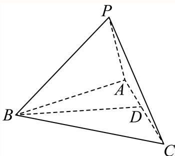

如图为棱长为2的正四面体，作 $B D \bot A C , B D \cap A C$ 于点D，

在 $\triangle A B C$ 中， $| A B | = 2 , \angle B A C = 6 0 ^ { \circ } , | B D | = | A B | \cdot \sin 6 0 ^ { \circ } = { \sqrt { 3 } } ,$

根据题意，正四面体旋转后得到两个同底的圆锥，

底面半径等于 $| B D | = { \sqrt { 3 } }$ ，高等于 ${ \frac { | A C | } { 2 } } = 1$ ，

所以旋转后几何体的体积为： $V = 2 \times { \frac { 1 } { 3 } } \cdot \pi \cdot \left( { \sqrt { 3 } } \right) ^ { 2 } = 2 \pi$

故答案为：2π

### 徐汇 · 第11题

徐汇滨江作为2024年上海国际鲜花展的三个主会场之一，吸引了广大市民前往观展并拍照留念.图中的花盆是种植鲜花的常见容器，它可视作两个圆台的组合体，上面圆台的上､下底面直径分别为
30cm和26cm，下面圆台的上､下底面直径分别为24cm和18cm，且两个圆台侧面展开图的圆弧所对 的圆心角相等.若上面圆台的高为8cm，则该花盆上､下两部分母线长的总和为 cm.

> 本题资料或解析有待核事项，预览不可作为已审定成品。

**考点：** 圆台展开扇形与母线

**难度依据：** 圆台展开扇形与母线；按所需步骤与推理量估计

**核查说明：** 题干与解析已用于人工归类，尚未完成整题公式校净与独立数学终审。；源解末行母线长度之和与前文数值不一致，需核原解和题图。；题干与解析已用于人工归类，尚未完成整题公式校净与独立数学终审。；源解末行母线长度之和与前文数值不一致，需核原解和题图。

【答案】$5 \sqrt { 1 7 }$

【解析】

设出圆台的母线长及底面半径，根据圆台的母线长公式 $l = \sqrt { h ^ { 2 } + \left( r _ { 1 } - r _ { 2 } \right) ^ { 2 } }$ 结合条件即得.

设上面圆台的母线长为 $\boldsymbol { \lvert l _ { 1 } }$ ，上面半径为 $ 1 r _ { 1 } = 1 5 \mathrm { c m }$ ,下半圆半径为 $r _ { 2 } = 1 3 \mathrm { c m }$ ,高为 $h = 8 \mathrm { c m }$

根据圆台的母线长公式l = $\sqrt { h ^ { 2 } + ( r _ { 1 } - r _ { 2 } ) ^ { 2 } }$ ，带入数值计算得到

$$
l _ {1} = \sqrt {8 ^ {2} + (1 5 - 1 3) ^ {2}} = \sqrt {6 8} = 2 \sqrt {1 7} \mathrm{cm};
$$

设下面圆台的母线长为l ，上面半径为 $r _ { 3 } = 1 2 \mathrm { { c m } } .$ ,下半圆半径为 $r _ { 4 } = 9 \mathrm { c m }$

由于两个圆台侧面展开图的圆弧所对的圆心角相等，可以得到 $\frac { r _ { 1 } - r _ { 2 } } { l _ { 1 } } = \frac { r _ { 3 } - r _ { 4 } } { l _ { 2 } }$ ，带入数值

计算得到 $| l _ { 2 } = { \frac { ( r _ { 3 } - r _ { 4 } ) l _ { 1 } } { r _ { 1 } - r _ { 2 } } } = { \frac { ( 1 2 - 9 ) \times 2 { \sqrt { 1 7 } } } { 1 5 - 1 3 } } = 3 { \sqrt { 1 7 } } \mathrm { c m }$

所以该花盆上､下两部分母线长的总和为 $\scriptstyle 1 2 { \sqrt { 1 7 } } + 3 { \sqrt { 1 7 } } = 5 { \sqrt { 1 7 } } { \mathrm { c m } }$

故答案为： $5 \sqrt { 1 7 }$

### 普陀 · 第8题

若圆锥PO的体积为 $\frac { 2 { \sqrt { 2 } } \pi } { 3 }$ ，它的母线与底面所成的角的余弦值为 $\frac 1 3$ ，则圆锥PO的表面积为

> 本题资料或解析有待核事项，预览不可作为已审定成品。

**考点：** 圆锥线面角体积与表面积；直角三角形中的余弦边比

**难度依据：** 先由夹角确定母线半径比例再用体积定尺度

**核查说明：** 题干与解析已用于人工归类，尚未完成整题公式校净与独立数学终审。

【解析】

由题意作图，根据线面角的定义，可得圆锥的母线与底面半径的等量关系，利用扇形面积公式以及圆的面积公式，可得答案.

由题意可作图如下：

在圆锥PO中，易知 $P O \bot A B$ ，且 $\angle P B O$ 为母线与底面所成的角，

由母线与底面所成的角的余弦值为 $\frac 1 3$ ，则 $\cos \angle P B O = \frac { 1 } { 3 }$

在 $\mathrm { R t } \triangle P O B \sharp$ ， ${ \frac { O B } { P B } } = { \frac { 1 } { 3 } }$ ，可得 $P B = 3 O B$ ，则 $P O = 2 \sqrt { 2 } O B$

圆锥PO的体积V = $\frac { 1 } { 3 } \cdot P O \cdot O B ^ { 2 } \pi = \frac { 2 \sqrt { 2 } } { 3 } O B ^ { 3 } \pi = \frac { 2 \sqrt { 2 } \pi } { 3 }$ ，解得 $O B = 1$ ，则 $P B = 3$ 圆O的周长为 $\textstyle | C = 2 \pi \cdot O B = 2 \pi$ ，则圆锥侧面展开图的面积 $\displaystyle { \left\{ S _ { 1 } = \frac { 1 } { 2 } \cdot P B \cdot C = 3 \pi \right. }$ 圆锥底面面积 $\begin{array} { r } { | S _ { 2 } = \pi \cdot O B ^ { 2 } = \pi } \end{array}$ 所以圆锥的表面积 $\begin{array} { r } { \mathbb { S } = S _ { 1 } + S _ { 2 } = 4 \pi . } \end{array}$ 故答案为：4π.

### 杨浦 · 第7题

已知一个正四棱锥的每一条棱长都为2，则该四棱锥的体积为

> 本题资料或解析有待核事项，预览不可作为已审定成品。

**考点：** 正四棱锥高与体积

**难度依据：** 正四棱锥高与体积；按所需步骤与推理量估计

**核查说明：** 题干与解析已用于人工归类，尚未完成整题公式校净与独立数学终审。

【答案】$\frac { 4 { \sqrt { 2 } } } { 3 }$

【解析】

作出辅助线，求出正四棱锥的高，由锥体体积公式进行求解.

如图，正四棱锥P−ABCD，正方形ABCD的对角线相交于点O，连接PO，

则 $P O \bot$ 平面ABCD，

因为 $B D \subset$ 平面 $A B C D$ ，所以 $P O \bot B D$

其中 $B O = { \frac { 1 } { 2 } } B D = { \frac { 1 } { 2 } } { \sqrt { 2 ^ { 2 } + 2 ^ { 2 } } } = { \sqrt { 2 } } ,$

故 $O P = \sqrt { B P ^ { 2 } - O B ^ { 2 } } = \sqrt { 2 } ,$

所以该四棱锥的体积为 ${ \frac { 1 } { 3 } } A B \cdot B C \cdot O P = { \frac { 4 { \sqrt { 2 } } } { 3 } }$

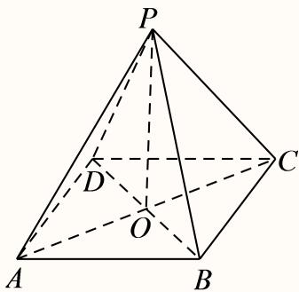

故答案为： $\frac { 4 { \sqrt { 2 } } } { 3 }$

### 杨浦 · 第9题

将一个半径为1的球形石材加工成一个圆柱形摆件，则该圆柱形摆件侧面积的最大值为

> 本题资料或解析有待核事项，预览不可作为已审定成品。

**考点：** 球内接圆柱侧面积最值；基本不等式

**难度依据：** 球内接圆柱侧面积最值；基本不等式；按所需步骤与推理量估计

**核查说明：** 题干与解析已用于人工归类，尚未完成整题公式校净与独立数学终审。

【答案】2π.

【解析】

设圆柱形工件的高为h，底面半径为r，得到圆柱形工件的侧面积为 $S = 2 \pi r h$ ，再结合基本不等式求解侧面积的最大值.

设圆柱形工件的高为h，底面半径为r， ${ \frac { h ^ { 2 } } { 4 } } + r ^ { 2 } = 1$

则圆柱形工件的侧面积为 $S = 2 \pi r h = 2 \pi r \sqrt { 4 \left( 1 - r ^ { 2 } \right) } = 4 \pi \sqrt { r ^ { 2 } \left( 1 - r ^ { 2 } \right) } ;$

又因为 $1 = r ^ { 2 } + \left( 1 - r ^ { 2 } \right) \geq 2 { \sqrt { r ^ { 2 } \left( 1 - r ^ { 2 } \right) } }$ 当且仅当 $r ^ { 2 } = \big ( 1 - r ^ { 2 } \big ) , r = \frac { \sqrt { 2 } } { 2 }$ 时等号成立，

所以 $S = 4 \pi { \sqrt { r ^ { 2 } \left( 1 - r ^ { 2 } \right) } } \leq 4 \pi \times { \frac { 1 } { 2 } } = 2 \pi ,$

故答案为：2π.

### 松江 · 第6题

已知一个圆锥的底面半径为3，其侧面积为15π，则该圆锥的高为

> 本题资料或解析有待核事项，预览不可作为已审定成品。

**考点：** 圆锥侧面积与高

**难度依据：** 圆锥侧面积与高；按所需步骤与推理量估计

**核查说明：** 题干与解析已用于人工归类，尚未完成整题公式校净与独立数学终审。

【答案】4

【解析】

根据给定条件，利用侧面积公式求出母线长，进而求出圆锥的高.

圆锥的底面半径r = 3，设其母线长为l，则 $\pi r l = 1 5 \pi$ ，解得l = 5，

所以该圆锥的高 $h = { \sqrt { l ^ { 2 } - r ^ { 2 } } } = { \sqrt { 5 ^ { 2 } - 3 ^ { 2 } } } = 4 .$

故答案为：4

### 浦东 · 第18题

如图，已知AB为圆柱 $O O _ { 1 }$ 底面圆O的直径， $O A = 2$ ，母线 $A A _ { 1 }$ 长为3，点P为底面圆O的圆周上一点

(1) (6分)若 $\angle B O P = 9 0 ^ { \circ }$ ，求三棱锥 $A - P B A _ { 1 }$ 的体积；
(2) (8分)若 $\angle B O P = 6 0 ^ { \circ }$ ，求异面直线 $A _ { 1 } B {  } A P$ 所成的角的余弦值

> 本题资料或解析有待核事项，预览不可作为已审定成品。

**考点：** （1）圆柱中三棱锥体积；（2）异面直线角余弦

**难度依据：** 圆柱三棱锥体积与异面直线角；按所需步骤与推理量估计

**核查说明：** 题干与解析已用于人工归类，尚未完成整题公式校净与独立数学终审。；第（2）问异面直线名称间连接词丢失。；题干与解析已用于人工归类，尚未完成整题公式校净与独立数学终审。；第（2）问异面直线名称间连接词丢失。

【解析】

(1) 依题意， $A A _ { 1 } \bot$ 平面 $A P B { \mathrm { : } }$ ，由 $\angle B O P = 9 0 ^ { \circ }$ ，得 $S _ { \triangle A P B } = \frac { 1 } { 2 } A B \cdot O P = \frac { 1 } { 2 } \times 4 \times 2 = 4$ 所以三棱锥 $A - P B A _ { 1 }$ 的体积 $V _ { A - P B A _ { 1 } } = V _ { A _ { 1 } - P B A } = \frac { 1 } { 3 } S _ { \triangle A P B } \cdot A A _ { 1 } = \frac { 1 } { 3 } \times 4 \times 3 = 4 .$

(2) 过点P作圆柱 $O O _ { 1 }$ 的母线 $P P _ { 1 }$ ，连接 $A _ { 1 } P _ { 1 } , B P _ { : }$

则 $P P _ { 1 } / / A A _ { 1 } , P P _ { 1 } = A A _ { 1 }$ ，于是四边形 $A P P _ { 1 } A _ { 1 }$ 为平行四边形， $A _ { 1 } P _ { 1 } / / A P$

因此 $\angle P _ { 1 } A _ { 1 } B$ 是异面直线 $A _ { 1 } B$ 与AP所成的角或其补角，

由 $\angle B O P = 6 0 ^ { \circ }$ ，得 $\angle A O P = 1 2 0 ^ { \circ } , A P = 2 O A \cos 3 0 ^ { \circ } = 2 { \sqrt { 3 } } , P B = O B = 2 ,$

则A1P1 = AP = 2√3，A1B = √AA2 + AB2 = √32 + 42 = 5，

由 $P P _ { 1 \perp }$ 平面 $A P B ,$ ，得 $P _ { 1 } B = { \sqrt { P P _ { 1 } ^ { 2 } + P B ^ { 2 } = { \sqrt { 3 ^ { 2 } + 2 ^ { 2 } } } } } = { \sqrt { 1 3 } } ,$

在 $\triangle A _ { 1 } P _ { 1 } B ^ { \vert }$ 中， $\cos \angle P _ { 1 } A _ { 1 } B = { \frac { A _ { 1 } P _ { 1 } ^ { 2 } + A _ { 1 } B ^ { 2 } - P _ { 1 } B ^ { 2 } } { 2 A _ { 1 } P _ { 1 } \cdot A _ { 1 } B } } = { \frac { 1 2 + 2 5 - 1 3 } { 2 \times 2 { \sqrt { 3 } } \times 5 } } = { \frac { 2 { \sqrt { 3 } } } { 5 } } ,$

所以异面直线 $A _ { 1 } B _ { \ l }$ 与AP所成的角的余弦值为 $\frac { 2 { \sqrt { 3 } } } { 5 }$

### 虹口 · 第6题

若某圆锥的底面半径为1，高为1，则该圆锥的侧面积为 ．（结果保留π）

**考点：** 圆锥侧面积

**难度依据：** 涉及圆锥侧面积；难度为教师预估，需结合原题条件复核。

**核查说明：** 依据现有底稿归类，尚未逐页校卷、公式校净或独立数学终审。

【答案】$\sqrt { 2 } \pi$

【解析】

首先求出母线，再由侧面积公式计算可得.

因为圆锥的底面半径r = 1，高h = 1，设母线为l(l > 0)，则 $l = { \sqrt { r ^ { 2 } + h ^ { 2 } } } = { \sqrt { 2 } }$

所以该圆锥的侧面积为 $\pi r l = \sqrt { 2 } \pi$

故答案为： $\sqrt { 2 } \pi$

### 金山 · 第7题

已知某圆锥的侧面展开图是圆心角为 $\sqrt { 2 } \pi$ ，半径为2的扇形，则该圆锥的母线与底面所成角的大小

**考点：** 扇形展开与圆锥线面角

**难度依据：** 涉及扇形展开与圆锥线面角；难度为教师预估，需结合原题条件复核。

**核查说明：** 依据现有底稿归类，尚未逐页校卷、公式校净或独立数学终审。

【解析】

根据扇形弧长与圆锥底面周长关系列方程求底面半径，结合圆锥的结构特征求该圆锥的母线与底面所成角余弦值，即可确定大小.

令底面半径为r，则 $2 \pi r = 2 \sqrt { 2 } \pi$ ，可得 $\cdot r = { \sqrt { 2 } } ,$ ，且圆锥母线为2，

所以该圆锥的母线与底面所成角的余弦值为 $\frac { \sqrt { 2 } } { 2 }$ ，故其大小为 $\frac { \pi } { 4 }$

$$
\frac {\pi}{4}
$$

### 金山 · 第15题

古希腊数学家阿波罗尼奥斯用不同的平面截同一圆锥，得到了圆锥曲线，其中的一种如图所示．用过M点且垂直于圆锥底面的平面截两个全等的对顶圆锥得到双曲线的一部分，已知高 $P O = 2$ ，底面圆的半径为4，M为母线PB的中点，平面与底面的交线 $E F \bot A B$ ，则双曲线的两条渐近线所成角的余弦值为（ ）

A. $\frac { 5 } { 6 }$

B. $\frac { 4 } { 5 }$

C. $\frac 3 4$

D. $\frac { 3 } { 5 }$

**考点：** 圆锥截面双曲线渐近线夹角

**难度依据：** 涉及圆锥截面双曲线渐近线夹角；难度为教师预估，需结合原题条件复核。

**核查说明：** 依据现有底稿归类，尚未逐页校卷、公式校净或独立数学终审。

【答案】D

【解析】

令双曲线为 ${ \frac { y ^ { 2 } } { a ^ { 2 } } } - { \frac { x ^ { 2 } } { b ^ { 2 } } } = 1$ ，根据已知建立合适坐标系，并求出双曲线参数，进而得渐近线方程，利用二倍角正切公式求得夹角正切值 $\tan \theta = { \frac { 4 } { 3 } }$ ，即可得其余弦值.

如下图建系，令双曲线为 ${ \frac { y ^ { 2 } } { a ^ { 2 } } } - { \frac { x ^ { 2 } } { b ^ { 2 } } } = 1$ ，且 $| O P | = 2$ ，则 $y _ { M } = - 1 , ~ a = 1$

如图， $| O H | = 2 , | O E | = 4$ ，则 $H E | = | H F | = 2 { \sqrt { 3 } }$ ，故 $F \left( 2 { \sqrt { 3 } } , - 2 \right)$

将F代入 $\cdot y ^ { 2 } - { \frac { x ^ { 2 } } { b ^ { 2 } } } = 1$ ，得 $4 - { \frac { 1 2 } { b ^ { 2 } } } = 1$ ，可得 $b ^ { 2 } = 4$ ，故渐近线为 $y = \pm \frac { 1 } { 2 } x$

若它们的夹角为θ，且 $\tan { \frac { \theta } { 2 } } = { \frac { 1 } { 2 } }$ ，则 $\tan \theta = { \frac { 2 \tan { \frac { \theta } { 2 } } } { 1 - \tan ^ { 2 } { \frac { \theta } { 2 } } } } = { \frac { 4 } { 3 } }$ ，故 $\cos \theta = { \frac { 3 } { 5 } }$

故选：D

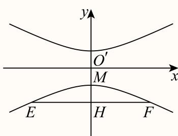

### 长宁 · 第2题

已知圆锥的底面半径为1，母线长为2，则该圆锥的体积是 （结果保留π）

**考点：** 母线、半径求高及体积

**难度依据：** 圆锥高与体积；母线、半径求高及体积

【答案】${ \frac { \sqrt { 3 } } { 3 } } \pi$

【解析】

做轴截面，根据母线与底面半径求出圆锥的高，计算体积即可.

如下图做出轴截面：

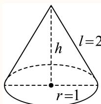

h = √l2 − r2 = √3

代入圆锥体积公式： $V = { \frac { 1 } { 3 } } \pi r ^ { 2 } h = { \frac { \sqrt { 3 } } { 3 } } \pi$

故答案为： ${ \frac { \sqrt { 3 } } { 3 } } \pi$

### 闵行 · 第5题

已知圆锥的高为8，底面半径为6，则该圆锥的侧面积为

**考点：** 求母线并代入侧面积公式

**难度依据：** 圆锥侧面积；求母线并代入侧面积公式

【答案】60π.

【解析】

根据勾股定理求出母线长，再根据圆锥的侧面积公式求解即可.

因为圆锥的高为8，底面半径为r = 6，

所以圆锥的母线长为 $! l = { \sqrt { 8 ^ { 2 } + 6 ^ { 2 } } } = 1 0$ ，

则圆锥的侧面积 $! S = \pi r l = \pi \times 6 \times 1 0 = 6 0 \pi$

故答案为：60π.

### 青浦 · 第8题

已知圆柱M的底面半径为3，高为 ${ \sqrt { 3 } } ,$ ，圆锥N的底面直径和母线长相等. 若圆柱M 和圆锥N的体积相同，则圆锥N的底面半径为

> 本题资料或解析有待核事项，预览不可作为已审定成品。

**考点：** 圆柱圆锥等体积与母线约束

**难度依据：** 由圆锥直径等母线先确定高半径比

**核查说明：** 题干与解析已用于人工归类，尚未完成整题公式校净与独立数学终审。

【答案】3

【解析】

求出圆柱M的体积，设圆锥N的底面半径为r，求出圆锥的高为 $\sqrt { 3 } r$ ，从而得到圆锥的体积，得到方程，求出答案.

圆柱M的体积为 $\pi \cdot 3 ^ { 2 } \times \sqrt { 3 } = 9 \sqrt { 3 } \pi$

设圆锥N的底面半径为r，则母线长为2r，故圆锥的高为 ${ \sqrt { \left( 2 r \right) ^ { 2 } - r ^ { 2 } } } = { \sqrt { 3 } } r$

则 ${ \frac { 1 } { 3 } } \pi \cdot r ^ { 2 } \cdot { \sqrt { 3 } } r = { \frac { \sqrt { 3 } } { 3 } } \pi r ^ { 3 }$ ，故 ${ \frac { \sqrt { 3 } } { 3 } } \pi r ^ { 3 } = 9 { \sqrt { 3 } } \pi$ ，解得 $\scriptstyle { \mathfrak { r } } = 3$

故圆锥N的底面半径为3.

故答案为：3

### 黄浦 · 第4题

若圆柱的底面半径与高均为1，则其侧面积为

**考点：** 侧面积公式

**难度依据：** 圆柱侧面积；侧面积公式

【答案】2π

【解析】

根据圆柱的侧面积公式直接计算可得.

由题意，圆柱的侧面积为： $S = 2 \pi r h = 2 \pi$

故答案为：2π

## 空间位置判定与综合证明

依据判定定理和中点构造证明平行垂直；保留体积计算等前置小问，区分给定角度与要求求角。

### 嘉定 · 第14题

已知α,β是两个不同的平面，a，b是两条不同的直线，下列条件中，一定得到直线l⊥α的是（ ）

A. $\alpha \perp \beta , l / / \beta$

B. $l \perp a , a / / \alpha$

C. $l / / a , a \bot \alpha$

D. $l \bot a , l \bot b , a \subset \alpha , b \subset \alpha$

> 本题资料或解析有待核事项，预览不可作为已审定成品。

**考点：** 线面垂直判定及反例辨析

**难度依据：** 区分平行传递与遗漏相交条件的伪判定

**核查说明：** 题干与解析已用于人工归类，尚未完成整题公式校净与独立数学终审。

【答案】C

【解析】

根据直线、平面的位置关系的判断可得结果.

对于A， $\alpha \perp \beta , l / / \beta ,$ ，则l与α相交、平行或l $\subset \alpha ,$ ，故A错误；

对于B， $l \perp a , a / / \alpha$ ，则l与α相交、平行或l $\subset \alpha ,$ ，故B错误；

对于C， $l / / a , a \bot \alpha$ ，由线面垂直的性质知l⊥α，故C正确；

对于D， $l \bot a , l \bot b , a \subset \alpha , b \subset \alpha$ ，则 $\varXi \alpha$ 相交、平行或l $\subset \alpha$ ，故D错误.

故选：C.

### 嘉定 · 第17题

如图所示，在三棱柱 $A B C - A _ { 1 } B _ { 1 } C _ { 1 }$ 中， $A B = A C$ ，侧面 $B B _ { 1 } C _ { 1 } C \bot$ 底面ABC，点E､F分别为梭BC和 $A _ { 1 } C _ { 1 }$ 的中点.

(1) (6分)若底面 $\triangle A B C$ 为边长为2的正三角形，且 $C C _ { 1 } = B C$ ，侧棱 $C C _ { 1 }$ 与底面ABC所成的角为$6 0 ^ { \circ }$ ，求三棱柱 $A B C - A _ { 1 } B _ { 1 } C _ { 1 }$ 的体积；
(2) (8分)求证： $E F / /$ 平面 $A A _ { 1 } B _ { 1 } B _ { \cdot }$

> 本题资料或解析有待核事项，预览不可作为已审定成品。

**考点：** （1）用线面角确定柱高并求体积；（2）辅助中点构造平行四边形证明线面平行

**难度依据：** （1）用线面角确定柱高并求体积；（2）辅助中点构造平行四边形证明线面平行

**核查说明：** 题干与解析已用于人工归类，尚未完成整题公式校净与独立数学终审。

【解析】

(1) 在三棱柱 $A B C - A _ { 1 } B _ { 1 } C _ { 1 }$ 中，平面 $B B _ { 1 } C _ { 1 } C \cap \mp \boxed { \boxplus } A B C = B C$ 由平面 $B B _ { 1 } C _ { 1 } C \bot \mp \nexists \overrightarrow { \mathbb { H } } A B C$ ，得点 $C _ { 1 }$ 在平面 $A B C .$ 上的射影在直线 $B C _ { - }$ 点 $C _ { 1 }$ 与其在平面 $A B C .$ 上的射影的距离h为点 $C _ { 1 }$ 到平面 $A B C$ 的距离，直线 $C C _ { 1 }$ 与直线CB的夹角即为侧棱 $C C _ { 1 }$ 与底面 $A B C$ 所成的角为 $6 0 ^ { \circ }$

因此 $\therefore h = C C _ { 1 } \sin 6 0 ^ { \circ } = { \frac { \sqrt { 3 } } { 2 } } B C = { \sqrt { 3 } } \quad$ ，而正 $\triangle A B C$ C的面积 $S = { \frac { \sqrt { 3 } } { 4 } } B C ^ { 2 } = { \sqrt { 3 } } $ 所以三棱柱 $A B C - A _ { 1 } B _ { 1 } C _ { 1 }$ 的体积 $V = S h = 3$

(2) 在三棱柱 $A B C - A _ { 1 } B _ { 1 } C _ { 1 }$ 中，取 $A _ { 1 } B _ { 1 }$ 的中点G，连接BG， $F G$

在 $\triangle A _ { 1 } B _ { 1 } C _ { 1 }$ 中，由F是 $A _ { 1 } C _ { 1 }$ 的中点，得 $F G / / B _ { 1 } C _ { 1 }$ ，且 $F G = \frac { 1 } { 2 } B _ { 1 } C _ { 1 }$

而 $B C / / B _ { 1 } C _ { 1 }$ 且 $B C = B _ { 1 } C _ { 1 }$ ，又E为棱BC的中点，则 $F G / / B E$ ，且 $F G = B E$

则四边形BEFG为平行四边形， $E F / / B G$ ，又 $B G \subset$ 平面 $A B B _ { 1 } A$ $E F \not \subset$ 平面 $A B B _ { 1 } A _ { 1 }$ 所以 $E F / /$ 平面 $A B B _ { 1 } A _ { 1 }$

### 奉贤 · 第15题

在四棱锥 $S - A B C D$ 中，若 $\overrightarrow { S A } = x \overrightarrow { S B } + y \overrightarrow { S C } + z \overrightarrow { S D }$ ，则实数组(x, y, z)可能是（ ）

A. $( 1 , - 1 , 1 )$

B. $( 1 , 0 , - 1 )$

C. $( 1 , 0 , 0 )$

D. $( 1 , - 1 , - 1 )$

> 本题资料或解析有待核事项，预览不可作为已审定成品。

**考点：** 空间向量线性表示与共面约束；四棱锥底面形状的可实现性

**难度依据：** 向量线性式须检验能否构成真实四棱锥

**核查说明：** 题干与解析已用于人工归类，尚未完成整题公式校净与独立数学终审。

【答案】A

【解析】

利用底面是平行四边形判断A，根据向量的线性运算与向量的共线与共面性质判断B、C、D

对于选项A，若底面ABCD是平行四边形，设 $A C \cap B D = O$ ，则 $| \overrightarrow { S A } + \overrightarrow { S C } = 2 \overrightarrow { S O } = \overrightarrow { S B } + \overrightarrow { S D }$

因此 $\overrightarrow { S A } = \overrightarrow { S B } + \overrightarrow { S D } - \overrightarrow { S C }$ ，即 $( x , y , z ) = ( 1 , - 1 , 1 )$ ，故A正确；

对于选项B，若 $( x , y , z ) = ( 1 , 0 , - 1 )$ ，则 $| x \overrightarrow { S B } + y \overrightarrow { S C } + z \overrightarrow { S D } = \overrightarrow { S B } - \overrightarrow { S D } = \overrightarrow { D B } \neq \overrightarrow { S A }$ ，故B错误；

对于选项C，若 $( x , y , z ) = ( 1 , 0 , 0 )$ ，则 $\overrightarrow { x S B } + \overrightarrow { y S C } + z \overrightarrow { S D } = \overrightarrow { S B } \neq \overrightarrow { S A }$ ，故C错误；

对于选项D，若 $( x , y , z ) = ( 1 , - 1 , - 1 )$ ，则 $| x \overrightarrow { S B } + y \overrightarrow { S C } + z \overrightarrow { S D } = \overrightarrow { S B } - \overrightarrow { S C } - \overrightarrow { S D } = \overrightarrow { C B } - \overrightarrow { S D }$ 但 $B C \notin$ 平面SAD，即 $\overrightarrow { S A } , \overrightarrow { S D } , \overrightarrow { C B }$ 不共面，因此 $\overrightarrow { S A } = \overrightarrow { C B } - \overrightarrow { S D }$ 不可能成立，故D错误故选：A

### 崇明 · 第14题

已知直线l和平面α，则“l垂直于α内的两条直线”是“l⊥α”的（ ）

A. 充分非必要条件

B. 必要非充分条件

C. 充要条件

D. 非充分非必要条件

**考点：** 线面垂直的充要条件

**难度依据：** 涉及线面垂直的充要条件；难度为教师预估，需结合原题条件复核。

**核查说明：** 依据现有底稿归类，尚未逐页校卷、公式校净或独立数学终审。

【答案】B

【解析】

利用直线与平面垂直的判定定理，即可得出结论.

根据直线与平面垂直的判定定理可知：

如果一条直线垂直于平面内的两条相交直线，那么这条直线垂直于这个平面.

而“l垂直于α内的两条直线”，没有满足相交，

所以不一定能推出直线与平面垂直，

但是如果一条直线与平面垂直，一定能推出这条直线垂直于平面内的所有直线，

即可得：“l垂直于α内的两条直线”是“l⊥α”的必要不充分条件.

故选：B.

### 徐汇 · 第6题

已知m,n为空间中两条不同的直线，α,β为两个不同的平面，若 $m \subset \alpha , \alpha \cap \beta = n$ ，则 $m / / n$ 是 $m / / \beta$ 的 条件.（填：“充分非必要”､“必要非充分”、“充要”、“既非充分又非必要”中的一个）

> 本题资料或解析有待核事项，预览不可作为已审定成品。

**考点：** 线面平行判定与性质；充要条件

**难度依据：** 线面平行判定与性质；充要条件；按所需步骤与推理量估计

**核查说明：** 题干与解析已用于人工归类，尚未完成整题公式校净与独立数学终审。

【答案】充要.

【解析】

根据线面平行的判定定理和性质定理结合充分条件和必要条件的定义即可得解.

充分性：因为 $m \subset \alpha , \alpha \cap \beta = n , m / / n$

所以m,n共面，

又因为α,β为两个不同的平面， $n \subset \beta ,$

所以 $\mathbf { \nabla } . m \not \subset \beta ,$

所以 $. m / / \beta _ { \mathrm { i } }$ ，故充分性成立；

必要性：因为 $m \subset \alpha , \alpha \cap \beta = n$ ，所以 $\textstyle { \mathcal { n } } \subset \alpha$

又因为 $| m / / \beta ,$ ，所以 $m / / n$ ，故必要性成立，

所以 $m / / n$ 是 $m / / $ β的充要条件.

故答案为：充要.

### 浦东 · 第14题

设m、n为两条直线，α、β为两个平面，且 $\alpha \cap \beta = n$ ．下述四个命题中为假命题的是（ ）

A. 若 $m \bot \alpha ,$ ，则 $m \perp n$

B. 若 $\dot { m } / / \alpha$ ，则 $\scriptstyle | m / / n$

C. 若 $\dot { \cdot } _ { m } / / \alpha$ 且 $. m / / \beta ,$ ，则 $m / / n$

D. 若 $m / / n ,$ ，则 $| m / / \alpha$ 或 $m / / \beta$

> 本题资料或解析有待核事项，预览不可作为已审定成品。

**考点：** 线面平行垂直关系判定；命题反例

**难度依据：** 线面平行垂直关系判定；命题反例；按所需步骤与推理量估计

**核查说明：** 题干与解析已用于人工归类，尚未完成整题公式校净与独立数学终审。；B选项反例把BB1称为平行底面，但它垂直底面；须更换有效反例并回核原题。；题干与解析已用于人工归类，尚未完成整题公式校净与独立数学终审。；B选项反例把BB1称为平行底面，但它垂直底面；须更换有效反例并回核原题。

【答案】B

【解析】

选项A，利用线面垂直的性质，即可求解；选项B，在正方体中，通过取特例，即可求解；选项C和D，利用线面平行的性质和判定，即可求解.

对于选项A，因为 $\alpha \cap \beta = n$ ，所以n $\subset \alpha ,$ ，又 $m \bot \alpha$ ，所以 $m \perp n$ ，故选项A是真命题，

对于选项B，如图，取平面ABCD为α，平面 $A D D _ { 1 } A _ { 1 }$ 为β，则直线n为直线AD，取 $B B _ { 1 }$ 为直线m，

显然有 $\dot { m } / / \alpha$ ，但m与n异面，所以选项B为假命题，对于选项C，在α内任取不在直线n上的一点M，过m,M确定γ，则 $\gamma \cap \alpha = l _ { 1 }$ ，因为 $m / / \alpha$ ，所以 $m / / l _ { 1 }$ 2

同理可得 $m / / l _ { 2 } , l _ { 2 } \subset \beta ,$ ，所以 $l _ { 1 } / / l _ { 2 }$ ，又 $. l _ { 2 } \subset \beta , l _ { 1 } \notin \beta .$ ，故 $l _ { 1 } / / \beta _ { : }$

又 $l _ { 1 } \subset \alpha , \alpha \cap \beta = n$ ，所以 $l _ { 1 } / / n$ ，得到 $m / / n ,$ ，故选项C为真命题，

对于选项D，因为 $\alpha \cap \beta = n ,$ 所以 $n \subset \alpha , n \subset \beta ,$ ，若 $m \not \subset \alpha$ ，因为 $m / / n$ ，则 $m / / \alpha$ 若 $m \subset \alpha .$ ，易知 $\mid m \mid ^ { \ell } \beta ,$ ，又 $m / / n , \ n \subset \beta ,$ ，所 $\lfloor m / / \beta \rfloor$ ，故选项D为真命题，故选：B.

### 长宁 · 第14题

已知非零空间向 $\sharp { \vec { a } } , { \vec { b } }$ 和→c，则下列说法正确的是（ ）

A. $\vec { \mathcal { G } } \vec { a } \perp \vec { b } , \vec { a } \perp \vec { c }$ ，则 $\vec { \vert b \vert } / \vec { \vert c }$

B. $\stackrel { \scriptscriptstyle + } { \vec { \tau } } \vec { a } \perp \vec { b } , \vec { a } \perp \vec { c }$ ,则 $\vec { b } \perp \vec { c }$

C. $\overrightarrow { \mathcal { H } } \overrightarrow { a } \perp \overrightarrow { b } , \overrightarrow { a } / / \overrightarrow { c }$ ，则 $\stackrel {  } { b } / / \stackrel {  } { c }$

D. $\overrightarrow { \mathcal { H } } \overrightarrow { a } \perp \overrightarrow { b } , \overrightarrow { a } / / \overrightarrow { c }$ ，则 $\vec { | b \perp c | }$

**考点：** 判断平行垂直命题与充分必要性

**难度依据：** 空间向量平行垂直的逻辑关系；判断平行垂直命题与充分必要性

【答案】D

【解析】

根据空间向量平行与垂直的定义判断即可.

若→a $\perp \vec { b } , \vec { a } \perp \vec { c }$ ，则 $\vec { \mathfrak { b } } / / \vec { c } \vec { \mathfrak { x } } \vec { b }$ 与→c不共线，故选项A与B错误；

故选：D.

若→a $\perp \vec { b } , \vec { a } / / \vec { c }$ ，则 $\vec { b } \perp \vec { c }$ ，故选项C错误，选项D正确.

### 闵行 · 第13题

在空间中，“$a,b$ 为异面直线”是“$a,b$ 不相交”的（　）。

A. 充分非必要条件

B. 必要非充分条件

C. 充要条件

D. 既非充分又非必要条件

> 本题资料或解析有待核事项，预览不可作为已审定成品。

**考点：** 判断异面与不相交的逻辑关系

**难度依据：** 异面直线与充分必要条件；判断异面与不相交的逻辑关系

**核查说明：** 题干A、B、C选项缺失，仅剩D标记，需回原卷补齐。

【答案】A

【解析】

利用异面直线的定义及充分条件、必要条件的定义判断即得.

直线a、b为异面直线，则直线a、b不相交，

反之，直线a、b不相交，直线a、b可能平行，也可能是异面直线，

所以在空间中，“a、b为异面直线”是“a、b不相交”的充分非必要条件.

故选：A

### 青浦 · 第18题

如图，在三棱锥 $P - A B C$ 中，平面 $P A B \bot$ 平面 $A B C , A B = 6 , B C = 2 { \sqrt { 3 } } , A C = 2 { \sqrt { 6 } } , D .$ 、E分别为线段AB、BC上的点，且 $A D = 2 D B , C E = 2 E B , P D \bot A C .$
(1) (6分)求证： $D E / /$ 平面 $P A C ;$
(2) (8分)求证： $P D \perp$ 平面 $A B C$

> 本题资料或解析有待核事项，预览不可作为已审定成品。

**考点：** （1）比例分点推出平行线；（2）算出底面垂线后结合面面垂直证明线面垂直

**难度依据：** （1）比例分点推出平行线；（2）算出底面垂线后结合面面垂直证明线面垂直

**核查说明：** 题干与解析已用于人工归类，尚未完成整题公式校净与独立数学终审。；解析CD²+AD²=AC²一行与前述CD=2√2、AD=4、AC=2√6实际一致；须保持数据，不把直角位置错移。；题干与解析已用于人工归类，尚未完成整题公式校净与独立数学终审。；解析CD²+AD²=AC²一行与前述CD=2√2、AD=4、AC=2√6实际一致；须保持数据，不把直角位置错移。

【解析】

(1) 因为D、E分别为线段AB、BC上的点，且 $A D = 2 D B , C E = 2 E B$

所以 $D E / / A C$ ，又 $A C \subset$ 平面PAC，DE ⊄平面 $P A C$ ，所以 $D E / / .$ 平面 $P A C$

(2) 因为 $A B = 6 , B C = 2 { \sqrt { 3 } } , A C = 2 { \sqrt { 6 } } ,$ ，所以 $A B ^ { 2 } = 6 ^ { 2 } = B C ^ { 2 } + A C ^ { 2 } = 3 6$

所以 $\angle A C B = 9 0 ^ { \circ } , \ \cos \angle A B C = { \frac { 2 { \sqrt { 3 } } } { 6 } } = { \frac { \sqrt { 3 } } { 3 } }$ ，连接DC，又 $B D = 2$

所以 $C D ^ { 2 } = 2 ^ { 2 } + \left( 2 { \sqrt { 3 } } \right) ^ { 2 } - 2 \times 2 \times 2 { \sqrt { 3 } } \times \cos \angle A B C = 8$ ，所以 $C D = 2 { \sqrt { 2 } }$ ，又 $A D = 4$

所以 $C D ^ { 2 } + A D ^ { 2 } = A C ^ { 2 }$ ，所以 $C D \bot A B .$

因为平面 $P A B \bot$ 平面 $A B C ,$ ，交线为 $A B , \ C D \subset$ 平面 $A B C$

所以 $C D \perp$ 平面PAB， $P D \subset$ 平面 $P A B ,$ ，所以 $C D \bot P D$

因为 $P D \bot A C$ $A C \cap C D = C$ ， $A C , C D \subset$ 平面 $A B C$

所以PD⊥平面ABC.

## 角度、距离与空间综合证明

完整保留空间大题，联系中点构造、建系法和等体积法求角距。

### 奉贤 · 第19题

如图为正四棱锥 $P - A B C D , O$ 为底面ABCD的中心

(1)图
(2)图
(1) (6分)求证： $C D / /$ 平面 $P A B ,$ 平面 $P A C \bot$ 平面PBD；
(2) (8分)设E为PB上的一点，− $\overrightarrow { B E } = \frac { 2 } { 3 } \overrightarrow { B P } .$
在下面两问中选一个，
①若 $A D = A P = 3 { \sqrt { 2 } } .$ ，求直线EC与平面BED所成角的大小
②已知平面ECD与平面ABCD所成锐二面角的大小为 $\arctan { \frac { \sqrt { 2 } } { 2 } }$ ，若 $A D = 3 { \sqrt { 2 } }$ ，求AP的长

> 本题资料或解析有待核事项，预览不可作为已审定成品。

**考点：** （1）证明线面平行与面面垂直；（2）选①建立坐标求线面角，选②由二面角反求棱长

**难度依据：** （1）证明线面平行与面面垂直；（2）选①建立坐标求线面角，选②由二面角反求棱长

**核查说明：** 题干与解析已用于人工归类，尚未完成整题公式校净与独立数学终审。；题干同时有图1图2和两种选做题，考点已分别标注，不得漏掉选②。；题干与解析已用于人工归类，尚未完成整题公式校净与独立数学终审。；题干同时有图1图2和两种选做题，考点已分别标注，不得漏掉选②。

【解析】

(1) 因为底面 $A B C D$ 是正方形，所以 $A B / / C D$

AB ⊂平面 $P A B _ { \mathrm { i } }$ $C D \notin$ 平面 $P A B _ { \mathrm { i } }$

所以 $C D / \mathrm { / }$ 平面 $P A B ;$

$A C \bot B D ,$ ，由四棱锥 $P - A B C D$ 是正四棱锥，

可得 $P O \bot$ 平面ABCD， $A C \subset$ 平面 $A B C D$ ，所以 $P O \bot A C$

由 $P O \cap B D = O , \ P O , B D \subset$ 平面 $P B D$ ，

所以AC⊥平面PBD，

又因为 $A C \subset$ 平面 $P A C ,$ 所以平面 $P A C \bot$ 平面 $P B D$ ；

(2) 选①，如图，以O点为原点， $O B , O C , O P$ 所在的直线分别为 $x , y ,$ z轴的

正方向建立空间直角坐标系，由 $A D = A P = 3 { \sqrt { 2 } } ,$ ，得

$$
B (3, 0, 0), C (0, 3, 0), P (0, 0, 3), A (0, - 3, 0),
$$

$$
\overrightarrow {B P} = (- 3, 0, 3), \overrightarrow {A C} = (0, 6, 0),
$$

由 $| \overrightarrow { B E } = \frac { 2 } { 3 } \overrightarrow { B P } = \frac { 2 } { 3 } ( - 3 , 0 , 3 ) = ( - 2 , 0 , 2 )$ 得 $E \left( 1 , 0 , 2 \right)$

所以 $\overrightarrow { E C } = ( - 1 , 3 , - 2 )$

因为 $A C \bot$ 平面 $P B D$ ，即 $A C \bot$ 平面 $B E D$

所以 $\xrightarrow [ A C ] { }$ 是平面BED的一个法向量，

设直线 $E C .$ 与平面BED所成角为θ，

$$
\sin \theta = \left| \cos \left\langle \overrightarrow {A C}, \overrightarrow {E C} \right\rangle \right| = \left| \frac {\overrightarrow {A C} \cdot \overrightarrow {E C}}{\left| \overrightarrow {A C} \right| \cdot \left| \overrightarrow {E C} \right|} \right| = \frac {1 8}{6 \cdot \sqrt {1 + 9 + 4}} = \frac {3 \sqrt {1 4}}{1 4},
$$

由 $1 \theta \in [ 0 ^ { \circ } , 9 0 ^ { \circ } ]$ ，得 $\cdot \theta = \arcsin { \frac { 3 { \sqrt { 1 4 } } } { 1 4 } }$

所以直线EC与平面BED所成角为 $\arcsin { \frac { 3 { \sqrt { 1 4 } } } { 1 4 } }$ ；

选②，同①以O点为原点， $\vec { O B } , \vec { O C } , \vec { O P }$ 所在的直线分别为 $x , y ,$ z轴的

正方向建立空间直角坐标系，设 $A P = a \left( a > 3 \right)$ ，得

B (3, 0, 0), D (−3, 0, 0), C (0, 3, 0), P (0, 0, √a2 − 9)，

BP = (−3, 0, √a2 − 9)，→

由 $\overrightarrow { B E } = \frac { 2 } { 3 } \overrightarrow { B P } = \frac { 2 } { 3 } \Big ( - 3 , 0 , \sqrt { a ^ { 2 } - 9 } \Big ) = \left( - 2 , 0 , \frac { 2 \sqrt { a ^ { 2 } - 9 } } { 3 } \right)$ 得E $\left( 1 , 0 , { \frac { 2 { \sqrt { a ^ { 2 } - 9 } } } { 3 } } \right)$

所以 $\overrightarrow { E C } = \left( - 1 , 3 , - \frac { 2 \sqrt { a ^ { 2 } - 9 } } { 3 } \right) , \overrightarrow { C D } = \left( - 3 , - 3 , 0 \right)$

$\vec { \mathbb { E } } \vec { n } = ( x , y , z )$ 为平面ECD的一个法向量，

− $\left\{ \begin{array} { l l } { \overrightarrow { C D } \cdot \overrightarrow { n } = 0 , } \\ { \overrightarrow { E C } \cdot \overrightarrow { n } = 0 } \end{array} \right.$ $\left\{ { - 3 x - 3 y = 0 \atop - x + 3 y - { \frac { 2 { \sqrt { a ^ { 2 } - 9 } } } { 3 } } z = 0 }  \right. $ 则− 得 令x = 1得 $y = - 1 , z = \frac { - 6 } { \sqrt { a ^ { 2 } - 9 } } { } ,$

所 ${ \vec { \operatorname { L } } } { \vec { \operatorname { L } } } = \left( 1 , - 1 , { \frac { - 6 } { \sqrt { a ^ { 2 } - 9 } } } \right)$ ，因为 $P O \bot$ 平面 $A B C D$

所以 $\overrightarrow { P O } = ( 0 , 0 , - 1 )$ 是平面ABCD的一个法向量，

设平面 $E C D -$ 与平面 $A B C D$ 所成锐二面角的大小为θ，得 $\cos \theta = { \frac { 2 } { \sqrt { 6 } } }$ ，

6 →n ⋅ PO−→ 由cos θ = cos ⟨→n, PO = = √a2 − 9 = 2 →n − PO 1 1 + 1 + 362 − 9 √6

解得 $a = 3 { \sqrt { 2 } } .$ ，即 $A P = 3 { \sqrt { 2 } }$

### 宝山 · 第17题

…
如图，四棱锥 $P - A B C D$ 中，底面ABCD为矩形， $P A = P B = A D = 3$ $A B = 4$ ，且该四棱锥的体积为 $4 { \sqrt { 5 } } .$

(1) (6分)证明：平面PAB⊥底面 $A B C D$ ；
(2) (8分)求异面直线PC和AB所成角的余弦值.

**考点：** （1）体积与面面垂直；（2）异面直线夹角

**难度依据：** 涉及（1）体积与面面垂直；（2）异面直线夹角；难度为教师预估，需结合原题条件复核。

**核查说明：** 依据现有底稿归类，尚未逐页校卷、公式校净或独立数学终审。

【解析】

(1) 证明：设该四棱锥的高为 ，则体积 $\mathtt { W } = { \frac { 1 } { 3 } } S \times h = { \frac { 1 } { 3 } } \times 3 \times 4 h = 4 { \sqrt { 5 } }$ ，从 ${ \overline { { \Pi } } } h = { \sqrt { 5 } }$ 等腰 $\triangle P A B ^ { \rvert }$ 中，设边AB的中点为E，易知 $P E \bot A B ,$

在Rt $\triangle P A E ^ { \rvert }$ 中， $P A = 3 , A E = 2$ ，所以 $P E = { \sqrt { 5 } }$

所以该四棱锥的高为h即为 $P E = { \sqrt { 5 } }$ ，

即 $P E \bot$ 底面 $A B C D$ ，又 $P E \subset \mp$ 面 $P A B$ ，

所以面 $P A B \bot$ 底面 $A B C D$

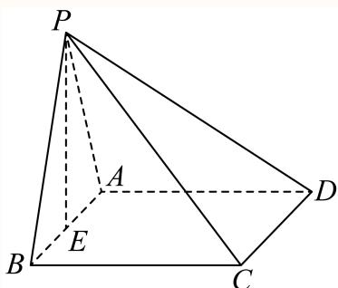

(2) 因为 $A B / / C D$

所以 $\angle P C D$ 即为异面直线PC和AB所成的角或其补角；

由（1）知平面 $P A B \bot$ 底面 $A B C D ,$ ，且平面 $P A B \cap$ 底面 $A B C D = A B$

在矩形 $A B C D$ 中， $C B \bot A B .$ ，所以 $C B \bot$ 平面 $P A B$

因为 $P B \subset { \overline { { 4 } } }$ 面 $P A B ,$ ，从而 $C B \bot P B$

Rt $\triangle P B C$ 中， $P B = B C = 3$ ，所以 $P C = 3 { \sqrt { 2 } } ,$

同理可得 $P D = 3 { \sqrt { 2 } } .$

$\triangle P C D$ 中， $P C = P D = 3 { \sqrt { 2 } } , C D = 4$

由余弦定理可得 $\langle \cos \angle P C D = \frac { P C ^ { 2 } + C D ^ { 2 } - P D ^ { 2 } } { 2 P C \cdot C D } = \frac { 1 8 + 1 6 - 1 8 } { 2 \times 3 \sqrt { 2 } \times 4 } = \frac { \sqrt { 2 } } { 3 } ,$

所以异面直线PC和AB所成角的余弦值为 $\frac { \sqrt { 2 } } { 3 }$

### 崇明 · 第17题

如图，在直三棱柱 $A B C - A _ { 1 } B _ { 1 } C _ { 1 }$ 中，E、F分别为 $A _ { 1 } C _ { 1 }$ 、BC的中点， $A A _ { 1 } = A B = B C = 2 \quad$ $C _ { 1 } F \bot A B .$

(1) (6分)求证： $C _ { 1 } F / /$ 平面ABE；
(2) (8分)求点C到平面ABE的距离.

> 本题资料或解析有待核事项，预览不可作为已审定成品。

**考点：** （1）中点构造线面平行；（2）等体积法求点面距离

**难度依据：** 涉及（1）中点构造线面平行；（2）等体积法求点面距离；难度为教师预估，需结合原题条件复核。

**核查说明：** 原解中G的中点位置及长度运算文字存在矛盾，须回核。；依据现有底稿归类，尚未逐页校卷、公式校净或独立数学终审。

【解析】

(1) 取AB中点G，连接 $F G , E G$ ，则 $F G / / A C$ • $F G = { \frac { 1 } { 2 } } A C .$

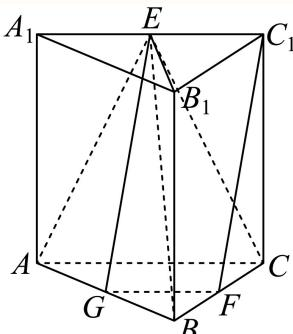

又 $C _ { 1 } E / / A C$ $C _ { 1 } E = { \frac { 1 } { 2 } } A C$ ，所以 $F G / / C _ { 1 } E$ ，且 $F G = C _ { 1 } E$

所以四边形 $F G E C _ { 1 }$ 是平行四边形，所以 $C _ { 1 } F / / E G$

又 $E G \subset$ 平面 $A B E$ $C _ { 1 } F \not \subset$ 平面ABE，所以 $C _ { 1 } F / /$ 平面 $A B E$ ；

(2) 由（1）点G是AC中点，连接 $E B _ { 1 }$

因为 $| C _ { 1 } C \bot$ 平面 $A B C , A B \subset { \overline { { \Psi } } } \widehat { \mathbb { H } } A B C .$ ，所以 $C _ { 1 } C \bot A B ,$

又 $C _ { 1 } F \bot A B ,$ ，且 $\begin{array} { r } { C _ { 1 } F \cap C _ { 1 } C = C _ { 1 } , C _ { 1 } F , C _ { 1 } C \subset  { \mathbb { T } }  { \mathbb { H } } B _ { 1 } C _ { 1 } C B , } \end{array}$

所以 $A B \bot$ 平面 $B _ { 1 } C _ { 1 } C B$ $B C \subset$ 平面 $B _ { 1 } C _ { 1 } C B _ { 3 }$ ，所 $\complement B \bot A B .$

所以 $S _ { \triangle A B C } = \frac { 1 } { 2 } \times 2 \times 2 = 2 , A _ { 1 } E = \frac { 1 } { 2 } A _ { 1 } C _ { 1 } = \frac { 1 } { 2 } \sqrt { A A _ { 1 } ^ { 2 } + A _ { 1 } C _ { 1 } ^ { 2 } } = \frac { 1 } { 2 } \sqrt { 2 ^ { 2 } + 2 ^ { 2 } } = \sqrt { 2 } ,$

$$
B _ {1} E = \sqrt {2},
$$

$$
A E = \sqrt {A A _ {1} ^ {2} + A _ {1} E ^ {2}} = \sqrt {6}, B E = \sqrt {B B _ {1} ^ {2} + B _ {1} E ^ {2}} = \sqrt {4 + 1} = \sqrt {6},
$$

所以 $\triangle A B E$ 为等腰三角形，则 $E G \bot A B ,$ ，且 $E G = { \sqrt { A E ^ { 2 } - A G ^ { 2 } } } = { \sqrt { 5 } } ,$

所以 $S _ { \triangle A B E } = \frac { 1 } { 2 } A B \cdot E G = \sqrt { 5 } ,$

设点C到平面ABE的距离为h，由 $V _ { C - A B E } = V _ { E - A B C }$ 得 $\frac { 1 } { 3 } S _ { \triangle A B E } \cdot h = \frac { 1 } { 3 } S _ { \triangle A B C } \cdot A A _ { 1 }$

所以 $\frac { 1 } { 3 } \times \sqrt { 5 } h = \frac { 1 } { 3 } \times 2 \times 2$ ，所以 $h = { \frac { 4 { \sqrt { 5 } } } { 5 } }$ 即点 到平面 的距离为 $\frac { 4 { \sqrt { 5 } } } { 5 }$

### 徐汇 · 第18题

如图，在四棱锥 $P - A B C D$ 中， $A D / / B C , \angle A D C = \angle P A B = \frac { \pi } { 2 } , B C = C D = \frac { 1 } { 2 } A D$ .E为棱AD的中点，异面直线PA与CD所成角的大小为 $\frac { \pi } { 2 }$

(1) (6分)求证： $C D / { \bar { \lambda } }$ 平面PBE；
(2) (8分)若二面角 $P - C D - A$ 的大小为 $\frac { \pi } { 4 }$ ，求直线PA与平面PCE所成角的正弦值.

> 本题资料或解析有待核事项，预览不可作为已审定成品。

**考点：** （1）中点与线面平行判定；（2）二面角转线面角

**难度依据：** 线面平行与二面角及线面角；空间法向量求线面角；按所需步骤与推理量估计

**核查说明：** 题干与解析已用于人工归类，尚未完成整题公式校净与独立数学终审。

【解析】

(1) 因为 $A D / / B C , B C = \frac { 1 } { 2 } A D$ ,E为棱AD的中点，

所以 $B C / / E D$ 且 $B C = E D$ ，所以四边形BCDE是平行四边形.

所以 $C D / / B E$ ，又 $B E \subset$ 平面 $P B E , C D$ 不在平面PBE上，

由线面平行的判定定理知， $C D / /$ 平面PBE.

(2) 解法一：因为 $\angle P A B = { \frac { \pi } { 2 } }$ ，即 $P A \bot A B ,$ ，且异面直线PA与CD所成的角为 $\frac { \pi } { 2 }$ ，即 $P A \bot C D$ ，

又 $A B \cap C D = M , A B , C D \subset \exists \overrightarrow { \mathbb { E } } \overrightarrow { \mathbb { E } } \overrightarrow { \mathbb { E } } A B C D , A P \perp$ 平面 $A B C D$

又 $C D \bot A D$ ，由三垂线定理可得 $C D \bot P D$

因此 $\angle P D A$ 是二面角 $P - C D - A$ 的平面角， $\angle P D A = { \frac { \pi } { 4 } }$ ，所以 $P A = A D$

不妨设 $A D = 2 a$ ，则 $B C = C D = { \frac { 1 } { 2 } } A D = a .$

以A为坐标原点，平行于CD的直线为x轴，AD所在直线为y轴，AP所在直线为z轴，

建立如图所示的空间直角坐标系，

所以 $P \left( 0 , 0 , 2 a \right) , E \left( 0 , a , 0 \right) , C \left( - a , 2 a , 0 \right)$ ，（其 $\# a > 0 )$ )，

则 $| \overrightarrow { E C } = ( - a , a , 0 ) , \overrightarrow { P E } = ( 0 , a , - 2 a ) , \overrightarrow { A P } = ( 0 , 0 , 2 a )$

设平面PCE的一个法向量为 $\vec { \mid n } = ( x , y , z )$

则 $\left\{ { \begin{array} { l } { { \vec { n } } \cdot { \overrightarrow { P E } } = 0 } \\ { { \vec { n } } \cdot { \overrightarrow { E C } } = 0 } \end{array} } \right. ,$ 可得 $\left\{ { \begin{array} { l } { y - 2 z = 0 } \\ { - x + y = 0 } \end{array} } \right.$

令y = 2，则 $x = 2 , z = 1$ ，可 $\stackrel {  } { \uparrow } \stackrel {  } { \vec { \cdot } } \vec { n } = ( 2 , 2 , 1 )$

设直线PA与平面PCE所成角为θ，

AP ⋅ n → 2 1 则sin θ = cos = = = 3 × 2 3 AP →n

即直线 $P A {  }$ 平面PCE所成角的正弦值为 $\frac 1 3$

解法二：过A作 $A H \bot C E$ ，交CE的延长线于H，连接PH，

由（1）知： $C D / / B E$

因为 $P A \bot C D$ ，所以 $P A \bot B E$

因为 $\angle A D C = \angle P A B = { \frac { \pi } { 2 } }$ ，即 $P A \bot A B$

又 $A B \cap B E = B , A B , B E \subset$ 平面 $A B C D$ ，所以 $P A \bot$ 平面 $A B C D$

因为 $C E \subset$ 平面 $A B C D$ ，所以 $P A \bot C E$

又AH是PH在平面 $A B C D$ 上的射影，由三垂线定理知， $P H \bot C E$

又 $P A \cap P H = P$ ，所以 $C E \bot$ 平面 $P A H$

再过A作 $A I \bot P H$ ，交 $P H \mp I$

因为 $C E \bot$ 平面 $P A H , A I \subset$ 平面 $P A H$ ，所以 $A I \bot C E$

又 $P H \cap C E = H .$ ，所以 $A I \perp$ 平面 $P C E$ ，所以 $\angle A P I$ 即为直线PA与平面PCE的所成角，

因为 $^ { \prime } C D \bot A D , P A \bot$ 平面 $A B C D$ ，由三垂线定理 $C D \bot P D$

因此 $\angle P D A$ 是二面角 $P - C D - A$ 的平面角， $\angle P D A = { \frac { \pi } { 4 } }$

设 $B C = C D = { \frac { 1 } { 2 } } A D = x \left( x > 0 \right)$ ，则 $A D = P A = 2 x$

因为 $B C = C D , C D \bot A D .$ ,所以四边形BCDE为正方形，

所以 $\angle C E D = \angle A E H = { \frac { \pi } { 4 } }$

所以 $A H = { \frac { \sqrt { 2 } } { 2 } } x$ ，所以 $\tan \angle A P I = \tan \angle A P H = { \frac { A H } { P A } } = { \frac { { \frac { { \sqrt { 2 } } } { 2 } } x } { 2 x } } = { \frac { \sqrt { 2 } } { 4 } }$

所以 $\sin \angle A P I = { \frac { 1 } { 3 } }$

即直线 $P A -$ 与平面PCE所成角的正弦值为 $\frac 1 3$

### 普陀 · 第17题

图1所示的平行四边形ABCD中， $C A = C B = 1 , \ C D = { \sqrt { 2 } }$ 现将 $\triangle D A C$ 沿AC折起，得到如图2所示的三棱锥 $P - A B C$ ，记棱PC的中点为M，且. $. P B = { \sqrt { 3 } }$

图1

图2
(1) (6分)求证： $A M \bot B C$ ；
(2) (8分)记棱AB的中点为E，在直线CE上作出点N，使得 $P N / /$ 平面MAB，请说明理由，并求出二面角 $P - N B - A$ 的大小.

> 本题资料或解析有待核事项，预览不可作为已审定成品。

**考点：** （1）勾股与线面垂直传递；（2）构造矩形顶点给出点N并找二面角平面角

**难度依据：** （1）勾股与线面垂直传递；（2）构造矩形顶点给出点N并找二面角平面角

**核查说明：** 题干与解析已用于人工归类，尚未完成整题公式校净与独立数学终审。

【解析】

(1) 因为 $C A = C B = D A = 1$ $C D = A B = { \sqrt { 2 } }$

$$
C A ^ {2} + C B ^ {2} = A B ^ {2} = 2,
$$

所 $\angle A C B = 9 0 ^ { \circ }$ ，所以 $\angle D A C = 9 0 ^ { \circ }$ ，即 $D A \bot A C , B C \bot C A$

图2中， $P A = D A = 1 , A B = \sqrt { 2 } , P B = \sqrt { 3 } ,$

则 $P A ^ { 2 } + A B ^ { 2 } = P B ^ { 2 } = 3$ ,所以 $P A \bot A B .$ ，又 $P A \bot A C$

又 $A B , A C$ 为平面ABC内两条相交直线，

所以 $P A \bot$ 面 $A B C ,$ ，又BC在面 $A B C$

所以 $P A \bot B C$ 又 $B C \bot C A$

PA,CA为平面PAC内两条相交直线，

所以 $B C \bot$ 面 $P A C ,$ ，又AM在面PAC内，

所以 $A M \bot B C$

(2)

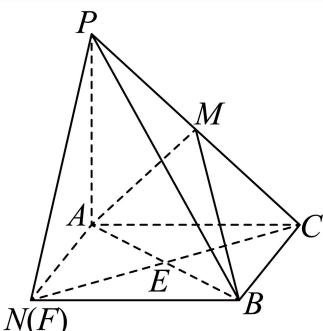

N(F)

以 $C A , C B$ 为临边，构造矩形 $A C B F$ ,连接 $C F ,$ ，易知过点 $E _ { : }$ ，

因为 $E , M$ 分别为 $\lceil C F , C P$ 的中点，

所以 $P F / / M E$ ，又ME在平面 $M A B ^ { \flat }$ 内，PF在平面 $M A B _ { , } ^ { \prime }$ 外，所以 $P F / /$ 平面 $M A B$ 4

即点F就是N点，

由（1）知 $P A \bot$ 面 $A C B N$ ，BN在面ACBN内，

所以 $B N \bot P A$ ，又 $B N \bot A N$

AN,PA是平面 $P A N$ 内两条相交直线，

所以 $B N \bot$ 面 $P A N$ ，PN在面 $P A N |$ 内，

所以 $P N \bot B N ,$ ，又 $A N \bot B N$

所以 $\angle P N A$ 为二面角 $P - N B - A$ 的平面角，

因为 $P A \bot A N , P A = A N .$

所以 $\angle P N A = 4 5 ^ { \circ }$ 。

所以二面角 $P - N B - A$ 的大小为 $4 5 ^ { \circ }$ .

### 杨浦 · 第17题

如图，在正方体 $A B C D - A _ { 1 } B _ { 1 } C _ { 1 } D _ { 1 }$ 中，点E、F分别是棱AB、BC的中点.

(1) (6分)求证： $E F \bot B D _ { 1 }$ ；
(2) (8分)求二面角 $B _ { 1 } - E F - B$ 的大小.

> 本题资料或解析有待核事项，预览不可作为已审定成品。

**考点：** （1）正方体线线垂直；（2）二面角

**难度依据：** 正方体垂直与二面角；向量证明垂直；按所需步骤与推理量估计

**核查说明：** 题干与解析已用于人工归类，尚未完成整题公式校净与独立数学终审。

【解析】

(1) 如图所示，连接AC，BD， $B _ { 1 } D _ { 1 }$ ，

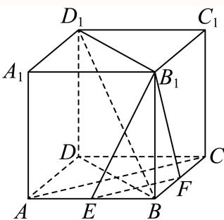

由 $1 B C D - A _ { 1 } B _ { 1 } C _ { 1 } D _ { 1 }$ 为正方体，

可知 $A C \bot B D$ • $D D _ { 1 \perp }$ 平面 $A B C D$ ，又∵ $E F \subset$ 平面 $A B C D$

$$
\therefore D D _ {1} \perp E F,
$$

$\because E , \ F$ 分别为AB，BC中点，

$$
\therefore E F \parallel A C, \therefore E F \perp B D,
$$

$\because B D \cap D D _ { 1 } = D ,$ ，且BD， $D D _ { 1 } \subset$ 平面 $B D D _ { 1 } B _ { 1 }$

$\therefore E F \bot$ 平面 $B D D _ { 1 } B _ { 1 }$ ，

$\because B D _ { 1 } \subset$ 平面 $B D D _ { 1 } B _ { 1 }$ ，

$\therefore E F \bot B D _ { 1 }$ ；

(2) 设正方体 $A B C D - A _ { 1 } B _ { 1 } C _ { 1 } D _ { 1 }$ 棱长为4，

法一：

如图所示，设 $E F \cap B D = M$ ，连接 $B _ { 1 } M$

由（1）得 $E F \bot$ 平面 $B D D _ { 1 } B _ { 1 }$ ，

$\because B M , B _ { 1 } M \subset$ 平面 $B D D _ { 1 } B _ { 1 }$

$$
\therefore B M \perp E F, B _ {1} M \perp E F,
$$

∴二面角 $B _ { 1 } - E F -$ B的平面角即为 $\angle B _ { 1 } M B$

又 $B B _ { 1 } \bot B M _ { \cdot }$

在Rt $\triangle B B _ { 1 }$ M中， $B M = \frac { 1 } { 4 } B D = \frac { 1 } { 4 } \sqrt { A B ^ { 2 } + A D ^ { 2 } } = \sqrt { 2 } , B B _ { 1 } = 4 ,$

所以 $B _ { 1 } M = \sqrt { B _ { 1 } B ^ { 2 } + B M ^ { 2 } } = \sqrt { 4 ^ { 2 } + \sqrt { 2 } ^ { 2 } } = 3 \sqrt { 2 } ,$ ，所以 $\cos \angle B _ { 1 } M B = \frac { B M } { B _ { 1 } M } = \frac { 1 } { 3 }$

所以二面角 $B _ { 1 } - E F$ −B的余弦值为 $\frac 1 3$ ，即二面角 $B _ { 1 } - E F -$ B的大小为 $\operatorname { a r c c o s } { \frac { 1 } { 3 } }$ ；

法二：

如图所示，以点D为坐标原点，DA，DC， $D D _ { 1 }$ 方向分别为x轴，y轴，z轴建立空间直角坐标系 $D - x y z$

则B (4, 4, 0)，E (4, 2, 0)，F (2, 4, 0)， $B _ { 1 } \left( 4 , 4 , 4 \right)$ ，

即 $| \overrightarrow { E F } = ( - 2 , 2 , 0 ) , \overrightarrow { E B _ { 1 } } = ( 0 , 2 , 4 )$

设平面 $B _ { 1 } E F$ 的法向 $\stackrel { \triangledown } { \equiv } \vec { n } = ( x , y , z )$ ，则 $\left\{ \begin{array} { l } { \overrightarrow { E F } \bot \overrightarrow { n } } \\ { \overrightarrow { E B _ { 1 } } \bot \overrightarrow { n } } \end{array} \right. ,$ 则 $\left\{ { \begin{array} { l } { { \overrightarrow { E F } } \cdot { \overrightarrow { n } } = - 2 x + 2 y = 0 } \\ { { \overrightarrow { E B _ { 1 } } } \cdot { \overrightarrow { n } } = 2 y + 4 z = 0 } \end{array} } \right.$

令 $z = - 1$ ，则 $\vec { | n } = ( 2 , 2 , - 1 )$

易知平面 $B E F$ 的一个法向量为 $\overrightarrow { m } = \overrightarrow { B B _ { 1 } } = ( 0 , 0 , 4 )$

$$
\therefore \cos \left\langle \overrightarrow {n}, \overrightarrow {m} \right\rangle = \frac {\overrightarrow {n} \cdot \overrightarrow {m}}{\left| \overrightarrow {n} \right| \cdot \left| \overrightarrow {m} \right|} = \frac {- 4}{\sqrt {2 ^ {2} + 2 ^ {2} + (- 1) ^ {2}} \cdot 4} = - \frac {1}{3},
$$

∵二面角 $B _ { 1 } - E F - B$ 为锐二面角，

∴二面角 $B _ { 1 } - E F -$ B的余弦值为 $\frac 1 3$ ，

即二面角 $B _ { 1 } - E F - B$ 的大小为 $\operatorname { a r c c o s } { \frac { 1 } { 3 } }$

### 松江 · 第18题

如图，已知AB⊥平面ACD，AB∥DE， $\triangle A C D$ 为等边三角形， $A D = D E = 2 A B$ ，F为CD的中点

（1）求证：AF∥平面BCE；
（2）求直线AD和平面BCE所成角的正弦值

> 本题资料或解析有待核事项，预览不可作为已审定成品。

**考点：** （1）中点连线与线面平行；（2）空间向量求线面角

**难度依据：** 线面平行及线面角；空间法向量；按所需步骤与推理量估计

**核查说明：** 题干与解析已用于人工归类，尚未完成整题公式校净与独立数学终审。

【解析】

（1）取CE的中点M，证明四边形BMFA为平行四边形，然后得：AF∥BM，进而得出答案.

（2）要求直线AD和平面BCE所成角的正弦值，通过建立空间直角坐标系，用向量法即可得出答案.

（1）取CE的中点M，连接BM,FM，因为 F为CD的中点.所以 $F M \| D E$ ，且 $F M = { \frac { 1 } { 2 } } D E$ 又因为 $A B \| D E$ ，AD = DE = 2AB，所以 $F M \| A B$ ，且 $F M = A B$

故四边形BMFA为平行四边形.所以AF∥BM

又因为 $B M \subset { \overline { { \Psi } } } { \overline { { \mathbb { H } } } } B C E$ ， AF ⊄平面BCE.

所以AF∥平面BCE.

（2）因为 $A B \bot$ 平面ACD， $\triangle A C D$ 为等边三角形.

以A为坐标原点，建立空间直角坐标系，如下图所示.

设 $A D = D E = 2 A B = 2 a$ ，

则A(0, 0, 0) ，D(0, 2a, 0)，E(0, 2a, 2a)，B(0, 0, a)，C (√3a, a, 0)

则 $\stackrel { \longrightarrow } { | A D } = ( 0 , 2 a , 0 )$ $\overrightarrow { B C } = \left( \sqrt { 3 } a , a , - a \right) , \overrightarrow { B E } = ( 0 , 2 a , a )$

设平面BCE的法向量为 $\vec { \Xi } = ( x , y , z )$ ，则

$$
\left\{ \begin{array}{l} \overrightarrow {n} \cdot \overrightarrow {B C} = 0 \\ \overrightarrow {n} \cdot \overrightarrow {B E} = 0 \end{array} \right.
$$

令 $y = 1$ ，得： $z = - 2 , x = - \sqrt { 3 }$ ，所 $\overrightarrow { \vert n } = \left( - \sqrt { 3 } , 1 , - 2 \right)$

设直线AD和平面BCE所成角为θ，则 $\sin \theta = { \frac { \left| { \overrightarrow { n } } \cdot { \overrightarrow { A D } } \right| } { \left| { \overrightarrow { n } } \right| \cdot \left| { \overrightarrow { A D } } \right| } } = { \frac { 2 a } { 2 a \times 2 { \sqrt { 2 } } } } = { \frac { \sqrt { 2 } } { 4 } }$

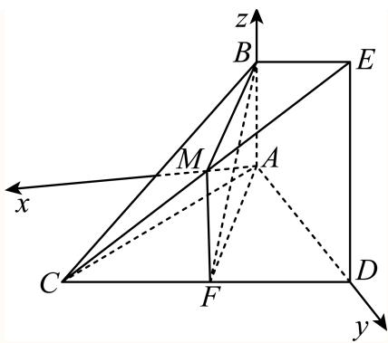

本题主要考查直线与平面平行及直线与平面所成角的知识，属于中档题目.

### 虹口 · 第9题

如图，已知正三角形ABC和正方形BCDE的边长均为2，且二面角 $A - B C - D$ 的大小为 $\frac { \pi } { 6 }$ ，则${ \overrightarrow { A C } } . { \overrightarrow { B D } } =$

**考点：** 二面角与空间向量数量积

**难度依据：** 涉及二面角与空间向量数量积；难度为教师预估，需结合原题条件复核。

**核查说明：** 依据现有底稿归类，尚未逐页校卷、公式校净或独立数学终审。

【答案】−1.

【解析】

设 $F , G$ 分别为 $B C , D E$ 的中点，连接 $A F , F G ,$ ，分析可得 $\angle A F G$ 为二面角 $A - B C - D$ 的平面角，进而结合空间向量的线性运算及数量积求解即可

设 $F , G$ 分别为BC,DE的中点，连接 $A F , F G$

在正三角形ABC中， $A { \cal F } \bot B { \cal C } , A { \cal F } = \sqrt { 3 } .$

在正方形BCDE中， $F G / / C D , F G \bot B C , F G = C D = 2$

所以 $\angle A F G$ 为二面角 $A - B C - D$ 的平面角，即 $\angle A F G = { \frac { \pi } { 6 } }$

$$
\overrightarrow {A C} \cdot \overrightarrow {B D} = \left(\overrightarrow {A F} + \overrightarrow {F C}\right) \cdot \left(\overrightarrow {B C} + \overrightarrow {C D}\right) = \left(\overrightarrow {A F} + \frac {1}{2} \overrightarrow {B C}\right) \cdot \left(\overrightarrow {B C} + \overrightarrow {F G}\right)
$$

$$
\overrightarrow {A F} \cdot \overrightarrow {B C} + \overrightarrow {A F} \cdot \overrightarrow {F G} + \frac {1}{2} \overrightarrow {B C} ^ {2} + \frac {1}{2} \overrightarrow {B C} \cdot \overrightarrow {F G} = \sqrt {3} \times 2 \times \left(- \cos \frac {\pi}{6}\right) + \frac {1}{2} \times 2 ^ {2} = - 1.
$$

故答案为：−1.

### 虹口 · 第18题

如图，已知在四棱柱 $A B C D - E F G H$ 中，EA⊥平面ABCD，N、M分别是EF、HD的中点

(1) (6分)求证： $H N / /$ 平面AFM；
(2) (8分)若底面ABCD为梯形， $A B / / C D , A B = E A = 2 , A D = D C = 1$ ，异面直线AB与EH所 成角为 $\frac { \pi } { 2 }$ ．求直线 $A N ^ { I }$ 与平面AFM所成角的正弦值

**考点：** （1）中点构造平行；（2）空间坐标求线面角

**难度依据：** 涉及（1）中点构造平行；（2）空间坐标求线面角；难度为教师预估，需结合原题条件复核。

**核查说明：** 依据现有底稿归类，尚未逐页校卷、公式校净或独立数学终审。

【解析】

(1) 连接BE交AF于点O，连接ON，OM，

在四棱柱 $A B C D - E F G H \uparrow$ ，四边形ABFE，ADHE为平行四边形，所以O为AF的中点，

又N、M分别是EF、HD的中点，

所以 $. O N / / A .$ E且 $O N = { \frac { 1 } { 2 } } A E$ $H M / / A E$ 且 $H M = { \frac { 1 } { 2 } } A E$

所以 $O N / / H M$ 且 $O N = H M$ ，所以四边形ONHM为平行四边形，

所以 $H N / / O M$ ，又HN ⊄平面AFM， $O M \subset$ 平面AFM，所以 $H N / /$ 平面 $A F M$ ；

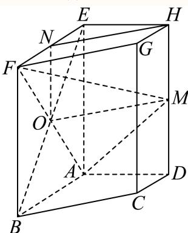

(2) 因为异面直线 $A B  E H$ 所成角为 $\frac { \pi } { 2 }$ ，又 $A D / / E H$

所以 $\angle B A D$ 即为异面直线AB与EH所成角，即 $\angle B A D = \frac { \pi } { 2 }$ ，即 $| A B \bot A D$ $\zeta E A \bot$ 平面 $A B C D$

如图建立空间直角坐标系，则A (0, 0, 0)，N (1, 0, 2)，F (2, 0, 2)，M (0, 1, 1)，

所以 $\stackrel {  } { A N } = ( 1 , 0 , 2 )$ 9 $\stackrel {  } { A F } = ( 2 , 0 , 2 )$ $\stackrel { \longrightarrow } { A M } = ( 0 , 1 , 1 )$

设平面AFM的法向量为 $\vec { n } = ( x , y , z )$ ，则 $\left\{ { \begin{array} { l } { { \vec { n } } \cdot { \overrightarrow { A F } } = 2 x + 2 z = 0 } \\ { { \vec { n } } \cdot { \overrightarrow { A M } } = y + z = 0 } \end{array} } \right.$ ， $\overrightarrow { \chi _ { n } } = \left( 1 , 1 , - 1 \right)$

设直线AN与平面AFM所成角为θ，则 $\sin \theta = { \frac { \left| { \overrightarrow { A N } } \cdot { \overrightarrow { n } } \right| } { \left| { \overrightarrow { A N } } \right| \cdot \left| { \overrightarrow { n } } \right| } } = { \frac { 1 } { { \sqrt { 3 } } \times { \sqrt { 5 } } } } = { \frac { \sqrt { 1 5 } } { 1 5 } } .$ 所以直线AN与平面AFM所成角的正弦值为 $\frac { \sqrt { 1 5 } } { 1 5 }$

### 金山 · 第18题

如图，在四棱锥 $P - A B C D$ 中，底面ABCD是直角梯形， $\angle B A D = \angle C D A = 9 0 ^ { \circ }$ $P A \bot$ 平面$A B C D$ ，Q是PB的中点， $P A = A D = D C = 1 , A B = 2$

(1) (6分)证明： $C Q / /$ 平面 $P A D$
(2) (8分)求点D到平面PAC的距离

**考点：** （1）中点构造线面平行；（2）等体积法求点面距离

**难度依据：** 涉及（1）中点构造线面平行；（2）等体积法求点面距离；难度为教师预估，需结合原题条件复核。

**核查说明：** 依据现有底稿归类，尚未逐页校卷、公式校净或独立数学终审。

【解析】

(1) 取PA的中点T，连接 $D T , T Q$

因为 $\angle B A D = \angle C D A = 9 0 ^ { \circ }$ ，所以 $A B / / D C , ~ A B = 2 , ~ A D = 1$

因为 $\Gamma T , Q$ 分别是 $P A , P B$ 中点，得出 ${ ^ { 1 } T Q } / / { A B } / / D C , T Q = { \frac { 1 } { 2 } } A B = D C ,$

所以四边形 $D C Q T$ 是平行四边形，所以 $D T / / C Q$

$D T \subset$ 平面 $P A D , \ C Q \ \mathcal { L }$ 平面 $P A D .$ ，所以 $C Q / /$ 平面 $P A D$ ；

(2) $\angle C D A = 9 0 ^ { \circ }$ $A C = { \sqrt { A D ^ { 2 } + D C ^ { 2 } } } = { \sqrt { 2 } } ,$

$P A \bot$ 平面 $A B C D , A D , A C \subset$ 平面 $A B C D$ ，则 $P A \bot A D , P A \bot A C$

$$
S _ {\triangle P A C} = \frac {1}{2} | A C | \times | P A | = \frac {1}{2} \times \sqrt {2} \times 1 = \frac {\sqrt {2}}{2}, S _ {\triangle A C D} = \frac {1}{2} \times | D C | \times | A D | = \frac {1}{2},
$$

设点D到平面PAC的距离为 $^ { \dag , } d ,$ ，由 $V _ { D - P A C } = V _ { P - A C D }$ ，得 $\frac { 1 } { 3 } S _ { \triangle P A C } \times d = \frac { 1 } { 3 } S _ { \triangle A C D } \times | P A |$

${ \frac { 1 } { 3 } } \times { \frac { \sqrt { 2 } } { 2 } } \times d = { \frac { 1 } { 3 } } \times { \frac { 1 } { 2 } } \times 1$ ，得 $d = { \frac { \sqrt { 2 } } { 2 } }$

所以点D到平面PAC的距离为 $\frac { \sqrt { 2 } } { 2 }$

### 长宁 · 第18题

如图所示，四棱柱 $A B C D - A _ { 1 } B _ { 1 } C _ { 1 } D _ { 1 }$ 1的底面ABCD是正方形，O是底面的中心， $A _ { 1 } O \bot$ 平面$A B C D , A B = A A _ { 1 } = { \sqrt { 2 } }$

(1) (6分)求证： $A _ { 1 } C \bot$ 平面 $B D D _ { 1 } B _ { 1 }$ ；
(2) (8分)求直线 $O A _ { 1 }$ 1与平面 $A A _ { 1 } B$ 所成角的正弦值

> 本题资料或解析有待核事项，预览不可作为已审定成品。

**考点：** （1）证明线面垂直；（2）空间向量或体积法求线面角

**难度依据：** 棱柱线面垂直与线面角；（1）证明线面垂直；（2）空间向量或体积法求线面角

**核查说明：** 仅修复所列OCR公式及其定界符错位；原解数学疑点和其他可渲染错识未因此消除。

【解析】

(1) 因为ABCD是正方形，所以 $A C \bot B D , O A = O C = 1$

因为 $A _ { 1 } O _ { - }$ ⊥底面 $A B C D$

所以 $A _ { 1 } O \bot B D$ ，又 $A _ { 1 } O \cap A C = O , A _ { 1 } O , A C$ 在平面 $A A _ { 1 } C \mathbb { N }$

所以 $B D \perp$ 平面 $A A _ { 1 } C , A _ { 1 } C$ 在平面 $A A _ { 1 } C \mathbb { N }$

所以 $B D \bot A _ { 1 } C$

由 $A A _ { 1 } = \sqrt { 2 } , O A = O C = 1 , A _ { 1 } O \bot$ 底面 $A B C D$

可得 $A _ { 1 } O = 1 , A _ { 1 } C = { \sqrt { 2 } }$

所以 $A A _ { 1 } ^ { 2 } + A _ { 1 } C ^ { 2 } = A C ^ { 2 }$ ，即有 $A A _ { 1 } \bot A _ { 1 } C ,$

因为 $A A _ { 1 } / / B B _ { 1 }$ ，所以 $B B _ { 1 } \bot A _ { 1 } C$

$B B _ { 1 }$ 和 $B D '$ 在平面 $B D D _ { 1 } B _ { 1 }$ 内，且 $B B _ { 1 } \cap B D = B$

所以 $A _ { 1 } C \bot$ 平面 $B D D _ { 1 } B _ { 1 }$

(2) 方法1：设点O到平面 $A A _ { 1 }$ B的距离为h，

$$
V _ {O - A _ {1} A B} = \frac {1}{3} \cdot S _ {A O B} \cdot O A _ {1} = \frac {1}{3} \cdot S _ {A A _ {1} B} \cdot h
$$

由题可知 $| O A _ { 1 } = 1 , S _ { A O B } = { \frac { 1 } { 2 } } , S _ { A A 1 B } = { \frac { 1 } { 2 } } \times { \sqrt { 2 } } \times { \sqrt { 2 } } \times { \frac { \sqrt { 3 } } { 2 } } = { \frac { \sqrt { 3 } } { 2 } }$

所以 $h = { \frac { 1 \times 1 } { \sqrt { 3 } } } = { \frac { \sqrt { 3 } } { 3 } }$

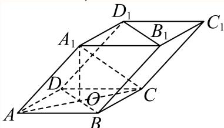

得直线 $O A _ { 1 }$ 与平面 $A A _ { 1 } B$ 所成角θ的正弦值sin $\theta = \frac { h } { O A _ { 1 } } = \frac { \sqrt { 3 } } { 3 }$

方法2：（建系）

以O为原点，射线 $; O A , ~ O B , ~ O A _ { 1 }$ 为x轴、y轴、z轴的正半轴，建立空间直角坐标系

可得 $A \left( 1 , 0 , 0 \right) , B \left( 0 , 1 , 0 \right) , A _ { 1 } \left( 0 , 0 , 1 \right)$

则 $\overrightarrow { \vert O A _ { 1 } } = ( 0 , 0 , 1 ) , \overrightarrow { A A _ { 1 } } = ( - 1 , 0 , 1 ) , \overrightarrow { A B } = ( - 1 , 1 , 0 )$

设平面 $A A _ { 1 }$ B的一个法向量为 $\vec { n } = ( x , y , z )$ 1

则 $\begin{cases}\vec n\cdot\overrightarrow{AA_1}=-x+z=0,\\\vec n\cdot\overrightarrow{AB}=-x+y=0.\end{cases}$ 令 $x = 1$ 可得 ${ \vec { n } } = ( 1 , 1 , 1 )$

直线 $; O A _ { 1 }$ 与平面 $A A _ { 1 } I$ B所成角θ的正弦值等于向量 $\overrightarrow { O A _ { 1 } }$ 与平面法向量→n的夹角余弦值的绝对

$$
\sin \theta = | \cos \left\langle \overrightarrow {O A _ {1}}, \overrightarrow {n} \right\rangle | = \left| \frac {\overrightarrow {O A _ {1}} \cdot \overrightarrow {n}}{| \overrightarrow {O A _ {1}} | \cdot | \overrightarrow {n} |} \right| = \frac {1}{\sqrt {3}} = \frac {\sqrt {3}}{3}.
$$

### 闵行 · 第17题

在直三棱柱 $A B C - A _ { 1 } B _ { 1 } C _ { 1 }$ 中，AB = AC = 2， $A A _ { 1 } = 3$ $\angle B A C = 9 0 ^ { \circ }$ ，连接 $A _ { 1 } C _ { : }$ ，M、E分别为 $A _ { 1 } C$ 和BC的中点

(1) (6分)证明：直线 $E M / /$ 平面 $A _ { 1 } A B B _ { 1 }$ ；
(2) (8分)求二面角 $A _ { 1 } - B C - A$ 的大小

**考点：** （1）中位线证明线面平行；（2）空间法向量求二面角

**难度依据：** 棱柱线面平行与二面角；（1）中位线证明线面平行；（2）空间法向量求二面角

【解析】

(1) 证明：如图所示：

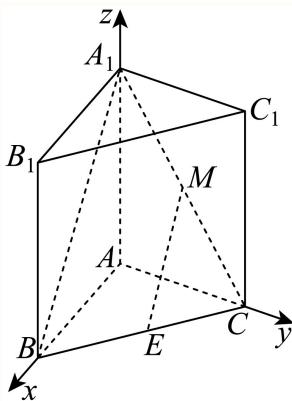

连接 $A _ { 1 } B ,$ 因为M、E分别为 $A _ { 1 } C$ 和BC的中点，

所以 $A _ { 1 } B / / M E$ ，又 $A _ { 1 } B$ ⊂平面 $A _ { 1 } A B B _ { 1 }$ 1 $M E \notin$ 平面 $A _ { 1 } A B B _ { 1 }$

所以直线 $E M / / { \vec { \cdot } } $ 面 $A _ { 1 } A B B _ { 1 }$ ；

(2) 建立如图所示空间直角坐标系，

则 $\left| A _ { 1 } ( 0 , 0 , 3 ) , B ( 2 , 0 , 0 ) , C ( 0 , 2 , 0 ) \right.$

所以 $\overrightarrow { \cdot B C } = ( - 2 , 2 , 0 ) , \overrightarrow { B A _ { 1 } } = ( - 2 , 0 , 3 ) ,$

设平面 $A _ { 1 } B C$ 的一个法向量为 $\vec { m } = ( x , y , z )$

$\left\{ \begin{array} { l l } { \overrightarrow { B C } \cdot \overrightarrow { m } = 0 } \\ { \overrightarrow { B A _ { 1 } } \cdot \overrightarrow { m } = 0 } \end{array} \right.$ ，即 $\left\{ { \begin{array} { l } { - 2 x + 2 y = 0 } \\ { - 2 x + 3 z = 0 } \end{array} } \right.$

令 $x = 1$ ，得 $y = 1 , z = \frac { 2 } { 3 }$ ，则 ${ \vec { m } } = \left( 1 , 1 , { \frac { 2 } { 3 } } \right)$

易知平面ABC的一个法向量为： $\stackrel {  } { n } = ( 0 , 0 , 1 )$ ，

设二面角 $A _ { 1 } - B C - A$ 的大小为θ，

→m ⋅→n √22 则 cos θ = cos ⟨→m,→n⟩ = →m ⋅ →n 11

二面角 $A _ { 1 } - B C - A$ 的大小为 $\operatorname { a r c c o s } { \frac { \sqrt { 2 2 } } { 1 1 } }$ .

### 静安 · 第15题

我国古代数学著作《九章算术》中将四个面都是直角三角形的空间四面体叫做“鳖臑”.如图是一个水平放置的 $\triangle A B C , C D \bot A B , \angle A = 3 0 ^ { \circ } , \angle B = 4 5 ^ { \circ }$ .现将 $\begin{array} { r } { \mathrm { R t } \triangle A C D \dot { \% } C D } \end{array}$ 折起，使点A移动到点A′，使得空间四面体A′BCD恰好是一个“鳖臑”，则二面角A′ −CD−B的大小为（ ）

A. $6 0 ^ { \circ }$

B. $9 0 ^ { \circ }$

C. $\arctan 2$

D. $\operatorname { a r c c o s } { \frac { \sqrt { 3 } } { 3 } }$

**考点：** 利用各面直角约束分类求二面角

**难度依据：** 四面体折叠与二面角；利用各面直角约束分类求二面角

【答案】D

【解析】

设CD = 1，根据题意求出四面体的棱长，二面角A′ −CD−B的平面角为 $\angle A ^ { \prime } D B$ ，求 $\angle A ^ { \prime } D B$ 的三角函数值即可.

$\triangle A B C$ 中， $C D \bot A B , \angle A = 3 0 ^ { \circ } , \angle B = 4 5 ^ { \circ }$

不妨设 $C D = 1$ ，则 $B D = 1 , B C = \sqrt { 2 } , A D = \sqrt { 3 } , A C = 2$

空间四面体 $A ^ { \prime } B C D$ 是一个“鳖臑”，则 $\triangle A ^ { \prime } B C$ 和 $| \triangle A ^ { \prime } B D$ 都是直角三角形，

若 $A ^ { \prime } B > A ^ { \prime } D$ ，则 $\mathrm { R t } \triangle A ^ { \prime } B D ^ { \scriptscriptstyle | }$ 中， $\angle A ^ { \prime } D B = 9 0 ^ { \circ }$ ，由勾股定理得 $A ^ { \prime } B = 2$

此时 $\triangle A ^ { \prime } B C$ 不是直角三角形，不合题意；

所以 $A ^ { \prime } B < A ^ { \prime } D ,$ ，在 $\mathrm { R t } \triangle A ^ { \prime } B D ^ { \scriptscriptstyle 1 }$ 中， $\angle A ^ { \prime } B D = 9 0 ^ { \circ }$ ，由勾股定理得 $A ^ { \prime } B = { \sqrt { 2 } }$

此时满足 $\triangle A ^ { \prime } B C$ 是直角三角形， $\angle A ^ { \prime } B C = 9 0 ^ { \circ }$

由 $A ^ { \prime } D \bot C D , B D \bot C D$ ，二面角A′ − CD − B的平面角为 $\angle A ^ { \prime } D B$

$\mathrm { R t } \triangle A ^ { \prime } B D$ 中， $\tan \angle A ^ { \prime } D B = \sqrt { 2 }$ $\cos \angle A ^ { \prime } D B = \frac { 1 } { \sqrt { 3 } } = \frac { \sqrt { 3 } } { 3 } ,$

所以二面角A′ − CD − B的大小为 $\operatorname { a r c c o s } { \frac { \sqrt { 3 } } { 3 } }$

故选：D.

### 静安 · 第16题

在四棱锥 $P - A B C D$ 中， $\overrightarrow { A B } = ( 4 , - 2 , 3 ) , \overrightarrow { A D } = ( - 4 , 1 , 0 ) , \overrightarrow { A P } = ( - 6 , 2 , - 8 )$ ，则该四棱锥的高为（ ）

A. 4

B. 3

C. 2

D. 1

**考点：** 法向量与投影求点面距离

**难度依据：** 法向量求棱锥高度；法向量与投影求点面距离

【答案】C

【解析】

求出平面ABCD的一个法向量，再利用点到平面的距离公式即可得到答案设平面ABCD的一个法向量 $\vec { \mathfrak { i } } \vec { n } = ( x , y , z )$

则 $\left\{ { \begin{array} { l } { { \vec { n } } \cdot { \overrightarrow { A B } } = 4 x - 2 y + 3 z = 0 } \\ { { \vec { n } } \cdot { \overrightarrow { A D } } = - 4 x + y = 0 } \end{array} } \right.$ 令 $y = 1 2 ,$ 则 $x = 3 , z = 4$ ，即 $\vec { \mathrm { \Delta } n } = ( 3 , 1 2 , 4 )$

所以该四棱锥的高 $h = \frac { \overrightarrow { | A P \cdot \overrightarrow { n } | } } { \vert \overrightarrow { n } \vert } = \frac { \vert - 6 \times 3 + 1 2 \times 2 - 8 \times 4 \vert } { \sqrt { 3 ^ { 2 } + 1 2 ^ { 2 } + 4 ^ { 2 } } } = 2 .$

故选：C.

## 三、解答题

### 静安 · 第19题

如图所示，正三棱锥A−BCD的侧面是边长为2的正三角形.

(1) (4分)求正三棱锥A − BCD的体积V；
(2) (10分)设E､F､G分别是线段AC､AD､BC的中点.
求证： $\textcircled { 1 } C D / / .$ 平面EFG；②若平面EFG交BD于点H，则四边形EFHG是正方形.

**考点：** （1）求高与体积；（2）①证明线面平行②证明截面正方形

**难度依据：** 正四面体体积与截面；（1）求高与体积；（2）①证明线面平行②证明截面正方形

【解析】

(1) 由正三棱锥A−BCD的侧面是边长为2的正三角形，得正三棱锥A−BCD为正四面体，取正 $\triangle B C D$ 的中心O，连接 $A O , B O $ ，延长BO交CD于M，连接AM，则 $A O \bot$ 平面 $B C D$

M是CD的中点， $A M = B M = { \sqrt { 3 } }$ • $O M = { \frac { 1 } { 3 } } B M = { \frac { \sqrt { 3 } } { 3 } }$ ，则

$$
A O = \sqrt {A M ^ {2} - O M ^ {2}} = \frac {2 \sqrt {6}}{3},
$$

所以正三棱锥 $A - B C D$ 的体积 $V = { \frac { 1 } { 3 } } S _ { \triangle B C D } \cdot A O = { \frac { 1 } { 3 } } \times { \frac { 1 } { 2 } } \times 2 \times { \sqrt { 3 } } \times { \frac { 2 { \sqrt { 6 } } } { 3 } } = { \frac { 2 { \sqrt { 2 } } } { 3 } }$

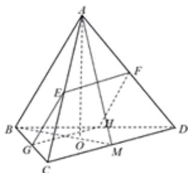

(2) ①由 $E , F ^ { . }$ 分别是线段AC,AD的中点，得 $E F / / C D _ { : }$ ，而 $E F \subset$ 平面EFG， $C D \notin$ 平面 $E F G$ 所以 $C D / /$ 平面 $E F G$

②由平面 $E F G$ 交BD于点H，得面 $E F G \cap$ 平面 $B C D = G H$ ，而 $C D / /$ 平面 $E F G$

$C D \subset$ 平面 $B C D ,$ ，则 $G H / / C D _ { : }$ ，而G是BC的中点，则H是BD的中点，

因此 $E G / / A B / / F H$ ，而 $E F / / G H$ ，则四边形 $E F H G$ 是平行四边形，

又 $E F = { \frac { 1 } { 2 } } C D = { \frac { 1 } { 2 } } A B = E G$ ，于是 $\neg E F H G$ 为菱形，而 $A M \bot C D , B M \bot C D$

$A M \cap B M = M , A M , B M \subset$ 平面ABM，则 $C D \perp$ 平面ABM，又 $A B \subset$ 平面ABM，

因此 $A B \bot C D$ ，于是 $E G \bot G H$ ，所以四边形EFHG是正方形.

### 黄浦 · 第14题

若从正方体八个顶点中任取四个顶点分别记为A、B、C、D，则直线AB与CD所成角的大小不可能为（ ）

A. $3 0 ^ { \circ }$

B. $4 5 ^ { \circ }$

C. $6 0 ^ { \circ }$

D. $9 0 ^ { \circ }$

> 本题资料或解析有待核事项，预览不可作为已审定成品。

**考点：** 分类空间方向并判断可取角度

**难度依据：** 正方体顶点连线夹角；分类空间方向并判断可取角度

**核查说明：** 原解列举可实现角后直接断言30度不可能，未给穷尽证明。

【答案】A

【解析】

由题意作图，根据正方体的几何性质，利用异面直线的夹角的定义，可得答案.①由题意作图如下：

由图易知 $| \triangle { O C D }$ 为等腰直角三角形，则直线AB与CD的夹角为 $4 5 ^ { \circ }$ ；②由题意作图如下：

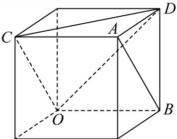

由图易知 $\triangle O C D$ 为等边三角形，则直线 $A B ^ { \perp }$ 与CD的夹角为60∘；

③由题意作图如下：

由图易知OA⊥AB，因为 $C B / / O A$ ，则直线AB与CD的夹角为 $9 0 ^ { \circ }$ 而不管怎么找顶点，都无法得到直线AB与CD所成角为 $3 0 ^ { \circ }$ 故选：A.

### 黄浦 · 第17题

如图，在正方体ABCD− $A _ { 1 } B _ { 1 } C _ { 1 } D _ { 1 }$ 中，E是 $B C _ { 1 }$ 的中点

(1) (6分)求证： $B C _ { 1 \bot }$ 平面CDE；
(2) (8分)求直线DE与平面ABCD所成角的大小

**考点：** （1）两条相交直线证明线面垂直；（2）投影求线面角

**难度依据：** 正方体线面垂直与线面角；（1）两条相交直线证明线面垂直；（2）投影求线面角

【解析】

(1) 证明：连接 $B _ { 1 } C ,$ ，在正方体 $A B C D - A _ { 1 } B _ { 1 } C _ { 1 } D _ { 1 }$ 中，E是 $B C _ { 1 }$ 的中点，

所以E是 $B _ { 1 } ($ C的中点，且 $B _ { 1 } C \bot B C _ { 1 }$ ，即 $E C \bot B C _ { 1 }$

因为 $D C \bot$ 平面 $B C C _ { 1 } B _ { 1 }$ $B C _ { 1 } \subset$ 平面 $B C C _ { 1 } B _ { 1 }$ 1,

所以 $D C \bot B C _ { 1 }$

又 $D C \cap E C = C , D C , E C \subset$ 平面 $C D E .$

所以 $B C _ { 1 \bot }$ 平面CDE.

(2) 过E作 $E F \bot B C$ ，交BC于F，连接 $D F .$ ，

在正方体 $A B C D - A _ { 1 } B _ { 1 } C _ { 1 } D _ { 1 } \sharp$ ， $C C _ { 1 - }$ ⊥平面 $A B C D$ $E F / / C C _ { 1 }$ 1

所以 $E F \bot$ 平面 $A B C D$ ，

又 $D F \subset$ 平面 $A B C D$ ，所以 $E F \bot D F$ ，

所以 $\angle E D F$ 是直线DE与平面 $A B C D$ 所成的角.

由题意，设 $C C _ { 1 } = C B = C D = 2 a$ ，则 $E F = \frac { 1 } { 2 } C C _ { 1 } = a .$

$C F = { \frac { 1 } { 2 } } C B = a$ ，所以 $D F = { \sqrt { 5 } } a$

所以在 $\mathrm { R t } \triangle D E F$ $\tan \angle E D F = { \frac { E F } { D F } } = { \frac { a } { \sqrt { 5 } a } } = { \frac { \sqrt { 5 } } { 5 } }$

故直线DE与平面ABCD所成角的大小是 $\arctan { \frac { \sqrt { 5 } } { 5 } }$

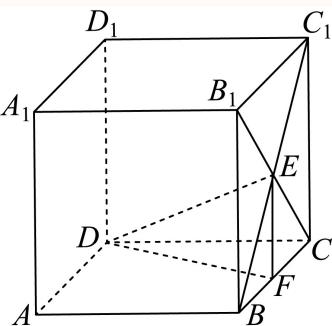

## 空间坐标、向量表示与轨迹度量

将固定点基底线性表示、等距或对称约束转成空间向量及坐标；动点问题再讨论轨迹、计数或最值。

### 嘉定 · 第10题

已知空间向量 $\overrightarrow { O B _ { 1 } } , \overrightarrow { O B _ { 2 } } , \overrightarrow { O B _ { 3 } }$ 两两垂直，若空间点A满足 $\left| \overrightarrow { A B _ { 1 } } \right| = \left| \overrightarrow { A B _ { 2 } } \right| = \left| \overrightarrow { A B _ { 3 } } \right| = 1$ ，记$\overrightarrow { O P } = \overrightarrow { O B _ { 1 } } + \overrightarrow { O B _ { 2 } } + \overrightarrow { O B _ { 3 } }$ ，且 $\left| \begin{array} { l } { \longrightarrow } \\ { \vec { A P } } \end{array} \right| \le 1$ ，则 $\overrightarrow { O A }$ 的取值范围为

> 本题资料或解析有待核事项，预览不可作为已审定成品。

**考点：** 空间正交向量数量积与模平方恒等式；等距点约束的空间度量

**难度依据：** 须将三组距离条件合并消去交叉项

**核查说明：** 题干与解析已用于人工归类，尚未完成整题公式校净与独立数学终审。；题干末尾将模长写成向量的取值范围；原PDF文字层及解析均有模长线，应回核后修复。；题干与解析已用于人工归类，尚未完成整题公式校净与独立数学终审。；题干末尾将模长写成向量的取值范围；原PDF文字层及解析均有模长线，应回核后修复。

【答案】$\left[ 1 , { \frac { \sqrt { 6 } } { 2 } } \right]$

【解析】

根据给定条件，利用空间向量模的意义及数量积的运算律求得 $| \overrightarrow { O A } | ^ { 2 } = \frac { 3 - | \overrightarrow { A P } | ^ { 2 } } { 2 }$ 进而求出范围.

由空间向量 $\overrightarrow { { \cdot } O B _ { 1 } } , \overrightarrow { O B _ { 2 } } , \overrightarrow { O B _ { 3 } }$ 两两垂直，得 $\overrightarrow { O B _ { 1 } } \cdot \overrightarrow { O B _ { 2 } } = \overrightarrow { O B _ { 2 } } \cdot \overrightarrow { O B _ { 3 } } = \overrightarrow { O B _ { 3 } } \cdot \overrightarrow { O B _ { 1 } } = 0$

又 AB1 = AB2 = AB3 = 1，OP = OB1 + OB2 + OB3，

则3 = |AB1|2 + |AB2|2 + |AB3|2 = (OB1 − OA)2 + (OB2 − OA)2 + (OB3 − OA)2−−→ → → → → → → → →

$$
= 3 \overrightarrow {| O A |} ^ {2} - 2 \overrightarrow {O A} \cdot \left(\overrightarrow {O B _ {1}} + \overrightarrow {O B _ {2}} + \overrightarrow {O B _ {3}}\right) + \overrightarrow {| O B _ {1} |} ^ {2} + \overrightarrow {| O B _ {2} |} ^ {2} + \overrightarrow {| O B _ {3} |} ^ {2}
$$

$$
= 3 \overrightarrow {| O A | ^ {2}} - 2 \overrightarrow {O A} \cdot \overrightarrow {O P} + \left(\overrightarrow {O B _ {1}} + \overrightarrow {O B _ {2}} + \overrightarrow {O B _ {3}}\right) ^ {2} - 2 \left(\overrightarrow {O B _ {1}} \cdot \overrightarrow {O B _ {2}} + \overrightarrow {O B _ {2}} \cdot \overrightarrow {O B _ {3}} + \overrightarrow {O B _ {3}} \cdot \overrightarrow {O B _ {1}}\right)
$$

$$
= 3 | \overrightarrow {O A} | ^ {2} - 2 \overrightarrow {O A} \cdot \overrightarrow {O P} + | \overrightarrow {O P} | ^ {2} = 2 | \overrightarrow {O A} | ^ {2} + | \overrightarrow {O A} | ^ {2} - 2 \overrightarrow {O A} \cdot \overrightarrow {O P} + | \overrightarrow {O P} | ^ {2}
$$

$= 2 | \overrightarrow { O A } | ^ { 2 } + \left( \overrightarrow { O A } - \overrightarrow { O P } \right) ^ { 2 } = 2 | \overrightarrow { O A } | ^ { 2 } + | \overrightarrow { A P } | ^ { 2 }$ 而0 $\leq | { \overrightarrow { A P } } | \leq 1$

因此 $| \overrightarrow { O A } | ^ { 2 } = \frac { 3 - | \overrightarrow { A P } | ^ { 2 } } { 2 } \in \left[ 1 , \frac { 3 } { 2 } \right] , \overrightarrow { | O A } | \in \left[ 1 , \frac { \sqrt { 6 } } { 2 } \right]$

所以 $\overrightarrow { \ O A }$ |的取值范围为 $\left[ 1 , { \frac { \sqrt { 6 } } { 2 } } \right]$

故答案为： $\left[ 1 , { \frac { \sqrt { 6 } } { 2 } } \right]$

### 宝山 · 第15题

…
如图，正四棱柱 $A B C D - A _ { 1 } B _ { 1 } C _ { 1 } D _ { 1 }$ 的底面ABCD边长为1，E为AD上任意一点，F为 $C C _ { 1 }$ 中点，若棱 $C _ { 1 } D _ { 1 }$ 上至少存在一点P使得 $P E \bot P F$ ，则棱长 $A A _ { 1 }$ 的最大值为（ ）

A. $\frac { \sqrt { 2 } } { 2 }$

B. 1

C. $\sqrt { 2 }$

D. 2

**考点：** 空间直角条件与坐标判别

**难度依据：** 涉及空间直角条件与坐标判别；难度为教师预估，需结合原题条件复核。

**核查说明：** 依据现有底稿归类，尚未逐页校卷、公式校净或独立数学终审。

【答案】A

【解析】

建立空间直角坐标系，设出点P、E、F的坐标，结合已知条件得到方程 $n ^ { 2 } - n + 2 h ^ { 2 } = 0$ ，根据方程解的情况求出h的取值范围即可求解.

根据已知条件，以D为坐标原点，DA、 $\mathit { D C } , \ \mathit { D D } _ { 1 }$ 分别为x、y、z轴的空间直角坐标系，

设正四棱柱的高为2h，令E (m, 0, 0)，F (0, 1, h)，P (0, n, 2h)，

所以 $\overrightarrow { P E } = ( m , - n , - 2 h ) , \overrightarrow { P F } = ( 0 , 1 - n , - h )$

因为 $P E \bot P F$ ，所以 $\overrightarrow { P E } \cdot \overrightarrow { P F } = 0$ ，即 $- n \left( 1 - n \right) + \left( - 2 h \right) \cdot \left( - h \right) = 0$

整理得： $n ^ { 2 } - n + 2 h ^ { 2 } = 0$ ，因为棱 $C _ { 1 } D _ { 1 }$ 上至少存在一点P使得 $P E \bot P F .$

所以关于 得的方程 $n ^ { 2 } - n + 2 h ^ { 2 } = 0$ ，n至少有一个解，

即 $\Delta = ( - 1 ) ^ { 2 } - 4 \times 1 \times 2 h ^ { 2 } \geq 0 \quad$ ，整理得： $1 - 8 h ^ { 2 } \ge 0$ ，解得 $- \frac { \sqrt { 2 } } { 4 } \leq h \leq \frac { \sqrt { 2 } } { 4 }$

又因为 $h > 0$ ，所以 $\dot { 0 } < h \leq \frac { \sqrt { 2 } } { 4 }$ ，所以棱长 $A A _ { 1 }$ 的最大值为 $2 h = 2 \times { \frac { \sqrt { 2 } } { 4 } } = { \frac { \sqrt { 2 } } { 2 } }$ 故选：A

### 崇明 · 第9题

在空间直角坐标系中，点(1,2,3)关 $\operatorname { F } x O y$ 平面的对称点的坐标是

**考点：** 空间点关于坐标平面对称

**难度依据：** 涉及空间点关于坐标平面对称；难度为教师预估，需结合原题条件复核。

**核查说明：** 依据现有底稿归类，尚未逐页校卷、公式校净或独立数学终审。

【答案】(1, 2, −3).

【解析】

根据空间点关于坐标平面的对称点特征可求对称点的坐标.

点(1, 2, 3)关于xOy平面的对称点的坐标为(1, 2, −3)，

故答案为：(1, 2, −3).

### 普陀 · 第9题

设λ ∈ R，在如图所示的平行六面体 $A B C D - A _ { 1 } B _ { 1 } C _ { 1 } D _ { 1 }$ 1中， $\angle A _ { 1 } A B = \angle A _ { 1 } A D = \angle B A D = { \frac { \pi } { 3 } } .$ $A A _ { 1 } = 2 , A B = A D = 1$ ，点M是棱 $C _ { 1 } D _ { 1 }$ 的中点， $\xrightarrow { \xrightarrow { } } { \lambda _ { 1 } N } = \overline { { \lambda A _ { 1 } D _ { 1 } } }$ ，若 $\stackrel { \longrightarrow } { A M } . \stackrel { \longrightarrow } { C N } = 2$ ，则λ的值为

> 本题资料或解析有待核事项，预览不可作为已审定成品。

**考点：** 非正交空间基底的数量积展开；平行六面体中点与棱上点的向量表示

**难度依据：** 基底不正交需逐项计入夹角

**核查说明：** 仅修复所列OCR公式及其定界符错位；原解数学疑点和其他可渲染错识未因此消除。；题干与解析已用于人工归类，尚未完成整题公式校净与独立数学终审。；题干点N的向量等式严重错识，原解指向A1N=λA1D1，须视觉回核后修复。；仅修复所列OCR公式及其定界符错位；原解数学疑点和其他可渲染错识未因此消除。；题干与解析已用于人工归类，尚未完成整题公式校净与独立数学终审。；题干点N的向量等式严重错识，原解指向A1N=λA1D1，须视觉回核后修复。

【答案】$\frac 1 3$

【解析】

以 $\overrightarrow { A B } , \overrightarrow { A D } , \overrightarrow { A A _ { 1 } }$ 为基底表示 $\overrightarrow{AM},\overrightarrow{CN}$ ，结合题意运用数量积及向量数乘运算即可求解

$$
\overrightarrow {A _ {1} N} = \lambda \overrightarrow {A _ {1} D _ {1}} = \lambda \overrightarrow {A D},
$$

$$
\overrightarrow {A M} = \overrightarrow {A D _ {1}} + \overrightarrow {D _ {1} M} = \overrightarrow {A D} + \overrightarrow {A A _ {1}} + \frac {1}{2} \overrightarrow {A B},
$$

$$
\overrightarrow {C N} = \overrightarrow {A N} - \overrightarrow {A C} = \overrightarrow {A A _ {1}} + \overrightarrow {A _ {1} N} - \overrightarrow {A B} - \overrightarrow {A D}
$$

$$
= \overrightarrow {A A _ {1}} + \overrightarrow {\lambda A _ {1} D _ {1}} - \overrightarrow {A B} - \overrightarrow {A D} = \overrightarrow {A A _ {1}} + (\lambda - 1) \overrightarrow {A D} - \overrightarrow {A B},
$$

$$
\overrightarrow {A M} \cdot \overrightarrow {C N} = \left(\overrightarrow {A D} + \overrightarrow {A A _ {1}} + \frac {1}{2} \overrightarrow {A B}\right) \cdot \left(\overrightarrow {A A _ {1}} + (\lambda - 1) \overrightarrow {A D} - \overrightarrow {A B}\right) = 2,
$$

$$
\overrightarrow {A D} \cdot \overrightarrow {A A _ {1}} + (\lambda - 1) \overrightarrow {A D} ^ {2} - \overrightarrow {A D} \cdot \overrightarrow {A B} + \overrightarrow {A A _ {1}} ^ {2} + (\lambda - 1) \overrightarrow {A D} \cdot \overrightarrow {A A _ {1}} - \overrightarrow {A A _ {1}} \cdot \overrightarrow {A B} + \frac {1}{2} \overrightarrow {A B} \cdot \overrightarrow {A A _ {1}} +
$$

$$
\frac {1}{2} \overrightarrow {A B} \cdot (\lambda - 1) \overrightarrow {A D} - \frac {1}{2} \overrightarrow {A B} ^ {2} = 2
$$

由 $\stackrel { \triangledown } { | \angle A _ { 1 } A B = \angle A _ { 1 } A D = \angle B A D = \frac { \pi } { 3 } , } ~ A A _ { 1 } = 2 , ~ A B = A D = 1 ,$

$$
\begin{array}{l} 1 \times 2 \times \frac {1}{2} + (\lambda - 1) - 1 \times 1 \times \frac {1}{2} + 4 + (\lambda - 1) \times 1 \times 2 \times \frac {1}{2} - 2 \times 1 \times \frac {1}{2} + \frac {1}{2} \times 1 \times 2 \times \frac {1}{2} + \\ \frac {1}{2} (\lambda - 1) \times 1 \times 1 \times \frac {1}{2} - \frac {1}{2} \times 1 = 2 \end{array}
$$

${ \frac { 9 } { 4 } } ( \lambda - 1 ) + { \frac { 7 } { 2 } } = 2$ ，解得 $\lambda = \frac { 1 } { 3 }$

故答案为： $\frac 1 3$

### 虹口 · 第15题

已知边长为2的正四面体A−BCD的内切球（球面与四面体四个面都相切的球）的球心为O，若空间中的动点P满足 $\overrightarrow { O P } = x \overrightarrow { O C } + y \overrightarrow { O B } + z \overrightarrow { O D } , x , y , z \in [ 0 , 1 ]$ ]，则点P的轨迹所形成的几何体的体积为（ ）

A. $\sqrt { 2 }$

B. $\frac { \sqrt { 2 } } { 3 }$

C. $2 \sqrt { 3 }$

D. $\frac { \sqrt { 3 } } { 3 }$

> 本题资料或解析有待核事项，预览不可作为已审定成品。

**考点：** 空间向量与平行六面体体积

**难度依据：** 涉及空间向量与平行六面体体积；难度为教师预估，需结合原题条件复核。

**核查说明：** 仅修复所列OCR公式及其定界符错位；原解数学疑点和其他可渲染错识未因此消除。；依据现有底稿归类，尚未逐页校卷、公式校净或独立数学终审。

【答案】A

【解析】

点P的轨迹是以 $|OC|,|OB|,|OD|$为邻边的平行六面体，求出以 $| O C | , | O B |$ 为邻边的平行四边形面积和点D到平面BOC距离，由柱体的体积公式即可得出答案

空间中的动点P满足 $\overrightarrow { O P } = x \overrightarrow { O C } + y \overrightarrow { O B } + z \overrightarrow { O D } , x , y , z \in [ 0 , 1 ]$ ，

则点P的轨迹是以 $| O C | , | O B | , | O D |$ |为邻边的平行六面体，

将正四面体 $A - B C D$ 放入如图所示的正方体 $A _ { 1 } B C _ { 1 } D - A B _ { 1 } C D _ { 1 } \sharp$ 中，

则正四面体 $A - B C D$ 的内切球心O为正方体的中心，

设正方体的棱长为a，所 $\ { } ^ { \ ' } a ^ { 2 } = 2$ ，所 $\downarrow a = \sqrt { 2 }$ ，

以 $D _ { 1 }$ 为坐标原点，建立如图所示的空间直角坐标系，

所以 $D \left( 0 , 0 , { \sqrt { 2 } } \right) , B \left( { \sqrt { 2 } } , { \sqrt { 2 } } , { \sqrt { 2 } } \right) , C \left( 0 , { \sqrt { 2 } } , 0 \right) , A \left( { \sqrt { 2 } } , 0 , 0 \right) , O \left( { \frac { { \sqrt { 2 } } } { 2 } } , { \frac { { \sqrt { 2 } } } { 2 } } , { \frac { { \sqrt { 2 } } } { 2 } } \right)$

$$
\overrightarrow {O B} = \left(\frac {\sqrt {2}}{2}, \frac {\sqrt {2}}{2}, \frac {\sqrt {2}}{2}\right), \overrightarrow {O C} = \left(- \frac {\sqrt {2}}{2}, \frac {\sqrt {2}}{2}, - \frac {\sqrt {2}}{2}\right), \overrightarrow {B C} = (- \sqrt {2}, 0, - \sqrt {2}).
$$

$$
\left| \overrightarrow {O B} \right| = \sqrt {\left(\frac {\sqrt {2}}{2}\right) ^ {2} + \left(\frac {\sqrt {2}}{2}\right) ^ {2} + \left(\frac {\sqrt {2}}{2}\right) ^ {2}} = \frac {\sqrt {6}}{2},
$$

$$
\left| \overrightarrow {O C} \right| = \sqrt {\left(- \frac {\sqrt {2}}{2}\right) ^ {2} + \left(\frac {\sqrt {2}}{2}\right) ^ {2} + \left(- \frac {\sqrt {2}}{2}\right) ^ {2}} = \frac {\sqrt {6}}{2},
$$

$$
\left| \overrightarrow {B C} \right| = \sqrt {\left(- \sqrt {2}\right) ^ {2} + \left(- \sqrt {2}\right) ^ {2}} = 2,
$$

$$
\cos \angle B O C = \frac {\left| \overrightarrow {O B} \right| ^ {2} + \left| \overrightarrow {O C} \right| ^ {2} - \left| \overrightarrow {B C} \right| ^ {2}}{2 \left| \overrightarrow {O B} \right| \cdot \left| \overrightarrow {O C} \right|} = \frac {\left(\frac {\sqrt {6}}{2}\right) ^ {2} + \left(\frac {\sqrt {6}}{2}\right) ^ {2} - 2 ^ {2}}{2 \times \frac {\sqrt {6}}{2} \times \frac {\sqrt {6}}{2}} = - \frac {1}{3},
$$

所以 $\sin \angle B O C = \sqrt { 1 - \cos ^ { 2 } \angle B O C } = \frac { 2 \sqrt { 2 } } { 3 } ,$ ，

所以 $\mathbb { \backslash } | O C | , | O B |$ 为邻边的平行四边形面积为：

$$
S = 2 \times \frac {1}{2} \cdot \left| \overrightarrow {O B} \right| \cdot \left| \overrightarrow {O C} \right| \sin \angle B O C = \left(\frac {\sqrt {6}}{2}\right) ^ {2} \times \frac {2 \sqrt {2}}{3} = \sqrt {2},
$$

设平面BOC的法向量为 $\vec { \vert n \vert } = ( x , y , z )$

→ √2 √2 √2 →n ⋅ OB = x + y + z = 0 则 2 2 2 →n ⋅ OC =−→ √2 x + √2 y − √2 = 0 2 2 2

取 $x = 1$ ，可得 $y = 0 , z = - 1$ ，所以 $\vec { n } = ( 1 , 0 , - 1 )$ , $\overrightarrow { D B } = \left( \sqrt { 2 } , \sqrt { 2 } , 0 \right)$

又因为点D到平面BOC距离为 $\dot { \iota } = \frac { \left| \overrightarrow { n } \cdot \overrightarrow { D B } \right| } { \left| \overrightarrow { n } \right| } = \frac { \sqrt { 2 } } { \sqrt { 2 } } = 1$

以 $| O C | , | O B | , | O D |$ |为邻边的平行六面体的体积为： $V = S \cdot d = { \sqrt { 2 } } \times 1 = { \sqrt { 2 } } .$

故选：A.

### 金山 · 第16题

已知三棱锥 $A _ { 1 } - A _ { 2 } A _ { 3 } A _ { 4 }$ 的侧棱长相等，且侧棱两两垂直．设P为该三棱锥表面（含棱）上异于顶点 $A _ { 1 } , A _ { 2 } , A _ { 3 } , A _ { 4 }$ 的点，记 $D = \{ d | d = | P A _ { i } | , i = 1 , 2 , 3 , 4 \}$ ．若集合D中有且只有2个元素，则符合条件的点P有（ ）个

A. 3

B. 6

C. 7

D. 10

> 本题资料或解析有待核事项，预览不可作为已审定成品。

**考点：** 空间点到顶点距离集合的分类

**难度依据：** 涉及空间点到顶点距离集合的分类；难度为教师预估，需结合原题条件复核。

**核查说明：** 原解称四个顶点具有对称性，题设并非正四面体；应区分顶点A1与另外三个顶点，核验分情况计数。；依据现有底稿归类，尚未逐页校卷、公式校净或独立数学终审。

【答案】D

【解析】

设 $d _ { i } = | P A _ { i } |$ ，分P到两个顶点的距离a一样，到另外两个顶点的距离b一样，且 $. a \neq b ,$ ，和P到其中三个顶点的距离c一样，到另一个顶点的距离为e，且 $c \neq e _ { \cdot }$ ，两种情况，结合对称性，列举出满足题设的所有P点，即可得答案.

设 $\cdot d _ { i } = | P A _ { i } |$ ，情况如下：

①P到两个顶点的距离a一样，到另外两个顶点的距离b一样， $\boxed { a } a \neq b .$

由 $A _ { 1 } , A _ { 2 } , A _ { 3 } , A _ { 4 }$ 具有对称性，不妨讨论 $\therefore d _ { 1 } = d _ { 4 } , d _ { 2 } = d _ { 3 }$ ，

满足题意的P应同时在线段 $A _ { 1 } A _ { 4 } , A _ { 2 } A _ { 3 }$ 的中垂线面和三棱锥表面上，

即为其中垂面交线与三棱锥表面的交点，如图 $P _ { 1 } , P _ { 2 }$ 两点，

同理， $d _ { 1 } = d _ { 2 } , d _ { 3 } = d _ { 4 }$ 和 $\begin{array} { r } { [ d _ { 1 } = d _ { 3 } , d _ { 2 } = d _ { 4 } } \end{array}$ 也各有2个满足题意的P点，故共6个；

②P到其中三个顶点的距离c一样，到另一个顶点的距离为e，且 $c \neq e$

若P到 $A _ { 2 } , A _ { 3 } , A _ { 4 }$ 的距离一样，即 $d _ { 2 } = d _ { 3 } = d _ { 4 }$ ，则P为过 $\triangle A _ { 2 } A _ { 3 } A _ { 4 }$ 外心的垂线与三棱锥表面的交点，如图 $P _ { 3 }$ 和 $A _ { 1 }$ （舍）；

若P到 $A _ { 1 }$ 和 $A _ { 2 } , A _ { 3 } , A _ { 4 } \sharp$ 的两个距离一样，由 $A _ { 1 } , A _ { 2 } , A _ { 3 } , A _ { 4 }$ 具有对称性，

不妨讨论 $\mathscr { d } _ { 1 } = \mathscr { d } _ { 2 } = \mathscr { d } _ { 3 }$ ，则P为过 $\triangle A _ { 2 } A _ { 3 } A _ { 4 }$ 外心的垂线与三棱锥表面的交点，如图 $P _ { 4 }$ ，

同理， $d _ { 1 } = d _ { 3 } = d _ { 4 } \operatorname { \bar { \kappa } } \boxed { \mathrm { \uparrow } } d _ { 1 } = d _ { 2 } = d _ { 4 }$ 也各有1个满足题意的P点，共4个；

综上，共有10个满足题意的点.

故选：D

关键点点睛：依据题意将问题分成P到两个顶点的距离a一样，到另外两个顶点的距离b一样，且 $. a \neq b ,$ ，和P到其中三个顶点的距离c一样，到另一个顶点的距离为e，且c ≠ e两类为关键.

## 三、解答题

### 长宁 · 第12题

点P、M、N分别位于正方体 $A B C D - A ^ { \prime } B ^ { \prime } C ^ { \prime } D ^ { \prime }$ 的面上，AB = 1，则 $\overrightarrow { P M } \cdot \overrightarrow { P N }$ 的最小值是

> 本题资料或解析有待核事项，预览不可作为已审定成品。

**考点：** 建立空间坐标并处理表面约束

**难度依据：** 正方体表面数量积最值；建立空间坐标并处理表面约束

**核查说明：** 源解析由整体下界直接推断最优点位于同一面，论证不足；答案需独立复核。

【答案】$- \frac 1 2$

【解析】

建立空间直角坐标系可得 $\xrightarrow [ { P M } ] { } \xrightarrow [ { P N } ] { }$ 的坐标表达式，配方后可得最值.

如图建立以D为原点的空间直角坐标系，

设 $\boldsymbol { P } \left( x _ { 0 } , y _ { 0 } , z _ { 0 } \right) , \boldsymbol { M } \left( x _ { 1 } , y _ { 1 } , z _ { 1 } \right) , \boldsymbol { N } \left( x _ { 2 } , y _ { 2 } , z _ { 2 } \right)$ ，其中 $x _ { i } , y _ { i } , z _ { i } \left( i = 0 , 1 , 2 \right) \in \left[ 0 , 1 \right]$

$$
\overrightarrow {P M} = \left(x _ {1} - x _ {0}, y _ {1} - y _ {0}, z _ {1} - z _ {0}\right), \overrightarrow {P N} = \left(x _ {2} - x _ {0}, y _ {2} - y _ {0}, z _ {2} - z _ {0}\right)
$$

$$
\overrightarrow {| P M} \cdot \overrightarrow {P N} = (x _ {1} - x _ {0}) (x _ {2} - x _ {0}) + (y _ {1} - y _ {0}) (y _ {2} - y _ {0}) + (z _ {1} - z _ {0}) (z _ {2} - z _ {0})
$$

$$
\begin{array}{l} = \left(x _ {0} - \frac {x _ {1} + x _ {2}}{2}\right) ^ {2} + \left(y _ {0} - \frac {y _ {1} + y _ {2}}{2}\right) ^ {2} + \left(z _ {0} - \frac {z _ {1} + z _ {2}}{2}\right) ^ {2} \\ + x _ {1} x _ {2} - \frac {(x _ {1} + x _ {2}) ^ {2}}{4} + y _ {1} y _ {2} - \frac {(y _ {1} + y _ {2}) ^ {2}}{4} \\ + z _ {1} z _ {2} - \frac {(z _ {1} + z _ {2}) ^ {2}}{4} \geq x _ {1} x _ {2} - \frac {(x _ {1} + x _ {2}) ^ {2}}{4} + y _ {1} y _ {2} - \frac {(y _ {1} + y _ {2}) ^ {2}}{4} + z _ {1} z _ {2} - \frac {(z _ {1} + z _ {2}) ^ {2}}{4} \\ = - \frac {(x _ {1} - x _ {2}) ^ {2}}{4} - \frac {(y _ {1} - y _ {2}) ^ {2}}{4} - \frac {(z _ {1} - z _ {2}) ^ {2}}{4} = - \frac {1}{4} \left[ (x _ {1} - x _ {2}) ^ {2} + (y _ {1} - y _ {2}) ^ {2} + (z _ {1} - z _ {2}) ^ {2} \right] \end{array}
$$

$$
- \frac {1}{4} \left| \overrightarrow {M N} \right| ^ {2},
$$

$$
\text {仅当} x _ {0} = \frac {x _ {1} + x _ {2}}{2}, y _ {0} = \frac {y _ {1} + y _ {2}}{2}, z _ {0} = \frac {z _ {1} + z _ {2}}{2}
$$

则为使 $\overrightarrow { P M } \cdot \overrightarrow { P N }$ 最小，则应使 $\boxed { M N }$ 尽量的大，且P为MN中点.

又点P、M、N均位于正方体表面上，则P、M、N在正方体同一面上，

则当 $\boxed { M N }$ 为正方体一面的对角线，P为对角线中点时，满足题意此时 $\left| { \overrightarrow { M N } } \right| = { \sqrt { 2 } } ,$ 则 $- \frac { 1 } { 4 } \left| \overrightarrow { M N } \right| ^ { 2 } \geq - \frac { 1 } { 2 }$

故答案为： $- \frac 1 2$

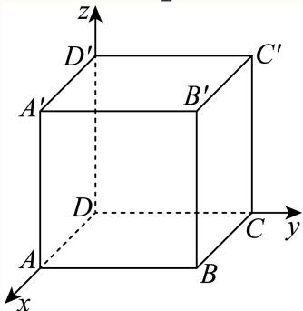

关键点睛：本题解题的关键是建立坐标系利用坐标计算得 $\overrightarrow { P M } \cdot \overrightarrow { P N } \geq - \frac { 1 } { 4 } \left| \overrightarrow { M N } \right| ^ { 2 }$ ，再由取等条件得到P、M、N位置关系从而得解.

## 二、选择题

### 青浦 · 第14题

若点 $P \left( x , y , z \right) \left( x y z \neq 0 \right)$ 关于xOy的对称点为A，关于z轴的对称点为B，则A、B两点的对称是（ ）

A. 关 $\operatorname { \mathbb { F } } _ { \mathbf { X } } \operatorname { O z } ^ { \mathrm { - } }$ 平面对称

B. 关于x轴对称

C. 关于y轴对称

D. 关于坐标原点对称

> 本题资料或解析有待核事项，预览不可作为已审定成品。

**考点：** 空间坐标轴平面对称；空间点的坐标与中心对称

**难度依据：** 坐标变号两次比较即可

**核查说明：** 题干与解析已用于人工归类，尚未完成整题公式校净与独立数学终审。

【答案】D

【解析】

运用空间向量坐标表示以及对称中的坐标特点可解.

点 $P \left( x , y , z \right) \left( x y z \neq 0 \right)$ 关于xOy的对称点为A，则A坐标 $( x , y , - z )$ ；

点 $P \left( x , y , z \right) \left( x y z \neq 0 \right)$ 关于z轴的对称点为B，则B坐标 $( - x , - y , z )$ ；

则根据坐标特点知道A、B两点关于原点对称.

故选：D

### 黄浦 · 第8题

在正四面体 $A B C D$ 中，点N是 $\triangle A B C$ 的中心，若 $\overrightarrow { D N } = \lambda \overrightarrow { D A } + \mu \overrightarrow { D B } + \nu \overrightarrow { B C } \left( \lambda , \mu , \nu \in \mathbf { R } \right)$ ，则$\lambda + \mu + \nu =$

**考点：** 由重心表示与向量基底求系数

**难度依据：** 正四面体中心的空间向量表示；由重心表示与向量基底求系数

【答案】${ \frac { 4 } { 3 } } .$

【解析】

依题意设 $O A = a , O B = b , O C = c$ ，利用勾股定理即可得到 $a = b = c$ ，设该正四面体的棱长为 ${ \sqrt { 2 } } ,$ ，求出点的坐标，结合 $\overrightarrow { D N } = \lambda \overrightarrow { D A } + \mu \overrightarrow { D B } + \nu \overrightarrow { B C }$ 利用空间向量法计算求解

因为在正四面体 $A B C D \ L \mathrm { \Sigma }$ ， $A B = B C = C A$ ，正四面体ABCD的顶点A，B，C分别在两两垂 直的三条射线 $O x , O y , O z \bot$

设 $O A = a , O B = b , O C = c ,$

由 $O A , O B , O C$ 两两垂直，得 $a ^ { 2 } + b ^ { 2 } = b ^ { 2 } + c ^ { 2 } = c ^ { 2 } + a ^ { 2 }$

所以 $a = b = c , $ ，即 $\begin{array} { r } { | O A = O B = O C , } \end{array}$ ，所以 $O - A B C$ 是正三棱锥，

设该正四面体的棱长为 ${ \overline { { \cdot } } } \sqrt { 2 } ,$ ，则 $a = b = c = 1$ ，于是 $A ( 1 , 0 , 0 ) , B ( 0 , 1 , 0 ) , C ( 0 , 0 , 1 ) , D ( 1 , 1 , 1 )$

又点N是 $\triangle A B C$ 的中心，所以 $N = \left( \frac { 1 } { 3 } , \frac { 1 } { 3 } , \frac { 1 } { 3 } \right)$

所以 $\overrightarrow { D N } = \left( - \frac { 2 } { 3 } , - \frac { 2 } { 3 } , - \frac { 2 } { 3 } \right) , \overrightarrow { D A } = ( 0 , - 1 , - 1 ) , \overrightarrow { D B } = ( - 1 , 0 , - 1 ) , \overrightarrow { B C } = ( 0 , - 1 , 1 )$

因为 $\overrightarrow { ^ { \vert D N } } = \lambda \overrightarrow { D A } + \mu \overrightarrow { D B } + \nu \overrightarrow { B C }$ ，所以

$$
\left(- \frac {2}{3}, - \frac {2}{3}, - \frac {2}{3}\right) = \lambda (0, - 1, - 1) + \mu (- 1, 0, - 1) + \nu (0, - 1, 1),
$$

可得 $\left\{ \begin{array} { l l } { - { \displaystyle \frac { 2 } { 3 } } = - \mu } \\ { - { \displaystyle \frac { 2 } { 3 } } = - \lambda - \nu } \\ { - { \displaystyle \frac { 2 } { 3 } } = - \lambda - \mu + \nu } \end{array} \right. ,$ 得 $\left\{ \begin{array} { l l } { \displaystyle \mu = \frac { 2 } { 3 } } \\ { \displaystyle \nu = \frac { 1 } { 3 } , } \\ { \displaystyle \lambda = \frac { 1 } { 3 } } \end{array} \right.$

可得 $\lambda + \mu + \nu = { \frac { 4 } { 3 } }$

故答案为： ${ \frac { 4 } { 3 } } .$

