# 2025一模 解析几何专题 · 教师版

> 本地预览：题目、答案及分类尚未全部审定。校对使用的PDF为高中工作台解析版，尚未逐区确认区级印刷原卷。

## 直线、圆与圆锥曲线基本量

根据方程方向和几何定义求斜率、焦点、准线、渐近线及离心率。

### 嘉定 · 第2题

直线3x − y + 1 = 0的倾斜角为 .（用反三角函数表示）

> 本题资料或解析有待核事项，预览不可作为已审定成品。

**考点：** 一般式求斜率与倾斜角；反正切表示倾斜角

**难度依据：** 斜率为正时直接反正切求角

**核查说明：** 题干与解析已用于人工归类，尚未完成整题公式校净与独立数学终审。

【答案】arctan 3.

【解析】

由直线的一般式方程求得斜率，根据倾斜角与斜率的关系，建立方程，可得答案.

由直线 $3 x - y + 1 = 0$ ，则该直线的斜率为3，设其倾斜角为θ，则 $\tan \theta = 3$

解得 $\theta = \arctan 3 .$

故答案为：arctan 3.

### 嘉定 · 第5题

已知双曲线C： ${ \frac { x ^ { 2 } } { 3 } } - { \frac { y ^ { 2 } } { 2 } } = 1$ ，则双曲线C的离心率是

> 本题资料或解析有待核事项，预览不可作为已审定成品。

**考点：** 双曲线标准方程与离心率

**难度依据：** 识别实虚半轴后计算离心率

**核查说明：** 题干与解析已用于人工归类，尚未完成整题公式校净与独立数学终审。

【答案】$\frac { \sqrt { 1 5 } } { 3 }$

【解析】

利用双曲线方程求出实半轴长、半焦距，进而求出离心率.

双曲线C： ${ \frac { x ^ { 2 } } { 3 } } - { \frac { y ^ { 2 } } { 2 } } = 1$ 的实半轴长 $a = { \sqrt { 3 } } ,$ ，虚半轴长 $b = { \sqrt { 2 } }$

则半焦距 $c = { \sqrt { a ^ { 2 } + b ^ { 2 } } } = { \sqrt { 5 } }$ ，所以双曲线C的离心率 $e = { \frac { c } { a } } = { \frac { \sqrt { 1 5 } } { 3 } }$

故答案为： $\frac { \sqrt { 1 5 } } { 3 }$

### 奉贤 · 第2题

若直线l1 $\ : \ : x + a y - 2 = 0 \ : \ !$ 与直线l2：ax + y − 2 = 0互相垂直，则a =

> 本题资料或解析有待核事项，预览不可作为已审定成品。

**考点：** 一般式直线垂直的系数条件

**难度依据：** 用系数内积为零避免漏斜率不存在情形

**核查说明：** 题干与解析已用于人工归类，尚未完成整题公式校净与独立数学终审。

【答案】0

【解析】

根据直线互相垂直求出a的值.

由题意得 $1 \times a + a \times 1 = 0$ ，解得a = 0.

故答案为：0

### 奉贤 · 第7题

已知抛物线 $x ^ { 2 } = a y \left( a > 0 \right)$ 上有一点P到准线的距离为6，点P到x轴的距离为4，则抛物线的焦点坐标为

> 本题资料或解析有待核事项，预览不可作为已审定成品。

**考点：** 抛物线准线距离与焦点参数

**难度依据：** 先定纵坐标再用准线距离反求参数

**核查说明：** 题干与解析已用于人工归类，尚未完成整题公式校净与独立数学终审。

【答案】(0, 2).

【解析】

根据题意求出点P的纵坐标，结合点P到准线的距离可求出a的值，即可得出抛物线焦点的坐标.

抛物线 $x ^ { 2 } = a y \left( a > 0 \right)$ )的准线方程为 $y = - { \frac { a } { 4 } }$

设点 $P \left( x , y \right)$ ，则 $y \geq 0$ ，由于点P到准线的距离为 $y + { \frac { a } { 4 } } = 6$ ，可得 ${ \mathfrak { y } } = 6 - { \frac { a } { 4 } }$

因为点P到x轴的距离为4，则y = 4，所以， $6 - { \frac { a } { 4 } } = { \dot { 4 } } .$ ，解得 $a = 8$

故抛物线的方程为 $x ^ { 2 } = 8 y$ ，其焦点坐标为(0,2).

故答案为：(0, 2).

### 宝山 · 第9题

…
过双曲线 ${ \frac { x ^ { 2 } } { 9 } } - { \frac { y ^ { 2 } } { 1 6 } } = 1$ 的左焦点F作圆 $x ^ { 2 } + y ^ { 2 } = 9$ 的切线，切点为M.延长切线交双曲线的右支于点 P，O为坐标原点，点T为线段FP的中点，则|OT| =

> 本题资料或解析有待核事项，预览不可作为已审定成品。

**考点：** 双曲线定义与切线几何

**难度依据：** 涉及双曲线定义与切线几何；难度为教师预估，需结合原题条件复核。

**核查说明：** 原解中参数a的数值前后冲突，线段位置关系亦需回源核验。；依据现有底稿归类，尚未逐页校卷、公式校净或独立数学终审。

【答案】5

【解析】

根据双曲线的定义，中位线的性质，可转化为 $| O T | - | M T | = | F M | - 3$ ，根据勾股定理计算$| F M | = 4$ 然后利用 $| O T | - | M T | = 1 \mathcal { \bar { X } } | O T | ^ { 2 } = | M T | ^ { 2 } + | O M | ^ { 2 }$ 解方程求解即可.如图，

取双曲线右焦点 $F ^ { \prime }$ ，连接 $P F ^ { \prime }$ ，由题知， $a = 3 , b = 4$ ，所以 $. c = 5$

因为O为 $F F ^ { \prime }$ ，T为PF的中点，所以TO为 $\triangle P F F ^ { \prime }$ 的中位线，

可得|OT| = 1 |PF ′|, |FT| = 1 |PF|.又|MT| = |FT| − |FM| 1 |PF| − |FM|，

所以 $| O T | - | M T | = \frac { 1 } { 2 } ( | P F ^ { \prime } | - | P F | ) + | F M | = | F M | - 3 ,$

又 $. a = \sqrt { 3 } , | F M | = \sqrt { | O F | ^ { 2 } - 3 ^ { 2 } } = 4 _ { \mathrm { { } } }$ ，所以 $| O T | - | M T | = 1$ ，又 $| O T | ^ { 2 } = | M T | ^ { 2 } + | O M | ^ { 2 }$

所以 $| O T | ^ { 2 } = ( | O T | - 1 ) ^ { 2 } + 9$ ，解得 $| O T | = 5$

故答案为：5

### 崇明 · 第5题

双曲线 $x ^ { 2 } - { \frac { y ^ { 2 } } { 4 } } = 1$ 的渐近线方程是

**考点：** 双曲线渐近线

**难度依据：** 涉及双曲线渐近线；难度为教师预估，需结合原题条件复核。

**核查说明：** 依据现有底稿归类，尚未逐页校卷、公式校净或独立数学终审。

【答案】$y = \pm 2 x$

【解析】

将双曲线方程中的1变为0后可得渐近线方程.

双曲线 $x ^ { 2 } - { \frac { y ^ { 2 } } { 4 } } = 1$ 的渐近线方程为 $x ^ { 2 } - { \frac { y ^ { 2 } } { 4 } } = 0 \mathbb { H } y = \pm 2 x$

故答案为： $y = \pm 2 x$

### 徐汇 · 第10题

已知椭圆 ${ \frac { x ^ { 2 } } { a ^ { 2 } } } + { \frac { y ^ { 2 } } { b ^ { 2 } } } = 1 ( a > b > 0 )$ 的左､右焦点分别为 $F _ { 1 } , F _ { 2 }$ ，P为椭圆上一点，且 $\angle P F _ { 2 } F _ { 1 } = \frac { \pi } { 3 }$ 若此椭圆的离心率为 ${ \sqrt { 3 } } - 1$ ，则 $\angle P F _ { 1 } F _ { 2 }$ 的大小为

> 本题资料或解析有待核事项，预览不可作为已审定成品。

**考点：** 椭圆焦点三角形；正余弦定理

**难度依据：** 椭圆焦点三角形；正余弦定理；按所需步骤与推理量估计

**核查说明：** 题干与解析已用于人工归类，尚未完成整题公式校净与独立数学终审。

【答案】${ \frac { \pi } { 6 } } .$

【解析】

设 $| P F _ { 2 } | = x$ ，由椭圆的定义得 $| P F _ { 1 } | = 2 a - x$ ，利用余弦定理求得 $x = { \bigg ( } { \sqrt { 3 } } - 1 { \bigg ) } a$ ，再由正弦定理即可求得 $\sin \angle P F _ { 1 } F _ { 2 } = \frac { 1 } { 2 }$ ，继而得到 $\angle P F _ { 1 } F _ { 2 }$ .

如图，设 $P F _ { 2 } | = x ,$ ，则 $P F _ { 1 } | = 2 a - x$ ，因 $e = { \frac { c } { a } } = { \sqrt { 3 } } - 1$ ，故 $\dot { \boldsymbol { c } } = \bigg ( \sqrt { 3 } - 1 \bigg ) \boldsymbol { a }$

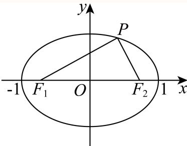

由余弦定理， $| P F _ { 1 } | ^ { 2 } = | P F _ { 2 } | ^ { 2 } + | F _ { 1 } F _ { 2 } | ^ { 2 } - 2 | P F _ { 2 } | \cdot | F _ { 1 } F _ { 2 } | \cos { \frac { \pi } { 3 } } ,$

即 $( 2 a - x ) ^ { 2 } = 4 c ^ { 2 } + x ^ { 2 } - 2 c x$

将 $\dot { \boldsymbol { c } } = \bigg ( \sqrt { 3 } - 1 \bigg ) \boldsymbol { a }$ 代入，整理得： $4 a ^ { 2 } - 4 a x + x ^ { 2 } = 4 { \Big ( } 4 - 2 { \sqrt { 3 } } { \Big ) } a ^ { 2 } + x ^ { 2 } - 2 { \Big ( } { \sqrt { 3 } } - 1 { \Big ) } a x$

解得 $x = { \frac { 4 { \sqrt { 3 } } - 6 } { 3 - { \sqrt { 3 } } } } a = \left( { \sqrt { 3 } } - 1 \right) a$ ，则有 $| P F _ { 2 } | = \Big ( \sqrt { 3 } - 1 \Big ) a , | P F _ { 1 } | = \Big ( 3 - \sqrt { 3 } \Big ) a ,$

由正弦定理： ${ \frac { \left| P F _ { 2 } \right| } { \sin \angle P F _ { 1 } F _ { 2 } } } = { \frac { \left| P F _ { 1 } \right| } { \sin { \frac { \pi } { 3 } } } }$ 即 ${ \frac { \left( { \sqrt { 3 } } - 1 \right) a } { \sin \angle P F _ { 1 } F _ { 2 } } } = { \frac { \left( 3 - { \sqrt { 3 } } \right) a } { \frac { \sqrt { 3 } } { 2 } } }$

解得 $\sin \angle P F _ { 1 } F _ { 2 } = \frac { 1 } { 2 }$

因0 $< \angle P F _ { 1 } F _ { 2 } < \frac { 2 \pi } { 3 }$ ，故 $\angle P F _ { 1 } F _ { 2 } = \frac { \pi } { 6 }$

故答案为： ${ \frac { \pi } { 6 } } .$

### 徐汇 · 第13题

下列抛物线中，焦点坐标为 $\left( 0 , { \frac { 1 } { 8 } } \right)$ 的是（）

A. $y ^ { 2 } = { \frac { 1 } { 2 } } x$

B. $y ^ { 2 } = { \frac { 1 } { 4 } } x$

C. $x ^ { 2 } = { \frac { 1 } { 2 } } y$

D. $x ^ { 2 } = { \frac { 1 } { 4 } } y$

> 本题资料或解析有待核事项，预览不可作为已审定成品。

**考点：** 抛物线焦点与标准方程

**难度依据：** 抛物线焦点与标准方程；按所需步骤与推理量估计

**核查说明：** 题干与解析已用于人工归类，尚未完成整题公式校净与独立数学终审。

【答案】C

【解析】

故选：C.

抛物线的标准方程为: $x ^ { 2 } = 2 p y$ ，焦点坐标为 $\left( 0 , { \frac { p } { 2 } } \right)$ ，由题意得 ${ \frac { p } { 2 } } = { \frac { 1 } { 8 } }$ ，所以 $p = \frac 1 4$ ，所以抛物线的标准方程为: $x ^ { 2 } = { \frac { 1 } { 2 } } y$

### 普陀 · 第2题

已知某抛物线的准线方程为y＝1，则该抛物线的标准方程为

> 本题资料或解析有待核事项，预览不可作为已审定成品。

**考点：** 准线方程反求抛物线标准式

**难度依据：** 先判断开口方向再确定参数

**核查说明：** 题干与解析已用于人工归类，尚未完成整题公式校净与独立数学终审。

【答案】$x ^ { 2 } = - 4 y$

【解析】

设出抛物线的标准方程后，根据准线方程可解得结果.依题意可设抛物线的标准方程为：

$$
x ^ {2} = - 2 p y (p > 0),
$$

由 ${ \frac { p } { 2 } } = 1$ ，解得p = 2，

所以该抛物线的标准方程为： $x ^ { 2 } = - 4 y$

故答案为： $x ^ { 2 } = - 4 y$

本题考查了根据准线方程求抛物线的标准方程，属于基础题.

### 普陀 · 第7题

设椭圆 $C \colon { \frac { x ^ { 2 } } { a ^ { 2 } } } + { \frac { y ^ { 2 } } { b ^ { 2 } } } = 1 ( a > b > 0 )$ 的左、右焦点分别为 $F _ { 1 } , \ F _ { 2 } ,$ ，左顶点为A，若椭圆C的离心率为 $\frac 1 3$ ，则 $\frac { | F _ { 2 } A | } { | A F _ { 1 } | }$ 的值为

> 本题资料或解析有待核事项，预览不可作为已审定成品。

**考点：** 椭圆顶点焦点距离比与离心率

**难度依据：** 把线段长度写成a加减c

**核查说明：** 题干与解析已用于人工归类，尚未完成整题公式校净与独立数学终审。

【答案】2.

【解析】

根据题意写出焦点与左顶点的坐标，表示出线段长，利用离心率写出等量关系，可得答案.

由题意可得 $F _ { 1 } \left( - c , 0 \right) , F _ { 2 } \left( c , 0 \right) , A \left( - a , 0 \right)$ ，则 $F _ { 2 } A \vert = a + c , \vert A F _ { 1 } \vert = a - c$

由椭圆离心率为 $\frac { 1 } { 3 }$ ，可得 ${ \frac { c } { a } } = { \frac { 1 } { 3 } }$ ，则 $a = 3 c ,$

所以 ${ \frac { | F _ { 2 } A | } { | A F _ { 1 } | } } = { \frac { a + c } { a - c } } = { \frac { 3 c + c } { 3 c - c } } = 2 .$

故答案为：2.

### 杨浦 · 第11题

中国探月工程又称“嫦娥工程”，是中国航天活动的第三个里程碑.在探月过程中，月球探测器需要进行变轨，即从一条椭圆轨道变到另一条不同的椭圆轨道上.若变轨前后的两条椭圆轨道均以月球中心为一个焦点，变轨后椭圆轨道上的点与月球中心的距离最小值保持不变，而距离最大值扩大为变轨前的4倍，椭圆轨道的离心率扩大为变轨前的2.5倍，则变轨前的椭圆轨道的离心率为（精确到0.01）

> 本题资料或解析有待核事项，预览不可作为已审定成品。

**考点：** 椭圆焦半径与离心率

**难度依据：** 椭圆焦半径与离心率；按所需步骤与推理量估计

**核查说明：** 题干与解析已用于人工归类，尚未完成整题公式校净与独立数学终审。

【答案】0.31.

【解析】

根据椭圆上点到焦点距离最小值为 $a - c ,$ ，到焦点距离最大值为 $[ a + c ,$ ，列式运算得解.

设变轨前的椭圆的长半轴长为 $[ a _ { 1 }$ ，短半轴长为 $b _ { 1 }$ ，半焦距为 $\lvert c _ { 1 }$ ，离心率为 $e _ { 1 }$ ，

变轨后的椭圆的长半轴长为 $\tan _ { 2 } .$ ，短半轴长为 $b _ { 2 }$ ，半焦距为 $c _ { 2 }$ ，离心率为 $\lvert e _ { 2 }$ ，

由题意可得 $\left\{ { \begin{array} { l } { a _ { 1 } - c _ { 1 } = a _ { 2 } - c _ { 2 } } \\ { 4 \left( a _ { 1 } + c _ { 1 } \right) = a _ { 2 } + c _ { 2 } } \\ { 2 . 5 { \frac { c _ { 1 } } { a _ { 1 } } } = { \frac { c _ { 2 } } { a _ { 2 } } } } \end{array} } \right.$ ，化简得 ${ \frac { 5 } { 2 } } \cdot { \frac { c _ { 1 } } { a _ { 1 } } } = { \frac { 3 a _ { 1 } + 5 c _ { 1 } } { 5 a _ { 1 } + 3 c _ { 1 } } }$

即 $\frac { 5 } { 2 } e _ { 1 } = \frac { 3 + 5 e _ { 1 } } { 5 + 3 e _ { 1 } }$ ，解得 $e _ { 1 } = { \frac { - 5 + { \sqrt { 6 5 } } } { 1 0 } } \approx 0 . 3 1$ （负值舍去）.

故答案为：0.31.

### 浦东 · 第2题

直线x − y + 1 = 0的倾斜角 .

> 本题资料或解析有待核事项，预览不可作为已审定成品。

**考点：** 直线斜率与倾斜角

**难度依据：** 直线斜率与倾斜角；按所需步骤与推理量估计

**核查说明：** 题干与解析已用于人工归类，尚未完成整题公式校净与独立数学终审。

【答案】$\frac { \pi } { 4 }$

【解析】

求出直线的斜率，再根据斜率与倾斜角之间的关系求解即可.

设直线x − y + 1 = 0的倾斜角为θ, $\theta \in [ 0 , \pi )$ ，

易知直线x−y+1 = 0的斜率为1，

所以 $\tan \theta = 1$

解得 $\theta = { \frac { \pi } { 4 } }$

故答案为： $\frac { \pi } { 4 }$

### 浦东 · 第9题

已知双曲线 $x ^ { 2 } - { \frac { y ^ { 2 } } { 3 } } = 1$ 的左、右焦点分别为 $F _ { \mathrm { 1 } } , \ F _ { \mathrm { 2 } }$ ，双曲线上的点P在第一象限，且 $P F _ { 2 }$ 与双曲线的一条渐近线平行，则 $\triangle P F _ { 1 } F _ { 2 }$ 的面积为

> 本题资料或解析有待核事项，预览不可作为已审定成品。

**考点：** 双曲线渐近线平行与焦点三角形

**难度依据：** 双曲线渐近线平行与焦点三角形；按所需步骤与推理量估计

**核查说明：** 题干与解析已用于人工归类，尚未完成整题公式校净与独立数学终审。

【答案】$\frac { 3 { \sqrt { 3 } } } { 2 }$

【解析】

根据题意先求出直线 $P F _ { 2 }$ 的方程，再与双曲线方程联立求出点P的坐标，即可根据三角形的面积公式求出 $\triangle P F _ { 1 } F _ { 2 }$ 的面积.

双曲线 $x ^ { 2 } - { \frac { y ^ { 2 } } { 3 } } = 1$ 的焦点 $F _ { 1 } ( - 2 , 0 ) , F _ { 2 } ( 2 , 0 )$ ，渐近线方程为 $y = \pm \sqrt { 3 } x$

依题意，直线 $P F _ { 2 }$ 的方程为 $y = - \sqrt { 3 } \left( x - 2 \right)$ ，

由 $\left\{ { \begin{array} { l } { y = - { \sqrt { 3 } } \left( x - 2 \right) } \\ { 3 x ^ { 2 } - y ^ { 2 } = 3 } \end{array} } \right.$ ，解得 $x = { \frac { 5 } { 4 } } , y = { \frac { 3 { \sqrt { 3 } } } { 4 } }$ ，则点P的坐标为 $\left( { \frac { 5 } { 4 } } , { \frac { 3 { \sqrt { 3 } } } { 4 } } \right)$

所以 $\triangle P F _ { 1 } F _ { 2 }$ 的面积为 ${ \frac { 1 } { 2 } } \times 4 \times { \frac { 3 { \sqrt { 3 } } } { 4 } } = { \frac { 3 { \sqrt { 3 } } } { 2 } }$

故答案为： $\frac { 3 { \sqrt { 3 } } } { 2 }$

### 虹口 · 第10题

双 曲 线 $C _ { 1 } \colon \frac { x ^ { 2 } } { a ^ { 2 } } - \frac { y ^ { 2 } } { b ^ { 2 } } = 1$ 的 左 、 右 焦 点 分 别 为 $F _ { 1 }$ 和 $F _ { 2 }$ ， 若 以 点 $F _ { 2 }$ 为 焦 点 的 抛 物 线$C _ { 2 } { : } y ^ { 2 } = 2 p x ( p > 0 ) \hat { \to } C _ { 1 }$ 在第一象限交于点P，且 $\angle P F _ { 1 } F _ { 2 } = \frac { \pi } { 4 }$ ，则 $C _ { 1 }$ 的离心率为

> 本题资料或解析有待核事项，预览不可作为已审定成品。

**考点：** 双曲线与抛物线定义、焦点三角形及离心率

**难度依据：** 需要联系两条圆锥曲线的焦点性质和余弦定理，教师预估。

**核查说明：** 题干连接抛物线与双曲线的文字识别缺损；解析需依照题图回源核对。；依据现有底稿归类，尚未逐页校卷、公式校净或独立数学终审。

【答案】${ \sqrt { 2 } } + 1$

【解析】

过P作抛物线准线的垂线，垂足为M，设 $| P F _ { 2 } | = t ,$ ，由 $F _ { 2 }$ 是抛物线的焦点，可得 $\vert P M \vert$ ，再由$\angle P F _ { 1 } F _ { 2 } = { \frac { \pi } { 4 } }$ ，可求得 $| P F _ { 1 } |$ $\mathrm { \# E } \triangle P F _ { 1 } F _ { 2 } $ 中由余弦定理可得 $| F _ { 1 } F _ { 2 } |$ ，再根据双曲线及离心率的定义可求出离心率

如图过P作抛物线准线的垂线，垂足为M，设 $| P F _ { 2 } | = t$

因为 $F _ { 2 }$ 是抛物线的焦点， $\therefore | P M | = | P F _ { 2 } | = t$

$$
\because \angle P F _ {1} F _ {2} = \frac {\pi}{4}, \therefore | P F _ {1} | = \frac {t}{\cos \angle F _ {1} P M} = \frac {t}{\cos \angle P F _ {1} F _ {2}} = \frac {t}{\cos \frac {\pi}{4}} = \sqrt {2} t,
$$

在 $\triangle P F _ { 1 } F _ { 2 }$ 中，由余弦定理得 $| P F _ { 2 } | ^ { 2 } = | P F _ { 1 } | ^ { 2 } + | F _ { 1 } F _ { 2 } | ^ { 2 } - 2 | P F _ { 1 } | \cdot | F _ { 1 } F _ { 2 } | \cdot \cos \angle P F _ { 1 } F _ { 2 } ,$

$$
\therefore t ^ {2} = \left(\sqrt {2} t\right) ^ {2} + \left| F _ {1} F _ {2} \right| ^ {2} - 2 \sqrt {2} t \cdot \left| F _ {1} F _ {2} \right| \cdot \frac {\sqrt {2}}{2},
$$

即 $| F _ { 1 } F _ { 2 } | ^ { 2 } - 2 t \cdot | F _ { 1 } F _ { 2 } | + t ^ { 2 } = 0$ ，解得 $F _ { 1 } F _ { 2 } | = t$

又 ${ \bf \nabla } \cdot { \bf F } _ { 1 }$ 和 $F _ { 2 }$ 是双曲线的左、右焦点，

$$
\therefore 2 c = \left| F _ {1} F _ {2} \right| = t, 2 a = \left| \left| P F _ {1} \right| - \left| P F _ {2} \right| \right| = \sqrt {2} t - t = (\sqrt {2} - 1) t
$$

$$
\therefore e = \frac {c}{a} = \frac {2 c}{2 a} = \frac {t}{(\sqrt {2} - 1) t} = \sqrt {2} + 1.
$$

故答案为： ${ \sqrt { 2 } } + 1$

### 金山 · 第6题

以C (3, 4)为圆心且过点(1, −3)的圆的标准方程是

**考点：** 圆的标准方程

**难度依据：** 涉及圆的标准方程；难度为教师预估，需结合原题条件复核。

**核查说明：** 依据现有底稿归类，尚未逐页校卷、公式校净或独立数学终审。

【答案】$\left( x - 3 \right) ^ { 2 } + \left( y - 4 \right) ^ { 2 } = 5 3 .$

【解析】

由圆心和圆上的点求出圆的半径，代入圆的标准方程即可.

圆心为 $C \left( 3 , 4 \right)$ ，圆过点(1,−3)，则圆的半径 $r = { \sqrt { \left( 3 - 1 \right) ^ { 2 } + \left( 4 + 3 \right) ^ { 2 } } } = { \sqrt { 5 3 } } ,$

所以圆的标准方程是 $\left( x - 3 \right) ^ { 2 } + \left( y - 4 \right) ^ { 2 } = 5 3$

故答案为： $\left( x - 3 \right) ^ { 2 } + \left( y - 4 \right) ^ { 2 } = 5 3 .$

### 金山 · 第15题

古希腊数学家阿波罗尼奥斯用不同的平面截同一圆锥，得到了圆锥曲线，其中的一种如图所示．用过M点且垂直于圆锥底面的平面截两个全等的对顶圆锥得到双曲线的一部分，已知高 $P O = 2$ ，底面圆的半径为4，M为母线PB的中点，平面与底面的交线 $E F \bot A B$ ，则双曲线的两条渐近线所成角的余弦值为（ ）
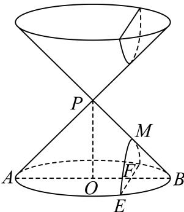

A. $\frac { 5 } { 6 }$

B. $\frac { 4 } { 5 }$

C. $\frac 3 4$

D. $\frac { 3 } { 5 }$

**考点：** 圆锥截面双曲线渐近线夹角

**难度依据：** 涉及圆锥截面双曲线渐近线夹角；难度为教师预估，需结合原题条件复核。

**核查说明：** 依据现有底稿归类，尚未逐页校卷、公式校净或独立数学终审。

【答案】D

【解析】

令双曲线为 ${ \frac { y ^ { 2 } } { a ^ { 2 } } } - { \frac { x ^ { 2 } } { b ^ { 2 } } } = 1$ ，根据已知建立合适坐标系，并求出双曲线参数，进而得渐近线方程，利用二倍角正切公式求得夹角正切值 $\tan \theta = { \frac { 4 } { 3 } }$ ，即可得其余弦值.

如下图建系，令双曲线为 ${ \frac { y ^ { 2 } } { a ^ { 2 } } } - { \frac { x ^ { 2 } } { b ^ { 2 } } } = 1$ ，且 $| O P | = 2$ ，则 $y _ { M } = - 1 , ~ a = 1$

如图， $| O H | = 2 , | O E | = 4$ ，则 $H E | = | H F | = 2 { \sqrt { 3 } }$ ，故 $F \left( 2 { \sqrt { 3 } } , - 2 \right)$

将F代入 $\cdot y ^ { 2 } - { \frac { x ^ { 2 } } { b ^ { 2 } } } = 1$ ，得 $4 - { \frac { 1 2 } { b ^ { 2 } } } = 1$ ，可得 $b ^ { 2 } = 4$ ，故渐近线为 $y = \pm \frac { 1 } { 2 } x$

若它们的夹角为θ，且 $\tan { \frac { \theta } { 2 } } = { \frac { 1 } { 2 } }$ ，则 $\tan \theta = { \frac { 2 \tan { \frac { \theta } { 2 } } } { 1 - \tan ^ { 2 } { \frac { \theta } { 2 } } } } = { \frac { 4 } { 3 } }$ ，故 $\cos \theta = { \frac { 3 } { 5 } }$

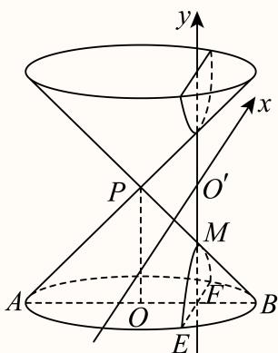

故选：D

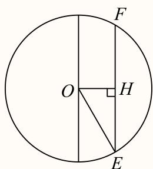

### 长宁 · 第4题

以C(3,4)为圆心，√3为半径的圆的标准方程是

**考点：** 由圆心半径求方程

**难度依据：** 圆的标准方程；由圆心半径求方程

【答案】$( x - 3 ) ^ { 2 } + ( y - 4 ) ^ { 2 } = 3$

【解析】

直接根据已知写出圆的标准方程得解.

由题得圆的标准方程为 $( x - 3 ) ^ { 2 } + ( y - 4 ) ^ { 2 } = 3$

故答案为： $( x - 3 ) ^ { 2 } + ( y - 4 ) ^ { 2 } = 3$

### 闵行 · 第3题

直线 ${ \sqrt { 3 } } \mathbf { x } - \mathbf { y } + 1 =$ 0的倾斜角为

> 本题资料或解析有待核事项，预览不可作为已审定成品。

**考点：** 由斜率求直线倾斜角

**难度依据：** 斜率与倾斜角；由斜率求直线倾斜角

**核查说明：** 源解析倾斜角范围误写为(0,π]，应核原卷；本题答案不受影响。

【解析】

把直线方程化为斜截式，再利用斜率与倾斜角的关系即可得出．设直线 ${ \sqrt { 3 } } x - y + 1 = 0$ 的倾斜角为θ

由直线 ${ \sqrt { 3 } } x - y + 1 = 0$ 化为 $y = \sqrt { 3 } x + 1$ ，故 $\tan \theta = { \sqrt { 3 } }$

又 $\theta \in ( 0 , \pi ]$ ，故 $\displaystyle { \dot { \theta } = \frac { \pi } { 3 } }$ ，故答案为 $\frac { \pi } { 3 }$

一般地，如果直线方程的一般式为 $A x + B y + C = 0 \left( B \neq 0 \right)$ )，那么直线的斜率为 $k = - { \frac { A } { B } }$ 且 $. k = \tan \theta .$ ，其中θ为直线的倾斜角，注意它的范围是(0,π]

### 青浦 · 第4题

已知直线 $\not { p } _ { 1 } \colon x + ( 1 + m ) y + m - 2 = 0$ 与直线l $: m x + 2 y + 8 = 0 \cdot$ 平行，则m = .

> 本题资料或解析有待核事项，预览不可作为已审定成品。

**考点：** 直线平行参数与重合排除

**难度依据：** 比例条件会给出重合直线需剔除

**核查说明：** 题干与解析已用于人工归类，尚未完成整题公式校净与独立数学终审。

【答案】1.

【解析】

两直线平行，则它们斜率相等.对于直线 $A x + B y + C = 0$ ，其斜率 $k = - { \frac { A } { B } }$ .我们先分别求出两直线的斜率，然后根据平行关系列出等式求解m的值

对于直线 $\not { l } _ { 1 } \colon x + ( 1 + m ) y + m - 2 = 0$ 根据斜率公式 $k = - { \frac { A } { B } }$ ，这里 $A = 1 , B = ( 1 + m )$ 所以 $k _ { 1 } = - \frac { 1 } { 1 + m } .$

对于直线 $l _ { 2 } \colon m x + 2 y + 8 = 0$ ，这里 $A = m , \ B = 2$ ，所以 $k _ { 2 } = - \frac { m } { 2 }$

因为 $n _ { 1 }  l _ { 2 }$ 平行，所以 $\boldsymbol { k } _ { 1 } = k _ { 2 }$ ，即 $\vert - \frac { 1 } { 1 + m } = - \frac { m } { 2 }$ 即 ${ \frac { 1 } { 1 + m } } = { \frac { m } { 2 } }$ ，解得 $m = - 2 \nexists \lambda m = 1$

当 $m = 1$ 时，直线 $l _ { 1 } \colon x + 2 y - 1 = 0$ ，直线 $\therefore x + 2 y + 8 = 0$ ，两直线平行.

当 $m = - 2$ 时，直线 $\ : l _ { 1 } : x - y - 4 = 0 \ :$ ，直线 $\therefore { } l _ { 2 } \colon - 2 x + 2 y + 8 = 0$ ，化简 $l _ { 2 }$ 为 $x - y - 4 = 0$ ，此时两直线重合，不符合要求，舍去.

故答案为：1.

### 青浦 · 第5题

两条渐近线互相垂直的双曲线的离心率为

> 本题资料或解析有待核事项，预览不可作为已审定成品。

**考点：** 等轴双曲线渐近线与离心率

**难度依据：** 垂直渐近线推出两半轴相等

**核查说明：** 题干与解析已用于人工归类，尚未完成整题公式校净与独立数学终审。

【答案】$\sqrt { 2 }$

【解析】

求出两渐近线方程，得到a = b，从而得到离心率.

两条渐近线互相垂直，由对称性可知，两渐近线的倾斜角分别为 $\frac { \pi } { 4 } , \frac { 3 \pi } { 4 }$

渐近线方程为 $\boldsymbol { \cdot } \boldsymbol { y } = \pm \boldsymbol { x }$ ，故 ${ \mathrm { : } } a = b ,$

所以渐近线的离心率为 ${ \frac { c } { a } } = { \sqrt { 1 + { \frac { b ^ { 2 } } { a ^ { 2 } } } } } = { \sqrt { 2 } } .$

故答案为： $\sqrt { 2 }$

### 静安 · 第5题

到点 $F _ { 1 } ( - 3 , 0 ) , F _ { 2 } ( 3 , 0 )$ 距离之和为10的动点P的轨迹方程为

**考点：** 由焦距和距离和求参数

**难度依据：** 椭圆定义与标准方程；由焦距和距离和求参数

【答案】${ \frac { x ^ { 2 } } { 2 5 } } + { \frac { y ^ { 2 } } { 1 6 } } = 1$

【解析】

根据给定条件，利用椭圆的定义求出轨迹方程.

依题意， $| P F _ { 1 } | + | P F _ { 2 } | = 1 0 > 6 = | F _ { 1 } F _ { 2 } |$

则点P的轨迹是以 $F _ { 1 } , F _ { 2 }$ 为左右焦点，长轴长2a = 10的椭圆，

由2c = 6，得 $\cdot b = { \sqrt { a ^ { 2 } - c ^ { 2 } } } = { \sqrt { 5 ^ { 2 } - 3 ^ { 2 } } } = 4$

所以动点P的轨迹方程为 ${ \frac { x ^ { 2 } } { 2 5 } } + { \frac { y ^ { 2 } } { 1 6 } } = 1$

故答案为： ${ \frac { x ^ { 2 } } { 2 5 } } + { \frac { y ^ { 2 } } { 1 6 } } = 1$

### 静安 · 第9题

以双曲线 ${ \frac { x ^ { 2 } } { 4 } } - { \frac { y ^ { 2 } } { m } } = 1$ 的离心率为半径，以右焦点为圆心的圆与双曲线的渐近线相切，则m的值为

**考点：** 焦点到渐近线距离等于离心率

**难度依据：** 双曲线渐近线与圆相切；焦点到渐近线距离等于离心率

【答案】$\frac { 4 } { 3 }$

【解析】

根据给定条件，求出双曲线渐近线方程、离心率及右焦点坐标，再利用圆的切线性质列式计算得解.

双曲线 ${ \frac { x ^ { 2 } } { 4 } } - { \frac { y ^ { 2 } } { m } } = 1$ 1的渐近线为 $\sqrt { m } x \pm 2 y = 0$ ，离心率 $e = { \frac { \sqrt { 4 + m } } { 2 } }$ ，右焦点 $\left( { \sqrt { 4 + m } } , 0 \right)$ 依题意， ${ \frac { { \sqrt { m } } \cdot { \sqrt { 4 + m } } } { \sqrt { 4 + m } } } = { \frac { \sqrt { 4 + m } } { 2 } }$ ，所以 $m = \frac { 4 } { 3 }$

故答案为： $\frac { 4 } { 3 }$

### 黄浦 · 第3题

椭圆 ${ \frac { x ^ { 2 } } { 4 } } + { \frac { y ^ { 2 } } { 3 } } = 1$ 的焦距是

**考点：** 由a²−b²求焦距

**难度依据：** 椭圆焦距；由a²−b²求焦距

【解析】

分析：由椭圆方程可求a b，然后由 $\begin{array} { r } { | c = \sqrt { a ^ { 2 } - b ^ { 2 } } } \end{array}$ 可求c，进而可求焦距

详解：∵椭圆 ${ \frac { x ^ { 2 } } { 4 } } + { \frac { y ^ { 2 } } { 3 } } = 1 , \div a = 2 \ , \ b = { \sqrt { 3 } }$

∴c = √a2 − b2 = 1 ∴ 2c = 2.

即答案为2

点睛：本题主要考查了椭圆的性质的简单应用，属基础题

## 焦点弦、交点与定点定值

联立曲线和直线，结合韦达、分点与面积条件；保留完整综合大题。

### 嘉定 · 第20题

在平面直角坐标系 $x O y \boxplus$ ，已知椭圆Γ: $\frac { x ^ { 2 } } { 5 } + \frac { y ^ { 2 } } { 4 } = 1 , F _ { 1 } , F _ { 2 }$ 是其左､右焦点，过椭圆Γ右焦点 $F _ { 2 }$ 的直线PQ交椭圆于P,Q两点
(1) (4分)若− $\overrightarrow { P F _ { 1 } } \cdot \overrightarrow { P F _ { 2 } } = 3$ ，求点P的坐标；
(2) (6分)若 $\triangle F _ { 1 } P Q$ 的面积为 $\frac { 4 0 } { 2 1 }$ ，求直线PQ的方程；
(3) (8分)设直线l与椭圆Γ交于A,B两点，M为线段AB的中点.当 $k _ { O M } \cdot k _ { A B } = k _ { O A } \cdot k _ { O B }$ 时，$\triangle O A$ B的面积是否为定值？如果是，请求出这个定值；如果不是，请说明理由.

> 本题资料或解析有待核事项，预览不可作为已审定成品。

**考点：** （1）数量积与椭圆联立求点；（2）韦达定理表示焦点弦面积；（3）点差法和斜率关系证明面积定值

**难度依据：** （1）数量积与椭圆联立求点；（2）韦达定理表示焦点弦面积；（3）点差法和斜率关系证明面积定值

**核查说明：** 题干与解析已用于人工归类，尚未完成整题公式校净与独立数学终审。

【解析】

(1) 易知 $F _ { 1 } \left( - 1 , 0 \right) , F _ { 2 } \left( 1 , 0 \right)$ ，设点 $P \left( x _ { 0 } , y _ { 0 } \right)$ ，

可得 $\frac { x _ { 0 } ^ { 2 } } { 5 } + \frac { y _ { 0 } ^ { 2 } } { 4 } = 1$ ，可得 $y _ { 0 } ^ { 2 } = 4 \left( 1 - { \frac { x _ { 0 } ^ { 2 } } { 5 } } \right)$ ，

则 $\overrightarrow { | P F _ { 1 } } = ( - 1 - x _ { 0 } , - y _ { 0 } ) , \overrightarrow { P F _ { 2 } } = ( 1 - x _ { 0 } , - y _ { 0 } ) _ { ; }$

所以 $\overrightarrow { P F _ { 1 } } \cdot \overrightarrow { P F _ { 2 } } = x _ { 0 } ^ { 2 } - 1 + y _ { 0 } ^ { 2 } = x _ { 0 } ^ { 2 } - 1 + 4 \left( 1 - \frac { x _ { 0 } ^ { 2 } } { 5 } \right) = \frac { x _ { 0 } ^ { 2 } } { 5 } + 3 = 3$ ，解得 $x _ { 0 } = 0$

可得 $y _ { 0 } = \pm 2$

即P (0, 2)或 $P \left( 0 , - 2 \right)$

(2) 设直线PQ的方程为x = my + 1， $P ( x _ { P } , y _ { P } ) , Q \left( x _ { Q } , y _ { Q } \right)$ ，

联立 $\left\{ { \frac { x ^ { 2 } } { 5 } } + { \frac { y ^ { 2 } } { 4 } } = 1 \right.$ 并整理可得 $\left( 4 m ^ { 2 } + 5 \right) y ^ { 2 } + 8 m y - 1 6 = 0$

所以 $y _ { P } + y _ { Q } = \frac { - 8 m } { 4 m ^ { 2 } + 5 } , y _ { P } y _ { Q } = \frac { - 1 6 } { 4 m ^ { 2 } + 5 } ,$

易知 $\triangle F _ { 1 } P Q$ 的面积为

$$
S _ {\triangle F _ {1} P Q} = \frac {1}{2} \left| F _ {1} F _ {2} \right| \left| y _ {P} - y _ {Q} \right| = \left| y _ {P} - y _ {Q} \right| = \sqrt {\left(y _ {P} + y _ {Q}\right) ^ {2} - 4 y _ {P} y _ {Q}} =
$$

$$
\begin{array}{l} \sqrt {\left(\frac {- 8 m}{4 m ^ {2} + 5}\right) ^ {2}} + \frac {6 4}{4 m ^ {2} + 5} \\ = \frac {8 \sqrt {5} \sqrt {m ^ {2} + 1}}{4 m ^ {2} + 5} = \frac {4 0}{2 1}, \end{array}
$$

解得 $m ^ { 2 } = 4$ ，即 $\mid m = \pm 2$ ；

所以直线PQ的方程为 $x - 2 y - 1 = 0 \not \equiv \not \{ x \} + 2 y - 1 = 0$

(3) 根据题意可知直线AB的斜率存在，

设直线AB的方程为 $\psi = k x + b , A ( x _ { 1 } , y _ { 1 } ) , B ( x _ { 2 } , y _ { 2 } )$ ，则M $\left( { \frac { x _ { 1 } + x _ { 2 } } { 2 } } , { \frac { y _ { 1 } + y _ { 2 } } { 2 } } \right)$ ，如下图所示：

易知 $\{ { \frac { x _ { 1 } ^ { 2 } } { 5 } } + { \frac { y _ { 1 } ^ { 2 } } { 4 } } = 1  \qquad \quad \quad \quad \quad \quad \quad \quad \quad \quad \quad \quad \quad \quad \quad \quad \quad \quad \quad \quad \quad \quad \quad \quad \quad \quad \quad  { }$ ，两式相减可得 ${ \frac { y _ { 1 } + y _ { 2 } } { x _ { 1 } + x _ { 2 } } } = - { \frac { 4 \left( x _ { 1 } - x _ { 2 } \right) } { 5 \left( y _ { 1 } - y _ { 2 } \right) } }$

由 $k _ { O M } = \frac { y _ { 1 } + y _ { 2 } } { x _ { 1 } + x _ { 2 } } , k _ { A B } = \frac { y _ { 1 } - y _ { 2 } } { x _ { 1 } - x _ { 2 } }$ ，所以可得 $\frac { y _ { 1 } + y _ { 2 } } { x _ { 1 } + x _ { 2 } } = k _ { O M } = - \frac { 4 \left( x _ { 1 } - x _ { 2 } \right) } { 5 \left( y _ { 1 } - y _ { 2 } \right) } = - \frac { 4 } { 5 k _ { A B } }$

； $k _ { O M } \cdot k _ { A B } = - \frac { 4 } { 5 }$ ，又 $k _ { O M } \cdot k _ { A B } = k _ { O A } \cdot k _ { O B }$ 可得 $k _ { O A } \cdot k _ { O B } = { \frac { y _ { 1 } } { x _ { 1 } } } \cdot { \frac { y _ { 2 } } { x _ { 2 } } } = { \frac { y _ { 1 } y _ { 2 } } { x _ { 1 } x _ { 2 } } } = - { \frac { 4 } { 5 } }$

$$
\frac {(k x _ {1} + b) (k x _ {2} + b)}{x _ {1} x _ {2}} = \frac {k ^ {2} x _ {1} x _ {2} + k b (x _ {1} + x _ {2}) + b ^ {2}}{x _ {1} x _ {2}} = - \frac {4}{5},
$$

联立 $\left\{ { \frac { x ^ { 2 } } { 5 } } + { \frac { y ^ { 2 } } { 4 } } = 1 \right.$ 整理可得 $\big ( 5 k ^ { 2 } + 4 \big ) x ^ { 2 } + 1 0 k b x + 5 b ^ { 2 } - 2 0 = 0 \mathrm { { , } }$

$\Delta = ( 1 0 k b ) ^ { 2 } - 4 \left( 5 k ^ { 2 } + 4 \right) \left( 5 b ^ { 2 } - 2 0 \right) = 4 0 0 k ^ { 2 } - 8 0 b ^ { 2 } + 3 2 0 > 0$ ，可得 $b ^ { 2 } < 5 k ^ { 2 } + 4$ ；

可得 $x _ { 1 } + x _ { 2 } = \frac { - 1 0 k b } { 5 k ^ { 2 } + 4 } , x _ { 1 } x _ { 2 } = \frac { 5 b ^ { 2 } - 2 0 } { 5 k ^ { 2 } + 4 } ;$

$$
\text {所以} \frac {k ^ {2} x _ {1} x _ {2} + k b (x _ {1} + x _ {2}) + b ^ {2}}{x _ {1} x _ {2}} = \frac {k ^ {2} \times \frac {5 b ^ {2} - 2 0}{5 k ^ {2} + 4} + k b \left(\frac {- 1 0 k b}{5 k ^ {2} + 4}\right) + b ^ {2}}{\frac {5 b ^ {2} - 2 0}{5 k ^ {2} + 4}} = - \frac {4}{5},
$$

整理可得 ${ \frac { 4 \left( b ^ { 2 } - 5 k ^ { 2 } \right) } { 5 \left( b ^ { 2 } - 4 \right) } } = - { \frac { 4 } { 5 } }$ ，即 $\begin{array} { r } { | 2 b ^ { 2 } = 5 k ^ { 2 } + 4 \rangle } \end{array}$

$$
\begin{array}{l} \text {易知} | A B | = \sqrt {1 + k ^ {2}} \sqrt {\left(x _ {1} + x _ {2}\right) ^ {2} - 4 x _ {1} x _ {2}} = \sqrt {1 + k ^ {2}} \sqrt {\left(\frac {- 1 0 k b}{5 k ^ {2} + 4}\right) ^ {2} - 4 \times \frac {5 b ^ {2} - 2 0}{5 k ^ {2} + 4}} \\ = \sqrt {1 + k ^ {2}} \frac {\sqrt {4 0 0 k ^ {2} - 8 0 b ^ {2} + 3 2 0}}{5 k ^ {2} + 4} = \sqrt {1 + k ^ {2}} \frac {\sqrt {4 0 (5 k ^ {2} + 4)}}{5 k ^ {2} + 4}; \end{array}
$$

原点O(0,0)到直线AB的距离为 $\mathsf { \Pi } \displaystyle d = \frac { | b | } { \sqrt { 1 + k ^ { 2 } } } $

所以△OAB的面积为

$$
S _ {\triangle O A B} = \frac {1}{2} | A B | d = \frac {1}{2} \times \sqrt {1 + k ^ {2}} \frac {\sqrt {4 0 (5 k ^ {2} + 4)}}{5 k ^ {2} + 4} \times \frac {| b |}{\sqrt {1 + k ^ {2}}} = \frac {| b | \sqrt {1 0 \times 2 b ^ {2}}}{2 b ^ {2}} = \sqrt {5};
$$

所以 $\triangle O A$ B的面积为定值，该定值为 ${ \sqrt { 5 } } .$

### 奉贤 · 第20题

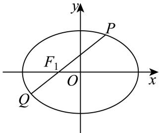
椭圆Γ: ${ \frac { x ^ { 2 } } { a ^ { 2 } } } + y ^ { 2 } = 1 ( a > 1 )$ 的左右焦点分别为 $F _ { 1 } , F _ { 2 }$ ，设 $P \left( x _ { 0 } , y _ { 0 } \right)$ 是第一象限内椭圆上的一点，$P F _ { 1 }$ 的延长线交椭圆于点 $Q \left( x _ { 1 } , y _ { 1 } \right)$

(1) (4分)若椭圆的离心率 $\frac { \sqrt { 2 } } { 2 }$ ，求a的值；
(2) (6分) $\overleftrightarrow { \boldsymbol { \mathrm { f } } } a = \sqrt { 2 } , \overrightarrow { P Q } \cdot \overrightarrow { O F _ { 1 } } = \frac { 1 2 } { 5 }$ ，求x0；
(3) (8分)若a = 2，过点 $T \left( 0 , t \right)$ 的直线l与椭圆Γ交于M、N两点，且 $\vert M N \vert = 2$ ，则当 $t \geq 0 \mathbb { H }$ 时，判 断符合要求的直线有几条，说明理由？

> 本题资料或解析有待核事项，预览不可作为已审定成品。

**考点：** （1）离心率定参数；（2）向量约束与焦点弦联立；（3）按参数讨论定长弦数目并补竖直线

**难度依据：** （1）离心率定参数；（2）向量约束与焦点弦联立；（3）按参数讨论定长弦数目并补竖直线

**核查说明：** 题干与解析已用于人工归类，尚未完成整题公式校净与独立数学终审。；原解第3问竖直线讨论写成t>0但题设允许t=0，最后汇总包含t=0；须规范边界说明。；题干与解析已用于人工归类，尚未完成整题公式校净与独立数学终审。；原解第3问竖直线讨论写成t>0但题设允许t=0，最后汇总包含t=0；须规范边界说明。

【解析】

(1) 若 $\dot { \boldsymbol { e } } = \frac { \sqrt { 2 } } { 2 }$ ，则 ${ \frac { { \sqrt { a ^ { 2 } - 1 } } } { a } } = { \frac { \sqrt { 2 } } { 2 } }$ ，解得： $a = { \sqrt { 2 } } .$

(2) 若 ${ \dot { a } } = { \sqrt { 2 } } ,$ 则椭圆方程为： ${ \frac { x ^ { 2 } } { 2 } } + y ^ { 2 } = 1 { \mathrm { H } } c = 1$ ，由P点在第一象限可知PQ的斜率不为0设直线PQ的方程为： $x = k y - 1 ( k > 0 )$ ，直线 $P Q$ 与椭圆方程联立消去x得：

$$
(k ^ {2} + 2) y ^ {2} - 2 k y - 1 = 0,
$$

所以 $y _ { 0 } + y _ { 1 } = \frac { 2 k } { k ^ { 2 } + 2 } , y _ { 0 } y _ { 1 } = - \frac { 1 } { k ^ { 2 } + 2 } ,$

$$
\left| y _ {0} - y _ {1} \right| = \sqrt {\left(y _ {0} + y _ {1}\right) ^ {2} - 4 y _ {0} y _ {1}} = \sqrt {\left(\frac {2 k}{k ^ {2} + 2}\right) ^ {2} + \frac {4}{k ^ {2} + 2}} = \frac {\sqrt {8 k ^ {2} + 8}}{k ^ {2} + 2},
$$

因为 $\tan \angle P F _ { 1 } O = \frac { 1 } { k }$ ，所以 $\cos \angle P F _ { 1 } O = \frac { 1 } { \sqrt { 1 + \frac { 1 } { k ^ { 2 } } } } = k \sqrt { \frac { 1 } { k ^ { 2 } + 1 } } ,$

而

$$
\overrightarrow {P Q} \cdot \overrightarrow {O F _ {1}} = \left| \overrightarrow {P Q} \right| \left| \overrightarrow {O F _ {1}} \right| \cos \angle P F _ {1} O = \sqrt {1 + k ^ {2}} \times | y _ {0} - y _ {1} | \times k \sqrt {\frac {1}{k ^ {2} + 1}} = \sqrt {1 + k ^ {2}} \times
$$

$$
\frac {\sqrt {8 k ^ {2} + 8}}{k ^ {2} + 2} \times k \sqrt {\frac {1}{k ^ {2} + 1}} = \frac {1 2}{5}
$$

解得： $k = 2 { \sqrt { 2 } } ,$ ，把 $k = 2 \sqrt { 2 }$ 代入 $\begin{array} { r } { \big ( k ^ { 2 } + 2 \big ) y ^ { 2 } - 2 k y - 1 = 0 } \end{array}$ 0得：

$$
1 0 y ^ {2} - 4 \sqrt {2} y - 1 = 0 \Rightarrow y _ {0} = \frac {4 \sqrt {2} + \sqrt {7 2}}{2 0} = \frac {\sqrt {2}}{2},
$$

把 $\lfloor y _ { 0 } = { \frac { \sqrt { 2 } } { 2 } }$ 代入椭圆方程得： $x _ { 0 } = 1$

(3) 若 ${ \dot { a } } = 2 ,$ 则椭圆方程为： ${ \frac { x ^ { 2 } } { 4 } } + y ^ { 2 } = 1$ ，且 $b = 1$

当 $t \geq 0$ 且直线l斜率存在时，设直线l的方程为： $y = m x + t , ~ M ( x _ { 2 } , y _ { 2 } ) , N ( x _ { 3 } , y _ { 3 } )$

直线l与椭圆方程联立消去y得： $\big ( 4 m ^ { 2 } + 1 \big ) x ^ { 2 } + 8 m t x + 4 t ^ { 2 } - 4 = 0 ,$

所以 $x _ { 2 } + x _ { 3 } = \frac { - 8 m t } { 4 m ^ { 2 } + 1 } , x _ { 2 } x _ { 3 } = \frac { 4 t ^ { 2 } - 4 } { 4 m ^ { 2 } + 1 } ,$

$$
\left| x _ {2} - x _ {3} \right| = \sqrt {\left(x _ {2} + x _ {3}\right) ^ {2} - 4 x _ {2} x _ {3}} = \sqrt {\left(\frac {- 8 m t}{4 m ^ {2} + 1}\right) ^ {2} - 4 \times \frac {4 t ^ {2} - 4}{4 m ^ {2} + 1}} = \frac {\sqrt {6 4 m ^ {2} - 1 6 t ^ {2} + 1 6}}{4 m ^ {2} + 1}
$$

所以 $\vert M N \vert = \sqrt { 1 + m ^ { 2 } } \left. x _ { 2 } - x _ { 3 } \right. = \sqrt { 1 + m ^ { 2 } } \frac { \sqrt { 6 4 m ^ { 2 } - 1 6 t ^ { 2 } + 1 6 } } { 4 m ^ { 2 } + 1 } = 2 ,$ 整理得：

$$
(1 2 - 4 t ^ {2}) m ^ {2} - 4 t ^ {2} + 3 = 0,
$$

当 $1 2 - 4 t ^ { 2 } = 0 \not \exists \hat { \chi } \Delta = 4 \left( 4 t ^ { 2 } - 3 \right) \left( 1 2 - 4 t ^ { 2 } \right) <$ < 0时，即0 $\leq t < \frac { \sqrt { 3 } } { 2 }$ 或 $t \geq \sqrt { 3 } \mathbb { H }$ 时，

方程无解，所以不存在满足 $M N | = 2$ 的直线l；

当 $- 4 t ^ { 2 } + 3 = 0$ 即t $= { \frac { \sqrt { 3 } } { 2 } }$ 时，方程只有唯一的解 $: m = 0$ ，所以，存在一条满足 $M N | = 2 \sharp \sharp$ 直线l；

当 $\Delta = 4 \left( 4 t ^ { 2 } - 3 \right) \left( 1 2 - 4 t ^ { 2 } \right) > 0$ ，即 ${ \frac { \sqrt { 3 } } { 2 } } < t < { \sqrt { 3 } }$ 时，方程有两个不相等的实数解，

所以存在两条满足 $| M N | = 2$ 的直线l；

当 $t > 0$ 且直线l斜率不存在时，直线l即y轴，满足 $\vert M N \vert = 2$

综上所述：当 $0 \leq t < \frac { \sqrt { 3 } } { 2 }$ 或 $; \geq { \sqrt { 3 } }$ 时，存在一条满足|MN| = 2的直线l；

当 $t = { \frac { \sqrt { 3 } } { 2 } }$ 时，存在两条满足 $\vert M N \vert = 2$ 的直线l；

当 ${ \frac { \sqrt { 3 } } { 2 } } < t < { \sqrt { 3 } }$ 时，存在三条满足|MN| = 2的直线l.

### 宝山 · 第20题

…
已知椭圆 $\ : : \frac { x ^ { 2 } } { 9 } + \frac { y ^ { 2 } } { 3 } = 1 \ :$ ，直线l经过椭圆Γ的右顶点P且与椭圆交于另一点A，设线段AP的中点为M.

(1) (4分)求椭圆Γ的焦距和离心率；
(2) (6分)若 $k _ { O M } = - \frac { 1 } { 3 } .$ ，求直线AP的方程；
(3) (8分)过点P再作一条直线与椭圆Γ交于点B，线段BP的中点为N.若 $O M \bot O N$ ，则直线AB是否经过定点？若经过定点，求出定点坐标；若不经过定点，请说明理由

> 本题资料或解析有待核事项，预览不可作为已审定成品。

**考点：** （1）椭圆离心率；（2）弦中点斜率；（3）向量垂直与定点

**难度依据：** 涉及（1）椭圆离心率；（2）弦中点斜率；（3）向量垂直与定点；难度为教师预估，需结合原题条件复核。

**核查说明：** 仅修复所列OCR公式及其定界符错位；原解数学疑点和其他可渲染错识未因此消除。；第（3）问舍根及特殊位置须回核。；依据现有底稿归类，尚未逐页校卷、公式校净或独立数学终审。；仅修复所列OCR公式及其定界符错位；原解数学疑点和其他可渲染错识未因此消除。；第（3）问舍根及特殊位置须回核。

【解析】

(1) $\boxed { \ d } a = 3 , b = \sqrt { 3 } / \boxed { \sharp } c = \sqrt { a ^ { 2 } - b ^ { 2 } } = \sqrt { 6 } ,$ ，所以焦距 $\dot { 2 c } = 2 \sqrt { 6 }$ ，离心率 $e = { \frac { c } { a } } = { \frac { \sqrt { 6 } } { 3 } }$

(2)

$P \left( 3 , 0 \right)$ ，设直线AP的方程 $x = t y + 3$

与椭圆Γ: $: { \frac { x ^ { 2 } } { 9 } } + { \frac { y ^ { 2 } } { 3 } } = 1$ ，联立 ${ \left\{ \begin{array} { l l } { x = t y + 3 } \\ { { \frac { x ^ { 2 } } { 9 } } + { \frac { y ^ { 2 } } { 3 } } = 1 } \end{array} \right. }$ 得： $\frac { \left( t y + 3 \right) ^ { 2 } } { 9 } + \frac { y ^ { 2 } } { 3 } = 1$

整理得： $\ ( t ^ { 2 } + 3 ) y ^ { 2 } + 6 t y = 0$ $y _ { A } + y _ { P } = { \frac { - 6 t } { t ^ { 2 } + 3 } } , y _ { A } y _ { P } = 0$

因为点M与点P不重合，M为 $A P ^ { \varepsilon }$ 中点，所 $ \ [ \times \ - y _ { M } = \frac { y _ { A } + y _ { P } } { 2 } = \frac { - 3 t } { t ^ { 2 } + 3 }$

代入方程 $x = t y + 3$ ，解得 $x _ { M } = \frac { - 3 t ^ { 2 } } { t ^ { 2 } + 3 } + 3 = \frac { 9 } { t ^ { 2 } + 3 }$ 所以可得点M $\left( { \frac { 9 } { t ^ { 2 } + 3 } } , { \frac { - 3 t } { t ^ { 2 } + 3 } } \right)$

于是由 $k _ { O M } = \frac { - 3 t } { 9 } = - \frac { 1 } { 3 }$ 得 $\mathbf { \boldsymbol { \cdot } } t = 1$ ，直线AP的方程： $x - y - 3 = 0$

(3)

①当直线A 斜率存在时，设方程为： $y = k x + m$ ，与椭圆Γ: $\frac { x ^ { 2 } } { 9 } + \frac { y ^ { 2 } } { 3 } = 1$

联立 ${ \left\{ \begin{array} { l l } { y = k x + m } \\ { { \frac { x ^ { 2 } } { 9 } } + { \frac { y ^ { 2 } } { 3 } } = 1 } \end{array} \right. } ,$ 得： $\frac { x ^ { 2 } } { 9 } + \frac { ( k x + m ) ^ { 2 } } { 3 } = 1$

整理得： $\big ( 3 k ^ { 2 } + 1 \big ) x ^ { 2 } + 6 k m x + 3 m ^ { 2 } - 9 = 0 ,$

设A $( x _ { 1 } , y _ { 1 } ) , B \left( x _ { 2 } , y _ { 2 } \right)$ ，由韦达定理得 $\begin{cases}x_1+x_2=\dfrac{-6km}{3k^2+1},\\x_1x_2=\dfrac{3m^2-9}{3k^2+1}.\end{cases}$

且 $\Delta = 3 6 k ^ { 2 } m ^ { 2 } - 4 \left( 3 k ^ { 2 } + 1 \right) \left( 3 m ^ { 2 } - 9 \right) > 0 \nonumber$ ，化简得 $m ^ { 2 } - 9 k ^ { 2 } - 3 < 0$

又 $P \left( 3 , 0 \right)$ ，从而 $M \left( { \frac { x _ { 1 } + 3 } { 2 } } , { \frac { y _ { 1 } } { 2 } } \right)$ $N \left( { \frac { x _ { 2 } + 3 } { 2 } } , { \frac { y _ { 2 } } { 2 } } \right)$

由 $O M \bot O N ^ { \overline { { \Pi } } }$ 得 ${ \overrightarrow { O M } } \cdot { \overrightarrow { O N } } = 0$ ，从而 $\left( x _ { 1 } + 3 \right) \left( x _ { 2 } + 3 \right) + y _ { 1 } y _ { 2 } = 0$

又因为 $\begin{array} { r } { \lvert y _ { 1 } = k x _ { 1 } + m , y _ { 2 } = k x _ { 2 } + m , } \end{array}$

所以上式化为： $\left( x _ { 1 } + 3 \right) \left( x _ { 2 } + 3 \right) + \left( k x _ { 1 } + m \right) \left( k x _ { 2 } + m \right) = 0$

整理得： $\begin{array} { r } { \big ( k ^ { 2 } + 1 \big ) x _ { 1 } x _ { 2 } + \big ( k m + 3 \big ) \big ( x _ { 1 } + x _ { 2 } \big ) + m ^ { 2 } + 9 = 0 , } \end{array}$

韦达定理代入： $\frac { \left( k ^ { 2 } + 1 \right) \left( 3 m ^ { 2 } - 9 \right) } { 3 k ^ { 2 } + 1 } + \frac { - 6 k m \cdot \left( k m + 3 \right) } { 3 k ^ { 2 } + 1 } + m ^ { 2 } + 9 = 0 ,$

化简得： $9 k ^ { 2 } - 9 k m + 2 m ^ { 2 } = 0 .$

$\left( 3 k - 2 m \right) \left( 3 k - m \right) = 0$ ，所以 $m = 3 k \not \equiv \hat { \chi } m = \frac { 3 } { 2 } k$

当m = 3k时，直线AB为： $y = k x + 3 k = k \left( x + 3 \right)$

直线AB经过点(−3,0)，舍去；

当 $m = \frac { 3 } { 2 }$ k时，直线AB为： $y = k x + { \frac { 3 } { 2 } } k = k \left( x + { \frac { 3 } { 2 } } \right)$ ，

此时 $\frac 9 4 k ^ { 2 } - 9 k ^ { 2 } - 3 < 0 !$ 成立，直线AB经过定点 $\left( - \frac { 3 } { 2 } , 0 \right)$

②当直线AB斜率不存在时，设 $A ( m , n ) , \ B ( m , - n )$

则M $\bar { I } \left( \frac { m + 3 } { 2 } , \frac { n } { 2 } \right) , \ N \left( \frac { m + 3 } { 2 } , \frac { - n } { 2 } \right) , \ \overrightarrow { O M } = \left( \frac { m + 3 } { 2 } , \frac { n } { 2 } \right) , \ \overrightarrow { O N } = \left( \frac { m + 3 } { 2 } , \frac { - n } { 2 } \right)$

代入 $\overrightarrow { O M } \cdot \overrightarrow { O N } = 0 .$ ，得 $n ^ { 2 } = \left( m + 3 \right) ^ { 2 }$

与 ${ \frac { m ^ { 2 } } { 9 } } + { \frac { n ^ { 2 } } { 3 } } = 1$ 联立得： $2 m ^ { 2 } + 9 m + 9 = 0$ 解得 $m = - \frac { 3 } { 2 }$

此时直线AB也经过点 $\left( - \frac { 3 } { 2 } , 0 \right)$

综上，直线AB经过定点 $\left( - \frac { 3 } { 2 } , 0 \right)$

### 崇明 · 第20题

已知椭圆Γ: ${ \frac { y ^ { 2 } } { 4 } } + { \frac { x ^ { 2 } } { 3 } } = 1$ ，点 $F _ { 1 }$ 、 $F _ { 2 }$ 分别是椭圆的下焦点和上焦点，过点 $F _ { 2 }$ 的直线l与椭圆交于A、B两点
(1) (4分)若直线l平行于x轴，求线段AB的长；
(2) (6分)若点A在y轴左侧，且− ${ \overrightarrow { F _ { 1 } A } } \cdot { \overrightarrow { F _ { 2 } A } } = { \frac { 9 } { 4 } }$ ，求直线l的方程；
(3) (8分)已知椭圆上的点C满足 $| C A | = | C B |$ ，是否存在直线l使得△ABC的重心在x轴上？若存在，请求出直线l的方程，若不存在，请说明理由

> 本题资料或解析有待核事项，预览不可作为已审定成品。

**考点：** （1）焦点弦长；（2）数量积求弦；（3）等腰与重心条件

**难度依据：** 涉及（1）焦点弦长；（2）数量积求弦；（3）等腰与重心条件；难度为教师预估，需结合原题条件复核。

**核查说明：** 原解上焦点坐标及后续分母前后不一致，须回核。；依据现有底稿归类，尚未逐页校卷、公式校净或独立数学终审。

【解析】

(1) 由题意， $F _ { 1 } ( 0 , - 1 )$ 、 $F _ { 2 } ( 1 , 0 )$ ，所以直线l的方程是 $y = 1$ ，

代入 ${ \frac { y ^ { 2 } } { 4 } } + { \frac { x ^ { 2 } } { 3 } } = 1$ 中，得 $x = \pm \frac { 3 } { 2 }$ ，所以 $| A B | = 3$

(2) 设 $A ( x _ { 0 } , y _ { 0 } ) ( x _ { 0 } < 0 )$ ，则 $\overrightarrow { F _ { 1 } A } = ( x _ { 0 } , y _ { 0 } + 1 ) , \overrightarrow { F _ { 2 } A } = ( x _ { 0 } , y _ { 0 } - 1 )$

所以 $\overrightarrow { { \cal F } _ { 1 } A } \cdot \overrightarrow { { \cal F } _ { 2 } A } = x _ { 0 } ^ { 2 } + \left( y _ { 0 } + 1 \right) \left( y _ { 0 } - 1 \right) = \frac { 9 } { 4 }$

又 $\frac { y _ { 0 } ^ { 2 } } { 4 } + \frac { x _ { 0 } ^ { 2 } } { 3 } = 1$ ，所以 $\left\{ { x _ { 0 } = - { \frac { 3 } { 2 } } } \right.$ 所以A点坐标是 $\left( - { \frac { 3 } { 2 } } , 1 \right)$ 或 $\left( - { \frac { 3 } { 2 } } , - 1 \right)$

所以直线l的方程是 $y = 1 \textcircled { \sharp } \hat { \chi } y = \frac { 4 } { 3 } x + 1$

(3) 当直线l的斜率存在时，设直线l的方程为 $\textstyle | y = k x + 1$

代入 ${ \frac { y ^ { 2 } } { 4 } } + { \frac { x ^ { 2 } } { 3 } } = 1 \#$ ，得 $( 3 k ^ { 2 } + 4 ) x ^ { 2 } + 6 k x - 9 = 0$ ，此时 $\Delta = 1 4 4 k ^ { 2 } + 1 4 4 > 0$

设 $\cdot A ( x _ { 1 } , y _ { 1 } ) \cdot \ B ( x _ { 2 } , y _ { 2 } ) \cdot \ C ( x _ { 3 } , y _ { 3 } )$

则 $\lvert x _ { 1 } + x _ { 2 } = \frac { - 6 k } { 3 k ^ { 2 } + 4 }$ ，所以AB中点M $\left( { \frac { - 3 k } { 3 k ^ { 2 } + 4 } } , { \frac { 4 } { 3 k ^ { 2 } + 4 } } \right)$

又 $\triangle A B C$ 的重心在x轴上，所以 $y _ { 1 } + y _ { 2 } + y _ { 3 } = 0$

即 $k ( x _ { 1 } + x _ { 2 } ) + 2 + y _ { 3 } = 0$ ，故 $y _ { 3 } = - { \frac { 8 } { 3 k ^ { 2 } + 4 } } .$

因为 $| C A | = | C B |$ ，所以 $M C \bot A B$

所以 $\overrightarrow { M C } \cdot \overrightarrow { A B } = \left( x _ { 3 } + \frac { 3 k } { 3 k ^ { 2 } + 4 } , y _ { 3 } - \frac { 4 } { 3 k ^ { 2 } + 4 } \right) \cdot ( x _ { 1 } - x _ { 2 } , y _ { 1 } - y _ { 2 } ) _ { t w i t h }$

因为 $x _ { 1 } - x _ { 2 } \neq 0$ ，所以 $x _ { 3 } + { \frac { 3 k } { 3 k ^ { 2 } + 4 } } + { \bigg ( } y _ { 3 } - { \frac { 4 } { 3 k ^ { 2 } + 4 } } { \bigg ) } k = 0 ,$

所以 $x _ { 3 } = { \frac { 9 k } { 3 + 4 k ^ { 2 } } }$ ，所以 $C \left( \frac { 9 k } { 3 + 4 k ^ { 2 } } , - \frac { 8 } { 3 k ^ { 2 } + 4 } \right)$ ，

因为点C在椭圆上，所以 ${ \frac { \left( - { \frac { 8 } { 3 k ^ { 2 } + 4 } } \right) ^ { 2 } } { 4 } } + { \frac { \left( { \frac { 9 k } { 3 + 4 k ^ { 2 } } } \right) ^ { 2 } } { 3 } } = 1$ ，解得k = 0或 $k = \pm \frac { \sqrt { 3 } } { 3 }$ 当直线l的斜率不存在时，直线l的方程为 $x = 0$ 9

此时A、B恰为长轴顶点，点C为短轴顶点，满足题意

综上所述，存在直线l使得 $\triangle A B C$ 的重心在x轴上，

其方程为： $y = \pm { \frac { \sqrt { 3 } } { 3 } } x + 1$ 或 $y = 1$ 或 $x = 0$

### 徐汇 · 第20题

已知过点 $P \left( 3 , { \sqrt { 2 } } \right)$ 的双曲线C的渐近线方程为 $x \pm { \sqrt { 3 } } y = 0$ .如图所示，过双曲线C的右焦点F作与 坐标轴都不垂直的直线l交C的右支于A,B两点.
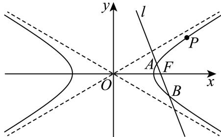
(1) (4分)求双曲线C的标准方程；
(2) (6分)已知点Q $\left( { \frac { 3 } { 2 } } , 0 \right)$ ，求证： $\angle A Q F = \angle B Q F$
(3) (8分)若以AB为直径的圆被直线 $x = \frac { 3 } { 2 }$ 截得的劣弧为 $\widehat { M N }$ ，则 $\widehat { M N }$ 所对圆心角的大小是否为定值？若是，求出该定值；若不是，请说明理由.

> 本题资料或解析有待核事项，预览不可作为已审定成品。

**考点：** （1）渐近线及过点确定双曲线；（2）焦点弦与斜率对称；（3）直径圆与定角

**难度依据：** 双曲线焦点弦与圆心角定值；按所需步骤与推理量估计

**核查说明：** 题干与解析已用于人工归类，尚未完成整题公式校净与独立数学终审。；联立方程及部分长分式有识别损坏，须核原解。；题干与解析已用于人工归类，尚未完成整题公式校净与独立数学终审。；联立方程及部分长分式有识别损坏，须核原解。

【解析】

(1) 因为双曲线C的渐近线方程为 $x \pm { \sqrt { 3 } } y = 0$

所以设双曲线方程为 $x ^ { 2 } - 3 y ^ { 2 } = \lambda ( \lambda \neq 0 )$ )，又双曲线过点 $P \left( 3 , { \sqrt { 2 } } \right)$ ，

则 $\lambda = 9 - 3 \times 2 = 3 ,$

所以双曲线的方程为 $x ^ { 2 } - 3 y ^ { 2 } = 3$ ，即 ${ \frac { x ^ { 2 } } { 3 } } - y ^ { 2 } = 1$

(2) 由(1)可知F(2,0)，l的斜率存在且不为0，所以设l的方程为 $\mathinner { | { y = k \left( x - 2 \right) } }$ )，

联立 $\left\{ { { y = k \left( x - 2 \right) } } _ { \left[ { x ^ { 2 } - 3 y ^ { 2 } } \right. } \right.$ ，消去y得 $\big ( 1 - 3 k ^ { 2 } \big ) x ^ { 2 } + 1 2 k ^ { 2 } x - 1 2 k ^ { 2 } - 3 = 0 ,$

设 $A \left( x _ { 1 } , y _ { 1 } \right) , B \left( x _ { 2 } , y _ { 2 } \right)$ ，由题意得 $\left\{ \begin{array} { l l } { \displaystyle 1 - 3 k ^ { 2 } \neq 0 } \\ { \Delta > 0 } \\ { \displaystyle x _ { 1 } + x _ { 2 } = \frac { - 1 2 k ^ { 2 } } { 1 - 3 k ^ { 2 } } > 0 } \\ { \displaystyle x _ { 1 } \cdot x _ { 2 } = \frac { - 1 2 k ^ { 2 } - 3 } { 1 - 3 k ^ { 2 } } > 0 } \end{array} \right.$

所以 $\mathfrak { i } \in \left( - \infty , - \frac { \sqrt { 3 } } { 3 } \right) \cup \left( \frac { \sqrt { 3 } } { 3 } , + \infty \right)$ $\left\{ \begin{array} { l l } { \displaystyle x _ { 1 } + x _ { 2 } = \frac { - 1 2 k ^ { 2 } } { 1 - 3 k ^ { 2 } } } \\ { \displaystyle x _ { 1 } \cdot x _ { 2 } = \frac { - 1 2 k ^ { 2 } - 3 } { 1 - 3 k ^ { 2 } } } \end{array} , \right.$

所以 $\dot { \mathfrak { c } } _ { A Q } + k _ { B Q } = \frac { y _ { 1 } } { x _ { 1 } - \frac { 3 } { 2 } } + \frac { y _ { 2 } } { x _ { 2 } - \frac { 3 } { 2 } } = \frac { k \left( \dot { x _ { 1 } } - 2 \right) } { x _ { 1 } - \frac { 3 } { 2 } } + \frac { k \left( x _ { 2 } - 2 \right) } { x _ { 2 } - \frac { 3 } { 2 } }$

k [2x1x2 − 7 (x + x ) + 6] k [2 (−12k2 − 3) + 72 × 12k2 + 6 (1 − 3k2) 2 = x1x2 − 32 (x1 + x2) + 94 −12k2 − 3 + 32 × 12k2 + 9 (1 − 3k2) 4 4

所以 $k _ { A Q } = - k _ { B Q }$ ，即 $\angle A Q F = \angle B Q F$ 得证.

(3) 由(2)可知 $| \Delta = 1 2 k ^ { 2 } + 1 2 >$ 0恒成立， $x _ { 1 } + x _ { 2 } = { \frac { - 1 2 k ^ { 2 } } { 1 - 3 k ^ { 2 } } }$

所以圆心到 $x = \frac { 3 } { 2 }$ 的距离 ${ \dot { \iota } } d = \left| { \frac { 6 k ^ { 2 } } { 3 k ^ { 2 } - 1 } } - { \frac { 3 } { 2 } } \right| = \left| { \frac { 3 k ^ { 2 } + 3 } { 2 ( 3 k ^ { 2 } - 1 ) } } \right|$

$$
\text {半径} r = \frac {| A B |}{2} = \frac {1}{2} \sqrt {1 + k ^ {2}} \frac {\sqrt {1 2 k ^ {2} + 1 2}}{| 1 - 3 k ^ {2} |} = \frac {\sqrt {3} (1 + k ^ {2})}{| 3 k ^ {2} - 1 |},
$$

设 $\widehat { M N }$ 所对圆心角为θ，

$$
\text {则} \cos {\frac {\theta}{2}} = {\frac {d}{r}} = \left| {\frac {3 \left(k ^ {2} + 1\right)}{2 \left(3 k ^ {2} - 1\right)}} \right| \cdot \left| {\frac {3 k ^ {2} - 1}{\sqrt {3} \left(1 + k ^ {2}\right)}} \right| = {\frac {\sqrt {3}}{2}},
$$

因为 $\widehat { M N }$ 为劣弧，所以 $\theta \in ( 0 , \pi )$

所以 ${ \frac { \theta } { 2 } } = { \frac { \pi } { 6 } }$ ，所以 $\theta = \frac { \pi } { 3 }$ ，即 $\widehat { M N }$ 所对圆心角的大小为定值 $\frac { \pi } { 3 }$

### 普陀 · 第20题

设 $m > 0 , \ m > 0 , \ F _ { 1 \setminus } \ F _ { 2 }$ 分别是双曲线Γ: ${ \frac { x ^ { 2 } } { a ^ { 2 } } } - y ^ { 2 } = 1$ 的左、右焦点，直线 $l { : } x - m y - 2 = 0 { \stackrel { 4 } { - } }$ 经过 点 $F _ { 2 ^ { - } }$ 与Γ的右支交于A、B两点，点O是坐标原点.
(1) (4分)若点M是Γ上的一点， $\vert M F _ { 1 } \vert = 2$ ，求 $| M F _ { 2 }$ |的值；
(2) (6分)设λ、 $\mu \in \mathbf { R } _ { : }$ ，点P在直线 $\dot { z } x = 6 .$ 上，若点O、A、P、B满足： $\overrightarrow { O A } = \lambda \overrightarrow { B P } , \overrightarrow { O B } = \mu \overrightarrow { A P }$ 求点P的坐标；
(3) (8分)设AO的延长线与Γ交于G点，若向量− $\xrightarrow { }$ 与 $\overbrace { O B }$ 满足： $\overrightarrow { O A } \cdot \overrightarrow { O B } \geq 1 7$ ，求 $\triangle G A B$ 的面积S 的取值范围.

> 本题资料或解析有待核事项，预览不可作为已审定成品。

**考点：** （1）由焦点和定义求距离；（2）向量关系转平行四边形与中点；（3）数量积限定参数后求三角形面积范围

**难度依据：** （1）由焦点和定义求距离；（2）向量关系转平行四边形与中点；（3）数量积限定参数后求三角形面积范围

**核查说明：** 题干与解析已用于人工归类，尚未完成整题公式校净与独立数学终审。；题干a>0误写为重复m>0，部分向量标签残缺，需视觉回源。；题干与解析已用于人工归类，尚未完成整题公式校净与独立数学终审。；题干a>0误写为重复m>0，部分向量标签残缺，需视觉回源。

【解析】

(1) 双曲线 ${ \frac { x ^ { 2 } } { a ^ { 2 } } } - y ^ { 2 } = 1$ 的右焦点 $F _ { 2 }$ 的坐标为 $\left( \sqrt { a ^ { 2 } + 1 } , 0 \right)$

因为 $x - m y - 2 = ($ 0过点 $F _ { 2 }$ ，

所以 ${ \sqrt { a ^ { 2 } + 1 } } - 2 = 0$ ，所 $\lambda a = { \sqrt { 3 } }$

因为 $| M F _ { 1 } | = 2 < a + \sqrt { a ^ { 2 } + 1 } = \sqrt { 3 } + 2 ,$

所以点M在双曲线 ${ \frac { x ^ { 2 } } { a ^ { 2 } } } - y ^ { 2 }$ = 1的左支上，

由双曲线定义知 $| M F _ { 2 } | - | M F _ { 1 } | = 2 \sqrt { 3 }$ ，又 $\vert M F _ { 1 } \vert = 2$

所以 $| M F _ { 2 } | = 2 \sqrt { 3 } + 2 \ /$

(2) 由（1）知， $a = { \sqrt { 3 } } ,$ ，则双曲线Γ: ${ \frac { x ^ { 2 } } { 3 } } - y ^ { 2 } = 1$

联立 $\left\{ { \begin{array} { l l } { x - m y - 2 = 0 } \\ { x ^ { 2 } - 3 y ^ { 2 } = 3 } \end{array} } \right.$ ，消去x得 $\left( m ^ { 2 } - 3 \right) y ^ { 2 } + 4 m y + 1 = 0$

则 $| \Delta = 1 6 m ^ { 2 } - 4 m ^ { 2 } + 1 2 = 1 2 m ^ { 2 } + 1 2 > 0 ,$

设A $( x _ { 1 } , y _ { 1 } ) , B \left( x _ { 2 } , y _ { 2 } \right)$ ，则 $y _ { 1 } + y _ { 2 } = { \frac { - 4 m } { m ^ { 2 } - 3 } } , y _ { 1 } y _ { 2 } = { \frac { 1 } { m ^ { 2 } - 3 } } ,$

所以 $x _ { 1 } + x _ { 2 } = m y _ { 1 } + 2 + m y _ { 2 } + 2 = m \left( y _ { 1 } + y _ { 2 } \right) + 4 = { \frac { - \mathbf { 1 } { \overset { \triangledown } { \mathbf { \theta } } } } { m ^ { 2 } - 3 } } ,$

$$
x _ {1} x _ {2} = (m y _ {1} + 2) (m y _ {2} + 2) = m ^ {2} y _ {1} y _ {2} + 2 m (y _ {1} + y _ {2}) + 4 = \frac {- 3 m ^ {2} - 1 2}{m ^ {2} - 3},
$$

又 $y _ { 1 } y _ { 2 } < 0$ ，所 $\downarrow m ^ { 2 } < 3$

因为点O、A、P、B满足： $\overrightarrow { O A } = \lambda \overrightarrow { B P } , \overrightarrow { O B } = \mu \overrightarrow { A P } ,$

所以 $O A / / B P , O B / / A P$ ，所以四边形 $O A P B$ 为平行四边形，

故 $O P  A B _ { - } ^ { 1 }$ 互相平分，点P在直线 $x = 6 \mathrm { { E } }$

所以 ${ \frac { x _ { 1 } + x _ { 2 } } { 2 } } = { \frac { - 6 } { m ^ { 2 } - 3 } } = 3 \quad$ ，又 $m > 0$ ，所以 $m = 1$

所以点P的纵坐标为 $y _ { 1 } + y _ { 2 } = { \frac { - 4 } { 1 - 3 } } = 2 .$

所以点P的坐标为(6,2).

(3) 因为− $\overrightarrow { O A } \cdot \overrightarrow { O B } \geq 1 7$

所以 $x _ { 1 } x _ { 2 } + y _ { 1 } y _ { 2 } = { \frac { - 3 m ^ { 2 } - 1 2 } { m ^ { 2 } - 3 } } + { \frac { 1 } { m ^ { 2 } - 3 } } \geq 1 7 ,$

所以 $m ^ { 2 } \geq 2 ,$ ，又 $m ^ { 2 } < 3$ ，所以2 $\leq m ^ { 2 } < 3$

由双曲线的对称性可得 $G ( - x _ { 1 } , - y _ { 1 } ) , S _ { \triangle A G B } = 2 S _ { \triangle A O B }$ ，

所以 $S _ { \triangle A G B } = 2 S _ { \triangle A O B } = 2 \times \frac { 1 } { 2 } \times | O F | \times | y _ { 2 } - y _ { 1 } | = 2 | y _ { 2 } - y _ { 1 } |$

所以 $S _ { \triangle A G B } = 2 \sqrt { ( y _ { 2 } + y _ { 1 } ) ^ { 2 } - 4 y _ { 2 } y _ { 1 } } = 4 \sqrt { 3 } { \frac { \sqrt { m ^ { 2 } + 1 } } { 3 - m ^ { 2 } } }$ ，

${ \mathfrak { H } } t = { \sqrt { m ^ { 2 } + 1 } } , \ t \in \left\lceil { \sqrt { 3 } } , 2 \right\rceil$ ，即 $m ^ { 2 } = t ^ { 2 } - 1$

所以 $S _ { \triangle A G B } = { \frac { 4 \sqrt { 3 } t } { 4 - t ^ { 2 } } } = { \frac { 4 \sqrt { 3 } } { { \frac { 4 } { t } } - t } }$

因为 $\displaystyle y = { \frac { 4 } { t } } - 1$ t在区间 $\left[ { \sqrt { 3 } } , 2 \right)$ 上单调递减，当 $t \in \left[ \sqrt { 3 } , 2 \right)$ 时， $y = { \frac { 4 } { t } } - t > 0$

所以 $\displaystyle { \boldsymbol { \cdot } } { \boldsymbol { y } } = { \frac { 4 { \sqrt { 3 } } } { \displaystyle { \frac { 4 } { t } } - t } }$ 在 $\left[ { \sqrt { 3 } } , 2 \right)$ 上单调递增，所以 ${ \frac { 4 { \sqrt { 3 } } } { { \frac { 4 } { t } } - t } } \geq 1 2$

所以△GAB的面积S的取值范围为 $[ 1 2 , + \infty )$

### 杨浦 · 第20题

如图所示，已知抛物线Γ: $y ^ { 2 } = x _ { : }$ ，点A､B､C､D是抛物线上的四个点，其中A､D在第一象限，B､C在第四象限，满足 $A B / / C D$ ，线段 $A C { \stackrel { E } { \doublebarwedge } } B D$ 交于点H.记线段AB与CD的中点分别为M､N.
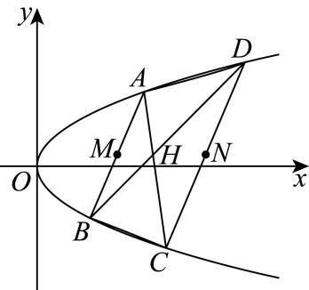
(1) (4分)求拋物线Γ的焦点坐标；
(2) (6分)求证：点M､H､N三点共线；
(3) (8分)若2 $| H M | = | H N | = 2$ ，求四边形ABCD的面积.

> 本题资料或解析有待核事项，预览不可作为已审定成品。

**考点：** （1）抛物线焦点；（2）平行弦与交点共线；（3）长度条件及四边形面积

**难度依据：** 需联立平行弦和交点条件，证明共线并处理面积约束。

**核查说明：** 题干与解析已用于人工归类，尚未完成整题公式校净与独立数学终审。；第（3）问长度关系2|HM|=|HN|=2须核原卷。；题干与解析已用于人工归类，尚未完成整题公式校净与独立数学终审。；第（3）问长度关系2|HM|=|HN|=2须核原卷。

【解析】

(1) 因抛物线方程为 $\boldsymbol { y } ^ { 2 } = \boldsymbol { x }$ ，则焦点坐标为 $\left( { \frac { 1 } { 4 } } , 0 \right)$ ；

(2) 证明：设 $A \left( x _ { 1 } , y _ { 1 } \right) , B \left( x _ { 2 } , y _ { 2 } \right) , C \left( x _ { 3 } , y _ { 3 } \right) , D \left( x _ { 4 } , y _ { 4 } \right)$

若 $x _ { 1 } = x _ { 2 } \ , \ x _ { 3 } = x _ { 4 }$ ，则直线AB，CD斜率不存在，

由对称性，可知M，N，H均在x轴上，则M，H，N三点共线；

若 $x _ { 1 } \neq x _ { 2 } \ , \ x _ { 3 } \neq x _ { 4 } ,$ ，则直线斜率存在，

直线 $A B ^ { - }$ 方程为： $y = \frac { y _ { 2 } - y _ { 1 } } { x _ { 2 } - x _ { 1 } } ( x - x _ { 1 } ) + y _ { 1 }$ ，结合 $y _ { 1 } ^ { 2 } = x _ { 1 } \ , \ y _ { 2 } ^ { 2 } = x _ { 2 }$

$$
\text {令} y = \frac {y _ {2} - y _ {1}}{x _ {2} - x _ {1}} \left(x - x _ {1}\right) + y _ {1} \Rightarrow \frac {\left(y - y _ {1}\right) \left(y _ {2} ^ {2} - y _ {1} ^ {2}\right)}{y _ {2} - y _ {1}} + y _ {1} ^ {2} = x \Rightarrow \left(y _ {1} + y _ {2}\right) y - y _ {1} y _ {2} = x,
$$

同理可得CD方程： $( y _ { 3 } + y _ { 4 } ) y - y _ { 3 } y _ { 4 } = x , A C$ 方程： $( y _ { 1 } + y _ { 3 } ) y - y _ { 1 } y _ { 3 } = x ,$

BD方程： $( y _ { 2 } + y _ { 4 } ) y - y _ { 2 } y _ { 4 } = x$ .设 $M \left( x _ { M } , y _ { M } \right) , N \left( x _ { N } , y _ { N } \right)$

因 $A B / / C D ;$ ，则 $y _ { 1 } + y _ { 2 } = y _ { 3 } + y _ { 4 } \Rightarrow { \frac { y _ { 1 } + y _ { 2 } } { 2 } } = { \frac { y _ { 3 } + y _ { 4 } } { 2 } } \Rightarrow y _ { M } = y _ { N } .$

则直线MN与x轴平行，设直线MN与线段AC，BD交点为 $P \left( x _ { P } , y _ { P } \right) , Q \left( x _ { Q } , y _ { Q } \right)$

将 $\dot { \cdot } y = \frac { y _ { 1 } + y _ { 2 } } { 2 }$ 代入直线AC方程，

$$
\left| x _ {P} = \left(y _ {1} + y _ {3}\right) \cdot \frac {y _ {1} + y _ {2}}{2} - y _ {1} y _ {3} = \frac {y _ {1} ^ {2} + y _ {2} \left(y _ {1} + y _ {3}\right) - y _ {1} y _ {3}}{2} \right.
$$

将 $\dot { \cdot } y = \frac { y _ { 3 } + y _ { 4 } } { 2 }$ 代入直线BD方程，

$$
x _ {Q} = \left(y _ {2} + y _ {4}\right) \cdot \frac {y _ {3} + y _ {4}}{2} - y _ {2} y _ {4} = \frac {y _ {4} ^ {2} + y _ {3} \left(y _ {2} + y _ {4}\right) - y _ {2} y _ {4}}{2}.
$$

注意到 $x _ { P } - x _ { Q } = \frac { y _ { 1 } ^ { 2 } \stackrel { \sim } { + } y _ { 2 } ( y _ { 1 } + y _ { 3 } ) - y _ { 1 } y _ { 3 } - y _ { 4 } ^ { 2 } \stackrel { \sim } { - } y _ { 3 } ( y _ { 2 } + y _ { 4 } ) + y _ { 2 } y _ { 4 } } { \supset }$

$$
= \frac {y _ {1} ^ {2} + y _ {1} y _ {2} - y _ {1} y _ {3} - \left(y _ {4} ^ {2} + y _ {3} y _ {4} - y _ {2} y _ {4}\right)}{2} = \frac {y _ {1} \left(y _ {1} + y _ {2} - y _ {3}\right) - y _ {4} \left(y _ {4} + y _ {3} - y _ {2}\right)}{2}
$$

$= { \frac { y _ { 1 } y _ { 4 } - y _ { 4 } y _ { 1 } } { 2 } } = 0$ ，又 ${ \it y } _ { P } = { \it y } _ { Q } = { \it y } _ { M } = { \it y } _ { N }$ ，则P，Q两点重合，

即P，Q为线段AC与BD交点H，且点M､H､N三点共线；

(3) 由（2），直线MN与x轴平行，

则2 $| H M | = | H N | = 2 \Rightarrow 2 \left( x _ { H } - x _ { M } \right) = x _ { N } - x _ { H } = 2 .$

又 $\small x _ { M } = \frac { x _ { 1 } + x _ { 2 } } { 2 } = \frac { y _ { 1 } ^ { 2 } + y _ { 2 } ^ { 2 } } { 2 }$ ，同理可得 $x _ { N } = \frac { y _ { 3 } ^ { 2 } + y _ { 4 } ^ { 2 } } { 2 }$

又由（2） $x _ { H } = \frac { y _ { 1 } ^ { 2 } + y _ { 2 } \left( y _ { 1 } + y _ { 3 } \right) - y _ { 1 } y _ { 3 } } { 2 } = \frac { y _ { 4 } ^ { 2 } + y _ { 3 } \left( y _ { 2 } + y _ { 4 } \right) - y _ { 2 } y _ { 4 } } { 2 }$ ，

则xH − xM = y21 + y2 (y1 + y3) − y1y3 − y21 + y22 = 1 ⇒y2 (y1 + y3) − y1y3 − y2 = 2，

$$
x _ {N} - x _ {H} = 2 = \frac {y _ {3} ^ {2} + y _ {4} ^ {2}}{2} - \frac {y _ {4} ^ {2} + y _ {3} (y _ {2} + y _ {4}) - y _ {2} y _ {4}}{2} \Rightarrow y _ {3} ^ {2} - y _ {3} (y _ {2} + y _ {4}) + y _ {2} y _ {4} = 4
$$

由 $\{ y _ { 1 } + y _ { 2 } = y _ { 3 } + y _ { 4 }$ ，则 $| y _ { 3 } ^ { 2 } - y _ { 3 } ( y _ { 2 } + y _ { 1 } + y _ { 2 } - y _ { 3 } ) + y _ { 2 } ( y _ { 1 } + y _ { 2 } - y _ { 3 } ) = 4 ,$

即2y2 + y2 − 3y2y3 − y1y3 + y1y2 = 4.

$$
\text {则} 2 y _ {3} ^ {2} + y _ {2} ^ {2} - 3 y _ {2} y _ {3} - y _ {1} y _ {3} + y _ {1} y _ {2} - \left[ y _ {2} \left(y _ {1} + y _ {3}\right) - y _ {1} y _ {3} - y _ {2} ^ {2} \right] = 2
$$

$$
\Rightarrow 2 y _ {3} ^ {2} + 2 y _ {2} ^ {2} - 4 y _ {2} y _ {3} = 2 \Rightarrow (y _ {3} - y _ {2}) ^ {2} = 1 \Rightarrow | y _ {3} - y _ {2} | = 1.
$$

如图，过B作MN平行线，交CD为E，则四边形MBEN为平行四边形，

结合2 $| H M | = | H N | = 2 $ ，则|BE| = 3， $S _ { \triangle B C E } = \frac { 1 } { 2 } | B E | \cdot | y _ { 3 } - y _ { 2 } | = \frac { 3 } { 2 }$

因 $A B / / C D$ ，则 $\triangle A H B \sim \triangle C H D$ ，结 $\triangle 2 | H M | = | H N |$

则 $\frac { | A B | } { | C D | } = \frac { | M H | } { | N H | } = \frac { | A H | } { | C H | } = \frac { | B H | } { | D H | } = \frac { 1 } { 2 }$ ，又M为AB中点，则N为DE中点

$$
S _ {\triangle B C E} = S _ {\triangle B N E} = \frac {1}{4} S _ {\triangle B C D}, S _ {\triangle B C D} = 2 S _ {\triangle A B D},
$$

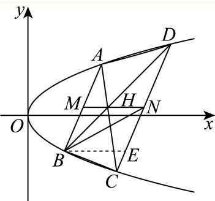

则四边形 $A B C L$ 的面积S = $: S _ { \triangle B C D } + S _ { \triangle A B D } = 6 S _ { \triangle B C E } = 6 \times { \frac { 3 } { 2 } } = 9 .$

### 松江 · 第20题

如果一条双曲线的实轴和虚轴分别是一个椭圆的长轴和短轴，则称它们为“共轴”曲线．若双曲线 $C _ { 1 }$ 与椭圆 $C _ { 2 }$ 是“共轴”曲线，且椭圆 $C _ { 2 } \colon \frac { x ^ { 2 } } { 9 } + \frac { y ^ { 2 } } { b ^ { 2 } } = 1 ( 0 < b < 3 )$ $e _ { 1 } e _ { 2 } = { \frac { 4 { \sqrt { 5 } } } { 9 } } ( e _ { 1 }$ 、 $e _ { 2 }$ 分别为曲线 $\wp$ 、 $C _ { 2 }$ 的离心率）．已知点M(1,0)，点P为双曲线 $C _ { 1 }$ 上任意一点
(1) (4分)求双曲线 $C _ { 1 }$ 的方程；
(2) (6分)延长线段PM到点Q，且 $| P M | = 2 \left| M Q \right|$ ，若点Q在椭圆 $C _ { 2 }$ 上，试求点P的坐标；
(3) (8分)若点P在双曲线 $C _ { 1 }$ 的右支上，点A、B分别为双曲线 $C _ { 1 }$ 的左、右顶点，直线PM交双曲线的左支于点R，直线AP、BR的斜率分别为 $\mathit { \iota } _ { A P \setminus } \ k _ { B R }$ ．是否存在实数λ，使得 $k _ { A P } = \lambda k _ { B R } ?$ 若存在，求出λ的值；若不存在，请说明理由

> 本题资料或解析有待核事项，预览不可作为已审定成品。

**考点：** （1）离心率积确定共轴曲线；（2）分点坐标与交点；（3）顶点相关斜率比例

**难度依据：** 需识别共轴关系、设分点并通过参数与韦达关系证明斜率比例。

**核查说明：** 题干与解析已用于人工归类，尚未完成整题公式校净与独立数学终审。；共轴关系的符号与下标有误识，需回源。；题干与解析已用于人工归类，尚未完成整题公式校净与独立数学终审。；共轴关系的符号与下标有误识，需回源。

【解析】

(1) 根据题意双曲线 $C _ { 2 } \colon \frac { x ^ { 2 } } { 9 } - \frac { y ^ { 2 } } { b ^ { 2 } } = 1 ( 0 < b < 3 )$ ，

因为 $\lceil e _ { 1 } e _ { 2 } = { \frac { { \sqrt { 9 - b ^ { 2 } } } } { 3 } } \times { \frac { { \sqrt { 9 + b ^ { 2 } } } } { 3 } } = { \frac { 4 { \sqrt { 5 } } } { 9 } }$ ，解得 $b = 1$

双曲线 $C _ { 1 }$ 的方程为 ${ \frac { x ^ { 2 } } { 9 } } - y ^ { 2 } = 1$ ；

(2)

由（1）知， $C _ { 1 } \colon \frac { x ^ { 2 } } { 9 } - y ^ { 2 } = 1 , C _ { 2 } \colon \frac { x ^ { 2 } } { 9 } + y ^ { 2 } = 1$

设 $P \left( x _ { 1 } , y _ { 1 } \right) , Q \left( x _ { 2 } , y _ { 2 } \right)$

已知 $M \left( 1 , 0 \right)$ ，又 $| P M | = 2 \left| M Q \right|$

所以 $x _ { 2 } = { \frac { 3 - x _ { 1 } } { 2 } } \ , y _ { 2 } = - { \frac { 1 } { 2 } } y _ { 1 }$ ，

由点Q在椭圆 $C _ { 2 } \bot$ ，则 ${ \frac { \left( { \frac { 3 - x _ { 1 } } { 2 } } \right) ^ { 2 } } { 9 } } + \left( - { \frac { 1 } { 2 } } y _ { 1 } \right) ^ { 2 } = 1$

又点P为双曲线 $C _ { 1 }$ 上任意一点，则 ${ \frac { x _ { 1 } ^ { 2 } } { 9 } } - y _ { 1 } ^ { 2 } = 1$ ，

联立，解得 $\left\{ \begin{array} { l l } { x _ { 1 } = 6 } \\ { y _ { 1 } = \pm { \sqrt { 3 } } } \end{array} \right.$ 或 $\left\{ { \begin{array} { l l } { x _ { 1 } = - 3 } \\ { y _ { 1 } = 0 } \end{array} } \right.$

当 $P \left( - 3 , 0 \right)$ 不满足题意，所以点P的坐标为 $\left( 6 , - { \sqrt { 3 } } \right)$ 或 $\left( 6 , { \sqrt { 3 } } \right)$ ；

(3) 当P、B重合时， $\lambda \in \mathrm { R }$ ；当P、B不重合时，存在实数λ = $\frac { 1 } { 2 }$ ，使得 $k _ { A P } = \frac { 1 } { 2 } k _ { B R }$ ，理由如下，

当P、B重合时，由题意 $k _ { B R } = 0$ ，则 $k _ { A P } = 0$ ，则 $\lambda \in \mathrm { R }$

当P、B不重合时， $k _ { B R } \neq 0$ ，设直线PR的方程为 $\begin{array} { r } { x = t y + 1 , P \left( x _ { 1 } , y _ { 1 } \right) , R \left( x _ { 3 } , y _ { 3 } \right) } \end{array}$

$\left\{ { \frac { x = t y + 1 } { 9 } } \right. \qquad { \mathrm { ~ } } x ^ { 2 } = 1 \qquad { \mathrm { ~ } }$ 得 $\ ( t ^ { 2 } - 9 ) y ^ { 2 } + 2 t y - 8 = 0$

因为双曲线的渐近线方程为 $\ I y = \pm \frac { x } { 3 }$

又直线PM交双曲线的左支于点R，右支于点P，所以 $t \in ( - 3 , 3 )$ ，

由韦达定理得， $y _ { 1 } + y _ { 3 } = { \frac { - 2 t } { t ^ { 2 } - 9 } } , y _ { 1 } y _ { 3 } = { \frac { - 8 } { t ^ { 2 } - 9 } }$ ，

$$
\frac {k _ {A P}}{k _ {B R}} = \frac {\frac {y _ {1}}{x _ {1} + 3}}{\frac {y _ {3}}{x _ {3} - 3}} = \frac {\frac {y _ {1}}{t y _ {1} + 4}}{\frac {y _ {3}}{t y _ {3} - 2}} = \frac {y _ {1}}{t y _ {1} + 4} \times \frac {t y _ {3} - 2}{y _ {3}} = \frac {t y _ {1} y _ {3} - 2 y _ {1}}{t y _ {1} y _ {3} + 4 y _ {3}}
$$

$$
= \frac {\frac {- 8 t}{t ^ {2} - 9} - 2 y _ {1}}{\frac {- 8 t}{t ^ {2} - 9} + 4 \left(\frac {- 2 t}{t ^ {2} - 9} - y _ {1}\right)} = \frac {- 8 t - 2 y _ {1} (t ^ {2} - 9)}{- 1 6 t - 4 y _ {1} (t ^ {2} - 9)} = \frac {1}{2} = \lambda ,
$$

所以存在实数 $\lambda = \frac { 1 } { 2 }$ ，使得k ${ \mathrm { \Delta } } _ { A P } = { \frac { 1 } { 2 } } k _ { B R }$

### 浦东 · 第20题

已知椭圆 ${ \frac { x ^ { 2 } } { 8 } } + { \frac { y ^ { 2 } } { 4 } } = 1$ 的左、右焦点分别为 $F _ { \mathrm { 1 } } , \ F _ { \mathrm { 2 } }$ ，过坐标原点的直线交椭圆于A、B两点，点A在第一象限
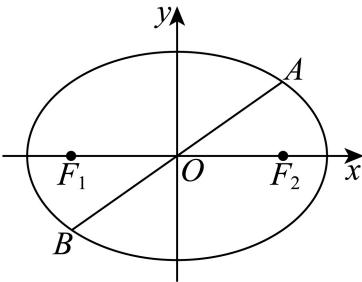
(1) (4分)若 $| O A | = { \sqrt { 6 } } .$ ，求点A的坐标；
(2) (6分)求− $\xrightarrow { } { \overrightarrow { A F _ { 1 } } + 3 \overrightarrow { A F _ { 2 } } }$ 的取值范围；
(3) (8分)若 $A E \bot x$ 轴，垂足为 $E ,$ ，连结BE并延长交椭圆于点 $^ { C , }$ ，求 $\triangle A B C { \overrightarrow { \mathbb { H } } }$ 积的最大值

> 本题资料或解析有待核事项，预览不可作为已审定成品。

**考点：** （1）椭圆与距离条件求点；（2）焦点向量模的取值范围；（3）椭圆弦与三角形面积最值

**难度依据：** 椭圆参数向量模与三角形面积；焦点向量模；按所需步骤与推理量估计

**核查说明：** 题干与解析已用于人工归类，尚未完成整题公式校净与独立数学终审。；第（2）问向量模符号丢失，须回源。；题干与解析已用于人工归类，尚未完成整题公式校净与独立数学终审。；第（2）问向量模符号丢失，须回源。

【解析】

(1) 由椭圆方程可知： $a = 2 { \sqrt { 2 } } , b = 2 , c = { \sqrt { a ^ { 2 } - b ^ { 2 } } } = 2$ ，则 $F _ { 1 } \left( - 2 , 0 \right) , F _ { 2 } \left( 2 , 0 \right)$

设直线 $O A \colon y = k x , k > 0 , A ( x _ { 0 } , y _ { 0 } ) , x _ { 0 } > 0 , y _ { 0 } > 0 ,$

可得 $\left\{ \begin{array} { l l } { y _ { 0 } = k x _ { 0 } } \\ { { \frac { x _ { 0 } ^ { 2 } } { 8 } } + { \frac { y _ { 0 } ^ { 2 } } { 4 } } = 1 } \end{array} \right. ,$ 解得 $x _ { 0 } ^ { 2 } = { \frac { 8 } { 1 + 2 k ^ { 2 } } }$

则 $\left. O A \right. = \sqrt { x _ { 0 } ^ { 2 } + y _ { 0 } ^ { 2 } } = \sqrt { x _ { 0 } ^ { 2 } + k ^ { 2 } x _ { 0 } ^ { 2 } } = 2 \sqrt { 2 } \sqrt { \frac { 1 + k ^ { 2 } } { 1 + 2 k ^ { 2 } } } = \sqrt { 6 } ,$ 解得 $k ^ { 2 } = { \frac { 1 } { 2 } } , k = { \frac { \sqrt { 2 } } { 2 } }$

则 $\textstyle | x _ { 0 } ^ { 2 } = 4$ ，即 $x _ { 0 } = 2 , y _ { 0 } = \frac { \sqrt { 2 } } { 2 } x _ { 0 } = \sqrt { 2 }$ ，所以 $A \left( 2 , { \sqrt { 2 } } \right)$

(2) 因为− $\overrightarrow { A F _ { 1 } } = ( - 2 - x _ { 0 } , - y _ { 0 } ) , \overrightarrow { A F _ { 2 } } = ( 2 - x _ { 0 } , - y _ { 0 } )$

可得 $\overrightarrow { A F _ { 1 } } + 3 \overrightarrow { A F _ { 2 } } = ( 4 - 4 x _ { 0 } , - 4 y _ { 0 } )$ ，

则 AF1 + 3AF2 = √(4 − 4x0)2 + (4y0)2 = 4√x20 + y20 − 2x0 + 1，−−→ →

因为 $\frac { x _ { 0 } ^ { 2 } } { 8 } + \frac { y _ { 0 } ^ { 2 } } { 4 } = 1$ ，则 $y _ { 0 } ^ { 2 } = 4 - { \frac { 1 } { 2 } } x _ { 0 } ^ { 2 } , x _ { 0 } \in \left( 0 , 2 { \sqrt { 2 } } \right)$ 2可得 $\left| \overrightarrow { A F _ { 1 } } + 3 \overrightarrow { A F _ { 2 } } \right| = 4 \sqrt { x _ { 0 } ^ { 2 } + 4 - \frac { 1 } { 2 } x _ { 0 } ^ { 2 } - 2 x _ { 0 } + 1 } = 4 \sqrt { \frac { 1 } { 2 } \left( x _ { 0 } - 2 \right) ^ { 2 } + 3 } \in \left[ 4 \sqrt { 3 } , 4 \sqrt { 5 } \right)$ 所以 $\left| \xrightarrow [ A F _ { 1 } + 3 A F _ { 2 } ] { } \right|$ 的取值范围为 $\left\lceil 4 { \sqrt { 3 } } , 4 { \sqrt { 5 } } \right)$

(3) 设 $C \left( x _ { 1 } , y _ { 1 } \right)$ 。

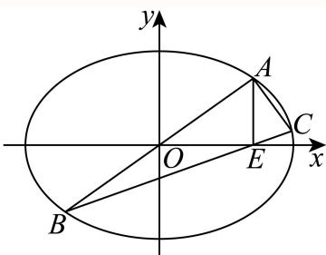

由题意可知： $A ( x _ { 0 } , y _ { 0 } ) , B ( - x _ { 0 } , - y _ { 0 } ) , E ( x _ { 0 } , 0 )$

则 $k = \frac { y _ { 0 } } { x _ { 0 } } , k _ { B C } = \frac { y _ { 0 } } { 2 x _ { 0 } } = \frac { 1 } { 2 }$ k，且 $\mathfrak { k } _ { A C } = \frac { y _ { 1 } - y _ { 0 } } { x _ { 1 } - x _ { 0 } } , \mathfrak { k } _ { B C } = \frac { y _ { 1 } + y _ { 0 } } { x _ { 1 } + x _ { 0 } }$

因为点A,C均在椭圆上，则 $\left\{ \begin{array} { l l } { \displaystyle \frac { x _ { 0 } ^ { 2 } } { 8 } + \frac { y _ { 0 } ^ { 2 } } { 4 } = 1 } \\ { \displaystyle \frac { x _ { 1 } ^ { 2 } } { 8 } + \frac { y _ { 1 } ^ { 2 } } { 4 } = 1 } \end{array} \right.$ ，两式相减得 $\frac { x _ { 1 } ^ { 2 } - x _ { 0 } ^ { 2 } } { 8 } + \frac { y _ { 1 } ^ { 2 } - y _ { 0 } ^ { 2 } } { 4 } = 0$

整理可得 $\frac { y _ { 1 } ^ { 2 } - y _ { 0 } ^ { 2 } } { x _ { 1 } ^ { 2 } - x _ { 0 } ^ { 2 } } = \frac { y _ { 1 } - y _ { 0 } } { x _ { 1 } - x _ { 0 } } \cdot \frac { y _ { 1 } + y _ { 0 } } { x _ { 1 } + x _ { 0 } } = - \frac { 1 } { 2 }$ ，即 $| k _ { A C } \cdot k _ { B C } = - \frac { 1 } { 2 }$

则 $k _ { A C } \left( \frac { 1 } { 2 } k \right) = - \frac { 1 } { 2 }$ ，即 $k _ { A C } \cdot k = - 1$ ，可知 $A B \bot A C$

又因为 $\tan \angle A B C = { \frac { k - { \frac { 1 } { 2 } } k } { 1 + k \times { \frac { 1 } { 2 } } k } } = { \frac { k } { k ^ { 2 } + 2 } }$ ，则 $A C | = | A B | \tan \angle A B C = \frac { k } { k ^ { 2 } + 2 } | A B | ,$

可得 $\triangle A B C$ 面积 $| S _ { \triangle A B C } = \frac { 1 } { 2 } | \stackrel { \sim } { A } | \boldsymbol { B } | \cdot | \boldsymbol { A } C | = \frac { 1 } { 2 } \times \frac { k } { k ^ { 2 } + 2 } | \boldsymbol { A } \boldsymbol { B } | ^ { 2 } = \frac { 1 } { 2 } \times \frac { k } { k ^ { 2 } + 2 } \times 4 | \boldsymbol { O } \boldsymbol { A } | ^ { 2 }$

$$
= \frac {2 k}{k ^ {2} + 2} \times 8 \left(\frac {1 + k ^ {2}}{1 + 2 k ^ {2}}\right) = \frac {1 6 (k ^ {3} + k)}{2 k ^ {4} + 5 k ^ {2} + 2},
$$

设 $f \left( k \right) = \frac { k ^ { 3 } + k } { 2 k ^ { 4 } + 5 k ^ { 2 } + 2 } , k > 0$ ，则 $f ^ { \prime } \left( k \right) = \frac { \left( 2 k ^ { 4 } + 3 k ^ { 2 } + 2 \right) \left( k + 1 \right) \left( 1 - k \right) } { \left( 2 k ^ { 4 } + 5 k ^ { 2 } + 2 \right) ^ { 2 } }$

当0 $< k <$ 1时， $f ^ { \prime } \left( k \right) > 0 ;$ ；当k > 1时， $f ^ { \prime } \left( k \right) < 0$ ；

可知f(k)在(0,1)内单调递增， $\textstyle { \overleftrightarrow { 1 } } ( 1 , + \infty )$ 内单调递减，则 $f \left( k \right) \leq f \left( 1 \right) = \frac { 2 } { 9 }$

所以 $\triangle A B C$ 面积的最大值为 $1 6 \times { \frac { 2 } { 9 } } = { \frac { 3 2 } { 9 } }$

### 虹口 · 第20题

已知椭圆Γ: ${ \frac { x ^ { 2 } } { 4 } } + y ^ { 2 } = 1$ 1的左、右焦点分别为 $F _ { 1 } , F _ { 2 }$ ，右顶点为A，上顶点为B，设P为Γ上的一点(1) (4分)当 $P F _ { 1 } \bot F _ { 1 } F _ { 2 }$ 时，求 $| P F _ { 2 }$ |的值；
(2) (6分)若P点坐标为 $\left( 1 , { \frac { \sqrt { 3 } } { 2 } } \right)$ ，则在Γ上是否存在点Q使 $\triangle A P Q$ 的面积为 $\frac { { \sqrt { 3 } } + 1 } { 2 }$ ，若存在，请求出所有满足条件的点Q的坐标；若不存在，请说明理由；
(3) (8分)已知D点坐标为(0,m)，过点P和点D的直线l与椭圆Γ交于另一点T，当直线l与x轴和y轴 均不平行时，有 ${ \overrightarrow { P T } } \cdot \left( { \overrightarrow { B P } } + { \overrightarrow { B T } } \right) = 0$ ，求实数m的取值范围

> 本题资料或解析有待核事项，预览不可作为已审定成品。

**考点：** （1）椭圆焦点；（2）定面积与交点；（3）数量积与中点参数范围

**难度依据：** 涉及（1）椭圆焦点；（2）定面积与交点；（3）数量积与中点参数范围；难度为教师预估，需结合原题条件复核。

**核查说明：** 第（2）问平行线距离公式中的符号与随后解出的q不一致，须回源核对。；依据现有底稿归类，尚未逐页校卷、公式校净或独立数学终审。

【解析】

(1) 由椭圆方程知：a = 2，b = 1， $c = { \sqrt { 3 } } .$ ，则 $F _ { 1 } \left( - { \sqrt { 3 } } , 0 \right)$

设 $P \left( - { \sqrt { 3 } } , y _ { P } \right)$ $\therefore { \frac { 3 } { 4 } } + y _ { P } ^ { 2 } = 1$ ，解得： $| y _ { P } | = { \frac { 1 } { 2 } }$ ，即 $\left| P F _ { 1 } \right| = \frac { 1 } { 2 }$

由椭圆定义知： $| P F _ { 2 } | = 2 a - | P F _ { 1 } | = 4 - { \frac { 1 } { 2 } } = { \frac { 7 } { 2 } } .$ .

(2) 由（1）知：A (2, 0)，

$$
\because P \left(1, \frac {\sqrt {3}}{2}\right), \therefore | A P | = \sqrt {(2 - 1) ^ {2} + \left(0 - \frac {\sqrt {3}}{2}\right) ^ {2}} = \frac {\sqrt {7}}{2};
$$

若存在点Q，使 $\triangle A P Q$ 的面积为 $\frac { { \sqrt { 3 } } + 1 } { 2 }$

则点Q到直线AP的距离 $\dot { d } = \frac { \sqrt { 3 } + 1 } { | A P | } = \frac { 2 \sqrt { 2 1 } + 2 \sqrt { 7 } } { 7 }$

$\cdot k _ { A P } = \frac { \frac { \sqrt { 3 } } { 2 } - 0 } { 1 - 2 } = - \frac { \sqrt { 3 } } { 2 }$ ，∴直线AP方程为： $y = - { \frac { \sqrt { 3 } } { 2 } } ( x - 2 )$ ，即 ${ \sqrt { 3 } } x + 2 y - 2 { \sqrt { 3 } } = 0$ 设平行于直线 $A P .$ 且到直线 的距离为 $\frac { 2 { \sqrt { 2 1 } } + 2 { \sqrt { 7 } } } { 7 }$ 的直线方程为 ${ \sqrt { 3 } } x + 2 y + q = 0$ 1$\therefore { \frac { \left| { \boldsymbol { q } } + 2 { \sqrt { 3 } } \right| } { \sqrt { 7 } } } = { \frac { 2 { \sqrt { 2 1 } } + 2 { \sqrt { 7 } } } { 7 } }$ 解得： $q = 2 \not \equiv \not \chi q = - 2 - 4 \sqrt { 3 }$ ；当q = 2时，直线方程为 $\sqrt { 3 } x + 2 y + 2 = 0$

$\left\{ { \begin{array} { l } { { \sqrt { 3 } } x + 2 y + 2 = 0 } \\ { { \frac { x ^ { 2 } } { 4 } } + y ^ { 2 } = 1 } \end{array} } \right.$ 得： $4 x ^ { 2 } + 4 { \sqrt { 3 } } x = 0$ ，解得： $x = 0 \not \equiv \not \chi _ { x } = - \sqrt { 3 } ,$

$\therefore y = - 1$ 或 $y = \frac 1 2$ ，∴点 $Q \left( 0 , - 1 \right) \stackrel { \triangledown } { \lrcorner } Q \left( - \sqrt { 3 } , \frac { 1 } { 2 } \right)$ ；

当 $q = - 2 - 4 \sqrt { 3 } \mathrm { \AA }$ 时，直线方程为 ${ \sqrt { 3 } } x + 2 y - 2 - 4 { \sqrt { 3 } } = 0$

由 $\left\{ { \begin{array} { l } { { \sqrt { 3 } } x + 2 y - 2 - 4 { \sqrt { 3 } } = 0 } \\ { { \frac { x ^ { 2 } } { 4 } } + y ^ { 2 } = 1 } \end{array} } \right.$ 得： $x ^ { 2 } - { \Big ( } 6 + { \sqrt { 3 } } { \Big ) } x + 1 2 + 4 { \sqrt { 3 } } = 0$ ，方程无解，

即直线 ${ \sqrt { 3 } } x + 2 y - 2 - 4 { \sqrt { 3 } } = 0 .$ 与椭圆Γ无交点，此时不存在满足题意的点Q；

综上所述：存在满足条件的点Q，Q点坐标为(0,−1)或 $\left( - { \sqrt { 3 } } , { \frac { 1 } { 2 } } \right)$

(3) 由题意可设直线l: $y = k x + m , P \left( x _ { 1 } , y _ { 1 } \right) , T \left( x _ { 2 } , y _ { 2 } \right)$

由 $\left\{ { \begin{array} { l } { y = k x + m } \\ { { \frac { x ^ { 2 } } { 4 } } + y ^ { 2 } = 1 } \end{array} } \right.$ 得： $\big ( 1 + 4 k ^ { 2 } \big ) x ^ { 2 } + 8 k m x + 4 m ^ { 2 } - 4 = 0 ,$

$\therefore \Delta = 1 6 \left( 1 + 4 k ^ { 2 } - m ^ { 2 } \right) > 0 ,$ ，即 $k ^ { 2 } > \frac { m ^ { 2 } - 1 } { 4 } , ~ \div . { } x _ { 1 } + x _ { 2 } = - \frac { 8 k m } { 1 + 4 k ^ { 2 } } , ~ x _ { 1 } x _ { 2 } = \frac { 4 m ^ { 2 } - 4 } { 1 + 4 k ^ { 2 } }$

设线段PT中点为G，则 $\overrightarrow { B P } + \overrightarrow { B T } = 2 \overrightarrow { B G } , \therefore \overrightarrow { P T } \cdot \left( \overrightarrow { B P } + \overrightarrow { B T } \right) = \overrightarrow { P T } \cdot 2 \overrightarrow { B G } = 0 ,$

$\therefore P T \bot B G$ ，又G为PT中点， $\therefore | B P | = | B T |$

$\because B ( 0 , 1 ) , \therefore ( x _ { 1 } - 0 ) ^ { 2 } + ( y _ { 1 } - 1 ) ^ { 2 } = ( x _ { 2 } - 0 ) ^ { 2 } + ( y _ { 2 } - 1 ) ^ { 2 } \nonumber$ ，即

$$
x _ {1} ^ {2} + (k x _ {1} + m - 1) ^ {2} = x _ {2} ^ {2} + (k x _ {2} + m - 1) ^ {2}, \therefore (1 + k ^ {2}) (x _ {1} ^ {2} - x _ {2} ^ {2}) = 2 k (m - 1) (x _ {2} - x _ {1})
$$

∵直线l与x轴和y轴均不平行， $\therefore x _ { 2 } - x _ { 1 } \neq 0 , ~ \therefore \left( 1 + k ^ { 2 } \right) \left( x _ { 1 } + x _ { 2 } \right) = - 2 k \left( m - 1 \right)$

$$
\therefore - \frac {8 k m (1 + k ^ {2})}{1 + 4 k ^ {2}} = - 2 k (m - 1),
$$

整理可得： $k ^ { 2 } = - \frac { 3 m + 1 } { 4 } > 0$ ，即 $m < - \frac { 1 } { 3 }$

$\therefore k ^ { 2 } > { \frac { m ^ { 2 } - 1 } { 4 } } , ~ \therefore { - \frac { 3 m + 1 } { 4 } } > { \frac { m ^ { 2 } - 1 } { 4 } }$ ，解得： $- 3 < m < - \frac { 1 } { 3 }$

即实数 的取值范围为 $\left( - 3 , - { \frac { 1 } { 3 } } \right)$

### 金山 · 第20题

已知椭圆 ${ \Gamma _ { 1 } } \colon \frac { { { x } ^ { 2 } } } { 4 } + \frac { { { y } ^ { 2 } } } { 3 } = 1$ ，抛物线 $\Gamma _ { 2 } { : } y ^ { 2 } = 2 p x ( p > 0 )$ 与 $\Gamma _ { 1 }$ 有一个相同的焦点F．过点F作互相垂直的两条直线l与l′，直线 $\lvert \underline { { E } } \rvert \Gamma _ { 1 }$ 交于点A、 $\mathbf { B } ,$ ，直线l′与 $\Gamma _ { 2 }$ 交于点C、D
(1) (4分)求椭圆 $\Gamma _ { 1 }$ 的离心率及抛物线 $\Gamma _ { 2 }$ 的方程；
(2) (6分)若直线l的倾斜角为 $\frac { 3 \pi } { 4 }$ ，求AB中点M的坐标；
(3) (8分)四边形ACBD的面积是否存在最小值，若存在，求出最小值；若不存在，请说明理由

> 本题资料或解析有待核事项，预览不可作为已审定成品。

**考点：** （1）椭圆与抛物线参数；（2）焦点弦中点；（3）垂直焦点弦所成面积最小值

**难度依据：** 涉及（1）椭圆与抛物线参数；（2）焦点弦中点；（3）垂直焦点弦所成面积最小值；难度为教师预估，需结合原题条件复核。

**核查说明：** 仅修复所列OCR公式及其定界符错位；原解数学疑点和其他可渲染错识未因此消除。；第（3）问中间不等式公式识别严重损坏，应回源核验。；依据现有底稿归类，尚未逐页校卷、公式校净或独立数学终审。；仅修复所列OCR公式及其定界符错位；原解数学疑点和其他可渲染错识未因此消除。；第（3）问中间不等式公式识别严重损坏，应回源核验。

【解析】

(1) 由题设 $\mathbf { \cdot } \mathbf { \Gamma } _ { \mathbf { 1 } }$ 的离心率为 ${ \frac { c } { a } } = { \frac { 1 } { 2 } }$ ，且右焦点 $F ( 1 , 0 )$ ，即为 $\Gamma _ { 2 } { : } y ^ { 2 } = 2 p x ( p > 0 )$ 的焦点，所以 $\frac { p } { 2 } = 1 \Rightarrow p = 2$ ，所以 $\ b { \mathscr { z } } : \boldsymbol { y } ^ { 2 } = 4 \boldsymbol { x }$

综上，椭圆 $\Gamma _ { 1 }$ 的离心率 $\frac { 1 } { 2 }$ ，抛物线 $\Gamma _ { 2 } { : } y ^ { 2 } = 4 x ;$

(2) 由题设，知l: $y = - ( x - 1 )$ ，联立 $\Gamma _ { 1 } \colon \frac { x ^ { 2 } } { 4 } + \frac { y ^ { 2 } } { 3 } = 1$ ，则 ${ \frac { x ^ { 2 } } { 4 } } + { \frac { ( x - 1 ) ^ { 2 } } { 3 } } = 1$ 所以 $7 x ^ { 2 } - 8 x - 8 = 0$ ，显然 $\Delta > 0$ ，则 $x _ { A } + x _ { B } = { \frac { 8 } { 7 } }$ 则 $y _ { A } + y _ { B } = 2 - ( x _ { A } + x _ { B } ) = { \frac { 6 } { 7 } }$ 所以AB中点M的坐标为 $\left( { \frac { 4 } { 7 } } , { \frac { 3 } { 7 } } \right)$

(3)

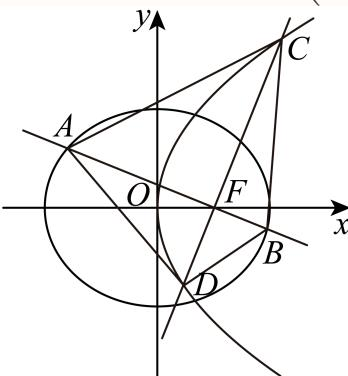

依题意，若直线AB斜率为0，则 $| A B | = 4 , | C D | = 4$ ，此时 $S _ { A C B D } = { \frac { 1 } { 2 } } | A B | | C D | = 8 ;$ 若直线AB斜率不为0，设直线AB为y = k(x−1)，则直线CD为 $y = - \frac { 1 } { k } ( x - 1 )$ ，且 $k \neq 0$ 联 $\begin{array} { r } { \dot { \mathbb { U } } y = k ( x - 1 ) } \end{array}$ 与 ${ \frac { x ^ { 2 } } { 4 } } + { \frac { y ^ { 2 } } { 3 } } = 1$ ，得 $( 3 + 4 k ^ { 2 } ) x ^ { 2 } - 8 k ^ { 2 } x + 4 k ^ { 2 } - 1 2 = 0$ ，且 $\Delta > 0$

则 $x _ { A } + x _ { B } = { \frac { 8 k ^ { 2 } } { 3 + 4 k ^ { 2 } } } , x _ { A } x _ { B } = { \frac { 4 ( k ^ { 2 } - 3 ) } { 3 + 4 k ^ { 2 } } }$ ，所以 $| A B | = { \sqrt { 1 + k ^ { 2 } } } \cdot | x _ { A } - x _ { B } | = { \frac { 1 2 ( 1 + k ^ { 2 } ) } { 3 + 4 k ^ { 2 } } }$

联立 $\mathbf { \dot { \boldsymbol { y } } } = - \frac { 1 } { k } ( \boldsymbol { x } - 1 )$ 与 $y ^ { 2 } = 4 x$ ，得 $x ^ { 2 } - ( 2 + 4 k ^ { 2 } ) x + 1 = 0$ ，且 $\Delta > 0$

则 $x _ { C } + x _ { D } = 4 k ^ { 2 } + 2 , x _ { C } x _ { D } = 1$ ，所以 $\vert C D \vert = \sqrt { 1 + \frac { 1 } { k ^ { 2 } } } \cdot \vert x _ { C } - x _ { D } \vert = 4 \left( 1 + k ^ { 2 } \right)$ 所以

$$
S _ {A C B D} = \frac {1}{2} | A B | | C D | = 6 \times \frac {\left(k ^ {2} + \frac {3}{4}\right) ^ {2} + \frac {1}{2} \left(k ^ {2} + \frac {3}{4}\right) + \frac {1}{1 6}}{\frac {3}{4} + k ^ {2}} = 6 \times
$$

$$
\left[ \begin{array}{l} \left(k ^ {2} + \frac {3}{4}\right) + \frac {1}{1 6 \left(k ^ {2} + \frac {3}{4}\right)} + \frac {1}{2} \\ \hline \end{array} \right]
$$

$\geq6\left[2\sqrt{\left(k^2+\frac34\right)\frac{1}{16\left(k^2+\frac34\right)}}+\frac12\right]=6,$ 而 $k ^ { 2 } + \frac { 3 } { 4 } > \frac { 3 } { 4 }$ ，即等号不成立，

结合对勾函数性质知： $S _ { A C B D } \ 7 \mp k ^ { 2 } + \frac { 3 } { 4 } \in \left( \frac { 3 } { 4 } , + \infty \right)$ 上递增，即 $S _ { A C B D } > 8$ 综上， $S _ { A C B D } \geq 8$ ，且直线AB斜率为0，面积取得最小值为8.

### 长宁 · 第20题

已知椭圆的左、右焦点分别为 $F _ { 1 } \left( - 1 , 0 \right) , F _ { 2 } \left( 1 , 0 \right)$ ，且经过点 $P \left( - 1 , { \frac { 3 } { 2 } } \right)$
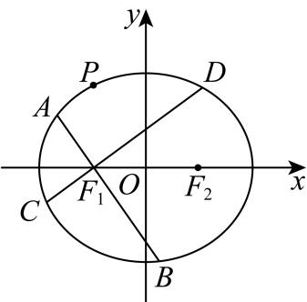
(1) (4分)求该椭圆的离心率；
(2) (6分)点Q为椭圆上一点，且位于第三象限，若 $\triangle P Q F _ { 2 }$ 的面积为3，求点Q的坐标；
(3) (8分)A，B，C，D是椭圆上不重合的四个点，AB与CD相交于点F1，且− $F _ { 1 }$ $\stackrel { \longrightarrow } { A B } . \stackrel { \longrightarrow } { C D } = 0$ ，求 $| A B | + | C D |$ 的取值范围

> 本题资料或解析有待核事项，预览不可作为已审定成品。

**考点：** （1）求椭圆离心率；（2）面积条件求点；（3）垂直焦点弦长度和范围

**难度依据：** 椭圆方程、面积及垂直焦点弦；（1）求椭圆离心率；（2）面积条件求点；（3）垂直焦点弦长度和范围

**核查说明：** 源解析第（2）问公式大段缺失，第（3）问弦长表达式破损，须回原卷核对。

【解析】

(1) 设椭圆的标准方程为 ${ \frac { x ^ { 2 } } { a ^ { 2 } } } + { \frac { y ^ { 2 } } { b ^ { 2 } } } = 1$ ， $a > 0 , b > 0$ ，由已知可得 $c = 1$

因为点 $P \left( - 1 , { \frac { 3 } { 2 } } \right)$ 在椭圆上，所以 ${ \frac { 1 } { a ^ { 2 } } } + { \frac { 9 } { 4 b ^ { 2 } } } = 1$ ，

又 $a ^ { 2 } = b ^ { 2 } + 1$ ，所 $\ ! \mathcal { V } \mathcal { a } ^ { 2 } = 4 , b ^ { 2 } = 3$

所以椭圆方程为 ${ \frac { x ^ { 2 } } { 4 } } + { \frac { y ^ { 2 } } { 3 } } = 1$

所以 $\displaystyle { \boldsymbol { \mathscr { e } } } = { \frac { c } { a } } = { \frac { 1 } { 2 } }$ ；

(2) $\textcircled { 1 } P F _ { 2 } = \frac { 5 } { 2 }$ ，直线 $P F _ { 2 }$ 的解析式为 $y = - \frac { 3 } { 4 } x + \frac { 3 } { 4 }$ ，

因为 $\triangle P Q F _ { 2 }$ 的面积为3，所以 $P F _ { 2 }$ 边上的高为 $\frac { 1 2 } { 5 }$

过Q做 $P F _ { 2 }$ 的平行线，则直线QR的解析式为 $y = - { \frac { 3 } { 4 } } x - { \frac { 9 } { 4 } }$

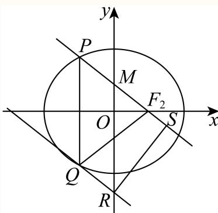

联立方程组 $\left\{ { \frac { x ^ { 2 } } { 4 } } + { \frac { y ^ { 2 } } { 3 } } = 1 \right. \qquad \quad \quad \quad \quad \quad \quad \quad \quad \quad \quad \quad \quad \quad \quad \quad \quad \quad \quad \quad \quad \quad \quad \quad \quad \quad \quad \quad \quad \quad \quad \quad \quad \quad \quad \quad \quad \quad \quad \quad \quad \quad \quad \quad \quad \quad \quad \quad \quad \quad \quad \quad \quad \quad \quad \quad \quad \quad \quad \quad \quad \quad \quad \quad \quad \quad \quad \quad \quad \quad \quad \quad \quad \quad \quad \quad \quad \quad \quad \quad \quad \quad \quad \quad \quad \quad \quad \quad \quad \quad \quad \quad \quad \quad \quad \quad \quad \quad \quad \quad \quad \quad \quad \quad \quad \quad \quad \quad \quad \quad \quad \quad \quad \quad \quad \quad \quad \quad \quad \quad \quad \quad \quad \quad \quad \quad \quad \quad \quad \quad \quad \quad \quad \quad \quad \quad \quad \quad \quad \quad \quad \quad \quad \quad \quad \quad \quad \quad \quad \quad \quad \quad \quad \quad \quad \quad \quad \quad \quad \quad \quad \quad \quad \quad \quad \quad \quad \quad \quad \quad \quad \quad \quad \quad \quad \quad \quad \quad \quad \quad \quad \quad \quad \quad \quad \quad \quad \quad \quad \quad \quad \quad \quad \quad \quad \quad \quad \quad \quad \quad \quad \quad \quad \quad \quad \quad \quad \quad \quad \quad \quad \quad \quad \quad \quad \quad \quad \quad \quad \quad \quad \quad \quad \quad \quad \quad \quad \quad \quad \quad \quad \quad \quad \quad \quad \quad \quad \quad \quad \quad \quad \quad \quad \quad \quad \quad \quad \quad \quad \quad \quad \quad \quad \quad \quad \quad \quad \quad \quad \quad \quad \quad \quad \quad \quad \quad \quad \quad \quad \quad \quad \quad \quad \quad \quad \quad \quad \quad \quad \quad \quad \quad \quad \quad \quad \quad \quad \quad \quad \quad \quad \quad \quad \quad \quad \quad \quad \quad \quad \quad \quad \quad \quad \quad \quad \quad \quad \quad \quad \quad \quad \quad \quad \quad \quad \quad \quad \quad \quad \quad \quad \quad \quad \quad \quad \quad \quad \quad \quad \quad \quad \quad \quad \quad \quad \quad \quad \quad \quad \quad \quad \quad \quad \quad \quad \quad \quad \quad \quad \quad \quad \quad \quad \quad \quad \quad \quad \quad \quad \quad \quad \quad$

解得： $\left\{ { \begin{array} { l } { x _ { 1 } = - 1 } \\ { y _ { 1 } = - { \cfrac { 3 } { 2 } } } \end{array} } \right.$ 或 $\left\{ { \begin{array} { l } { x _ { 1 } = - { \frac { 1 1 } { 7 } } } \\ { y _ { 1 } = - { \frac { 1 5 } { 1 4 } } } \end{array} } \right. ,$

所以点Q的坐标为 $\left( - 1 , - { \frac { 3 } { 2 } } \right)$ 或 $\left( - { \frac { 1 1 } { 7 } } , - { \frac { 1 5 } { 1 4 } } \right)$ ；

(3) ①若AB或CD垂直于x轴，则 $| A B | + | C D | = 7$

②若AB和CD不垂直于x轴，

设直线AB的解析式为 $y = k \left( x + 1 \right)$ ，点 $A \left( x _ { 1 } , y _ { 1 } \right) , B \left( x _ { 2 } , y _ { 2 } \right)$

联立方程组 $\left\{ { \frac { x ^ { 2 } } { 4 } } + { \frac { y ^ { 2 } } { 3 } } = 1 \right. \qquad $ ，得 $\big ( 3 + 4 k ^ { 2 } \big ) x ^ { 2 } + 8 k ^ { 2 } x + 4 k ^ { 2 } - 1 2 = 0 ,$

从而 $x _ { 1 } + x _ { 2 } = { \frac { - 8 k ^ { 2 } } { 3 + 4 k ^ { 2 } } } , x _ { 1 } x _ { 2 } = { \frac { 4 k ^ { 2 } - 1 2 } { 3 + 4 k ^ { 2 } } } ,$

$$
A B = \sqrt {1 + k ^ {2}} \cdot \sqrt {\left(\frac {- 8 k ^ {2}}{3 + 4 k ^ {2}}\right) - 4 \cdot \frac {4 k ^ {2} - 1 2}{3 + 4 k ^ {2}}} = \frac {1 2 (k ^ {2} + 1)}{3 + 4 k ^ {2}},
$$

同理 $C D = { \frac { 1 2 \left( k ^ { 2 } + 1 \right) } { 4 + 3 k ^ { 2 } } }$

$$
\begin{array}{l} | A B | + | C D | = \frac {1 2 (k ^ {2} + 1)}{3 + 4 k ^ {2}} + \frac {1 2 (k ^ {2} + 1)}{4 + 3 k ^ {2}} = \frac {8 4 (k ^ {4} + 2 k ^ {2} + 1)}{1 2 k ^ {4} + 2 5 k ^ {2} + 1 2} = 7. \\ \left(1 - \frac {1}{1 2 k ^ {2} + \frac {1 2}{k ^ {2}} + 2 5}\right) \end{array}
$$

因为 $1 2 k ^ { 2 } + { \frac { 1 2 } { k ^ { 2 } } } + 2 5 \geq 4 9$ ，所以 $\frac { 4 8 } { 7 } \leq | A B | + | C D | < 7$

综上， $| A B | + | C D |$ 的取值范围是 $\left[ { \frac { 4 8 } { 7 } } , 7 \right]$

### 闵行 · 第20题

已知圆 $O \colon x ^ { 2 } + y ^ { 2 } = 1$ ，双曲线Γ: $x ^ { 2 } - { \frac { y ^ { 2 } } { b ^ { 2 } } } = 1$ ，直线l: $y = k x + b$ ，其中 ${ \mathbb X } \in { \mathbb R } , b > 0$
(1) (4分)当b = 2时，求双曲线Γ的离心率；
(2) (6分)若l与圆O相切，证明：l与双曲线Γ的左右两支各有一个公共点；
(3) (8分)设l与y轴交于点P，与圆O交于点A、B，与双曲线Γ的左右两支分别交于点C、D，四个点从左至右依次为C、A、B、D．当 $k = { \frac { \sqrt { 2 } } { 2 } }$ 时，是否存在实数b，使得 $\overrightarrow { P A } \cdot \overrightarrow { P C } = \overrightarrow { P B } \cdot \overrightarrow { P D } \vert$ 成立？若存在，求出b的值；若不存在，说明理由

**考点：** （1）求离心率；（2）联立及根的符号证明交两支；（3）韦达定理与数量积求参数

**难度依据：** 直线与圆、双曲线交点关系；（1）求离心率；（2）联立及根的符号证明交两支；（3）韦达定理与数量积求参数

【解析】

(1) 由题意， $a ^ { 2 } = 1 , b ^ { 2 } = 4$ ，所以， $c ^ { 2 } = a ^ { 2 } + b ^ { 2 } = 5$

因此，双曲线Γ的离心率 $e = { \frac { c } { a } } = { \sqrt { 5 } } .$

(2) 由直线l与圆O相切，得 $\frac { | b | } { \sqrt { k ^ { 2 } + 1 } } = 1$ ，即 $b ^ { 2 } = k ^ { 2 } + 1 > 0$

联立 $\left\{ x ^ { 2 } - \frac { y ^ { 2 } } { b ^ { 2 } } = 1 , \gamma _ { \check { \mathbb { H } } } \big ( b ^ { 2 } - k ^ { 2 } \big ) x ^ { 2 } - 2 k b x - 2 b ^ { 2 } = 0 , \right.$

即 $x ^ { 2 } - 2 k b x - 2 b ^ { 2 } = 0$

该一元二次方程的判别式 $\Delta = 4 k ^ { 2 } b ^ { 2 } + 8 b ^ { 2 } = 4 b ^ { 2 } \left( k ^ { 2 } + 2 \right) > 0$

因此有两个不相等的实数根，

且两根之积为 $- 2 b ^ { 2 } < 0$ ，因此两根一正一负，

即l与双曲线Γ的左右两支各有一个公共点.

(3) 设 $4 ( x _ { 1 } , y _ { 1 } ) , B ( x _ { 2 } , y _ { 2 } ) , C ( x _ { 3 } , y _ { 3 } ) , D ( x _ { 4 } , y _ { 4 } ) _ { 1 }$ ，

联立 $\left\{ { x ^ { 2 } + y ^ { 2 } = 1 \atop y = k x + b } \right.$ ，得 $\big ( 1 + k ^ { 2 } \big ) x ^ { 2 } + 2 k b x + b ^ { 2 } - 1 = 0$ ，得 $\left\{ \begin{array} { l l } { \displaystyle x _ { 1 } + x _ { 2 } = \displaystyle \frac { - 2 k b } { 1 + k ^ { 2 } } } \\ { \displaystyle x _ { 1 } x _ { 2 } = \displaystyle \frac { b ^ { 2 } - 1 } { 1 + k ^ { 2 } } } \end{array} \right.$

由 $\Delta _ { 1 } > 0$ 可得 $b ^ { 2 } - k ^ { 2 } < 1$

联立 $\left\{ x ^ { 2 } - { \frac { y ^ { 2 } } { b ^ { 2 } } } = 1 \right.$ 得, $\ ( b ^ { 2 } - k ^ { 2 } ) x ^ { 2 } - 2 k b x - 2 b ^ { 2 } = 0 \quad$ ，得 $\left\{ \begin{array} { l l } { \displaystyle x _ { 3 } + x _ { 4 } = \frac { 2 k b } { b ^ { 2 } - k ^ { 2 } } , } \\ { \displaystyle x _ { 3 } x _ { 4 } = \frac { - 2 b ^ { 2 } } { b ^ { 2 } - k ^ { 2 } } . } \end{array} \right.$

$\Delta _ { 2 } > ($ 且分别交于左右两支可得 $\left\{ { 2 b ^ { 2 } - k ^ { 2 } > 0 } \right.$

又 $\overrightarrow { P A } \cdot \overrightarrow { P C } = \overrightarrow { P B } \cdot \overrightarrow { P D }$ ，又C、A、B、D四个点在同一直线上，

$$
\therefore | \overrightarrow {P A} | \cdot | \overrightarrow {P C} | = | \overrightarrow {P B} | \cdot | \overrightarrow {P D} | \Rightarrow \frac {| P A |}{| P B |} = \frac {| P D |}{| P C |} \Rightarrow \frac {| x _ {1} |}{| x _ {2} |} = \frac {| x _ {4} |}{| x _ {3} |},
$$

$\therefore { \frac { x _ { 1 } } { x _ { 2 } } } = { \frac { x _ { 4 } } { x _ { 3 } } }$ ，还可得 ${ \frac { x _ { 2 } } { x _ { 1 } } } = { \frac { x _ { 3 } } { x _ { 4 } } }$

$$
\therefore \frac {x _ {1}}{x _ {2}} + \frac {x _ {2}}{x _ {1}} = \frac {x _ {4}}{x _ {3}} + \frac {x _ {3}}{x _ {4}}, \frac {x _ {1} ^ {2} + x _ {2} ^ {2}}{x _ {1} x _ {2}} = \frac {x _ {3} ^ {2} + x _ {4} ^ {2}}{x _ {3} x _ {4}}, \frac {(x _ {1} + x _ {2}) ^ {2}}{x _ {1} x _ {2}} = \frac {(x _ {3} + x _ {4}) ^ {2}}{x _ {3} x _ {4}},
$$

即 ${ \frac { \left( { \cfrac { - 2 k b } { 1 + k ^ { 2 } } } \right) ^ { 2 } } { \cfrac { b ^ { 2 } - 1 } { 1 + k ^ { 2 } } } } = { \frac { \left( { \cfrac { 2 k b } { b ^ { 2 } - k ^ { 2 } } } \right) ^ { 2 } } { \cfrac { - 2 b ^ { 2 } } { b ^ { 2 } - k ^ { 2 } } } }$ 化简后可得: $: \frac { 2 b ^ { 2 } } { k ^ { 2 } + 1 } = \frac { b ^ { 2 } - 1 } { k ^ { 2 } - b ^ { 2 } }$ $k = { \frac { \sqrt { 2 } } { 2 } }$ 代入后化简可得 $: 4 b ^ { 4 } + b ^ { 2 } - 3 = 0$ ，解得 $\cdot b = \pm { \frac { \sqrt { 3 } } { 2 } }$ ，由 $b > 0 _ { : }$ ，得 $b = { \frac { \sqrt { 3 } } { 2 } }$ 经检验，此时l与Γ两支分别有交点，

$\therefore b = { \frac { \sqrt { 3 } } { 2 } }$ 为唯一满足条件的实数b.

### 青浦 · 第20题

已知椭圆 $C : \frac { x ^ { 2 } } { 4 } + \frac { y ^ { 2 } } { 3 } = 1 , F$ 为椭圆 C的右焦点，过点F的直线 l交椭圆 C于A、B两点.
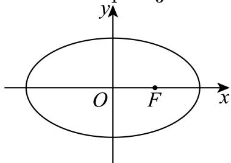
(1) (4分)若直线 l垂直于 x轴，求椭圆 C的弦AB的长度；
(2) (6分)设点P (−3, 0)，当 $\angle P A B = 9 0 ^ { \circ }$ 时，求点A的坐标；
(3) (8分)设点M (3, 0)，记 MA 、 MB的斜率分别为 $| k _ { 1 }$ 和 $k _ { 2 }$ ，求 $k _ { 1 } + k _ { 2 }$ 的取值范围.

> 本题资料或解析有待核事项，预览不可作为已审定成品。

**考点：** （1）竖直焦点弦长；（2）直角几何结合焦点定义求点；（3）韦达化斜率和再求范围

**难度依据：** （1）竖直焦点弦长；（2）直角几何结合焦点定义求点；（3）韦达化斜率和再求范围

**核查说明：** 题干与解析已用于人工归类，尚未完成整题公式校净与独立数学终审。；原解第1问把c=√(a²−b²)代入写成√(4²−3²)=1，且第3问联立系数有漏4，须校净复算。；题干与解析已用于人工归类，尚未完成整题公式校净与独立数学终审。；原解第1问把c=√(a²−b²)代入写成√(4²−3²)=1，且第3问联立系数有漏4，须校净复算。

【解析】

(1) 由题意可知， $c = { \sqrt { a ^ { 2 } - b ^ { 2 } } } = { \sqrt { 4 ^ { 2 } - 3 ^ { 2 } } } = 1$

$\therefore F \left( 1 , 0 \right)$ ,又∵当直线 l垂直于 x轴时，直线l的方程为 $x = 1$

$\left\{ { \frac { x = 1 } { 4 } } \right. \qquad { \frac { y ^ { 2 } } { 3 } } = 1$ 得， $y = \pm \frac { 3 } { 2 }$

∴弦AB的长为 $2 \times { \frac { 3 } { 2 } } = 3 .$

(2) $\because \angle P A B = 9 0 ^ { \circ }$ ，且直线l过点F，

$\therefore \angle P A F = 9 0 ^ { \circ }$ ，在 $: { \mathrm { R t } } \triangle P A F ^ { \natural }$ 中， $P ( - 3 , 0 ) , F \left( 1 , 0 \right)$

∴斜边PF的中点(−1,0)，恰为椭圆的左焦点 $F ^ { \prime }$ ,

$\therefore A F ^ { \prime } = { \frac { 1 } { 2 } } P F = 2$ ,又由椭圆的定义可得 $A F = 2 a - A F ^ { \prime } = 4 - 2 = 2$

∴点A在线段 $F F ^ { \prime }$ 的垂直平分线上，又A在椭圆上，

$\therefore A$ 为椭圆的上顶点或下顶点，

∴A $\left( 0 , - { \sqrt { 3 } } \right)$ 或A $\left( 0 , { \sqrt { 3 } } \right)$

(3) 当直线AB的斜率不存在时，不妨设A $\left( 1 , \frac { 3 } { 2 } \right) , B \left( 1 , - \frac { 3 } { 2 } \right)$ ，

$$
\therefore k _ {1} = \frac {0 - \frac {3}{2}}{3 - 1} = - \frac {3}{4}, k _ {2} = \frac {0 + \frac {3}{2}}{3 - 1} = \frac {3}{4},
$$

故 $k _ { 1 } + k _ { 2 } = 0 ;$

当直线AB的斜率存在时，设斜率为k，则直线AB： $y = k \left( x - 1 \right)$ ，设 $A \left( x _ { 1 } , y _ { 1 } \right) , B \left( x _ { 2 } , y _ { 2 } \right)$

由 $\left\{ { \begin{array} { l } { y = k \left( x - 1 \right) } \\ { { \frac { x ^ { 2 } } { 4 } } + { \frac { y ^ { 2 } } { 3 } } = 1 } \end{array} } \right.$ 得， $\left( 3 + k ^ { 2 } \right) x ^ { 2 } - 8 k ^ { 2 } x + \left( 4 k ^ { 2 } - 1 2 \right) = 0 ,$

$$
\therefore x _ {1} + x _ {2} = \frac {8 k ^ {2}}{4 k ^ {2} + 3}, x _ {1} x _ {2} = \frac {4 k ^ {2} - 1 2}{4 k ^ {2} + 3},
$$

$$
\therefore k _ {1} + k _ {2} = \frac {y _ {1}}{x _ {1} - 3} + \frac {y _ {2}}{x _ {2} - 3} = \frac {k (x _ {1} - 1)}{x _ {1} - 3} + \frac {k (x _ {2} - 1)}{x _ {2} - 3} = \frac {k (2 x _ {1} x _ {2} - 4 (x _ {1} + x _ {2}) + 6)}{x _ {1} x _ {2} - 3 (x _ {1} + x _ {2}) + 9},
$$

化简得 $\therefore k _ { 1 } + k _ { 2 } = { \frac { k \left( { \cfrac { 8 k ^ { 2 } - 2 4 - 3 2 k ^ { 2 } + 2 4 k ^ { 2 } + 1 8 } { 4 k ^ { 2 } + 3 } } \right) } { { \cfrac { 4 k ^ { 2 } - 1 2 } { 4 k ^ { 2 } + 3 } } - { \cfrac { 2 4 k ^ { 2 } } { 4 k ^ { 2 } + 3 } } + 9 } } = - { \frac { 6 k } { 1 6 k ^ { 2 } + 1 5 } } ,$

①当k > 0， $0 > k _ { 1 } + k _ { 2 } = - { \frac { 6 } { 1 6 k + { \frac { 1 5 } { k } } } } \geq - { \frac { 6 } { 2 { \sqrt { 1 6 k \times { \frac { 1 5 } { k } } } } } } = - { \frac { \sqrt { 1 5 } } { 2 0 } }$ ，当且仅当 $k = \frac { \sqrt { 1 5 } } { 4 }$

时等式成立；

②当k < 0， $0 < k _ { 1 } + k _ { 2 } = { \frac { 6 } { - \left( 1 6 k + { \frac { 1 5 } { k } } \right) } } \leq { \frac { 6 } { 2 { \sqrt { ( - 1 6 k ) } } \times \left( - { \frac { 1 5 } { k } } \right) } } = { \frac { \sqrt { 1 5 } } { 2 0 } }$ ，当且仅当

$k = - { \frac { \sqrt { 1 5 } } { 4 } }$ 时等式成立；

③当 $k = 0 , \ k _ { 1 } + k _ { 2 } = 0$ ；

综上所述可得， $k _ { 1 } + k _ { 2 }$ 的取值范围为 $\left[ - { \frac { \sqrt { 1 5 } } { 2 0 } } , { \frac { \sqrt { 1 5 } } { 2 0 } } \right]$

### 黄浦 · 第20题

双曲线Γ: ${ \frac { x ^ { 2 } } { a ^ { 2 } } } - { \frac { y ^ { 2 } } { b ^ { 2 } } } = 1 ( a > 0 , b > 0 )$ 的左、右焦点分别为 $F _ { 1 } \left( - c , 0 \right) , F _ { 2 } \left( c , 0 \right) \left( c > 0 \right)$ ），过点 $F _ { 1 }$ 的直线l与Γ右支在x轴上方交于点A
(1) (4分)若 $a = { \sqrt { 5 } } ,$ ，点A的坐标为(3,4)，求c的值；
(2) (6分)若 $A F _ { 2 } \bot F _ { 1 } F _ { 2 }$ ，且 $. a , b , c$ 是等比数列，求证：直线l的斜率为定值；
(3) (8分)设直线l与Γ左支的交点为B， $c = 3$ ，当且仅当a满足什么条件时，存在直线l，使得$| A B | = | A F _ { 2 } |$ 成立

> 本题资料或解析有待核事项，预览不可作为已审定成品。

**考点：** （1）代点求焦距；（2）等比条件求定斜率；（3）焦点定义与三角形条件求参数

**难度依据：** 双曲线焦点弦与存在性；（1）代点求焦距；（2）等比条件求定斜率；（3）焦点定义与三角形条件求参数

**核查说明：** 第（3）问源解推导中位置关系与充要性需要独立复核。

【解析】

(1) 依题意，将 $a = { \sqrt { 5 } } , x = 3 , y =$ 4代入Γ: ${ \frac { x ^ { 2 } } { a ^ { 2 } } } - { \frac { y ^ { 2 } } { b ^ { 2 } } } = 1 \mathbb { H }$ ，解得 $b ^ { 2 } = 2 0$ ，则 $c = { \sqrt { a ^ { 2 } + b ^ { 2 } } } = 5$ ；

(2)

依题意知，可设直线l: $y = k ( x + c )$ ，代入Γ: ${ \frac { x ^ { 2 } } { a ^ { 2 } } } - { \frac { y ^ { 2 } } { b ^ { 2 } } } = 1 \ u \cdot$ 中，

整理得： $( b ^ { 2 } - a ^ { 2 } k ^ { 2 } ) x ^ { 2 } - 2 a ^ { 2 } c k ^ { 2 } x - a ^ { 2 } c ^ { 2 } k ^ { 2 } - a ^ { 2 } b ^ { 2 } = 0 ( * )$ ，

如图，因 $A F _ { 2 } \bot F _ { 1 } F _ { 2 }$ ，故点A的横坐标为c恰是方程（\*）的解，

则 $| ( b ^ { 2 } - a ^ { 2 } k ^ { 2 } ) c ^ { 2 } - 2 a ^ { 2 } c ^ { 2 } k ^ { 2 } - a ^ { 2 } c ^ { 2 } k ^ { 2 } - a ^ { 2 } b ^ { 2 } = 0 ,$

整理得： $b ^ { 2 } c ^ { 2 } - 4 a ^ { 2 } c ^ { 2 } k ^ { 2 } - a ^ { 2 } b ^ { 2 } = 0$ ，即 $4 a ^ { 2 } c ^ { 2 } k ^ { 2 } = b ^ { 4 }$

$$
| a, b,
$$

$$
b ^ {2} = a c,
$$

$$
4 a ^ {2} c ^ {2} k ^ {2} = a ^ {2} c ^ {2}
$$

$$
k ^ {2} = \frac {1}{4}
$$

因过点 $F _ { 1 }$ 的直线l与Γ右支在x轴上方交于点A，故得 $k = \frac 1 2$ ，即直线l的斜率为定值；

(3)

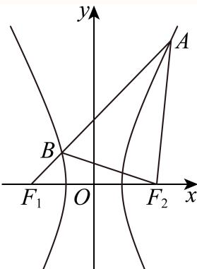

如图，因点A在双曲线右支上，则 $| A F _ { 1 } | - | A F _ { 2 } | = 2 a$ ，即 $| A F _ { 2 } | = | A F _ { 1 } | - 2 a$ 故由 $| A B | = | A F _ { 2 } |$ |可得 $| A F _ { 1 } | - | A B | = | B F _ { 1 } | = 2 a$

又因点B直线l与Γ左支的交点,故 $| B F _ { 2 } | - | B F _ { 1 } | = 2 a$ ，则 $\left| B F _ { 2 } \right| = 4 a$

在 $\triangle B F _ { 1 } F _ { 2 } \notin$ ，设 $\angle F _ { 1 } B F _ { 2 } = \theta$ ，由余弦定理，

$$
\cos \theta = \frac {4 a ^ {2} + 1 6 a ^ {2} - 4 c ^ {2}}{2 \times 2 a \times 4 a} = \frac {2 0 a ^ {2} - 3 6}{1 6 a ^ {2}} = \frac {5}{4} - \frac {9}{4 a ^ {2}},
$$

依题意， $\frac { \pi } { 2 } < \theta < \pi ,$ ，故 $- 1 < \cos \theta < 0$ ，即 $- 1 < \frac { 5 } { 4 } - \frac { 9 } { 4 a ^ { 2 } } < 0$ ，

去分母得− $4 a ^ { 2 } < 5 a ^ { 2 } - 9 < 0$ ，解得 $1 < a ^ { 2 } < { \frac { 9 } { 5 } } .$ ，

因 $| a > 0$ ，故当且仅当a满足 $a \in ( 1 , \frac { 3 \sqrt { 5 } } { 5 } ) .$ )时，存在直线l，使得 $| A B | = | A F _ { 2 } |$ |成立.

## 轨迹交集、构形与计数

把函数变换、等距及面积约束译为几何轨迹；宝山16利用固定底边与两边差不变识别双曲线，再以两边和递增研究高度及面积。检验交点存在性及构形计数。

### 宝山 · 第16题

…
设 $\triangle A _ { n } B _ { n } C _ { n }$ 的三边长分别为 $a _ { n } , b _ { n } , c _ { n }$ ，面积为 $S _ { n }$ （n为正整数）．若 $b _ { 1 } - c _ { 1 } = \frac { 1 } { 2 } a _ { 1 }$ ，其中$c _ { 1 } > { \frac { 1 } { 4 } } a _ { 1 } , a _ { n + 1 } = a _ { n } , b _ { n + 1 } = c _ { n } + { \frac { 1 } { 4 } } a _ { n } , c _ { n + 1 } = b _ { n } + { \frac { 1 } { 4 } } a _ { n }$ ，则（ ）

A. $\{ S _ { n } \}$ 为严格减数列

B. $\{ S _ { n } \}$ 为严格增数列

C. $\left\{ S _ { 2 n - 1 } \right\}$ }为严格增数列， $\{ S _ { 2 n } \}$ 为严格减数列

D. $\{ S _ { 2 n - 1 } \}$ 为严格减数列， $\{ S _ { 2 n } \}$ 为严格增数列

> 本题资料或解析有待核事项，预览不可作为已审定成品。

**考点：** 边长递推与双曲线轨迹

**难度依据：** 涉及边长递推与双曲线轨迹；难度为教师预估，需结合原题条件复核。

**核查说明：** 轨迹完整性与面积单调的原证明不充分，须数学复核。；依据现有底稿归类，尚未逐页校卷、公式校净或独立数学终审。；初次仅从题干抽核误报专题归属存疑，现已撤销。父端复核并再次读取完整源解析确认：a_n固定、|b_n-c_n|=a_1/2使三角形顶点位于以B,C为焦点的双曲线，b_n+c_n等差递增对应高度及面积递增。保留解析几何归属及本组，作为数列与双曲线定义的跨专题案例。

【答案】B

【解析（回源净化）】

由 $a_{n+1}=a_n$，知 $a_n=a_1$。经平移、旋转或翻折，可把各三角形的底边 $B_nC_n$ 重合为同一条线段 $BC$，其中 $|BC|=a_1$，这些刚体变换不改变边长和面积。

由递推关系，得

$$b_{n+1}-c_{n+1}=c_n-b_n=-(b_n-c_n).$$

结合 $b_1-c_1=\frac12a_1$，可知

$$|b_n-c_n|=\frac12a_1.$$

因此，顶点 $A_n$ 到定点 $B,C$ 的距离之差的绝对值恒为 $\frac12a_1$。根据双曲线的定义，$A_n$ 在以 $B,C$ 为焦点的同一条双曲线上。

同时，

$$b_{n+1}+c_{n+1}=b_n+c_n+\frac12a_1.$$

故 $s_n=b_n+c_n$ 为公差为 $\frac12a_1>0$ 的等差数列，严格递增。原解据此指出：两焦点距离之和增大，顶点到焦点连线的距离增大，从而面积增大。下面补明这一转化。

以 $BC$ 的中点为原点、$BC$ 所在直线为 $x$ 轴，则 $B=(-\frac{a_1}2,0)$，$C=(\frac{a_1}2,0)$。该双曲线的实半轴长为 $\frac{a_1}4$，虚半轴长为 $\frac{\sqrt3a_1}4$，方程为

$$\frac{x^2}{a_1^2/16}-\frac{y^2}{3a_1^2/16}=1.$$

记 $A_n=(x_n,y_n)$。将到两焦点距离的平方作差，并利用距离差的绝对值为 $\frac12a_1$，得

$$2a_1|x_n|=\left|b_n^2-c_n^2\right|=\frac12a_1s_n,$$

故 $|x_n|=\frac14s_n$，代入双曲线方程，得

$$y_n^2=\frac3{16}(s_n^2-a_1^2).$$

又由 $c_1>\frac14a_1$ 和 $b_1=c_1+\frac12a_1$，知 $s_1>a_1$，所以各项均有 $s_n>a_1$。随着 $s_n$ 严格增大，$|y_n|$ 也严格增大。

由面积公式

$$S_n=\frac12a_1|y_n|,$$

知 $\{S_n\}$ 为严格增数列，其奇数项子列和偶数项子列也均为严格增数列。

故选B。

整理说明：保留源PDF第9—10页的双曲线解法及原图；清除OCR误添的竖线、字形及下一节标题，并补明“两焦点距离之和增大推出高度增大”的论证。原始解析保存在回源补丁记录及来源字段中。

### 杨浦 · 第12题

已知实数 $a>0$，$\mathrm{i}$ 是虚数单位，设集合 $A=\{z\mid z=w+\frac1w,\ |w|>1,\ w\in\mathbf C,\ z\in\mathbf C\}$，集合 $B=\{z\mid |z-1+\mathrm{i}|=a,\ z\in\mathbf C\}$。如果 $B\subseteq A$，则 $a$ 的取值范围为______。

> 本题资料或解析有待核事项，预览不可作为已审定成品。

**考点：** 复变换与几何轨迹；圆与实轴线段相离；集合包含

**难度依据：** 需确定复变换值域并将包含问题转为圆与线段的位置关系；长解细节待审。

**核查说明：** 原MD漏失A的定义及a>0条件；从同名PDF文字层恢复完整题干。PDF第4页底部印刷裁切，A定义未完整可见，不能称已全题视觉确认。；题干与解析已用于人工归类，尚未完成整题公式校净与独立数学终审。；解法二纯虚数分支对q<0的构造及负实数分支符号存在问题，需审解；结论不据此改写。；原MD漏失A的定义及a>0条件；从同名PDF文字层恢复完整题干。PDF第4页底部印刷裁切，A定义未完整可见，不能称已全题视觉确认。；题干与解析已用于人工归类，尚未完成整题公式校净与独立数学终审。；解法二纯虚数分支对q<0的构造及负实数分支符号存在问题，需审解；结论不据此改写。

【答案】$( 0 , 1 ) \cup \left( \sqrt { 1 0 } , + \infty \right)$

【解析】

解法一：明确集合A，B的几何意义，数形结合，根据几何意义即可求得参数范围.

解法二：先证明不属于A的复数z，恰好是那些区间[−2,2]上的实数，再利用该结论得到取值范围.

解法一：由于 $| w | > 1$ ，设 $w = r ( \cos \theta + \mathrm { i } \sin \theta ) , r > 1$ ，

$$
w + \frac {1}{w} = r (\cos \theta + \mathrm{i} \sin \theta) + \frac {1}{r (\cos \theta + \mathrm{i} \sin \theta)}
$$

$$
= r (\cos \theta + \mathrm{i} \sin \theta) + \frac {\cos \theta - \mathrm{i} \sin \theta}{r} = \left(r + \frac {1}{r}\right) \cos \alpha + \mathrm{i} \left(r - \frac {1}{r}\right) \sin \alpha ,
$$

设z对应点(x, y)，则 $x = \left( r + { \frac { 1 } { r } } \right) \cos \alpha , y = \left( r - { \frac { 1 } { r } } \right) \sin \alpha$

所以 ${ \frac { x ^ { 2 } } { \left( r + { \frac { 1 } { r } } \right) ^ { 2 } } } + { \frac { y ^ { 2 } } { \left( r - { \frac { 1 } { r } } \right) ^ { 2 } } } = 1$ ，其中 $r + \frac { 1 } { r } > 2 , r - \frac { 1 } { r } > 0$

当 $r > 1  { \mathbb { H } } )$ ，该方程的几何意义为表示所有椭圆的并集，

即平面上除去线段 $A _ { 1 } A _ { 2 }$ 的点的集合，其中 $A _ { 1 } ( - 2 , 0 ) , A _ { 2 } ( 2 , 0 )$

集合 $B = \{ z \mid | z - 1 + \mathbf { i } | = a , z \in \mathbf { C } \}$ 表示复平面上的圆，圆心为(1,−1)，半径为a，

如果 $B \subseteq A$ ，则该圆与线段 $A _ { 1 } A _ { 2 }$ 无公共点，

结合图形可知a的取值范围为(0,1)∪ $\left( { \sqrt { 1 0 } } , + \infty \right)$ ；

解法二：

先证明：不属于A的复数z，恰好是那些区间[−2,2]上的实数.

下设z是复数.

①情况一：z不是实数，也不是纯虚数.

设 ${ \boldsymbol { \cdot } } { \boldsymbol { z } } = r \cdot \mathrm { e } ^ { \mathrm { i } \alpha } \left( r \geq 0 , \alpha \in \mathbf { R } \right) , z ^ { 2 } - 4 = R \cdot \mathrm { e } ^ { \mathrm { i } \beta } \left( R \geq 0 , \beta \in \mathbf { R } \right)$ ，并令 $w _ { 1 } = { \frac { r \cdot \mathrm { e } ^ { \mathrm { i } \alpha } + { \sqrt { R } } \cdot \mathrm { e } ^ { \mathrm { i } \cdot { \frac { \beta } { 2 } } } } { 2 } }$ $w _ { 2 } = { \frac { r \cdot \mathrm { e } ^ { \mathrm { i } \alpha } - { \sqrt { R } } \cdot \mathrm { e } ^ { \mathrm { i } \cdot { \frac { \beta } { 2 } } } } { 2 } }$

则对 $k = 1 , 2 ,$ ，有 $\left( w _ { k } - { \frac { z } { 2 } } \right) ^ { 2 } = \left( w _ { k } - { \frac { r \cdot \mathrm { e } ^ { \mathrm { i } \alpha } } { 2 } } \right) ^ { 2 } = \left( { \frac { { \sqrt { R } } \cdot \mathrm { e } ^ { \mathrm { i } { \frac { \beta } { 2 } } } } { 2 } } \right) ^ { 2 } = { \frac { R \cdot \mathrm { e } ^ { \mathrm { i } \beta } } { 4 } } = { \frac { z ^ { 2 } - 4 } { 4 } }$ ，即

$$
w _ {k} ^ {2} - z \cdot w _ {k} + 1 = 0.
$$

假设 $w _ { k } = 0$ ，则 $| 0 = w _ { k } ^ { 2 } - z \cdot w _ { k } + 1 = 0 ^ { 2 } - z \cdot 0 + 1 = 1$ ，矛盾，所以 $w _ { k } \neq 0$ ，从而 $w _ { k } + \frac { 1 } { w _ { k } } = z .$

又因为 $\mathfrak { w } _ { 1 } \mathfrak { w } _ { 2 } = \frac { \left( r \cdot \mathrm { e } ^ { \mathrm { i } \alpha } \right) ^ { 2 } - \left( \sqrt { R } \cdot \mathrm { e } ^ { \mathrm { i } \cdot \frac { \beta } { 2 } } \right) ^ { 2 } } { 4 } = \frac { z ^ { 2 } - R \cdot \mathrm { e } ^ { \mathrm { i } \beta } } { 4 } = \frac { z ^ { 2 } - \left( z ^ { 2 } - 4 \right) } { 4 } = 1 ,$

所以 $1 = | 1 | = | w _ { 1 } w _ { 2 } | = | w _ { 1 } | | w _ { 2 } | .$

此时，假设 $| w _ { 1 } | = | w _ { 2 } | = 1 \colon$ ：由于

$$
w _ {1} = \frac {r \mathrm{e} ^ {\mathrm{i} \alpha} + \sqrt {R} \mathrm{e} ^ {\mathrm{i} \cdot \frac {\beta}{2}}}{2} = \left(\frac {r}{2} \cos \alpha + \frac {\sqrt {R}}{2} \cos \frac {\beta}{2}\right) + \left(\frac {r}{2} \sin \alpha + \frac {\sqrt {R}}{2} \sin \frac {\beta}{2}\right) \mathrm{i},
$$

故

$$
\begin{array}{l} 1 = 1 ^ {2} = | w _ {1} | ^ {2} = \left(\frac {r}{2} \cos \alpha + \frac {\sqrt {R}}{2} \cos \frac {\beta}{2}\right) ^ {2} + \left(\frac {r}{2} \sin \alpha + \frac {\sqrt {R}}{2} \sin \frac {\beta}{2}\right) ^ {2} = \frac {r ^ {2}}{4} + \frac {R}{4} + \frac {r \sqrt {R}}{2} \cos \\ \left(\alpha - \frac {\beta}{2}\right) \end{array}
$$

同理，根据 $| w _ { 2 } | = 1$ 可以得到 $1 = { \frac { r ^ { 2 } } { 4 } } + { \frac { R } { 4 } } - { \frac { r { \sqrt { R } } } { 2 } } \mathrm { c o s } \left( \alpha - { \frac { \beta } { 2 } } \right)$

对 $. = { \frac { r ^ { 2 } } { 4 } } + { \frac { R } { 4 } } + { \frac { r { \sqrt { R } } } { 2 } } \cos \left( \alpha - { \frac { \beta } { 2 } } \right)$ 和1 $= { \frac { r ^ { 2 } } { 4 } } + { \frac { R } { 4 } } - { \frac { r { \sqrt { R } } } { 2 } } \cos \left( \alpha - { \frac { \beta } { 2 } } \right)$ 相加和相减，

就能得到 $1 = { \frac { r ^ { 2 } } { 4 } } + { \frac { R } { 4 } } , { \frac { r { \sqrt { R } } } { 2 } } \mathrm { c o s } \left( \alpha - { \frac { \beta } { 2 } } \right) = 0 .$

若假设R = 0，则 $( z - 2 ) ( z + 2 ) = z ^ { 2 } - 4 = R \mathrm { e } ^ { \mathrm { i } \beta } = 0$ ，从而 $z = 2$ 或 $z = - 2$

这和情况一的定义矛盾，所以 $R > 0$

若假设 $\boldsymbol { r } = 0$ ，则 $z = r \cdot \mathrm { e } ^ { \mathrm { i } \alpha } = 0$ ，从而 $z = 0$ ，这和情况一的定义矛盾，所以 $r > 0$

这就得到 $\frac { r \sqrt { R } } { 2 } > 0 .$ ，所以 $\cos \left( \alpha - { \frac { \beta } { 2 } } \right)$ = 0，所以 $\frac { \beta } { 2 } = \alpha + \left( 2 m - 1 \right) \cdot \frac { \pi } { 2 } ( m \in \mathbf { Z } )$

即 $\displaystyle | \beta = 2 \alpha + ( 2 m - 1 ) \pi \left( m \in \mathbf { Z } \right)$

这就得到

R (reiα)2 ⋅ ei(2m−1)π R 2 − 4 = ⋅ eiβ = ⋅ ei(2α+(2m−1)π) = e2iα ⋅ ei(2m−1)π z2 2 i(2m−1)π r2 r2 所以 $z ^ { 2 } - 4 = { \frac { R } { r ^ { 2 } } } i$ z2或 $z ^ { 2 } - 4 = - { \frac { R } { r ^ { 2 } } } z ^ { 2 }$ ，无论哪种情况都能得到 $z ^ { 2 }$ 是实数，故可设 $z ^ { 2 } = c \in \mathbf { R }$ 若 $c \geq 0 .$ ，则 $0 = z ^ { 2 } - c = \left( z - { \sqrt { c } } \right) \left( z + { \sqrt { c } } \right)$ ，得 $z = \pm \sqrt { { \mathfrak { c } } }$ c是实数，这和情况一的定义矛盾. 若 $c < 0 _ { : }$ ，则 $0 = z ^ { 2 } - c = \left( z - \mathrm { i } { \sqrt { c } } \right) \left( z + \mathrm { i } { \sqrt { c } } \right)$ ，得 $z = \pm \mathrm { i } \sqrt { }$ c是纯虚数，这和情况一的定义矛 盾.

故前面的假设 $| w _ { 1 } | = | w _ { 2 } | = 1$ 不成立，所以结合 $\mathrm { ~ l ~ } = \left| w _ { 1 } \right| \left| w _ { 2 } \right|$ |可知，

一定存在k = 1,2使得 $| w _ { k } | > 1$ ，结合 $w _ { k } + \frac { 1 } { w _ { k } } = z ^ { \boxplus } \ddot { \star } \boxed { \| } z \in A$

②情况二：z是纯虚数.

此时设 $z = \dot { q 1 } ( q \neq 0 )$ ，则 $w = \frac { q + \sqrt { q ^ { 2 } + 4 } } { 2 }$ i满 $\dot { \Xi } | w | = { \frac { q + \sqrt { q ^ { 2 } + 4 } } { 2 } } > { \frac { 0 + \sqrt { 0 + 4 } } { 2 } } = 1$

$$
\begin{array}{l} {w + \frac {1}{w} = \frac {q + \sqrt {q ^ {2} + 4}}{2} \mathrm{i} + \frac {1}{\frac {q + \sqrt {q ^ {2} + 4}}{2} \mathrm{i}} = \frac {q + \sqrt {q ^ {2} + 4}}{2} \mathrm{i} - \frac {2}{q + \sqrt {q ^ {2} + 4}} \mathrm{i} = \frac {q + \sqrt {q ^ {2} + 4}}{2} \mathrm{i}} \\ {- \frac {\sqrt {q ^ {2} + 4} - q}{2} \mathrm{i} = q \mathrm{i} = z} \end{array}
$$

故 $z \in A .$

③情况三：z是实数， $\mathrm { { E } } z > 2 .$

此时 $w = \frac { z + \sqrt { z ^ { 2 } - 4 } } { 2 }$ 满足 $| w | = \left| { \frac { z + { \sqrt { z ^ { 2 } - 4 } } } { 2 } } \right| = { \frac { z + { \sqrt { z ^ { 2 } - 4 } } } { 2 } } > { \frac { 2 + { \sqrt { 2 ^ { 2 } - 4 } } } { 2 } } = 1 ,$

且 $\lfloor w + { \frac { 1 } { w } } = { \frac { z + { \sqrt { z ^ { 2 } - 4 } } } { 2 } } + { \frac { 2 } { z + { \sqrt { z ^ { 2 } - 4 } } } } = { \frac { z + { \sqrt { z ^ { 2 } - 4 } } } { 2 } } + { \frac { z - { \sqrt { z ^ { 2 } - 4 } } } { 2 } } = z ,$ ，故 $( z \in A$

④情况四：z是实数，且 $z < - 2$

此时 $w = \frac { - z + \sqrt { z ^ { 2 } - 4 } } { 2 }$ 满足

$$
| w | = \left| \frac {- z + \sqrt {z ^ {2} - 4}}{2} \right| = \frac {(- z) + \sqrt {(- z) ^ {2} - 4}}{2} > \frac {2 + \sqrt {2 ^ {2} - 4}}{2} = 1,
$$

且 $w + \frac { 1 } { w } = \frac { z - \sqrt { z ^ { 2 } - 4 } } { 2 } + \frac { 2 } { z - \sqrt { z ^ { 2 } - 4 } } = \frac { z - \sqrt { z ^ { 2 } - 4 } } { 2 } + \frac { z + \sqrt { z ^ { 2 } - 4 } } { 2 } = z ,$ ，故 $z \in A$

⑤情况五：z是实数， $\mathrm { E } z \in [ - 2 , 2 ]$

假设 $z \in A .$ 则存在复数w使得 $| w | > 1$ ，且 ${ \boldsymbol { \cdot } } { \boldsymbol { w } } + { \frac { 1 } { w } } = { \boldsymbol { z } } ,$ ，设 $w = r _ { 0 } \cdot \mathrm { e } ^ { \mathrm { i } \theta } \left( r _ { 0 } > 1 , \theta \in \mathbf { R } \right)$

$$
| z = w + \frac {1}{w} = r _ {0} \mathrm{e} ^ {\mathrm{i} \theta} + \frac {1}{r _ {0} \cdot \mathrm{e} ^ {\mathrm{i} \theta}} = r _ {0} \mathrm{e} ^ {\mathrm{i} \theta} + \frac {1}{r _ {0}} \mathrm{e} ^ {- \mathrm{i} \theta} = \left(r _ {0} + \frac {1}{r _ {0}}\right) \cos \theta + \mathrm{i} \left(r _ {0} - \frac {1}{r _ {0}}\right) \sin \theta .
$$

从而 $\left( r _ { 0 } + { \frac { 1 } { r _ { 0 } } } \right) \cos \theta = z , \left( r _ { 0 } - { \frac { 1 } { r _ { 0 } } } \right) \sin \theta = 0$ 而由 $r _ { 0 } > 1$ 可知 $\vert r _ { 0 } - \frac { 1 } { r _ { 0 } } > 1 - \frac { 1 } { 1 } = 0 .$ 所以 $\sin \theta = 0$ ，故 $| \cos \theta | = 1$

这就得到 ${ \mathrm { ~ : } } \geq | z | = \left| \left( r _ { 0 } + { \frac { 1 } { r _ { 0 } } } \right) \cos \theta \right| = r _ { 0 } + { \frac { 1 } { r _ { 0 } } } = { \frac { ( r _ { 0 } - 1 ) ^ { 2 } + 2 r _ { 0 } } { r _ { 0 } } } > { \frac { 2 r _ { 0 } } { r _ { 0 } } } = 2 ,$ ，矛盾.所以假设不成立，从而z ∉ A.

综合上面五种情况，就得到了结论：不属于A的复数z，恰好是那些区间[−2,2]上的实数现在回到原题，结合上面的结论，条件等价于B中包含的每个实数都不属于[−2,2].

一方面，若B中包含一个实数z，满足 $- 2 \leq z \leq 2$

则 $| a = | z - 1 + \mathbf { i } | = { \sqrt { ( z - 1 ) ^ { 2 } + 1 } } \geq 1 \quad$

$a = | z - 1 + \mathrm { i } | = { \sqrt { \left( z - 1 \right) ^ { 2 } + 1 } } = { \sqrt { \left( z + 2 \right) \left( z - 4 \right) + 1 0 } } \leq { \sqrt { 1 0 } }$ ，从而1 $\leq a \leq { \sqrt { 1 0 } } .$

另一方面，若 $1 \leq a \leq \sqrt { 1 0 }$ ，则实数 $z = 1 - \sqrt { a ^ { 2 } - 1 }$ 1满足

$$
z = 1 - \sqrt {a ^ {2} - 1} \geq 1 - \sqrt {\left(\sqrt {1 0}\right) ^ {2} - 1} = 1 - \sqrt {9} = - 2, z = 1 - \sqrt {a ^ {2} - 1} \leq 1 \leq 2.
$$

故B中包含一个实数z，满 $\begin{array} { r } { \mathbb { E } - 2 \le z \le 2 } \end{array}$

这就说明，B中包含一个实数z满足−2 ≤ z ≤ 2的充要条件是1 $\leq a \leq { \sqrt { 1 0 } } .$

所以a的取值范围是 $( 0 , 1 ) \cup \left( \sqrt { 1 0 } , + \infty \right)$

故答案为： $( 0 , 1 ) \cup \left( \sqrt { 1 0 } , + \infty \right)$

关键点点睛：本题的关键在于对复数知识和三角恒等变换的使用.

## 二、选择题

### 长宁 · 第11题

设O为坐标原点，从集合{1,2,3,4,5,6,7,8,9}中任取两个不同的元素x、y，组成A、B两点的坐标$( x , y ) , ( y , x )$ ，则 $S _ { \triangle A O B } \leq$ 10的概率为

**考点：** 化面积约束为整数对不等式并枚举

**难度依据：** 坐标面积与古典概型；化面积约束为整数对不等式并枚举

【答案】${ \frac { 1 3 } { 3 6 } } .$

【解析】

设AB与直线y = x的交点为C，由面积关系可得 $\left| \begin{array} { r l r } { x ^ { 2 } - y ^ { 2 } } \end{array} \right| \le 2 0$ ，列表，结合古典概型运算求解

设AB与直线y = x的交点为C，由题意知A，B关于y = x对称，

可知C为线段AB的中点，且 $O C \bot A B$ ，则C $\left( { \frac { x + y } { 2 } } , { \frac { x + y } { 2 } } \right)$

$$
| A B | = \sqrt {(x - y) ^ {2} + (y - x) ^ {2}} = \sqrt {2} | x - y |, | O C | = \sqrt {\left(\frac {x + y}{2}\right) ^ {2} + \left(\frac {x + y}{2}\right) ^ {2}}
$$

$$
= \frac {\sqrt {2}}{2} | x + y |,
$$

则 $S _ { \triangle A O B } = { \frac { 1 } { 2 } } | A B | \cdot | O C | = { \frac { 1 } { 2 } } \left| x ^ { 2 } - y ^ { 2 } \right| \leq 1 0$ ，即 $\left| ~ x ^ { 2 } - y ^ { 2 } \right| \leq 2 0$

列表可得：

设样本空间为Ω， $S _ { \triangle A O B } \leq 1 0 $ 为事件A，

可得 ${ \mathit { n } } \left( \Omega \right) = 7 2 , { \mathit { n } } \left( A \right) = 2 6$

所以所求概率为 $P = \frac { n \left( A \right) } { n \left( \Omega \right) } = \frac { 2 6 } { 7 2 } = \frac { 1 3 } { 3 6 }$

故答案为： ${ \frac { 1 3 } { 3 6 } } .$

### 闵行 · 第10题

已知 $\begin{array} { r l } { \ F _ { 1 } , } & { { } F _ { 2 } } \end{array}$ 分别为椭圆 ${ \frac { x ^ { 2 } } { 4 } } + { \frac { y ^ { 2 } } { 2 } } = 1$ 的左、右焦点，过 $F _ { 1 }$ 的直线交椭圆于A、B两点．若 $\overrightarrow { A F _ { 1 } } \cdot \overrightarrow { A F _ { 2 } } = 0$ ，则 $\overrightarrow { A F _ { 2 } } \cdot \overrightarrow { B F _ { 2 } }$

> 本题资料或解析有待核事项，预览不可作为已审定成品。

**考点：** 由垂直定位短轴顶点并计算数量积

**难度依据：** 椭圆焦点与向量垂直；由垂直定位短轴顶点并计算数量积

**核查说明：** 仅修复所列OCR公式及其定界符错位；原解数学疑点和其他可渲染错识未因此消除。

【答案】4.

【解析】

首先求出 $F _ { \mathrm { 1 } } , \ F _ { \mathrm { 2 } }$ ，设 $A \left( x _ { 0 } , y _ { 0 } \right)$ ，根据数量积的坐标表示及 $\frac { x _ { 0 } ^ { 2 } } { 4 } + \frac { y _ { 0 } ^ { 2 } } { 2 } = 1$ 求出A点坐标，从而求出AB的方程，再联立直线与椭圆方程，求出B点坐标，最后由数量积的坐标表示计算可得.

椭圆 ${ \frac { x ^ { 2 } } { 4 } } + { \frac { y ^ { 2 } } { 2 } } = 1$ ，则 $F _ { 1 } \left( - { \sqrt { 2 } } , 0 \right) , F _ { 2 } \left( { \sqrt { 2 } } , 0 \right)$

设A $( x _ { 0 } , y _ { 0 } )$ ，因为 $\overrightarrow { A F _ { 1 } } \cdot \overrightarrow { A F _ { 2 } } = 0$ ，即 $\left( - \sqrt { 2 } - x _ { 0 } \right) \left( \sqrt { 2 } - x _ { 0 } \right) + ( - y _ { 0 } ) ^ { 2 } = 0 _ { : }$

即 $| x _ { 0 } ^ { 2 } + y _ { 0 } ^ { 2 } = 2$ ，又 $\frac { x _ { 0 } ^ { 2 } } { 4 } + \frac { y _ { 0 } ^ { 2 } } { 2 } = 1$ ，解得 $\left\{ { \begin{array} { l } { y _ { 0 } ^ { 2 } = 2 } \\ { x _ { 0 } ^ { 2 } = 0 } \end{array} } \right.$ 不妨取A $\left( 0 , { \sqrt { 2 } } \right)$

则AB的方程为 $y = x + { \sqrt { 2 } } ,$ ，由 ${ \left\{ \begin{array} { l l } { y = x + { \sqrt { 2 } } } \\ { { \frac { x ^ { 2 } } { 4 } } + { \frac { y ^ { 2 } } { 2 } } = 1 } \end{array} \right. } ,$ ，解得 $\left\{ { \begin{array} { l l } { x = 0 } \\ { y = { \sqrt { 2 } } } \end{array} } \right.$ 或 $\begin{cases}x=-\dfrac{4\sqrt2}{3},\\y=-\dfrac{\sqrt2}{3}.\end{cases}$

所以 $B \left( - { \frac { 4 { \sqrt { 2 } } } { 3 } } , - { \frac { \sqrt { 2 } } { 3 } } \right)$

所以 $\overrightarrow { A F _ { 2 } } = \Big ( \sqrt { 2 } , - \sqrt { 2 } \Big ) , \overrightarrow { B F _ { 2 } } = \Bigg ( \frac { 7 \sqrt { 2 } } { 3 } , \frac { \sqrt { 2 } } { 3 } \Bigg )$

所以 $\overrightarrow { A F _ { 2 } } \cdot \overrightarrow { B F _ { 2 } } = \frac { 7 \sqrt { 2 } } { 3 } \times \sqrt { 2 } - \sqrt { 2 } \times \frac { \sqrt { 2 } } { 3 } = 4 .$

故答案为：4.

## 距离、投影与几何最值

利用圆、圆弧和函数模型研究距离或投影的范围与最值。

### 嘉定 · 第12题

已知实数 $\left[ x _ { 1 } , x _ { 2 } , y _ { 1 } , y _ { 2 } \right.$ 满足： $x _ { 1 } ^ { 2 } + y _ { 1 } ^ { 2 } = 1 , x _ { 2 } ^ { 2 } + y _ { 2 } ^ { 2 } = 1 , x _ { 1 } x _ { 2 } + y _ { 1 } y _ { 2 } = { \frac { 1 } { 2 } }$ ，则${ \frac { | x _ { 1 } + y _ { 1 } - 1 | } { \sqrt { 2 } } } + { \frac { | x _ { 2 } + y _ { 2 } - 1 | } { \sqrt { 2 } } }$ 的最小值为

> 本题资料或解析有待核事项，预览不可作为已审定成品。

**考点：** 点线距离和与单位圆弦的几何转化；数量积确定圆心角；定角弦及投影的距离最值

**难度依据：** 绝对值转点线距离并区分两点位于直线同异侧

**核查说明：** 题干与解析已用于人工归类，尚未完成整题公式校净与独立数学终审。；原解几处角区间及同侧讨论有乱码，完整分类不等于已核证明。；题干与解析已用于人工归类，尚未完成整题公式校净与独立数学终审。；原解几处角区间及同侧讨论有乱码，完整分类不等于已核证明。

【答案】$\frac { { \sqrt { 6 } } - { \sqrt { 2 } } } { 4 }$

【解析】

设 $A ( x _ { 1 } , y _ { 1 } ) , B ( x _ { 2 } , y _ { 2 } )$ ，根据给定条件可得A,B为单位圆O上两点，且 $\angle A O B = 6 0 ^ { \circ }$ ，再利用${ \frac { | x _ { 1 } + y _ { 1 } - 1 | } { \sqrt { 2 } } } + { \frac { | x _ { 2 } + y _ { 2 } - 1 | } { \sqrt { 2 } } }$ 的几何意义转化为直线x $: + y - 1 = 0$ 与圆 $x ^ { 2 } + y ^ { 2 } = { \frac { 3 } { 4 } }$ 上点的距离最小值求解.

设 $A ( x _ { 1 } , y _ { 1 } ) , B ( x _ { 2 } , y _ { 2 } )$ ，则 $\overrightarrow { { O A } } = ( x _ { 1 } , y _ { 1 } ) , \overrightarrow { { O B } } = ( x _ { 2 } , y _ { 2 } )$ ，由 $x _ { 1 } ^ { 2 } + y _ { 1 } ^ { 2 } = 1 , x _ { 2 } ^ { 2 } + y _ { 2 } ^ { 2 } = 1$ $x _ { 1 } x _ { 2 } + y _ { 1 } y _ { 2 } = { \frac { 1 } { 2 } }$

得点A,B在单位圆 $x ^ { 2 } + y ^ { 2 } = 1 _ { - }$ 上，且 $\overrightarrow { O A } \cdot \overrightarrow { O B } = x _ { 1 } x _ { 2 } + y _ { 1 } y _ { 2 } = 1 \times 1 \times \cos \angle A O B = \frac { 1 } { 2 }$

即 $\angle A O B = 6 0 ^ { \circ }$ ，则 $\triangle A O B$ 为等边三角形， $| A B | = 1$ ，

${ \frac { | x _ { 1 } + y _ { 1 } - 1 | } { \sqrt { 2 } } } + { \frac { | x _ { 2 } + y _ { 2 } - 1 | } { \sqrt { 2 } } }$ 可视为点A,B到直线l： $x + y - 1 = 0$ 的距离 $d _ { 1 }$ 与 $d _ { 2 }$ 之和， 当点4 R在克线1同侧时

$$
(\cos \alpha , \sin \alpha), B \left(\cos \left(\alpha + \frac {\pi}{3}\right), \sin \left(\alpha + \frac {\pi}{3}\right)\right), 0 <   \alpha <   \frac {\pi}{6} \text {或} \frac {\pi}{2} <   \alpha <   \frac {5 \pi}{3}.
$$

当0 $< \alpha < \frac { \pi } { 6 }$ 时， $\frac { \pi } { 4 } < \alpha + \frac { \pi } { 4 } < \frac { 5 \pi } { 1 2 }$ ，则 $\sin \alpha + \cos \alpha = { \sqrt { 2 } } \sin \left( \alpha + { \frac { \pi } { 4 } } \right) > 1$

$$
\frac {7 \pi}{1 2} <   \alpha + \frac {\pi}{3} + \frac {\pi}{4} <   \frac {3 \pi}{4}, \sin \left(\alpha + \frac {\pi}{3}\right) + \cos \left(\alpha + \frac {\pi}{3}\right) = \sqrt {2} \sin \left(\alpha + \frac {\pi}{3} + \frac {\pi}{4}\right) > 1,
$$

$$
\cos {\frac {5 \pi}{1 2}} = \sin {\frac {\pi}{1 2}} = \sin \left(\frac {\pi}{3} - \frac {\pi}{4}\right) = \sin {\frac {\pi}{3}} \cos {\frac {\pi}{4}} - \cos {\frac {\pi}{3}} \sin {\frac {\pi}{4}} = \frac {\sqrt {6}}{4} - \frac {\sqrt {2}}{4} = \frac {\sqrt {6} - \sqrt {2}}{4},
$$

$$
\sin {\frac {5 \pi}{1 2}} = \cos {\frac {\pi}{1 2}} = \cos \left(\frac {\pi}{3} - \frac {\pi}{4}\right) = \cos {\frac {\pi}{3}} \cos {\frac {\pi}{4}} + \sin {\frac {\pi}{3}} \sin {\frac {\pi}{4}} = \frac {\sqrt {2}}{4} + \frac {\sqrt {6}}{4} = \frac {\sqrt {6} + \sqrt {2}}{4},
$$

$$
\text {是} d _ {1} + d _ {2} = \frac {\left| \sin \alpha + \cos \alpha - 1 \right|}{\sqrt {2}} + \frac {\left| \sin \left(\alpha + \frac {\pi}{3}\right) + \cos \left(\alpha + \frac {\pi}{3}\right) - 1 \right|}{\sqrt {2}}
$$

$$
= \frac {1}{\sqrt {2}} \left[ \sin \alpha + \cos \alpha + \sin \left(\alpha + \frac {\pi}{3}\right) + \cos \left(\alpha + \frac {\pi}{3}\right) - 2 \right] = \frac {1}{\sqrt {2}}
$$

$$
\left(\frac {3 - \sqrt {3}}{2} \sin \alpha + \frac {3 + \sqrt {3}}{2} \cos \alpha\right) - \sqrt {2}
$$

$$
= \frac {\sqrt {6}}{\sqrt {2}} \left(\frac {\sqrt {6} - \sqrt {2}}{4} \sin \alpha + \frac {\sqrt {6} + \sqrt {2}}{4} \cos \alpha\right) - \sqrt {2} = \sqrt {3} \sin \left(\alpha + \frac {5 \pi}{1 2}\right) - \sqrt {2},
$$

由0 $1 < \alpha < \frac { \pi } { 6 }$ ，得 $\frac { 5 \pi } { 1 2 } < \alpha + \frac { 5 \pi } { 1 2 } < \frac { 7 \pi } { 1 2 } , \frac { \sqrt { 6 } + \sqrt { 2 } } { 4 } < \sin \left( \alpha + \frac { 5 \pi } { 1 2 } \right) \le 1 ,$

$$
d _ {1} + d _ {2} > \frac {\sqrt {6} - \sqrt {2}}{4};
$$

当 π2 < α < 5π 时， $\frac { 3 \pi } { 4 } < \alpha + \frac { \pi } { 4 } < \frac { 2 3 \pi } { 1 2 }$ 则 $\sin \alpha + \cos \alpha = { \sqrt { 2 } } \sin \left( \alpha + { \frac { \pi } { 4 } } \right) < 1$

$$
\frac {1 3 \pi}{1 2} <   \alpha + \frac {\pi}{3} + \frac {\pi}{4} <   \frac {9 \pi}{4}, \sin \left(\alpha + \frac {\pi}{3}\right) + \cos \left(\alpha + \frac {\pi}{3}\right) = \sqrt {2} \sin \left(\alpha + \frac {\pi}{3} + \frac {\pi}{4}\right) <   1,
$$

$$
d _ {1} + d _ {2} = \frac {1}{\sqrt {2}} \Big [ 2 - \sin \alpha - \cos \alpha - \sin \left(\alpha + \frac {\pi}{3}\right) - \cos \left(\alpha + \frac {\pi}{3}\right) \Big ]
$$

$$
= \sqrt {2} - \frac {1}{\sqrt {2}} \left(\frac {3 - \sqrt {3}}{2} \sin \alpha + \frac {3 + \sqrt {3}}{2} \cos \alpha\right) = \sqrt {2} - \sqrt {3} \sin \left(\alpha + \frac {5 \pi}{1 2}\right),
$$

$$
\frac {1 1 \pi}{1 2} <   \alpha + \frac {5 \pi}{1 2} <   \frac {2 5 \pi}{1 2}, - 1 \leq \sin \left(\alpha + \frac {5 \pi}{1 2}\right) <   \frac {\sqrt {6} - \sqrt {2}}{4}, d _ {1} + d _ {2} > \frac {\sqrt {6} + \sqrt {2}}{4};
$$

当点A,B在直线l异侧时（包括点A,B之一在直线l上），

过A,B分别作 $A A ^ { \prime } \bot l , B B ^ { \prime } \bot l ,$ 垂足为A′,B′，令直线AB与直线l的夹角为θ $\left( { \frac { \pi } { 1 2 } } \leq \theta \leq { \frac { 5 \pi } { 1 2 } } \right)$ $d _ { 1 } + d _ { 2 } = | A B | \sin \theta = \sin \theta \geq \sin { \frac { \pi } { 1 2 } } = { \frac { { \sqrt { 6 } } - { \sqrt { 2 } } } { 4 } } ,$

所以 ${ \frac { | x _ { 1 } + y _ { 1 } - 1 | } { \sqrt { 2 } } } + { \frac { | x _ { 2 } + y _ { 2 } - 1 | } { \sqrt { 2 } } }$ 的最小值为 $\frac { { \sqrt { 6 } } - { \sqrt { 2 } } } { 4 }$

故答案为： $\frac { { \sqrt { 6 } } - { \sqrt { 2 } } } { 4 }$

关键点点睛：本题解题的关键是将 $\frac { | x _ { 1 } + y _ { 1 } - 1 | } { \sqrt { 2 } } + \frac { | x _ { 2 } + y _ { 2 } - 1 | } { \sqrt { 2 } }$ 的转化为点 $A ( x _ { 1 } , y _ { 1 } ) , B ( x _ { 2 } , y _ { 2 } )$ 两点到直线 $x + y - 1 = 0$ 的距离 $d _ { 1 } \mathscr { \varTheta } d _ { 2 }$ 之和.

## 二、选择题

### 普陀 · 第10题

设平面上四点P、Q、M、N满足： $| P M | = | P N | = 4 , | P Q | = 2$ ，若 $\stackrel { \longrightarrow } { Q M } \cdot \stackrel { \longrightarrow } { Q N } = 0$ ，则 $\vert M N \vert$ |的最小值为

> 本题资料或解析有待核事项，预览不可作为已审定成品。

**考点：** 数量积零转直角圆周关系；双圆约束中的弦长最值

**难度依据：** 将垂直条件转圆再用距离约束确定最短弦

**核查说明：** 题干与解析已用于人工归类，尚未完成整题公式校净与独立数学终审。；原解将r²=8−2√7舍去却随后取其为最小值，又出现r>4的不可能分支；结论不能替代证明，须重核。；题干与解析已用于人工归类，尚未完成整题公式校净与独立数学终审。；原解将r²=8−2√7舍去却随后取其为最小值，又出现r>4的不可能分支；结论不能替代证明，须重核。

【解析】

首先分析向量关系，建立平面直角坐标系，设点的坐标，根据已知条件得到 $m = { \frac { 6 } { r \sin \theta } } .$ ，消去m得到 $\sin ^ { 2 } \theta = { \frac { 3 6 } { - r ^ { 4 } + 1 6 r ^ { 2 } } }$ ，借助三角函数的值域得到r的取值范围，最后最后求(MN)的最小值即可.

已知 $\overrightarrow { 1 Q M } \cdot \overrightarrow { Q N } = 0 .$ ，则这两个向量垂直，所 $\xrightarrow [ {  { Q M } \perp  { Q N } } ] { \longrightarrow }$ .则Q再以MN为直径的圆上.

以原点O建立平面直角坐标系，设 $M ( r , 0 )$ ，N(−r, 0)，P(0, m)，Q(r cos θ, r sin θ).

由 $O P ^ { 2 } + O M ^ { 2 } = 1 6 $ ，可得 $r ^ { 2 } + m ^ { 2 } = 1 6$ ，对于r2 $\cos ^ { 2 } \theta + ( r \sin \theta - m ) ^ { 2 } = 4 { \mathrm { . } }$

$\backprime ^ { 2 } + m ^ { 2 } = 1$ 6解出 $\mathsf { \Pi } _ { 1 } m = \pm { \sqrt { 1 6 - r ^ { 2 } } }$ ，代入 $\displaystyle { \sqrt { r ^ { 2 } \cos ^ { 2 } \theta + ( r \sin \theta - m ) ^ { 2 } } = 4 \sharp }$ ，经过化简可以得$m = { \frac { 6 } { r \sin \theta } }$

将 $\mathbf { \dot { \sigma } } m = { \frac { 6 } { r \sin \theta } }$ 代入 $\setminus r ^ { 2 } + m ^ { 2 } = 1 6$ ，得到 $r ^ { 2 } + \frac { 3 6 } { r ^ { 2 } \sin ^ { 2 } \theta } = 1 6$ ，进一步变形为$\sin ^ { 2 } \theta = { \frac { 3 6 } { - r ^ { 4 } + 1 6 r ^ { 2 } } } .$

因为 $\sin ^ { 2 } \theta \in ( 0 , 1 ]$ ，所以 $\frac { 3 6 } { - r ^ { 4 } + 1 6 r ^ { 2 } } \in ( 0 , 1 ]$ .

当 ${ \frac { 3 6 } { - r ^ { 4 } + 1 6 r ^ { 2 } } } = 1$ 时，解方程 $\displaystyle - r ^ { 4 } + 1 6 r ^ { 2 } - 3 6 = 0$

$\widehat { \sf x } t = r ^ { 2 }$ ，则方程变为 $- t ^ { 2 } + 1 6 t - 3 6 = 0$ ，可得 $\lvert { \cdot } t = 8 \pm 2 \sqrt { 7 }$

因为 $\begin{array} { r } { { \boldsymbol { \mathsf { t } } } = r ^ { 2 } > 0 } \end{array}$ ，所以 $r ^ { 2 } = 8 + 2 \sqrt { 7 } ( r ^ { 2 } = 8 - 2 \sqrt { 7 }$ 舍去），则 $r = \sqrt { 7 } + 1$ ；

当 ${ \frac { 3 6 } { - r ^ { 4 } + 1 6 r ^ { 2 } } } =$ 0时， $- r ^ { 4 } + 1 6 r ^ { 2 }  + \infty , r ^ { 2 }  + \infty , r  + \infty$ 或者 $r \to 0$

又因为 $r > 0$ 且存在其他条件限制，所以 $r \in \left\lceil \sqrt { 7 } - 1 , \sqrt { 7 } + 1 \right\rceil \cup ( 4 , + \infty )$

因为 $M N = 2 r$ ，当r取最小值 $r _ { \mathrm { m i n } } = \sqrt { 7 } - 1$ 时， $( M N ) _ { \mathrm { m i n } } = 2 \left( { \sqrt { 7 } } - 1 \right) = 2 { \sqrt { 7 } } - 2$

$$
2 \sqrt {7} - 2
$$

### 普陀 · 第11题

设t ∈ R，直线l: $x + y - t = 0 \div$ 与曲线 $C _ { 1 } { : } y = { \frac { 1 } { 4 } } x ^ { 2 } \left( 0 \leq x \leq 4 \right)$ )和曲线 $C _ { 2 } { : } y = 2 x ^ { \frac { 1 } { 2 } }$ 分别交于P、Q两 点，则|PQ|的最大值是

> 本题资料或解析有待核事项，预览不可作为已审定成品。

**考点：** 反函数图像对称与参数最值；垂直对称轴的截线长度

**难度依据：** 借互逆曲线对称性降为点到对称轴的距离

**核查说明：** 题干与解析已用于人工归类，尚未完成整题公式校净与独立数学终审。；原解联立方程中常数和换元后的常数有错识，须重排并复算。；题干与解析已用于人工归类，尚未完成整题公式校净与独立数学终审。；原解联立方程中常数和换元后的常数有错识，须重排并复算。

【答案】${ \sqrt { 2 } } .$

【解析】

根据题意可得曲线 $C _ { 1 } , C _ { 2 }$ 对应的函数关于直线 ${ \dot { \boldsymbol { \cdot } } } y = x .$ 对称，直线l关于直线 $\dot { \boldsymbol { { \mathfrak { z } } } } { \boldsymbol { y } } = { \boldsymbol { \mathfrak { x } } }$ 对称，从而可得 $P , Q$ 关于直线 ${ \dot { y } } = x$ 对称，利用直线与直线相交、曲线与直线相交得坐标，结合函数性质可得|PQ|的最值.

曲线 $C _ { 1 } : y = \frac { 1 } { 4 } x ^ { 2 } \left( 0 \leq x \leq 4 \right)$ )和曲线 $C _ { 2 } { : } y = 2 x ^ { \frac { 1 } { 2 } }$ 对应的函数互为反函数，则 $C _ { 1 } , C _ { 2 }$ 关于直线

y = x对称，

又 $\{ y = \frac { 1 } { 4 } x ^ { 2 }  \Rightarrow \{ x = 0 _ { \scriptscriptstyle \boxplus \atop y = 0 } \} \{ x = 4 \atop y = 4  ,$ 即两曲线交点坐标为 $O \left( 0 , 0 \right) , M \left( 4 , 4 \right)$

又直线l: $x + y - t = 0 .$ 与直线 $y = x$ 相互垂直，则直线l关于直线 $y = x \mathbb { M }$ 称，

所以 $P , Q$ 关于直线 $y = x$ 对称，设直线 $y = x ^ { \underline { { I } } }$ 与直线l相交与N，且 $P Q \bot O M \mp N$

$\left\{ x + y - t = 0 \atop y = x \right\} x = { \frac { t } { 2 } }$ ，则 $N \left( \frac { t } { 2 } , \frac { t } { 2 } \right)$ ，且 $\frac { t } { 2 } \in [ 0 , 4 ]$ ，所以 $t \in [ 0 , 8 ]$

联立 $\left\{ y = { \frac { 1 } { 4 } } x ^ { 2 } \right. \qquad \Rightarrow x ^ { 2 } + 4 x - t ^ { 2 } = 0 ,$ 解得 $x = { \frac { - 4 \pm { \sqrt { 1 6 + 1 6 t } } } { 2 } } = - 2 \pm 2 { \sqrt { 1 + t } } ,$

因为 $0 \leq x _ { P } \leq 4 , $ ，所以 $x _ { P } = - 2 + 2 { \sqrt { 1 + t } } .$

则|PQ| = 2 |PN| = 2√2 |xP − xN | = 2√2 2√1 + t − 2 − t = √2 4√1 + t − t − 4 ，

令 $\cdot m = { \sqrt { 1 + t } } , 0 \leq t \leq 8$ ，则1 $. \leq m \leq 3$ ，则 $t = m ^ { 2 } - 1$ ，

所以 $\left| 4 { \sqrt { 1 + t } } - t \right| = \left| 4 m - m ^ { 2 } + 1 \right| = \left| - ( m - 2 ) ^ { 2 } + 1 \right|$

因为 $1 \leq m \leq 3$ ，所 $\mathscr { L } \lambda - ( m - 2 ) ^ { 2 } + 1 \in [ 0 , 1 ]$ ，所以 $\big | - ( m - 2 ) ^ { 2 } + 1 \big | _ { \operatorname* { m a x } } = 1$

故 $P Q$ |的最大值为 ${ \sqrt { 2 } } .$ .

故答案为： ${ \sqrt { 2 } } .$

### 松江 · 第10题

已知点P为椭圆 ${ \frac { x ^ { 2 } } { 4 } } + { \frac { y ^ { 2 } } { 3 } } = 1$ 上任意一点，EF为圆 $N \colon ( x - 1 ) ^ { 2 } + y ^ { 2 } = 4$ 的任意一条直径，则 $\overrightarrow { P E } \cdot \overrightarrow { P F }$ 的取值范围是

> 本题资料或解析有待核事项，预览不可作为已审定成品。

**考点：** 数量积转距离平方；椭圆与焦点距离最值

**难度依据：** 数量积转距离平方；椭圆与焦点距离最值；按所需步骤与推理量估计

**核查说明：** 题干与解析已用于人工归类，尚未完成整题公式校净与独立数学终审。；解析中向量数量积与夹角余弦的符号步骤不一致，需审校。；题干与解析已用于人工归类，尚未完成整题公式校净与独立数学终审。；解析中向量数量积与夹角余弦的符号步骤不一致，需审校。

【答案】[−3,5]

【解析】

利用向量运算将 $\overrightarrow { P E } \cdot \overrightarrow { P F }$ 转化为 $| - 4 + | \overrightarrow { N P } | ^ { 2 } .$ ，通过求 $| N P |$ 的取值范围来求得正确答案圆N的圆心为N(1,0)，半径为2.

因为PE ⋅ PF = (NE − NP) ⋅ (NF − NP)= NE ⋅ NF − NP ⋅ (NE + NF) + NP−−→ → → → → → → → → → → →

$$
= - \left| \overrightarrow {N E} \right| \cdot \left| \overrightarrow {N F} \right| \cdot \cos \pi - 0 + \left| \overrightarrow {N P} \right| ^ {2} = - 4 + \left| \overrightarrow {N P} \right| ^ {2}.
$$

又因为椭圆 ${ \frac { x ^ { 2 } } { 4 } } + { \frac { y ^ { 2 } } { 3 } } = 1$ 的 $\quad | a = 2 , b = { \sqrt { 3 } } , c = 1$ $N \left( 1 ~ , ~ 0 \right)$ 为椭圆的右焦点，

$$
P \left(x _ {0}, y _ {0}\right), \frac {x _ {0} ^ {2}}{4} + \frac {y _ {0} ^ {2}}{3} = 1, y _ {0} ^ {2} = 3 \left(1 - \frac {x _ {0} ^ {2}}{4}\right) = 3 - \frac {3 x _ {0} ^ {2}}{4},
$$

$$
| N P | = \sqrt {\left(x _ {0} - 1\right) ^ {2} + y _ {0} ^ {2}} = \sqrt {x _ {0} ^ {2} - 2 x _ {0} + 1 + 3 - \frac {3 x _ {0} ^ {2}}{4}}
$$

$$
= \sqrt {\frac {x _ {0} ^ {2}}{4} - 2 x _ {0} + 4} = \sqrt {\frac {x _ {0} ^ {2} - 8 x _ {0} + 1 6}{4}} = \sqrt {\frac {(x _ {0} - 4) ^ {2}}{4}} = \frac {4 - x _ {0}}{2} = 2 - \frac {1}{2} x _ {0},
$$

$$
- 2 \leq x _ {0} \leq 2, - 1 \leq - \frac {1}{2} x _ {0} \leq 1, 1 \leq 2 - \frac {1}{2} x _ {0} \leq 3,
$$

所以 $N P | \in [ 1 , 3 ] , | N P | ^ { 2 } \in [ 1 , 9 ]$

$$
\therefore \overrightarrow {P E} \cdot \overrightarrow {P F} \in [ - 3, 5 ].
$$

故答案为：[−3,5]

### 浦东 · 第10题

某地要建造一个市民休闲公园长方形ABCD，如图，边 $A B = 2 \mathrm { k m }$ ，边 $A D = 1 \mathrm { k m }$ ，其中区域ADE开挖成一个人工湖，其他区域为绿化风景区．经测算，人工湖在公园内的边界是一段圆弧，且A、D位于圆心O的正北方向，E位于圆心O的北偏东 $\mathrm { \Delta } 6 0 ^ { \circ }$ 方向．拟定在圆弧P处修建一座渔人码头，供游客湖中泛舟，并在公园的边DC、CB开设两个门M、N，修建步行道PM、PN通往渔人码头，且PM⊥CD、PN⊥CB，则步行道PM、PN长度之和的最小值是 km．（精确到0.001）

> 本题资料或解析有待核事项，预览不可作为已审定成品。

**考点：** 圆弧距离和与辅助角最值；圆弧建模

**难度依据：** 圆弧距离和与辅助角最值；圆弧建模；按所需步骤与推理量估计

**核查说明：** 题干与解析已用于人工归类，尚未完成整题公式校净与独立数学终审。

【答案】1.172

【解析】

以O为原点建立坐标系，求出圆半径，并设出点P的坐标，借助辅助角公式及正弦函数的性质求出最小值.

以点O为原点，直线OA为y轴建立平面直角坐标系，连接OE，

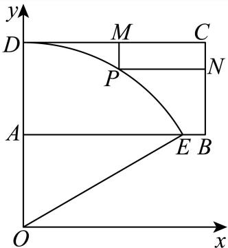

令圆O的半径为r，则 $r - 1 = r \cos { 6 0 ^ { \circ } }$ ，解得 $r = 2$ ，设 $P ( 2 \cos \theta , 2 \sin \theta ) , \frac { \pi } { 6 } \leq \theta \leq \frac { \pi } { 2 }$

$$
P M + P N = 2 - 2 \sin \theta + 2 - 2 \cos \theta = 4 - 2 \sqrt {2} \sin \left(\theta + \frac {\pi}{4}\right) \geq 4 - 2 \sqrt {2},
$$

当且仅当 $\theta = { \frac { \pi } { 4 } }$ 时取等号， $4 - 2 \sqrt { 2 } \approx 1 . 1 7 2$

所以步行道PM、PN长度之和的最小值是1.172km.

故答案为：1.172

### 金山 · 第12题

已知 $O$ 为坐标原点，向量 $\overrightarrow{OA},\overrightarrow{OB}$ 满足 $|\overrightarrow{OA}|+|\overrightarrow{OB}|=8$，将 $\overrightarrow{OA}$ 绕点 $O$ 按逆时针方向旋转 $90^\circ$，得到向量 $\overrightarrow{OC}$。若 $\overrightarrow{OB}+\overrightarrow{OC}=(-3,3)$，$\vec i=(1,0)$，则 $(\overrightarrow{OA}+\overrightarrow{OB})\cdot\vec i$ 的最大值为______。

> 本题资料或解析有待核事项，预览不可作为已审定成品。

**考点：** 旋转坐标、椭圆轨迹与投影最值

**难度依据：** 涉及旋转坐标、椭圆轨迹与投影最值；难度为教师预估，需结合原题条件复核。

**核查说明：** 题干向量与模长条件识别不清，原解参数亦有冲突，须回源。；依据现有底稿归类，尚未逐页校卷、公式校净或独立数学终审。

【解析】

设 $A ( x , y )$ ，则 $\boldsymbol { C } ( - y , x )$ ，进而得 $B ( y - 3 , 3 - x )$ ，结合 $\left| { \overrightarrow { O A } } \right| + \left| { \overrightarrow { O B } } \right| = { \mathrm { i } }$ 8分析得到A的轨迹为一个椭圆，并确定椭圆的右顶点P坐标，再利用向量数量积的坐标表示，将问题化为求$y = - x + m +$ 3的截距最大，即m最大且该直线过P点，即可求最值

设 $A ( x , y )$ ，则 $C ( - y , x )$ ，故 $\overrightarrow { O B } + \overrightarrow { O C } = ( x _ { B } - y , y _ { B } + x ) = ( - 3 , 3 )$

所以 $\begin{array} { l } { { \left\{ { x _ { B } } - y = - 3 \right. } } \\ { { \left. y _ { B } + x = 3 \right. } } \end{array}$ ，则 $\left\{ { \begin{array} { l } { x _ { B } = y - 3 } \\ { y _ { B } = 3 - x } \end{array} } \right.$ ，故 $B ( y - 3 , 3 - x )$

由 $\overrightarrow { \vert O A \vert } + \overrightarrow { \vert O B \vert } = \sqrt { x ^ { 2 } + y ^ { 2 } } + \sqrt { ( x - 3 ) ^ { 2 } + ( y - 3 ) ^ { 2 } } = 8 ,$

即 $A ( x , y )$ 到原点距离与 $\therefore A ( x , y )$ 到(3,3)的距离之和为8，

易知A的轨迹为一个椭圆，且 $2 a = 8 \Rightarrow a = 4$ $2 c = 2 { \sqrt { 3 } } \Rightarrow c = { \sqrt { 3 } }$ ，如下图，

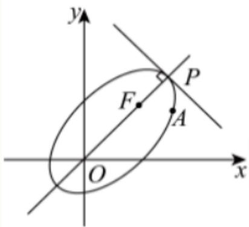

若P为椭圆的右顶点，则 $| O P | = { \frac { 8 - 3 { \sqrt { 2 } } } { 2 } } + 3 { \sqrt { 2 } } = { \frac { 8 + 3 { \sqrt { 2 } } } { 2 } }$ ，且直线 $O P \colon y = x$ 易知 $\displaystyle { v _ { P } = y _ { P } = \frac { | O P | } { \sqrt { 2 } } = \frac { 4 \sqrt { 2 } + 3 } { 2 } }$ ，即 $P \left( \frac { 4 \sqrt { 2 } + 3 } { 2 } , \frac { 4 \sqrt { 2 } + 3 } { 2 } \right)$

由 $\left( \overrightarrow { O A } + \overrightarrow { O B } \right) \cdot \overrightarrow { i } ^ { \cdot } = ( x + y - 3 , y - x + 3 ) \cdot ( 1 , 0 ) = x + y - 3$ 令 $m = x + y - 3 \textcircled { 1 }$

所以，要使 $\left( \overrightarrow { O A } + \overrightarrow { O B } \right) \cdot \overrightarrow { i }$ 最大，只需 $y = - x + m +$ 3的截距最大，即m最大，

结合图知，该直线过P点即可，将P代入①，有 $m = { \frac { 4 { \sqrt { 2 } } + 3 } { 2 } } + { \frac { 4 { \sqrt { 2 } } + 3 } { 2 } } - 3 = 4 { \sqrt { 2 } } .$

$$
4 \sqrt {2}
$$

关键点点睛：首先得到A的轨迹为一个椭圆及其右顶点坐标，再应用向量数量积的坐标表示化为求 $m = x + y - \vdots$ 3最大为关键.

## 二、选择题

### 青浦 · 第12题

已知A,B,C是单位圆上任意不同三点，则 $\frac { { \overrightarrow { A B } } \cdot { \overrightarrow { A C } } } { \left| { \overrightarrow { A B } } \right| }$ 的取值范围是

> 本题资料或解析有待核事项，预览不可作为已审定成品。

**考点：** 数量积除模转化为有向投影；单位圆上三点的投影范围

**难度依据：** 利用圆上投影上下界且审查互异点下端点可达性

**核查说明：** 仅修复所列OCR公式及其定界符错位；原解数学疑点和其他可渲染错识未因此消除。；原解析保留在源字段及精确补丁old中；本题针对性纠错已独立复核，不外推为全卷数学终审。；题干与解析已用于人工归类，尚未完成整题公式校净与独立数学终审。；原解取AB=2x后写0<x<1，漏了AB为直径时x=1情形；最终范围仍需补充该情形与端点不可达证明。；仅修复所列OCR公式及其定界符错位；原解数学疑点和其他可渲染错识未因此消除。；原解析保留在源字段及精确补丁old中；本题针对性纠错已独立复核，不外推为全卷数学终审。；题干与解析已用于人工归类，尚未完成整题公式校净与独立数学终审。；原解取AB=2x后写0<x<1，漏了AB为直径时x=1情形；最终范围仍需补充该情形与端点不可达证明。

【答案】$(-1,2)$。

【解析·补全直径情形和取值充分性】

设圆心为$O$，以$O$为原点，令$\vec u=\dfrac{\overrightarrow{AB}}{|\overrightarrow{AB}|}$，$s=\dfrac{|AB|}{2}$。由于$A\ne B$，有$0<s\leq1$。

由$|\overrightarrow{OA}|=|\overrightarrow{OB}|=1$及弦长关系，得

$$
\overrightarrow{OA}\cdot\vec u=-s.
$$

因此所求投影为

$$
r=\overrightarrow{AC}\cdot\vec u=s+\overrightarrow{OC}\cdot\vec u.
$$

由$-1\leq\overrightarrow{OC}\cdot\vec u\leq1$，得$r>-1$且$r\leq2$。

若$r=2$，则$s=1$且$\overrightarrow{OC}=\vec u$。这时$AB$为直径，$\overrightarrow{OB}=\vec u$，故$C=B$，与三点互异矛盾。因此$r<2$，包括直径情形在内均有$r\in(-1,2)$。

再验证区间内每个值都能取到。任取$r\in(-1,2)$，选取

$$
\max\{0,r-1\}<s<\min\{1,r+1\}.
$$

该开区间非空，且$0<s<1$。在单位圆上取

$$
A=(-s,\sqrt{1-s^2}),\qquad B=(s,\sqrt{1-s^2}).
$$

此时$\vec u=(1,0)$。由于$-1<r-s<1$，圆上横坐标为$r-s$的点有两个且互不相同。

$A$、$B$的横坐标不同，所以这两个候选点至多一个与$A$或$B$重合。选另一个作为$C$，便可保证三点互异，并有

$$
\frac{\overrightarrow{AB}\cdot\overrightarrow{AC}}{|\overrightarrow{AB}|}=s+(r-s)=r.
$$

综上，所求取值范围为$(-1,2)$。

本段为独立复算后补写的证明；原PDF解析未讨论$AB$为直径及全部中间值的达到性，原解完整留存于来源字段和补丁记录。

### 静安 · 第20题

如图的封闭图形的边缘由抛物线Γ和垂直于拋物线对称轴的线段AB组成.已知 $| A B = 4$ ，拋物线的顶 点到线段AB所在直线的距离为2.
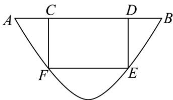
(1) (4分)请用数学符号语言表达这个封闭图形的边缘；
(2) (6分)在该封闭图形上截取一个矩形CDEF，其中点C､D在线段AB上，点E､F抛物线Γ上.求以矩形CDEF为侧面，CF为母线的圆柱的体积最大值；
(3) (8分)求证：抛物线Γ的任何两条相互垂直的切线的交点都在同一条直线上.

**考点：** （1）建立图形方程；（2）圆柱体积最值；（3）垂直切线交点轨迹

**难度依据：** 抛物线模型与切线；（1）建立图形方程；（2）圆柱体积最值；（3）垂直切线交点轨迹

【解析】

(1) 如图建立平面直角坐标系 $x O y$

设抛物线Γ的方程为 $y = a x ^ { 2 } , x \in [ - 2 , 2 ]$

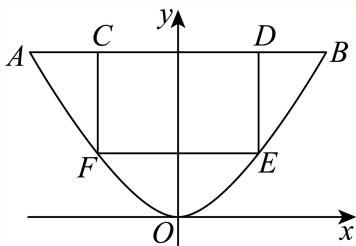

则曲线Γ过点(2,2)，所以 $\displaystyle \left. 2 = 4 a \right.$ ，故 $\mathrm { \dot { \alpha } } a = \frac { 1 } { 2 }$

所以，曲线Γ的方程为 $\left| y = { \frac { 1 } { 2 } } x ^ { 2 } , x \in [ - 2 , 2 ] \right.$ ，

线段AB的方程为 $y = 2 , x \in [ - 2 , 2 ]$ ，

(2) 设 $E \left( x , y \right)$ ，则 $D E = 2 - { \frac { 1 } { 2 } } x ^ { 2 }$

以 $C F$ 为母线的圆柱的底面半径r 满足 $2 x = 2 \pi r _ { 1 }$ ，

所以 $\displaystyle { \boldsymbol { r } } _ { 1 } = { \frac { x } { \pi } }$

所以圆柱的体积 $V _ { 1 } = \pi \cdot \left( { \frac { x } { \pi } } \right) ^ { 2 } \cdot \left( 2 - { \frac { 1 } { 2 } } x ^ { 2 } \right) = { \frac { 1 } { \pi } } \left( 2 x ^ { 2 } - { \frac { 1 } { 2 } } x ^ { 4 } \right)$ .

所以 $V _ { 1 } = - \frac { 1 } { 2 \pi } \left( x ^ { 2 } - 2 \right) ^ { 2 } + \frac { 2 } { \pi }$ ，

所以，当 $\mathfrak { x } = \sqrt { 2 } \mathbb { H }$ 时，其体积取得最大值 $\frac { 2 } { \pi }$

(3) 证明： 因为函数 $y = { \frac { 1 } { 2 } } x ^ { ; }$ 2的导函数 $\boldsymbol { \cdot } \boldsymbol { y } ^ { \prime } = \boldsymbol { x }$

所以，抛物线Γ上任意一点 $( x , y )$ 的切线斜率为 $x _ { i }$ ，

$\sharp \ell _ { 1 } , l _ { 2 }$ 是抛物线Γ上两条相互垂直的切线，切点分别为 $( x _ { 1 } , y _ { 1 } ) , ( x _ { 2 } , y _ { 2 } )$ ，

则其方程分别为 $\begin{array} { r } { \vert l _ { 1 } ; y - y _ { 1 } = x _ { 1 } \left( x - x _ { 1 } \right) , l _ { 2 } ; y - y _ { 2 } = x _ { 2 } \left( x - x _ { 2 } \right) } \end{array}$ ，

且 $x _ { 1 } x _ { 2 } = - 1$

消去x，解得 $( x _ { 1 } - x _ { 2 } ) y = { \frac { 1 } { 2 } } x _ { 1 } x _ { 2 } \left( x _ { 1 } - x _ { 2 } \right)$ ，

因为 $x _ { 1 } \neq x _ { 2 } ,$ ，得 $y = - \frac 1 2$

故抛物线Γ的任何两条相互垂直的切线的交点都在直线 $: y = - \frac { 1 } { 2 } .$ 上.

### 黄浦 · 第10题

i为虚数单位，若复数 $z _ { 1 }$ 满足 $| z _ { 1 } - 1 + \mathbf { i } | \leq { \sqrt { 2 } }$ ，复数 $\scriptstyle z _ { 2 }$ 满足 $\left| z _ { 2 } \right| = \left| z _ { 2 } + 1 - \mathrm { i } \right|$ ，则 $| z _ { 1 } - z _ { 2 } |$ |的最小值 为

**考点：** 转化圆面到直线距离

**难度依据：** 复数轨迹间最短距离；转化圆面到直线距离

【答案】$\frac { \sqrt { 2 } } { 2 }$

【解析】

设 ${ \bf \ddot { z } } _ { 1 } = a _ { 1 } + b _ { 1 } { \bf \dot { i } } , a _ { 1 } , b _ { 1 } \in { \bf R } , z _ { 2 } = a _ { 2 } + b _ { 2 } { \bf \dot { i } } , a _ { 2 } , b _ { 2 } \in { \bf R }$ ，由题设易得z 对应的点 $( a _ { 1 } , b _ { 1 } )$ )的轨迹是以(1,−1)为圆心， $\downarrow \downarrow r = \sqrt { 2 }$ 为半径的圆面（包括边界）内， $z _ { 2 }$ 对应的点 $( a _ { 2 } , b _ { 2 } )$ 是直线$x - y + 1 = 0 \pm { \frac { - 5 } { \cdots } }$ ，进而结合圆上一点到直线上一点的距离最值问题求解即可

设 $z _ { 1 } = a _ { 1 } + b _ { 1 } \mathrm { i } , \ a _ { 1 } , b _ { 1 } \in \mathbf { R } .$

则 $| z _ { 1 } - 1 + \mathrm { i } = a _ { 1 } + b _ { 1 } \mathrm { i } - 1 + \mathrm { i } = ( a _ { 1 } - 1 ) + ( b _ { 1 } + 1 ) \mathrm { i } ,$

由 $| z _ { 1 } - 1 + \mathrm { i } | \leq \sqrt { 2 }$ ，得 ${ \sqrt { \left( a _ { 1 } - 1 \right) ^ { 2 } + \left( b _ { 1 } + 1 \right) ^ { 2 } } } \leq { \sqrt { 2 } } ,$

即 $\left( a _ { 1 } - 1 \right) ^ { 2 } + \left( b _ { 1 } + 1 \right) ^ { 2 } \leq 2 ,$

则复数 $z _ { 1 }$ 对应的点 $( a _ { 1 } , b _ { 1 } )$ 的轨迹是以(1,−1)为圆心，以 ${ \sqrt { r } } = { \sqrt { 2 } }$ 为半径的圆面（包括边界）内，

设 $\cdot z _ { 2 } = a _ { 2 } + b _ { 2 } \mathbf { i } , ~ a _ { 2 } , b _ { 2 } \in { \bf R } , ~ \ b \| z _ { 2 } + 1 - \mathbf { i } = a _ { 2 } + b _ { 2 } \mathbf { i } + 1 - \mathbf { i } = ( a _ { 2 } + 1 ) + ( b _ { 2 } - 1 ) \mathbf { i } ,$

由 $| z _ { 2 } | = | z _ { 2 } + 1 - \mathrm { i } |$ ，得 ${ \sqrt { a _ { 2 } ^ { 2 } + b _ { 2 } ^ { 2 } } } = { \sqrt { ( a _ { 2 } + 1 ) ^ { 2 } + ( b _ { 2 } - 1 ) ^ { 2 } } }$ ，

整理得， $a _ { 2 } - b _ { 2 } + 1 = 0$

则复数 $\dot { z } _ { 2 }$ 对应的点 $( a _ { 2 } , b _ { 2 } )$ 是直线x − y + 1 = 0上一点，

又z1 − z2 = a1 + b1i − (a2 + b2i) = (a1 − a2) + (b1 − b2)i，

所以 $\left| z _ { 1 } - z _ { 2 } \right| = { \sqrt { \left( a _ { 1 } - a _ { 2 } \right) ^ { 2 } + \left( b _ { 1 } - b _ { 2 } \right) ^ { 2 } } }$ 表示点 $( a _ { 1 } , b _ { 1 } ) ^ { l }$ 与点 $( a _ { 2 } , b _ { 2 } )$ 之间的距离，

因为圆心(1,−1)到直线 $x - y + 1 = 0$ 的距离为 $d = { \frac { | 1 + 1 + 1 | } { \sqrt { 2 } } } = { \frac { 3 { \sqrt { 2 } } } { 2 } }$

所以 $| z _ { 1 } - z _ { 2 } |$ |的最小值为 $d - r = { \frac { 3 { \sqrt { 2 } } } { 2 } } - { \sqrt { 2 } } = { \frac { \sqrt { 2 } } { 2 } }$

故答案为： $\frac { \sqrt { 2 } } { 2 }$

### 黄浦 · 第11题

一个机器零件的形状是有缺口的圆形铁片，如图中实线部分为裁剪后的形状．已知这个圆的半径是13cm， $A B = 8 \mathrm { { c m } }$ ， $B C = 6 \mathrm { c m }$ ，且 $A B \bot B C$ ，则圆心到点B的距离约为 cm．（结果精确到0.1cm）
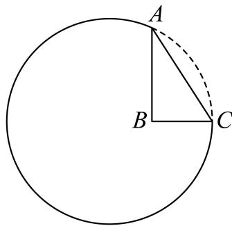

**考点：** 三角恒等变换与余弦定理求长度

**难度依据：** 圆内几何测距；三角恒等变换与余弦定理求长度

【答案】7.3.

【解析】

利用圆的对称性及三角恒等变换、余弦定理计算即可.

如图所示，设圆心为D，AC的中点为E，则 $A D = 1 3$ ，

由题意易知 $A C = { \sqrt { A B ^ { 2 } + B C ^ { 2 } } } = 1 0 = 2 A E .$

$$
\left| \cos \angle D A C = \frac {A E}{A D} = \frac {5}{1 3}, \cos \angle B A C = \frac {A B}{A C} = \frac {4}{5}, \therefore \sin \angle D A C = \frac {1 2}{1 3}, \sin \angle B A C = \frac {3}{5}, \right.
$$

$$
\cos \angle B A D = \cos (\angle D A C - \angle B A C) = \frac {5}{1 3} \times \frac {4}{5} + \frac {1 2}{1 3} \times \frac {3}{5} = \frac {5 6}{6 5},
$$

由余弦定理知 $B D ^ { 2 } = A D ^ { 2 } + A B ^ { 2 } - 2 A D \cdot A B \cdot \cos \angle B A D = 5 3 . 8 .$

所以 $B D \approx 7 . 3 \mathrm { { c m } }$

故答案为：7.3.

