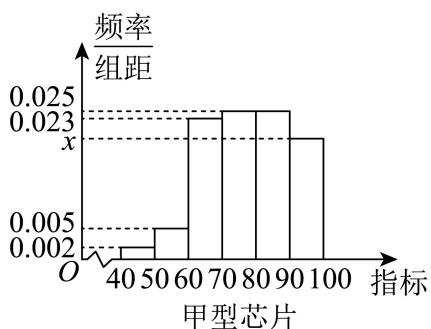
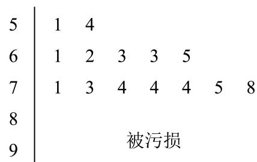
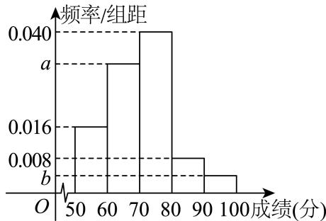

# 2025一模 计数原理与二项式专题 · 教师版

> 本地预览：题目、答案及分类尚未全部审定。校对使用的PDF为高中工作台解析版，尚未逐区确认区级印刷原卷。

## 通项、常数项与系数定位

依据通项指数和系数定义定位目标项，注意负号与指数识别。

### 嘉定 · 第7题

在 $\left( x - { \frac { 1 } { x } } \right)$ 9 的二项展开式中， $x ^ { 3 }$ 的系数为

> 本题资料或解析有待核事项，预览不可作为已审定成品。

**考点：** 二项式通项中的指数配对

**难度依据：** 通项指数含正负幂需解指数方程

**核查说明：** 仅修复所列OCR公式及其定界符错位；原解数学疑点和其他可渲染错识未因此消除。；题干与解析已用于人工归类，尚未完成整题公式校净与独立数学终审。；题干幂9游离于公式外，原解通项存在严重坏TeX，须回源排版。；仅修复所列OCR公式及其定界符错位；原解数学疑点和其他可渲染错识未因此消除。；题干与解析已用于人工归类，尚未完成整题公式校净与独立数学终审。；题干幂9游离于公式外，原解通项存在严重坏TeX，须回源排版。

【答案】-84

【解析】

先求出展开式的通项公式为 $T _ { r + 1 } = ( - 1 ) ^ { r } \cdot C _ { 9 } ^ { r } \cdot x ^ { 9 - 2 r }$ ，再令x的幂指数等于3求出r的值，即可求得 $x ^ { 3 }$ 的系数．二项式 $\left(x-\frac1x\right)^9$ 的展开式的通项公式为

$$
T _ {r + 1} = C _ {9} ^ {r} \cdot x ^ {9 - r} \cdot (- 1) ^ {r} \cdot x ^ {- r} = (- 1) ^ {r} \cdot C _ {9} ^ {r} \cdot x ^ {9 - 2 r}
$$

${ \mathfrak { H } } { \mathfrak { g } } _ { - } { 2 r } = 3$ ，解得 $r = 3$

∴展开式中 $x ^ { 3 }$ 的系数为 $- C _ { 9 } ^ { 3 } = - 8 4$

故答案为-84

本题主要考查二项式定理的应用，二项式展开式的通项公式，求展开式中某项的系数，属于中档题

### 奉贤 · 第6题

$\left( x ^ { 6 } + { \frac { 1 } { x { \sqrt { x } } } } \right) ^ { ! }$ 5 的二项展开式中的常数项为 ．（用数字作答）

> 本题资料或解析有待核事项，预览不可作为已审定成品。

**考点：** 含分数指数的二项展开常数项

**难度依据：** 准确列指数并令其为零

**核查说明：** 题干与解析已用于人工归类，尚未完成整题公式校净与独立数学终审。

【答案】5

【解析】

写出展开式的通项，令x的指数为0即可；

由题意可知： $T _ { r + 1 } = \mathrm { C } _ { 5 } ^ { r } { \left( x \right) } ^ { 3 0 - 6 r } { \left( \frac { 1 } { x \sqrt { x } } \right) } ^ { r } = \mathrm { C } _ { 5 } ^ { r } { \left( x \right) } ^ { 3 0 - 6 r } { \left( x \right) } ^ { - \frac { 3 } { 2 } r } = \mathrm { C } _ { 5 } ^ { r } { \left( x \right) } ^ { 3 0 - \frac { 1 5 } { 2 } r }$ ，令

$3 0 - { \frac { 1 5 } { 2 } } r = 0 \Rightarrow r = 4$ ，所以常数项为 $\mathrm { C } _ { 5 } ^ { 4 } = 5$

故答案为：5

### 宝山 · 第4题

…
在(x+2)5的展开式中x3的系数为

**考点：** 二项展开通项与系数

**难度依据：** 涉及二项展开通项与系数；难度为教师预估，需结合原题条件复核。

**核查说明：** 依据现有底稿归类，尚未逐页校卷、公式校净或独立数学终审。

【答案】40

【解析】

利用二项式展开式通项，即可直接求解.

由题知，设(x+2)5展开式中通项为 $\mathrm { C } _ { 5 } ^ { k } \cdot x ^ { 5 - k } \cdot 2 ^ { k }$

令5 − k = 3，则 $k = 2 , \ \mathrm { C _ { 5 } ^ { 2 } } \cdot 2 ^ { 2 } = 4 0 .$

故答案为：40

### 崇明 · 第4题

(x − 1)7的二项展开式中x3的系数为

**考点：** 二项展开指定项系数

**难度依据：** 涉及二项展开指定项系数；难度为教师预估，需结合原题条件复核。

**核查说明：** 依据现有底稿归类，尚未逐页校卷、公式校净或独立数学终审。

【答案】35

【解析】

写出展开式的通项，利用通项计算可得.

二项 $\mathbb { X } ( x - 1 ) ^ { 7 }$ 展开式的通项为 ${ \cal T } _ { r + 1 } = \mathrm { C } _ { 7 } ^ { r } x ^ { 7 - r } ( - 1 ) ^ { r } ( 0 \leq r \leq 7 \mathrm { H } r \in \mathrm { N } )$

${ \widehat { \vec { \times } } } 7 - r = 3$ ，解得r = 4，所以 $T _ { 5 } = \mathrm { C } _ { 7 } ^ { 4 } x ^ { 3 } { ( - 1 ) } ^ { 4 } = 3 5 x ^ { 3 }$ ，

所以二项展开式中x3的系数为35.

故答案为：35

### 普陀 · 第4题

若 $\left( x + x ^ { 2 } \right) ^ { 5 } = a _ { 0 } x ^ { 5 } + a _ { 1 } x ^ { 6 } + a _ { 2 } x ^ { 7 } + a _ { 3 } x ^ { 8 } + a _ { 4 } x ^ { 9 } + a _ { 5 } x ^ { 1 0 }$ ，则 $\stackrel { \cdot } { a } _ { 3 }$ 的值为

> 本题资料或解析有待核事项，预览不可作为已审定成品。

**考点：** 提公因式后二项式系数定位

**难度依据：** 转化为一加x的五次展开

**核查说明：** 题干与解析已用于人工归类，尚未完成整题公式校净与独立数学终审。

【答案】10.

【解析】

化简结合二项式定理求 $x ^ { 8 }$ 项的系数.

因为 $\left( x + x ^ { 2 } \right) ^ { 5 } = a _ { 0 } x ^ { 5 } + a _ { 1 } x ^ { 6 } + a _ { 2 } x ^ { 7 } + a _ { 3 } x ^ { 8 } + a _ { 4 } x ^ { 9 } + a _ { 5 } x ^ { 1 0 } ,$

所以 $\begin{array} { r } { x ^ { 5 } ( 1 + x ) ^ { 5 } = a _ { 0 } x ^ { 5 } + a _ { 1 } x ^ { 6 } + a _ { 2 } x ^ { 7 } + a _ { 3 } x ^ { 8 } + a _ { 4 } x ^ { 9 } + a _ { 5 } x ^ { 1 0 } } \end{array}$

所以 $x ^ { 5 } ( 1 + x ) ^ { \sharp }$ 5的展开式的第 $r + 1$ 项的表达式 $T _ { r + 1 } = x ^ { 5 } \mathrm { C } _ { 5 } ^ { r } x ^ { r } , ~ r = 0 , 1 , 2 , 3 , 4 , 5$

所以 $a _ { 3 } = \mathrm { C } _ { 5 } ^ { 3 } = 1 0$

故答案为：10.

### 浦东 · 第4题

$\left( x ^ { 2 } + { \frac { 1 } { x } } \right)$ 6 的展开式中 $x ^ { 3 }$ 的系数为 （用数字作答）

> 本题资料或解析有待核事项，预览不可作为已审定成品。

**考点：** 通项法求指定系数

**难度依据：** 通项法求指定系数；按所需步骤与推理量估计

**核查说明：** 题干与解析已用于人工归类，尚未完成整题公式校净与独立数学终审。

【解析】

$$
\because T _ {r + 1} = \mathrm{C} _ {6} ^ {\mathrm{r}} (x ^ {2}) ^ {6 - r} \left(\frac {1}{x}\right) ^ {r} = \mathrm{C} _ {6} ^ {\mathrm{r}} x ^ {1 2 - 3 r},
$$

∴ 令 12 − 3r = 3 ⇒ x = 3

$\therefore \left( x ^ { 2 } + { \frac { 1 } { x } } \right) ^ { 6 }$ 的展开式中 $x ^ { 3 }$ 的系数为 $\mathrm { C } _ { 6 } ^ { 3 } = 2 0$

### 虹口 · 第4题

在(x−2)6的二项展开式中， $x ^ { 3 }$ 项的系数为

**考点：** 二项展开系数

**难度依据：** 涉及二项展开系数；难度为教师预估，需结合原题条件复核。

**核查说明：** 依据现有底稿归类，尚未逐页校卷、公式校净或独立数学终审。

【答案】−160.

【解析】

先求出 ${ ( x - 2 ) } ^ { 6 }$ 的通项，再令 $6 - r = 3$ ，代入计算可得答案.

二项 $\operatorname { \mathbb { E } } ( x - 2 ) ^ { 6 }$ 的通项公式为 $T _ { r + 1 } = \mathrm { C } _ { 6 } ^ { r } x ^ { 6 - r } ( - 2 ) ^ { r } = \mathrm { C } _ { 6 } ^ { r } ( - 2 ) ^ { r } \cdot x ^ { 6 - r }$

${ \widehat { \times } } 6 - r = 3$ ，可得r = 3，所以 $\mathrm { C _ { 6 } ^ { 3 } } ( - 2 ) ^ { 3 } = 2 0 \times ( - 8 ) = - 1 6 0$

故答案为：−160.

### 金山 · 第5题

(3x − 1)6的二项展开式中， $x ^ { 2 } ,$ 项的系数为

**考点：** 二项式展开系数

**难度依据：** 涉及二项式展开系数；难度为教师预估，需结合原题条件复核。

**核查说明：** 依据现有底稿归类，尚未逐页校卷、公式校净或独立数学终审。

【答案】135.

【解析】

写出二项式的通项，取r = 4，即得 $x ^ { 2 }$ 项的系数.

(3x − 1)6的通项为 $\begin{array} { r } { \jmath T _ { r + 1 } = \mathrm { C } _ { 6 } ^ { r } ( 3 x ) ^ { 6 - r } ( - 1 ) ^ { r } = ( - 1 ) ^ { r } \times 3 ^ { 6 - r } \mathrm { C } _ { 6 } ^ { r } x ^ { 6 - r } ; } \end{array}$ ,

使6−r = 2，解得r = 4，即得x2项的系数为 $3 ^ { 2 } \mathrm { C } _ { 6 } ^ { 4 } = 9 \times 1 5 = 1 3 5$

故答案为：135.

### 长宁 · 第6题

$\left( x - { \frac { 1 } { x } } \right)$ 6 的二项展开式中的常数项是

**考点：** 通项指数为零求常数项

**难度依据：** 二项展开常数项；通项指数为零求常数项

【答案】−20.

【解析】

由题可得展开式的第r+1项，令x指数为0，可得常数项对应r，即可得答案.

由题 $\left( x - { \frac { 1 } { x } } \right) ^ { \textsf { t } }$ 的二项展开式的第r+1项为 $\mathrm { C } _ { 6 } ^ { r } x ^ { 6 - r } \cdot \left( - 1 \right) ^ { r } \cdot \left( { \frac { 1 } { x } } \right) ^ { r } = ( - 1 ) ^ { r } \cdot \mathrm { C } _ { 6 } ^ { r } x ^ { 6 - 2 r }$

令 $6 - 2 r = 0 \Rightarrow r = 3$ ，则常数项为 $( - 1 ) ^ { 3 } \cdot \mathrm { C } _ { 6 } ^ { 3 } = - 2 0 .$

故答案为：−20.

### 闵行 · 第6题

$\left( x + { \frac { 1 } { x } } \right)$ 8 的二项展开式中， $x ^ { 4 }$ 项的系数为

**考点：** 通项指数定位系数

**难度依据：** 二项展开指定项系数；通项指数定位系数

【答案】28

【解析】

利用二项式定理求出含 $\cdot _ { x ^ { 4 } }$ 的项，进而求出其系数.

在 $\left( x + { \frac { 1 } { x } } \right)$ 8 的二项展开式中，含x4的项为 $\mathrm { C } _ { 8 } ^ { 2 } x ^ { 6 } \cdot \left( { \frac { 1 } { x } } \right) ^ { 2 } = 2 8 x ^ { 4 }$

所以 $x ^ { 4 }$ 项的系数为28.

故答案为：28

### 青浦 · 第9题

$( x + y ) ( x - y ) ^ { 6 }$ 的展开式中， $x ^ { 4 } y ^ { 3 }$ 项的系数为

> 本题资料或解析有待核事项，预览不可作为已审定成品。

**考点：** 二项式展开乘一次式的系数合并

**难度依据：** 目标单项式可来自两项必须相加

**核查说明：** 题干与解析已用于人工归类，尚未完成整题公式校净与独立数学终审。

【答案】−5

【解析】

写出 $( x - y ) ^ { 6 }$ 展开式的通项，利用通项求出 $x ^ { 4 } y ^ { 3 }$ 项的系数.

$( x - y ) ^ { 6 }$ 展开式的通项为 $T _ { r + 1 } = \mathrm { C } _ { 6 } ^ { r } x ^ { 6 - r } ( - y ) ^ { r } , r \in \{ 0 , 1 , 2 , 3 , 4 , 5 , 6 \}$

所以含 $x ^ { 4 } y ^ { 3 }$ 的项为 $x \mathrm { C } _ { 6 } ^ { 3 } x ^ { 3 } ( - y ) ^ { 3 } + y \mathrm { C } _ { 6 } ^ { 2 } x ^ { 4 } ( - y ) ^ { 2 } = - 5 x ^ { 4 } y ^ { 3 }$ ，即 $x ^ { 4 } y ^ { 3 }$ 项的系数为−5.

故答案为：−5

### 黄浦 · 第5题

$\left( x + { \frac { 1 } { x } } \right) ^ { 1 }$ 6 的二项展开式的常数项为

> 本题资料或解析有待核事项，预览不可作为已审定成品。

**考点：** 通项指数为零

**难度依据：** 二项展开常数项；通项指数为零

**核查说明：** 题干展开式指数识别错误，原解析按6次处理，须核原卷。

【解析】

$\left( x + { \frac { 1 } { x } } \right) ^ { 1 }$ 6 的二项展开式的通项为 $T _ { r + 1 } = \mathrm { C } _ { 6 } ^ { r } x ^ { 6 - r } x ^ { - r } = \mathrm { C } _ { 6 } ^ { r } x ^ { 6 - 2 r }$ ${ \widehat { \vec { \times } } } 6 - 2 r = 0$ 得r = 3．所以 $\left( x + { \frac { 1 } { x } } \right) ^ { \prime }$ 6 的二项展开式的常数项为 $\mathrm { C } _ { 6 } ^ { 3 } = 2 0$

## 赋值求和与组合数性质

用特殊赋值或组合数对称性化简，并检查下标范围。

### 宝山 · 第7题

…
已知关于正整数x的方程 ${ \bf C } _ { 1 2 } ^ { x - 1 } = { \bf C } _ { 1 2 } ^ { 5 x - 5 }$ ，则该方程的解为

**考点：** 组合数相等与下标范围

**难度依据：** 涉及组合数相等与下标范围；难度为教师预估，需结合原题条件复核。

**核查说明：** 依据现有底稿归类，尚未逐页校卷、公式校净或独立数学终审。

【答案】1或3

【解析】

利用组合数的性质得到方程，解方程，结合x的取值范围即可求解.

根据组合数的性质，由 $\mathrm { C } _ { 1 2 } ^ { x - 1 } = \mathrm { C } _ { 1 2 } ^ { 5 x - 5 }$

可知： $\left\{ \begin{array} { l l } { x - 1 = 5 x - 5 } \\ { 0 \leq x - 1 \leq 1 2 } \\ { 0 \leq 5 x - 5 \leq 1 2 } \\ { x \in \mathrm { Z } } \end{array} \right.$ $\left\{ \begin{array} { l l } { \left( x - 1 \right) + \left( 5 x - 5 \right) = 1 2 } \\ { 0 \leq x - 1 \leq 1 2 } \\ { 0 \leq 5 x - 5 \leq 1 2 } \\ { x \in \mathrm { Z } } \end{array} \right. ,$

即 $\left\{ \begin{array} { l l } { x = 1 } \\ { 1 \leq x \leq 1 3 } \\ { 1 \leq x \leq \displaystyle \frac { 1 7 } { 5 } } \\ { x \in \mathrm { Z } } \end{array} \right.$ $\left\{ \begin{array} { l l } { x = 3 } \\ { 1 \leq x \leq 1 3 } \\ { 1 \leq x \leq \displaystyle \frac { 1 7 } { 5 } } \\ { x \in \mathrm { Z } } \end{array} \right.$ ，所以x = 1和x = 3均满足题意，

所以该方程的解为：1或3.

故答案为：1或3

### 徐汇 · 第3题

在(1+x)n的二项展开式中，若各项系数和为32，则正整数n的值为 .

> 本题资料或解析有待核事项，预览不可作为已审定成品。

**考点：** 赋值求二项式系数和

**难度依据：** 赋值求二项式系数和；按所需步骤与推理量估计

**核查说明：** 题干与解析已用于人工归类，尚未完成整题公式校净与独立数学终审。

【答案】5.

【解析】

令x = 1，解出2n = 32即可.

因为 $( 1 + x ) ^ { n } = \mathbf { C } _ { n } ^ { 0 } + \mathbf { C } _ { n } ^ { 1 } x + \cdots + \mathbf { C } _ { n } ^ { n } x ^ { n }$ ，且各项系数和为32，

令x = 1，则 $2 ^ { n } = \mathbf { C } _ { n } ^ { 0 } + \mathbf { C } _ { n } ^ { 1 } + \cdots + \mathbf { C } _ { n } ^ { n } = 3 2$ ，解得n = 5，

所以正整数 的值为5.

故答案为：5.

### 松江 · 第7题

已知 $( x + 2 ) ^ { 4 } = a _ { 0 } + a _ { 1 } x + a _ { 2 } x ^ { 2 } + a _ { 3 } x ^ { 3 } + a _ { 4 } x ^ { 4 }$ ，则 $a _ { 1 } + a _ { 2 } + a _ { 3 } + a _ { 4 } =$

> 本题资料或解析有待核事项，预览不可作为已审定成品。

**考点：** 赋值法求系数和

**难度依据：** 赋值法求系数和；按所需步骤与推理量估计

**核查说明：** 题干与解析已用于人工归类，尚未完成整题公式校净与独立数学终审。

【答案】65.

【解析】

根据二项展开式，利用赋值法求解.

${ \stackrel { \wedge } { \sim } } x = 0 .$ ，则有 $a _ { 0 } = 2 ^ { 4 } = 1 6$

再 $\stackrel { \wedge } { \prec } x = 1$ ，则有 $\therefore a _ { 0 } + a _ { 1 } + a _ { 2 } + a _ { 3 } + a _ { 4 } = 3 ^ { 4 } = 8 1$

所以 $a _ { 1 } + a _ { 2 } + a _ { 3 } + a _ { 4 } = 8 1 - 1 6 = 6 5$

故答案为：65.

## 排列限制与有限映射计数

按必选、相邻和函数对应条件分类，处理重复及排除情况。

### 奉贤 · 第5题

若A, B, C, D, E五人站成一排，如果A, B必须相邻，那么排法共 种.

> 本题资料或解析有待核事项，预览不可作为已审定成品。

**考点：** 相邻排列的捆绑法

**难度依据：** 整体排列后补内部排列

**核查说明：** 题干与解析已用于人工归类，尚未完成整题公式校净与独立数学终审。

【答案】48

【解析】

元素相邻问题运用捆绑法求解.

第一步：把A,B捆绑当作一个元素与C,D,E进行排列共有 $\mathrm { A } _ { 4 } ^ { 4 }$ 种；

第二步：A,B之间进行排列共有A2种；

根据分步计数原理可知：排法的总数共有 $\mathrm { A } _ { 4 } ^ { 4 } \mathrm { A } _ { 2 } ^ { 2 } = 4 8 \hbar \#$ .

故答案为：48

### 奉贤 · 第12题

已知集合 $\mathbf { \partial } M = \{ P _ { 0 } , P _ { 1 } , P _ { 2 } , \cdots , P _ { n } \} , n \geq 2 , n \in \mathbf { N }$ 是由函数 $y = \cos x , x \in [ 0 , 2 \pi ]$ 的图象上两两不相同的点构成的点集，集合 $S = \left\{ a | a = { \overrightarrow { O P _ { 0 } } } \cdot { \overrightarrow { O P _ { i } } } , i = 0 , 1 , 2 , \cdots , n , n \geq 2 , n \in \mathbf { N } \right\}$ ，其中 $P _ { 0 } \left( 0 , 1 \right)$ $P _ { 1 } \left( \pi , - 1 \right)$ ．若集合S中的元素按照从小到大的顺序排列能构成公差为d的等差数列，当 $d \in \left\{ { \frac { 1 } { 2 } } , 1 \right\}$ 时，则符合条件的点集M的个数为

> 本题资料或解析有待核事项，预览不可作为已审定成品。

**考点：** 坐标数量积提取纵坐标；有限等差数列公差分类；余弦函数定值点枚举；有必选点约束的集合计数；点集到数集映射的重合与去重

**难度依据：** 公差两种情形下按同纵坐标点的非空选择计数

**核查说明：** 题干与解析已用于人工归类，尚未完成整题公式校净与独立数学终审。；原解多个余弦值与横坐标被错排，计数思路可辨但公式未校净。；题干与解析已用于人工归类，尚未完成整题公式校净与独立数学终审。；原解多个余弦值与横坐标被错排，计数思路可辨但公式未校净。

【答案】60.

【解析】

确定数列中最大值为1，最小值为−1，然后根据d分类得出等差数列，再由等差数列的项确定点 $P _ { i }$ 的横坐标的值，然后由M中对应点的的情形确定集合个数

由已知 $\vert a _ { 0 } = \overrightarrow { O P _ { 0 } } \cdot \overrightarrow { O P _ { 0 } } = 1 , a _ { 1 } = \overrightarrow { O P _ { 0 } } \cdot \overrightarrow { O P _ { 1 } } = - 1$

设 $P _ { i } ( x _ { i } , y _ { i } )$ ，则 $a _ { i } = \overrightarrow { O P _ { 0 } } \cdot \overrightarrow { O P _ { i } } = y _ { i }$ ，显然 $- 1 \leq y _ { i } \leq 1$

若 $\dot { \boldsymbol { d } } = 1$ ，则 $S = \{ - 1 , 0 , 1 \}$ ，因此有 $\dot { y } _ { i } = 0$

由 $\cos x _ { i } = 0 , x _ { i } \in [ 0 , 2 \pi ]$ 得 $x _ { i } = { \frac { \pi } { 2 } }$ 或 $\frac { 3 \pi } { 2 }$ ，对应 $Q _ { 1 } \left( \frac { \pi } { 2 } , 0 \right) , Q _ { 2 } \left( \frac { 3 \pi } { 2 } , 0 \right)$

同理 $Q _ { 3 } ( 2 \pi , 1 )$ 对应 $P _ { 0 }$ ，

集合M中已经含有点 $P _ { 0 } , P _ { 1 }$ ，

因此产生 $S = \{ - 1 , 0 , 1 \}$ 的集合M中，点 $Q _ { 3 }$ 可有也可没有， $Q _ { 1 } , Q _ { 2 }$ 至少有一个，

所以M的个数为 $2 \times 3 = 6$

若 $\dot { \boldsymbol { d } } = \frac { 1 } { 2 }$ ，则 $S = \left\{ - 1 , - \frac { 1 } { 2 } , 0 , \frac { 1 } { 2 } , 1 \right\}$

cos xi = 1 xi 2π 或 4π cos xi = 1 xi π 或 5π

对应点Q $\mathrm { ~ \ i ~ } \left( \frac { \pi } { 3 } , \frac { 1 } { 2 } \right) , Q _ { 5 } \left( \frac { 5 \pi } { 3 } , \frac { 1 } { 2 } \right) , Q _ { 6 } \left( \frac { 2 \pi } { 3 } , - \frac { 1 } { 2 } \right) , Q _ { 7 } \left( \frac { 4 \pi } { 3 } , - \frac { 1 } { 2 } \right)$

产生 $\left\{ - 1 , - \frac { 1 } { 2 } , 0 , \frac { 1 } { 2 } , 1 \right\}$ 的集合M中，点 ${ \bf \nabla } \cdot { \bf Q _ { 3 } }$ 可有也可没有， $Q _ { 1 } , Q _ { 2 }$ 至少有一个，

$Q _ { 4 } , Q _ { 5 }$ 中至少有一个， $Q _ { 6 } , Q _ { 7 }$ 中至少有一个，M的个数为 $2 \times 3 \times 3 \times 3 = 5 4$

综上，集合M的个数为 $6 + 5 4 = 6 0$

故答案为：60.

方法点睛：确定集合的个数即为确定集合中元素的可能性，本题中首先确定出最终等差数列的最大值和最小值，从而根据公差得出等差数列，由等差数列确定可能含有的点，从而得出集合个数

## 二、选择题

### 崇明 · 第12题

已知函数 $\cdot y = f ( x )$ 的定义域 $D = \{ 1 , 2 , 3 , 4 \}$ ，值域 $A = \{ 5 , 6 , 7 \}$ ，则函数 $\cdot y = f ( x )$ 为增函数的概率是

> 本题资料或解析有待核事项，预览不可作为已审定成品。

**考点：** 有限集合函数计数与单调性概率

**难度依据：** 涉及有限集合函数计数与单调性概率；难度为教师预估，需结合原题条件复核。

**核查说明：** 题称增函数而原解计数包含相等函数值，严格递增定义下不成立，须回核原题及术语。；依据现有底稿归类，尚未逐页校卷、公式校净或独立数学终审。

【答案】$\frac { 1 } { 1 2 }$

【解析】

求出所有函数的个数，再求出增函数的个数，利用古典概型的概率公式可求对应的概率.

若函数 $\langle y = f ( x )$ 的定义域为{1, 2, 3, 4}，值域为{5, 6, 7}，

则不同的函数的个数为 $\mathrm { C _ { 4 } ^ { 2 } \mathrm { P _ { 3 } ^ { 3 } = 3 6 } }$ ，

其中增函数共有3个：

（1） $f \left( 1 \right) = f ( 2 ) = 5 , f ( 3 ) = 6 , f ( 4 ) = 7 ;$

（2） $f \left( 1 \right) = 5 , f ( 2 ) = f ( 3 ) = 6 , f ( 4 ) = 7 ;$

（3） $f \left( 1 \right) = 5 , f ( 2 ) = 6 , f ( 3 ) = f ( 4 ) = 7 ;$

故所求概率为 ${ \frac { 3 } { 3 6 } } = { \frac { 1 } { 1 2 } }$ ，

故答案为： $\frac { 1 } { 1 2 }$

## 二、选择题

### 浦东 · 第12题

已知在复数集中，等式 $x ^ { 4 } + a _ { 3 } x ^ { 3 } + a _ { 2 } x ^ { 2 } + a _ { 1 } x + a _ { 0 } = \left( x - z _ { 1 } \right) \left( x - z _ { 2 } \right) \left( x - z _ { 3 } \right) \left( x - z _ { 4 } \right)$ 对任意复数x恒成立，复数 $z _ { 1 } , ~ z _ { 2 } , ~ z _ { 3 } , ~ z _ { 4 }$ 在复平面上对应的4个点为某个单位圆内接正方形的4个顶点，$\{ a _ { 0 } , a _ { 1 } , a _ { 2 } , a _ { 3 } \} \subset \{ n | 1 \leq n \leq 2 0 2 4 , n \in \bf { Z } \}$ ，则满足条件的不同集合 $\{ a _ { 0 } , a _ { 1 } , a _ { 2 } , a _ { 3 } \}$ 个数为

> 本题资料或解析有待核事项，预览不可作为已审定成品。

**考点：** 复根与正方形共轭对称；整数参数计数

**难度依据：** 需利用复根的共轭对称、正方形结构和整数约束分类计数；题意与答案待核。

**核查说明：** 题干与解析已用于人工归类，尚未完成整题公式校净与独立数学终审。；源解以系数集合元素互异性排除圆心参数a=-1；底稿未明确要求各系数互异，该情形系数集合{2,4,6}满足当前字面条件，可能影响答案，须核原卷及独立复算。；题干与解析已用于人工归类，尚未完成整题公式校净与独立数学终审。；源解以系数集合元素互异性排除圆心参数a=-1；底稿未明确要求各系数互异，该情形系数集合{2,4,6}满足当前字面条件，可能影响答案，须核原卷及独立复算。

【答案】10.

【解析】

由一元二次方程，复数根互为共轭复数根，一元四次方程可以分解为两个一元二次方程，因此四个根应该两两互为共轭复数根（或实数根），因此圆心在x轴上，据此分类讨论可求得结论.

$$
x ^ {4} + a _ {3} x ^ {3} + a _ {2} x ^ {2} + a _ {1} x + a _ {0} = (x - z _ {1}) (x - z _ {2}) (x - z _ {3}) (x - z _ {4})
$$

$$
= x ^ {4} - (z _ {1} + z _ {2} + z _ {3} + z _ {4}) x ^ {3} + (z _ {1} z _ {2} + z _ {1} z _ {3} + z _ {1} z _ {4} + z _ {2} z _ {3} + z _ {2} z _ {4} + z _ {3} z _ {4}) x ^ {2}
$$

$$
- \left(z _ {1} z _ {2} z _ {3} + z _ {1} z _ {2} z _ {4} + z _ {2} z _ {3} z _ {4}\right) x + z _ {1} z _ {2} z _ {3} z _ {4},
$$

对 比系数可得a0 = z1z2z3z4，a1 = − (z1z2z3 + z1z2z4 + z2z3z4)，

$$
a _ {2} = z _ {1} z _ {2} + z _ {1} z _ {3} + z _ {1} z _ {4} + z _ {2} z _ {3} + z _ {2} z _ {4} + z _ {3} z _ {4}, a _ {3} = - \left(z _ {1} + z _ {2} + z _ {3} + z _ {4}\right),
$$

复数 $z _ { 1 } , ~ z _ { 2 } , ~ z _ { 3 } , ~ z _ { 4 }$ 在复平面上对应的4个点为某个单位圆内接正方形的4个顶点情况1，四个根两两互为共轭复数，故圆心在x轴上，设单位的圆心为(a,0)，

不妨设 $z _ { 1 } = a + \frac { \sqrt { 2 } } { 2 } + \frac { \sqrt { 2 } } { 2 } \mathrm { i } , ~ z _ { 2 } = a - \frac { \sqrt { 2 } } { 2 } + \frac { \sqrt { 2 } } { 2 } \mathrm { i } ,$

$$
z _ {3} = a - \frac {\sqrt {2}}{2} - \frac {\sqrt {2}}{2} \mathrm{i}, z _ {4} = a + \frac {\sqrt {2}}{2} + \frac {\sqrt {2}}{2} \mathrm{i},
$$

$$
a _ {0} = z _ {1} z _ {2} z _ {3} z _ {4} = \left(a + \frac {\sqrt {2}}{2} + \frac {\sqrt {2}}{2} \mathrm{i}\right) \left(a - \frac {\sqrt {2}}{2} + \frac {\sqrt {2}}{2} \mathrm{i}\right) \left(a - \frac {\sqrt {2}}{2} - \frac {\sqrt {2}}{2} \mathrm{i}\right)
$$

$$
\left(a + \frac {\sqrt {2}}{2} + \frac {\sqrt {2}}{2} \mathrm{i}\right)
$$

$$
= \left[ \left(a + \frac {\sqrt {2}}{2} \mathrm{i}\right) ^ {2} - \frac {1}{2} \right] \left[ \left(a - \frac {\sqrt {2}}{2} \mathrm{i}\right) ^ {2} - \frac {1}{2} \right] = \left[ a ^ {2} + \sqrt {2} a \mathrm{i} - 1 \right] \left[ a ^ {2} - \sqrt {2} a \mathrm{i} - 1 \right]
$$

$$
\left[ (a ^ {2} - 1) + \sqrt {2} a \mathrm{i} \right] \left[ (a ^ {2} - 1) - \sqrt {2} a \mathrm{i} \right] = (a ^ {2} - 1) ^ {2} + 2 a ^ {2} = a ^ {4} + 1,
$$

类似计算可得 $\dot { \bf { \sigma } } a _ { 1 } = - \left( z _ { 1 } z _ { 2 } z _ { 3 } + z _ { 1 } z _ { 2 } z _ { 4 } + z _ { 2 } z _ { 3 } z _ { 4 } \right) = - 4 a ^ { 3 } ,$

$$
a _ {2} = z _ {1} z _ {2} + z _ {1} z _ {3} + z _ {1} z _ {4} + z _ {2} z _ {3} + z _ {2} z _ {4} + z _ {3} z _ {4} = 6 a ^ {2}, \quad a _ {3} = - (z _ {1} + z _ {2} + z _ {3} + z _ {4}) = - 4 a,
$$

因为 $\{ a _ { 0 } , a _ { 1 } , a _ { 2 } , a _ { 3 } \} \subset \{ n | 1 \leq n \leq 2 0 2 4 , n \in \bf { Z } \}$

所以a只能为负整数，又集合元素的互异性，从而可得 $\cdot a = - 2 , - 3 , - 4 , - 5 , - 6$ ，此时集合

$\{ a _ { 0 } , a _ { 1 } , a _ { 2 } , a _ { 3 } \}$ 的个数为5个，

情况2，四个根有2个为实数，另外2个为共轭复数故圆心在x轴上，设单位的圆心为(a,0)，不妨设 $z _ { 1 } = a - 1 , ~ z _ { 2 } = a + \mathrm { i } , ~ z _ { 3 } = a + 1 , ~ z _ { 4 } = a - \mathrm { i } ,$

计算可得 $\cdot a _ { 0 } = z _ { 1 } z _ { 2 } z _ { 3 } z _ { 4 } = a ^ { 4 } - 1 , a _ { 1 } = - \left( z _ { 1 } z _ { 2 } z _ { 3 } + z _ { 1 } z _ { 2 } z _ { 4 } + z _ { 2 } z _ { 3 } z _ { 4 } \right) = - 4 a ^ { 3 } ,$

$$
a _ {2} = z _ {1} z _ {2} + z _ {1} z _ {3} + z _ {1} z _ {4} + z _ {2} z _ {3} + z _ {2} z _ {4} + z _ {3} z _ {4} = 6 a ^ {2}, a _ {3} = - (z _ {1} + z _ {2} + z _ {3} + z _ {4}) = - 4 a,
$$

因为 $\{ a _ { 0 } , a _ { 1 } , a _ { 2 } , a _ { 3 } \} \subset \{ n | 1 \leq n \leq 2 0 2 4 , n \in \bf { Z } \}$ ，所以a只能为负整数，又集合元素的互异性，从而可得 $\cdot a = - 2 , - 3 , - 4 , - 5 , - 6$ ，此时集合 $\{ a _ { 0 } , a _ { 1 } , a _ { 2 } , a _ { 3 } \}$ 的个数为5个，

综上：满足条件的不同 $\{ a _ { 0 } , a _ { 1 } , a _ { 2 } , a _ { 3 } \}$ 的个数为10.

故答案为：10.

关键点点睛：重点在于一元二次方程，复数根互为共轭复数根，进而确定一元四次方程可以 分解为两个一元二次方程，从而4个根两两互为共轭复数根，进而确定圆心，从而分类讨论求 解.

## 二、选择题

### 虹口 · 第12题

已知项数为10的数列 $\left\{ a _ { n } \right\}$ 中任一项均为集合 $\{ x | 1 \leq x \leq 1 0 , x \in \mathbf { N } \}$ 中的元素，且相邻两项满足$a _ { n } < a _ { n + 1 } + 3 , n = 1 , 2 , \cdots , 9 .$ ．若 $\left\{ a _ { n } \right\}$ 中任意两项都不相等，则满足条件的数列 $\{ a _ { n } \}$ 有 个

> 本题资料或解析有待核事项，预览不可作为已审定成品。

**考点：** 整数排列与相邻限制计数

**难度依据：** 涉及整数排列与相邻限制计数；难度为教师预估，需结合原题条件复核。

**核查说明：** 原解插入计数结尾乘数识别成问号，需核原文。；依据现有底稿归类，尚未逐页校卷、公式校净或独立数学终审。

【答案】13122.

【解析】

先将1,2,3任意排列，依次将4到10插入该数列，考虑满足条件 $a _ { n } < a _ { n + 1 } + 3 , n = 1 , 2 , \cdots , 9$ 求出其方法总数，即可得出答案.

由于 $\cdot a _ { n } < a _ { n + 1 } + 3 , n = 1 , 2 , \cdot \cdot \cdot , 9$ ，可以先将1,2,3任意排列，

再将4插入该数列，但不能在1的左边且与1相邻，共有 $\mathrm { 3 A _ { 3 } ^ { 3 } = 2 \times 3 ^ { 2 } }$ 种，

再将5插入该数列，同样5不能在1和2的左边且与1，2相邻，共有 $2 \times 3 ^ { 3 }$ 种，

再将6插入该数列，同样6不能在1，2和3的左边且与1,2,3相邻，共有 $2 \times 3 ^ { 4 }$ 种，

以此类推，将10插入该数列，共有 $? \times 3 ^ { 8 } = 1 3 1 2 2$ 种.

故答案为：13122.

## 二、选择题

### 闵行 · 第8题

从10名数学老师中选出3人安排在3天的假期中值班，每天有且只有一人值班．若老师甲必须参加且不安排在假期第一天值班，则不同的值班安排方法种数为

> 本题资料或解析有待核事项，预览不可作为已审定成品。

**考点：** 特殊元素优先安排再排列

**难度依据：** 指定人员参加与位置限制排列；特殊元素优先安排再排列

**核查说明：** 仅完成本题所述针对性校核；不代表其他题或全卷数学通过。

【答案】144

【解析】

利用分步乘法计数原理及排列应用问题列式计算得解.

依题意，安排老师甲有 $\mathbf { A } _ { 2 } ^ { 1 }$ 种，从除甲外的9名老师中任选2人并安排值班有 $\mathrm { A } _ { 9 } ^ { 2 }$ 种，

所以不同的值班安排方法种数为 $\mathrm A_2^1\mathrm A_9^2=2\times72=144$（种）。

故答案为：144

### 闵行 · 第9题

已知 $f \left( n \right) = \mathrm { i } ^ { n + 1 } + \mathrm { i } ^ { n + 2 } + \mathrm { i } ^ { n + 3 } + \mathrm { i } ^ { n + 4 } + \mathrm { i } ^ { n + 5 }$ （i为虚数单位，n为正整数），当 $n _ { 1 } , ~ n _ { 2 }$ 取遍所有正整数时， $f \left( n _ { 1 } \right) + f \left( n _ { 2 } \right)$ 的值中不同虚数的个数为

**考点：** 利用i的周期确定不同复数值

**难度依据：** 虚数幂周期与计数；利用i的周期确定不同复数值

【解析】

由i的整数次幂的周期性求出f(n)的取值集合，进而列举出所有结果即可得解

依题意， $n \in \mathrm { N ^ { * } , ~ i ^ { 4 n - 3 } = i , i ^ { 4 n - 2 } = - 1 , i ^ { 4 n - 1 } = - i , i ^ { 4 n } = 1 }$ ，则 $\mathrm { i } ^ { 4 n - 3 } + \mathrm { i } ^ { 4 n - 2 } + \mathrm { i } ^ { 4 n - 1 } + \mathrm { i } ^ { 4 n } = 0$ 1

$$
n \in \mathrm{N} ^ {*}, f (n) = \mathrm{i} ^ {n + 1} + \mathrm{i} ^ {n + 2} + \mathrm{i} ^ {n + 3} + \mathrm{i} ^ {n + 4} + \mathrm{i} ^ {n + 5} = \mathrm{i} ^ {n + 1} \in \{- 1, - \mathrm{i}, 1, \mathrm{i} \}
$$

所以 $f ( n _ { 1 } ) + f ( n _ { 2 } )$ 的值中不同虚数有： $- 2 \mathrm { i } , 2 \mathrm { i } , - 1 - \mathrm { i } , - 1 + \mathrm { i } , 1 - \mathrm { i } , 1 + \mathrm { i }$ ，共6个.故答案为：6

### 青浦 · 第10题

已知函数 $y = f \left( x \right)$ 的定义域为{−2, −1, 1, 2}，值域为{−2, 2}，则满足条件的函数 $y = f \left( x \right)$ 最多有个.

> 本题资料或解析有待核事项，预览不可作为已审定成品。

**考点：** 有限集合上满射函数的计数；对应规则分类与排除常值函数

**难度依据：** 值域两个元素都须取得可用总数减两种常值

**核查说明：** 题干与解析已用于人工归类，尚未完成整题公式校净与独立数学终审。

【答案】14

【解析】

由函数的概念及分类加法计数原理、组合数计算得解.

由函数定义，转化为给− $\cdot 2 ,$ 2安排对应的自变量，每一种对应方式，即为一个函数，

给−2取3个自变量，则2对应1个自变量，有 $\mathrm { C _ { 4 } ^ { 3 } }$ 种，

给−2取2个自变量，则2对应2个自变量，有 $\mathrm { C _ { 4 } ^ { 2 } }$ 种，

给−2取1个自变量，则2对应3个自变量，有 $\mathrm { C _ { 4 } ^ { 1 } }$ 种，

所以由分类加法计数原理知，共有C3 $+ \mathrm { C } _ { 4 } ^ { 2 } + \mathrm { C } _ { 4 } ^ { 1 }$ = 14种不同的对应方式，

故答案为：14

## 抽样、比赛与概率计数

明确抽样或比赛停止规则，以组合、枚举或有限轮次分解计算。

### 奉贤 · 第18题

某芯片代工厂生产甲、乙两种型号的芯片，为了解芯片的某项指标，从这两种芯片中各抽取100件进行检测，获得该项指标的频率分布直方图，如图所示：

假设数据在组内均匀分布，以样本估计总体，以事件发生的频率作为相应事件发生的概率
(1) (6分)求频率分布直方图中x的值并估计乙型芯片该项指标的平均值（同一组中的数据用该组区间的中点值为代表）；
(2) (8分)已知甲型芯片指标在[80, 100)为航天级芯片，乙型芯片指标在[60, 70)为航天为航天级芯片．现分别采用分层抽样的方式，从甲型芯片指标在[70,90)内取2件，乙型芯片指标在[50,70)内取4件，再从这6件中任取2件，求至少有一件为航天级芯片的概率

> 本题资料或解析有待核事项，预览不可作为已审定成品。

**考点：** （1）直方图面积归一与组中值均值；（2）分层确定样本组成再算至少一个事件

**难度依据：** （1）直方图面积归一与组中值均值；（2）分层确定样本组成再算至少一个事件

**核查说明：** 题干与解析已用于人工归类，尚未完成整题公式校净与独立数学终审。；解析第2问乙型芯片误写甲型且存在枚举乱码，须校净。；题干与解析已用于人工归类，尚未完成整题公式校净与独立数学终审。；解析第2问乙型芯片误写甲型且存在枚举乱码，须校净。

【解析】

(1) 由题意得 $1 0 \times ( 0 . 0 0 2 + 0 . 0 0 5 + 0 . 0 2 3 + 0 . 0 2 5 + 0 . 0 2 5 + x ) = 1$ ，解得 ${ \boldsymbol { x } } = 0 . 0 2 0$ 由频率分布直方图得乙型芯片该项指标的平均值：

$$
\overline {{{x}}} = (2 5 \times 0. 0 0 2 + 3 5 \times 0. 0 2 6 + 4 5 \times 0. 0 3 2 + 5 5 \times 0. 0 3 0 + 6 5 \times 0. 0 1 0) \times 1 0 = 4 7.
$$

(2) 根据分层抽样得，来自甲型芯片指标在[70,80)和[80,90)的各1件，分别记为A和B，来自甲型芯片指标在[50,60)和[60,70)分别为3件和1件，分别记为 $\begin{array} { r } { { I C _ { 1 } , \ C _ { 2 } , \ C _ { 3 } \# \mathbb { D } } } \end{array}$ 7从中任取2件，样本空间可记为 $\Omega = \{ ( A , B ) , ~ ( A , C _ { 1 } ) , ~ ( A , C _ { 2 } ) , ~ ( A , C _ { 3 } ) , ~ ( A , D ) , ~ ( B , C _ { 1 } )$ ，$( B , C _ { 2 } ) , ~ ( B , C _ { 3 } ) , ~ ( B , D ) , ~ ( C _ { 1 } , C _ { 2 } ) , ~ ( C _ { 1 } , C _ { 3 } ) , ~ ( C _ { 1 } , D ) , ~ ( C _ { 2 } , C _ { 3 } ) , ~ ( C _ { 2 } , D ) , ~ ( C _ { 3 } , D ) \}$ 共15个，记事件E：至少有一件为航天级芯片,则 $E = \{ ( A , B ) , ~ ( A , D ) , ~ ( B , C _ { 1 } ) , ~ ( B , C _ { 2 } ) , ~ ( B , C _ { 3 } )$ $( B , D ) , ~ ( C _ { 1 } , D ) , ~ ( C _ { 2 } , D ) , ~ ( C _ { 3 } , D ) \}$ }共9个，所以 $P \left( E \right) = \frac { 9 } { 1 5 } = \frac { 3 } { 5 }$

### 宝山 · 第19题

…
甲乙两人轮流掷质地均匀的骰子，每人每次掷两颗
(1) (4分)甲掷一次，求两颗骰子点数不同的概率；
(2) (4分)甲乙各掷一次，求甲的点数和恰好比乙的点数和大7的概率；
(3) (6分)若第一次掷出点数之和大于6的人为胜者，同时比赛结束；否则，由另一人继续投掷，直到比赛结束.例如，甲乙先后轮流掷出的点数之和为：5、4、3、7，此时乙为胜者.设甲先投掷，求甲最终获胜的概率.

**考点：** （1）骰子点数概率；（2）点数和差计数；（3）轮流比赛与等比级数

**难度依据：** 涉及（1）骰子点数概率；（2）点数和差计数；（3）轮流比赛与等比级数；难度为教师预估，需结合原题条件复核。

**核查说明：** 依据现有底稿归类，尚未逐页校卷、公式校净或独立数学终审。

【解析】

(1) 甲掷一次，两颗骰子点数相等的概率为 ${ \frac { 6 } { 6 \times 6 } } = { \frac { 1 } { 6 } }$ 所以两颗骰子点数不同的概率为 $1 - { \frac { 1 } { 6 } } = { \frac { 5 } { 6 } }$

(2) 甲的点数和恰好比乙的点数和大7点的情形如下表：

| 甲的点数 | 乙的点数 | 甲的点数和 | 乙的点数和 |
|---|---|---|---|
| (3,6)、(4,5)、(5,4)、(6,3) | (1,1) | 9 | 2 |
| (4,6)、(5,5)、(6,4) | (1,2)、(2,1) | 10 | 3 |
| (5,6)、(6,5) | (1,3)、(2,2)、(3,1) | 11 | 4 |
| (6,6) | (1,4)、(2,3)、(3,2)、(4,1) | 12 | 5 |

所以 $P = { \frac { 4 \times 1 + 3 \times 2 + 2 \times 3 + 1 \times 4 } { 6 ^ { 4 } } } = { \frac { 5 } { 3 2 4 } }$

另解：设掷一次两颗骰子的点数和为X，则 $X = 2 , 3 , 4 \ , \ \cdots , 1 2$

$$
P (X = 2) = P (X = 1 2) = \frac {1 \times 1}{6 \times 6} = \frac {1}{3 6};
$$

$$
P (X = 3) = P (X = 1 1) = \frac {2}{6 \times 6} = \frac {1}{1 8};
$$

$$
P (X = 4) = P (X = 1 0) = \frac {3}{6 \times 6} = \frac {1}{1 2};
$$

$$
P (X = 5) = P (X = 9) = \frac {4}{6 \times 6} = \frac {1}{9};
$$

$$
P (X = 6) = P (X = 8) = \frac {5}{6 \times 6} = \frac {5}{3 6};
$$

$$
P (X = 7) = \frac {6}{6 \times 6} = \frac {1}{6}.
$$

所以甲的点数和恰好比乙的点数和大7点的概率为

$$
\frac {1}{3 6} \times \frac {1}{9} + \frac {1}{1 8} \times \frac {1}{1 2} + \frac {1}{1 2} \times \frac {1}{1 8} + \frac {1}{9} \times \frac {1}{3 6} = \frac {5}{3 2 4}.
$$

(3) 由（2）可知掷两颗骰子点数和大于6的概率为

$$
\sum_ {i = 7} ^ {1 2} P (X = i) = \frac {1}{6} + \frac {5}{3 6} + \frac {1}{9} + \frac {1}{1 2} + \frac {1}{1 8} + \frac {1}{3 6} = \frac {7}{1 2}.
$$

若甲第一轮获胜，概率为 $P _ { 1 } = { \frac { 7 } { 1 2 } }$ ；

若甲第二轮获胜，即第一轮投掷后两人的点数和都不大于6，概率为 $P _ { 2 } = \left( { \frac { 5 } { 1 2 } } \right) ^ { 2 } \times { \frac { 7 } { 1 2 } }$ 若甲第三轮获胜，即前两轮投掷后两人的点数和都不大于6，概率为 $P _ { 3 } = \left( { \frac { 5 } { 1 2 } } \right) ^ { 4 } \times { \frac { 7 } { 1 2 } }$ ；

由以上可得，若甲第 $n \left( n \ge 1 \right)$ 轮获胜，即前 $n - 1$ 轮投掷后两人的点数和都不大于6，概率为 $P _ { n } = \left\lceil \left( { \frac { 5 } { 1 2 } } \right) ^ { 2 } \right\rceil ^ { n - 1 } \times { \frac { 7 } { 1 2 } } = \left( { \frac { 5 } { 1 2 } } \right) ^ { 2 n - 2 } \times { \frac { 7 } { 1 2 } }$

于是， $P _ { 1 } , P _ { 2 } , P _ { 3 } , \cdots , P _ { n } , \cdots$ ⋯组成一个以 $\frac { 7 } { 1 2 }$ 为首项， $\left( { \frac { 5 } { 1 2 } } \right) ^ { 2 }$ 为公比的无穷等比数列.

$$
P _ {1} + P _ {2} + P _ {3} + \dots + P _ {n} = \frac {\frac {7}{1 2} \times \left[ 1 - \left(\frac {5}{1 2}\right) ^ {2 n} \right]}{1 - \left(\frac {5}{1 2}\right) ^ {2}},
$$

所以甲最终获胜的总概率为 $P _ { 1 } + P _ { 2 } + P _ { 3 } + \cdots + P _ { n } + \cdots = { \frac { \frac { 7 } { 1 2 } } { 1 - \left( { \frac { 5 } { 1 2 } } \right) ^ { 2 } } } = { \frac { 1 2 } { 1 7 } } .$

### 崇明 · 第19题

王老师将全班40名学生的高一数学期中考试（满分100分）成绩分成5组，绘制成如图所示的频率分布直方图，现将[50, 60)记作第一组，[60, 70)、[70, 80)、[80, 90)、[90, 100]分别记作第二、三、四、五组．已知第一组、第二组的频率之和为0.3，第一组和第五组的频率相同

(1) (4分)估计此次考试成绩的平均值（同一组数据用该组数据的中点值代替）；
(2) (5分)王老师将测试成绩在[80, 90)和[90, 100]内的试卷进行分析，再从中选2人的试卷进行优秀答卷展示，求被选中进行优秀答卷展示的这2人的测试成绩至少1个在[90,100]内的概率；
(3) (5分)已知第二组考生成绩的平均数和方差分别为65和40，第四组考生成绩的平均数和方差分别为83和70，据此计算第二组和第四组所有学生成绩的方差

**考点：** （1）频率直方图估计；（2）组合概率；（3）合并方差

**难度依据：** 涉及（1）频率直方图估计；（2）组合概率；（3）合并方差；难度为教师预估，需结合原题条件复核。

**核查说明：** 依据现有底稿归类，尚未逐页校卷、公式校净或独立数学终审。

【解析】

(1) 由题意得 $\left\{ { 1 0 a + 1 0 b = 0 . 3 \atop 1 0 ( 0 . 0 4 5 + 0 . 0 2 0 + a ) = 0 . 7 } \right.$ 解得 $\left\{ { a = 0 . 0 0 5 , } \atop { b = 0 . 0 2 5 . } \right.$

所以平均数等 $\mp 5 5 \times 0 . 0 5 + 6 5 \times 0 . 2 5 + 7 5 \times 0 . 4 5 + 8 5 \times 0 . 2 + 9 5 \times 0 . 0 5 = 7 4 . 5$

(2) 由题意，[80, 90)内有8人，[90, 100]内有2人，

所以被选中进行优秀答卷展示的这2人的测试成绩至少1个在[90,100]内的概率为

1 $- \ : \frac { \mathrm { C } _ { 8 } ^ { 2 } } { \mathrm { C } _ { 1 0 } ^ { 2 } } = \frac { 1 7 } { 4 5 } .$

(3) 设第二组、第四组的平均数与方差分别为 $\bar { \jmath _ { x _ { 1 } , x _ { 2 } , s _ { 1 } ^ { 2 } , s _ { 2 } ^ { 2 } } }$ ，

由题意，第二组、第四组分别有10人和8人，

所以成绩在第二组、第四组的平均数 $t \overline { { x } } = \frac { 6 5 \times 1 0 + 8 3 \times 8 } { 1 0 + 8 } = 7 3$

成绩在第二组、第四组的方差 $s ^ { 2 } = { \frac { 1 } { 1 8 } } \left\lceil \sum _ { i = 1 } ^ { 1 0 } \left( x _ { i } - { \overline { { x } } } \right) ^ { 2 } + \sum _ { j = 1 } ^ { 8 } \left( y _ { j } - { \overline { { x } } } \right) ^ { 2 } \right\rceil$

$$
= \frac {1}{1 8} \left\{ \right.\left\{\sum_ {i = 1} ^ {1 0} \left[ (x _ {i} - \overline {{x _ {1}}}) + (\overline {{x _ {1}}} - \overline {{x}}) \right] ^ {2} + \sum_ {j = 1} ^ {8} \left[ (y _ {j} - \overline {{x _ {2}}}) + (\overline {{x _ {2}}} - \overline {{x}}) \right] ^ {2} \right\}
$$

$$
= \frac {5}{9} \left[ s _ {1} ^ {2} + (\overline {{x _ {1}}} - \overline {{x}}) ^ {2} \right] + \frac {4}{9} \left[ s _ {2} ^ {2} + (\overline {{x _ {2}}} - \overline {{x}}) ^ {2} \right]
$$

$$
= \frac {5}{9} \times [ 4 0 + (6 5 - 7 3) ^ {2} ] + \frac {4}{9} \times [ 7 0 + (8 3 - 7 3) ^ {2} ] = \frac {4 0 0}{3}
$$

故估计成绩在第二组、第四组的方差是 $\frac { 4 0 0 } { 3 }$

### 普陀 · 第19题

机器人竞技是继电子竞技之后热门的科技竞技项目.某区为了参加市机器人竞技总决赛，开展了区内选拔赛，其中A、B、C、D四人进入区内个人组决赛，按照规则每人与其他三人各进行一场比赛，且这三场比赛互相独立.下表统计的是A在近期热身中分别与B、C、D三人比赛的情况.

| 对手 | B | C | D |
| --- | ---: | ---: | ---: |
| 比赛的次数 | 12 | 10 | 15 |
| A获胜的次数 | 4 | 5 | 12 |

(1) (6分)根据表格中的数据，试估计在区内决赛中A至少获胜一场的概率；
(2) (8分)根据表格中的数据，请给B、C、D三人设计一个出场顺序，使得A在这三场比赛中连胜两场的概率最大，并说明理由.

> 本题资料或解析有待核事项，预览不可作为已审定成品。

**考点：** （1）频率估计概率并求至少一胜；（2）按不同中间选手比较相邻两胜概率

**难度依据：** （1）频率估计概率并求至少一胜；（2）按不同中间选手比较相邻两胜概率

**核查说明：** 题干与解析已用于人工归类，尚未完成整题公式校净与独立数学终审。；题干说下表但MD没有表格或题图；同名PDF已定位原表，且“连胜两场”是否含三连胜需明确语义，原解只算恰好相邻两胜。；题干与解析已用于人工归类，尚未完成整题公式校净与独立数学终审。；题干说下表但MD没有表格或题图；同名PDF已定位原表，且“连胜两场”是否含三连胜需明确语义，原解只算恰好相邻两胜。

【解析】

(1)由表格可估计A与B的比赛中A获胜的概率 (1) 由表格可估计A与B的比赛中A获胜的概率 $P _ { 1 } = { \frac { 4 } { 1 2 } } = { \frac { 1 } { 3 } }$

A与C的比赛中A获胜的概率 $P _ { 2 } = { \frac { 5 } { 1 0 } } = { \frac { 1 } { 2 } }$ ，A与D的比赛中A获胜的概率 $P _ { 3 } = { \frac { 1 2 } { 1 5 } } = { \frac { 4 } { 5 } } .$ 则估计在区内决赛中A三场全输的概率 $\overline { { P ^ { \prime } } } = \left( 1 - P _ { 1 } \right) \left( 1 - P _ { 2 } \right) \left( 1 - P _ { 3 } \right) = \frac { 2 } { 3 } \times \frac { 1 } { 2 } \times \frac { 1 } { 5 } = \frac { 1 } { 1 5 }$

所以估计在区内决赛中A至少获胜一场的概率 $P = 1 - P ^ { \prime } = { \frac { 1 4 } { 1 5 } }$

(2) ①当比赛安排为BCD时，A连胜两场的概率为 $P _ { 1 } P _ { 2 } ( 1 - P _ { 3 } ) + ( 1 - P _ { 1 } ) P _ { 2 } P _ { 3 } = { \frac { 3 } { 1 0 } }$ ②当比赛安排为BDC时，A连胜两场的概率为 $P _ { 1 } P _ { 3 } ( 1 - P _ { 2 } ) + ( 1 - P _ { 1 } ) P _ { 3 } P _ { 2 } = \frac { 2 } { 5 } ;$ ③当比赛安排为CBD时，A连胜两场的概率为 $P _ { 2 } P _ { 1 } ( 1 - P _ { 3 } ) + ( 1 - P _ { 2 } ) P _ { 1 } P _ { 3 } = \frac { 1 } { 6 } ;$ ④当比赛安排为CDB时，A连胜两场的概率为 $P _ { 2 } P _ { 3 } \left( 1 - P _ { 1 } \right) + ( 1 - P _ { 2 } ) P _ { 3 } P _ { 1 } = \frac { 2 } { 5 }$ ⑤当比赛安排为DBC时，A连胜两场的概率为 $P _ { 3 } P _ { 1 } ( 1 - P _ { 2 } ) + ( 1 - P _ { 3 } ) P _ { 1 } P _ { 2 } = \frac { 1 } { 6 } ;$ ⑥当比赛安排为DCB时，A连胜两场的概率为 $P _ { 3 } P _ { 2 } \left( 1 - P _ { 1 } \right) + ( 1 - P _ { 3 } ) P _ { 2 } P _ { 1 } = \frac { 3 } { 1 0 }$ 由 $\frac { 1 } { 6 } < \frac { 3 } { 1 0 } < \frac { 2 } { 5 }$ ，则当比赛安排为CDB或BDC时，A连胜两场的概率最大

### 杨浦 · 第19题

为加强学生睡眠监测督导，学校对高中三个年级学生的日均睡眠时间进行调查.根据分层随机抽样法，学校在高一､高二和高三年级中共抽取了100名学生的日均睡眠时间作为样本，其中高一35人，高二33人.已知该校高三年级一共512人.
(1) (4分)学校高中三个年级一共有多少个学生？
(2) (4分)若抽取100名学生的样本极差为2，数据如下表所示（其中 $x < 1 0 , n$ 是正整数）

| 日均睡眠时间（小时） | $x$ | 8.5 | 9 | 9.5 | 10 |
|---|---|---|---|---|---|
| 学生数量 | $n$ | 32 | 13 | 11 | 4 |

求该样本的第40百分位数。
(3) (6分)从这100名学生的样本中随机抽取三个学生的日均睡眠时间，求其中至少有1个数据来自高三学生的概率.

> 本题资料或解析有待核事项，预览不可作为已审定成品。

**考点：** （1）分层抽样估计总体；（2）极差与百分位数；（3）抽样概率及对立事件

**难度依据：** 分层抽样百分位及古典概型；按所需步骤与推理量估计

**核查说明：** 仅修复所列OCR公式及其定界符错位；原解数学疑点和其他可渲染错识未因此消除。；题干与解析已用于人工归类，尚未完成整题公式校净与独立数学终审。；第（2）问数据表缺失，无法核百分位。；仅修复所列OCR公式及其定界符错位；原解数学疑点和其他可渲染错识未因此消除。；题干与解析已用于人工归类，尚未完成整题公式校净与独立数学终审。；第（2）问数据表缺失，无法核百分位。

【解析】

(1) 设学校高中三个年级一共有N个学生,

因为采用分层抽样法抽取一个容量为100的样本，

在高一年级抽取了35人，高二年级抽取了33人，

所以高三抽取的人数为： $100-35-33=32$

又因为高三年级一共512人，所以有： $\frac { 3 2 } { 5 1 2 } = \frac { 1 0 0 } { N }$ ，解得 $N = 1 6 0 0$

所以学校高中三个年级一共有1600个学生.

(2) 因为抽取100名学生的样本极差为2， $x < 1 0 , n$ 所以 $1 0 - x = 2 \Rightarrow x = 8$

$$
n = 1 0 0 - 3 2 - 1 3 - 1 1 - 4 = 4 0.
$$

又因为 $1 0 0 \times 0 . 4 = 4 0 .$ ，所以样本的第40百分位数为： ${ \frac { 8 + 8 . 5 } { 2 } } = 8 . 2 5 .$

(3) 因为100名学生的样本中随机抽取三个学生的总情况数为： $C _ { 1 0 0 } ^ { 3 } = 1 6 1 7 0 0 .$

其中至少有1个数据来自高三学生的情况为： $C _ { 3 2 } ^ { 1 } \cdot C _ { 6 8 } ^ { 2 } + C _ { 3 2 } ^ { 2 } \cdot C _ { 6 8 } ^ { 1 } + C _ { 3 2 } ^ { 3 } = 1 1 1 5 8 4$ 所以至少有1个数据来自高三学生的概率为：

$$
P = \frac {C _ {3 2} ^ {1} \cdot C _ {6 8} ^ {2} + C _ {3 2} ^ {2} \cdot C _ {6 8} ^ {1} + C _ {3 2} ^ {3}}{C _ {1 0 0} ^ {3}} = \frac {1 1 1 5 8 4}{1 6 1 7 0 0} = \frac {2 5 3 6}{3 6 7 5}.
$$

### 浦东 · 第19题

申辉中学为期两周的高一、高二年级校园篮球赛告一段落．高一小A、高二小B分别荣获了高一年级和高二年级比赛的年级MVP（最有价值球员）．以下是他们在各自8场比赛的二分球和三分球出手次数及其命中率

| 人物 | 二分球出手 | 二分球命中率 | 三分球出手 | 三分球命中率 |
|---|---|---|---|---|
| 小A | 100次 | 80% | 100次 | 40% |
| 小B | 190次 | 70% | 10次 | 30% |

现以两人的总投篮命中率（二分球+三分球）较高者评为校MVP（总投篮命中率=总命中次数÷总出手次数）
(1) (4分)小C认为，目测小A的二分球命中率和三分球命中率均高于小B，此次必定能评为校MVP，试通过计算判断小C的想法是否准确？
(2) (10分)小D是游戏爱好者，设置了一款由游戏人物小a、小b轮流投篮对战游戏，游戏规则如下：①游戏中小a的命中率始终为0.4，小b的命中率始终为0.3，②游戏中投篮总次数最多为$k \left( 3 \leq k \leq 2 0 , k \in \mathbf { Z } \right)$ 次，且同一个游戏人物不允许连续投篮．③游戏中若投篮命中，则游戏结束，投中者获得胜利；若直至第k次投篮都没有命中，则规定第二次投篮者获胜．若每次游戏对战前必须设置“第一次投篮人物”和“k”的值，请解答以下两个问题
（ⅰ）若小a第一次投篮，请证明小a获胜概率大；
（ⅱ）若小b第一次投篮，试问谁的获胜概率大？并说明理由

> 本题资料或解析有待核事项，预览不可作为已审定成品。

**考点：** （1）按出手次数加权求命中率；（2）①先手概率；②交替事件与末次规则分类

**难度依据：** 需分别处理加权命中率及有限轮交替事件，并区分先后手与轮数。

**核查说明：** 题干与解析已用于人工归类，尚未完成整题公式校净与独立数学终审。；第（1）问原始命中率数据表缺失，不能单凭解析重建为题干。；题干与解析已用于人工归类，尚未完成整题公式校净与独立数学终审。；第（1）问原始命中率数据表缺失，不能单凭解析重建为题干。

【解析】

(1) 由题意小A总出手200次，命中120次，命中率为： $\frac { 1 2 0 } { 2 0 0 } = 6 0 \%$ 小B总出手200次，命中136次，命中率为 $\frac { 1 3 6 } { 2 0 0 } = 6 8 \% > 6 0 \%$ 故小B获校MVP，所以小C的想法不正确；

(2) （ⅰ）证明：若第一次投篮人物为小a， $k \left( 3 \leq k \leq 2 0 , k \in \mathbf { Z } \right)$

小a获胜的概率为 $P _ { a } ,$ 小b获胜的概率为1−Pa，

$$
\left| P _ {a} \geq 0. 4 + 0. 7 \times 0. 6 \times 0. 4 = 0. 5 6 8 > 0. 5 > 1 - P _ {a}, \right.
$$

所以若小a第一次投篮，小a获胜概率大，

（ⅱ）若第一次投篮人物为小b， $k \left( 3 \leq k \leq 2 0 , k \in \mathbf { Z } \right)$

小b获胜的概率为P ，小a获胜的概率为1−P ，

则 $P _ { b } = 0 . 3 + 0 . 3 \times ( 0 . 7 \times 0 . 6 ) + \cdot \cdot \cdot 0 . 3 \times ( 0 . 7 \times 0 . 6 ) ^ { m }$

$$
= \frac {0 . 3 \times [ 1 - 0 . 4 2 ^ {m + 1} ]}{0 . 5 8} = \frac {1 5}{2 9} (1 - 0. 4 2 ^ {m + 1}),
$$

其中 $\mathfrak { i } m = \left\{ \begin{array} { l l } { \displaystyle \frac { k - 2 } { 2 } , k \in \{ 4 , 6 , 8 , 1 0 , 1 2 , 1 4 , 1 6 , 1 8 , 2 0 \} } \\ { \displaystyle \frac { k - 1 } { 2 } , k \in \{ 3 , 5 , 7 , 9 , 1 1 , 1 3 , 1 5 , 1 7 , 1 9 \} } \end{array} \right.$

由指数函数的单调性可知： $P _ { b } = \frac { 1 5 } { 2 9 } \big ( 1 - 0 . 4 2 ^ { m + 1 } \big )$ 随着m的增大而增大，计算可得： $f \left( 2 \right) < 0 . 5 < f \left( 3 \right)$

所以当 $m \geq 3$ 也就是 $7 \leq k \leq 2 0$ 0时， $P _ { b } > 0 . 5 > 1 - P _ { b }$

当 $m < 3$ 也就是 $3 \leq k \leq$ 6时， $P _ { b } < 0 . 5 < 1 - P _ { b }$

综上：若小b第一次投篮， $k \in \{ 3 , 4 , 5 , 6 \}$ 时，小a获胜概率大，

$k \in \{ k | 7 \leq k \leq 2 0 , k \in \mathrm { Z } \}$ 时，小b获胜概率大.

### 虹口 · 第19题

2024年法国奥运会落下帷幕．某平台为了解观众对本次奥运会的满意度，随机调查了本市1000名观众 ， 得 到 他 们 对 本 届 奥 运 会 的 满 意 度 评 分 （ 满 分 100 分 ）， 平 台 将 评 分 分 为[50, 60)、 [60, 70)、 [70, 80)、 [80, 90)、 [90, 100]共5层，绘制成频率分布直方图（如图1所示）．并在这些评分中以分层抽样的方式从这5层中再抽取了共20名观众的评分，绘制成茎叶图，但由于某种原因茎叶图受到了污损，可见部分信息如图2所示

图1

图2
(1) (4分)求图2中这20名观众的满意度评分的第35百分位数；
(2) (4分)若从图2中的20名观众中再任选取3人做深度采访，求其中至少有1名观众的评分大于等于90分的概率；
(3) (6分)已知这1000名观众的评分位于[50, 80)上的均值为67，方差为64.7，位于[50, 100]上的均值为73，方差为134.6，求这1000名观众的评分位于[80, 100]上的均值与方差

> 本题资料或解析有待核事项，预览不可作为已审定成品。

**考点：** （1）茎叶图与百分位数；（2）组合概率；（3）合并方差

**难度依据：** 涉及（1）茎叶图与百分位数；（2）组合概率；（3）合并方差；难度为教师预估，需结合原题条件复核。

**核查说明：** 第（1）问解析中平均数误识为平方数。；依据现有底稿归类，尚未逐页校卷、公式校净或独立数学终审。

【解析】

(1) $\because 2 0 \times 0 . 3 5 = 7 ,$

∴第35百分位数为第7,8两个数的平方数 ${ \frac { 6 5 + 7 1 } { 2 } } = 6 8$

(2) 由图1可知，图2中[90, 100]有2人，

所以从图2中的20名观众中再任选取3人做深度采访，求其中至少有1名观众的评分大于等于90分设为事件A，

所以 $P \left( A \right) = 1 - \frac { \mathrm { C _ { 1 8 } ^ { 3 } } } { \mathrm { C _ { 2 0 } ^ { 3 } } } = 1 - \frac { 6 8 } { 9 5 } = \frac { 2 7 } { 9 5 } .$

(3) 由题意可知：落在[50,80)的频率为 $0 . 1 + 0 . 2 5 + 0 . 3 5 = 0 . 7$ ，落在[80, 100]的频率为0.3，

因为这1000名观众的评分位于[50,80)上的均值为67，方差为64.7，

位于[50, 100]上的均值为73，方差为134.6，

所以x1– $= 6 7 , s _ { 1 } ^ { 2 } = 6 4 . 7 , \overline { { x } } = 7 3 , s ^ { 2 } = 1 3 4 . 6 ,$

设这1000名观众的评分位于[80,100]上的均值与方差分别为 $\overline { { x _ { 2 } } } , s _ { 2 } ^ { 2 }$

所以x – $= 7 3 = \frac { 0 . 7 } { 0 . 7 + 0 . 3 } \times { 6 7 } + \frac { 0 . 3 } { 0 . 7 + 0 . 3 } \cdot \overline { { x _ { 2 } } } ,$ ，解得： ${ \overline { { x _ { 2 } } } } = 8 7 .$

$$
s ^ {2} = \frac {0 . 7}{0 . 7 + 0 . 3} \left[ 6 4. 7 + (6 7 - 7 3) ^ {2} \right] + \frac {0 . 3}{0 . 7 + 0 . 3} \left[ s _ {2} ^ {2} + (8 7 - 7 3) ^ {2} \right] = 1 3 4. 6,
$$

解得： $s _ { 2 } ^ { 2 } = 1 7 . 7 .$

这1000名观众的评分位于[80,100]上的均值与方差分别为87，17.7.

### 金山 · 第11题

抛掷一枚质地均匀的硬币n次（其中n为大于等于2的整数），设事件A：n次中既有正面朝上又有反面朝上，事件B：n次中至多有一次正面朝上，若事件A与事件B是独立的，则n的值为

> 本题资料或解析有待核事项，预览不可作为已审定成品。

**考点：** 独立事件与硬币次数

**难度依据：** 涉及独立事件与硬币次数；难度为教师预估，需结合原题条件复核。

**核查说明：** 原解仅由两个函数均递增断言解唯一，论证不足。；依据现有底稿归类，尚未逐页校卷、公式校净或独立数学终审。

【答案】3

【解析】

通过古典概率的计算公式计算 $P ( A ) , P ( B ) , P \left( A B \right)$ ，由A,B独立得 $P \left( A \right) \cdot P \left( B \right) = P \left( A B \right)$ 解方程即可.

由题意可知： $P \left( A \right) = \frac { 2 ^ { n } - 2 } { 2 ^ { n } } , P \left( B \right) = \frac { 1 + n } { 2 ^ { n } } , P \left( A B \right) = \frac { n } { 2 ^ { n } }$

因为A,B独立，所以 $P \left( A \right) \cdot P \left( B \right) = P \left( A B \right)$

即 ${ \frac { 2 ^ { n } - 2 } { 2 ^ { n } } } \cdot { \frac { 1 + n } { 2 ^ { n } } } = { \frac { n } { 2 ^ { n } } } \Rightarrow 2 ^ { n - 1 } = n + 1$ ，结合 $\cdot 2 ^ { n - 1 } , n + 1$ 均随n的增大而增大，$n = 3 .$

故答案为：3

### 金山 · 第19题

某高中举行了一次知识竞赛．为了了解本次竞赛成绩情况，从中抽取了部分学生的成绩作为样本进行统计．将成绩进行整理后，依次分为五组（[50, 60), [60, 70), [70, 80), [80, 90), [90, 100]），其中第1组的频率为第2组和第4组频率的等比中项．请根据下面的频率分布直方图（如图所示）解决下列问题：

(1) (4分)求a、b的值；
(2) (4分)从样本数据在[50,60),[70,80)两个小组内的学生中，用分层抽样的方法抽取7名学生，再从这7名学生中随机选出2人，求选出的两人恰好来自不同小组的概率；
(3) (6分)某老师在此次竞赛成绩中抽取了10名学生的分数： $x _ { 1 } , x _ { 2 } , x _ { 3 } , \cdots , x _ { 1 0 } ,$ 已知这10个分数的平均数x = 88，方差– $s ^ { 2 } = 2 5$ ，若剔除其中的95和81两个分数，求剩余8个分数的平均数与方差

**考点：** （1）频率直方图与等比关系；（2）分层抽样概率；（3）剔除数据后的方差

**难度依据：** 涉及（1）频率直方图与等比关系；（2）分层抽样概率；（3）剔除数据后的方差；难度为教师预估，需结合原题条件复核。

**核查说明：** 依据现有底稿归类，尚未逐页校卷、公式校净或独立数学终审。

【解析】

(1) 由题设 $( 0 . 0 1 6 + a + 0 . 0 4 + 0 . 0 0 8 + b ) \times 1 0 = 1$ ，且 $( 0 . 0 1 6 \times 1 0 ) ^ { 2 } = 1 0 a \times 0 . 0 0 8 \times 1 0$ 所 ${ \updownarrow } a + b = 0 . 0 3 6$ 且 $a = 0 . 0 3 2 ,$ ，故b = 0.004，所 $\ ! { \ ! } a = 0 . 0 3 2 , \ : \ : b = 0 . 0 0 4 .$

(2) 由题图知：在[50, 60), [70, 80)两个小组内的学生人数比为2: 5，所以抽取7名学生中，来 自[50, 60), [70, 80)的分别为2人、5人，随机选出2人，两人恰好来自不同小组的概率 ${ \frac { \mathrm { C _ { 2 } ^ { 1 } C _ { 5 } ^ { 1 } } } { \mathrm { C _ { 7 } ^ { 2 } } } } = { \frac { 1 0 } { 2 1 } }$

(3) 由题设得 $x _ { 1 } + x _ { 2 } + x _ { 3 } + \cdot \cdot \cdot + x _ { 1 0 } = 8 8 0 _ { : }$

10s2 = (x1 − 88)2 + (x2 − 88)2 + ⋯ + (x10 − 88)2 = 250， 假设剔除的两个为 $| x _ { 1 } = 8 1 , x _ { 2 } = 9 5$ ，则平均值为 ${ \frac { 8 8 0 - 9 5 - 8 1 } { 8 } } = 8 8 $ 此时方差为

$$
\frac {(x _ {3} - 8 8) ^ {2} + (x _ {4} - 8 8) ^ {2} + \cdots + (x _ {1 0} - 8 8) ^ {2}}{8} = \frac {2 5 0 - (9 5 - 8 8) ^ {2} - (8 1 - 8 8) ^ {2}}{8} = 1 9.
$$

### 闵行 · 第19题

为了解某市高三学生的睡眠时长，从该市6.6万名高三学生中随机抽取600人，统计他们的日均睡眠时长及分布人数如下表所示：

| 睡眠时长（小时） | $[4,6)$ | $[6,8)$ | $[8,10]$ |
|---|---|---|---|
| 人数 | 150 | 270 | 180 |

注：睡眠时长在[8, 10]的为睡眠充足，在[6, 8)的为睡眠良好，在[4, 6)的为睡眠不足
(1) (4分)估计该市6.6万名高三学生中日均睡眠时长大于等于6小时的人数约为多少？
(2) (4分)估计该市高三学生日均睡眠时长；
(3) (6分)若从这600名学生中利用分层抽样的方法抽取20人，再从这20人中随机抽取4人做进一步访谈调查，求这4人中既有睡眠充足，又有睡眠良好，也有睡眠不足学生的概率

> 本题资料或解析有待核事项，预览不可作为已审定成品。

**考点：** （1）样本估计总体；（2）组中值估计均值；（3）分层抽样后分类计数

**难度依据：** 分组统计、分层抽样与概率；（1）样本估计总体；（2）组中值估计均值；（3）分层抽样后分类计数

**核查说明：** 题干统计表缺失，解析可见各组人数但不能替代原表，需回原卷。

【解析】

(1) 由题知，随机抽取的600人中日均睡眠时长大于等于6小时的人数为270 $+ 1 8 0 = 4 5 0 ( \lambda )$ 所以估计该市6.6万名高三学生中日均睡眠时长大于等于6小时的人数约为6 $. 6 \times { \frac { 4 5 0 } { 6 0 0 } } = 4 . 9 5$ （万人）；

(2) 随机抽取的600人的日均睡眠时长为 $\frac { 1 5 0 \times 5 + 2 7 0 \times 7 + 1 8 0 \times 9 } { 6 0 0 } = 7 . 1 ( / J \backslash \mathbb H \mathbb H )$ 所以估计该市高三学生日均睡眠时长约为7.1（小时）；

(3) 从这600名学生中利用分层抽样的方法抽取20人，抽样比例为 ${ \frac { 2 0 } { 6 0 0 } } = { \frac { 1 } { 3 0 } }$ ，

所以睡眠时长在[4,6)抽取 $1 5 0 \times \frac { 1 } { 3 0 } = 5 ( \lambda )$

睡眠时长在[6,8)抽取 $2 7 0 \times \frac { 1 } { 3 0 } = 9 ( \lambda )$

睡眠时长在[8,10]抽取 $1 8 0 \times \frac { 1 } { 3 0 } = 6 ( \lambda )$ ），

则从这20人中随机抽取4人，这4人中既有睡眠充足，又有睡眠良好，也有睡眠不足学生的概率为 $\frac { \mathrm { C _ { 5 } ^ { 2 } C _ { 9 } ^ { 1 } C _ { 6 } ^ { 1 } } + \mathrm { C _ { 5 } ^ { 1 } C _ { 9 } ^ { 2 } C _ { 6 } ^ { 1 } } + \mathrm { C _ { 5 } ^ { 1 } C _ { 9 } ^ { 1 } C _ { 6 } ^ { 2 } } } { \mathrm { C _ { 2 0 } ^ { 4 } } } = \frac { 9 } { 1 9 }$

### 青浦 · 第19题

第七届中国国际进口博览会于 2024 年 11 月 5 日至 10 日在上海举办，某公司生产的 A、B 、C 三款产品在博览会上亮相，每一种产品均有普通装和精品装两种款式，该公司每天产量如下表: （单位:个）

|  | 产品A | 产品B | 产品C |
| --- | ---: | ---: | ---: |
| 普通装 | $n$ | 180 | 400 |
| 精品装 | 300 | 420 | 600 |

现采用分层抽样的方法在某一天生产的产品中抽取 100 个，其中 B款产品有30个
(1) (4分)求 n的值；
(2) (4分)用分层抽样的方法在C款产品中抽取一个容量为5的样本，从样本中任取 2个产品，求其中至少有一个精品装产品的概率;
(3) (6分)对抽取到的 B款产品样本中某种指标进行统计，普通装产品的平均数为10，方差为2，精品装产品的平均数为12，方差为1.8，试估计这天生产的 B款产品的某种指标的总体方差 （精确到 0.01 ）.

> 本题资料或解析有待核事项，预览不可作为已审定成品。

**考点：** （1）按抽样比例反求产量；（2）分层样本中的至少一件概率；（3）组内方差与组间均值差加权合并

**难度依据：** （1）按抽样比例反求产量；（2）分层样本中的至少一件概率；（3）组内方差与组间均值差加权合并

**核查说明：** 题干与解析已用于人工归类，尚未完成整题公式校净与独立数学终审。；题干产量表在MD缺失；已定位同名PDF文字层：普通装A=n、B=180、C=400，精品装A=300、B=420、C=600，须恢复原表。；题干与解析已用于人工归类，尚未完成整题公式校净与独立数学终审。；题干产量表在MD缺失；已定位同名PDF文字层：普通装A=n、B=180、C=400，精品装A=300、B=420、C=600，须恢复原表。

【解析】

(1) 由题意可知，该工厂一天所生产的产品数为

$$
n + 3 0 0 + 1 8 0 + 4 2 0 + 4 0 0 + 6 0 0 = n + 1 9 0 0.
$$

现采用分层抽样的方法在这一天生产的产品中抽取100个，其中B款产品有30个，

则 ${ \frac { 1 8 0 + 4 2 0 } { n + 1 9 0 0 } } = { \frac { 3 0 } { 1 0 0 } }$ ，解得 $n = 1 0 0$

(2) 设所抽取的样本中有p个精品装产品，则 ${ \frac { p } { 5 } } = { \frac { 6 0 0 } { 1 0 0 0 } }$ ，解得p = 3,

所以容量为5的样本中，有3个精品装产品，2个普通装产品.

因此从样本中任取 2个产品，至少有1个精品装产品的概率为 $\frac { \mathrm { C } _ { 5 } ^ { 2 } - \mathrm { C } _ { 2 } ^ { 2 } } { \mathrm { C } _ { 5 } ^ { 2 } } = \frac { 9 } { 1 0 } .$

(3) 由题意，某项指标总体的平均数为 ${ \frac { 1 8 0 \times 1 0 + 4 2 0 \times 1 2 } { 6 0 0 } } = 1 1 . 4$ 所以由分层抽样的总体方差公式可得

$$
\begin{array}{l} s ^ {2} = \frac {1 8 0}{6 0 0} \left[ 2 + (1 1. 4 - 1 0) ^ {2} \right] + \frac {4 2 0}{6 0 0} \left[ 1. 8 + (1 1. 4 - 1 2) ^ {2} \right] \\ = \frac {1 8 0}{6 0 0} \times \frac {9 9}{2 5} + \frac {4 2 0}{6 0 0} \times \frac {5 4}{2 5} = \frac {6 7 5}{2 5 0} = 2. 7 0 \end{array}
$$

### 黄浦 · 第19题

A校高一年级共有学生330名，为了解该校高一年级学生的身高情况，学校采用分层随机抽样的方法抽取66名学生，其中女生32名，男生34名，测量他们的身高
(1) (4分)该校高一学生中男、女生各有多少名？
(2) (4分)若从这66名学生中随机抽取两名，求这两名都是男生的概率；
(3) (6分)在32名女生身高的数据中，其中一个数据记录有误，错将165cm记录为156cm，由错误数据求得这32个数据的平均数为161cm，方差为23.6875，求原始数据的平均数及方差．（平均数结果保留精确值，方差结果精确到0.01）

**考点：** （1）样本比例估计人数；（2）组合计数求概率；（3）修正均值和方差

**难度依据：** 分层抽样、概率与方差修正；（1）样本比例估计人数；（2）组合计数求概率；（3）修正均值和方差

【解析】

(1) 根据题意可知，抽样比为5:1，所以该校高一学生中男生有34×5 = 170名，女生有 $3 2 \times 5 = 1 6 0$ 名；

(2) 从这66名学生中随机抽取两名共有 $\mathrm { \dot { C } _ { 6 6 } ^ { 2 } }$ 种，两名都是男生的抽法共有 $\mathrm { \dot { C } _ { 3 4 } ^ { 2 } }$ 种，所以这两名都是男生的概率为 $P = { \frac { \mathrm { C _ { 3 4 } ^ { 2 } } } { \mathrm { C _ { 6 6 } ^ { 2 } } } } = { \frac { 1 7 } { 6 5 } }$

(3) 根据题意可设正确的31个数据为 $\begin{array} { r } { | x _ { 1 } , x _ { 2 } , \cdots , } \end{array}$ x31，易知 $| \sum _ { i = 1 } ^ { 3 1 } x _ { i } + 1 5 6 = 3 2 \times 1 6 1$ ，可得 $\sum _ { i = 1 } ^ { 3 1 } x _ { i } = 4 9 9 6 .$ 所以原始数据平均值为 ${ \frac { 1 } { 3 2 } } { \bigg ( } \sum _ { i = 1 } ^ { 3 1 } x _ { i } + 1 6 5 { \bigg ) } = 1 6 1 . 2 8 1 2 5$ 由方差定义可得 ${ \frac { 1 } { 3 2 } } \biggl [ \sum _ { i = 1 } ^ { 3 1 } { ( x _ { i } - 1 6 1 ) ^ { 2 } } + { ( 1 5 6 - 1 6 1 ) ^ { 2 } } \biggr ] = 2 3 . 6 8 7 5$ 因此 $\sum _ { i = 1 } ^ { 3 1 } { \bigl ( } x _ { i } - 1 6 1 { \bigr ) } ^ { 2 } = \sum _ { i = 1 } ^ { 3 1 } x _ { i } ^ { 2 } - 2 \times 1 6 1 \sum _ { i = 1 } ^ { 3 1 } x _ { i } + 3 1 \times 1 6 1 ^ { 2 } = 7 3 3$ ，可得$\sum _ { i = 1 } ^ { 3 1 } x _ { i } ^ { 2 } = 2 \times 1 6 1 \sum _ { i = 1 } ^ { 3 1 } x _ { i } - 3 1 \times 1 6 1 ^ { 2 } + 7 3 3 = 8 0 5 8 9 4 ;$ 原始数据的方差为 ${ \frac { 1 } { 3 2 } } \left[ \sum _ { i = 1 } ^ { 3 1 } { \big ( } x _ { i } - 1 6 1 . 2 8 1 2 5 { \big ) } ^ { 2 } + { \big ( } 1 6 5 - 1 6 1 . 2 8 1 2 5 { \big ) } ^ { 2 } \right]$ $= \frac { 1 } { 3 2 } \bigg [ \sum _ { i = 1 } ^ { 3 1 } x _ { i } ^ { 2 } - 2 \times 1 6 1 . 2 8 1 2 5 \sum _ { i = 1 } ^ { 3 1 } x _ { i } + 3 1 \times 1 6 1 . 2 8 1 2 5 ^ { 2 } + 3 . 7 1 8 7 5 ^ { 2 } \bigg ]$ $\approx { \frac { 1 } { 3 2 } } \times 7 4 6 . 4 6 8 7 5 \approx 2 3 . 3 3$ 即原始数据的方差为23.33.

