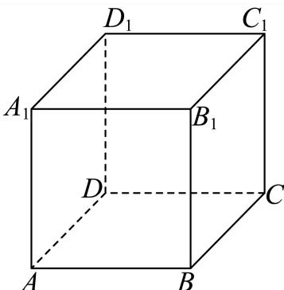
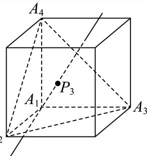

# 2025一模 集合与逻辑专题 · 教师版

> 本地预览：题目、答案及分类尚未全部审定。校对使用的PDF为高中工作台解析版，尚未逐区确认区级印刷原卷。

## 集合交并补与元素计数

先辨明全集及元素互异性，再完成集合运算与计数。

### 奉贤 · 第1题

设全集 $U=\{1,2,3,4\}$，集合 $A=\{2,4\}$，则 $\overline A=$ ______。

> 本题资料或解析有待核事项，预览不可作为已审定成品。

**考点：** 有限集合的补集运算

**难度依据：** 按全集删除集合已有元素

**核查说明：** 仅核本题所列字段及页面；不等于全卷终审。；题干与解析已用于人工归类，尚未完成整题公式校净与独立数学终审。；题干补集横线漏识；同名PDF第1页文字层确认是A的补集。；题干与解析已用于人工归类，尚未完成整题公式校净与独立数学终审。；题干补集横线漏识；同名PDF第1页文字层确认是A的补集。 本次已按本机具名解析版PDF逐页视觉恢复题干：奉贤01为补集符号，第1页；奉贤08为两个位置向量夹角，第3页。此题题干缺项已解决，不代表原解析全量数学终审。

【答案】{1, 3}.

【解析】

利用补集的定义可得出结合A.–

因为全集U = {1, 2, 3, 4}，集合 $A = \{ 2 , 4 \}$ ，则 $\overline { { A } } = \{ 1 , 3 \}$

故答案为：{1, 3}.

### 宝山 · 第1题

…
集合 $A = ( - 1 , 1 ) , B = \mathbf { Z } ,$ ，则A ∩ B =

**考点：** 区间与整数集合求交

**难度依据：** 涉及区间与整数集合求交；难度为教师预估，需结合原题条件复核。

**核查说明：** 依据现有底稿归类，尚未逐页校卷、公式校净或独立数学终审。

【答案】{0}.

【解析】

根据集合的交集运算即可.

因为集合A = (−1, 1), B = Z，则 $A \cap B = \{ 0 \}$

故答案为：{0}.

### 崇明 · 第1题

已知集合 $A = \{ 1 , 2 , 3 , 4 , 5 \}$ $B = \left\{ x \mid x > { \sqrt { 5 } } \right\}$ ，则 $A \cap B =$

**考点：** 集合交集

**难度依据：** 涉及集合交集；难度为教师预估，需结合原题条件复核。

**核查说明：** 依据现有底稿归类，尚未逐页校卷、公式校净或独立数学终审。

【答案】{3, 4, 5}

【解析】

根据交集运算求解.

因为集合 $A = \{ 1 , 2 , 3 , 4 , 5 \} , B = \left\{ x \mid x > { \sqrt { 5 } } \right\}$

所以 $A \cap B = \{ 3 , 4 , 5 \}$ ，

故答案为：{3, 4, 5}

### 普陀 · 第1题

设全集U = {−1, 0, 1, 2, 4}，若集合A = {−1, 2, 4}，则A = .

> 本题资料或解析有待核事项，预览不可作为已审定成品。

**考点：** 有限集合的补集运算

**难度依据：** 由全集直接取补集

**核查说明：** 题干与解析已用于人工归类，尚未完成整题公式校净与独立数学终审。

【答案】{0, 1}.

【解析】

根据补集的定义求解即可.

因为 $U = \{ - 1 , 0 , 1 , 2 , 4 \}$ ，集合A = {−1, 2, 4}，

所以 ${ \overline { { A } } } = \{ 0 , 1 \}$

故答案为：{0, 1}.

### 杨浦 · 第1题

已知集合 $A = \{ a , b \}$ ，则A的子集个数为

> 本题资料或解析有待核事项，预览不可作为已审定成品。

**考点：** 有限集合子集个数

**难度依据：** 有限集合子集个数；按所需步骤与推理量估计

**核查说明：** 题干与解析已用于人工归类，尚未完成整题公式校净与独立数学终审。

【答案】4.

【解析】

利用子集概念列举出即可得到答案.

集合A = {a, b},则集合A的子集有：∅ {a}, {b}, {a, b}

所以集合A的子集个数有4个.

故答案为：4.

### 松江 · 第1题

已知集合 $A = [ 4 , + \infty )$ $B = \{ 2 , 4 , 6 , 8 \}$ ，则 $A \cap B =$ =

> 本题资料或解析有待核事项，预览不可作为已审定成品。

**考点：** 数集交集

**难度依据：** 数集交集；按所需步骤与推理量估计

**核查说明：** 题干与解析已用于人工归类，尚未完成整题公式校净与独立数学终审。

【答案】{4, 6, 8}.

【解析】

找出集合A与集合B的公共元素，即可确定出交集

因为集合 $A = [ 4 , + \infty ) , \ B = \{ 2 , 4 , 6 , 8 \}$

所以 $A \cap B = \{ 4 , 6 , 8 \}$ .

故答案为：{4, 6, 8}.

### 虹口 · 第1题

已知集合 $A = \{ x | | x | < 2 \} , B = \{ 1 , 2 , 3 \}$ ，则A ∩ B =

**考点：** 集合交集

**难度依据：** 涉及集合交集；难度为教师预估，需结合原题条件复核。

**核查说明：** 依据现有底稿归类，尚未逐页校卷、公式校净或独立数学终审。

【答案】{1}.

【解析】

先求出集合A，再根据交集的定义求解即可.

由 $A = \{ x | | x | < 2 \} = \{ x | - 2 < x < 2 \} , B = \{ 1 , 2 , 3 \} ,$

则 $A \cap B = \{ 1 \}$

故答案为：{1}.

### 金山 · 第1题

已知全集U = {−1, 0, 1, 2}，集合 $A = \{ x | - 1 \leq x \leq 1 , x \in \mathrm { N } \}$ }，则A = –

**考点：** 集合补集

**难度依据：** 涉及集合补集；难度为教师预估，需结合原题条件复核。

**核查说明：** 依据现有底稿归类，尚未逐页校卷、公式校净或独立数学终审。

【答案】{−1,2}

【解析】

列举法改写集合A，再应用补运算求集合.

由题设A = {0, 1}，又U = {−1, 0, 1, 2}，故 $\overline { { A } } = \{ - 1 , 2 \}$

故答案为：{−1,2}

### 长宁 · 第1题

设全集为R，集合 $A = \left\{ x | x ^ { 2 } - 2 x - 3 \geq 0 \right\}$ ，则A = –

**考点：** 解二次不等式并求补集

**难度依据：** 二次不等式与补集；解二次不等式并求补集

【答案】(−1, 3).

【解析】

先解一元二次不等式再根据补集定义计算即可.

由 $A = ( - \infty , - 1 ] \cup [ 3 , + \infty )$

则 $| \overline { { A } } = ( - 1 , 3 )$

故答案为：(−1, 3).

### 闵行 · 第1题

设集合 $A = \{ 0 , 1 , 2 , 3 , 4 \}$ $B = \{ x | 0 < x < 3 \}$ ，则 $A \cap B$ =

**考点：** 按元素归属求交集

**难度依据：** 离散集合与区间交集；按元素归属求交集

【答案】{1,2}

【解析】

根据交集的定义计算可得.

因为 $A = \{ 0 , 1 , 2 , 3 , 4 \}$ $B = \{ x | 0 < x < 3 \}$

所以 $A \cap B = \{ 1 , 2 \}$

故答案为：{1,2}

### 青浦 · 第2题

已知集合 $A = \{ x \mid x = 2 k - 1 , k \in \mathbf { N } \} , B = \{ - 1 , 0 , 1 , 2 , 3 \}$ ，则 $A \cap B =$

> 本题资料或解析有待核事项，预览不可作为已审定成品。

**考点：** 自然数生成集合与交集

**难度依据：** 枚举满足奇数表达式的元素

**核查说明：** 题干与解析已用于人工归类，尚未完成整题公式校净与独立数学终审。

【答案】{−1, 1, 3}.

【解析】

利用交集的定义求解.

因为 $A = \{ x \mid x = 2 k - 1 , k \in \mathbf { N } \} = \{ - 1 , 1 , 3 , 5 , \cdot \cdot \cdot \}$ •

所以 $A \cap B = \{ - 1 , 1 , 3 \}$

故答案为: {−1, 1, 3}.

### 静安 · 第1题

设集合A = {1, 3, 5, 7}, B = {2, 3, 4, 5}，则A ∩ B = .

**考点：** 交集定义

**难度依据：** 有限集合交集；交集定义

【答案】{3,5}

【解析】

根据给定条件，利用交集的定义求得答案.

集合 $A = \{ 1 , 3 , 5 , 7 \} , B = \{ 2 , 3 , 4 , 5 \}$ ，所以 $\displaystyle 1 \cap B = \{ 3 , 5 \}$

故答案为：{3,5}

### 黄浦 · 第1题

若集合A = {1, 2}，B = {1, 3}，则A ∪ B =

**考点：** 并集定义

**难度依据：** 有限集合并集；并集定义

【答案】{1, 2, 3}.

【解析】

根据并集的定义运算即可.

因为A = {1, 2}，B = {1, 3}，所以 $A \cup B = \{ 1 , 2 , 3 \}$ }

故答案为: {1, 2, 3}.

## 充分必要条件与反例

将命题转为包含关系或几何条件，分别检验两个推理方向。

### 嘉定 · 第13题

已知a为正数，则 $^ { * } a > 3 ^ { * }$ 是 ${ } ^ {  } a ^ { a } > a ^ { 3 } { } ^ { , }$ 的（ ）.

A. 充分非必要条件

B. 必要非充分条件

C. 充要条件

D. 既非充分也非必要条件

> 本题资料或解析有待核事项，预览不可作为已审定成品。

**考点：** 指数不等式的充分必要条件；按指数函数底数分类讨论；变底数指数大小比较

**难度依据：** 底数在零一之间时不等方向变化

**核查说明：** 题干与解析已用于人工归类，尚未完成整题公式校净与独立数学终审。

【答案】A

【解析】

根据给定条件，当 $a > 3$ 时，利用指数函数的单调性即可判断，当 $a ^ { a } > a ^ { 3 }$ 时，分类讨论，最后利用充分条件、必要条件的定义判断作答.

当 $a >$ 3时，所以 $\langle y = a ^ { x }$ 为增函数，所以 $a ^ { a } > a ^ { 3 }$ ，

当 $a ^ { a } > a ^ { 3 }$ 时，当a > 1时，则 $a > 3 ,$ ，当0 $< a <$ 1时，则 $a < 3$ ，此时0 $< a < 1$ ；

所以 $^ { * } a > 3 ^ { * }$ 是 ${ } ^ { \cdot } a ^ { a } > a ^ { 3 } { } ^ { , }$ ”的充分非必要条件.

故选：A.

### 奉贤 · 第13题

在 $\triangle A B C ^ { \ r }$ 中， $^ { \ast } C = \frac { \pi } { 2 } ;$ ”是 $\ddot { } \sin ^ { 2 } A + \sin ^ { 2 } B = 1$ ”的（ ）

A. 充分不必要条件

B. 必要不充分条件

C. 充要条件

D. 既不充分也不必要条件

> 本题资料或解析有待核事项，预览不可作为已审定成品。

**考点：** 三角命题的充分必要性与反例；三角形内角关系及平方和恒等式

**难度依据：** 充分性用互余关系必要性需构造非直角反例

**核查说明：** 题干与解析已用于人工归类，尚未完成整题公式校净与独立数学终审。

【答案】A

【解析】

结合同角三角函数关系、诱导公式，分别从充分性、必要性两方面来说明即可

一方面：

$$
C = \frac {\pi}{2} \Rightarrow A + B = \frac {\pi}{2} \Rightarrow \sin A = \sin \left(\frac {\pi}{2} - B\right) = \cos B \Rightarrow \sin^ {2} A + \sin^ {2} B = \cos^ {2} B + \sin^ {2} B =
$$

另一方面： $A = { \frac { 2 \pi } { 3 } } , B = C = { \frac { \pi } { 6 } } \Rightarrow \sin ^ { 2 } A + \sin ^ { 2 } B = \left( { \frac { \sqrt { 3 } } { 2 } } \right) ^ { 2 } + \left( { \frac { 1 } { 2 } } \right) ^ { 2 } = 1$ 但 $C \neq { \frac { \pi } { 2 } }$

$$
" C = \frac {\pi}{2}" \text {是}" \sin^ {2} A + \sin^ {2} B = 1
$$

故选：A.

### 宝山 · 第13题

设 $\cdot a b > 0$ ,则 $^ { \ast } a > b ^ { \prime \prime }$ $\ddot { } \frac { \mathrm { ~ . ~ } } { a } < \frac { \mathrm { ~ 1 ~ } } { b } ,$ ”的（ ）

A. 充分非必要条件

B. 必要非充分条件

C. 充分必要条件

D. 既非充分也非必要条件

**考点：** 倒数比较的充要条件

**难度依据：** 涉及倒数比较的充要条件；难度为教师预估，需结合原题条件复核。

**核查说明：** 依据现有底稿归类，尚未逐页校卷、公式校净或独立数学终审。

【答案】C

【解析】

由 $a b > 0 \boxed { \mathrm { H } }$ 推出a,b同号,则根据 $\{ a > b$ 分类讨论可得出 ${ \frac { 1 } { a } } < { \frac { 1 } { b } }$ ,根据 ${ \frac { 1 } { a } } < { \frac { 1 } { b } }$ ,两边同乘 $a b \overline { { \Pi } }$ 得$a > b ,$ 即可选出选项.解:由题知 $\vert a b > 0$ ,则a, b同号,当 $a > b > 1$ 0时,有 $0 < \frac { 1 } { a } < \frac { 1 } { b }$ 当 $0 > a > b \sharp \frac { \ d H } { \ d t }$ ,有 $\frac { 1 } { a } < \frac { 1 } { b } < 0$ 故 $\mathbf { \chi } _ { \mathbf { \chi } _ { a } } > t$ 能推出 ${ \frac { 1 } { a } } < { \frac { 1 } { b } }$ 当 ${ \frac { 1 } { a } } < { \frac { 1 } { b } }$ 成立时,又 $. a b > 0$ 对不等式两边同时乘以ab可得 $b < a .$ 故 $^ { * } a > b ^ { * }$ 是 $\ddot { } \frac { \mathrm { ~ \scriptsize ~ 1 ~ } } { a } < \frac { \mathrm { ~ \scriptsize ~ 1 ~ } } { b }$ ”的充分必要条件.故选:C

### 崇明 · 第14题

已知直线l和平面α，则“l垂直于α内的两条直线”是“l⊥α”的（ ）

A. 充分非必要条件

B. 必要非充分条件

C. 充要条件

D. 非充分非必要条件

**考点：** 线面垂直的充要条件

**难度依据：** 涉及线面垂直的充要条件；难度为教师预估，需结合原题条件复核。

**核查说明：** 依据现有底稿归类，尚未逐页校卷、公式校净或独立数学终审。

【答案】B

【解析】

利用直线与平面垂直的判定定理，即可得出结论.

根据直线与平面垂直的判定定理可知：

如果一条直线垂直于平面内的两条相交直线，那么这条直线垂直于这个平面.

而“l垂直于α内的两条直线”，没有满足相交，

所以不一定能推出直线与平面垂直，

但是如果一条直线与平面垂直，一定能推出这条直线垂直于平面内的所有直线，

即可得：“l垂直于α内的两条直线”是“l⊥α”的必要不充分条件.

故选：B.

### 徐汇 · 第6题

已知m,n为空间中两条不同的直线，α,β为两个不同的平面，若 $m \subset \alpha , \alpha \cap \beta = n$ ，则 $m / / n$ 是 $m / / \beta$ 的 条件.（填：“充分非必要”､“必要非充分”、“充要”、“既非充分又非必要”中的一个）

> 本题资料或解析有待核事项，预览不可作为已审定成品。

**考点：** 线面平行判定与性质；充要条件

**难度依据：** 线面平行判定与性质；充要条件；按所需步骤与推理量估计

**核查说明：** 题干与解析已用于人工归类，尚未完成整题公式校净与独立数学终审。

【答案】充要.

【解析】

根据线面平行的判定定理和性质定理结合充分条件和必要条件的定义即可得解.

充分性：因为 $m \subset \alpha , \alpha \cap \beta = n , m / / n$

所以m,n共面，

又因为α,β为两个不同的平面， $n \subset \beta ,$

所以 $\mathbf { \nabla } . m \not \subset \beta ,$

所以 $. m / / \beta _ { \mathrm { i } }$ ，故充分性成立；

必要性：因为 $m \subset \alpha , \alpha \cap \beta = n$ ，所以 $\textstyle { \mathcal { n } } \subset \alpha$

又因为 $| m / / \beta ,$ ，所以 $m / / n$ ，故必要性成立，

所以 $m / / n$ 是 $m / / $ β的充要条件.

故答案为：充要.

### 普陀 · 第13题

设 $\alpha\in\mathbb{R}$，则“$\cos 2\alpha=\frac{1}{3}$”是“$\sin\alpha=\frac{\sqrt{3}}{3}$”的（　）

A. 充分非必要条件

B. 必要非充分条件

C. 充要条件

D. 既非充分又非必要条件

> 本题资料或解析有待核事项，预览不可作为已审定成品。

**考点：** 二倍角命题的充分必要条件；二倍角公式与符号分支

**难度依据：** 平方关系不能确定正弦符号

**核查说明：** 题干与解析已用于人工归类，尚未完成整题公式校净与独立数学终审。；题干α范围大段乱码；同名PDF第9页文字层已确认“设α∈R”，本分类不改源稿。；题干与解析已用于人工归类，尚未完成整题公式校净与独立数学终审。；题干α范围大段乱码；同名PDF第9页文字层已确认“设α∈R”，本分类不改源稿。

【答案】B

【解析】

根据余弦二倍角公式由 $\mathrm { I c o s 2 } \alpha = \frac { 1 } { 3 }$ 可得sinα的值，结合充分必要条件判断即可因为 $\cos 2 \alpha = \frac { 1 } { 3 }$ ，则 $\cos 2 \alpha = 1 - 2 \sin ^ { 2 } \alpha = { \frac { 1 } { 3 } }$ ，所 $B / \sin \alpha = { \frac { \sqrt { 3 } } { 3 } }$ 或 $\sin \alpha = - { \frac { \sqrt { 3 } } { 3 } }$ 则 $| { ^ { \circ } \cos 2 \alpha = \frac { 1 } { 3 } , \frac { \sqrt { 3 } } { \sqrt { \pm } } { ^ \circ \sin \alpha } = \frac { \sqrt { 3 } } { 3 } }$ ”的必要非充分条件.故选：B.

### 杨浦 · 第13题

已知实数 $[ a \neq 0 ,$ ，则 $^ { * } a > 2 ^ { * }$ 是 $\ddot { } \frac { \mathrm { ~ \scriptsize ~ 1 ~ } } { a } < \frac { \mathrm { ~ \scriptsize ~ 1 ~ } } { 2 }$ ”的（ ）条件.

A. 充分非必要

B. 必要非充分

C. 充分必要

D. 既非充分也非必要

> 本题资料或解析有待核事项，预览不可作为已审定成品。

**考点：** 充分必要条件；分式不等式

**难度依据：** 充分必要条件；分式不等式；按所需步骤与推理量估计

**核查说明：** 题干与解析已用于人工归类，尚未完成整题公式校净与独立数学终审。

【答案】A

【解析】

根据分式不等式化简可得 $\cdot a > 2 \nexists \lambda a < 0$ 即可根据集合间的关系求解.由 $\frac { 1 } { a } < \frac { 1 } { 2 }$ 得 $\frac { 2 - a } { 2 a } < 0$ ，解得 $a > 2 \nexists \lambda a < 0$ •$\mathbb { F } \{ a | a >$ 2} $\{ a | a >$ 2或 $a < 0 \}$ ，$^ { * } a > 2 ^ { * }$ 是 $ { \mathrm { ~  ~ \cdot ~ } } \frac { 1 } { a } < \frac { 1 } { 2 }$ ”的充分不必要条件，故选：A

### 浦东 · 第14题

设m、n为两条直线，α、β为两个平面，且 $\alpha \cap \beta = n$ ．下述四个命题中为假命题的是（ ）

A. 若 $m \bot \alpha ,$ ，则 $m \perp n$

B. 若 $\dot { m } / / \alpha$ ，则 $\scriptstyle | m / / n$

C. 若 $\dot { \cdot } _ { m } / / \alpha$ 且 $. m / / \beta ,$ ，则 $m / / n$

D. 若 $m / / n ,$ ，则 $| m / / \alpha$ 或 $m / / \beta$

> 本题资料或解析有待核事项，预览不可作为已审定成品。

**考点：** 线面平行垂直关系判定；命题反例

**难度依据：** 线面平行垂直关系判定；命题反例；按所需步骤与推理量估计

**核查说明：** 题干与解析已用于人工归类，尚未完成整题公式校净与独立数学终审。；B选项反例把BB1称为平行底面，但它垂直底面；须更换有效反例并回核原题。；题干与解析已用于人工归类，尚未完成整题公式校净与独立数学终审。；B选项反例把BB1称为平行底面，但它垂直底面；须更换有效反例并回核原题。

【答案】B

【解析】

选项A，利用线面垂直的性质，即可求解；选项B，在正方体中，通过取特例，即可求解；选项C和D，利用线面平行的性质和判定，即可求解.

对于选项A，因为 $\alpha \cap \beta = n$ ，所以n $\subset \alpha ,$ ，又 $m \bot \alpha$ ，所以 $m \perp n$ ，故选项A是真命题，

对于选项B，如图，取平面ABCD为α，平面 $A D D _ { 1 } A _ { 1 }$ 为β，则直线n为直线AD，取 $B B _ { 1 }$ 为直线m，

显然有 $\dot { m } / / \alpha$ ，但m与n异面，所以选项B为假命题，对于选项C，在α内任取不在直线n上的一点M，过m,M确定γ，则 $\gamma \cap \alpha = l _ { 1 }$ ，因为 $m / / \alpha$ ，所以 $m / / l _ { 1 }$ 2

同理可得 $m / / l _ { 2 } , l _ { 2 } \subset \beta ,$ ，所以 $l _ { 1 } / / l _ { 2 }$ ，又 $. l _ { 2 } \subset \beta , l _ { 1 } \notin \beta .$ ，故 $l _ { 1 } / / \beta _ { : }$

又 $l _ { 1 } \subset \alpha , \alpha \cap \beta = n$ ，所以 $l _ { 1 } / / n$ ，得到 $m / / n ,$ ，故选项C为真命题，

对于选项D，因为 $\alpha \cap \beta = n ,$ 所以 $n \subset \alpha , n \subset \beta ,$ ，若 $m \not \subset \alpha$ ，因为 $m / / n$ ，则 $m / / \alpha$ 若 $m \subset \alpha .$ ，易知 $\mid m \mid ^ { \ell } \beta ,$ ，又 $m / / n , \ n \subset \beta ,$ ，所 $\lfloor m / / \beta \rfloor$ ，故选项D为真命题，故选：B.

### 虹口 · 第13题

已知 $\alpha\in(0,\pi)$，则“$\sin(\pi-\alpha)=\frac12$”是“$\cos\alpha=\frac{\sqrt3}2$”的（　）条件。

A. 充要

B. 充分非必要

C. 必要非充分

D. 既非充分又非必要

> 本题资料或解析有待核事项，预览不可作为已审定成品。

**考点：** 三角诱导公式与充要条件

**难度依据：** 涉及三角诱导公式与充要条件；难度为教师预估，需结合原题条件复核。

**核查说明：** 题干及A选项可能在题图中，需核题图及原卷。；依据现有底稿归类，尚未逐页校卷、公式校净或独立数学终审。

【答案】C

【解析】

结合诱导公式及特殊角的三角函数值求出两个条件的α的值，进而结合充分、必要条件的定义判断即可.

由题意， $\alpha \in ( 0 , \pi )$

由 $\sin \left( \pi - \alpha \right) = \frac { 1 } { 2 }$ ，即 $\sin \alpha = \frac { 1 } { 2 }$ ，则 $\lvert \alpha = \frac { \pi } { 6 }$ 或 $\alpha = \frac { 5 \pi } { 6 }$

由 $\cos \alpha = { \frac { \sqrt { 3 } } { 2 } }$ ，则 $\alpha = \frac { \pi } { 6 }$

所以 $\sin \left( \pi - \alpha \right) = \frac { 1 } { 2 } ,$ ”是 ${ \mathrm { \ddot { c } o s } } \alpha = { \frac { \sqrt { 3 } } { 2 } } { \mathrm { \ddot { } } }$ ”的必要非充分条件

故选：C.

### 金山 · 第14题

若 $^ { * } x > a ^ { * }$ 是 $^ {  } x ^ { 2 } - 2 x - 3 < 0 ^ { , }$ 的必要不充分条件，则实数a的取值范围是（ ）

A. $\left( - \infty - 1 \right)$

B. $( - \infty - 1 ]$

C. $( - 1 , + \infty )$

D. $[ - 1 , + \infty )$

**考点：** 必要条件与区间包含

**难度依据：** 涉及必要条件与区间包含；难度为教师预估，需结合原题条件复核。

**核查说明：** 依据现有底稿归类，尚未逐页校卷、公式校净或独立数学终审。

【答案】B

【解析】

【分析】根据充分条件和必要条件的定义结合不等式进行判断即可

【详解】由 $\ : \mathrm { ~ \ : ~ } \mathrm { ~ \ : ~ } \mathrm { ~ \ : ~ } \mathrm { ~ \ : ~ } \mathrm { ~ \ : ~ } \mathrm { ~ \ : ~ } x ^ { 2 } - 2 x - 3 <$ < 0得 $- 1 < x < 3$

$\because x > a _ { \mathrm { \tiny \mathscr { L } } } ^ { \mathrm { \tiny \sharp } } - 1 < x <$ 3的必要不充分条件，

∴ a ≤ −1，

故选：B

### 长宁 · 第9题

已知 $\alpha : 2 ^ { x } + \log _ { 2 } x \leq 2 ,$ β: $x < m$ ，若α是β的充分条件，则实数m的取值范围是

**考点：** 利用单调性求解集并转化集合包含

**难度依据：** 指数对数不等式与充分条件；利用单调性求解集并转化集合包含

【答案】$( 1 , + \infty )$

【解析】

通过构造函数 $f ( x ) = 2 ^ { x } + \log _ { 2 } x , x \in ( 0 , + \infty )$ ，利用f(x)的单调性解不等式，再由题意将α是 $_ { ; \beta }$ 的充分条件转化为包含关系，进而求得参数m范围

设 $f ( x ) = 2 ^ { x } + \log _ { 2 } x , x \in ( 0 , + \infty )$

则 $f ( x ) \overleftarrow { \left. \pm ( 0 , + \infty ) \right. }$ 单调递增，又f(1) = 2，

所以 $2 ^ { x } + \log _ { 2 } x \leq 2$ ，即 $f ( x ) \leq f ( 1 )$ ，故 $0 < x \le 1$ .

则 $\alpha \colon 0 < x \leq 1$

由题意 $0 < x \le 1$ 是x < m的充分条件，则 $( 0 , 1 ] \subseteq ( - \infty , m )$ ，

所以有 $m > 1$ ，故实数m的取值范围是 $( 1 , + \infty )$

故答案为： $( 1 , + \infty )$

### 长宁 · 第14题

已知非零空间向 $\sharp { \vec { a } } , { \vec { b } }$ 和→c，则下列说法正确的是（ ）

A. $\vec { \mathcal { G } } \vec { a } \perp \vec { b } , \vec { a } \perp \vec { c }$ ，则 $\vec { \vert b \vert } / \vec { \vert c }$

B. $\stackrel { \scriptscriptstyle + } { \vec { \tau } } \vec { a } \perp \vec { b } , \vec { a } \perp \vec { c }$ ,则 $\vec { b } \perp \vec { c }$

C. $\overrightarrow { \mathcal { H } } \overrightarrow { a } \perp \overrightarrow { b } , \overrightarrow { a } / / \overrightarrow { c }$ ，则 $\stackrel {  } { b } / / \stackrel {  } { c }$

D. $\overrightarrow { \mathcal { H } } \overrightarrow { a } \perp \overrightarrow { b } , \overrightarrow { a } / / \overrightarrow { c }$ ，则 $\vec { | b \perp c | }$

**考点：** 判断平行垂直命题与充分必要性

**难度依据：** 空间向量平行垂直的逻辑关系；判断平行垂直命题与充分必要性

【答案】D

【解析】

根据空间向量平行与垂直的定义判断即可.

若→a $\perp \vec { b } , \vec { a } \perp \vec { c }$ ，则 $\vec { \mathfrak { b } } / / \vec { c } \vec { \mathfrak { x } } \vec { b }$ 与→c不共线，故选项A与B错误；

故选：D.

若→a $\perp \vec { b } , \vec { a } / / \vec { c }$ ，则 $\vec { b } \perp \vec { c }$ ，故选项C错误，选项D正确.

### 闵行 · 第13题

在空间中，“$a,b$ 为异面直线”是“$a,b$ 不相交”的（　）。

A. 充分非必要条件

B. 必要非充分条件

C. 充要条件

D. 既非充分又非必要条件

> 本题资料或解析有待核事项，预览不可作为已审定成品。

**考点：** 判断异面与不相交的逻辑关系

**难度依据：** 异面直线与充分必要条件；判断异面与不相交的逻辑关系

**核查说明：** 题干A、B、C选项缺失，仅剩D标记，需回原卷补齐。

【答案】A

【解析】

利用异面直线的定义及充分条件、必要条件的定义判断即得.

直线a、b为异面直线，则直线a、b不相交，

反之，直线a、b不相交，直线a、b可能平行，也可能是异面直线，

所以在空间中，“a、b为异面直线”是“a、b不相交”的充分非必要条件.

故选：A

### 静安 · 第13题

设 $[ a , b \in \mathbf { R } ,$ ，则 $^ { * } a + b > 0 ^ { * }$ 是 $\mathbf { \bar { \rho } } ^ { * } a > 0$ 且 $. b > 0 ^ { \ast }$ 的（ ）

A. 充分非必要条件

B. 必要非充分条件

C. 充要条件

D. 既非充分又非必要条件

**考点：** 用反例与不等式性质判断

**难度依据：** 充分必要条件判断；用反例与不等式性质判断

【答案】B

【解析】

正向取反例即可，反向根据不等式性质即可，最后根据必要不充分条件判定即可.

正向来看，取 $\ Q = 2 , b = - 1$ ，则 $\left| a + b > 0 \right.$ ，满足 $a + b > 0$ ，但不满足 $\because 0 \mathbb { H } b > 0$ ，故充分性不成立，

反向来看， $a > 0 , b > 0$ ，则 $\left| a + b > 0 \right.$ ，故必要性成立，

所以前者是后者的必要不充分条件.

故选：B.

## 点集、函数映射与存在性命题

检查映射后的重合与函数单值性，用构造和反例处理存在量词。

### 奉贤 · 第12题

已知集合 $\mathbf { \partial } M = \{ P _ { 0 } , P _ { 1 } , P _ { 2 } , \cdots , P _ { n } \} , n \geq 2 , n \in \mathbf { N }$ 是由函数 $y = \cos x , x \in [ 0 , 2 \pi ]$ 的图象上两两不相同的点构成的点集，集合 $S = \left\{ a | a = { \overrightarrow { O P _ { 0 } } } \cdot { \overrightarrow { O P _ { i } } } , i = 0 , 1 , 2 , \cdots , n , n \geq 2 , n \in \mathbf { N } \right\}$ ，其中 $P _ { 0 } \left( 0 , 1 \right)$ $P _ { 1 } \left( \pi , - 1 \right)$ ．若集合S中的元素按照从小到大的顺序排列能构成公差为d的等差数列，当 $d \in \left\{ { \frac { 1 } { 2 } } , 1 \right\}$ 时，则符合条件的点集M的个数为

> 本题资料或解析有待核事项，预览不可作为已审定成品。

**考点：** 坐标数量积提取纵坐标；有限等差数列公差分类；余弦函数定值点枚举；有必选点约束的集合计数；点集到数集映射的重合与去重

**难度依据：** 公差两种情形下按同纵坐标点的非空选择计数

**核查说明：** 题干与解析已用于人工归类，尚未完成整题公式校净与独立数学终审。；原解多个余弦值与横坐标被错排，计数思路可辨但公式未校净。；题干与解析已用于人工归类，尚未完成整题公式校净与独立数学终审。；原解多个余弦值与横坐标被错排，计数思路可辨但公式未校净。

【答案】60.

【解析】

确定数列中最大值为1，最小值为−1，然后根据d分类得出等差数列，再由等差数列的项确定点 $P _ { i }$ 的横坐标的值，然后由M中对应点的的情形确定集合个数

由已知 $\vert a _ { 0 } = \overrightarrow { O P _ { 0 } } \cdot \overrightarrow { O P _ { 0 } } = 1 , a _ { 1 } = \overrightarrow { O P _ { 0 } } \cdot \overrightarrow { O P _ { 1 } } = - 1$

设 $P _ { i } ( x _ { i } , y _ { i } )$ ，则 $a _ { i } = \overrightarrow { O P _ { 0 } } \cdot \overrightarrow { O P _ { i } } = y _ { i }$ ，显然 $- 1 \leq y _ { i } \leq 1$

若 $\dot { \boldsymbol { d } } = 1$ ，则 $S = \{ - 1 , 0 , 1 \}$ ，因此有 $\dot { y } _ { i } = 0$

由 $\cos x _ { i } = 0 , x _ { i } \in [ 0 , 2 \pi ]$ 得 $x _ { i } = { \frac { \pi } { 2 } }$ 或 $\frac { 3 \pi } { 2 }$ ，对应 $Q _ { 1 } \left( \frac { \pi } { 2 } , 0 \right) , Q _ { 2 } \left( \frac { 3 \pi } { 2 } , 0 \right)$

同理 $Q _ { 3 } ( 2 \pi , 1 )$ 对应 $P _ { 0 }$ ，

集合M中已经含有点 $P _ { 0 } , P _ { 1 }$ ，

因此产生 $S = \{ - 1 , 0 , 1 \}$ 的集合M中，点 $Q _ { 3 }$ 可有也可没有， $Q _ { 1 } , Q _ { 2 }$ 至少有一个，

所以M的个数为 $2 \times 3 = 6$

若 $\dot { \boldsymbol { d } } = \frac { 1 } { 2 }$ ，则 $S = \left\{ - 1 , - \frac { 1 } { 2 } , 0 , \frac { 1 } { 2 } , 1 \right\}$

cos xi = 1 xi 2π 或 4π cos xi = 1 xi π 或 5π

对应点Q $\mathrm { ~ \ i ~ } \left( \frac { \pi } { 3 } , \frac { 1 } { 2 } \right) , Q _ { 5 } \left( \frac { 5 \pi } { 3 } , \frac { 1 } { 2 } \right) , Q _ { 6 } \left( \frac { 2 \pi } { 3 } , - \frac { 1 } { 2 } \right) , Q _ { 7 } \left( \frac { 4 \pi } { 3 } , - \frac { 1 } { 2 } \right)$

产生 $\left\{ - 1 , - \frac { 1 } { 2 } , 0 , \frac { 1 } { 2 } , 1 \right\}$ 的集合M中，点 ${ \bf \nabla } \cdot { \bf Q _ { 3 } }$ 可有也可没有， $Q _ { 1 } , Q _ { 2 }$ 至少有一个，

$Q _ { 4 } , Q _ { 5 }$ 中至少有一个， $Q _ { 6 } , Q _ { 7 }$ 中至少有一个，M的个数为 $2 \times 3 \times 3 \times 3 = 5 4$

综上，集合M的个数为 $6 + 5 4 = 6 0$

故答案为：60.

方法点睛：确定集合的个数即为确定集合中元素的可能性，本题中首先确定出最终等差数列的最大值和最小值，从而根据公差得出等差数列，由等差数列确定可能含有的点，从而得出集合个数

## 二、选择题

### 徐汇 · 第12题

已知定义域为A = {1,2,3}的函数 $\cdot y = f \left( x \right)$ 的值域也是A，所有这样的函数 $y = f \left( x \right)$ 形成全集B.设非空集合 $C \subseteq B$ 且$\overline{C}$中的每一个函数都是C中的两个函数（可以相同）的复合函数，则集合C的元素个数的最小值为

> 本题资料或解析有待核事项，预览不可作为已审定成品。

**考点：** 有限集合与函数复合；函数复合计数

**难度依据：** 需要理解复合与有限集合约束并分情形构造；题干符号待核，评级暂定。

**核查说明：** 已恢复缺失部分，但题干仍有OCR乱码，须校净后才能发布。；题干与解析已用于人工归类，尚未完成整题公式校净与独立数学终审。；题干C与补集的区别在解析中严重丢失，按底稿字面恒等函数构成单元素集合已满足，源答案2不适用于该字面题意；须回源确认定义。；已恢复缺失部分，但题干仍有OCR乱码，须校净后才能发布。；题干与解析已用于人工归类，尚未完成整题公式校净与独立数学终审。；题干C与补集的区别在解析中严重丢失，按底稿字面恒等函数构成单元素集合已满足，源答案2不适用于该字面题意；须回源确认定义。

【答案】2.

【解析】

根据题意可得集合B有6个不同的元素，且非空集合 $C \subseteq B , \ { \overline { { C } } } \subseteq B \mathbb { H } { \overline { { C } } } \cup C = B$ ，对C分类讨论可求得集合 的元素个数的最小值

因为定义域为 $A = \{ 1 , 2 , 3 \}$ 的函数 $\boldsymbol { \cdot } \boldsymbol { y } = \boldsymbol { f } \left( \boldsymbol { x } \right)$ 的值域也是A，

所以这样的不同的函数有 $\mathrm { A _ { 3 } ^ { 3 } } = 6 \mathrm { \uparrow }$ ，所以集合B有6个不同的元素，

又非空集合 $\cdot C \subseteq B , \ { \overline { { C } } } \subseteq B \mathbb { H } { \overline { { C } } } \cup C = B ,$

又C中的每一个函数都是C中的两个函数（可以相同）的复合函数，–

若C中只有1个函数，则 $| \overline { { C } } |$ 中有5个函数，

又C中函数与自身的复合函数只能表示一个函数，故不能得到 $| \overline { { C } } |$ 中5个函数，不符合题意，

若C中只有2个函数，则C中有4个函数，–

若C中2个函数的复合函数有 $2 \times 2 = 4$ ，如果这4个函数是C中4个函数时，符合题意，此时只–

需验证即可.

6个不同函数为 $f _ { 1 } ( x ) \colon 1 \to 1 , 2 \to 2 , 3 \to 3 , f _ { 2 } ( x ) \colon 1 \to 1 , 2 \to 3 , 3 \to 2$

$$
f _ {3} (x): 1 \rightarrow 2, 2 \rightarrow 1, 3 \rightarrow 3, f _ {4} (x): 1 \rightarrow 2, 2 \rightarrow 3, 3 \rightarrow 1,
$$

f5(x): 1 → 3, 2 → 1, 3 → 2， $f _ { 6 } ( x ) \colon 1 \to 3 , 2 \to 2 , 3 \to 1$

若 $C = \{ f _ { 4 } ( x ) , f _ { 6 } ( x ) \}$ ，此时 $\mathsf { F } \overline { { C } } = \{ f _ { 1 } ( x ) , f _ { 2 } ( x ) , f _ { 3 } ( x ) , f _ { 5 } ( x ) \}$ ，

$$
f _ {6} (f _ {6} (x)) = f _ {1} (x), \quad f _ {4} (f _ {6} (x)) = f _ {2} (x),
$$

$$
f _ {6} (f _ {4} (x)) = f _ {3} (x), \quad f _ {4} (f _ {4} (x)) = f _ {5} (x),
$$

所以集合C的元素个数的最小值为2.

故答案为：2.

方法点睛：利用已知先确定集合B有6个不同的元素，按照C中函数是C中函数的复合函数，找到两集合元素的关系，验证即可.

## 二、选择题

### 普陀 · 第15题

设a > 0且 $a \neq 1$ ，k、m、n都是正整数，数列 $\left\{ a _ { n } \right\}$ 的通项公式为 $\mathfrak { l } a _ { n } = \left\{ \begin{array} { l l } { ( a - 6 ) n + 2 1 , ( 1 \leq n \leq m ) } \\ { a ^ { n - 3 } , ( n > m ) } \end{array} \right.$ ，记数列 $\left\{ a _ { n } \right\}$ 中前k项的最小值为 $ { \lvert h _ { k } }$ ，由所有 $h _ { k }$ 的值所组成的集合记为A，若集合A中仅有四个元素，则下列说法中错误的是（ ）

A. 当m = 3时，a的取值范围是(1,6)

B. 不存在a和m的值，使得 $. a _ { 4 } \notin A$

C. 当m = 4时，a的取值范围是(3, 6)

D. 存在a和m的值，使得 $\cdot a _ { 5 } \notin A$

> 本题资料或解析有待核事项，预览不可作为已审定成品。

**考点：** 分段数列前缀最小值的不同取值；分段线性指数函数的单调性；前缀最小值集合的元素计数

**难度依据：** 按底数及分段位置追踪最小值更新次数

**核查说明：** 题干与解析已用于人工归类，尚未完成整题公式校净与独立数学终审。；原解多处把通项讨论称为递推，部分分支解释跳步，需逐项核验前缀最小值集合。；题干与解析已用于人工归类，尚未完成整题公式校净与独立数学终审。；原解多处把通项讨论称为递推，部分分支解释跳步，需逐项核验前缀最小值集合。

【答案】C

【解析】

根据a不同的取值范围分析分段函数的性质，结合函数单调性，反证法，进而判断关于集合元素个数等命题的正确性，逐个判断真假即可.

对于A选项,当 $m = 3$ 时，对 ${ \vec { \mathbf { \tau } } } a \in ( 0 , 1 )$ )，根据分段函数的性质，会得到 $\displaystyle a _ { 1 } > a _ { 2 } > a _ { 3 } > . . . > a _ { n }$

由 $\mathbb { F } a \mathbb { E } ( 0 , 1 )$ )这个区间内，这样的递推会一直进行下去，所以集合A有无数个元素.

$\exists a \in ( 1 , 6 )$ 时，要满足 $a _ { 1 } > a _ { 2 } > a _ { 3 } > a _ { 4 }$ ，通过对分段函数的计算和分析，正好解得 $a \in ( 1 , 6 )$ 9

此时 $A = \{ a _ { 1 } , a _ { 2 } , a _ { 3 } , a _ { 4 } \}$ .并且当 $a \in [ 6 , + \infty )$ ，两个分段函数都是增函数，A中最多只存在两个元素.所以A选项正确.

对于B选项，当 $a \in ( 0 , 1 )$ 时，有 $a _ { 1 } > a _ { 2 } > a _ { 3 }$ 且 $a _ { 4 } > a _ { 5 } > a _ { 6 } > . . . > a _ { n }  0$

要想A有4个元素，根据函数的递推关系，如果 ${ \mathrm { : } } a _ { 3 } > 0$ ，那么根据函数性质会继续产生更多的元素，

所以必有 $\dot { \mathbf { \alpha } } a _ { 3 } \leq 0$ ，不然会有无数个元素.但是当a ≤ 0时，A中元素个数就不是4个了，

这就产生了矛盾，所以原命题正确，即B选项正确.

对于C选项，当 $a \in ( 0 , 1 )$ 时， $a _ { 1 } > a _ { 2 } > a _ { 3 } > a _ { 4 }$ ，令 $\cdot a _ { 4 } \leq 0$ ，通过对分段函数的计算解得$a \leq \frac { 3 } { 4 }$

由于 $a _ { 5 } > a _ { 6 } > . . . > a _ { n }  0$ ，此时 $A = \{ a _ { 1 } , a _ { 2 } , a _ { 3 } , a _ { 4 } \}$ ，这与选项中说的情况不符，所以C选项错误.

对于D选项，从前面的分析经验来看，要想 $a _ { 5 } \in A$ ，根据分段函数的性质，只能令 $\cdot m = 4$ $a _ { 5 } = a _ { 4 }$

由此得到方程 $4 ( a - 6 ) + 2 1 = a ^ { 2 }$ ，整理得 $\mathbf { \partial } : a ^ { 2 } - 4 a + 3 = 0$ ，解得 $\ Q = 1 \not \equiv \not \{ a = 3$

故选：C.

因为 $\lceil a \neq 1$ （根据前面的取值范围等条件），所以a = 3，D选项正确.

### 杨浦 · 第12题

已知实数 $a>0$，$\mathrm{i}$ 是虚数单位，设集合 $A=\{z\mid z=w+\frac1w,\ |w|>1,\ w\in\mathbf C,\ z\in\mathbf C\}$，集合 $B=\{z\mid |z-1+\mathrm{i}|=a,\ z\in\mathbf C\}$。如果 $B\subseteq A$，则 $a$ 的取值范围为______。

> 本题资料或解析有待核事项，预览不可作为已审定成品。

**考点：** 复变换与几何轨迹；圆与实轴线段相离；集合包含

**难度依据：** 需确定复变换值域并将包含问题转为圆与线段的位置关系；长解细节待审。

**核查说明：** 原MD漏失A的定义及a>0条件；从同名PDF文字层恢复完整题干。PDF第4页底部印刷裁切，A定义未完整可见，不能称已全题视觉确认。；题干与解析已用于人工归类，尚未完成整题公式校净与独立数学终审。；解法二纯虚数分支对q<0的构造及负实数分支符号存在问题，需审解；结论不据此改写。；原MD漏失A的定义及a>0条件；从同名PDF文字层恢复完整题干。PDF第4页底部印刷裁切，A定义未完整可见，不能称已全题视觉确认。；题干与解析已用于人工归类，尚未完成整题公式校净与独立数学终审。；解法二纯虚数分支对q<0的构造及负实数分支符号存在问题，需审解；结论不据此改写。

【答案】$( 0 , 1 ) \cup \left( \sqrt { 1 0 } , + \infty \right)$

【解析】

解法一：明确集合A，B的几何意义，数形结合，根据几何意义即可求得参数范围.

解法二：先证明不属于A的复数z，恰好是那些区间[−2,2]上的实数，再利用该结论得到取值范围.

解法一：由于 $| w | > 1$ ，设 $w = r ( \cos \theta + \mathrm { i } \sin \theta ) , r > 1$ ，

$$
w + \frac {1}{w} = r (\cos \theta + \mathrm{i} \sin \theta) + \frac {1}{r (\cos \theta + \mathrm{i} \sin \theta)}
$$

$$
= r (\cos \theta + \mathrm{i} \sin \theta) + \frac {\cos \theta - \mathrm{i} \sin \theta}{r} = \left(r + \frac {1}{r}\right) \cos \alpha + \mathrm{i} \left(r - \frac {1}{r}\right) \sin \alpha ,
$$

设z对应点(x, y)，则 $x = \left( r + { \frac { 1 } { r } } \right) \cos \alpha , y = \left( r - { \frac { 1 } { r } } \right) \sin \alpha$

所以 ${ \frac { x ^ { 2 } } { \left( r + { \frac { 1 } { r } } \right) ^ { 2 } } } + { \frac { y ^ { 2 } } { \left( r - { \frac { 1 } { r } } \right) ^ { 2 } } } = 1$ ，其中 $r + \frac { 1 } { r } > 2 , r - \frac { 1 } { r } > 0$

当 $r > 1  { \mathbb { H } } )$ ，该方程的几何意义为表示所有椭圆的并集，

即平面上除去线段 $A _ { 1 } A _ { 2 }$ 的点的集合，其中 $A _ { 1 } ( - 2 , 0 ) , A _ { 2 } ( 2 , 0 )$

集合 $B = \{ z \mid | z - 1 + \mathbf { i } | = a , z \in \mathbf { C } \}$ 表示复平面上的圆，圆心为(1,−1)，半径为a，

如果 $B \subseteq A$ ，则该圆与线段 $A _ { 1 } A _ { 2 }$ 无公共点，

结合图形可知a的取值范围为(0,1)∪ $\left( { \sqrt { 1 0 } } , + \infty \right)$ ；

解法二：

先证明：不属于A的复数z，恰好是那些区间[−2,2]上的实数.

下设z是复数.

①情况一：z不是实数，也不是纯虚数.

设 ${ \boldsymbol { \cdot } } { \boldsymbol { z } } = r \cdot \mathrm { e } ^ { \mathrm { i } \alpha } \left( r \geq 0 , \alpha \in \mathbf { R } \right) , z ^ { 2 } - 4 = R \cdot \mathrm { e } ^ { \mathrm { i } \beta } \left( R \geq 0 , \beta \in \mathbf { R } \right)$ ，并令 $w _ { 1 } = { \frac { r \cdot \mathrm { e } ^ { \mathrm { i } \alpha } + { \sqrt { R } } \cdot \mathrm { e } ^ { \mathrm { i } \cdot { \frac { \beta } { 2 } } } } { 2 } }$ $w _ { 2 } = { \frac { r \cdot \mathrm { e } ^ { \mathrm { i } \alpha } - { \sqrt { R } } \cdot \mathrm { e } ^ { \mathrm { i } \cdot { \frac { \beta } { 2 } } } } { 2 } }$

则对 $k = 1 , 2 ,$ ，有 $\left( w _ { k } - { \frac { z } { 2 } } \right) ^ { 2 } = \left( w _ { k } - { \frac { r \cdot \mathrm { e } ^ { \mathrm { i } \alpha } } { 2 } } \right) ^ { 2 } = \left( { \frac { { \sqrt { R } } \cdot \mathrm { e } ^ { \mathrm { i } { \frac { \beta } { 2 } } } } { 2 } } \right) ^ { 2 } = { \frac { R \cdot \mathrm { e } ^ { \mathrm { i } \beta } } { 4 } } = { \frac { z ^ { 2 } - 4 } { 4 } }$ ，即

$$
w _ {k} ^ {2} - z \cdot w _ {k} + 1 = 0.
$$

假设 $w _ { k } = 0$ ，则 $| 0 = w _ { k } ^ { 2 } - z \cdot w _ { k } + 1 = 0 ^ { 2 } - z \cdot 0 + 1 = 1$ ，矛盾，所以 $w _ { k } \neq 0$ ，从而 $w _ { k } + \frac { 1 } { w _ { k } } = z .$

又因为 $\mathfrak { w } _ { 1 } \mathfrak { w } _ { 2 } = \frac { \left( r \cdot \mathrm { e } ^ { \mathrm { i } \alpha } \right) ^ { 2 } - \left( \sqrt { R } \cdot \mathrm { e } ^ { \mathrm { i } \cdot \frac { \beta } { 2 } } \right) ^ { 2 } } { 4 } = \frac { z ^ { 2 } - R \cdot \mathrm { e } ^ { \mathrm { i } \beta } } { 4 } = \frac { z ^ { 2 } - \left( z ^ { 2 } - 4 \right) } { 4 } = 1 ,$

所以 $1 = | 1 | = | w _ { 1 } w _ { 2 } | = | w _ { 1 } | | w _ { 2 } | .$

此时，假设 $| w _ { 1 } | = | w _ { 2 } | = 1 \colon$ ：由于

$$
w _ {1} = \frac {r \mathrm{e} ^ {\mathrm{i} \alpha} + \sqrt {R} \mathrm{e} ^ {\mathrm{i} \cdot \frac {\beta}{2}}}{2} = \left(\frac {r}{2} \cos \alpha + \frac {\sqrt {R}}{2} \cos \frac {\beta}{2}\right) + \left(\frac {r}{2} \sin \alpha + \frac {\sqrt {R}}{2} \sin \frac {\beta}{2}\right) \mathrm{i},
$$

故

$$
\begin{array}{l} 1 = 1 ^ {2} = | w _ {1} | ^ {2} = \left(\frac {r}{2} \cos \alpha + \frac {\sqrt {R}}{2} \cos \frac {\beta}{2}\right) ^ {2} + \left(\frac {r}{2} \sin \alpha + \frac {\sqrt {R}}{2} \sin \frac {\beta}{2}\right) ^ {2} = \frac {r ^ {2}}{4} + \frac {R}{4} + \frac {r \sqrt {R}}{2} \cos \\ \left(\alpha - \frac {\beta}{2}\right) \end{array}
$$

同理，根据 $| w _ { 2 } | = 1$ 可以得到 $1 = { \frac { r ^ { 2 } } { 4 } } + { \frac { R } { 4 } } - { \frac { r { \sqrt { R } } } { 2 } } \mathrm { c o s } \left( \alpha - { \frac { \beta } { 2 } } \right)$

对 $. = { \frac { r ^ { 2 } } { 4 } } + { \frac { R } { 4 } } + { \frac { r { \sqrt { R } } } { 2 } } \cos \left( \alpha - { \frac { \beta } { 2 } } \right)$ 和1 $= { \frac { r ^ { 2 } } { 4 } } + { \frac { R } { 4 } } - { \frac { r { \sqrt { R } } } { 2 } } \cos \left( \alpha - { \frac { \beta } { 2 } } \right)$ 相加和相减，

就能得到 $1 = { \frac { r ^ { 2 } } { 4 } } + { \frac { R } { 4 } } , { \frac { r { \sqrt { R } } } { 2 } } \mathrm { c o s } \left( \alpha - { \frac { \beta } { 2 } } \right) = 0 .$

若假设R = 0，则 $( z - 2 ) ( z + 2 ) = z ^ { 2 } - 4 = R \mathrm { e } ^ { \mathrm { i } \beta } = 0$ ，从而 $z = 2$ 或 $z = - 2$

这和情况一的定义矛盾，所以 $R > 0$

若假设 $\boldsymbol { r } = 0$ ，则 $z = r \cdot \mathrm { e } ^ { \mathrm { i } \alpha } = 0$ ，从而 $z = 0$ ，这和情况一的定义矛盾，所以 $r > 0$

这就得到 $\frac { r \sqrt { R } } { 2 } > 0 .$ ，所以 $\cos \left( \alpha - { \frac { \beta } { 2 } } \right)$ = 0，所以 $\frac { \beta } { 2 } = \alpha + \left( 2 m - 1 \right) \cdot \frac { \pi } { 2 } ( m \in \mathbf { Z } )$

即 $\displaystyle | \beta = 2 \alpha + ( 2 m - 1 ) \pi \left( m \in \mathbf { Z } \right)$

这就得到

R (reiα)2 ⋅ ei(2m−1)π R 2 − 4 = ⋅ eiβ = ⋅ ei(2α+(2m−1)π) = e2iα ⋅ ei(2m−1)π z2 2 i(2m−1)π r2 r2 所以 $z ^ { 2 } - 4 = { \frac { R } { r ^ { 2 } } } i$ z2或 $z ^ { 2 } - 4 = - { \frac { R } { r ^ { 2 } } } z ^ { 2 }$ ，无论哪种情况都能得到 $z ^ { 2 }$ 是实数，故可设 $z ^ { 2 } = c \in \mathbf { R }$ 若 $c \geq 0 .$ ，则 $0 = z ^ { 2 } - c = \left( z - { \sqrt { c } } \right) \left( z + { \sqrt { c } } \right)$ ，得 $z = \pm \sqrt { { \mathfrak { c } } }$ c是实数，这和情况一的定义矛盾. 若 $c < 0 _ { : }$ ，则 $0 = z ^ { 2 } - c = \left( z - \mathrm { i } { \sqrt { c } } \right) \left( z + \mathrm { i } { \sqrt { c } } \right)$ ，得 $z = \pm \mathrm { i } \sqrt { }$ c是纯虚数，这和情况一的定义矛 盾.

故前面的假设 $| w _ { 1 } | = | w _ { 2 } | = 1$ 不成立，所以结合 $\mathrm { ~ l ~ } = \left| w _ { 1 } \right| \left| w _ { 2 } \right|$ |可知，

一定存在k = 1,2使得 $| w _ { k } | > 1$ ，结合 $w _ { k } + \frac { 1 } { w _ { k } } = z ^ { \boxplus } \ddot { \star } \boxed { \| } z \in A$

②情况二：z是纯虚数.

此时设 $z = \dot { q 1 } ( q \neq 0 )$ ，则 $w = \frac { q + \sqrt { q ^ { 2 } + 4 } } { 2 }$ i满 $\dot { \Xi } | w | = { \frac { q + \sqrt { q ^ { 2 } + 4 } } { 2 } } > { \frac { 0 + \sqrt { 0 + 4 } } { 2 } } = 1$

$$
\begin{array}{l} {w + \frac {1}{w} = \frac {q + \sqrt {q ^ {2} + 4}}{2} \mathrm{i} + \frac {1}{\frac {q + \sqrt {q ^ {2} + 4}}{2} \mathrm{i}} = \frac {q + \sqrt {q ^ {2} + 4}}{2} \mathrm{i} - \frac {2}{q + \sqrt {q ^ {2} + 4}} \mathrm{i} = \frac {q + \sqrt {q ^ {2} + 4}}{2} \mathrm{i}} \\ {- \frac {\sqrt {q ^ {2} + 4} - q}{2} \mathrm{i} = q \mathrm{i} = z} \end{array}
$$

故 $z \in A .$

③情况三：z是实数， $\mathrm { { E } } z > 2 .$

此时 $w = \frac { z + \sqrt { z ^ { 2 } - 4 } } { 2 }$ 满足 $| w | = \left| { \frac { z + { \sqrt { z ^ { 2 } - 4 } } } { 2 } } \right| = { \frac { z + { \sqrt { z ^ { 2 } - 4 } } } { 2 } } > { \frac { 2 + { \sqrt { 2 ^ { 2 } - 4 } } } { 2 } } = 1 ,$

且 $\lfloor w + { \frac { 1 } { w } } = { \frac { z + { \sqrt { z ^ { 2 } - 4 } } } { 2 } } + { \frac { 2 } { z + { \sqrt { z ^ { 2 } - 4 } } } } = { \frac { z + { \sqrt { z ^ { 2 } - 4 } } } { 2 } } + { \frac { z - { \sqrt { z ^ { 2 } - 4 } } } { 2 } } = z ,$ ，故 $( z \in A$

④情况四：z是实数，且 $z < - 2$

此时 $w = \frac { - z + \sqrt { z ^ { 2 } - 4 } } { 2 }$ 满足

$$
| w | = \left| \frac {- z + \sqrt {z ^ {2} - 4}}{2} \right| = \frac {(- z) + \sqrt {(- z) ^ {2} - 4}}{2} > \frac {2 + \sqrt {2 ^ {2} - 4}}{2} = 1,
$$

且 $w + \frac { 1 } { w } = \frac { z - \sqrt { z ^ { 2 } - 4 } } { 2 } + \frac { 2 } { z - \sqrt { z ^ { 2 } - 4 } } = \frac { z - \sqrt { z ^ { 2 } - 4 } } { 2 } + \frac { z + \sqrt { z ^ { 2 } - 4 } } { 2 } = z ,$ ，故 $z \in A$

⑤情况五：z是实数， $\mathrm { E } z \in [ - 2 , 2 ]$

假设 $z \in A .$ 则存在复数w使得 $| w | > 1$ ，且 ${ \boldsymbol { \cdot } } { \boldsymbol { w } } + { \frac { 1 } { w } } = { \boldsymbol { z } } ,$ ，设 $w = r _ { 0 } \cdot \mathrm { e } ^ { \mathrm { i } \theta } \left( r _ { 0 } > 1 , \theta \in \mathbf { R } \right)$

$$
| z = w + \frac {1}{w} = r _ {0} \mathrm{e} ^ {\mathrm{i} \theta} + \frac {1}{r _ {0} \cdot \mathrm{e} ^ {\mathrm{i} \theta}} = r _ {0} \mathrm{e} ^ {\mathrm{i} \theta} + \frac {1}{r _ {0}} \mathrm{e} ^ {- \mathrm{i} \theta} = \left(r _ {0} + \frac {1}{r _ {0}}\right) \cos \theta + \mathrm{i} \left(r _ {0} - \frac {1}{r _ {0}}\right) \sin \theta .
$$

从而 $\left( r _ { 0 } + { \frac { 1 } { r _ { 0 } } } \right) \cos \theta = z , \left( r _ { 0 } - { \frac { 1 } { r _ { 0 } } } \right) \sin \theta = 0$ 而由 $r _ { 0 } > 1$ 可知 $\vert r _ { 0 } - \frac { 1 } { r _ { 0 } } > 1 - \frac { 1 } { 1 } = 0 .$ 所以 $\sin \theta = 0$ ，故 $| \cos \theta | = 1$

这就得到 ${ \mathrm { ~ : } } \geq | z | = \left| \left( r _ { 0 } + { \frac { 1 } { r _ { 0 } } } \right) \cos \theta \right| = r _ { 0 } + { \frac { 1 } { r _ { 0 } } } = { \frac { ( r _ { 0 } - 1 ) ^ { 2 } + 2 r _ { 0 } } { r _ { 0 } } } > { \frac { 2 r _ { 0 } } { r _ { 0 } } } = 2 ,$ ，矛盾.所以假设不成立，从而z ∉ A.

综合上面五种情况，就得到了结论：不属于A的复数z，恰好是那些区间[−2,2]上的实数现在回到原题，结合上面的结论，条件等价于B中包含的每个实数都不属于[−2,2].

一方面，若B中包含一个实数z，满足 $- 2 \leq z \leq 2$

则 $| a = | z - 1 + \mathbf { i } | = { \sqrt { ( z - 1 ) ^ { 2 } + 1 } } \geq 1 \quad$

$a = | z - 1 + \mathrm { i } | = { \sqrt { \left( z - 1 \right) ^ { 2 } + 1 } } = { \sqrt { \left( z + 2 \right) \left( z - 4 \right) + 1 0 } } \leq { \sqrt { 1 0 } }$ ，从而1 $\leq a \leq { \sqrt { 1 0 } } .$

另一方面，若 $1 \leq a \leq \sqrt { 1 0 }$ ，则实数 $z = 1 - \sqrt { a ^ { 2 } - 1 }$ 1满足

$$
z = 1 - \sqrt {a ^ {2} - 1} \geq 1 - \sqrt {\left(\sqrt {1 0}\right) ^ {2} - 1} = 1 - \sqrt {9} = - 2, z = 1 - \sqrt {a ^ {2} - 1} \leq 1 \leq 2.
$$

故B中包含一个实数z，满 $\begin{array} { r } { \mathbb { E } - 2 \le z \le 2 } \end{array}$

这就说明，B中包含一个实数z满足−2 ≤ z ≤ 2的充要条件是1 $\leq a \leq { \sqrt { 1 0 } } .$

所以a的取值范围是 $( 0 , 1 ) \cup \left( \sqrt { 1 0 } , + \infty \right)$

故答案为： $( 0 , 1 ) \cup \left( \sqrt { 1 0 } , + \infty \right)$

关键点点睛：本题的关键在于对复数知识和三角恒等变换的使用.

## 二、选择题

### 松江 · 第16题

设函数y = f (x)与 $y = g \left( x \right)$ 均是定义在R上的函数，有以下两个命题：①若y = f (x)是周期函数，且是R上的减函数，则函数y = f(x)必为常值函数；②若对任意的a， $b \in \mathbf { R }$ ，有$\left| f \left( a \right) - f \left( b \right) \right| \leq \left| g \left( a \right) - g \left( b \right) \right|$ |成立，且 $y = g \left( x \right)$ 是R上的增函数，则 $y = f \left( x \right) - g \left( x \right)$ 是R上的增函数．则以下选项正确的是（ ）

A. ①是真命题，②是假命题

B. 两个都是真命题

C. ①是假命题，②是真命题

D. 两个都是假命题

> 本题资料或解析有待核事项，预览不可作为已审定成品。

**考点：** 周期单调函数与函数增量；命题判断与反例

**难度依据：** 周期单调函数与函数增量；命题判断与反例；按所需步骤与推理量估计

**核查说明：** 题干与解析已用于人工归类，尚未完成整题公式校净与独立数学终审。

【答案】A

【解析】

用反证法判断命题①，用反例判断命题②

①若y = f(x)是周期函数，设T是它的正周期，即 $f ( x ) = f ( x + T )$

$$
x _ {1} <   x _ {2}
$$

$$
f (x _ {1}) \neq f (x _ {2})
$$

$$
f (x _ {1}) \geq f (x _ {2})
$$

$$
f (x _ {1}) > f (x _ {2})
$$

$$
l n = \left[ \frac {x _ {2} - x _ {1}}{T} \right] + 1
$$

$$
\left[ \frac {x _ {2} - x _ {1}}{T} \right]
$$

$$
\frac {x _ {2} - x _ {1}}{T}
$$

$$
x _ {1} + n T > x _ {2}
$$

$$
f (x _ {1}) = f (x _ {1} + n T)
$$

所以 $f ( x _ { 1 } + n T ) > f ( x _ { 2 } )$ ，这是f(x)是减函数矛盾，所以 $f ( x _ { 1 } ) \neq f ( x _ { 2 } )$ 不成立，

所以 $f ( x _ { 1 } ) = f ( x _ { 2 } )$ ，即f(x)是常值函数，①是真命题；

②取 $f ( x ) = x , g ( x ) = 2 x$ ，则对任意的 $a , b , | f ( a ) - f ( b ) | = | a - b | , | g ( a ) - g ( b ) | = 2 | a - b |$

满足 $\left| f \left( a \right) - f \left( b \right) \right| \leq \left| g \left( a \right) - g \left( b \right) \right|$

但 $f ( x ) - g ( x ) = - x$ 是减函数，②是假命题

故选：A

## 三、解答题

### 金山 · 第16题

已知三棱锥 $A _ { 1 } - A _ { 2 } A _ { 3 } A _ { 4 }$ 的侧棱长相等，且侧棱两两垂直．设P为该三棱锥表面（含棱）上异于顶点 $A _ { 1 } , A _ { 2 } , A _ { 3 } , A _ { 4 }$ 的点，记 $D = \{ d | d = | P A _ { i } | , i = 1 , 2 , 3 , 4 \}$ ．若集合D中有且只有2个元素，则符合条件的点P有（ ）个

A. 3

B. 6

C. 7

D. 10

> 本题资料或解析有待核事项，预览不可作为已审定成品。

**考点：** 空间点到顶点距离集合的分类

**难度依据：** 涉及空间点到顶点距离集合的分类；难度为教师预估，需结合原题条件复核。

**核查说明：** 原解称四个顶点具有对称性，题设并非正四面体；应区分顶点A1与另外三个顶点，核验分情况计数。；依据现有底稿归类，尚未逐页校卷、公式校净或独立数学终审。

【答案】D

【解析】

设 $d _ { i } = | P A _ { i } |$ ，分P到两个顶点的距离a一样，到另外两个顶点的距离b一样，且 $. a \neq b ,$ ，和P到其中三个顶点的距离c一样，到另一个顶点的距离为e，且 $c \neq e _ { \cdot }$ ，两种情况，结合对称性，列举出满足题设的所有P点，即可得答案.

设 $\cdot d _ { i } = | P A _ { i } |$ ，情况如下：

①P到两个顶点的距离a一样，到另外两个顶点的距离b一样， $\boxed { a } a \neq b .$

由 $A _ { 1 } , A _ { 2 } , A _ { 3 } , A _ { 4 }$ 具有对称性，不妨讨论 $\therefore d _ { 1 } = d _ { 4 } , d _ { 2 } = d _ { 3 }$ ，

满足题意的P应同时在线段 $A _ { 1 } A _ { 4 } , A _ { 2 } A _ { 3 }$ 的中垂线面和三棱锥表面上，

即为其中垂面交线与三棱锥表面的交点，如图 $P _ { 1 } , P _ { 2 }$ 两点，

同理， $d _ { 1 } = d _ { 2 } , d _ { 3 } = d _ { 4 }$ 和 $\begin{array} { r } { [ d _ { 1 } = d _ { 3 } , d _ { 2 } = d _ { 4 } } \end{array}$ 也各有2个满足题意的P点，故共6个；

②P到其中三个顶点的距离c一样，到另一个顶点的距离为e，且 $c \neq e$

若P到 $A _ { 2 } , A _ { 3 } , A _ { 4 }$ 的距离一样，即 $d _ { 2 } = d _ { 3 } = d _ { 4 }$ ，则P为过 $\triangle A _ { 2 } A _ { 3 } A _ { 4 }$ 外心的垂线与三棱锥表面的交点，如图 $P _ { 3 }$ 和 $A _ { 1 }$ （舍）；

若P到 $A _ { 1 }$ 和 $A _ { 2 } , A _ { 3 } , A _ { 4 } \sharp$ 的两个距离一样，由 $A _ { 1 } , A _ { 2 } , A _ { 3 } , A _ { 4 }$ 具有对称性，

不妨讨论 $\mathscr { d } _ { 1 } = \mathscr { d } _ { 2 } = \mathscr { d } _ { 3 }$ ，则P为过 $\triangle A _ { 2 } A _ { 3 } A _ { 4 }$ 外心的垂线与三棱锥表面的交点，如图 $P _ { 4 }$ ，

同理， $d _ { 1 } = d _ { 3 } = d _ { 4 } \operatorname { \bar { \kappa } } \boxed { \mathrm { \uparrow } } d _ { 1 } = d _ { 2 } = d _ { 4 }$ 也各有1个满足题意的P点，共4个；

综上，共有10个满足题意的点.

故选：D

关键点点睛：依据题意将问题分成P到两个顶点的距离a一样，到另外两个顶点的距离b一样，且 $. a \neq b ,$ ，和P到其中三个顶点的距离c一样，到另一个顶点的距离为e，且c ≠ e两类为关键.

## 三、解答题

### 青浦 · 第16题

对于数列 $\{a_n\}$，设数列 $\{a_n\}$ 的前 $n$ 项和为 $S_n$，给出下列两个命题：

①存在函数 $y=f(x)$，使得 $S_n=f(a_n)$；

②存在函数 $y=g(x)$，使得 $n=g(a_n)$。

则①是②的（　）。

A. 充分不必要条件

B. 必要不充分条件

C. 充要条件

D. 既不充分也不必要条件

> 本题资料或解析有待核事项，预览不可作为已审定成品。

**考点：** 前缀和与通项的函数对应；函数单值性及一一对应；两个存在命题的充分必要性；数列映射条件的反例与蕴含

**难度依据：** 零数列给反例且要证明反向映射可定义

**核查说明：** 题干与解析已用于人工归类，尚未完成整题公式校净与独立数学终审。；原解最后复合映射的书写不严谨，应从an互异保证Sn关于an可定义来证明。；题干与解析已用于人工归类，尚未完成整题公式校净与独立数学终审。；原解最后复合映射的书写不严谨，应从an互异保证Sn关于an可定义来证明。

【答案】B

【解析】

取特例可知①推不出②，根据反函数可知满足②能推出①，结合充分条件、必要条件的概念得 解.

取 $S _ { n } = a _ { n } = 0$ ，存在 $y = f ( x ) = 0$ ，使得 $S _ { n } = f \left( a _ { n } \right)$ 成立，

此时由函数定义知，不存在函数 $y = g \left( x \right)$ ，使得 $n = g \left( a _ { n } \right)$

当存在函数 ${ \boldsymbol { \cdot } } { \boldsymbol { y } } = { \boldsymbol { g } } \left( { \boldsymbol { x } } \right)$ ，使得 $n = g \left( a _ { n } \right)$ 成立时，

由于n与a 为一一对应关系，所 $\complement { \lambda } a _ { n }$ 就可以写成y = g(x)的反函数，

即 $a _ { n }$ 可以用n表示，即存在函数 $\dot { a } _ { n } = g ^ { - 1 } \left( n \right)$

所以存在 $S _ { n } = h ( n ) = f \left( a _ { n } \right) = f \left\{ g ^ { - 1 } ( n ) \right\}$

综上可知，①是②的必要不充分条件.

故选：B

关键点点睛：对于新概念问题需要去理解，本题理解了之后，可以根据函数的概念去判断①②之间的推出关系得解.

## 三、解答题

