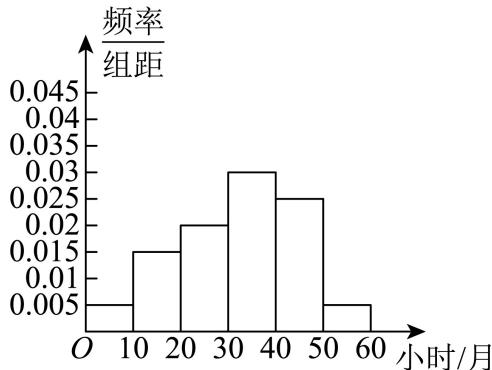
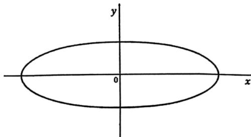
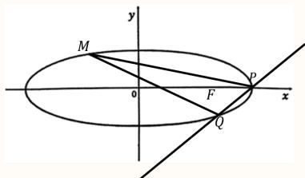

# 2025二模 嘉定区原卷 · 教师版

> 本地预览：题目、答案及分类尚未全部审定。校对使用的PDF为高中工作台解析版，尚未逐区确认区级印刷原卷。

## 填空题

按本区原卷题号顺序排列。

### 嘉定 · 第1题

已知集合 $A = \{ x | - 1 < x \leq 3 \}$ ，集合 $B = \{ x | 1 \leq x < 4 \}$ ，则 $A \cap B =$

**考点：** 集合交集

**难度依据：** 集合交集；直接调用定义或基本公式，运算路径短

**核查说明：** 已人工阅读底稿题干和解析；尚未逐页对照原PDF，不作为数学终审。

【答案】$\{ x \mid 1 \leq x \leq 3 \}$ .

【解析】

A ∩ B = {x |1 ≤ x ≤ 3}.

故答案为： $\{ x \mid 1 \leq x \leq 3 \}$ .

### 嘉定 · 第2题

不等 $\updownarrow \frac { x - 2 } { x + 1 } <$ 0的解集为

> 本题资料或解析有待核事项，预览不可作为已审定成品。

**考点：** 分式不等式与符号

**难度依据：** 分式不等式求解；需完成一次转化或结合基本条件后计算

**核查说明：** 题干出现“不等\updownarrow”等乱码，解析不等式阈值排版破损，需核原卷。；已人工阅读底稿题干和解析；尚未逐页对照原PDF，不作为数学终审。

【答案】(−1,2)

【解析】

由分式不等式的解法得原不等式 $\frac { x - 2 } { x + 1 } < 1$ 0等价于 $\left( x - 2 \right) \left( x + 1 \right) < 0$

解不等式 $\left( x - 2 \right) \left( x + 1 \right) < 0$ 得 $- 1 < x < 2$

故不等式 $\frac { x - 2 } { x + 1 } <$ 0的解集为(−1, 2).

故答案为：(−1,2)

### 嘉定 · 第3题

已知向量 $\vec { m } = ( 1 , - 2 ) , \vec { n } = ( k , 4 )$ ，若 $\cdot \overrightarrow { m } \perp \overrightarrow { n } ,$ ，则k =

**考点：** 向量数量积与垂直条件

**难度依据：** 坐标运算与垂直；直接调用定义或基本公式，运算路径短

**核查说明：** 已人工阅读底稿题干和解析；尚未逐页对照原PDF，不作为数学终审。

【答案】8

【解析】

由向量垂直的坐标表示，列方程求参数值.

由题设 ${ \vec { m } } \cdot { \vec { n } } = 1 \times k + ( - 2 ) \times 4 = k - 8 = 0 \Rightarrow k = 8$

故答案为：8

### 嘉定 · 第4题

已知等比数列 $\left\{ a _ { n } \right\}$ 的首项为1，公比为q，其前n项和为 $S _ { n }$ ．若 $S _ { 3 } > S _ { 4 }$ ，则q的取值范围为

**考点：** 等比数列前n项和与符号

**难度依据：** 等比数列前n项和符号；需完成一次转化或结合基本条件后计算

**核查说明：** 已人工阅读底稿题干和解析；尚未逐页对照原PDF，不作为数学终审。

【答案】$( - \infty , 0 )$

【解析】

根据等比数列的知识化简已知条件，从而求得正确答案.

依题意， $S _ { 3 } > S _ { 4 }$ ，即 $S _ { 4 } - S _ { 3 } = a _ { 4 } = a _ { 1 } q ^ { 3 } = q ^ { 3 } < 0$

所以 $. q < 0$

故答案为： $( - \infty , 0 )$

### 嘉定 · 第5题

在 $\left( 2 x - { \frac { 1 } { \sqrt { x } } } \right) ^ { \ell }$ 6 的二项展开式中，常数项的值为

> 本题资料或解析有待核事项，预览不可作为已审定成品。

**考点：** 二项式通项与常数项

**难度依据：** 二项展开式常数项；需完成一次转化或结合基本条件后计算

**核查说明：** 展开式指数OCR为上标ell后接6，需回核指数。；已人工阅读底稿题干和解析；尚未逐页对照原PDF，不作为数学终审。

【答案】60.

【解析】

利用二项展开式的通项公式即可得出

二项式 $\left( 2 x - { \frac { 1 } { \sqrt { x } } } \right) ^ { \ell }$ 的展开式的通项公式为：

$$
T _ {r + 1} = \mathrm{C} _ {6} ^ {r} (2 x) ^ {6 - r} \left(- \frac {1}{\sqrt {x}}\right) ^ {r} = (- 1) ^ {r} \mathrm{C} _ {6} ^ {r} 2 ^ {6 - r} x ^ {6 - \frac {3}{2} r},
$$

令 $6 - { \frac { 3 } { 2 } } r = 0$ ，解得 $r = 4$

所以二项式的展开式中的常数项为 $( - 1 ) ^ { 4 } \mathrm { C } _ { 6 } ^ { 4 } 2 ^ { 2 } = 6 0$

故答案为：60.

### 嘉定 · 第6题

已知θ ∈ R，若 $\tan \theta + \cot \theta = 5$ ，则sin 2θ =

**考点：** 二倍角与三角化简

**难度依据：** 二倍角公式；需完成一次转化或结合基本条件后计算

**核查说明：** 已人工阅读底稿题干和解析；尚未逐页对照原PDF，不作为数学终审。

【解析】

根据已知，应用商数关系及平方关系可得 $\sin \theta \cos \theta = { \frac { 1 } { 5 } }$ 再应用二倍角正弦公式求函数值由 $\tan \theta + \cot \theta = { \frac { \sin \theta } { \cos \theta } } + { \frac { \cos \theta } { \sin \theta } } = { \frac { \sin ^ { 2 } \theta + \cos ^ { 2 } \theta } { \sin \theta \cos \theta } } = { \frac { 1 } { \sin \theta \cos \theta } } = 5 ,$ 所以 $\sin \theta \cos \theta = { \frac { 1 } { 5 } }$ ，则 $| \sin 2 \theta = 2 \sin \theta \cos \theta = \frac { 2 } { 5 }$ 故答案为： $\frac { 2 } { 5 }$

### 嘉定 · 第7题

直线l: $y = x + 1$ 与圆 $C { : } x ^ { 2 } + y ^ { 2 } - 4 x - 2 y = 0$ 相交所得的弦长为

**考点：** 圆心到直线距离与弦长

**难度依据：** 直线与圆弦长；需完成一次转化或结合基本条件后计算

**核查说明：** 已人工阅读底稿题干和解析；尚未逐页对照原PDF，不作为数学终审。

【答案】$2 \sqrt { 3 }$

【解析】

首先确定圆心和半径，应用点线距离公式求圆心到直线的距离，再利用几何法求相交弦长即可.

由C: $x ^ { 2 } + y ^ { 2 } - 4 x - 2 y = 0$ ，即 $C \colon ( x - 2 ) ^ { 2 } + ( y - 1 ) ^ { 2 } = 5$

所以圆心为 $C ( 2 , 1 )$ ，半径为 $r = { \sqrt { 5 } }$

所以C(2, 1)到l: $y = x + 1$ 的距离 $d = { \frac { | 2 - 1 + 1 | } { \sqrt { 2 } } } = { \sqrt { 2 } } \quad$

综上，直线与圆的相交弦长为 $2 { \sqrt { r ^ { 2 } - d ^ { 2 } } } = 2 { \sqrt { 3 } }$

故答案为： $2 \sqrt { 3 }$

### 嘉定 · 第8题

已知复数z1，z2满足 $| z _ { 1 } | = 1$ $| z _ { 2 } | = 2 \ , \ | z _ { 1 } - z _ { 2 } | = \sqrt { 7 }$ ，则 $| z _ { 1 } + z _ { 2 } |$ |的值为

**考点：** 复数的几何意义与模

**难度依据：** 模与平行四边形；需完成一次转化或结合基本条件后计算

**核查说明：** 已人工阅读底稿题干和解析；尚未逐页对照原PDF，不作为数学终审。

【答案】${ \sqrt { 3 } } .$

【解析】

利用复数的几何意义，把复数和平面向量建立一一对应关系，再利用向量的加减运算及平行四边形的性质即可.

设 $\overrightarrow { O A }$ 对应的复数为 $z _ { 1 } , \ \overrightarrow { O B }$ 对应的复数为 $z _ { 2 }$ ，

则 $\overrightarrow { O A } + \overrightarrow { O B }$ 对应的复数为 $z _ { 1 } + z _ { 2 } , \overrightarrow { O A } - \overrightarrow { O B }$ 对应的复数为 $z _ { 1 } - z _ { 2 }$

因为 $| z _ { 1 } | = 1 , | z _ { 2 } | = 2 , | z _ { 1 } - z _ { 2 } | = { \sqrt { 7 } } ,$

由平行四边形的性质可得： $| z _ { 1 } + z _ { 2 } | ^ { 2 } + | z _ { 1 } - z _ { 2 } | ^ { 2 } = 2 ( | z _ { 1 } | ^ { 2 } + | z _ { 2 } | ^ { 2 } )$

所以 $| z _ { 1 } + z _ { 2 } | = { \sqrt { 2 | z _ { 1 } | ^ { 2 } + 2 | z _ { 2 } | ^ { 2 } - | z _ { 1 } - z _ { 2 } | ^ { 2 } } } = { \sqrt { 2 + 8 - 7 } } = { \sqrt { 3 } }$

故答案为： ${ \sqrt { 3 } } .$

### 嘉定 · 第9题

在由1，2，3，4，5这五个数组成的无重复数字的四位数中，其能被3整除的概率为

**考点：** 排列组合与古典概型

**难度依据：** 排列组合计数；需完成一次转化或结合基本条件后计算

**核查说明：** 已人工阅读底稿题干和解析；尚未逐页对照原PDF，不作为数学终审。

【解析】

利用排列数公式分别求出由1，2，3，4，5这五个数组成的无重复数字的四位数的个数，及其中能被3整除的四位数的个数，再根据古典概型公式即可得解.

由1，2，3，4，5这五个数组成的无重复数字的四位数共 $\mathrm { A } _ { 5 } ^ { 4 } = 5 \times 4 \times 3 \times 2 = 1 2 0 $ 个，

其中能被3整除的四位数是由1，2，4，5组成的，共 ${ \bf A } _ { 4 } ^ { 4 } = 4 \times 3 \times 2 \times 1 = 2 4$

故由1，2，3，4，5这五个数组成的无重复数字的四位数中，其能被3整除的概率为 ${ \frac { 2 4 } { 1 2 0 } } = { \frac { 1 } { 5 } }$ 故答案为： $\frac { 1 } { 5 }$

### 嘉定 · 第10题

已知某次数学的测试成绩X服从 $\textstyle \mu = 7 5 , \sigma ^ { 2 } = 6 4$ 的正态分布，若小明的成绩不低于91分，那么他的成绩大约超过了 %的学生（精确到0.1%）．（参考数据：$P(\mu-\sigma<X<\mu+\sigma)\approx0.6827$，$P(\mu-2\sigma<X<\mu+2\sigma)\approx0.9545$，$P(\mu-3\sigma<X<\mu+3\sigma)\approx0.9973$）

**考点：** 正态分布概率

**难度依据：** 正态分布的对称性；需完成一次转化或结合基本条件后计算

**核查说明：** 已人工阅读底稿题干和解析；尚未逐页对照原PDF，不作为数学终审。

【答案】97.7%

【解析】

根据正态分布的2σ范围求解即可.

因为 $^ { I \mu } = 7 5 , \ \sigma ^ { 2 } = 6 4 .$

所以 $P \left( X < 9 1 \right) \approx 0 . 5 + \frac { 1 } { 2 } \times 9 5 . 4 \% = 9 7 . 7 \% ,$

故答案为：97.7%

### 嘉定 · 第11题

某建筑公司欲设计一个正四棱锥形纪念碑，要求其顶点位于容积为36π立方米的球形景观灯所在球面上．考虑到抗风、抗震等结构安全需求，侧棱长度l需满足 $\pm 2 { \sqrt { 3 } } \leq l \leq 3 { \sqrt { 3 } } .$ ．当纪念碑体积取得最大值时，正四棱锥的侧棱长约为 米（精确到0.01米）

> 本题资料或解析有待核事项，预览不可作为已审定成品。

**考点：** 棱锥外接球与几何最值

**难度依据：** 棱锥外接球与最值；需综合转化、参数分析或完整证明，推理链较长

**核查说明：** 侧棱范围、球面条件与参数公式OCR破损，需原卷复核。；已人工阅读底稿题干和解析；尚未逐页对照原PDF，不作为数学终审。

【解析】

由题设可得球的半径为 $\scriptstyle \mathbf { r } = 3$ ，结合正四棱锥的结构特征及其外接球半径与棱长、底面边长的关系得 $6 h = l ^ { 2 }$ ，进而得到纪念碑体积关于l的表达式，应用导数求其最大值，并确定对应的侧棱长.

若球的半径为r，则 ${ \frac { 4 } { 3 } } \pi r ^ { 3 } = 3 6 \pi$ ，可得 $r = 3 , \ Z 2 \sqrt { 3 } \le l \le 3 \sqrt { 3 } .$

对于正四棱锥，设底面边长为 $^ { \cdot } a ,$ ，高为h，

则 $h ^ { 2 } = l ^ { 2 } - \left( \frac { \sqrt { 2 } } { 2 } a \right) ^ { 2 } = l ^ { 2 } - \frac { a ^ { 2 } } { 2 }$ ，所以 $\frac { a ^ { 2 } } { 2 } = l ^ { 2 } - h ^ { 2 }$ ，即 $a ^ { 2 } = 2 ( l ^ { 2 } - h ^ { 2 } )$

又 $( h - r ) ^ { 2 } + { \frac { a ^ { 2 } } { 2 } } = r ^ { 2 }$ ，则 ${ \frac { a ^ { 2 } } { 2 } } = 6 h - h ^ { 2 }$ ，故 $5 6 h = l ^ { 2 }$ ，即 ${ \mathfrak { h } } = { \frac { l ^ { 2 } } { 6 } }$

纪念碑体积 $| V = { \frac { 1 } { 3 } } a ^ { 2 } h = { \frac { 2 } { 3 } } \times \left( l ^ { 2 } - { \frac { l ^ { 4 } } { 3 6 } } \right) \cdot { \frac { l ^ { 2 } } { 6 } } = { \frac { 1 } { 9 } } \times \left( l ^ { 4 } - { \frac { l ^ { 6 } } { 3 6 } } \right)$ 令 $\cdot t = l ^ { 2 } \in [ 1 2 , 2 7 ]$

对 $\mp y = t ^ { 2 } - \frac { t ^ { 3 } } { 3 6 }$ ，则 $| y ^ { \prime } = 2 t - { \frac { t ^ { 2 } } { 1 2 } } = { \frac { 2 4 t - t ^ { 2 } } { 1 2 } }$ 在 $t \in [ 1 2 , 2 7 ]$ ]上单调递减，

当 $1 2 \leq t < 2$ 24时 $\dot { \boldsymbol { y } } ^ { \prime } > 0 \mathrm { ; }$ ，即 $y = t ^ { 2 } - { \frac { t ^ { 3 } } { 3 6 } }$ 在[12, 24)上单调递增，

当 $2 4 < t \leq$ 27时 $\dot { \boldsymbol y } ^ { \prime } < 0$ ，即 $y = t ^ { 2 } - { \frac { t ^ { 3 } } { 3 6 } }$ 在(24,27]上单调递减，

所以 $y _ { \mathrm { { m a x } } } = 2 4 ^ { 2 } - { \frac { 2 4 ^ { 3 } } { 3 6 } } = 1 9 2$ ，故 $V _ { \mathrm { m a x } } = \frac { 1 } { 9 } \times 1 9 2 = \frac { 6 4 } { 3 }$ ，此时 $l = 2 \sqrt { 6 } \approx 4 . 9 0$ 米.故答案为：4.90

### 嘉定 · 第12题

在平面直角坐标系中，一质点 $P$ 从原点 $O$ 出发，第一次从点 $O$ 移动到点 $P_1$，第二次从点 $P_1$ 移动到点 $P_2$，……，第 $k$ 次从点 $P_{k-1}$（规定 $P_0=O$）移动到点 $P_k$。记向量 $\vec v_k=\overrightarrow{P_{k-1}P_k}$，其模长为 $k$，方向与 $x$ 轴正方向成 $(90k)^\circ$ 角。设 $\vec S_n$ 为经过 $n$ 次移动的位移向量，即 $\vec S_n=\overrightarrow{OP_n}$，则当 $|\vec S_n|=\sqrt{85}$ 时，$n$ 的值为________。

> 本题资料或解析有待核事项，预览不可作为已审定成品。

**考点：** 周期位移、向量与数列

**难度依据：** 周期位移与向量运算；需连接多个条件、建模或作分类讨论

**核查说明：** 位移向量及等于根号85的条件严重乱码，不能凭解析猜补。；已人工阅读底稿题干和解析；尚未逐页对照原PDF，不作为数学终审。

【答案】13.

【解析】

根据题意，求出向量 $\overrightarrow { v _ { k } }$ 的坐标，再求出向量 $\overrightarrow { S _ { n } }$ 的坐标，根据模长求解 即可

$$
\therefore \overrightarrow {v _ {k}} = \overrightarrow {P _ {k - 1} P _ {k}} = (k \cos (9 0 k) ^ {\circ}, k \sin (9 0 k) ^ {\circ}),
$$

$$
\begin{array}{l} \overrightarrow {S _ {n}} = \overrightarrow {O P _ {n}} = \\ \left(1 \times \cos 9 0 ^ {\circ} + 2 \cos 1 8 0 ^ {\circ} + 3 \cos 2 7 0 ^ {\circ} + \dots + n \cos (9 0 n) ^ {\circ}, 1 \times \sin 9 0 ^ {\circ} + 2 \sin 1 8 0 ^ {\circ} + 3 \sin 2 7 0 ^ {\circ} \right. \\ \left. + \dots + n \sin (9 0 n) ^ {\circ}\right) \end{array}
$$

$$
\therefore \overrightarrow {S _ {4}} = \overrightarrow {O P _ {4}} = (- 2 + 4, 1 - 3) = (2, - 2), \quad \left| \overrightarrow {S _ {4}} \right| = 2 \sqrt {2};
$$

$$
\overrightarrow {S _ {8}} = \overrightarrow {O P _ {8}} = (- 2 + 4 - 6 + 8, 1 - 3 + 5 - 7) = (4, - 4), \quad \left| \overrightarrow {S _ {8}} \right| = 4 \sqrt {2};
$$

$$
\overrightarrow {S _ {1 2}} = \overrightarrow {O P _ {1 2}} = (- 2 + 4 - 6 + 8 - 1 0 + 1 2, 1 - 3 + 5 - 7 + 9 - 1 1) = (6, - 6), \quad \left| \overrightarrow {S _ {1 2}} \right| = 6 \sqrt {2};
$$

$$
\overrightarrow {S _ {1 3}} = \overrightarrow {O P _ {1 3}} = (- 2 + 4 - 6 + 8 - 1 0 + 1 2, 1 - 3 + 5 - 7 + 9 - 1 1 + 1 3) = (6, 7), \quad \left| \overrightarrow {S _ {1 3}} \right| = \sqrt {8 5}
$$

故 $n = 1 3 .$

故答案为：13.

## 二、选择题

## 选择题

按本区原卷题号顺序排列。

### 嘉定 · 第13题

已知实数 $a,b$ 满足 $a>b$，则下列不等式中，不恒成立的是（　）。

A. $a^3>b^3$

B. $\dfrac ab>1$

C. $a^2+b^2>2ab$

D. $2^a>2^b$

> 本题资料或解析有待核事项，预览不可作为已审定成品。

**考点：** 不等式恒成立

**难度依据：** 恒成立条件判断；需连接多个条件、建模或作分类讨论

**核查说明：** 解析疑似截断且无明确答案标记，不能认定解析齐备。；已人工阅读底稿题干和解析；尚未逐页对照原PDF，不作为数学终审。

【答案】B。

【解析】选项A：$y=x^3$ 在 $\mathbb R$ 上严格递增，由 $a>b$ 得 $a^3>b^3$，恒成立。

选项B：取 $a=-1$，$b=-2$，则 $a>b$，但 $a/b=1/2<1$，不恒成立；当 $b=0$ 时该商还没有定义。

选项C：由 $a>b$ 得 $a\ne b$，故 $a^2+b^2-2ab=(a-b)^2>0$，恒成立。

选项D：$y=2^x$ 在 $\mathbb R$ 上严格递增，由 $a>b$ 得 $2^a>2^b$，恒成立。故选B。

本解析根据题设补写并独立复核；源解析截断部分另存。

### 嘉定 · 第14题

已知平面α和平面 ${ \mathrm { ~ ~ } } ; { \boldsymbol { \beta } } ,$ ，直线 $m \subset \alpha$ ，直线 $n \subset \beta ,$ ，则下列结论一定成立的是（ ）

A. 若 $\dot { \mathbf { \rho } } _ { m } / / n ,$ ，则 $| \alpha / / \beta$

B. 若 $\dot { \overline { { { \dot { m } } } } }$ 与n为异面直线，则 $\alpha / / \beta$

C. $\sharp m \perp n$ ，则 $| \alpha \perp \beta$

D. 若 $n \bot \alpha .$ ，则 $m \perp n$

**考点：** 空间线面关系判断

**难度依据：** 空间线面位置关系；需完成一次转化或结合基本条件后计算

**核查说明：** 已人工阅读底稿题干和解析；尚未逐页对照原PDF，不作为数学终审。

【答案】D。

【解析】

对于A，$m\parallel n$ 不能保证 $\alpha\parallel\beta$，两平面相交时也可以分别包含两条平行直线，故A错误。

对于B，相交的两个平面中也可以分别选取两条异面直线，因此两条直线异面不能推出两平面平行，故B错误。

对于C，即使 $m\perp n$，也不一定有 $\alpha\perp\beta$。例如取两相交但不垂直的平面，以其交线为 $m$，在 $\beta$ 内作 $n\perp m$，即得反例，故C错误。

对于D，由 $n\perp\alpha$ 及 $m\subset\alpha$，得 $m\perp n$，故D正确。

故选D。

### 嘉定 · 第15题

已知关于x的不等式 $| \sin 2 x | > \cos$ x在区间 $[ 0 , 2 \pi ]$ ]内有k个整数解，则k的值为（ ）

A. 3

B. 4

C. 5

D. 6

**考点：** 三角不等式及整数解

**难度依据：** 三角不等式与整数解；需连接多个条件、建模或作分类讨论

**核查说明：** 已人工阅读底稿题干和解析；尚未逐页对照原PDF，不作为数学终审。

【答案】C

【解析】

由二倍角正弦公式有 $2 \left| \sin x \cos x \right| > \cos x$ ，讨论 $x \in \left( 0 , \frac { \pi } { 2 } \right) \cup \left( \frac { 3 \pi } { 2 } , 2 \pi \right)$ $x \in \left( { \frac { \pi } { 2 } } , { \frac { 3 \pi } { 2 } } \right)$ ，结合正余弦函数的性质解不等式求解集，进而确定整数解的个数.由题设2 $| \sin x \cos x | > \cos x$ ，显然 $: x \notin \left\{ 0 , \frac { \pi } { 2 } , \frac { 3 \pi } { 2 } , 2 \pi \right\}$ ，当 $x \in \left( 0 , \frac { \pi } { 2 } \right) \cup \left( \frac { 3 \pi } { 2 } , 2 \pi \right)$ ，则 $| \sin x | > { \frac { 1 } { 2 } }$ ，此时 $x \in \left( { \frac { \pi } { 6 } } , { \frac { \pi } { 2 } } \right) \cup \left( { \frac { 3 \pi } { 2 } } , { \frac { 1 1 \pi } { 6 } } \right)$ 当 $x \in \left( { \frac { \pi } { 2 } } , { \frac { 3 \pi } { 2 } } \right)$ 则2 $| \sin x \cos x | \geq 0 > \cos x$ ，此时 $x \in \left( { \frac { \pi } { 2 } } , { \frac { 3 \pi } { 2 } } \right)$ 所以，整数解有1,2,3,4,5，共5个整数解.

故选：C

### 嘉定 · 第16题

设数列 $\left\{ a _ { n } \right\}$ 满足 $a _ { n } = \sin \left( { \frac { n \pi } { 3 } } \right) + ( - 1 ) ^ { n } \cos \left( { \frac { n \pi } { 4 } } \right)$ ，记其前n项和为 $S _ { n }$ ，前n项积为 $T _ { n }$ ．则下列结论正确的是（ ）

A. 数列 $\{ S _ { n } \}$ 和数列 $\left\{ T _ { n } \right\}$ 均不是周期数列

B. 数列 $\{ S _ { n } \}$ 是周期数列，数列 $\left\{ T _ { n } \right\}$ 不是周期数列

C. 数列 $\{ S _ { n } \}$ 不是周期数列，数列 $\left\{ T _ { n } \right\}$ 是周期数列

D. 数列 $\{ S _ { n } \}$ 和数列 $\left\{ T _ { n } \right\}$ 均为周期数列

**考点：** 周期规律及数列和、积

**难度依据：** 三角函数周期性；需综合转化、参数分析或完整证明，推理链较长

**核查说明：** 已人工阅读底稿题干和解析；尚未逐页对照原PDF，不作为数学终审。

【答案】B

【解析】

$\widehat { \check { \mathbf { \asymp } } } b _ { n } = \sin \left( \frac { n \pi } { 3 } \right)$ 可得数列 $\left\{ b _ { n } \right\}$ }的周期为6， ${ \mathfrak { H } } c _ { n } = ( - 1 ) ^ { n } \cos \left( { \frac { n \pi } { 4 } } \right)$ 可得数列 $\left\{ c _ { n } \right\}$ 的周期为8，进而依次得数列 $\{ a _ { n } \}$ 和数列 $\{ S _ { n } \}$ 的周期， $\nabla T _ { 1 } = \frac { \sqrt { 3 } } { 2 } - \frac { \sqrt { 2 } } { 2 }$ 和 $\lvert T _ { n } = 0 \left( n \geq 6 , n \in \mathrm { N } ^ { * } \right)$ 判断数列 $\{ T _ { n } \}$ 的周期性.$\cdot b _ { n } = \sin \left( { \frac { n \pi } { 3 } } \right)$ ，则数列 $\left\{ b _ { n } \right\}$ 的一个周期为 $^ { 1 6 , }$ ，$\therefore b _ { 1 } = { \frac { \sqrt { 3 } } { 2 } } , b _ { 2 } = { \frac { \sqrt { 3 } } { 2 } } , b _ { 3 } = 0 , b _ { 4 } = - { \frac { \sqrt { 3 } } { 2 } } , b _ { 5 } = - { \frac { \sqrt { 3 } } { 2 } } , b _ { 6 } = 0 ,$ $| b _ { 1 } + b _ { 2 } + b _ { 3 } + b _ { 4 } + b _ { 5 } + b _ { 6 } = 0 _ { }$ $c _ { n } = ( - 1 ) ^ { n } \cos \left( { \frac { n \pi } { 4 } } \right)$ ，则数列 $\left\{ c _ { n } \right\}$ 的一个周期为8，$c _ { 1 } = - \frac { \sqrt { 2 } } { 2 } , c _ { 2 } = 0 , c _ { 3 } = \frac { \sqrt { 2 } } { 2 } , c _ { 4 } = - 1 , c _ { 5 } = \frac { \sqrt { 2 } } { 2 } , c _ { 6 } = 0 , c _ { 7 } = - \frac { \sqrt { 2 } } { 2 } , c _ { 8 } = 1 ,$ $\begin{array} { r } { | c _ { 1 } + c _ { 2 } + c _ { 3 } + c _ { 4 } + c _ { 5 } + c _ { 6 } + c _ { 7 } + c _ { 8 } = 0 , } \end{array}$

所以数列 $\{ a _ { n } \}$ 的一个周期为24，且 $S _ { 2 4 } = 0$ ，所以 $S _ { n } = S _ { n + 2 4 }$ ，则 $\{ S _ { n } \}$ 的一个周期为24，

√3 √2 又a1 = b1 + c1 = 2 2 ≠ 0，a6 = 0，

所以 $T _ { 1 } = \frac { \sqrt { 3 } } { 2 } - \frac { \sqrt { 2 } } { 2 } , T _ { 6 } = 0$ ，故 $T _ { n } = 0 ( n \geq 6 , n \in \mathrm { N } ^ { * } )$ ，所以 $\left\{ T _ { n } \right\}$ 不是周期数列.故选：B.

## 三、解答题

## 解答题

按本区原卷题号顺序排列。

### 嘉定 · 第17题

如图，在四棱锥 $P - A B C D !$ 中，PA⊥平面ABCD， $P A = A C = 2 , B C = 1$ 1 $A B = { \sqrt { 3 } } .$

(1) (6分)若 $\mathrm { A D } / / \bar { \bar { - } }$ 平面PBC，证明： $A D \bot P B$ ；
(2) (8分)在我国古代数学典籍《九章算术》中，记载了一种特殊的三棱锥——鳖臑，其四个面均为直角三角形，找出本题图中的一个鳖臑，并计算它的体积和表面积

**考点：** (1)线面垂直证明；(2)鳖臑体积与表面积

**难度依据：** 线面垂直与几何体体积表面积；需连接多个条件、建模或作分类讨论

**核查说明：** 已人工阅读底稿题干和解析；尚未逐页对照原PDF，不作为数学终审。

【解析】

(1) 由题设 $B C ^ { 2 } + A B ^ { 2 } = A C ^ { 2 }$ ，则 $A B \bot B C$

由 $\mathrm { P A } \bot$ 平面ABCD，BC ⊂平面 $A B C D$ ，则 $P A \bot B C$

而 $P A \cap A B = A$ 都在面PAB内，则BC⊥面PAB，

由 $\mathrm { A D } / / \dot { - }$ 平面PBC， $A D \subset$ 面ABCD，面 $A B C D \cap$ 面 $P B C = B C$ 9

所以 $A D / / B C ,$ ，则AD⊥面PAB，PB ⊂面PAB，故 $A D \bot P B$

(2) 由PA⊥平面ABCD，AB,AC ⊂平面ABCD，则 $P A \bot A B , P A \bot A C$

由（1）知 $A B \bot B C$ ，且BC⊥面PAB，PB ⊂面 $P A B ,$ ，则 $B C \bot P B$

所以 $\triangle P A B , \triangle P A C , \triangle A B C , \triangle P B C$ 都是直角三角形，且 $P B = { \sqrt { 7 } }$

根据题设定义，P−ABC为一个鳖臑，体积

$$
V = \frac {1}{3} P A \cdot \frac {1}{2} A B \cdot B C = \frac {1}{3} \times 2 \times \frac {1}{2} \times \sqrt {3} \times 1 = \frac {\sqrt {3}}{3},
$$

$$
S = S _ {\triangle P A B} + S _ {\triangle P A C} + S _ {\triangle A B C} + S _ {\triangle P B C} = \sqrt {3} + 2 + \frac {\sqrt {3}}{2} + \frac {\sqrt {7}}{2} = \frac {4 + 3 \sqrt {3} + \sqrt {7}}{2}.
$$

### 嘉定 · 第18题

已知函数 $\mathbf { \boldsymbol { y } } = \mathbf { \boldsymbol { f } } \left( \boldsymbol { x } \right)$ ，其中 $f \left( x \right) = a \cdot \mathbf { e } ^ { x } + b \cdot \mathbf { e } ^ { - x }$ ，a，b为实常数且 $\boldsymbol a \boldsymbol b \neq 0$
(1) (6分)若 $y = f \left( x \right)$ 为偶函数，且其最小值为4，求实数a与b的值；
(2) (8分)若a = 1， $g \left( x \right) = \mathbf { e } ^ { x } - x$ ，对任意实数x均满足 $f \left( x \right) \geq g \left( x \right)$ ，求实数b的取值范围

**考点：** (1)指数函数偶性与最值；(2)导数与不等式恒成立

**难度依据：** 指数函数性质与导数恒成立；需综合转化、参数分析或完整证明，推理链较长

**核查说明：** 已人工阅读底稿题干和解析；尚未逐页对照原PDF，不作为数学终审。

【解析】

(1) 由题设 $f \left( - x \right) = f ( x ) \Rightarrow a \cdot \mathrm { e } ^ { - x } + b \cdot \mathrm { e } ^ { x } = a \cdot \mathrm { e } ^ { x } + b \cdot \mathrm { e } ^ { - x }$

所以 $( a - b ) \cdot \mathrm e ^ { - x } = ( a - b ) \cdot \mathrm e ^ { x }$ 恒成立，则 $a = b , ~ \mathbb { Z } a b \neq 0$

所以 $f \left( x \right) = a ( \mathrm { e } ^ { x } + \mathrm { e } ^ { - x } )$ 的最小值为4，显然 ${ \mathrm { : } } a > 0$ ，

又 $\mathrm { e } ^ { x } + \mathrm { e } ^ { - x } \geq 2$ ，当且仅当x = 0时取等号，则 $f \left( x \right) \geq 2 a = 4$ ，即 $\quad \mathrm { I } _ { a } = 2$

所以 $\overset { \vartriangle } { \boldsymbol { a } } = \boldsymbol { b } = \boldsymbol { 2 }$ ，经检验满足题设，故 $\dot { \boldsymbol { a } } = \boldsymbol { b } = 2$ ；

(2) 由题设 $\mathrm { e } ^ { x } + b \mathrm { e } ^ { - x } \geq \mathrm { e } ^ { x } - x$ ，即在R上 $. b \geq - x \mathrm { e } ^ { x }$ x恒成立，

令 $\cdot h ( x ) = - x \mathrm { e } ^ { x }$ ，则 $h ^ { \prime } ( x ) = - ( x + 1 ) \mathrm { e } ^ { x }$

当 $x < - 1 \sharp \dag h ^ { \prime } ( x ) > 0 , h ( x ) \dag \pounds ( - \infty , - 1 )$ 上单调递增，

当x > −1时h′(x) < 0，h(x)在 $( - 1 , + \infty )$ 上单调递减，

所以 $h \left( x \right) \leq h \left( - 1 \right) = \frac { 1 } { \mathrm { e } }$ ，故 $b \geq \frac { 1 } { \mathrm { e } }$

### 嘉定 · 第19题

某学校对学生的课外阅读时间进行调查，随机抽取了150位学生，得到如下样本数据频率分布直方图

(1) (4分)估计该校学生的平均课外阅读时间；（同一组数据用该区间的中点值作代表）
(2) (4分)估计该校学生课外阅读时间位于区间[30,60)（单位：小时/月）的概率；
(3) (6分)已知该校喜欢阅读的学生占比为18%，初一年级学生占该校总学生数的28%，且初一年级学生中喜欢阅读的占40%，求其他年级学生中喜欢阅读的比例．（精确到0.1%）

**考点：** (1)分组均值；(2)频率；(3)全概率反求比例

**难度依据：** 样本统计与概率模型；需连接多个条件、建模或作分类讨论

**核查说明：** 已人工阅读底稿题干和解析；尚未逐页对照原PDF，不作为数学终审。

【解析】

(1) 由直方图知，平均课外阅读时间为

$0 . 0 5 \times 5 + 0 . 1 5 \times 1 5 + 0 . 2 \times 2 5 + 0 . 3 \times 3 5 + 0 . 2 5 \times 4 5 + 0 . 0 5 \times 5 5 = 3 2 ,$ 小时/月；

(2) 由直方图知，时间位于区间[30,60)的频率为 $( 0 . 0 3 + 0 . 0 2 5 + 0 . 0 0 5 ) \times 1 0 = 0 . 6$ 所以该校学生课外阅读时间位于区间[30,60)（单位：小时/月）的概率为0.6

(3) 由题设，初一年级学生中喜欢阅读的学生占比为 $1 2 8 \% \times 4 0 \% = 1 1 . 2 \%$

所以其他年级学生中喜欢阅读的学生占比为 $1 8 \% - 1 1 . 2 \% = 6 . 8 \%$

故其他年级学生中喜欢阅读的比例 $\frac { 6 . 8 \% } { 1 - 2 8 \% } \approx 9 . 4 \%$

### 嘉定 · 第20题

已知椭圆C： ${ \frac { x ^ { 2 } } { 9 } } + y ^ { 2 } = 1$ ．F为椭圆的右焦点，过椭圆上一点 $P \left( 3 , 0 \right)$ 的直线 $\vdots l _ { 1 }$ 交椭圆于另 $- \sharp { \sf Q }$ 点M为椭圆上任意一点

(1) (4分)求|MF|的最小值；
(2) (6分)当直线l1的斜率为1时，求 $\triangle P Q M$ 面积的最大值及此时点M的坐标；
(3) (8分)若直线PQ与直线 $\mathbf { \langle } l _ { 2 } : x = - 3$ 交于点D，点D不在x轴上，Q关于原点的对称点为点R，直线PR与 $\mathrm { i } _ { 2 }$ 交于点E，求线段|DE|的取值范围

> 本题资料或解析有待核事项，预览不可作为已审定成品。

**考点：** (1)椭圆焦点距离；(2)弦与三角形面积最值；(3)直线联立及距离范围

**难度依据：** 椭圆焦点距离与弦三角形面积最值；需综合转化、参数分析或完整证明，推理链较长

**核查说明：** 题干过P直线的交点Q等文字OCR损坏，需校对原卷。；已人工阅读底稿题干和解析；尚未逐页对照原PDF，不作为数学终审。

【解析】

(1)

由椭圆方程 ${ \frac { x ^ { 2 } } { 9 } } + y ^ { 2 } = 1$ 知， $a ^ { 2 } = 9 , b ^ { 2 } = 1 , c ^ { 2 } = a ^ { 2 } - b ^ { 2 } = 9 - 1 = 8$ ，所以右焦点$F \left( 2 { \sqrt { 2 } } , 0 \right)$

设 $M \left( m , n \right)$ ，则 $| M F | = \sqrt { \left( m - 2 \sqrt { 2 } \right) ^ { 2 } + n ^ { 2 } }$ ，由 ${ \frac { m ^ { 2 } } { 9 } } + n ^ { 2 } = 1 \Rightarrow n ^ { 2 } = 1 - { \frac { m ^ { 2 } } { 9 } }$ 代入得：

$$
| M F | = \sqrt {\left(m - 2 \sqrt {2}\right) ^ {2} + n ^ {2}} = \sqrt {\left(m - 2 \sqrt {2}\right) ^ {2} + 1 - \frac {m ^ {2}}{9}}
$$

$$
= \sqrt {\frac {8 m ^ {2}}{9} - 4 \sqrt {2} m + 9} = \frac {\sqrt {8 m ^ {2} - 3 6 \sqrt {2} m + 8 1}}{3},
$$

由于 $m \in [ - 3 , 3 ]$ ，对称轴 $m = \frac { 9 \sqrt { 2 } } { 4 } > 3 .$ ，

所以 $| M F | \geq { \frac { { \sqrt { 8 \times 9 - 3 6 { \sqrt { 2 } } } } \times 3 + 8 1 } { 3 } } = { \sqrt { 1 7 - 1 2 { \sqrt { 2 } } } } = { \sqrt { 9 - 2 \times 3 \times { \sqrt { 8 } } + 8 } } = 3 - 2 { \sqrt { 2 } }$

即|MF|的最小值为 $\hphantom { - } 3 - 2 \sqrt { 2 }$ ，此时点M为椭圆的右顶点.

(2)

由直线l 的斜率为1且经过P(3,0)，可得直线方程 $y = x - 3$

与椭圆 ${ \frac { x ^ { 2 } } { 9 } } + y ^ { 2 } = 1$ 联立方程组，消元得： ${ \frac { x ^ { 2 } } { 9 } } + ( x - 3 ) ^ { 2 } = 1 \Rightarrow 1 0 x ^ { 2 } - 5 4 x + 7 2 = 0 ,$

解得 $x = 3 , x = { \frac { 1 2 } { 5 } }$ ，则代入 $\ 、 x = { \frac { 1 2 } { 5 } }$ 得： $y = { \frac { 1 2 } { 5 } } - 3 = - { \frac { 3 } { 5 } }$ ，所以Q $\left( { \frac { 1 2 } { 5 } } , - { \frac { 3 } { 5 } } \right)$

$$
| P Q | = \sqrt {\left(\frac {1 2}{5} - 3\right) ^ {2} + \left(- \frac {3}{5} - 0\right) ^ {2}} = \frac {3 \sqrt {2}}{5},
$$

设平行于直线 $\dot { \iota } _ { 1 }$ 的直线方程为 $y = x + t ,$ ，则与椭圆 ${ \frac { x ^ { 2 } } { 9 } } + y ^ { 2 } = 1$ 联立方程组，消元得：

${ \frac { x ^ { 2 } } { 9 } } + \left( x + t \right) ^ { 2 } = 1 \Rightarrow 1 0 x ^ { 2 } + 1 8 t x + 9 t ^ { 2 } - 9 = 0$ 当此直线与椭圆相切时，满足判别式为0

即 $\Delta = 1 8 ^ { 2 } t ^ { 2 } - 4 \times 1 0 \times \left( 9 t ^ { 2 } - 9 \right) = 0$ ，解得 $t = \pm \sqrt { 1 0 }$

根据数形结合可得 $t = { \sqrt { 1 0 } } \mathbb { H }$ 时，满足切点M取到 $\triangle P Q M$ 面积最大值，

此时方程为 $1 0 x ^ { 2 } + 1 8 { \sqrt { 1 0 } } x + 8 1 = 0 \Rightarrow \left( { \sqrt { 1 0 } } x + 9 \right) ^ { 2 } = 0 \Rightarrow x = - { \frac { 9 } { \sqrt { 1 0 } } } ,$

代入直线得 $\cdot y = - { \frac { 9 } { \sqrt { 1 0 } } } + { \sqrt { 1 0 } } = { \frac { 1 } { \sqrt { 1 0 } } }$ ，则 $M \left( - { \frac { 9 } { \sqrt { 1 0 } } } , { \frac { 1 } { \sqrt { 1 0 } } } \right)$

由点M $\left( - { \frac { 9 } { \sqrt { 1 0 } } } , { \frac { 1 } { \sqrt { 1 0 } } } \right)$ 到直线 $y = x -$ 3的距离公式得：

$$
d = \frac {\left| - \frac {9}{\sqrt {1 0}} - \frac {1}{\sqrt {1 0}} - 3 \right|}{\sqrt {2}} = \frac {3 + \sqrt {1 0}}{\sqrt {2}},
$$

所以 $\triangle P Q M$ 面积的最大值为 $S = { \frac { 1 } { 2 } } \times { \frac { 3 { \sqrt { 2 } } } { 5 } } \times { \frac { 3 + { \sqrt { 1 0 } } } { \sqrt { 2 } } } = { \frac { 9 + 3 { \sqrt { 1 0 } } } { 1 0 } }$

此时点 $M \left( - { \frac { 9 } { \sqrt { 1 0 } } } , { \frac { 1 } { \sqrt { 1 0 } } } \right)$ ；

(3)

设过点 $P \left( 3 , 0 \right)$ 直线为： $y = k \left( x - 3 \right)$ ，与椭圆 ${ \frac { x ^ { 2 } } { 9 } } + y ^ { 2 } = 1$ 联立方程组，消元得：

$$
\frac {x ^ {2}}{9} + k ^ {2} (x - 3) ^ {2} = 1 \Rightarrow (1 + 9 k ^ {2}) x ^ {2} - 5 4 k ^ {2} x + 8 1 k ^ {2} - 9 = 0,
$$

$$
\Delta = \left(- 5 4 k ^ {2}\right) ^ {2} - 4 (1 + 9 k ^ {2}) (8 1 k ^ {2} - 9) = 3 6 > 0,
$$

再由于交点D不在x轴上，即 $k \neq 0$

设交点 $Q \left( x _ { 1 } , y _ { 1 } \right)$ ，则有 $x _ { 1 } + 3 = { \frac { 5 4 k ^ { 2 } } { 1 + 9 k ^ { 2 } } } \Rightarrow x _ { 1 } = { \frac { 2 7 k ^ { 2 } - 3 } { 1 + 9 k ^ { 2 } } }$

代入 $x _ { 1 } = \frac { 2 7 k ^ { 2 } - 3 } { 1 + 9 k ^ { 2 } }$ 得： $y _ { 1 } = k \left( { \frac { 2 7 k ^ { 2 } - 3 } { 1 + 9 k ^ { 2 } } } - 3 \right) = { \frac { - 6 k } { 1 + 9 k ^ { 2 } } } ,$

由于Q关于原点的对称点为点R，所以R $\left( - \frac { 2 7 k ^ { 2 } - 3 } { 1 + 9 k ^ { 2 } } , \frac { 6 k } { 1 + 9 k ^ { 2 } } \right)$ ，

则直线PR方程为 $\displaystyle y = { \frac { \frac { 6 k } { 1 + 9 k ^ { 2 } } } { \displaystyle - { \frac { 2 7 k ^ { 2 } - 3 } { 1 + 9 k ^ { 2 } } } - 3 } } ( x - 3 )$ 与直线x = −3相交得：

E点纵坐标为 $\vert y = - 6 { \frac { \overline { { 1 + 9 k ^ { 2 } } } } { - { \frac { 2 7 k ^ { 2 } - 3 } { 1 + 9 k ^ { 2 } } } - 3 } } = { \frac { 2 } { 3 k } } .$

而直线 $y = k \left( x - 3 \right)$ 与直线x = −3相交得：

D点纵坐标为 $y = - 6 k$

所以可得 $| D E | = \left| { \frac { 2 } { 3 k } } + 6 k \right| = \left| { \frac { 2 } { 3 k } } \right| + | 6 k | \geq 2 { \sqrt { \left| { \frac { 2 } { 3 k } } \right| \cdot | 6 k | } } = 4$

当且仅当 ${ \bigg | } { \frac { 2 } { 3 k } } { \bigg | } = { \big | } 6 k { \big | }$ ，即 $\vert k = \pm \frac { 1 } { 3 }$ 时，|DE|取到最小值4.

即|DE|的取值范围是 $[ 4 , + \infty )$

### 嘉定 · 第21题

已知函数 $\mathbf { \boldsymbol { y } } = \mathbf { \boldsymbol { f } } \left( \boldsymbol { x } \right)$ ，其中 $f \left( x \right) = x ^ { 2 } + a x + b , \left( a , b \in \mathbf { R } \right)$ ，定义集合
$S \left( f \right) = \left\{ ( x , y ) | y = f ( x ) , x \in \mathbf { R } \right\}$ ．对于点 $P ( p , q )$ ，定义集合
$D ( P ) = \{ ( x , y ) | | x - p | \leq 1 , ( x , y ) \in S ( f ) \}$ ．若对任意 $( x , y ) \in D ( P )$ ，均有 $| y - q | \leq 1$ ，则称点P为平衡点
(1) (4分)当a = b = 0时，判断点P(0,0)是否为平衡点；
(2) (6分)当a = 0时，求实数b的取值范围，使得点P(0,0)是平衡点；
(3) (8分)求所有实数a和b，使得点P (0, 0)是平衡点

**考点：** (1)平衡点定义；(2)二次函数区间性质；(3)参数恒成立

**难度依据：** 平衡点与二次函数；需构造新对象、综合多问并处理一般性或参数边界

**核查说明：** 已人工阅读底稿题干和解析；尚未逐页对照原PDF，不作为数学终审。

【解析】

(1) 由题设 $f \left( x \right) = x ^ { 2 }$ ，而 $| x - 0 | \leq 1 \Rightarrow - 1 \leq x \leq 1$ ，当 $x \in [ - 1 , 1 ]$ ，则 $f \left( x \right) \in \left[ 0 , 1 \right]$ ，即 $\mathsf { I } _ { \boldsymbol { y } } \in [ 0 , 1 ]$ ，故 $| y - 0 | \leq 1$ 所以点P(0,0)是平衡点；

(2) 由题设 $\mathbf { \dot { \boldsymbol { { r } } } } \left( \mathbf { \boldsymbol { { x } } } \right) = \mathbf { \boldsymbol { { x } } } ^ { 2 } + \boldsymbol { { b } } ,$ 若P(0,0)是平衡点，则 $x \in [ - 1 , 1 ]$ ，即 $\textstyle | x ^ { 2 } \in [ 0 , 1 ]$ 此时 $| x ^ { 2 } + b - 0 | \leq 1 \Rightarrow - 1 - x ^ { 2 } \leq b \leq 1 - x ^ { 2 }$ 2恒成立，则 $b \in [ - 1 , 0 ]$ ]；

(3) 由题意，对于 $\forall x \in [ - 1 , 1 ]$ ，都有 $\left| x ^ { 2 } + a x + b - 0 \right| \leq 1 \Rightarrow - 1 \leq x ^ { 2 } + a x + b \leq 1$ 4 当 $- \frac { a } { 2 } \leq - 1$ 即a ≥ 2时，f(x)在 $[ - 1 , 1 ]$ 上单调递增，则 $\left\{ { \begin{array} { l l } { f ( - 1 ) = 1 - a + b \geq - 1 } \\ { f ( 1 ) = 1 + a + b \leq 1 } \end{array} } \right.$

所以 $ a - 2 \leq b \leq - a$ ，易知 $| a \leq 1$ ，显然不满足前提；

$- 1 < - \frac { a } { 2 } \leq 0 .$ ，即0 $\leq a <$ < 2时，f(x)在 $[ - 1 , - \frac { a } { 2 } ]$ 上单调递减，在 $\left[ - { \frac { a } { 2 } } , 1 \right]$ 上单调递增，$\left\{ f \left( - { \frac { a } { 2 } } \right) = b - { \frac { a ^ { 2 } } { 4 } } \geq - 1 \right.$ ，故 ${ \frac { a ^ { 2 } } { 4 } } - 1 \leq b \leq - a ,$ 则 $- 2 { \sqrt { 2 } } - 2 \leq a \leq 2 { \sqrt { 2 } } - 2$ 所以 $0 \leq a \leq 2 { \sqrt { 2 } } -$ 2时， $\frac { a ^ { 2 } } { 4 } - 1 \leq b \leq - a ;$

$< - \frac { a } { 2 } \leq 1$ ，即 $- 2 \leq a <$ < 0时，f(x)在 $[ - 1 , - \frac { a } { 2 } ]$ 上单调递减，在 $\left[ - { \frac { a } { 2 } } , 1 \right]$ 上单调递增，$\left\{ f \left( - { \frac { a } { 2 } } \right) = b - { \frac { a ^ { 2 } } { 4 } } \geq - 1 \right. \qquad $ ，故 $\frac { a ^ { 2 } } { 4 } - 1 \leq b \leq a ,$ ，则2 $- 2 { \sqrt { 2 } } \leq a \leq 2 + 2 { \sqrt { 2 } }$

所以2 $- \ 2 { \sqrt { 2 } } \leq a <$ 0时， ${ \frac { a ^ { 2 } } { 4 } } - 1 \leq b \leq a ;$

当 $- \frac { a } { 2 } > 1$ ，即 $a < - { \mathrm { . } }$ 2时，f(x)在[−1,1]上单调递减，则 $\begin{array} { r } { \left\{ f ( - 1 ) = 1 - a + b \leq 1 \atop { f ( 1 ) = 1 + a + b \geq - 1 } , \right. } \end{array}$ 所以− $- a - 2 \leq b \leq a _ { \mathrm { { i } } }$ ，易知 $| a \geq - 1$ ，显然不满足前提；

综上， $0 \leq a \leq 2 { \sqrt { 2 } } - 2$ 2时， $\frac { a ^ { 2 } } { 4 } - 1 \leq b \leq - a ; 2 - 2 \sqrt { 2 } \leq a <$ < 0时， ${ \frac { a ^ { 2 } } { 4 } } - 1 \leq b \leq a$

