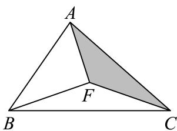
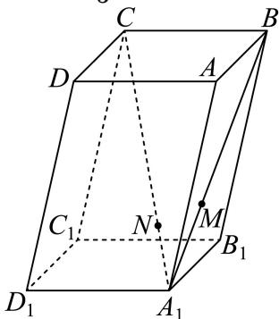
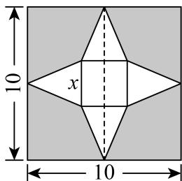
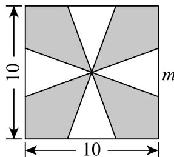
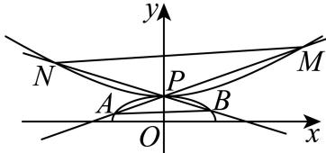

# 2025二模 奉贤区原卷 · 学生版

> 本地预览：题目、答案及分类尚未全部审定。校对使用的PDF为高中工作台解析版，尚未逐区确认区级印刷原卷。

## 填空题

按本区原卷题号顺序排列。

### 奉贤 · 第1题

等差数列首项为1，公差是3，则第5项等于

### 奉贤 · 第2题

已知 i 为虚数单位，复数 z 满足 zi−i = 1 ，则 |z| =

### 奉贤 · 第3题

假设生产某产品的一个部件来自三个供应商，供货占比分别是 ${ \frac { 1 } { 2 } } , \ { \frac { 1 } { 6 } } , \ { \frac { 1 } { 3 } }$ ，而它们的良品率分别是0.96、0.90、0.93，则该部件的总体良品率是

### 奉贤 · 第4题

在 $\left(\sqrt{x}-\dfrac{2}{x}\right)^9$ 的二项展开式中，常数项为________。（用数字作答）

> 本题资料或解析有待核事项，预览不可作为已审定成品。

### 奉贤 · 第5题

直线3x + 4y − 5 = 0上的动点P和直线 $3 x + 4 y + 1 0 = 0$ 上的动点Q，则点P与点Q之间距离的最小值是

### 奉贤 · 第6题

已知θ是斜率为−1的直线的倾斜角，计算 $\sin \left( \theta - { \frac { \pi } { 2 } } \right) =$

### 奉贤 · 第7题

已知 $\Delta A B C , ~  A , ~ B , ~ C \}$ 成等差数列且sinA、sinB、sinC成等比数列”是 $^ { * } \Delta A B C$ 是正三角形”的条件

### 奉贤 · 第8题

抛物线 $\dot { x } ^ { 2 } = 4 y$ 的准线与圆 $x ^ { 2 } + y ^ { 2 } = r ^ { 2 }$ 相切，将圆绕直径所在直线旋转一周形成一个几何体，则该几何体的表面积为

### 奉贤 · 第9题

通过随机抽样，获得某种商品消费者年需求量与该商品每千克价格之间的一组数据调查，如下表所示:

| 价格（百元） | $x_1$ | $x_2$ | $x_3$ | $x_4$ | $x_5$ | $x_6$ | $x_7$ | $x_8$ | $x_9$ | $x_{10}$ |
|---|---|---|---|---|---|---|---|---|---|---|
|  | 4 | 4 | 4.6 | 5 | 5.2 | 5.6 | 6 | 6.6 | 7 | 10 |
| 需求量（千克） | $y_1$ | $y_2$ | $y_3$ | $y_4$ | $y_5$ | $y_6$ | $y_7$ | $y_8$ | $y_9$ | $y_{10}$ |
|  | 3.5 | 3 | 2.7 | 2.4 | 2.5 | 2 | 1.5 | 1.2 | 1.2 | 1 |

那么线性相关系数 $r=\underline{\qquad}$（精确到0.001）。线性相关系数公式为

$$
r=\frac{\displaystyle\sum_{i=1}^{n}(x_i-\bar{x})(y_i-\bar{y})}{\sqrt{\displaystyle\sum_{i=1}^{n}(x_i-\bar{x})^2\cdot\sum_{i=1}^{n}(y_i-\bar{y})^2}}.
$$

### 奉贤 · 第10题

盒子中有大小与质地均相同的a个红球和b个白球，从中随机取1个球，观察其颜色后放回，并同时放入与其相同颜色的球c个（大小与质地均相同），再从中随机取1个球，计算此次取到白球的概率是

### 奉贤 · 第11题

中企联合大厦是奉贤区的第一高楼，是奉贤美奉贤强的一个缩影．某数学建模兴趣小组的同学们去实地进行测量，经过多次的测量，最终在平行于地面的同一水平面上选取三个点：点B、点C、点O作为测量基点．设大厦的最高点为A，在点B处测得点A的仰角为 $\angle A B O = \theta = 7 1 . 5 ^ { \circ }$ ，在点C处测得点A的仰角为 $\angle A C O = 4 4 ^ { \circ }$ ，又测得 $B C = 2 2 1$ 米， $\angle B O C = 1 1 9 ^ { \circ }$ ，（见图）．现作出以下几个假设：
①直线AO垂直于平面OBC；
②平面OBC到地面的距离等于测角仪高度，在计算过程中测角仪高度忽略不计；
③其它次要因素等忽略不计．根据以上信息估算奉贤第一高楼的高度约

### 奉贤 · 第12题

$\triangle ABC$ 内一点 $F$（见图1），式子 $FA+FC+FB$ 可以写成 $1\times FA+1\times FC+1\times FB$。这个式子中 $FA$、$FC$、$FB$ 的系数均为1，以三个系数1作为边长可构造一个等边三角形，因此我们尝试把 $\triangle AFC$ 绕点 $C$ 顺时针旋转 $\dfrac\pi3$，得到 $\triangle A'F'C$（见图2），所以 $FA+FC+FB$ 等于 $F'A'+F'F+FB$。显然 $F'A'+F'F+FB\geq A'B$，当 $A'$、$F'$、$F$、$B$ 四点共线时（见图3），$FA+FC+FB$ 最小。

| 图1 | 图2 | 图3 |
|:---:|:---:|:---:|
|  |  |  |

试用类似的方法解决下面这道题目：

已知 $\vec a$ 是平面内的任意一个向量，向量 $\vec b$、$\vec c$ 满足 $\vec b\cdot\vec c=0$，且 $|\vec b|=4$、$|\vec c|=4$，则 $\sqrt2|\vec a-\vec b|+|\vec a-\vec c|+|\vec a+\vec c|$ 的最小值为________。

> 本题资料或解析有待核事项，预览不可作为已审定成品。

## 选择题

按本区原卷题号顺序排列。

### 奉贤 · 第13题

下列有关排列组合数的计算公式，错误的是（ ）

A. $\mathrm { P } _ { n } ^ { m } + \mathrm { P } _ { n } ^ { m - 1 } = \mathrm { P } _ { n + 1 } ^ { m }$ （m，n是正整数，且 $m \leq n )$

B. $\mathbf { P } _ { n } ^ { m } = \mathbf { C } _ { n } ^ { m } \mathbf { P } _ { m } ^ { m } \mathbf { \Lambda } ( m$ ，n是正整数，且 $m \leq n )$

C. ${ \mathrm P } _ { n } ^ { m } = n { \mathrm P } _ { n - 1 } ^ { m - 1 } { \mathrm { ( } } m { \mathrm { . } }$ ，n是正整数，且 $. m \leq n )$

D. $\mathbf { C } _ { n } ^ { m } + \mathbf { C } _ { n } ^ { m - 1 } = \mathbf { C } _ { n + 1 } ^ { m } \mathbf { \Delta } \left( m \right.$ ，n是正整数，且 $. m \leq n )$

### 奉贤 · 第14题

如图，在平行六面体 $ABCD-A_1B_1C_1D_1$ 中，点 $N$ 在对角线 $A_1C$ 上，点 $M$ 在对角线 $A_1B$ 上，$\overrightarrow{A_1N}=\frac13\overrightarrow{NC}$，$\overrightarrow{A_1M}=\frac12\overrightarrow{MB}$，以下命题正确的是（　）。

A. $\overrightarrow{MN}\parallel\overrightarrow{BC}$

B. $D_1,N,M$ 三点共线

C. $D_1M$ 与 $A_1C$ 是异面直线

D. $\overrightarrow{D_1N}=\frac12\overrightarrow{NM}$

> 本题资料或解析有待核事项，预览不可作为已审定成品。

### 奉贤 · 第15题

函数y = f (x)的导函数为 $\boldsymbol { \mathscr { y } } = \boldsymbol { \mathscr { g } } \left( \boldsymbol { \mathscr { x } } \right)$ ，若存在实数x0，使得 $g \left( x _ { 0 } \right) f \left( - x _ { 0 } \right) = 1$ 成立，则称函数$y = f \left( x \right)$ 具有x 性质，下列函数 $y = f \left( x \right)$ 具有 $\scriptstyle { \dot { \boldsymbol { x } } } _ { 0 }$ 性质的函数是（ ）

A. $y = \mathbf { e } ^ { - x }$

B. $y = \sin x$

C. $y = \mathbf { e } ^ { x } + \mathbf { e } ^ { - x }$

D. $y = { \frac { 1 } { 2 } } \mathrm { l n } \left( x ^ { 2 } + 1 \right)$

### 奉贤 · 第16题

若5π是函数 $\stackrel { \prime } { y } = \cos n x \sin \frac { 2 0 0 0 } { n ^ { 2 } } x$ 的一个周期，则正整数n所有可能取值个数是（ ）

A. 2

B. 3

C. 4

D. 9

## 解答题

按本区原卷题号顺序排列。

### 奉贤 · 第17题

某疾病预防中心随机调查了339名50岁以上的公民，研究吸烟习惯与慢性气管炎患病 的关系，测得数据如表所示：

|  | 不吸烟 | 吸烟 | 总计 |
|---|---|---|---|
| 不患慢性气管炎者 | 121 | $b$ | 283 |
| 患慢性气管炎者 | $c$ | $d$ |  |
| 总计 | 134 |  | 339 |

(1) (6分)估算样本中吸烟者中患慢性支气管炎的百分比；
(2) (8分)有多少把握认为患慢性支气管炎与吸烟有关？
附： $\chi ^ { 2 } = \frac { n ( a d - b c ) ^ { 2 } } { ( a + b ) \left( c + d \right) ( a + c ) \left( b + d \right) }$ ，其中 $n = a + b + c + d P \left( \chi ^ { 2 } \geq 6 . 6 3 5 \right) \approx 0 . 0 1$ $P \left( \chi ^ { 2 } \geq 5 . 0 2 4 \right) \approx 0 . 0 2 5 , P \left( \chi ^ { 2 } \geq 3 . 8 4 1 \right) \approx 0 . 0 5 , P \left( \chi ^ { 2 } \geq 2 . 7 0 6 \right) \approx 0 . 1 .$

> 本题资料或解析有待核事项，预览不可作为已审定成品。

### 奉贤 · 第18题

函数 $y = f \left( x \right)$ ，其中 $\mathfrak { 1 } f \left( x \right) = \mathbf { e } ^ { - \frac { \left( x - \mu \right) ^ { 2 } } { 2 } }$
(1) (6分)若函数 $\boldsymbol { \cdot } \boldsymbol { y } = \boldsymbol { f } \left( \boldsymbol { x } \right)$ 是偶函数，当 $f \left( t \right) = \frac { 1 } { \sqrt { \mathrm { e } } }$ 时，求t的值；
(2) (8分)求函数 $\boldsymbol { \{ y = f \left( x \right) } $ 的值域并证明对任意的正实数k和实数x，不等式 $\mathfrak { z } + \frac { 1 } { k } \geq 2 f \left( x \right)$ 恒成立

> 本题资料或解析有待核事项，预览不可作为已审定成品。

### 奉贤 · 第19题

将一块边长为10cm的正方形铁片制作一个正四棱锥的容器罩．同学们设计了甲、乙、丙三个不同的方案，各自裁下阴影部分，用余下的制作成正四棱锥容器罩，形如最右边的图．甲和丙是去制作有盖的容器罩，乙是去制作无盖的容器罩．假设加工过程中铁片损失忽略不计．设甲、乙、丙中白色的四个等腰三角形的底边分别是x、m、n

甲

乙

丙

(1) (10分)请你选择其中的某一个方案，而且只需选一个方案（选择超过一个方案的，按第一个方案处理）．你选择的方案是______，求解以下2个问题：
①求出所选方案相对应的棱锥的侧面积 $S \left( x \right) , S \left( m \right) , S \left( n \right)$ ；
②求出所选方案相对应棱锥的体积V(x)、 $V \left( m \right) , \ V \left( n \right)$ 的最大值
(2) (4分)假设三个方案中相应的体积最大值分别记作 $V ( x ) _ { \mathrm { m a x } } \ { \cal V } ( m ) _ { \mathrm { m a x } } \ { \cal V } ( n ) _ { \mathrm { m a x } }$ ，请直接写出三者的大小关系．（不写判断理由与过程）

> 本题资料或解析有待核事项，预览不可作为已审定成品。

### 奉贤 · 第20题

如图1，曲线 $\Gamma$ 是 $\dfrac{x^2}{4}+\dfrac{y^2}{b^2}=1\ (y\ge0)$ 与 $\dfrac{y^2}{b^2}-\dfrac{x^2}{4}=1\ (y\ge0)$ 组合的。

| 图1 | 图2 |
|:---:|:---:|
|  |  |

(1)（4分）$\dfrac{x^2}{4}+\dfrac{y^2}{b^2}=1\ (y\ge0)$ 过点 $\left(-1,\dfrac32\right)$，求 $\dfrac{y^2}{b^2}-\dfrac{x^2}{4}=1\ (y\ge0)$ 的渐近线方程；

(2)（6分）$b=\sqrt2$，设 $T(0,t)$，$t\in\left[-\dfrac{\sqrt2}{2},3\sqrt2\right]$，曲线 $\Gamma$ 上找一个点 $Q$，使得 $|\overrightarrow{TQ}|$ 达到最小；

(3)（8分）若 $b=1$，如图2，存在过点 $P(0,1)$ 的两条直线 $l_1$、$l_2$ 与曲线 $\Gamma$ 的交点分别是点 $A$、点 $M$、点 $B$、点 $N$，点 $A$ 在第二象限，点 $M$ 在第一象限。是否存在非零实数 $\lambda$ 使得 $\overrightarrow{MN}=\lambda\overrightarrow{AB}$ 成立，请说明理由。

> 本题资料或解析有待核事项，预览不可作为已审定成品。

### 奉贤 · 第21题

函数 $y = f \left( x \right)$ ，其中 $f \left( x \right) = x ^ { 3 } - x ^ { 2 } + { \frac { 1 } { 2 } } x + { \frac { 1 } { 4 } }$ ，定义域是一切实数
(1) (4分)计算 $\mathrm { { . l i m } } _ { h  0 } \frac { f ( 2 + h ) - f ( 2 ) } { h }$ 的值并指出其几何意义；
(2) (6分)当 $\left| x \in \left( 0 , { \frac { 1 } { 2 } } \right) \right.$ 时，方程 $f \left( x \right) = a + x$ 只有一个解，求实数a的取值范围；
(3) (8分)设 $x _ { 1 } = 0 , x _ { n + 1 } = f ( x _ { n } ) , y _ { 1 } = { \frac { 1 } { 2 } } , y _ { n + 1 } = f ( y _ { n } ) , n \geq 1 , n \in \mathrm { N } , b _ { n } = y _ { n } - x _ { n }$ ．求证： $\sum _ { i = 1 } ^ { n } b _ { n } \in ( 0 , 1 )$

> 本题资料或解析有待核事项，预览不可作为已审定成品。

