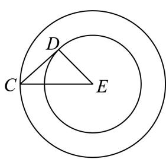
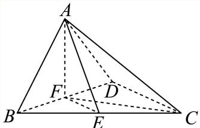
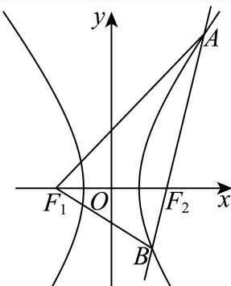
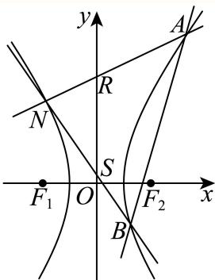

# 2025二模 宝山区原卷 · 教师版

> 本地预览：题目、答案及分类尚未全部审定。校对使用的PDF为高中工作台解析版，尚未逐区确认区级印刷原卷。

## 填空题

按本区原卷题号顺序排列。

### 宝山 · 第1题

i是虚数单位，则|1 + i| =

**考点：** 复数模公式

**难度依据：** 复数的模；直接运用定义或基础公式，推理链短

**核查说明：** 已人工阅读完整底稿题干及原解，未逐页对照正式PDF，分类不等于数学终审。

【解析】

$| 1 + i | = { \sqrt { 1 ^ { 2 } + 1 ^ { 2 } } } = { \sqrt { 2 } }$ ，故答案为 ${ \sqrt { 2 } } .$

### 宝山 · 第2题

已知集合 $A = \{ 1 , 2 \} , B = \{ 2 , 4 \}$ ，则A ∪ B =

**考点：** 集合并集

**难度依据：** 有限集合并集；直接运用定义或基础公式，推理链短

**核查说明：** 已人工阅读完整底稿题干及原解，未逐页对照正式PDF，分类不等于数学终审。

【解析】

由并集的定义求解.

集合A = {1, 2}, B = {2, 4}，则A ∪ B = {1, 2, 4}.

### 宝山 · 第3题

抛物线x2 = 4y的准线方程是

**考点：** 抛物线标准方程与准线

**难度依据：** 抛物线准线；直接运用定义或基础公式，推理链短

**核查说明：** 已人工阅读完整底稿题干及原解，未逐页对照正式PDF，分类不等于数学终审。

【解析】

先根据抛物线的标准方程得到焦点在y轴上以及2p = 4，再直接代入即可求出其准线方程.因为抛物线的标准方程为 $\scriptstyle { | x ^ { 2 } = 4 y }$ ，焦点在y轴上，

所以：2p = 4，即p = 2，所以 ${ \frac { p } { 2 } } = 1$

所以准线方程为：y = −1，

故答案是：y = −1.

该题考查的是有关抛物线的几何性质，涉及到的知识点是已知抛物线的标准方程求其准线方程，属于简单题目.

### 宝山 · 第4题

已知函数 $: f \left( x \right) = \left\{ \begin{array} { l l } { x ^ { 2 } + 2 \ , \ x < 1 , } \\ { f \left( x - 2 \right) \ , \ x \ge 1 } \end{array} \right.$ 则f (4)=

**考点：** 递归函数代入求值

**难度依据：** 递归分段函数求值；直接运用定义或基础公式，推理链短

**核查说明：** 已人工阅读完整底稿题干及原解，未逐页对照正式PDF，分类不等于数学终审。

【答案】2.

【解析】

由分段函数的解析式，代入已知值，可得答案.

由题意可得 $f \left( 4 \right) = f \left( 2 \right) = f \left( 0 \right) = 0 ^ { 2 } + 2 = 2$

故答案为：2.

### 宝山 · 第5题

若函数 $\mathbf { \dot { \mathcal { f } } } ( x ) = ( m - 1 ) x ^ { 2 } + 3 x + ( 2 - n )$ 是奇函数，则m+n=

**考点：** 奇函数偶次项系数为零

**难度依据：** 多项式奇偶性；直接运用定义或基础公式，推理链短

**核查说明：** 已人工阅读完整底稿题干及原解，未逐页对照正式PDF，分类不等于数学终审。

【答案】3

【解析】

由函数 $f ( x ) = ( m - 1 ) x ^ { 2 } + 3 x + ( 2 - n )$ 是奇函数可知其偶次项系数为0,计算求解即可.因为函数 $f ( x ) = ( m - 1 ) x ^ { 2 } + 3 x + ( 2 - n )$ 是奇函数且为多项式的形式,故偶次项系数均为0,即$m - 1 = 0 , 2 - n = 0$ ,即m = 1,n = 2故m + n = 3

故答案为3

形如多项式的函数f(x),若f(x)为偶函数,则其中所有奇次项系数为0,若f(x)为奇函数,则其中所有偶次项系数为0.属于基础题型.

### 宝山 · 第6题

$\left( x + { \frac { 2 } { x } } \right) ^ { \mathsf { f } }$ 6 的二项展开式中， $x ^ { 2 }$ 项的系数为

> 本题资料或解析有待核事项，预览不可作为已审定成品。

**考点：** 二项式通项求指定系数

**难度依据：** 指定项系数；需一次转化并结合定义域或几何条件计算

**核查说明：** 题干指数6上标破损，需回核并修复。；已人工阅读完整底稿题干及原解，未逐页对照正式PDF，分类不等于数学终审。

【答案】60

【解析】

写出二项展开式通项公式，由x的指数为2求得项数，从而得到系数

由题意得二项式的展开式的通项公式为 $\vert T _ { K + 1 } = { \bf C } _ { 6 } ^ { k } \cdot x ^ { 6 - k } \cdot \left( \frac { 2 } { x } \right) ^ { k } = { \bf C } _ { 6 } ^ { k } \cdot 2 ^ { k } x ^ { 6 - 2 k } ,$ 令6−2k = 2，得k = 2，所以x2项的系数为 $\mathbf { C } _ { 6 } ^ { 2 } \cdot 2 ^ { 2 } = 6 0$

故答案为：60

### 宝山 · 第7题

已知函数 $\mathbf { \xi } : y = a ^ { x + 1 } - \log _ { a } { ( x + 2 ) } + 1 ( a > 0$ 且 $. a \neq 1 )$ )的图像经过定点A，则点A的坐标为

> 本题资料或解析有待核事项，预览不可作为已审定成品。

**考点：** 指数对数定点

**难度依据：** 指数对数混合函数定点；需一次转化并结合定义域或几何条件计算

**核查说明：** 解析将-log_a(1)+1排为-log_a(1+1)，括号位置错误，答案定点不据此改动。；已人工阅读完整底稿题干及原解，未逐页对照正式PDF，分类不等于数学终审。

【答案】(−1, 2).

【解析】

根据指数函数和对数函数的图象与性质求解即可

$\widehat { \vec { \bf { v } } } x = - 1$ ，可得 $y = a ^ { - 1 + 1 } - \log _ { a } { ( - 1 + 2 ) } + 1 = a ^ { 0 } - \log _ { a } { 1 + 1 } = 2 .$

所以定点A的坐标为(−1,2).

故答案为：(−1, 2).

### 宝山 · 第8题

已知圆柱的底面积为9π，侧面积为18π，则该圆柱的体积为

**考点：** 圆柱底面积侧面积反求体积

**难度依据：** 圆柱表面积与体积；直接运用定义或基础公式，推理链短

**核查说明：** 已人工阅读完整底稿题干及原解，未逐页对照正式PDF，分类不等于数学终审。

【答案】27π.

【解析】

根据圆柱的底面积和侧面积公式求出圆柱的底面圆半径和高，再根据圆柱的体积公式即可得解.

设圆柱的底面圆的半径为r，高为h，

由题意可得 $\left\{ \begin{array} { l } { { \pi r ^ { 2 } = 9 \pi } } \\ { { 2 \pi r h = 1 8 \pi } } \end{array} \right.$ 解得 ${ \left\{ \begin{array} { l l } { r = 3 } \\ { h = 3 } \end{array} \right. }$

所以圆柱的体积 $V = \pi r ^ { 2 } h = 2 7 \pi$

故答案为：27π.

### 宝山 · 第9题

已知 $\triangle A B C$ 中， $A B = A C = 4 , \angle B A C = \frac { 2 } { 3 } \pi$ ，点D在线段BC上，且 $S _ { \triangle A C D } = 2 S _ { \triangle A B D }$ ，则$\overrightarrow { A B } \cdot \overrightarrow { A D }$ 的值为

**考点：** 面积比确定分点及数量积

**难度依据：** 分点向量与数量积；需一次转化并结合定义域或几何条件计算

**核查说明：** 已人工阅读完整底稿题干及原解，未逐页对照正式PDF，分类不等于数学终审。

【答案】8.

【解析】

根据 $S _ { \triangle A C D } = 2 S _ { \triangle A B D }$ 确定 $C D = 2 B D$ ，从而可得 $\overrightarrow { A D } = \frac { 2 } { 3 } \overrightarrow { A B } + \frac { 1 } { 3 } \overrightarrow { A C }$ ，从而用向量数量积的运算律即可求解.

设等腰 $\triangle A B C$ 在BC边上的高为h，

因为 $S _ { \triangle A C D } = 2 S _ { \triangle A B D }$ ，所以 $\frac { 1 } { 2 } \times C D \times h = 2 \times \frac { 1 } { 2 } \times B D \times h$

所以 $C D = 2 B D$

$$
\overrightarrow {A D} = \overrightarrow {A B} + \overrightarrow {B D} = \overrightarrow {A B} + \frac {1}{3} \overrightarrow {B C} = \overrightarrow {A B} + \frac {1}{3} \left(\overrightarrow {A C} - \overrightarrow {A B}\right) = \frac {2}{3} \overrightarrow {A B} + \frac {1}{3} \overrightarrow {A C},
$$

$$
\overrightarrow {A B} \cdot \overrightarrow {A D} = \overrightarrow {A B} \cdot \left(\frac {2}{3} \overrightarrow {A B} + \frac {1}{3} \overrightarrow {A C}\right) = \frac {2}{3} \overrightarrow {A B} ^ {2} + \frac {1}{3} \overrightarrow {A B} \cdot \overrightarrow {A C}
$$

$$
= \frac {2}{3} \left| \overrightarrow {A B} \right| ^ {2} + \frac {1}{3} \left| \overrightarrow {A B} \right| \cdot \left| \overrightarrow {A C} \right| \cos \angle B A C
$$

$$
= \frac {2}{3} \times 4 ^ {2} + \frac {1}{3} \times 4 \times 4 \times \left(- \frac {1}{2}\right) = 8.
$$

故答案为：8.

### 宝山 · 第10题

有3件商品的编号分别为 $i ( i = 1 , 2 , 3 )$ ，它们的售价（元） $S \left( i \right) \in \left\{ 5 , 7 , 8 , 1 0 , 1 1 , 2 0 \right\}$ ，且满足$S \left( 1 \right) \leq S \left( 2 \right) \leq S \left( 3 \right)$ ，则这3件商品售价的所有可能情况有 种.

**考点：** 分类重复组合计数

**难度依据：** 允许重复的无序选择；需连接多个条件或多步模型转化

**核查说明：** 已人工阅读完整底稿题干及原解，未逐页对照正式PDF，分类不等于数学终审。

【答案】56.

【解析】

利用组合数中允许重复的原则，分四类讨论，再由加法原理和组合数计算即可.

分四类讨论：

①当S (1) = S (2) = S (3)时，有6种情况；

②当S (1) = S (2) < S (3)时，

若S (1) = S (2) = 5，S (3)有5种选法；

若S (1) = S (2) = 7，S (3)有4种选法；

若S (1) = S (2) = 8，S (3)有3种选法；

若S (1) = S (2) = 10，S (3)有2种选法；

若S (1) = S (2) = 11，S (3)有1种选法；

由加法原理可得共有15种；

③当S (1) < S (2) = S (3)时，

若S (1) = 5，选择S (2) = S (3)有5种选法；

若S (1) = 7，选择S (2) = S (3)有4种选法；

若S (1) = 8，选择S (2) = S (3)有3种选法；

若S (1) = 10，选择S (2) = S (3)有2种选法；

若S (1) = 11，选择S (2) = S (3)有1种选法；

由加法原理可得共有15种；

④当 $S \left( 1 \right) < S \left( 2 \right) < S \left( 3 \right)$ 时，有C3 = 20种，

综上，共有6 + 15 + 15 + 20 = 56种.

故答案为：56.

### 宝山 · 第11题

某分公司经销一产品，每件产品的成本为5元，且每件产品需向总公司交2元的管理费，预计每件产品的售价为x元 $( 8 \leq x \leq 1 1 )$ 时，一年的销售量为（12−x）2万件，则每件产品售价为 元时，该分公司一年的利润达到最大值.（结果精确到1元）

> 本题资料或解析有待核事项，预览不可作为已审定成品。

**考点：** 利润建模及闭区间最值

**难度依据：** 利润模型导数最值；需连接多个条件或多步模型转化

**核查说明：** 销售量平方上标脱落；按实数售价最优26/3后按要求取整，须避免把整数决策与四舍五入混淆。；已人工阅读完整底稿题干及原解，未逐页对照正式PDF，分类不等于数学终审。

【解析】

根据条件确定函数关系式，由函数的最值与函数的导数的关系，求出该函数的最大值即可.

分公司一年的利润y(万元)与售价x的函数关系式为

y = (x − 5 − 2)(12 − x)2 = (x − 7)(12 − x)2, x ∈ [8, 11]，

所以y′ = (12 − x)2 − 2(x − 7)(12 − x) = (12 − x)(26 − 3x)，

令 $y ^ { \prime } = 0 ,$ ，即 $( 1 2 - x ) ( 2 6 - 3 x ) = 0$ ，解得 $x = { \frac { 2 6 } { 3 } }$ 或x = 12（舍），

当 $x \in \left\lceil 8 , { \frac { 2 6 } { 3 } } \right\rceil$ 时， $y ^ { \prime } > 0$ ，此时 $\mathbf { \hat { y } } = ( x - 5 - 2 ) ( 1 2 - x ) ^ { 2 }$ 在 $\left\lceil 8 , { \frac { 2 6 } { 3 } } \right\rceil$ 上单调递增，

当 $x \in \left( { \frac { 2 6 } { 3 } } , 1 1 \right]$ 时， $y ^ { \prime } < 0$ ，此时 $y = ( x - 5 - 2 ) ( 1 2 - x ) ^ { 2 } \overleftarrow { \mathbb { \chi } } \left( \frac { 2 6 } { 3 } , 1 1 \right]$ ]单调递减，

又因为结果精确到1元，且当x = 8时， $y = 1 6 ,$ ，且当x = 9时， $y = 1 8$

于是：当每件产品的售价为9元时，该分公司一年的利润最大.

### 宝山 · 第12题

空间中有相互垂直的两条异面直线 $l _ { 1 } , \ l _ { 2 }$ ，点A、 $B \in l _ { 1 } , C , \ D \in l _ { 2 }$ ，且 $A B = 4 , C D = 1$ ，若 $D A \bot D B$ ，且 $A C = B C + 2$ ，则二面角 $D - A B - C$ 平面角的余弦值最小为

> 本题资料或解析有待核事项，预览不可作为已审定成品。

**考点：** 双曲线与球面约束下二面角最值

**难度依据：** 异面直线与二面角最值；需参数分类、构造递推或综合最值分析

**核查说明：** 双曲面、球面与三角形可行参数范围论证较简，需回核原图并检验最值可取。；已人工阅读完整底稿题干及原解，未逐页对照正式PDF，分类不等于数学终审。

【答案】$\frac { 4 { \sqrt { 3 } } } { 9 }$

【解析】

先确定点C、D的轨迹及相关线段长度表达式，再利用余弦定理得 $\cos \angle C E D$ 的表达式，最后通过换元求最值.

根据双曲线的定义，平面内到两个定点A、B（焦点）的距离之差的绝对值为定值（小于|AB）的点的轨迹为双曲线.由 $A C = B C + 2$ ，可知 $A C - B C | = 2$

所以点C在以A、B为焦点的双曲线上.在空间中，是此双曲线绕AB旋转得到的曲面.

因为 $D A \bot D B$ ，根据直径所对的圆周角是直角，所以点D同时在以AB为直径的球面上.

由 $\mathbb { F } l _ { 1 } \bot l _ { 2 }$ ，所以C、D在与AB垂直的面上.

不妨令C固定在一支双曲线上，设双曲线方程为 $y ^ { 2 } - { \frac { x ^ { 2 } } { 3 } } = 1$

过C作CE⊥AB于E，在双曲线 $y ^ { 2 } - { \frac { x ^ { 2 } } { 3 } } = \pmb { \cdot }$ 1中，变形可得 $x ^ { 2 } = 3 ( y ^ { 2 } - 1 )$

在Rt △ CEB（因为 $\scriptstyle { \mathrm { C E \bot A B } } )$ 中，CE的长度可根据坐标关系得到， $C E = \sqrt { 3 y ^ { 2 } - 3 }$

因为D在过C与AB垂直的面与球的交线上，设球心为O（AB中点），

由 $D E ^ { 2 } + O E ^ { 2 } = 4$ （球的半径的平方为4，根据勾股定理得到此关系），OE的长度与y有关（E点坐标与C点纵坐标y有关），且OE在y轴上的投影长度就是y，所以 $D E = { \sqrt { 4 - y ^ { 2 } } }$

在 $\triangle C E D \sharp$ ，根据余弦定理 $\cos \angle C E D = { \frac { C E ^ { 2 } + D E ^ { 2 } - C D ^ { 2 } } { 2 \cdot C E \cdot D E } }$ ，

通过 $C E ^ { 2 } = 3 y ^ { 2 } - 3 , ~ D E ^ { 2 } = 4 - y ^ { 2 }$ 代入余弦定理公式化简得到,

$$
\cos \angle C E D = \frac {3 y ^ {2} - 3 + 4 - y ^ {2} - 1}{2 \sqrt {(3 y ^ {2} - 3) (4 - y ^ {2})}} = \frac {\sqrt {3}}{3} \cdot \sqrt {\frac {y ^ {4}}{- y ^ {4} + 5 y ^ {2} - 4}} = \frac {\sqrt {3}}{3} \cdot \sqrt {\frac {1}{- 1 - \frac {4}{y ^ {4}} + \frac {5}{y ^ {2}}}}.
$$

令 $\mathbf { \nabla } \cdot t = \frac { 1 } { y ^ { 2 } } ( t > 0 )$ ，则 $\cos \angle C E D = { \frac { \sqrt { 3 } } { 3 } } \cdot { \sqrt { \frac { 1 } { - 4 t ^ { 2 } + 5 t - 1 } } }$ 对于二次函数 $f ( t ) = - 4 t ^ { 2 } + 5 t - 1$ ，其对称轴为 $t = - { \frac { 5 } { 2 \times ( - 4 ) } } = { \frac { 5 } { 8 } }$ 当 $t = \frac { 5 } { 8 }$ 时，f(t)取得最大值 $f \left( { \frac { 5 } { 8 } } \right) = - 4 \times \left( { \frac { 5 } { 8 } } \right) ^ { 2 } + 5 \times { \frac { 5 } { 8 } } - 1 = { \frac { 9 } { 1 6 } }$

$$
\cos \angle C E D = \frac {\sqrt {3}}{3} \cdot \sqrt {\frac {1}{- 4 t ^ {2} + 5 t - 1}} \geq \frac {\sqrt {3}}{3} \cdot \sqrt {\frac {1}{\frac {9}{1 6}}} = \frac {4 \sqrt {3}}{9}.
$$

故答案为： $\frac { 4 { \sqrt { 3 } } } { 9 }$

## 选择题

按本区原卷题号顺序排列。

### 宝山 · 第13题

已知向量 $\overrightarrow { a } = ( 1 , x ) , \overrightarrow { b } = ( 3 , 1 )$ ，若 $\overrightarrow { \vert a \vert } / \overrightarrow { \vert b }$ ，则x的值为（ ）

A. −3

B. 3

C. $- { \frac { 1 } { 3 } }$

D. $\frac 1 3$

> 本题资料或解析有待核事项，预览不可作为已审定成品。

**考点：** 共线行列式为零

**难度依据：** 平面向量共线坐标条件；直接运用定义或基础公式，推理链短

**核查说明：** 题干向量平行符号严重破损，应核清原条件。；已人工阅读完整底稿题干及原解，未逐页对照正式PDF，分类不等于数学终审。

【答案】D

【解析】

由共线向量的坐标表示，建立方程，可得答案.由题意可得 $1 \times 1 - 3 x = 0$ ，解得 $x = \frac { 1 } { 3 }$ 故选：D.

## 二、选择题

### 宝山 · 第14题

“$a>b$”的一个必要非充分条件是（　）。

A. $\ln(a-b)>0$

B. $2^a>2^b$

C. $(\frac12)^{a-b}\le1$

D. $a^3>b^3$

**考点：** 不等式及函数单调性判断条件关系

**难度依据：** 必要非充分条件；需一次转化并结合定义域或几何条件计算

**核查说明：** 已人工阅读完整底稿题干及原解，未逐页对照正式PDF，分类不等于数学终审。

【答案】C

选项A错误，
对于选项B，由 $2 ^ { a } > 2 ^ { b }$ ，得到 $a > b ,$ ，所以 $2 ^ { a } > 2 ^ { b }$ 可得 $a > b ,$ ，故选项B错误，
对于选项C，由 $\left( { \frac { 1 } { 2 } } \right) ^ { a - b } \leq 1$ ，得到 $\left| a - b \geq 0 \right.$ ，即 $\iota \geq b$ ，所以 $\left( { \frac { 1 } { 2 } } \right) ^ { a - b }$ ≤ 1推不出 ${ \mathfrak { a } } > b ,$
但a > b可以得出 $\left( { \frac { 1 } { 2 } } \right) ^ { a - b } \leq 1$ ，故选项C正确，
对于选项D，由 $a ^ { 3 } > b ^ { 3 }$ ，得到
$$
a ^ {3} - b ^ {3} = (a - b) \left(a ^ {2} + a b + b ^ {2}\right) = (a - b) \left[ \left(a + \frac {1}{2} b\right) ^ {2} + \frac {3}{4} b ^ {2} \right] > 0,
$$
$\left( a + { \frac { 1 } { 2 } } b \right) ^ { 2 } + { \frac { 3 } { 4 } } b ^ { 2 } \geq 0 .$ 当且仅当 $a = b = 0$ 时取等号，显然 $\dot { \boldsymbol { a } } = \boldsymbol { b } = 0$ 不满足题意，$a - b > 0$ ，即 $\vert a > b$
故选：C.
又当 $a > b ,$ ，有 $a ^ { 3 } > b ^ { 3 }$ ，所以 $\mathbf { \Omega } _ { \cdot } a ^ { 3 } > b ^ { 3 }$ 是 $a > l$ b的充要条件，故选项D错误，

### 宝山 · 第15题

甲、乙两名篮球运动员在8场比赛中的单场得分用茎叶图表示如左下图，茎叶图中甲的得分有部分数据丢失，但甲得分的折线图完好（右下图），则下列结论正确的是（ ）

A. 甲得分的极差小于乙得分的极差

B. 甲得分的第25百分位数大于乙得分的第75百分位数

C. 甲得分的平均数大于乙得分的平均数

D. 甲得分的方差小于乙得分的方差

**考点：** 极差、百分位数、均值与方差

**难度依据：** 茎叶图折线图及统计量比较；需连接多个条件或多步模型转化

**核查说明：** 已人工阅读完整底稿题干及原解，未逐页对照正式PDF，分类不等于数学终审。

【答案】C

【解析】

利用极差、百分位数和平均数的计算公式可以判断A、B、C三个选项，对于D选项，利用数据的分散程度判断方差的大小即可.

对于A选项，甲得分的极差为： $2 8 - 9 = 1 9$ ，乙得分的极差为： $2 0 - 9 = 1 1$

因为 $1 9 > 1 1$ ，所以甲得分的极差大于乙得分的极差，故A错误；

对于B选项，因为 $8 \times 2 5 \% = 2$ ，所以甲得分的第25百分位数为 ${ \frac { 1 2 + 1 3 } { 2 } } = { \frac { 2 5 } { 2 } }$

又 $8 \times 7 5 \% = 6$ ，所以乙得分的第75百分位数为 ${ \frac { 1 8 + 1 9 } { 2 } } = { \frac { 3 7 } { 2 } }$

因为 $\frac { 2 5 } { 2 } < \frac { 3 7 } { 2 }$ 所以甲得分的第25百分位数小于乙得分的第75百分位数，故B错误；

对于C选项，由折线图可知，在茎叶图中甲的得分中丢失的数据一个为15，另一个设为m，其中 $1 0 < m < 1 5$

所以甲的平均数为 ${ \frac { 9 + 1 2 + 1 3 + 1 5 + 2 0 + 2 6 + 2 8 + m } { 8 } } = { \frac { 1 2 3 + m } { 8 } }$ ，

乙的平均数为 $\frac { 9 + 1 4 + 1 5 + 1 6 + 1 7 + 1 8 + 1 9 + 2 0 } { 8 } = \frac { 1 2 8 } { 8 } = 1 6 ,$

因为 $1 0 < m < 1 5$ ，所以 $\frac { 1 3 3 } { 8 } < \frac { 1 2 3 + m } { 8 } < \frac { 1 3 8 } { 8 }$ ，所 $\therefore \frac { 1 2 3 + m } { 8 } > \frac { 1 2 8 } { 8 } = 1 6 ,$

所以甲得分的平均数大于乙得分的平均数，故C正确；

对于D选项，方差是刻画数据离散程度或波动幅度的指标.

从茎叶图中可以看到，甲的得分分布比乙的得分分布分散，

所以甲得分的方差大于乙得分的方差，故D错误.

故选：C

### 宝山 · 第16题

若对任意正整数n，数列 $\left\{ a _ { n } \right\}$ 的前n项和 $S _ { n }$ 都是完全平方数，则称数列 $\left\{ a _ { n } \right\}$ 为“完全平方数列”.有如下两个命题：①若数列 $\left\{ b _ { n } \right\}$ 的前n项和 $T _ { n } = \left( n - t \right) ^ { 2 }$ ，（ 为正整数），则使得数列 $\{ | b _ { n } | \}$ 为“完全平方数列”的t值有且仅有一个；②存在无穷多个“完全平方数列”的等差数列. 则下列选项中正确的是
（ ）

A. ①是真命题， ②是真命题；

B. ①是真命题， ②是假命题；

C. ①是假命题， ②是真命题；

D. ①是假命题， ②是假命题.

> 本题资料或解析有待核事项，预览不可作为已审定成品。

**考点：** 平方和约束、绝对值项及构造

**难度依据：** 完全平方数列；需参数分类、构造递推或综合最值分析

**核查说明：** 源解|b_n|分段式漏绝对值；关于公差的必要性论证含缺项和跳步。证明存在无穷构造可直接验证，但原解不能视为已数学审定。；已人工阅读完整底稿题干及原解，未逐页对照正式PDF，分类不等于数学终审。

【答案】A

【解析】

对于①，根据数列 $\{ b _ { n } \}$ 的前n项和得到 $| b _ { n } | = { \left\{ \begin{array} { l l } { \left( 1 - t \right) ^ { 2 } , n = 1 } \\ { 2 n - 2 t - 1 , n \geq 2 ^ { \prime } } \end{array} \right. }$ 对t = 1， $n \geq 2$ 和t ≥ 2两种情况分类讨论求解可判断；对于②设等差数列的首项为 $\mathbf { \dot { a } } _ { 1 }$ ，公差为d，对d分类讨论求解判断

对于①，数列 $\left\{ b _ { n } \right\}$ 的前n项和 $T _ { n } = \left( n - t \right) ^ { 2 }$ （t为正整数），

当 $n \geq$ 2时， $b _ { n } = T _ { n } - T _ { n - 1 } = \left( n - t \right) ^ { 2 } - \left( n - 1 - t \right) ^ { 2 } = 2 n - 2 t - 1$ ，

当n = 1时， $b _ { 1 } = T _ { 1 } = \left( 1 - t \right) ^ { 2 }$ 不满足上式，所以 $| b _ { n } | = { \left\{ \begin{array} { l l } { ( 1 - t ) ^ { 2 } , n = 1 } \\ { 2 n - 2 t - 1 , n \geq 2 ^ { \prime } } \end{array} \right. }$

当t = 1， $n \geq$ 2时， $2 n - 2 t - 1 = 2 n - 3 > 0 ,$

所以数列 $\{ | b _ { n } | \}$ 与原数列相同，所以 $T _ { n } = ( n - 1 ) ^ { 2 }$ ，

所以当t = 1时，数列 $\{ | b _ { n } | \}$ 为完全平方数列，

当t ≥ 2时， $\left| b _ { 1 } \right| + \left| b _ { 2 } \right| = ( t - 1 ) ^ { 2 } + \left| 3 - 2 t \right| = t ^ { 2 } - 2 t + 1 + 2 t - 3 = t ^ { 2 }$ −2不是“完全平方数，所以当t ≥ 2时，数列 $\{ | b _ { n } | \}$ 不是完全平方数列，

综上所述：数列 $\{ | b _ { n } | \}$ 为“完全平方数列”，故①是真命题；

对于②，因为 $S _ { n }$ 为完全平方数，故 $\tau d \geq 0 , a _ { 1 } \geq 0 , d , a _ { 1 } \in \mathrm { N }$

若 $\dot { \boldsymbol { d } } = 0$ ，则 $S _ { n } = n a _ { 1 }$ ，若对任意的 $| n \in \mathrm { N } ^ { * } , n a _ { 1 }$ 均为完全平方数，

则 $| a _ { 1 } = 0$ ，否则假设p为a 的素因数，且pa恰好整除a ，a为正整数，

若a为奇数，则 $| a _ { 1 }$ 不是完全平方数，矛盾，

若a为偶数，取 $n = p ^ { a + 1 }$ ，则 $n a _ { 1 }$ 不是完全平方数，矛盾，

若 $d > 1$ ， 则 $S _ { n } = { \frac { n \left( a _ { 1 } + a _ { n } \right) } { 2 } } = { \frac { n \left( 2 a _ { 1 } - d + n d \right) } { 2 } }$

若 $2 a _ { 1 } - d \neq 0$ ，取 $\begin{array} { r } { n = | 2 a _ { 1 } - d | } \end{array}$ ，则 $S _ { n } = { \overline { { \left| 2 a _ { 1 } - d \right| ^ { 2 } \left( d + 1 \right) } } }$ 或 $S _ { n } = { \frac { \left| 2 a _ { 1 } - d \right| ^ { 2 } \left( d - 1 \right) } { 2 } }$

当d为偶数时，此时 $\frac { \left| 2 a _ { 1 } - d \right| ^ { 2 } \left( d + 1 \right) } { 2 }$ $\frac{|2a_1-d|^2(d-1)}{2}$ 均不是完全平方数，

当d为奇数时，取 $n = 4 , S _ { n } = 2 ( 2 a _ { 1 } + 3 d ) , 2 a _ { 1 } + 3 d$ 为奇数，

故此时 $S _ { n }$ 不是完全平方数，

故 $2 a _ { 1 } - d = 0$ ，即 $2 a _ { 1 } = d ,$ ，故 $S _ { n } = a _ { 1 } n ^ { 2 }$ ，设 $\mathrm { \dot { \varepsilon } } a _ { 1 } = k ^ { 2 }$ ，故 $S _ { n } = k ^ { 2 } n ^ { 2 }$

当 $n \geq$ 2时， $a _ { n } = S _ { n } - S _ { n - 1 } = k ^ { 2 } n ^ { 2 } - k ^ { 2 } ( n - 1 ) ^ { 2 } = k ^ { 2 } ( 2 n - 1 )$

又 $\textstyle . a _ { 1 } = k ^ { 2 }$ 适合上式，即 $\mathfrak { I } a _ { n } = k ^ { 2 } ( 2 n - 1 ) , k \in \mathtt { Z }$

故存在无穷多个“完全平方数列”的等差数列，故②是真命题.

故选：A.

## 三、解答题

## 解答题

按本区原卷题号顺序排列。

### 宝山 · 第17题

如图，在四面体 $A B C D$ 中， $\triangle B C D$ 是边长为2的正三角形，且 $A B = A D = { \sqrt { 2 } } .$

(1) (6分)证明： $B D \bot A C ;$
(2) (8分)若E是BC的中点，且二面角 $A - B D - ($ C的大小为 $\frac { \pi } { 2 }$ ，求AE与平面BCD所成角的大小.

> 本题资料或解析有待核事项，预览不可作为已审定成品。

**考点：** (1)等腰三角形构造线面垂直；(2)二面角条件与线面角

**难度依据：** 线线垂直与线面角；需连接多个条件或多步模型转化

**核查说明：** 第二问原解将AF垂直平面BCD误写为AF垂直平面ABD，后文又使用正确结论，须校正。；已人工阅读完整底稿题干及原解，未逐页对照正式PDF，分类不等于数学终审。

【解析】

(1) 取BD中点 $F ,$ ，连接 $A F , \ C F ,$

由已知条件 $\triangle B C D$ 是边长为2的正三角形， $A B = A D$ 得 $B D \bot A F , B D \bot C F$

$A F \cap C F = F , A F , C F \subset$ 平面 $A C F$ ，所以 $B D \perp$ 平面 $A C F$

又 $A C \subset \cdot$ 平面 $A C F$ ，所以 $B D \bot A C$

(2)

二面角 $A - B D - { }$ C的大小为 $\frac { \pi } { 2 }$ ，即平面 $A B D \bot$ 平面 $B C D$

由平面 $A B D \cap$ 平面 $B C D = B D$ ，且由（1）知 $A F \bot B D$ ， $A F \subset$ 平面ABD，

所以 $A F \bot$ 平面 $A B D ,$ ，从而 $\angle A E F$ 即为 $A E { \mathrm { - } }$ 与平面BCD所成角

在Rt $\triangle A B F ^ { \mathrm { H } }$ 中， $A B = \sqrt { 2 } , B F = 1$ ，从而 $A F = 1$

在 $\Delta B C D ^ {  }$ 中， $E F = { \frac { 1 } { 2 } } C D = 1$

因为 $A F \bot$ 平面 $B C D$ ，且 $E F \subset$ 平面 $B C D$ ，所以 $A F \bot E F$

所以在 $\mathrm { R t } \triangle A E F ^ { \prime }$ 中， $A F \bot E F$ ，且 $A { \cal F } = E { \cal F } = 1$

易求得 $\angle A E F = { \frac { \pi } { 4 } }$ ，即 $A E ^ { \underline { { I } } }$ 与平面BCD所成角的大小为 $\frac { \pi } { 4 }$

### 宝山 · 第18题

已知函数 $f ( x ) = a ^ { x }$ ，（a > 0且 $. a \neq 1 )$
(1) (6分)若 $f \left( 2 \right) = 4 .$ ，求方程 $f ( x ) - f ( - x ) = 2$ 的解；
(2) (8分)已知0 $< a < 1$ ，若关于x的不等式 $[ f ( m x ) ] ^ { 2 } \geq f \left( x ^ { 2 } + 1 \right) \cdot f \left( x + 3 \right)$ 在区间[1, 2]上恒成立，求实数m的最大值.

**考点：** (1)指数代换解方程；(2)指数单调性及恒成立参数

**难度依据：** 指数方程与区间恒成立；需连接多个条件或多步模型转化

**核查说明：** 已人工阅读完整底稿题干及原解，未逐页对照正式PDF，分类不等于数学终审。

【解析】

(1) M即 $\mathrm { l } a ^ { 2 } = 4$ ,解得a = 2，于是 $f ( x ) = 2 ^ { x }$ ，

方程 $f ( x ) - f ( - x ) = { \mathfrak { s } }$ 2即为 ${ } ^ { 2 ^ { x } - 2 ^ { - x } = 2 }$ ，

令 $\cdot t = 2 ^ { x } > 0$ ，则有 $\dot { t } - \frac { 1 } { t } = 2$ 即 $t ^ { 2 } - 2 t - 1 = 0$

求得 $t = 1 \pm { \sqrt { 2 } }$ （舍负） ，

所以方程的解为 $x = \log _ { 2 } \left( 1 + { \sqrt { 2 } } \right)$

(2) 由已知 $\left[ f ( m x ) \right] ^ { 2 } \geq f \left( x ^ { 2 } + 1 \right) \cdot f \left( x + 3 \right)$ 得 $\left( a ^ { m x } \right) ^ { 2 } \geq a ^ { x ^ { 2 } + 1 } \cdot a ^ { x + 3 }$

整理得 $a ^ { 2 m x } \geq a ^ { x ^ { 2 } + x + 4 }$

因为 $0 < a < 1$ ，所以 $2 m x \leq x ^ { 2 } + x + 4$ ，

从而 $2 m \leq { \frac { x ^ { 2 } + x + 4 } { x } } = x + { \frac { 4 } { x } } +$ 1对任意 $x \in [ 1 , 2 ]$ 恒成立，

因为 $\displaystyle { | x + \frac { 4 } { x } + 1 \geq 2 \sqrt { 4 } + 1 = 5 }$ （当且仅当x = 2取等号），

所以 $2 m \leq 5$

即实数m的最大值为 $\frac { 5 } { 2 }$

### 宝山 · 第19题

某游乐园的活动项目共有三类，分别是“过山车”等10个体验类项目、“海豚之舞”等4个表演类项目、“智力闯关”等3个互动类项目.因设备维护需要，项目并非每日都全部开放.以下数据是项目开放的数量x（个）和游客平均等待时间y（分钟/个）的关系：

| 类别 | 体验类 | 体验类 | 体验类 | 体验类 | 体验类 | 演出类 | 演出类 | 互动类 | 互动类 |
|---|---|---|---|---|---|---|---|---|---|
| 开放数量 $x$ | 4 | 5 | 6 | 7 | 8 | 2 | 4 | 2 | 3 |
| 平均等待时间 $y$ | 76 | 73 | 67 | $m$ | 60 | 53 | 30 | 46 | 30 |

(1) (4分)体验类项目中，若y关于x的回归方程为 $y=-4.3x+93.8$ ，请计算m的值，并依据该模型预测所有体验类项目均开放时的平均等待时间（精确到整数）；
(2) (4分)小王游玩当日，体验类、演出类、互动类项目分别开放了8个、4个、3个，他计划随机游玩其中的3个项目，已知他选择的项目中至少包含1个互动类项目，求他的等待总时间恰为120分钟的概率；
(3) (6分)为提高游客的参与度，园方在互动类项目“智力闯关”中设计了两关.通过第一关的游客奖励20个游园币，游客可以选择结束或继续闯关.若继续闯关，则必须完成第二关的所有题目.第二关包含2道相互独立的选择题，每答对1题可再奖励20个游园币，每答错1题则要扣除10个游园币。每个游园币可兑换园区内任意一个项目的1分钟等待时间.小王已通过第一关，假设他在第二关中每道题答对的概率均为p，为了获得更多项目等待时间的兑换奖励，小王是否应该继续闯关？请你帮他做出决策.

> 本题资料或解析有待核事项，预览不可作为已审定成品。

**考点：** (1)回归中心与预测；(2)条件概率与组合计数；(3)二项奖励期望与决策

**难度依据：** 回归预测条件概率与策略期望；需参数分类、构造递推或综合最值分析

**核查说明：** 题干项目开放数与等待时间表未保留，第二问等待时间组成依赖原表，须补齐。；已人工阅读完整底稿题干及原解，未逐页对照正式PDF，分类不等于数学终审。

【解析】

$$
\overline {{{x}}} = \frac {4 + 5 + 6 + 7 + 8}{5} = 6, \overline {{{y}}} = \frac {7 6 + 7 3 + 6 7 + m + 6 0}{5} = \frac {m + 2 7 6}{5},
$$

代入回归方程 $y = - 4 . 3 x + 9 3 . 8$ ，得 $\frac { m + 2 7 \dot { 6 } } { 5 } = - 4 . 3 \times 6 + 9 3 . 8$ ，解得 $m = 6 4$

当x = 10时 $, y = - 4 . 3 \times 1 0 + 9 3 . 8 = 5 0 . 8$ ，即开放所有体验类项目时的平均等待时间约为51分钟.

(2) 记事件A =“等待总时间恰为120分钟”，事件B =“选择的3个项目中至少包含1个互动类项目”，

因为全部的项目数为15个，其中互动类项目有3个，则事件B共包含了 $\mathrm { ^ { 7 } C _ { 1 5 } ^ { 3 } - C _ { 1 2 } ^ { 3 } }$ 种；在事件B的条件下，等待总时间恰为120分钟，此时的可能情况有：

①一个互动类项目，一个体验类项目，一个演出类项目，此时共有 $\mathrm { C _ { 3 } ^ { 1 } C _ { 8 } ^ { 1 } C _ { 4 } ^ { 1 } }$ 种情况；

②两个互动类项目，一个体验类项目，此时共有 $\mathrm { C _ { 3 } ^ { 2 } C _ { 8 } ^ { 1 } }$ 种情况.

由条件概率公式得 $P \left( A | B \right) = \frac { P \left( A B \right) } { P \left( B \right) } = \frac { n \left( A B \right) } { n \left( B \right) } = \frac { \mathrm { C _ { 3 } ^ { 2 } C _ { 8 } ^ { 1 } } + \mathrm { C _ { 3 } ^ { 1 } C _ { 4 } ^ { 1 } C _ { 8 } ^ { 1 } } } { \mathrm { C _ { 1 5 } ^ { 3 } - C _ { 1 2 } ^ { 3 } } } = \frac { 2 4 } { 4 7 } .$

(3) 设小王参加第二关获得的游园币数为随机变量X，则X所有可能取值为−20,10,40，

$$
P (X = - 2 0) = (1 - p) ^ {2}, P (X = 1 0) = \mathrm{C} _ {2} ^ {1} p (1 - p), P (X = 4 0) = p ^ {2},
$$

$$
E (X) = 4 0 \cdot P ^ {2} + 1 0 \cdot \mathrm{C} _ {2} ^ {1} p (1 - p) + (- 2 0) \cdot (1 - p) ^ {2} = 6 0 p - 2 0.
$$

所以，当 $0 \leq p < \frac { 1 } { 3 }$ 时， $E ( X ) < 0$ ，不建议小王继续闯关；

当 $| p = \frac 1 3$ 时， $E ( X ) = 0$ ，小王可根据自 己的情况随机选择；

当 $\frac { 1 } { 3 } < p \leq$ 1时， $E ( X ) > 0$ ，建议小王继续闯关.

### 宝山 · 第20题

已知双曲线 $C { : } x ^ { 2 } - \frac { y ^ { 2 } } { 3 } = 1 , F _ { 1 }$ 、 $F _ { 2 }$ 分别是其左、右焦点，直线l与双曲线C的右支交于A、B两点.
(1) (4分)当直线l过点 $F _ { 2 }$ ，且 $| A B | = 6 \mathbb { H }$ ，求 $\triangle A B F _ { 1 }$ 的周长；
(2) (6分)已知点N (−2, 3)，若直线AN、BN的斜率之和为0，且 $\tan \angle A N B = \frac { 4 } { 3 }$ ，当AN、BN分别与y轴交于点R、S时，求 $\triangle R S N$ 的面积；
(3) (8分)已知直线l过点F2，P是双曲线C上一点且位于第一象限，且满足− $F _ { 2 }$ $\overrightarrow { O Q } = 2 \overrightarrow { O P }$ 的点Q在线段AB上，若 $\overrightarrow { A B } = 2 \overrightarrow { Q F _ { 2 } }$ ，求点P的坐标.

> 本题资料或解析有待核事项，预览不可作为已审定成品。

**考点：** (1)双曲线定义与周长；(2)斜率和、夹角及截距面积；(3)焦点弦与向量条件

**难度依据：** 双曲线焦点弦与向量点；需参数分类、构造递推或综合最值分析

**核查说明：** 第三问题干向量关系附近混入F2与异常上下标，需回核原题；韦达公式末尾杂入2。；已人工阅读完整底稿题干及原解，未逐页对照正式PDF，分类不等于数学终审。

【解析】

(1)

根据双曲线定义得： $| A F _ { 1 } | - | A F _ { 2 } | = 2 , | B F _ { 1 } | - | B F _ { 2 } | = 2$

两式相加得 $| A F _ { 1 } | + | B F _ { 1 } | - \left( | A F _ { 2 } | + | B F _ { 2 } | \right) = 4$ ，即 $A F _ { 1 } | + | B F _ { 1 } | - | A B | = 4$

由已知 $A B | = 6$ 得 $| A F _ { 1 } | + | B F _ { 1 } | = 1 0$ ，所以 $\triangle A B F _ { 1 }$ 的周长为16，

(2)

设直线AN、BN的倾斜角分别为α、 $\beta ,$

由已知 $k _ { A N } + k _ { B N } = 0 / \sharp \alpha + \beta = \pi$ ，不妨设 $0 < \alpha < \frac { \pi } { 2 } < \beta < \pi$ ，则 $\angle A N B = 2 \alpha$

则 $\tan \angle A N B = \tan 2 \alpha = \frac { 4 } { 3 }$ 可求得 $\tan \alpha = \frac { 1 } { 2 } \overrightarrow { \sf z } - 2$ （舍）， $\tan \beta = - \frac 1 2$

所以直线 $A N \colon y - 3 = { \frac { 1 } { 2 } } ( x + 2 )$ 解得 $R ( 0 , 4 )$

直线 $B N ; y - 3 = - \frac 1 2 ( x + 2 )$ 解得S(0, 2)，

所以 $\triangle R S N$ 的面积为 $\frac 1 2 | R S | \cdot | x _ { N } | = \frac 1 2 \times 2 \times 2 = 2$

(3) 设 $P \left( x _ { 0 } , y _ { 0 } \right) , \left( x _ { 0 } > 0 , y _ { 0 } > 0 \right)$ ，由 $\overrightarrow { O Q } = 2 \overrightarrow { O P } \dot { \ast } \mathbb { I } Q \left( 2 x _ { 0 } , 2 y _ { 0 } \right)$

若直线l斜率不存在，则 $l \colon x = 2$ ，此时 $P \left( 1 , 0 \right) , Q \left( 2 , 0 \right)$ 与点 $F _ { 2 } \left( 2 , 0 \right)$ 重合，不符题意，舍去；设直线l方程为： $y = k \left( x - 2 \right)$

与双曲线 $C { : } x ^ { 2 } - { \frac { y ^ { 2 } } { 3 } } = 1$ 联立化简得 $\left( k ^ { 2 } - 3 \right) x ^ { 2 } - 4 k ^ { 2 } x + 4 k ^ { 2 } + 3 = 0 \nonumber$

$k ^ { 2 } - 3 \neq 0 , \Delta >$ 0显然成立，设交点 $A \left( x _ { 1 } , y _ { 1 } \right) , B \left( x _ { 2 } , y _ { 2 } \right)$

由韦达定理： $x _ { 1 } + x _ { 2 } = { \frac { 4 k ^ { 2 } } { k ^ { 2 } - 3 } } , x _ { 1 } x _ { 2 } = { \frac { 4 k ^ { 2 } + 3 } { k ^ { 2 } - 3 } }$ 2

由 $\overrightarrow { A B } = 2 \overrightarrow { Q F _ { 2 } }$ 得 $\left( x _ { 2 } - x _ { 1 } , y _ { 2 } - y _ { 1 } \right) = 2 \left( 2 - 2 x _ { 0 } , - 2 y _ { 0 } \right)$

从而 $x _ { 2 } - x _ { 1 } = 2 \left( 2 - 2 x _ { 0 } \right)$ ，即 $( x _ { 1 } - x _ { 2 } ) ^ { 2 } = 1 6 ( x _ { 0 } - 1 ) ^ { 2 }$

将韦达定理代入 $\left( \frac { 4 k ^ { 2 } } { k ^ { 2 } - 3 } \right) ^ { 2 } - 4 \times \frac { 4 k ^ { 2 } + 3 } { k ^ { 2 } - 3 } = 1 6 ( x _ { 0 } - 1 ) ^ { 2 }$

化简得 $9 ( k ^ { 2 } + 1 ) = 4 ( x _ { 0 } - 1 ) ^ { 2 } ( k ^ { 2 } - 3 ) ^ { 2 } ( \ast \ast )$ ），

因为 $k = k _ { Q F _ { 2 } } = \frac { 2 y _ { 0 } } { 2 x _ { 0 } - 2 } = \frac { y _ { 0 } } { x _ { 0 } - 1 }$ ，即 $y _ { 0 } = k ( x _ { 0 } - 1 )$

由已知 $P \left( x _ { 0 } , y _ { 0 } \right)$ 在双曲线上， $3x_0^2-y_0^2=3$

从而 $3 x _ { 0 } ^ { 2 } - ( k ( x _ { 0 } - 1 ) ) ^ { 2 } = :$ 3得 $k ^ { 2 } = { \frac { 3 x _ { 0 } ^ { 2 } - 3 } { ( x _ { 0 } - 1 ) ^ { 2 } } } = { \frac { 3 ( x _ { 0 } + 1 ) } { x _ { 0 } - 1 } }$ 代入（※）式，

$$
9 \left(\frac {3 x _ {0} + 3}{x _ {0} - 1} + 1\right) = 4 (x _ {0} - 1) ^ {2} \left(\frac {3 x _ {0} + 3}{x _ {0} - 1} - 3\right) ^ {2}
$$

化简得 $9 \frac { 4 x _ { 0 } + 2 } { x _ { 0 } - 1 } = 4 ( x _ { 0 } - 1 ) ^ { 2 } \bigg ( \frac { 6 } { x _ { 0 } - 1 } \bigg ) ^ { 2 }$ ，即9 ${ \frac { 4 x _ { 0 } + 2 } { x _ { 0 } - 1 } } = 4 \times 3 6$

解得 $x _ { 0 } = \frac { 3 } { 2 }$ 则点P的坐标为 $\left( { \frac { 3 } { 2 } } , { \frac { \sqrt { 1 5 } } { 2 } } \right)$

### 宝山 · 第21题

定义在D上的可导函数y = f(x)，集合 $A _ { ( k , m ) } = \{ f ( x ) | F \left( x _ { i } \right) = k , x _ { i } \in D , i = 1 , 2 , \cdot \cdot \cdot , m , m $ 为正整数 } ， 其 中 $F \left( x \right) = f \left( x \right) + f ^ { \prime } \left( x \right)$ 称为f(x)的 自 和函数， $x _ { i }$ 称为 $y = f \left( x \right)$ 的固着点. 已知$f \left( x \right) = a \mathbf { e } ^ { x } + b x + c \sin x \ \left( a , b , c \in \mathrm { R } \right)$
(1) (4分)若a = c = 0, b = 2, D = R， $f \left( x \right) \in A _ { \left( 1 , m \right) }$ ，求m的值及 $y = f ( x )$ 的固着点；
(2) (6分)若a = 0, b = 1, c = 1, D = [s, t](s > 0)，F(x)是f(x)的 自 和函数，且F(x)在D上是严格增函数，求t−s的最大值；
(3) (8分)若b = −1, c = 0, D = (0, +∞)， $f ( x ) \in A _ { ( 0 , 1 ) }$ ，且t是y = f(x)的固着点，求a的取值范 围，并证明： $\frac { 1 } { 2 a } < \mathbf { e } ^ { t } < \frac { 1 } { a ^ { 2 } }$

> 本题资料或解析有待核事项，预览不可作为已审定成品。

**考点：** (1)定义转化求固着点；(2)三角导数确定最长单调区间；(3)唯一根参数及指数根界

**难度依据：** 自和函数与固着点；需处理新定义或多对象联动，包含一般性证明及边界

**核查说明：** 新定义集合记号不规范，f(x)与f(x_i)需原卷核清；第三问方法一m(x)导数应为-4x ln x-2，源解漏常数且单调性结论疑错；方法二2a-1>=1也不成立（应>=0）。；已人工阅读完整底稿题干及原解，未逐页对照正式PDF，分类不等于数学终审。

【解析】

(1) 由题得 $f ( x ) = 2 x , \ f ^ { \prime } ( x ) = 2$ ，所以 $F ( x ) = 2 x + 2$

因为 $f ( x ) \in A _ { ( 1 , m ) }$ ，所以 $2 x + 2 = 1$ ，解得 $x = - { \frac { 1 } { 2 } }$

所以m = 1，固着点 $x = - { \frac { 1 } { 2 } }$

(2) 由题得 $f ( x ) = x + \sin x .$ ，则 $f ^ { \prime } \left( x \right) = 1 + \cos x$

所以 $F \left( x \right) = x + 1 + \sqrt { 2 } \sin \left( x + \frac { \pi } { 4 } \right)$ ，因为F(x)是D上的严格增函数，

所以 $F ^ { \prime } \left( x \right) = 1 + \sqrt { 2 } \cos \left( x + \frac { \pi } { 4 } \right) \bar { \geq } 0$ 0在区间[s,t]上恒成立，

${ \mathrm { f f } } \cos \left( x + { \frac { \pi } { 4 } } \right) \geq - { \frac { \sqrt { 2 } } { 2 } }$ ，得到 $2 k \pi + \pi \leq x \leq 2 k \pi + { \frac { 5 \pi } { 2 } } ( k \in \mathbf { Z } )$ ，所以[s, t]

$$
\subseteq \left[ 2 k \pi + \pi , 2 k \pi + \frac {5 \pi}{2} \right] (k \in \mathbf {Z}),
$$

所以t $- s \leq { \bigg ( } 2 k \pi + { \frac { 5 \pi } { 2 } } { \bigg ) } - ( 2 k \pi + \pi ) = { \frac { 3 \pi } { 2 } }$ ，因此t−s的最大值是 $\frac { 3 \pi } { 2 }$

(3) （方法一）由题得 $f ( x ) = a \mathrm { e } ^ { x } - x , f ^ { \prime } \left( x \right) = a \mathrm { e } ^ { x } - 1$ ，

所以 $F ( x ) = 2 a \mathrm { e } ^ { x } - x - 1$

因为 $f ( x ) \in A _ { ( 0 , 1 ) }$ ，且t是f(x)的固着点，所以 $2 a = { \frac { x + 1 } { \mathrm { e } ^ { x } } } \ ( * )$ 在 $( 0 , + \infty )$ 上有唯一的解t，记 $\overset { \cdot } { \boldsymbol { g } } \left( \boldsymbol { x } \right) = \frac { \boldsymbol { x } + 1 } { \mathrm { e } ^ { \boldsymbol { x } } } ( \boldsymbol { x } > 0 )$ ，则 $| g ^ { \prime } ( x ) = - \frac { x } { \mathrm { e } ^ { x } } < 0 .$ ，所以g(x)在(0,+∞)是严格减函数，

从 $\widehat { \Pi } g ( x ) < g ( 0 ) = 1$ ，又当x → +∞时，g(x) → 0，故g(x)的值域是(0,1)，

所以 $0 < 2 a < 1$ ，即 $a \in \left( 0 , \frac { 1 } { 2 } \right)$

记 $\ i \left( x \right) = \frac { x + 1 } { \mathrm { e } ^ { x } } - 2 a$ 则由上述可知h(x)是(0,+∞)的严格减函数且h(t) = 0，

$$
h \left(\ln \frac {1}{2 a}\right) = \frac {\ln \frac {1}{2 a} + 1}{\mathrm{e} ^ {\ln \frac {1}{2 a}}} - 2 a = - 2 a \ln (2 a),
$$

因为 $\displaystyle { 0 < a < \frac { 1 } { 2 } }$ ，所以 $\langle \ln ( 2 a ) < 0$ ，所以 $h \left( \ln { \frac { 1 } { 2 a } } \right) > 0$ ①

$$
\left(\ln \frac {1}{a ^ {2}}\right) = \frac {\ln \frac {1}{a ^ {2}} + 1}{\mathrm{e} ^ {\ln \frac {1}{a ^ {2}}}} - 2 a = a ^ {2} - 2 a ^ {2} \ln a - 2 a,
$$

记 $m \left( x \right) = x ^ { 2 } - 2 x ^ { 2 } \ln x - 2 x \left( 0 < x < \frac { 1 } { 2 } \right)$ ，则 $m ^ { \prime } ( x ) = - 2 x ( 2 \ln x + 1 )$

因为 $\quad \ j 0 < x < { \frac { 1 } { 2 } }$ ，所以2 $\ln x + 1 < 2 \ln { \frac { 1 } { 2 } } + 1 < 0$ ，所以 $m ^ { \prime } ( x ) > 0$

所以m(x)是 $\left( 0 , { \frac { 1 } { 2 } } \right)$ 上的严格增函数，

故 $m \left( x \right) < m \left( \frac { 1 } { 2 } \right) = \left( \frac { 1 } { 2 } \right) ^ { 2 } - 2 \cdot \left( \frac { 1 } { 2 } \right) ^ { 2 }$ $\ln { \frac { 1 } { 2 } } - 2 \cdot { \frac { 1 } { 2 } } < 0 .$ ，从而h $\left( \ln { \frac { 1 } { a ^ { 2 } } } \right) < 0$ ②

由①②可知， $h \left( \ln { \frac { 1 } { a ^ { 2 } } } \right) < 0 < h \left( \ln { \frac { 1 } { 2 a } } \right)$ ，即h $\left( \ln { \frac { 1 } { a ^ { 2 } } } \right) < h \left( t \right) < h \left( \ln { \frac { \dot { 1 } } { 2 a } } \right)$

又h(x)是 $( 0 , + \infty )$ 的严格减函数，所以l $\mathrm { n } { \frac { 1 } { 2 a } } < t < \ln { \frac { 1 } { a ^ { 2 } } }$ ，故 ${ \frac { 1 } { 2 a } } < \mathbf { e } ^ { t } < { \frac { 1 } { a ^ { 2 } } }$ （方法二）

由题得 $f ( x ) = a \mathrm { e } ^ { x } - x , f ^ { \prime } \left( x \right) = a \mathrm { e } ^ { x } - 1$ ，所以 $F ( x ) = 2 a \mathrm { e } ^ { x } - x - 1$

因为 $f ( x ) \in A _ { ( 0 , 1 ) }$ 且t是f(x)的固着点，所以 $F ( x ) = 0 ( * )$ 在 $( 0 , + \infty )$ 上有唯一的解t求导得 $F ^ { \prime } \left( x \right) = 2 a \mathrm { e } ^ { x } - 1$

当a ≤ 0时， $F ^ { \prime } \left( x \right) < 0 , F ( x )$ 是 $( 0 , + \infty )$ 上的严格减函数，

所以 $F ( x ) < F ( 0 ) = 2 a - 1 \leq - 1$ ，所以方程（\*）无解；

当a > 0时，

（ⅰ）当 $a \geq \frac 1 2$ 时， $F ^ { \prime } \left( x \right) > 2 a - 1 \geq$ 0在 $( 0 , + \infty )$ 恒成立，故F(x)是 $( 0 , + \infty )$ 上的严格增函数，

所以 $F ( x ) > F ( 0 ) = 2 a - 1 \geq 1 > 0$ ，所以方程（\*）无解；

（ⅱ）当0 $\mathbf { \Sigma } < a < \frac { 1 } { 2 }$ 时，如下表

可知 $F ( x ) \mathcal { \ K } \bigg ( 0 , \ln { \frac { 1 } { 2 a } } \bigg )$ 严格减，在 $\left( \ln { \frac { 1 } { 2 a } } , + \infty \right)$ 严格增，

又F(0) = 2a − 1 < 0， $F \left( \ln { \frac { 1 } { 2 a } } \right) = \ln ( 2 a ) < 0$ ，当 $x \to + \infty$ 时， $F ( x ) \to + \infty$

所以方程（\*）在 $\left( 0 , \ln { \frac { 1 } { 2 a } } \right)$ 无解，在 $\left( \ln { \frac { 1 } { 2 a } } , + \infty \right)$ 有唯一解，满足题意的 的取值范围$0 < a < \frac { 1 } { 2 }$

因为t是 $\left( \ln { \frac { 1 } { 2 a } } , + \infty \right)$ 的唯一解，所以t $> \ln { \frac { 1 } { 2 a } }$

又 $F \left( \ln { \frac { 1 } { a ^ { 2 } } } \right) = { \frac { 2 } { a } } + 2 \ln a - 1$ ，令 $h \left( x \right) = \frac { 2 } { x } + 2 \ln x - 1 , 0 < x < \frac { 1 } { 2 }$

则 $h ^ { \prime } \left( x \right) = - \frac { 2 } { x ^ { 2 } } + \frac { 2 } { x } = - 2 { \left( \frac { 1 } { x } - \frac { 1 } { 2 } \right) } ^ { 2 } + \frac { 1 } { 2 } < - 4$ ，所以h(x)是 $\left( 0 , { \frac { 1 } { 2 } } \right)$ 上的严格减函数，所以 $\mathfrak { i } \left( x \right) > h \left( \frac { 1 } { 2 } \right) = 4 + 2 \ln \frac { 1 } { 2 } - 1 \approx 1 . 6 1 4 > 0$ ，即 $F \left( \ln { \frac { 1 } { a ^ { 2 } } } \right) ^ { \cdot } > 0$ 又当 $0 < a < \frac { 1 } { 2 }$ 时， $\ln { \frac { 1 } { 2 a } } - \ln { \frac { 1 } { a ^ { 2 } } } = \ln { \frac { a } { 2 } } < 0 ,$ 所以 $\ln { \frac { 1 } { 2 a } } < \ln { \frac { 1 } { a ^ { 2 } } }$ 又F(x)在 $\left( \ln { \frac { 1 } { 2 a } } , \ln { \frac { 1 } { a ^ { 2 } } } \right)$ 上有唯一的零点，则ln ${ \frac { 1 } { 2 a } } < t < \ln { \frac { 1 } { a ^ { 2 } } }$

综上， $a \in \left( 0 , \frac { 1 } { 2 } \right)$ ，此时 ${ \frac { 1 } { 2 a } } < \mathbf { e } ^ { t } < { \frac { 1 } { a ^ { 2 } } }$

