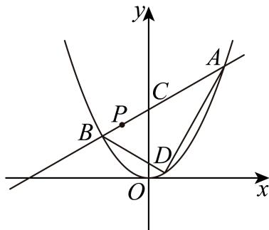

# 2025二模 崇明区原卷 · 学生版

> 本地预览：题目、答案及分类尚未全部审定。校对使用的PDF为高中工作台解析版，尚未逐区确认区级印刷原卷。

## 填空题

按本区原卷题号顺序排列。

### 崇明 · 第1题

不等式 $| x - 1 | < 2$ 的解集为

### 崇明 · 第2题

已知复数 Z = 1 − 2i（ i 为虚数单位），则 z =

> 本题资料或解析有待核事项，预览不可作为已审定成品。

### 崇明 · 第3题

已知全集U = R，集合 $A = \{ 1 , 2 , 4 \} , B = \{ 2 , 4 , 5 \}$ ，则 $A \cap \complement _ { U } B =$

### 崇明 · 第4题

求直线x = −2与直线 ${ \sqrt { 3 } } x - y + 1 = 0$ 的夹角为 .

### 崇明 · 第5题

已知 $\vec { | a } = ( 1 , 0 ) , \vec { b } = ( 2 , 1 )$ ，则 $| { \vec { a } } + 2 { \vec { b } } | =$

### 崇明 · 第6题

函数 $y=2\sin(\omega x-\frac\pi{16})$（$\omega>0$）的最小正周期是 $\pi$，则 $\omega=$______。

### 崇明 · 第7题

某次数学考试后，随机选取14位学生的成绩，得到如下茎叶图，其中个数部分作为“叶”，百位数和十位数作为“茎”，若该组数据的第25百分位数是87，则x的值为
$$
\begin{array}{c c c c c} 7 & 5 & & \\ 8 & 2 & 3 & x & 9 \\ 9 & 1 & 3 & 7 \\ 1 0 & 0 & 4 & 6 \\ 1 1 & 1 & 9 \\ 1 2 & 5 \end{array}
$$

### 崇明 · 第8题

在 $\triangle A B C ^ { \scriptscriptstyle \mathrm { F } }$ 中，若 ${ \mathsf { i } } c = 3 , C = { \frac { \pi } { 3 } }$ ，其面积为 ${ \sqrt { 3 } } ,$ ，则a + b =

### 崇明 · 第9题

若 $( x + 1 ) ^ { 1 0 } = a _ { 0 } + a _ { 1 } ( x - 1 ) + a _ { 2 } ( x - 1 ) ^ { 2 } + \dots + a _ { 1 0 } ( x - 1 ) ^ { 1 0 }$ ，则 $a _ { 0 } + a _ { 1 } + a _ { 2 } + \cdots + a _ { 1 0 } =$

### 崇明 · 第10题

已知 $f \left( x \right) = \left\{ { { - x ^ { 2 } } + a x , x \leq 1 } _ { a x - 1 , x > 1 } { \mathrm { ~ } } \right.$ ，若函数 $y = f ( x )$ 有两个极值点，则实数a的取值范围是

> 本题资料或解析有待核事项，预览不可作为已审定成品。

### 崇明 · 第11题

已知双曲线 $x ^ { 2 } - { \frac { y ^ { 2 } } { b ^ { 2 } } } = 1 \left( b > 0 \right)$ 的左、右焦点为 $F _ { 1 } , F _ { 2 }$ ，以O为顶点， $F _ { 2 }$ 为焦点作抛物线交双曲线于P，且 $\angle P F _ { 1 } F _ { 2 } = 4 5 ^ { \circ }$ ，则 $| b ^ { 2 } = |$

> 本题资料或解析有待核事项，预览不可作为已审定成品。

### 崇明 · 第12题

已知集合M中的任一个元素都是整数，当存在整数 $a , c \in M , b \notin M$ 且 $a < b <$ c时，称M为“间断整数集”．集合 $\{ x \mid 1 \leq x \leq 1 0 , x \in \mathbf { Z } \}$ 的所有子集中，是“间断整数集”的个数为

> 本题资料或解析有待核事项，预览不可作为已审定成品。

## 选择题

按本区原卷题号顺序排列。

### 崇明 · 第13题

若a $> b > 0 , c > d ,$ ，则下列结论正确的是（ ）

A. $a - b < 0$

B. $a c > b d$

C. $a c ^ { 2 } > b c ^ { 2 }$

D. ${ \frac { a } { c ^ { 2 } + 1 } } > { \frac { b } { c ^ { 2 } + 1 } }$

### 崇明 · 第14题

已知一个圆锥的轴截面是边长为2的等边三角形，则这个圆锥的侧面积为（ ）

A. 2π

B. 3π

C. 4π

D. ${ \frac { \sqrt { 3 } } { 3 } } \pi$

### 崇明 · 第15题

抛掷一枚质地均匀的硬币n次（其中n为大于等于2的整数），设事件A表示“n次中既有正面朝上又有反面朝上”，事件B表示“n次中至多有一次正面朝上”，若事件A与事件B是独立的，则n的值为（ ）

A. 5

B. 4

C. 3

D. 2

> 本题资料或解析有待核事项，预览不可作为已审定成品。

### 崇明 · 第16题

数列 $\{a_n\}$ 是等差数列，周期数列 $\{b_n\}$ 满足 $b_n=\cos(a_n)$。若集合 $X=\{x\mid x=b_n,\ n\text{ 是正整数}\}$ 中恰有三个元素，则数列 $\{b_n\}$ 的周期 $T$ 的取值不可能是（　）。

A. $4$

B. $5$

C. $6$

D. $7$

> 本题资料或解析有待核事项，预览不可作为已审定成品。

## 解答题

按本区原卷题号顺序排列。

### 崇明 · 第17题

如图，在四棱锥 $P - A B C D$ 中，底面ABCD是边长为2的正方形，且 $C B \bot B P , C D \bot D P$ $P A = 2$ ，点E，F分别为PB，PD的中点.

(1) (6分)求证： $P A \bot$ 平面ABCD；
(2) (8分)求点P到平面AEF的距离.

### 崇明 · 第18题

已知 $| f ( x ) = \log _ { 3 } ( x + a ) + \log _ { 3 } ( 6 - x )$
(1) (6分)是否存在实数a，使得函数 $y = f ( x )$ 是偶函数？若存在，求实数a的值，若不存在，请说明理由；
(2) (8分)若a > −3且 $. a \neq 0$ ，解关于x的不等式 $f ( x ) \leq f ( 6 - x )$

### 崇明 · 第19题

某区2025年3月31日至4月13日的天气预报如图所示。

(1)（4分）从3月31日至4月13日某天开始，连续统计三天，求这三天中至少有两天是阵雨的概率；

(2)（4分）根据天气预报，该区4月14日的最低气温是 $9^\circ\mathrm C$。温差是指一段时间内最高温度与最低温度之间的差值，例如3月31日的最高温度为 $17^\circ\mathrm C$，最低温度为 $9^\circ\mathrm C$，当天的温差为 $8^\circ\mathrm C$。记4月1日至4日这4天温差的方差为 $s_1^2$，4月11日至14日这4天温差的方差为 $s_2^2$。若 $s_2^2=\dfrac43s_1^2$，求4月14日天气预报的最高气温；

(3)（6分）从3月31日至4月13日中随机抽取两天，用 $X$ 表示一天温差不高于 $9^\circ\mathrm C$ 的天数，求 $X$ 的分布列及期望。

> 本题资料或解析有待核事项，预览不可作为已审定成品。

### 崇明 · 第20题

已知抛物线Γ: $x ^ { 2 } = 4 y ,$ ，过点 $P \left( a , b \right)$ 的直线l与抛物线Γ交于点A、B，与y轴交于点C

(1) (4分)若点A位于第一象限，且点A到抛物线Γ的焦点的距离等于3，求点A的坐标；
(2) (6分)若点A坐标为(4,4)，且点B恰为线段AC的中点，求原点O到直线l的距离；
(3) (8分)若抛物线Γ上存在定点D使得满足题意的点A、B都有 $D A \bot D B$ ，求a、b满足的关系式

> 本题资料或解析有待核事项，预览不可作为已审定成品。

### 崇明 · 第21题

已知函数 $\scriptstyle ( y = f ( x )$ ，P为坐标平面上一点．若函数 $\cdot y = f ( x )$ 的图像上存在与P不同的一点Q，使得直线PQ是函数y = f(x)在点Q处的切线，则称点P具有性质 $M _ { f }$
(1) (4分)若 $f ( x ) = x ^ { 2 }$ ，判断点 $P ( 1 , 0 )$ 是否具有性质 $M _ { f }$ ，并说明理由；
(2) (6分)若 $f ( x ) = 2 x ^ { 3 } - 4 x ^ { 2 } + 2 x$ ，证明：线段 $x = \frac { 1 } { 2 } ( - 1 \leq y \leq 1 )$ 上的所有点均具有性质 $M _ { f }$ ；
(3) (8分)若 $f ( x ) = \mathbf { e } ^ { x }$ ，证明：“点 $P ( x , y )$ 具有性质 ${ M } _ { f } ^ { \prime }$ ”的充要条件是 $^ { 6 } y < \mathrm { e } ^ { x ^ { , } }$

> 本题资料或解析有待核事项，预览不可作为已审定成品。

