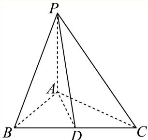
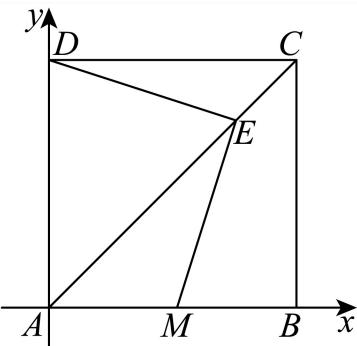
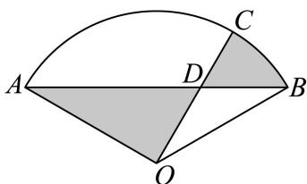
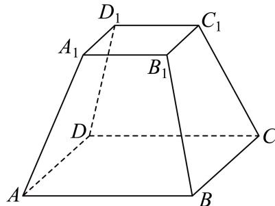
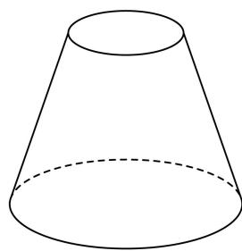
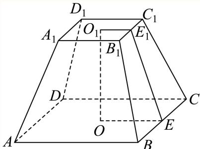
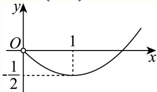
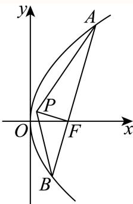

# 2025二模 徐汇区原卷 · 教师版

> 本地预览：题目、答案及分类尚未全部审定。校对使用的PDF为高中工作台解析版，尚未逐区确认区级印刷原卷。

## 填空题

按本区原卷题号顺序排列。

### 徐汇 · 第1题

已知全集 $U = \{ x | | x - 1 | \leq 2 , x \in \mathbf { R } \}$ ，A = [1, 3]，则A =

> 本题资料或解析有待核事项，预览不可作为已审定成品。

**考点：** 全集与区间补集

**难度依据：** 绝对值不等式与集合补集；直接运用定义或基础公式，推理链短

**核查说明：** 题干所求补集符号丢失，底稿显示A=，须核原卷。；已人工阅读完整底稿题干及原解，未逐页对照正式PDF，分类不等于数学终审。

【答案】[−1, 1).

【解析】

先求解绝对值不等式解得集合U，再根据补运算求解即可.

$U = \{ x | | x - 1 | \leq 2 , x \in \mathbf { R } \} = \{ x | - 1 \leq x \leq 3 \} , \ \mathbb { X } A = [ 1 , 3 ]$ ，故 $ { \overline { { A } } } = [ - 1 , 1 )$

故答案为：[−1, 1).

### 徐汇 · 第2题

复数 $z = { \frac { 1 } { 1 - i } }$ （其中 i为虚数单位）的虚部是

**考点：** 复数除法、虚部

**难度依据：** 复数除法与虚部；直接运用定义或基础公式，推理链短

**核查说明：** 已人工阅读完整底稿题干及原解，未逐页对照正式PDF，分类不等于数学终审。

【答案】$\frac { 1 } { 2 }$

【解析】

根据复数除法，化简 z，进而直接写出虚部即可.

$z = { \frac { 1 } { 1 - \mathrm { i } } } = { \frac { 1 + \mathrm { i } } { ( 1 - \mathrm { i } ) ( 1 + \mathrm { i } ) } } = { \frac { 1 + \mathrm { i } } { 2 } } = { \frac { 1 } { 2 } } + { \frac { 1 } { 2 } } \mathrm { i }$ ，故其虚部为 $\frac { 1 } { 2 }$

故答案为： $\frac { 1 } { 2 }$

### 徐汇 · 第3题

在空间直角坐标系中，向 $\overrightarrow { \Xi a } = ( - m , 6 , 3 ) , \overrightarrow { b } = ( 2 , n , 1 )$ ,若 $\overrightarrow { a } / / \overrightarrow { b }$ ，则 $\left| m + n = \right.$

> 本题资料或解析有待核事项，预览不可作为已审定成品。

**考点：** 空间向量平行与参数

**难度依据：** 空间向量共线的坐标条件；直接运用定义或基础公式，推理链短

**核查说明：** 空间向量和所求m+n周围有OCR噪声，需校原式。；已人工阅读完整底稿题干及原解，未逐页对照正式PDF，分类不等于数学终审。

【答案】$-4$。

【解析】

由 $\vec a\parallel\vec b$，可设 $\vec a=\lambda\vec b$，即

$$(-m,6,3)=\lambda(2,n,1).$$

比较第三个坐标，得 $\lambda=3$；再比较其余坐标，得 $-m=6$，$6=3n$，所以 $m=-6$，$n=2$，故 $m+n=-4$。

### 徐汇 · 第4题

已知幂函数y = f(x)的图像过点 $\left( 3 , { \frac { \sqrt { 3 } } { 3 } } \right)$ ，则该幂函数的值域是

**考点：** 幂函数由点求式与值域

**难度依据：** 幂函数解析式及值域；直接运用定义或基础公式，推理链短

**核查说明：** 已人工阅读完整底稿题干及原解，未逐页对照正式PDF，分类不等于数学终审。

【答案】(0,+∞).

【解析】

根据幂函数定义代入点可得 $f \left( x \right) = { \frac { 1 } { \sqrt { x } } }$ ，即可得函数值域.

设幂函数 $f \left( x \right) = x ^ { \alpha } , \alpha \in \mathbf { R }$

代入点 $\left( 3 , { \frac { \sqrt { 3 } } { 3 } } \right)$ 可得 $3 ^ { \alpha } = { \frac { \sqrt { 3 } } { 3 } } = 3 ^ { - { \frac { 1 } { 2 } } }$ ，即 $\mathsf { I } _ { \alpha = - \frac 1 2 }$

可得 $f \left( x \right) = x ^ { - \frac { 1 } { 2 } } = \frac { 1 } { \sqrt { x } }$

因为 $\sqrt { x } > 0$ ，可得 $f \left( x \right) = \frac { 1 } { \sqrt { x } } > 0$ 所以该幂函数的值域是 $( 0 , + \infty )$

故答案为：(0,+∞).

### 徐汇 · 第5题

如下是一个 $2\times2$ 列联表，则 $s=$ ______。

|  | $y_1$ | $y_2$ | 总计 |
|---|---|---|---|
| $x_1$ | $a$ | 35 | 45 |
| $x_2$ | 7 | $b$ | $n$ |
| 总计 | $m$ | 73 | $s$ |

> 本题资料或解析有待核事项，预览不可作为已审定成品。

**考点：** 列联表行列合计

**难度依据：** 列联表数据填补；直接运用定义或基础公式，推理链短

**核查说明：** 题干2x2列联表未保留，不可仅据解析反推表格。；已人工阅读完整底稿题干及原解，未逐页对照正式PDF，分类不等于数学终审。

【答案】90.

【解析】

完善列联表即可求解.

由表格有 $\dot { a } = 4 5 - 3 5 = 1 0 , m = a + 7 = 1 7 , s = 1 7 + 7 3 = 9 0 ,$

故答案为：90.

### 徐汇 · 第6题

已知 $\cos \theta = - \frac { 3 } { 5 } , \theta \in ( 0 , \pi )$ ，则 $\tan \left( \theta - { \frac { \pi } { 4 } } \right)$ 的值为

**考点：** 象限判断及两角差正切

**难度依据：** 两角差正切公式；需一次转化并结合定义域或几何条件计算

**核查说明：** 已人工阅读完整底稿题干及原解，未逐页对照正式PDF，分类不等于数学终审。

【答案】7

【解析】

先根据同角三角函数关系得出 tanθ，再根据两角差正切公式计算求解

$$
\cos \theta = - \frac {3}{5}, \theta \in (0, \pi),
$$

所以 $\sin \theta = { \sqrt { 1 - \cos ^ { 2 } \theta } } = { \frac { 4 } { 5 } } , \tan \theta = - { \frac { 4 } { 3 } }$ ，

$$
\tan \left(\theta - \frac {\pi}{4}\right) = \frac {- \frac {4}{3} - 1}{1 - \frac {4}{3}} = \frac {- \frac {7}{3}}{- \frac {1}{3}} = 7
$$

故答案为：7

### 徐汇 · 第7题

已知PA⊥平面ABC， $\triangle A B C$ 是直角三角形，且 $A B = A C = 2$ ，PA = 4，则点P到直线BC的距离是

**考点：** 线面垂直构造点线距离

**难度依据：** 点到直线距离；需一次转化并结合定义域或几何条件计算

**核查说明：** 已人工阅读完整底稿题干及原解，未逐页对照正式PDF，分类不等于数学终审。

【答案】$3 { \sqrt { 2 } } .$

【解析】

取BC中点为D，连接PD,AD，通过证明 $B C \bot P D$ ，从而证明点P到BC的距离为PD，再结合已知条件求出PD即可.

取 $BC$ 中点为D，连接 $A D , P D$ ，如下所示：

因为ABC为等腰三角形，又D为BC中点，故 $B C \bot A D$ ；

因为 $P A \bot$ 平面ABC， $B C \subset$ 面ABC，故 $B C \bot P A$ ；

又AD,PA ⊂面 $P A D , A D \cap P A = A$ ，故 $B C \bot$ 面PAD，又 $P D \subset$ 面PAD，故 $P D \bot B C$

故点P到直线BC的距离，即为PD；

在 $\triangle A B C ^ { \scriptscriptstyle \perp }$ 中， $A D = { \frac { 1 } { 2 } } B C = { \frac { 1 } { 2 } } \times { \sqrt { 2 } } A B = { \sqrt { 2 } } ;$

因为 $P A \bot$ 平面ABC，AD ⊂面 $A B C$ ，故 $P A \bot A D$ ，则 $\triangle P A D$ 为直角三角形；

在 $\triangle P A D ^ { | }$ 中， $P A = 4 , A D = { \sqrt { 2 } }$ ，故 $P D = { \sqrt { P A ^ { 2 } + A D ^ { 2 } } } = { \sqrt { 1 6 + 2 } } = 3 { \sqrt { 2 } } .$

故点P到直线BC的距离为3√2.

故答案为： $3 { \sqrt { 2 } } .$

### 徐汇 · 第8题

已知ABCD是正方形，点M是AB的中点，点E在对角线AC上，且 $\stackrel { \longrightarrow } { A E } = \stackrel { \longrightarrow } { 3 E C }$ ,则∠MED的大小为

> 本题资料或解析有待核事项，预览不可作为已审定成品。

**考点：** 正方形中的向量垂直与夹角

**难度依据：** 坐标数量积与几何夹角；需一次转化并结合定义域或几何条件计算

**核查说明：** 缺独立答案字段，但解析末尾给出pi/2；题干多余sub标签需修复。；已人工阅读完整底稿题干及原解，未逐页对照正式PDF，分类不等于数学终审。

【解析】

建立平面直角坐标系，求出点的坐标，利用数量积即可求解.

以点A为坐标原点，AB为x轴，AD为y轴建立平面直角坐标系，设 $A B = 4$ 则有 $A ( 0 , 0 ) , M ( 2 , 0 ) , D ( 0 , 4 ) , C ( 4 , 4 )$ ，由 $\stackrel { \longrightarrow } { A E } = \stackrel { \longrightarrow } { 3 E C }$ 有 $\stackrel { \longrightarrow } { A E } = \frac { 3 } { 4 } \stackrel { \longrightarrow } { A C } = ( 3 , 3 )$ ，所以 $E \left( 3 , 3 \right)$ 所以 $\overrightarrow { E M } = ( - 1 , - 3 ) , \overrightarrow { E D } = ( - 3 , 1 )$ ，所以 $\overrightarrow { E M } \cdot \overrightarrow { E D } = - 1 \times ( - 3 ) + ( - 3 ) \times 1 = 0$ 即 $E D \bot E M$ ，所以 $\angle M E D = { \frac { \pi } { 2 } }$ 故答案为： $\frac { \pi } { 2 }$

### 徐汇 · 第9题

已知两个随机事件A,B，若 $P \left( A \right) = \frac { 1 } { 5 } , P \left( B \right) = \frac { 1 } { 4 } , P \left( B | A \right) = \frac { 2 } { 3 }$ ，则 $P \left( { \overline { { A } } } \left| B \right. \right)$

**考点：** 条件概率及对立事件

**难度依据：** 条件概率与事件分解；需一次转化并结合定义域或几何条件计算

**核查说明：** 已人工阅读完整底稿题干及原解，未逐页对照正式PDF，分类不等于数学终审。

【答案】$\frac { 7 } { 1 5 }$

【解析】

根据全概率公式有 $P \left( B \right) = P \left( B A \right) + P \left( B \overline { { A } } \right)$ ，由乘法公式有 $P \left( B A \right) = P \left( A \right) P \left( B \left| A \right. \right)$ 求出$P \left( B { \overline { { A } } } \right)$ ，最后利用条件概率公式即可求解

由题意 $P \left( B \right) = P \left( B A \right) + P \left( B \overline { { A } } \right) = P \left( A \right) P \left( B \left| A \right. \right) + P \left( B \overline { { A } } \right)$

所以 $P \left( B { \overline { { A } } } \right) = P \left( B \right) - P \left( A \right) P \left( B \left| A \right. \right) = { \frac { 1 } { 4 } } - { \frac { 1 } { 5 } } \times { \frac { 2 } { 3 } } = { \frac { 7 } { 6 0 } }$

所以 $P \left( { \overline { { A } } } { \Big | } B \right) = { \frac { P \left( B { \overline { { A } } } \right) } { P \left( B \right) } } = { \frac { \frac { 7 } { 6 0 } } { \frac { 1 } { 4 } } } = { \frac { 7 } { 1 5 } } .$

故答案为： $\frac { 7 } { 1 5 }$

### 徐汇 · 第10题

已知双曲线 ${ \frac { x ^ { 2 } } { a ^ { 2 } } } - { \frac { y ^ { 2 } } { b ^ { 2 } } } = 1 ( a > 0 , b > 0 )$ 的左焦点为 $F _ { 1 }$ ，右焦点为 $F _ { 2 }$ .若双曲线的右支上存在一点P，使得直线 $P F _ { 1 }$ 与以双曲线的实轴为直径的圆相切，切点为线段 $P F _ { 1 }$ 的中点，则该双曲线的离心率为

**考点：** 双曲线定义、圆切线与离心率

**难度依据：** 双曲线焦点三角形与切圆；需连接多个条件或多步模型转化

**核查说明：** 已人工阅读完整底稿题干及原解，未逐页对照正式PDF，分类不等于数学终审。

【答案】${ \sqrt { 5 } } .$

【解析】

根据题意，求得 $| P F _ { 2 } |$ ，再结合双曲线定义，求得 $| P F _ { 1 } |$ |，结合 $\triangle P F _ { 1 } F _ { 2 }$ 为直角三角形，利用勾股定理，建立 $^ { ( a , }$ 的等量关系，进而求解即可

设 $P F _ { 1 }$ 中点为H，连接 $O H , P F _ { 2 }$ ，作图如下所示：

在 $\triangle P F _ { 1 } F _ { 2 }$ 中，因为O,H分别为 $F _ { 1 } F _ { 2 } , P F _ { 1 }$ 1的中点，故 $O H / / P F _ { 2 }$ ，且 $| O H | = \frac { 1 } { 2 } | P F _ { 2 } |$ ；

由题可知， $| O H | = a$ ，且 $O H \bot P F _ { 1 }$ ，故 $| P F _ { 2 } | = 2 a$ ，且 $P F _ { 2 } \bot P F _ { 1 }$ ；

根据双曲线定义可知， $| P F _ { 1 } | = 2 a + | P F _ { 2 } | = 2 a + 2 a = 4 a$ ，又 $| F _ { 1 } F _ { 2 } | = 2 c$

故在 $\triangle P F _ { 1 } F _ { 2 }$ 中，由勾股定理 $| P F _ { 1 } | ^ { 2 } + | P F _ { 2 } | ^ { 2 } = | F _ { 1 } F _ { 2 } | ^ { 2 }$ ，也即 $1 6 a ^ { 2 } + 4 a ^ { 2 } = 4 c ^ { 2 }$

整理得 ${ \frac { c ^ { 2 } } { a ^ { 2 } } } = 5$ ，故 ${ \frac { c } { a } } = { \sqrt { 5 } }$ 也即该双曲线的离心率为 $\sqrt { 5 }$

故答案为： ${ \sqrt { 5 } } .$

### 徐汇 · 第11题

如图，某处有一块圆心角为 $\frac { 2 } { 3 } \pi \sharp$ 的扇形绿地AOB，扇形的半径为20米，AB是一条原有的人行直路，由于工程建设需要，现要在绿地中建一条直路 ，以便在图中阴影部分区域分类堆放物料.为了尽量减少对绿地的破坏（不计路宽），则原直路AB与新直路OC的交叉点D到O的距离为米.

> 本题资料或解析有待核事项，预览不可作为已审定成品。

**考点：** 扇形面积建模与导数最值

**难度依据：** 扇形面积与正弦定理；需参数分类、构造递推或综合最值分析

**核查说明：** 题干新直路OC名称丢失，导数展开行及角参数范围有OCR损坏，需核图与原解。；已人工阅读完整底稿题干及原解，未逐页对照正式PDF，分类不等于数学终审。

【答案】$: ~ 1 0 \sqrt { 2 }$

【解析】

过点O作 ${ \tt O H \bot A B }$ ，设 $\angle B O D = \alpha , B D = m$ 根据正弦定理求得 $\begin{array} { c c c } { \displaystyle { m = \frac { 2 0 \sin \alpha } { \sin \left( \alpha + \frac { \pi } { 6 } \right) } } } \end{array}$ ，求得阴

影的面积为 $S = 2 0 0 \left( \alpha - { \frac { \sin \alpha } { \sin \left( \alpha + { \frac { \pi } { 6 } } \right) } } \right) + 1 0 0 { \sqrt { 3 } } ,$ 令 $f \left( \alpha \right) = \alpha - \frac { \sin \alpha } { \sin \left( \alpha + \displaystyle \frac { \pi } { 6 } \right) }$ ，求得

$f ^ { \prime } \left( \alpha \right) = 1 - \frac { \frac { 1 } { 2 } } { \sin ^ { 2 } \left( \alpha + \displaystyle \frac { \pi } { 6 } \right) }$ ，得出函数的单调性，得到 $\alpha = \frac { \pi } { 1 2 }$ 时，f(α)取得最小值，结合

$\triangle O D H$ 为等腰直角三角形，即可求解.

过点O作 $: O H \bot A B$ 垂足为H，可得 $O H = 1 0$ ， $A B = 2 0 { \sqrt { 3 } } .$

设 $\angle B O D = \alpha , B D = m$ ，在 $: \triangle B O D \ntrianglelefteq$ ，由正弦定理得 ${ \frac { m } { \sin \alpha } } = { \frac { O B } { \sin \angle O D B } }$

因为 $\sin \angle O D B = \sin \left( \alpha + \angle O B D \right) = \sin \left( \alpha + { \frac { \pi } { 6 } } \right)$ ，所以 $m = \frac { 2 0 \sin \alpha } { \sin \left( \alpha + \displaystyle \frac { \pi } { 6 } \right) } ;$

又由阴影部分的面积： $S = S _ { \hat { \mathbb { H } } \times \hat { \mathbb { H } } \times O B C } - S _ { \triangle O B D } + S _ { \triangle O A D }$

$$
= \frac {1}{2} \alpha \times (2 0) ^ {2} - \frac {1}{2} m \times 1 0 + \frac {1}{2} (2 0 \sqrt {3} - m) \times 1 0 = 2 0 0 \alpha + 1 0 0 \sqrt {3} - 1 0 m
$$

$= 2 0 0 \alpha + 1 0 0 \sqrt { 3 } - \frac { 2 0 0 \sin \alpha } { \sin \left( \alpha + \frac { \pi } { 6 } \right) } = 2 0 0 \left( \alpha - \frac { \sin \alpha } { \sin \left( \alpha + \frac { \pi } { 6 } \right) } \right) + 1 0 0 \sqrt { 3 } ,$ 其中 $) < \alpha \leq \frac { \pi } { 2 }$

$$
f (\alpha) = \alpha - \frac {\sin \alpha}{\sin \left(\alpha + \frac {\pi}{6}\right)}, 0 <   \alpha \leq \frac {\pi}{2},
$$

可得f′ (α) = 1 − cos α sin (α + π − sin x cos (α + 6 12 = 1 − sin2 (α + π 6 sin2 (α + π 6

令 $: f ^ { \prime } \left( \alpha \right) = 0 ;$ ，可得 $\sin \left( \alpha + { \frac { \pi } { 6 } } \right) = { \frac { \sqrt { 2 } } { 2 } }$ ，解得 $\alpha = \frac { \pi } { 1 2 }$

当 $) < \alpha < \frac { \pi } { 1 2 }$ 时， $f ^ { \prime } \left( \alpha \right) < 0 ;$ 当 $\frac { \pi ^ { - } } { 1 2 } < \alpha < \frac { \pi } { 2 }$ 时， $f ^ { \prime } \left( \alpha \right) > 0$

所以f (α)在 $\left( 0 , { \frac { \pi } { 1 2 } } \right)$ 上单调递减，在 $\left( { \frac { \pi } { 1 2 } } , { \frac { \pi } { 2 } } \right)$ 上单调递增，当 $\alpha = \frac { \pi } { 1 2 }$ 时，函数 ${ \bf \nabla } \cdot \ f \left( \alpha \right)$ 取得最小值，则 $\angle \bar { D O H } = \frac { \pi } { 4 }$ ，所以 $\triangle O D H$ 为等腰直角三角形，因为 $| O H | = 1 0 $ ，所以 $| O D | = 1 0 { \sqrt { 2 } }$

故答案为 $: ~ 1 0 \sqrt { 2 }$

### 徐汇 · 第12题

设实数 $[ \omega > 0 ,$ ，若 $f ( x ) = \sin \omega x$ 满足对任意 $x _ { 1 } \in [ 0 , \pi ]$ ，都存在 $x _ { 2 } \in [ \pi , 2 \pi ]$ ，使得 $ f ( x _ { 1 } ) + f ( x _ { 2 } ) = 0$ 成立，则ω的最小值是

**考点：** 全称存在条件转化为值域包含

**难度依据：** 区间值域覆盖与参数；需参数分类、构造递推或综合最值分析

**核查说明：** 已人工阅读完整底稿题干及原解，未逐页对照正式PDF，分类不等于数学终审。

【答案】$\frac 3 4$

【解析】

先证明 $\omega \geq \frac { 3 } { 4 }$ ，再说明 $\omega = \frac { 3 } { 4 }$ 满足条件，即可得到ω的最小值是 $\frac 3 4$

假设 $0 < \omega < \frac { 1 } { 2 }$ ，则 $\mathbb { H } \omega \pi \in \left( 0 , \frac { \pi } { 2 } \right)$ 可 $\sharp \mathrm { s i n } \left( \omega \pi \right) > 0$ ，取 $x _ { 1 } = \pi$ ，则对任意 $x _ { 2 } \in [ \pi , 2 \pi ]$ ]，由于$\omega x _ { 2 } \in [ 0 , \pi ]$ ，故sin $\omega x _ { 2 } \geq 0 _ { \mathrm { { \ell } } }$ ，从而 $f \left( x _ { 1 } \right) + f \left( x _ { 2 } \right) = \sin \omega x _ { 1 } + \sin \omega x _ { 2 } \geq \sin \omega x _ { 1 } = \sin \left( \omega \pi \right) > 0$ ，不满足条件，矛盾；

假设 $\frac { 1 } { 2 } \leq \omega < \frac { 3 } { 4 }$ ，取 $[ x _ { 1 } = \frac { \pi } { 2 \omega } \in [ 0 , \pi ]$ ，则对任意 $x _ { 2 } \in [ \pi , 2 \pi ]$ ，由 $\mp \frac { \pi } { 2 } \leq \omega x _ { 2 } < \frac { 3 \pi } { 2 }$ ，故$\sin \omega x _ { 2 } > - 1$ ，从而 $\stackrel { . } { f } \left( x _ { 1 } \right) + f \left( x _ { 2 } \right) = \sin \omega x _ { 1 } + \sin \omega x _ { 2 } > \sin \omega x _ { 1 } - 1 = \sin \frac { \pi } { 2 } - 1 = 0$ ，不满足条件，矛盾；

以上结果表明必有 $\stackrel { \cdot } { \omega } \geq \frac { 3 } { 4 }$ ，而当 $\omega = \frac { 3 } { 4 }$ 时，对任意 $x _ { 1 } \in [ 0 , \pi ]$ ，由 ${ \frac { 3 } { 4 } } x _ { 1 } \in \left[ 0 , { \frac { 3 \pi } { 4 } } \right]$ ]可知

$$
\sin \frac {3}{4} x _ {1} \in [ 0, 1 ]
$$

$$
- 1 \leq - \sin \frac {3}{4} x _ {1} \leq 0.
$$

而 $\mathrm { s i n } \left( \frac { 3 } { 4 } \cdot \pi \right) > 0 , \ \mathrm { s i n } \left( \frac { 3 } { 4 } \cdot 2 \pi \right) = - 1$ ，所以一定存在 $x _ { 2 } \in [ \pi , 2 \pi ]$ ，使得

$\sin { \frac { 3 } { 4 } } x _ { 2 } = - \sin { \frac { 3 } { 4 } } x _ { 1 }$ ，即 $f \left( x _ { 1 } \right) + f \left( x _ { 2 } \right) = \sin { \frac { 3 } { 4 } } x _ { 1 } + \sin { \frac { 3 } { 4 } } x _ { 2 } = 0 ,$ ，满足条件.

综上，ω的最小值是 $\frac { 3 } { 4 }$

故答案为： $\frac 3 4$

## 二、选择题

## 选择题

按本区原卷题号顺序排列。

### 徐汇 · 第13题

已知A､B为两个随机事件，则“A､B为互斥事件”是“A､B为对立事件”的（ ）

A. 充分非必要条件

B. 必要非充分条件

C. 充要条件

D. 非充分非必要条件

**考点：** 互斥和对立事件关系

**难度依据：** 充分必要条件；直接运用定义或基础公式，推理链短

**核查说明：** 已人工阅读完整底稿题干及原解，未逐页对照正式PDF，分类不等于数学终审。

【答案】B

【解析】

根据互斥事件和对立事件的概念直接判断即可.

根据互斥事件和对立事件的概念可知，互斥不一定对立，对立一定互斥，所以“ A､B为互斥事 件”是“ A､B为对立事件”的必要非充分条件.

故选：B

### 徐汇 · 第14题

在研究线性回归模型时，若样本数据 $( x _ { i } , y _ { i } ) ( i = 1 , 2 , 3 , \cdot \cdot \cdot , n )$ 所对应的点都在直线 $y = - { \frac { 1 } { 3 } } x + 2$ 上，则两组数据x 和 $\lvert y _ { i } ( i = 1 , 2 , 3 , \cdots , n )$ 的线性相关系数为（ ）

A. −1

B. 1

C. $- { \frac { 1 } { 3 } }$

D. 2

> 本题资料或解析有待核事项，预览不可作为已审定成品。

**考点：** 回归直线与相关系数

**难度依据：** 完全线性相关系数；需一次转化并结合定义域或几何条件计算

**核查说明：** x_i、y_i标记误识为绝对值符号，需核清，避免理解为|y_i|。；已人工阅读完整底稿题干及原解，未逐页对照正式PDF，分类不等于数学终审。

【答案】A

【解析】

根据回归模型性质判断即可.

若样本数据 $( x _ { i } , y _ { i } ) ( i = 1 , 2 , 3 , \cdot \cdot \cdot , n )$ 所对应的点都在直线 $y = - \frac { 1 } { 3 } x + 2 \mathrm { . } \mathrm { E }$ 则两组数据x 和 $| y _ { i } ( i = 1 , 2 , 3 , \cdots , n )$ 的线性相关系数为−1.故选：A.

### 徐汇 · 第15题

在桌面上有一个质地均匀的正四面体D—ABC．从该正四面体与桌面贴合的面上的三条棱中等可能地选取一条棱，沿其翻转正四面体至正四面体的另一个面与桌面贴合，如此翻转称为一次操作．如图，开始时，正四面体与桌面贴合的面为ABC，操作 ${ \mathrm { i } n ( n = 1 , 2 , 3 , \cdots ) }$ 次后，正四面体与桌面贴合的面是ABC的概率记为 $P _ { n } .$ . 现有下列两个结论： $\odot P _ { 2 } = { \frac { 1 } { 3 } } ; \odot P _ { 2 5 } < P _ { 2 4 }$ . 则下列说法正确的是（ ）

A. ①正确，②错误

B. ①错误，②正确

C. ①、②都正确

D. ①、②都错误

> 本题资料或解析有待核事项，预览不可作为已审定成品。

**考点：** 翻转概率递推、奇偶比较

**难度依据：** 正四面体翻转递推概率；需连接多个条件或多步模型转化

**核查说明：** 源解P24所列幂指数25与通式应得23不一致，虽不影响奇偶比较仍须核改；缺独立答案字段。；已人工阅读完整底稿题干及原解，未逐页对照正式PDF，分类不等于数学终审。

【解析】

首先通过分析正四面体的翻转操作，找出操作n次后正四面体与桌面贴合的面是 的概率$P _ { n }$ 的递推关系，再根据递推关系计算 $P _ { 2 }$ ，并分析 $P _ { n }$ 的性质判断 $P _ { 2 4 } { \stackrel { \cal L } {  } } P _ { 2 5 }$ 的大小关系开始时正四面体与桌面贴合的面为ABC，进行一次操作后，正四面体与桌面贴合的面不可能再是 $A B C$ ，所以 $P _ { 1 } = 0$

要得到操作2次后正四面体与桌面贴合的面是ABC，那么第一次操作后正四面体与桌面贴合的面不是ABC，且第二次操作能回到ABC.

第一次操作后正四面体与桌面贴合的面不是ABC，有3种情况（正四面体共4个面，除去ABC面），从这3个面中的任意一个面进行第二次操作回到ABC面的概率为 $\frac 1 3$

根据分步乘法计数原理， $P _ { 2 } = ( 1 - P _ { 1 } ) \times \frac { 1 } { 3 }$ ，因为 $P _ { 1 } = 0$ ，所以 $P _ { 2 } = ( 1 - 0 ) \times \frac { 1 } { 3 } = \frac { 1 } { 3 }$ ，故①正确,

当n ≥ 2时，操作n次后正四面体与桌面贴合的面是 $A B C ,$ ，则操作n−1次后正四面体与桌面贴合的面不是 $A B C$ ，且第n次操作能回到ABC,

操作n−1次后正四面体与桌面贴合的面不是ABC的概率为 $1 - P _ { n - 1 }$ ，

从不是ABC的面进行一次操作回到ABC面的概率为 $\frac 1 3$

所以可得递推关系 $P _ { n } = ( 1 - P _ { n - 1 } ) \times \frac { 1 } { 3 } = - \frac { 1 } { 3 } P _ { n - 1 } + \frac { 1 } { 3 }$

将上式变形为 $P _ { n } - { \frac { 1 } { 4 } } = - { \frac { 1 } { 3 } } \biggl ( P _ { n - 1 } - { \frac { 1 } { 4 } } \biggr )$

所以数列 $\left\{ P _ { n } - { \frac { 1 } { 4 } } \right\}$ 是以 $P _ { 1 } - { \frac { 1 } { 4 } } = 0 - { \frac { 1 } { 4 } } = - { \frac { 1 } { 4 } }$ 为首项, $, - { \frac { 1 } { 3 } }$ 为公比的等比数列,

$P _ { n } - { \frac { 1 } { 4 } } = \left( - { \frac { 1 } { 4 } } \right) \times \left( - { \frac { 1 } { 3 } } \right) ^ { n - 1 }$ $P _ { n } = { \frac { 1 } { 4 } } + \left( - { \frac { 1 } { 4 } } \right) \times \left( - { \frac { 1 } { 3 } } \right) ^ { n - 1 }$

$P _ { 2 5 } = { \frac { 1 } { 4 } } - { \frac { 1 } { 4 } } \times { \bigg ( } { \frac { 1 } { 3 } } { \bigg ) } ^ { 2 4 } , P _ { 2 4 } = { \frac { 1 } { 4 } } + { \frac { 1 } { 4 } } \times { \bigg ( } { \frac { 1 } { 3 } } { \bigg ) } ^ { 2 5 }$ ，显然 $P _ { 2 5 } < P _ { 2 4 }$ ，故②正确.

### 徐汇 · 第16题

已知函数 $y = f ( x )$ 的定义域和值域都为R，且图像是一条连续不断的曲线，其导函数 $y = f ^ { \prime } ( x )$ 的值如下表：

| $x$ | $(-\infty,x_1)$ | $x_1$ | $(x_1,x_2)$ | $x_2$ | $(x_2,+\infty)$ |
|---|---|---|---|---|---|
| $f'(x)$ | $+$ | 0 | $-$ | 0 | $+$ |

设 $D\subseteq\mathbf R$，若集合 $\{y\mid y=f(x),x\in D\}=\{a,b,c\}$，其中 $a,b,c$ 为常数，则符合要求的集合 $D$ 的个数不可能是（　）。

A. 3

B. 27

C. 63

D. 343

> 本题资料或解析有待核事项，预览不可作为已审定成品。

**考点：** 导数表判断原像数与集合计数

**难度依据：** 导数符号表与方程根数；需参数分类、构造递推或综合最值分析

**核查说明：** 题干所指导数数值表未保留，无法独立判断反像个数限制；源解排除27的依据写得不全。；已人工阅读完整底稿题干及原解，未逐页对照正式PDF，分类不等于数学终审。

【答案】B

【解析】

根据若对应的 = 的 取值的情况可以有1个，2个或3个，且对应2个根的情况的时候即可判断A，根据若 $\dot { \boldsymbol { y } } = a , \boldsymbol { y } = b , \boldsymbol { y } = c$ c对应的根的个数为2，2，3即可判断C，根据若 $\scriptstyle y = a , y = b , y = c$ 对应的根的个数为3，3，3即可判断D.

由题意可得，若对应的y = t的x取值的情况可以有1个，2个或3个，且对应2个根的情况的时候，

t的取值只要2个，若 $y = a , y = b , y = c$ 对应的根的个数为1，1，2，

则符合要求的集合的个数为1 $\times 1 \times \left( 2 ^ { 2 } - 1 \right) = 3$ ，A有可能；

若 $\dot { \boldsymbol { y } } = a , \boldsymbol { y } = b , \boldsymbol { y } = c$ 对应的根的个数为2，2，3，

则符合要求的隹合的个数为 $\left( 2 ^ { 2 } - 1 \right) \times \left( 2 ^ { 2 } - 1 \right) \times \left( 2 ^ { 3 } - 1 \right) = 6 3$ ，C有可能；

若 $\dot { \boldsymbol { y } } = a , \boldsymbol { y } = b , \boldsymbol { y } = c ,$ 对应的根的个数为3，3，3，

则符合要求的集合的个数为 $( 2 ^ { 3 } - 1 ) \times ( 2 ^ { 3 } - 1 ) \times ( 2 ^ { 3 } - 1 ) = 3 4 3$ ，D有可能.故选：B.

## 三、解答题

## 解答题

按本区原卷题号顺序排列。

### 徐汇 · 第17题

如图， $A B C D - A _ { 1 } B _ { 1 } C _ { 1 } D _ { 1 }$ 是一块正四棱台形铁料，上、下底面的边长分别为20cm和40cm，高30cm

(1) (6分)求正四棱台 $A B C D - A _ { 1 } B _ { 1 } C _ { 1 } D _ { 1 }$ 的侧面 $B C C _ { 1 } B _ { 1 }$ 与底面ABCD所成二面角的大小；
(2) (8分)现削去部分铁料（不计损耗），将原正四棱台打磨为一个圆台，使得该圆台的上、下底面分别为原正四棱台上、下底面正方形的内切圆及其内部．求削去部分与原正四棱台的体积之比

**考点：** (1)棱台侧面与底面二面角；(2)圆台和棱台体积比

**难度依据：** 棱台二面角与体积比；需连接多个条件或多步模型转化

**核查说明：** 已人工阅读完整底稿题干及原解，未逐页对照正式PDF，分类不等于数学终审。

【解析】

(1) 设正方形ABCD， $A _ { 1 } B _ { 1 } C _ { 1 } D _ { 1 }$ 的中心分别为 $O , O _ { 1 }$ ，连接 $O O _ { 1 }$ ，则 $O O _ { 1 } \bot$ 平面 $A B C D$

分别取BC， $B _ { 1 } C _ { 1 }$ 的中点E， $E _ { 1 }$ ，连接 $E E _ { 1 } , O E , O E _ { 1 }$ ，则 $O E \bot B C , ~ O _ { 1 } E _ { 1 } \bot B _ { 1 } C _ { 1 }$ 由E， $E _ { 1 }$ 分别为等腰梯形 $B C C _ { 1 } B _ { 1 }$ 底边BC， $B _ { 1 } C _ { 1 }$ 的中点，得 $E { E _ { 1 } } \bot B C$ 由 $O _ { 1 } E _ { 1 } / / A _ { 1 } B _ { 1 } / / A B / / O E$ ，得四边形 $O _ { 1 } O E E _ { 1 }$ 是一个直角梯形，

$E E _ { 1 } \bot B C _ { \cdot }$ ，又 $O E \bot B C$ $\angle O E E _ { 1 }$ 为侧面 $B C C _ { 1 } B _ { 1 }$ 与底面ABCD所成二面角的平面角，

由条件知 $\vert O _ { 1 } E _ { 1 } = \frac { 1 } { 2 } A _ { 1 } B _ { 1 } = 1 0 , O E = \frac { 1 } { 2 } A B = 2 0 , O O _ { 1 } = 3 0$ ，则

$$
\tan \angle O E E _ {1} = \frac {O O _ {1}}{O E - O _ {1} E _ {1}} = \frac {3 0}{1 0} = 3,
$$

所以侧面 $B C C _ { 1 } B _ { 1 }$ 与底面ABCD所成二面角的大小为arctan3.

(2) 依题意，圆台 $O - O _ { 1 }$ 上底面半径r = 10cm，下底面半径 $R = 2 0 \mathrm { { c m } }$ ，高 $O _ { 1 } O = 3 0 \mathrm { { c m } }$ 1则圆台 $O - O _ { 1 }$ 的体积为 $V _ { 1 } = \frac { 1 } { 3 } \pi ( 1 0 ^ { 2 } + 2 0 ^ { 2 } + 1 0 \times 2 0 ) \times 3 0 = 7 0 0 0 \pi \left( \mathrm { c m ^ { 3 } } \right)$ 又正四棱台的体积 ${ } ! V _ { 2 } = { \frac { 1 } { 3 } } ( 2 0 ^ { 2 } + 4 0 ^ { 2 } + { \sqrt { 2 0 ^ { 2 } \times 4 0 ^ { 2 } } } ) \times 3 0 = 2 8 0 0 0 ( { \mathrm { c m } } ^ { 3 } )$ 所以削去部分的体积 $V _ { 3 } = 2 8 0 0 0 - 7 0 0 0 \pi ( \mathrm { c m ^ { 3 } } )$ \_所以削去部分与正四棱台的体积之比为 $\frac { 2 8 0 0 0 - 7 0 0 0 \pi } { 2 8 0 0 0 } = \frac { 4 - \pi } { 4 }$

### 徐汇 · 第18题

已知函数 $\cdot y = f ( x )$ ，其中 $f ( x ) = \log _ { 2 } x$
(1) (6分)解关于x的不等式 $f ( 3 x - 2 ) < f ( 2 x + 1 )$ ；
(2) (8分)若存在唯一的实数x0，使得 $f ( x _ { 0 } ) , f ( x _ { 0 } - a ) , f ( 2 )$ 依次成等差数列，求实数a的取值范围.

**考点：** (1)对数单调性解不等式；(2)等差中项转化方程唯一根

**难度依据：** 对数单调性与方程根数；需连接多个条件或多步模型转化

**核查说明：** 已人工阅读完整底稿题干及原解，未逐页对照正式PDF，分类不等于数学终审。

【解析】

(1) 由函数 $f \left( x \right) = \log _ { 2 } { x } \overleftarrow { \mathbb { E } } ( 0 \ , \ + \infty )$ 单调递增，

所以0 $< 3 x - 2 < 2 x + 1 \Rightarrow x \in \left( { \frac { 2 } { 3 } } , 3 \right)$

(2) 原问题等价于关于x的方程 $\log _ { 2 } x + 1 = 2 \log _ { 2 } ( x - a )$ 恰有一个实数解，求实数a的取值范围.

即 $\frac { 1 } { 2 } \mathrm { l o g } _ { 2 } \left( 2 x \right) = \mathrm { l o g } _ { 2 } \left( x - a \right) \ddagger x \in \left( 0 , + \infty \right)$ 上恰有一个实数解.

等价 $\mp { \sqrt { 2 x } } = x - a / \mp x \in ( 0 , + \infty )$ 上恰有一个实数解.

⇔ $a = x - { \sqrt { 2 x } }$ 在 $x \in ( 0 , + \infty )$ 上恰有一个实数解.

${ \widehat { \vec { \triangledown } } } { \sqrt { 2 x } } = t \left( t > 0 \right)$ ，则 $a = \frac { 1 } { 2 } t ^ { 2 } - t \mathcal { \sqrt { \pm } } t \in ( 0 , + \infty )$ 上恰有一个实数解.

画出关于t的二次函数在 $\mathrm { : } t \in ( 0 , + \infty )$ 上的图像可知， $a \in \left\{ - \frac { 1 } { 2 } \right\} \cup [ 0 , + \infty )$ 时只有一个交点；

$$
\therefore a \in \left\{- \frac {1}{2} \right\} \cup [ 0, + \infty).
$$

### 徐汇 · 第19题

某公司生产的糖果每包标识“净含量500g”，但公司承认实际的净含量存在误差. 已知每包糖果的实际净含量ξ（单位：g）服从正态分布N (500, 2.52).
(1) (6分)随机抽取一包该公司生产的糖果，求其净含量误差超过5g的概率（精确到0.001）；
(2) (8分)随机抽取3包该公司生产的糖果，记其中净含量小于497.5g的包数为X.求X的分布和期望（精确到0.001）.
参考数据：Φ (1) ≈ 0.8413，Φ $( 2 ) \approx 0 . 9 7 7 2$ ，Φ $( 3 ) \approx 0 . 9 9 8 7$ ，其中 $y = \Phi \left( x \right)$ 为标准正态分布函数.

> 本题资料或解析有待核事项，预览不可作为已审定成品。

**考点：** (1)正态分布标准化；(2)二项分布列与期望

**难度依据：** 正态分布与二项分布；需连接多个条件或多步模型转化

**核查说明：** 分布列汇总表缺失，但四项概率已在解析式中给出。；已人工阅读完整底稿题干及原解，未逐页对照正式PDF，分类不等于数学终审。

【解析】

(1) 由题意， $\xi \sim N \left( 5 0 0 , 2 . 5 ^ { 2 } \right)$ ，|ξ − 500| > 5的概率等于 $P \left( | \xi - 5 0 0 | > 5 \right)$ ).

令 $Y = \frac { \xi - 5 0 0 } { 2 . 5 }$ ，则 $Y \sim N \left( 0 , 1 \right)$

因此， $P \left( | \xi - 5 0 0 | > 5 \right) = P \left( | Y | > 2 \right)$

= 2 (1 − Φ (2)) ≈ 0.0456.

故净含量误差超过5g的概率约为0.046.

(2) X可能的取值为0、1、2、3.

由（1）可知，任取一包糖果，净含量小于497.5g的概率为Φ(−1) = 1 − Φ(1) ≈ 0.1587.

故X服从二项分布B (3, 0.1587)，记p = 0.1587，

$$
P (X = 0) = \mathrm{C} _ {3} ^ {0} (1 - p) ^ {3} = 0. 5 9 5, P (X = 1) = \mathrm{C} _ {3} ^ {1} p (1 - p) ^ {2} = 0. 3 3 7,
$$

$$
P (X = 2) = \mathrm{C} _ {3} ^ {2} p ^ {2} (1 - p) = 0. 0 6 4, P (X = 3) = \mathrm{C} _ {3} ^ {3} p ^ {3} = 0. 0 0 4
$$

从而X的分布为

因此 $E \left[ X \right] = n p = 3 \times 0 . 1 5 8 7 \approx 0 . 4 7 6 .$

### 徐汇 · 第20题

已知抛物线C: $y ^ { 2 } = 4 x$ ，点F是抛物线C的焦点

(1) (4分)求点F的坐标及点F到准线l的距离；
(2) (6分)过点F作相互垂直的两条直线 $l _ { 1 } , l _ { 2 } , \ l _ { 1 }$ 交抛物线C于点 $P _ { 1 } , \ P _ { 2 } , \ l _ { 2 }$ 交抛物线C于点 $\ Q _ { 1 } , \ Q _ { 2 }$ ，求证： $\frac { 1 } { | P _ { 1 } P _ { 2 } | } + \frac { 1 } { | Q _ { 1 } Q _ { 2 } | }$ 为定值，并求出该定值；
(3) (8分)过点F且斜率为√3的直线交抛物线C于A、B两点，设点P不在直线AB上且PF为 $\triangle P A B$ 的内角平分线，求 $\triangle P A$ B面积的最大值.

**考点：** (1)焦点与准线；(2)垂直焦点弦长度倒数定值；(3)角平分线与阿波罗尼斯圆面积最值

**难度依据：** 抛物线焦点弦与轨迹最值；需参数分类、构造递推或综合最值分析

**核查说明：** 已人工阅读完整底稿题干及原解，未逐页对照正式PDF，分类不等于数学终审。

【解析】

(1) 由已知可得 $2 p = 4 .$ ，即 $\lceil p = 2$

所以点F的坐标为(1,0)，点F到准线l的距离为2；

(2) 由已知可知直线 $l _ { 1 } , l _ { 2 }$ 的斜率均存在且不等于0并过点 $F ( 1 , 0 )$ )，

设 $l _ { 1 }$ 的方程为 $y = k ( x - 1 ) ( k \neq 0 )$ ，则 $| l _ { 2 }$ 的斜率为 $- { \frac { 1 } { k } }$ ，设l 与C相交于 $\cdot P _ { 1 } ( x _ { 1 } , y _ { 1 } ) , P _ { 2 } ( x _ { 2 } , y _ { 2 } )$

由 $\left\{ \begin{array} { l } { y ^ { 2 } = 4 x } \\ { y = k ( x - 1 ) } \end{array} \right.$ 得 $k ^ { 2 } x ^ { 2 } - ( 2 k ^ { 2 } + 4 ) x + k ^ { 2 } = 0$ ，则 $x _ { 1 } + x _ { 2 } = { \frac { 2 k ^ { 2 } + 4 } { k ^ { 2 } } } , x _ { 1 } x _ { 2 } = 1$ ，

$\vert P _ { 1 } P _ { 2 } \vert = x _ { 1 } + x _ { 2 } + 2 = \frac { 2 k ^ { 2 } + 4 } { k ^ { 2 } } + 2 = \frac { 4 k ^ { 2 } + 4 } { k ^ { 2 } }$ ，同理可得

$$
\left| Q _ {1} Q _ {2} \right| = \frac {4 \left(- \frac {1}{k}\right) ^ {2} + 4}{\left(- \frac {1}{k}\right) ^ {2}} = 4 k ^ {2} + 4,
$$

所以 $\frac { 1 } { | P _ { 1 } P _ { 2 } | } + \frac { 1 } { | Q _ { 1 } Q _ { 2 } | } = \frac { k ^ { 2 } } { 4 k ^ { 2 } + 4 } + \frac { 1 } { 4 k ^ { 2 } + 4 } = \frac { 1 } { 4 }$

(3) 由已知可得直线AB的方程为 $y = \sqrt { 3 } \left( x - 1 \right)$

由 $\left\{ \begin{array} { l l } { y = \sqrt { 3 } \left( x - 1 \right) } \\ { y ^ { 2 } = 4 x } \end{array} \right.$ ，解得 $\left\{ \begin{array} { l l } { \displaystyle x _ { 1 } = \frac { 1 } { 3 } } \\ { \displaystyle y _ { 1 } = - \frac { 2 \sqrt { 3 } } { 3 } } \end{array} , \right. \left\{ \begin{array} { l l } { \displaystyle x _ { 1 } = 3 } \\ { \displaystyle y _ { 1 } = 2 \sqrt { 3 } } \end{array} \right.$

不妨令B $\left( { \frac { 1 } { 3 } } , - { \frac { 2 { \sqrt { 3 } } } { 3 } } \right) , A \left( 3 , 2 { \sqrt { 3 } } \right)$

$$
| A B | = \frac {1}{3} + 1 + 3 + 1 = \frac {1 6}{3}, \frac {| A F |}{| B F |} = \frac {3 + 1}{\frac {1}{3} + 1} = 3,
$$

$\triangle P A F 1$ ${ \begin{array} { r } { { \frac { | P A | } { \sin \angle P F A } } = { \frac { | A F | } { \sin \angle A P F } } , } \\ { { \frac { | P B | } { \sin \angle P F B } } = { \frac { | B F | } { \sin \angle B P F } } , } \end{array} }$ $\triangle P B F$

由 $\angle P F A + \angle P F B = \pi \mathcal { K } \angle A P F = \angle B P F$ 得 ${ \frac { | P A | } { | P B | } } = { \frac { | A F | } { | B F | } } = 3$

设点 $P ( x , y )$ ，于是 $\sqrt { ( x - 3 ) ^ { 2 } + \left( y - 2 { \sqrt { 3 } } \right) ^ { 2 } } = 3 \sqrt { \left( x - { \frac { 1 } { 3 } } \right) ^ { 2 } + \left( y + { \frac { 2 { \sqrt { 3 } } } { 3 } } \right) ^ { 2 } } ,$

整理得 $x ^ { 2 } + \left( y + { \sqrt { 3 } } \right) ^ { 2 } = 4$

所以点P在以点 $\left( 0 , - { \sqrt { 3 } } \right)$ 为圆心，2为半径的圆上（除去与直线AB的两个交点），因为圆 ${ \dot { \mathbb { L } } } \left( 0 , - { \sqrt { 3 } } \right)$ 在直线AB上，则点P到直线AB距离的最大值为2，

所以 $\triangle P A .$ B面积的最大值为 ${ \frac { 1 } { 2 } } \times 2 \times { \frac { 1 6 } { 3 } } = { \frac { 1 6 } { 3 } }$

### 徐汇 · 第21题

对于函数 $y=h(x)$，记 $h^{(0)}(x)=h(x)$，$h^{(1)}(x)=(h(x))'$，……，$h^{(n+1)}(x)=(h^{(n)}(x))'$（$n\in\mathbb N$）。如果 $n$ 是满足 $h^{(n)}(x)=h(x)$ 的最小正整数，则称 $n$ 是函数 $y=h(x)$ 的“最小导周期”。

(1)（4分）已知函数 $y=f(x)$，其中 $f(x)=a\sin(x+t)+b\cos(x+t)$，求证：对任意实数 $a,b,t$，都有 $f^{(4)}(x)=f(x)$；

(2)（6分）设 $m,n\in\mathbb R$，$g(x)=\mathrm e^{mx}+n\cos x$，若函数 $y=g(x)$ 的最小导周期为 2，记

$$M(a,b)=\sqrt{(a-b)^2+(a+1+g(b))^2},$$

当实数 $a,b$ 变化时，求 $M(a,b)$ 的最小值；

(3)（8分）设 $\omega>1$，$h(x)=\cos\omega x$，若函数 $y=h(x)$ 满足 $h^{(2)}(x)\le x$ 对 $x\in(0,+\infty)$ 恒成立，且存在 $x_0\in(0,+\infty)$ 使得 $h^{(2)}(x_0)=x_0$，试用 $\omega$ 表示 $x_0$，并证明 $\frac{\pi}{2\omega}<x_0<\frac{\pi}{\omega}$。

**考点：** (1)三角函数四阶导数；(2)导周期判定与曲线到直线最短距离；(3)恒成立取等与驻点定位

**难度依据：** 最小导周期；需处理新定义或多对象联动，包含一般性证明及边界

**核查说明：** 主agent已据PDF恢复题干；原解仍有下标与公式OCR残留，分类未进行完整数学终审。；已人工阅读完整底稿题干及原解，未逐页对照正式PDF，分类不等于数学终审。

【解析】

(1) 证明：因为 $f ^ { ( 1 ) } ( x ) = a \cos ( x + t ) - b \sin ( x + t )$

$$
f ^ {(2)} (x) = - a \sin (x + t) - b \cos (x + t),
$$

$$
f ^ {(3)} (x) = - a \cos (x + t) + b \sin (x + t),
$$

$$
f ^ {(4)} (x) = a \sin (x + t) + b \cos (x + t) = f (x),
$$

所以，对任意实数 $[ a , b , t ,$ ，都有 $f ^ { ( 4 ) } ( x ) = f ( x )$

(2) g(x) = emx + n cos x，g(1)(x) = memx − n sin x, g(2)(x) = m2emx − n cos x，

由题意知， $\mathrm { e } ^ { m x } + n \cos x = m ^ { 2 } \mathrm { e } ^ { m x } - n \cos x$ 对任意实数x恒成立，

${ \stackrel { \wedge } { \sim } } x = 0 ,$ ，则1 $+ n = m ^ { 2 } - n$ ，即 $m ^ { 2 } = 1 + 2 n$ ，

令 $\mathbf { \dot { \alpha } } \mathbf { } \mathbf { = } \frac { \pi } { 2 }$ ，则 $\mathrm { e } ^ { \frac { m \pi } { 2 } } = m ^ { 2 } \mathrm { e } ^ { \frac { m \pi } { 2 } }$ ，则 $m ^ { 2 } = 1$

所 ${ \mathcal { X } } m = 1 , n = 0 { \not \equiv } { \overline { { \chi } } } m = - 1 , n = 0 .$

若 $m = 1 , n = 0$ ，则 $| g ( x ) = \mathrm { e } ^ { x } , ~ g ^ { ( 1 ) } ( x ) = \mathrm { e } ^ { x } = g ( x )$ ，最小导周期不是2，矛盾；

若 $\mathbf { \dot { \zeta } } m = - 1 , n = 0$ ，则 $| g ( x ) = \mathrm { e } ^ { - x } , g ^ { ( 1 ) } ( x ) = - \mathrm { e } ^ { - x } , g ^ { ( 2 ) } ( x ) = \mathrm { e } ^ { - x } = g ( x ) $ ，最小导周期为2，符合要求，所 $\begin{array} { r } { \mathbb { V } g ( x ) = \mathbf { e } ^ { - x } } \end{array}$

$M \left( a , b \right) = { \sqrt { \left( a - b \right) ^ { 2 } + \left( a + 1 + g ( b ) \right) ^ { 2 } } } = { \sqrt { \left( a - b \right) ^ { 2 } + \left( - a - 1 - \mathrm { e } ^ { - b } \right) ^ { 2 } } }$ 可视为点$P ( a , - a - 1 )$ 与点 $Q ( b , \mathrm { e } ^ { - b } )$

之间的距离，当实数a,b变化时，点 $P \left( a , - a - 1 \right)$ 在直线 $\dot { z } y = - x - 1$ 上运动，点 $Q ( b , \mathrm { e } ^ { - b } )$ 在曲线 $y = \mathrm { e } ^ { - x }$ 上运动，

因此所求最小值可转化为曲线 $y = \mathrm { e } ^ { - x }$ 上的点到直线y = −x−1距离的最小值，

而曲线 $\dot { \boldsymbol { { y } } } = \mathbf { e } ^ { - x }$ 在直线 $\dot { \boldsymbol { \mu } } ( y = - x - 1$ 上方，平移直线 $\dot { \boldsymbol { \mu } } ( y = - x - 1$ 使其与曲线 $\dot { \boldsymbol { y } } = \mathbf { e } ^ { - \boldsymbol { x } }$ 相切，

则切点到直线 $\dot { \boldsymbol { \mu } } ( y = - x - 1$ 的距离即为所求.

设切点 $M ( x _ { 0 } , \mathrm { e } ^ { - x _ { 0 } } ) , y ^ { \prime } = - \mathrm { e } ^ { - x }$ ，切线斜率 $- \mathrm { e } ^ { - x _ { 0 } } = - 1$ ，得 $x _ { 0 } = 0$ ，切点为(0,1)，

点(0, 1)到直线 $y = - x - 1$ 距离 $d = { \frac { \left| 1 + 0 + 1 \right| } { \sqrt { 1 ^ { 2 } + 1 ^ { 2 } } } } = { \sqrt { 2 } }$ . 即 $M ( a , b )$ 的最小值为 ${ \sqrt { 2 } } .$

(3) $h ^ { ( 1 ) } ( x ) = - \omega \sin ( \omega x ) , ~ h ^ { ( 2 ) } ( x ) = - \omega ^ { 2 } \cos ( \omega x ) ,$

记 ${ \bf \varphi } _ { \varphi } ( x ) = h ^ { ( 2 ) } ( x ) - x$ ，即 $\varphi ( x ) = - \omega ^ { 2 } \cos \omega x - x$

$\boxed { \dag } \varphi ( x ) = h ^ { ( 2 ) } ( x ) - x \leq 0 \ddagger ( 0 , + \infty )$ 上恒成立及存在 $. x _ { 0 } > 0$ 使 $\varphi ( x _ { 0 } ) = h ^ { ( 2 ) } ( x _ { 0 } ) - x _ { 0 } = 0$

可知 $\vert x = x _ { 0 }$ 是函数 $y = \varphi ( x )$ 的极大值点，于是 $\varphi ^ { \prime } ( x _ { 0 } ) = \omega ^ { 3 } \sin \omega x _ { 0 } - 1 = 0$

则 $\sin \omega x _ { 0 } = \frac { 1 } { \omega ^ { 3 } } \textcircled { 1 } .$

又 $\varphi ( x _ { 0 } ) = - \omega ^ { 2 } \cos \omega x _ { 0 } - x _ { 0 } = 0$ ，则 $\cos \omega x _ { 0 } = \frac { - x _ { 0 } } { \omega ^ { 2 } } \textcircled { 2 }$

由①②得 $\frac { 1 } { \omega ^ { 6 } } + \frac { x _ { 0 } ^ { 2 } } { \omega ^ { 4 } } = 1$ ，则 $x _ { 0 } = \frac { \sqrt { \omega ^ { 6 } - 1 } } { \omega }$

又因为 $\sin \omega x _ { 0 } = \frac { 1 } { \omega ^ { 3 } } > 0 , \cos \omega x _ { 0 } = \frac { - x _ { 0 } } { \omega ^ { 2 } } < 0 ,$

所以 $2 k \pi + { \frac { \pi } { 2 } } < \omega x _ { 0 } < 2 k \pi + \pi ( k \in { \bf Z } )$ ，由 $\omega x _ { 0 } > 0$ 0得k $\geq 0$

又因为 $\frac { \pi } { 2 \omega } < x _ { 0 } - \frac { 2 k \pi } { \omega } < \frac { \pi } { \omega } ( k \in { \bf Z } ) _ { \mathrm { : } }$

所以 $\varphi \left( x _ { 0 } - { \frac { 2 k \pi } { \omega } } \right) = - \omega ^ { 2 } \cos \left[ \omega \left( x _ { 0 } - { \frac { 2 k \pi } { \omega } } \right) \right] - \left( x _ { 0 } - { \frac { 2 k \pi } { \omega } } \right)$

$$
= - \omega^ {2} \cos \omega x _ {0} - x _ {0} + \frac {2 k \pi}{\omega} = \frac {2 k \pi}{\omega} \leq 0,
$$

有 $k \leq 0$ ，于是 $k = 0$

所以 $\frac { \pi } { 2 \omega } < x _ { 0 } < \frac { \pi } { \omega } ,$ .

