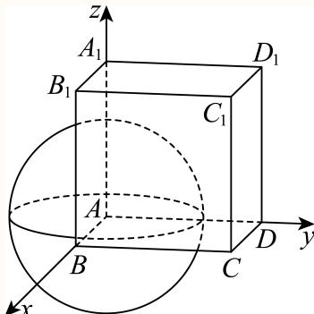
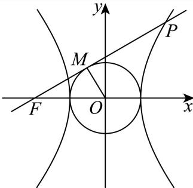

# 2025二模 普陀区原卷 · 教师版

> 本地预览：题目、答案及分类尚未全部审定。校对使用的PDF为高中工作台解析版，尚未逐区确认区级印刷原卷。

## 填空题

按本区原卷题号顺序排列。

### 普陀 · 第1题

不等 $\Re { \left( 1 + \frac { 1 } { x } \right) } <$ 0的解集是

**考点：** 分式不等式求解

**难度依据：** 分式不等式；直接调用定义或基本公式，运算路径短

**核查说明：** 已人工阅读底稿题干和解析；尚未逐页对照原PDF，不作为数学终审。

【答案】(−1,0)

【解析】

根据分式不等式的解法求解即可.

因为 $1 + \frac { 1 } { x } < 0 { \Rightarrow } \frac { x + 1 } { x } < 0 { \Rightarrow } x \left( x + 1 \right) < 0 .$

所以原不等式的解集为：(−1,0).

故答案为：(−1,0)

### 普陀 · 第2题

已知复数z $\stackrel { - } { = } \frac { 3 - 2 \mathrm { i } } { \mathrm { i } }$ ，其中i为虚数单位，则z +–z = .

**考点：** 复数共轭与运算

**难度依据：** 共轭复数运算；直接调用定义或基本公式，运算路径短

**核查说明：** 已人工阅读底稿题干和解析；尚未逐页对照原PDF，不作为数学终审。

【答案】−4

【解析】

根据复数的运算求出z，再根据共轭复数的概念求解即可.

因为 $\vert z = { \frac { ( 3 - 2 \mathrm { i } ) ( - \mathrm { i } ) } { \mathrm { i } ( - \mathrm { i } ) } } = - 2 - 3 \mathrm { i } , { \overline { { z } } } = - 2 + 3 \mathrm { i }$

$$
\therefore z + \bar {z} = (- 2 - 3 \mathrm{i}) + (- 2 + 3 \mathrm{i}) = - 4.
$$

故答案为：−4

### 普陀 · 第3题

已知事件A与事件B相互独立，若 $P \left( A \cap { \overline { { B } } } \right) = { \frac { 3 } { 2 5 } } , P \left( B \right) = { \frac { 3 } { 5 } }$ ，则P(A) =

**考点：** 独立事件概率

**难度依据：** 独立事件与对立事件；需完成一次转化或结合基本条件后计算

**核查说明：** 已人工阅读底稿题干和解析；尚未逐页对照原PDF，不作为数学终审。

【答案】$\frac { 3 } { 1 0 }$

【解析】

利用相互独立事件概率乘法公式和对立事件概率公式来求解即可.

由独立事件性质 $P \left( A \cap { \overline { { B } } } \right) = P \left( A \right) P \left( { \overline { { B } } } \right) = { \frac { 3 } { 2 5 } }$

$$
P \left(\overline {{B}}\right) = 1 - \frac {3}{5} = \frac {2}{5},
$$

$$
\therefore P (A) = \frac {\overline {{2 5}}}{\frac {2}{\overline {{z}}}} = \frac {3}{1 0},
$$

故答案为： $\frac { 3 } { 1 0 }$

### 普陀 · 第4题

设n ≥ 1， $n \in  { \mathrm { N } } , S _ { n }$ 是等差数列 $\left\{ a _ { n } \right\}$ 的前n项和，若 $a _ { 3 n } = 3 a _ { n } \neq 0$ ，则 $\frac { S _ { 5 } } { a _ { 1 0 } }$ 的值为

**考点：** 等差数列通项和前n项和

**难度依据：** 等差数列通项与求和；直接调用定义或基本公式，运算路径短

**核查说明：** 已人工阅读底稿题干和解析；尚未逐页对照原PDF，不作为数学终审。

【答案】$: \ \frac { 3 } { 2 }$

【解析】

根据等差数列数列的性质结合通项公式、求和公式，可直接求解.

设等差数列 $\{ a _ { n } \}$ 的首项为 $[ a _ { 1 }$ ，公差为 $^ { \dag { d , } }$

$$
a _ {1} + (3 n - 1) d = 3 \left[ a _ {1} + (n - 1) d \right] \Rightarrow a _ {1} + (3 n - 1) d = 3 a _ {1} + (3 n - 3) d \Rightarrow a _ {1} = d.
$$

所以 $S _ { 5 } = \frac { 5 \left( a _ { 1 } + a _ { 5 } \right) } { 2 } = 5 a _ { 3 } = 5 \left( a _ { 1 } + 2 d \right) = 1 5 d , a _ { 1 0 } = a _ { 1 } + 9 d = 1 0 d ,$

所以： ${ \frac { S _ { 5 } } { a _ { 1 0 } } } = { \frac { 1 { \bar { 5 } } d } { 1 0 d } } = { \frac { 3 } { 2 } }$

故答案为 $: \ \frac { 3 } { 2 }$

### 普陀 · 第5题

设m > 2，拋物线 $C \colon x ^ { 2 } = 2 m y$ 上的点P到C的焦点的距离为5，点P到y轴的距离为3，则m的值为

**考点：** 焦准距离

**难度依据：** 抛物线焦点与准线；直接调用定义或基本公式，运算路径短

**核查说明：** 已人工阅读底稿题干和解析；尚未逐页对照原PDF，不作为数学终审。

【答案】9

【解析】

根据给定条件，求出点P的纵坐标，再利用抛物线的定义列式求解.

拋物线 $C \colon x ^ { 2 } = 2 m y$ 的准线为 $y = - { \frac { m } { 2 } }$ ，

由点P到y轴的距离为3，得点P的纵坐标 $y _ { P } = { \frac { 9 } { 2 m } }$

由点P到C的焦点的距离为5，得 ${ \frac { 9 } { 2 m } } + { \frac { m } { 2 } } = 5$ ，解得m = 1或m = 9，而 $m > 2$ 所以m = 9.

故答案为：9

### 普陀 · 第6题

设t ∈ R，若 $\left( 1 + { \frac { t } { x } } \right) \left( 1 - x \right)$ 6的展开式中x3项的系数为10，则t =

**考点：** 二项式系数计算

**难度依据：** 二项式系数；直接调用定义或基本公式，运算路径短

**核查说明：** 已人工阅读底稿题干和解析；尚未逐页对照原PDF，不作为数学终审。

【答案】2

【解析】

根据二项式定理求x3项的系数即可.

$x ^ { 3 }$ 项为 $1 \times \mathrm { C } _ { 6 } ^ { 3 } \cdot 1 ^ { 3 } \cdot ( - x ) ^ { 3 } + \frac { t } { x } \times \mathrm { C } _ { 6 } ^ { 4 } \cdot 1 ^ { 2 } \cdot ( - x ) ^ { 4 } = ( - 2 0 + 1 5 t ) x ^ { 3 } ,$

由− $- 2 0 + 1 5 t = 1 0 \Rightarrow t = 2$

故答案为：2

### 普陀 · 第7题

在一个不透明的盒中装着标有数字1，2，3，4的大小与质地都相同的小球各2个，现从该盒中一次取出2个球，设事件A为“取出2个球的数字之和大于5”，事件B为“取出的2个球中最小数字是2”，则$P ( B | A ) =$

**考点：** 条件概率计算

**难度依据：** 条件概率；需完成一次转化或结合基本条件后计算

**核查说明：** 已人工阅读底稿题干和解析；尚未逐页对照原PDF，不作为数学终审。

【答案】$\frac { 2 } { 5 }$

【解析】

首先求出事件A、事件A∩B的基本事件数，再由条件概率公式计算可得.

事件A（数字之和大于5）的基本事件数（数字组合(2, 4), (3, 3), (3, 4), (4, 4)），

共有 $2 \times 2 + \mathbf { C } _ { ? } ^ { 2 } + 2 \times 2 + \mathbf { C } _ { ? } ^ { 2 } = 4 + 1 + 4 + 1 = 1 0 \# 4$ ；

而事件 $A \cap B$ （最小数字是2且和大 $\mp 5$ ，即(2,4)）的基本事件数有2×2 = 4种，

由条件概率公式 $P \left( B | A \right) = { \frac { n ( A \cap B ) } { n ( A ) } } = { \frac { 4 } { 1 0 } } = { \frac { 2 } { 5 } } .$

故答案为： $\frac { 2 } { 5 }$

### 普陀 · 第8题

若一个圆锥的高为 ${ \sqrt { 2 } } ,$ ，侧面积为2 $\sqrt { 2 } \pi$ ，则该圆锥侧面展开图中扇形的中心角的大小为

**考点：** 圆锥展开图与长度

**难度依据：** 圆锥侧面展开；需完成一次转化或结合基本条件后计算

**核查说明：** 已人工阅读底稿题干和解析；尚未逐页对照原PDF，不作为数学终审。

【答案】$\sqrt2\pi$。

【解析】

设圆锥的底面半径为 $r$，母线长为 $l$。由侧面积公式，得 $\pi rl=2\sqrt2\pi$，即 $rl=2\sqrt2$。

又圆锥的高为 $\sqrt2$，故 $l^2=r^2+2$，从而 $r\sqrt{r^2+2}=2\sqrt2$。解得 $r=\sqrt2$，$l=2$。

侧面展开扇形的弧长等于底面周长 $L=2\pi r=2\sqrt2\pi$，因此其中心角为

$$\theta=\frac{L}{l}=\sqrt2\pi.$$

### 普陀 · 第9题

设i,j,n为正整数，集合 $M = \{ 1 , 3 , 5 , \cdots , 2 n - 1 \}$ ，若集合A满足 $A \subseteq M ,$ ，且对A中任意的两个元素 $i , j ,$ 皆有 $| i - j | > 4 \#$ 立，记满足条件的集合A的个数为 $\scriptstyle { | a _ { n } }$ ，则 $a _ { 8 } =$

> 本地版本的第9、10题题号顺序存在冲突；本题子集范围的表述也须核正式原卷。

**考点：** 满足间距条件的子集计数

**难度依据：** 满足间距条件的子集；需连接多个条件、建模或作分类讨论

**核查说明：** 按现有题干子集条件，源答案19似漏空集和8个单元素集（另加9）；原题可能有OCR遗漏，先核原卷，不擅改。；已人工阅读底稿题干和解析；尚未逐页对照原PDF，不作为数学终审。；本机题目版PDF将该两题排序为第10、第9题，与底稿相反；PDF为重编候选，正式原卷题号需另核。

【答案】19

【解析】

【分析】利用分类思想，列举思想即可得到答案

【详解】当 n = 8 时，M = {1, 3, 5, ⋯ , 15}

若A为二元集：如

$\begin{array} { c } { { \{ 1 , 7 \} , \{ 1 , 9 \} , \{ 1 , 1 1 \} } } \\  { 1 3 \} , \{ 7 , 1 5 \} , \{ 9 , 1 5 \} } \end{array}$ , {1, 13}, {1, 15}, {3, 9}, {3, 11}, {3, 13}, {3, 15}, {5, 11}, {5, 13}, {5, 15}, {7,

，共有15种，

若 A 为三元集：如 {1, 7, 13}, {1, 7, 15}, {1, 9, 15}, {3, 9, 15} ，共有4种，所以总共有：

$a _ { 8 } = 1 5 + 4 = 1 9$ 种；

故答案为：19

### 普陀 · 第10题

设 $\bar { \mathsf { k } } \geq \overline { { 1 , k \in } } \mathrm { N } , 0 < \varphi < \frac { \pi } { 2 }$ ，函数 $y = f ( x )$ 的表达式为 $f ( x ) = 2 \sin ( k x + \varphi )$ )，则对任意的实数a，皆有 $\{ f ( x ) \mid a < x < a + 2 \} = \{ f ( x ) \mid x \in \operatorname { R } \}$ 成立的一个充分条件是

> 本地版本的第9、10题题号顺序存在冲突，当前题号尚待正式原卷核对。

**考点：** 周期性与开区间值域

**难度依据：** 周期函数区间值域；需连接多个条件、建模或作分类讨论

**核查说明：** 已人工阅读底稿题干和解析；尚未逐页对照原PDF，不作为数学终审。；本机题目版PDF将该两题排序为第10、第9题，与底稿相反；PDF为重编候选，正式原卷题号需另核。

【答案】k = 4

【解析】

由题意分析出区间 $( a , a + 2 )$ 至少包含一个完整的周期，才能保证f(x)能取到 $x \in \mathrm { R }$ 时的所有函数值，再利用周期的公式求出k的取值范围，结合充分条件的定义即可得到结果

因为函数 $f ( x ) = 2 \sin ( k x + \varphi )$ ，要使 $\{ f ( x ) \mid a < x < a + 2 \} = \{ f ( x ) \mid x \in \operatorname { R } \}$

则周期 $T = \frac { 2 \pi } { k } \leq 2$ ，即k $\geq \pi \approx 3 . 1 4$

因为 $k \in \mathbf N$ ，所以一个充分条件是 $k = 4$

故答案为：k = 4

### 普陀 · 第11题

在棱长为4的正方体 $A B C D - A _ { 1 } B _ { 1 } C _ { 1 } D _ { 1 } { } ^ { \prime }$ 中， $\overrightarrow { A N } = 2 \overrightarrow { A M } = \frac { 1 } { 2 } \overrightarrow { A C _ { 1 } }$ ，若一动点G满足$\left| { \overrightarrow { G N } } \right| = { \sqrt { 2 } } \left| { \overrightarrow { G M } } \right|$ ，则三棱锥 $G - A _ { 1 } B _ { 1 } D _ { 1 }$ 体积的最大值为

**考点：** 球面轨迹与体积最值

**难度依据：** 球面轨迹与棱锥体积最值；需综合转化、参数分析或完整证明，推理链较长

**核查说明：** 已人工阅读底稿题干和解析；尚未逐页对照原PDF，不作为数学终审。

【答案】$\frac { 3 2 + 8 { \sqrt { 6 } } } { 3 }$

【解析】

以A为坐标原点建立空间直角坐标系，得出 $M , N , A , C _ { 1 }$ 的坐标，设 $G ( x , y , z )$ ，根据已知$\left| { \overrightarrow { G N } } \right| = { \sqrt { 2 } } \left| { \overrightarrow { G M } } \right|$ 列出方程，化简得出点G的轨迹为球.进而结合图象即可得出点G到平面$A _ { 1 } B _ { 1 } D _ { 1 }$ 的最大距离，结合体积公式即可得出答案.

如图，以A为坐标原点建立空间直角坐标系，

则有 $A ( 0 , 0 , 0 ) , C _ { 1 } ( 4 , 4 , 4 )$

又 $\overrightarrow { A N } = \overrightarrow { 2 A M } = \frac { 1 } { 2 } \overrightarrow { A C _ { 1 } }$ ，

所以 $M ( 1 , 1 , 1 ) , N ( 2 , 2 , 2 )$

设 $G ( x , y , z )$ ，则 $| \overrightarrow { G N } = ( 2 - x , 2 - y , 2 - z ) , \overrightarrow { G M } = ( 1 - x , 1 - y , 1 - z ) .$

因为 $\left| \overrightarrow { G N } \right| = \sqrt { 2 } \left| \overrightarrow { G M } \right|$

代入可得 $\left( 2 - x \right) ^ { 2 } + ( 2 - y ) ^ { 2 } + ( 2 - z ) ^ { 2 } = 2 \left[ ( 1 - x ) ^ { 2 } + ( 1 - y ) ^ { 2 } + ( 1 - z ) ^ { 2 } \right]$

整理可得 $x ^ { 2 } + y ^ { 2 } + z ^ { 2 } = 6$

即G在以点A为球心， $r = { \sqrt { 6 } }$ 为半径的球上.

又 $\mathrm { R t } \triangle A _ { 1 } B _ { 1 } D _ { 1 }$ 的面积为 $S _ { \triangle A _ { 1 } B _ { 1 } D _ { 1 } } = \frac { 1 } { 2 } \times 4 \times 4 = 8 _ { \cdot }$

平面ABCD到平面 $A _ { 1 } B _ { 1 } C _ { 1 } D _ { 1 }$ 的距离为4，

所以G到平面 $A _ { 1 } B _ { 1 } D _ { 1 }$ 的最大距离为 $\begin{array} { r } { d _ { \operatorname* { m a x } \sim } = 4 + r = 4 + \sqrt { 6 } } \end{array}$

体积最大值为 $V = { \frac { 1 } { 3 } } \times S _ { \triangle A _ { 1 } B _ { 1 } D _ { 1 } } \times d _ { \mathrm { m a x } } = { \frac { 1 } { 3 } } \times 8 \times \Big ( 4 + \sqrt { 6 } \Big ) = { \frac { 3 2 + 8 \sqrt { 6 } } { 3 } } .$

故答案为： $\frac { 3 2 + 8 { \sqrt { 6 } } } { 3 }$

### 普陀 · 第12题

$\textstyle { \dot { \mathbb { E } } } a \in \mathbf { R }$ ，函数y = f(x)的表达式为 $f \left( x \right) = \left\{ \begin{array} { l l } { \displaystyle \mathrm { e } ^ { x } , x > 0 } \\ { \displaystyle \frac { 1 } { x + a } , x < 0 ^ { , } } \end{array} \right.$ 若函数 $\dot { \boldsymbol { \cdot } } \boldsymbol { g } ( \boldsymbol { x } ) = \boldsymbol { f } ( \boldsymbol { x } ) \boldsymbol { f } ( \boldsymbol { x } + 1 ) - 1$ 恰有三个零点，则a的取值范围是

**考点：** 分段函数零点个数

**难度依据：** 分段函数零点分类；需连接多个条件、建模或作分类讨论

**核查说明：** 已人工阅读底稿题干和解析；尚未逐页对照原PDF，不作为数学终审。

【答案】(2, e).

【解析】

根据x和x+1的符号，将x分为三个区间 $( - \infty , - 1 ) , ( - 1 , 0 ) , ( 0 , + \infty )$ ，并得到g(x)对应的不同的表达式，当x > 0时，g(x) = 0无解；当 $- 1 < x <$ 0时，g(x) = 0有唯一解，通过分离常数得到 $\mathbf { e } ^ { x + 1 } - x = a$ ，借助导数得到 $\mathrm { e } ^ { x + 1 } - x \ddag x \in ( - 1 , 0 )$ 上的值域，即可得到a的取值范围；当x < −1时，将g(x) = 0转化成关于x的二次函数 $x ^ { 2 } + ( 2 a + 1 ) x + a ^ { 2 } + a - 1 = 0 \not \equiv ( - \infty , - 1 )$ 上恰有两解的问题，即可求出a的取值范围.

①当x > 0时， $x + 1 > 0$

所以 $f ( x ) = \mathrm { e } ^ { x } , f ( x + 1 ) = \mathrm { e } ^ { x + 1 }$ ，

$$
g (x) = \mathrm{e} ^ {x} \mathrm{e} ^ {x + 1} - 1 = \mathrm{e} ^ {2 x + 1} - 1 > 0,
$$

解得 $x = - { \frac { 1 } { 2 } }$ ，不符合题意，所以g(x)在(0,+∞)上无解

②当 $- 1 < x <$ < 0时， $0 < x + 1 < 1$ ，

所以 $f \left( x \right) = \frac { 1 } { x + a } , f ( x + 1 ) = \mathrm { e } ^ { x + 1 } , g \left( x \right) = \frac { \mathrm { e } ^ { x + 1 } } { x + a } - 1 ,$

令 $\gamma g \left( x \right) = \frac { { { { \mathrm { e } } ^ { x + 1 } } } } { x + a } - 1 = 0$ ，所以 $\mathbf { e } ^ { x + 1 } = x + a$

即 $\mathsf { I e } ^ { x + 1 } - x = a , x \in ( - 1 , 0 )$

令 $h ( x ) = \mathrm { e } ^ { x + 1 } - x .$ ，所以 $\boldsymbol { h } ^ { \prime } ( \boldsymbol { x } ) = \mathrm { e } ^ { \boldsymbol { x } + 1 } - 1$ ，

所以 $h ^ { \prime } ( x ) = \mathrm { e } ^ { x + 1 } - 1 > 0$ ，所以h(x)在(−1,0)单调递增，

所以 $2 < h ( x ) < \mathrm { e }$ ，即2 $< a < \mathbf { e } .$

此时g(x)在(−1,0)上有唯一解；

③当 $\vert x < - 1$ 时， $x + 1 < 0$

$$
g (x) = \frac {1}{x + a} \cdot \frac {1}{x + a + 1} - 1 = 0
$$

因为函数 $\begin{array} { r } { \dot { \boldsymbol { g } } ( \boldsymbol { x } ) = f ( \boldsymbol { x } ) f ( \boldsymbol { x } + 1 ) - 1 } \end{array}$ 恰有三个零点，

所 $\lambda g \left( x \right) = \frac { 1 } { x + a } \cdot \frac { 1 } { x + a + 1 } - 1 = 0$ 在 $( - \infty , - 1 )$ 上有两解，

即 $( x + a ) ( x + 1 + a ) = 1 \not \downarrow \pm ( - \infty , - 1 )$ 上有两解，

即 $x ^ { 2 } + ( 2 a + 1 ) x + a ^ { 2 } + a - 1 = 0 \not \equiv ( - \infty , - 1 )$ 上有两解.

$$
\text {令} m (x) = x ^ {2} + (2 a + 1) x + a ^ {2} + a - 1
$$

所以 $\left\{ { \begin{array} { l } { m ( - 1 ) = a ^ { 2 } - a - 1 > 0 } \\ { \displaystyle - { \frac { 2 a + 1 } { 2 } } < - 1 } \\ { \Delta = \left( 2 a + 1 \right) ^ { 2 } - 4 \left( a ^ { 2 } + a - 1 \right) > 0 } \end{array} } \right. ,$ 即 $\left\{ \begin{array} { l l } { \displaystyle a > \frac { 1 + \sqrt { 5 } } { 2 } \ngeq \grave { \updownarrow } a < \frac { 1 - \sqrt { 5 } } { 2 } } \\ { \displaystyle a > \frac { 1 } { 2 } } \\ { \displaystyle a \in \mathrm { R } } \end{array} \right.$

解得 $\cdot a > { \frac { 1 + { \sqrt { 5 } } } { 2 } }$ ，

综上①②③，所以a的取值范围是(2,e).

故答案为：(2, e).

## 二、选择题

## 选择题

按本区原卷题号顺序排列。

### 普陀 · 第13题

某市职业技能大赛的移动机器人比赛项目有19位同学参赛，他们在预赛中所得的积分互不相同，只有积分在前10位的同学才能进入决赛.若该比赛项目中的某同学知道自 己的积分后，要判断自 己能否进入决赛，则他只需要知道这19位同学的预赛积分的（ ）

A. 平均数

B. 众数

C. 中位数

D. 方差

**考点：** 中位数判断

**难度依据：** 中位数；直接调用定义或基本公式，运算路径短

**核查说明：** 已人工阅读底稿题干和解析；尚未逐页对照原PDF，不作为数学终审。

【答案】C

【解析】

根据中位数的概念进行判断即可.

故选：C

因为19位同学的积分，中位数是第10名，所以知道中位数即可判断是否在前10.

### 普陀 · 第14题

设m ∈ R，在平面直角坐标系xOy中，角α的顶点在坐标原点，始边与x轴的正半轴重合，若角α的终边经过点 $P \left( - 3 , m \right)$ ，且 $\sin { ( \pi + 2 \alpha ) } > 0$ ，则角α属于（ ）

A. 第一象限

B. 第二象限

C. 第三象限

D. 第四象限

**考点：** 象限与倍角关系

**难度依据：** 角的象限与倍角；需完成一次转化或结合基本条件后计算

**核查说明：** 已人工阅读底稿题干和解析；尚未逐页对照原PDF，不作为数学终审。

【答案】B

【解析】

根据诱导公式和二倍角公式可得2 $\cos \alpha \sin \alpha < 0$ ，再根据角α的终边经过点 $P \left( - 3 , m \right)$ ，即可求解.

因为sin (π + 2α) = − sin 2α > 0，所以 $s \mathrm { i n } 2 \alpha < 0 .$ ，所以2 $\cos \alpha \sin \alpha < 0$

所以sin α，cos α异号，

所以α在第二、四象限，

又 $P \left( - 3 , m \right)$ ，所以α在第二象限.

故选：B.

### 普陀 · 第15题

设 $\because { \cal 0 } , { \cal b } > 0$ ，点 $M \left( x _ { 0 } , y _ { 0 } \right)$ ，O是坐标原点， $| O M | = a _ { \mathrm { { . } } }$ ，F是双曲线Γ: ${ \frac { x ^ { 2 } } { a ^ { 2 } } } - { \frac { y ^ { 2 } } { b ^ { 2 } } } = 1$ 1的左焦点，若直线l: $x _ { 0 } x + y _ { 0 } y = a ^ { 2 }$ 经过点F，且与双曲线Γ的右支在第一象限内交于P点，则双曲线Γ的离心率的一个可能的值是（ ）

A. $\frac { \sqrt { 5 } } { 2 }$

B. $\frac { \sqrt { 6 } } { 2 }$

C. $\frac { \sqrt { 7 } } { 2 }$

D. $\frac { \sqrt { 1 1 } } { 2 }$

**考点：** 双曲线焦点切线与渐近线

**难度依据：** 双曲线切线与离心率；需综合转化、参数分析或完整证明，推理链较长

**核查说明：** 已人工阅读底稿题干和解析；尚未逐页对照原PDF，不作为数学终审。

【答案】D

【解析】

先确定直线l与圆 $x ^ { 2 } + y ^ { 2 } = a ^ { 2 }$ 的位置关系，表示出直线 的斜率，数形结合，根据直线斜率与双曲线渐近线斜率的关系，得到a,b的关系，求出离心率的取值范围，即可进行判断.如图：

因为 $| O M | = a$ ，所以M点的轨迹是以O为圆心，以a为半径的圆，方程为： $x ^ { 2 } + y ^ { 2 } = a ^ { 2 }$ 因为点O到直线l： $x _ { 0 } x + y _ { 0 } y - a ^ { 2 } = 0$ 的距离为： $d = { \frac { a ^ { 2 } } { \sqrt { x _ { 0 } ^ { 2 } + y _ { 0 } ^ { 2 } } } } = { \frac { a ^ { 2 } } { a } } = a .$

所以直线l与圆 $x ^ { 2 } + y ^ { 2 } = a ^ { 2 }$ 相切.

又l过点 $F \left( - c , 0 \right)$ ，且 $c ^ { 2 } = a ^ { 2 } + b ^ { 2 }$ ，直线l与双曲线Γ的右支在第一象限内交于P点，

所以直线l的斜率为： $k _ { l } = { \frac { | O M | } { | F M | } } = { \frac { a } { b } }$

又一、三象限双曲线的渐近线的斜率为： $\frac { b } { a }$

$$
\frac {b}{a} > \frac {a}{b} \Rightarrow b ^ {2} > a ^ {2} \Rightarrow c ^ {2} - a ^ {2} > a ^ {2} \Rightarrow c ^ {2} > 2 a ^ {2} \Rightarrow \frac {c ^ {2}}{a ^ {2}} > 2.
$$

即 $e ^ { 2 } > 2 \Rightarrow e > { \sqrt { 2 } } .$

故选：D

### 普陀 · 第16题

设 $k\geq2$，$n\geq1$，$k,n\in\mathbf N$，$S_n$ 是数列 $\{a_n\}$ 的前 $n$ 项和，且满足 $2S_n=3a_n-1$。数列 $\{b_n\}$ 是由 $k$ 个大于 $-2$ 的整数组成的有穷数列，若 $b_1\ne0$，且

$$\sum_{i=1}^{k}b_i a_{k-i+1}=0,$$

则称数列 $\{b_n\}$ 是数列 $\{a_n\}$ 的“T数列”。对于数列 $\{b_n\}$ 有如下两个命题：

① 若 $b_1>0$，则数列 $\{b_n\}$ 不是数列 $\{a_n\}$ 的“T数列”；

② 若 $k\geq3$，则数列 $\{a_n\}$ 的“T数列”至少有5个。

则下列结论中正确的是（　）。

A. ①为真，②为真

B. ①为真，②为假

C. ①为假，②为真

D. ①为假，②为假

> 本题资料或解析有待核事项，预览不可作为已审定成品。

**考点：** T数列构造与一般性证明

**难度依据：** T数列定义；需综合转化、参数分析或完整证明，推理链较长

**核查说明：** 源解由k=2等个案推一般结论，论证不充分，需一般性证明。；已人工阅读底稿题干和解析；尚未逐页对照原PDF，不作为数学终审。

【答案】A。

【解析】

当 $n=1$ 时，$2a_1=3a_1-1$，得 $a_1=1$。当 $n\geq2$ 时，由

$$2S_n=3a_n-1,\qquad 2S_{n-1}=3a_{n-1}-1,$$

两式相减得 $a_n=3a_{n-1}$，故 $a_n=3^{n-1}$。

对于命题①，若整数 $b_1>0$，则 $b_1\geq1$，其余各项 $b_i\geq-1$。因此

$$\begin{aligned}
\sum_{i=1}^{k}b_i a_{k-i+1}
&=\sum_{i=1}^{k}b_i3^{k-i}\\
&\geq3^{k-1}-\sum_{j=0}^{k-2}3^j
=\frac{3^{k-1}+1}{2}>0.
\end{aligned}$$

加权和不为0，故不能成为“T数列”，命题①为真。

对于命题②，当 $k=3$ 时，取以下五组三元组：

$$(-1,-1,12),\quad(-1,0,9),\quad(-1,1,6),\quad(-1,2,3),\quad(-1,3,0).$$

每组均满足 $9b_1+3b_2+b_3=0$，各项均为大于 $-2$ 的整数，且 $b_1\ne0$。

对任意 $k\geq3$，在上述每组三元组后补上 $k-3$ 个0，则

$$\sum_{i=1}^{k}b_i3^{k-i}=3^{k-3}(9b_1+3b_2+b_3)=0.$$

由此得到五个不同的“T数列”，所以命题②为真，故选A。

源解析仅举 $k=2$ 判断命题①，并由 $k=3,4$ 的例子推及一般情况；本解析分别补充一般下界与补零构造。

## 解答题

按本区原卷题号顺序排列。

### 普陀 · 第17题

如图，在三棱柱 $A B C - A _ { 1 } B _ { 1 } C _ { 1 }$ 中， $A C = A A _ { 1 } = A B = 2 , \angle B A A _ { 1 } = { \frac { \pi } { 3 } }$ ，且
$$
C A _ {1} = C B, C A _ {1} \bot A B _ {1}
$$

(1) (6分)求证：平面 $C A B _ { 1 } \bot$ 平面 $A A _ { 1 } B _ { 1 } B _ { \cdot }$
(2) (8分)求直线 $C A _ { 1 }$ 与平面 $B B _ { 1 } C _ { 1 }$ C所成的角的正弦值.

**考点：** (1)面面垂直证明；(2)空间向量求线面角

**难度依据：** 面面垂直与线面角；需连接多个条件、建模或作分类讨论

**核查说明：** 已人工阅读底稿题干和解析；尚未逐页对照原PDF，不作为数学终审。

【解析】

(1) 连结 $A _ { 1 } B \cap A B _ { 1 } = O$ ，连结CO

在 $: \triangle A B A _ { 1 }$ 1中， $A A _ { 1 } = A B = 2 , \angle B A A _ { 1 } = { \frac { \pi } { 3 } }$

故 $\triangle A B A _ { 1 }$ 是等边三角形，所以 $\square A _ { 1 } A B B _ { 1 }$ 为菱形，

所以 $A B _ { 1 } \bot A _ { 1 } B _ { \cdot }$ ，且O是 $A _ { 1 } B , A B _ { 1 }$ 的中点.

因为 $C A _ { 1 } = C B$

所以 $C O \bot A _ { 1 } B _ { \cdot }$

因为 ${ \cal C } { \cal O } \cap { \cal C } A _ { 1 } = C ,$

所以 $A _ { 1 } B \bot$ 平面 $\ C A B _ { 1 }$

又 $A _ { 1 } B \subset \bar { 2 }$ 平面 $A A _ { 1 } B _ { 1 } B _ { 2 }$

所以平面 $C A B _ { 1 } \bot$ 平面 $A A _ { 1 } B _ { 1 } B$

(2)

以O为原点，OA为x轴， $O A _ { 1 }$ 为y轴，OC为z轴建立空间直角坐标系，

则O (0, 0, 0), A $\left( \sqrt { 3 } , 0 , 0 \right) , A _ { 1 } \left( 0 , 1 , 0 \right) , C \left( 0 , 0 , 1 \right) , B \left( 0 , - 1 , 0 \right) , B _ { 1 } \left( - \sqrt { 3 } , 0 , 0 \right)$

所以， $\overrightarrow { B C } = ( 0 , 1 , 1 ) , \overrightarrow { B B _ { 1 } } = \left( - \sqrt { 3 } , 1 , 0 \right) , \overrightarrow { C A _ { 1 } } = ( 0 , 1 , - 1 )$

设平面 $B B _ { 1 } C _ { 1 } C$ 的一个法向 $\vec n=(x,y,z)$ ，

则有 $\left\{ { \begin{array} { l } { { \vec { n } } \cdot { \overrightarrow { B C } } = 0 } \\ { { \vec { n } } \cdot { \overrightarrow { B B _ { 1 } } } = 0 } \end{array} } \right.$ ，即 $\left\{ { \begin{array} { l l } { y + z = 0 } \\ { - { \sqrt { 3 } } x + y = 0 } \end{array} } \right. .$

令 $\mathbf { \bar { \rho } } y = \mathbf { \sqrt { 3 } }$ ，可得平面 $B B _ { 1 } C _ { 1 }$ C的一个法向量为 ${ \vec { n } } = \left( 1 , { \sqrt { 3 } } , - { \sqrt { 3 } } \right)$ 所以，直线 $C A _ { 1 } \mathrm { { - } }$ 与平面 $B B _ { 1 } C _ { 1 } C$ 所成的角θ的正弦值为

$$
\sin \theta = \frac {\left| \overrightarrow {C A _ {1}} \cdot \overrightarrow {n} \right|}{\left| \overrightarrow {C A _ {1}} \right| | \overrightarrow {n} |} = \frac {| 0 + \sqrt {3} + \sqrt {3} |}{\sqrt {1 + 1} \times \sqrt {7}} = \frac {2 \sqrt {3}}{\sqrt {2} \times \sqrt {7}} = \frac {\sqrt {4 2}}{7}.
$$

### 普陀 · 第18题

$\begin{array} { r } { \operatorname { i } \frac { \hbar } { \mathsf { X } } \omega > 0 , } \end{array}$ ，函数 $y = f ( x )$ 的表达式为 $f \left( x \right) = \cos { \left( \omega x - \frac { \pi } { 6 } \right) }$
(1) $( 6 \mathcal { W } ) _ { \# } \underline { { { \sf _ { \Pi } } } } \omega = 2$ ，设 $\triangle A B C$ 的内角A,B,C的对边分别为 $a , b , c$ $f \left( C \right) = - \frac { \sqrt { 3 } } { 2 }$ ，且$c ^ { 2 } - a ^ { 2 } - b ^ { 2 } = 4$ ，求 $\triangle A B C$ 的面积.
(2) (8分)对任意的 $\mathbf { \boldsymbol { x } } _ { 0 } \in \mathbf { \mathbb { R } }$ ，皆有 $f \left( x _ { 0 } \right) \leq f \left( { \frac { \pi } { 3 } } \right)$ 成立，且该函数在区间 $\left( { \frac { \pi } { 6 } } , { \frac { \pi } { 2 } } \right)$ 上不存在最小值，求函数 $\boldsymbol { \cdot } \boldsymbol { y } = \boldsymbol { f } \left( \boldsymbol { x } \right)$ 在 $x \in \left( { \frac { 4 \pi } { 3 } } , { \frac { 1 7 \pi } { 6 } } \right)$ 的单调区间.

**考点：** (1)正余弦定理解三角形；(2)相位、周期与单调区间

**难度依据：** 解三角形与三角函数性质；需连接多个条件、建模或作分类讨论

**核查说明：** 已人工阅读底稿题干和解析；尚未逐页对照原PDF，不作为数学终审。

【解析】

(1) 因 $\Re \omega = 2$ ，所以 $f \left( x \right) = \cos { \left( 2 x - \frac { \pi } { 6 } \right) }$ ，

所以 $f \left( C \right) = \cos \left( 2 C - \frac { \pi } { 6 } \right) = - \frac { \sqrt { 3 } } { 2 }$ ，解得 $2 C - { \frac { \pi } { 6 } } = { \frac { 7 \pi } { 6 } }$ 或 $\frac { 5 \pi } { 6 }$

所以 $\mathit { S } = \frac { \pi } { 2 } \mathit { \Pi } _ { \exists } \mathit { \hat { \Psi } } _ { 3 } ^ { 2 \pi }$

若 $C = \frac { \pi } { 2 }$ ，则 $| c ^ { 2 } = a ^ { 2 } + b ^ { 2 } |$ ，不符；所以 $C = \frac { 2 \pi } { 3 }$

所以 $\cos { C } = { \frac { a ^ { 2 } + b ^ { 2 } - c ^ { 2 } } { 2 a b } } = - { \frac { 1 } { 2 } }$ ，所以 $c ^ { 2 } = a ^ { 2 } + b ^ { 2 } + a b$

由 $\displaystyle { \mathrm {  ~ \nabla ~ } } \mathrm { f } c ^ { 2 } - a ^ { 2 } - b ^ { 2 } = 4 ,$

得 $\cdot 4 + a ^ { 2 } + b ^ { 2 } = a ^ { 2 } + b ^ { 2 } + a b$ ，所以 $a b = 4$

$$
S _ {\triangle A B C} = \frac {1}{2} a b \sin C = \frac {1}{2} \times 4 \times \frac {\sqrt {3}}{2} = \sqrt {3};
$$

(2) 由 $f \left( { \frac { \pi } { 3 } } \right) = 1$ ，得 $\frac { \omega \pi } { 3 } - \frac { \pi } { 6 } = 2 k \pi$ ，所以 $\omega = 6 k + { \frac { 1 } { 2 } } , k \in \mathbf { Z } .$

$\stackrel { \triangledown } {  } t = \omega x - \frac { \pi } { 6 }$ ，因为 $x \in \left( { \frac { \pi } { 6 } } , { \frac { \pi } { 2 } } \right)$ ，所以 $t \in \left( \frac { \pi } { 6 } \omega - \frac { \pi } { 6 } , \frac { \pi } { 2 } \omega - \frac { \pi } { 6 } \right)$

又函数在 $\left( { \frac { \pi } { 6 } } , { \frac { \pi } { 2 } } \right)$ 无最小值，

所以 $\left\{ \begin{array} { l l } { \displaystyle \frac { \pi } { 6 } \omega - \displaystyle \frac { \pi } { 6 } > - \displaystyle \frac { \pi } { 2 } } \\ { \displaystyle \frac { \pi } { 2 } \omega - \displaystyle \frac { \pi } { 6 } < \displaystyle \frac { 3 \pi } { 2 } } \\ { \omega > 0 } \end{array} \right.$ 解得 $\omega \in \left( 0 , \frac { 1 0 } { 3 } \right)$

所以 $. k = 0$ ，则 $\omega = \frac { 1 } { 2 }$ ，所以 $f \left( x \right) = \cos \left( \frac { 1 } { 2 } x - \frac { \pi } { 6 } \right)$ ，

令 $2 k \pi \leq { \frac { 1 } { 2 } } x - { \frac { \pi } { 6 } } \leq 2 k \pi + \pi _ { \cdot }$ ，所以 $4 k \pi + \frac { \pi } { 3 } \leq x \leq 4 k \pi + \frac { 7 \pi } { 3 }$ , k ∈ Z，

当k = 0时， $\frac { \pi } { 3 } \leq x \leq \frac { 7 \pi } { 3 }$

因为 $x \in \left( { \frac { 4 \pi } { 3 } } , { \frac { 1 7 \pi } { 6 } } \right)$ ， 所以f (x)在 $\left( { \frac { 4 \pi } { 3 } } , { \frac { 7 \pi } { 3 } } \right)$ 单调递减， $\sharp \left( { \frac { 7 \pi } { 3 } } , { \frac { 1 7 \pi } { 6 } } \right)$ 单调递增.

### 普陀 · 第19题

某区为推进教育数字化转型，通过聚合区域学校的教育资源，依托AI技术搭建了区域智慧题库系统，形成了“A通识过关—B综合拓展—C创新提升”三层动态原库，且A,B,C三层题量之比为7:3:2，设该题库中任意1道题被选到的可能性都相同.
(1) (6分)现有4人参加一项比赛，若每人分别独立地从该题库中随机选取一道题作答，求这4人中至少有2人的选题来自B层的概率；
(2) (8分)现采用分层随机抽样的方法，使用智能组卷系统从该题库中选取12道题生成试卷，若某老师要从生成的这份12道题的试卷中随机选取3道题做进一步改编，记该老师选到A层题的题数为X，求X的分布与期望E(X)

**考点：** (1)二项概率；(2)分层抽样后分布列与期望

**难度依据：** 二项概率与分布列期望；需连接多个条件、建模或作分类讨论

**核查说明：** 已人工阅读底稿题干和解析；尚未逐页对照原PDF，不作为数学终审。

【解析】

(1) 因为A,B,C三层题量之比为7:3:2，

所以在B层选题的概率为 ${ \frac { 3 } { 1 2 } } = { \frac { 1 } { 4 } }$ ，不在B层选题的概率为 $- \frac { 1 } { 4 } = \frac { 3 } { 4 }$

设至少2人的选题来自B层的概率为 $P ,$ ，从B层选题数量为 $X _ { 1 }$ ，

由题意得 $X _ { 1 } \sim B \left( 4 , \frac { 1 } { 4 } \right)$ 而二项分布概率公式为 $P \left( X _ { 1 } = k \right) = \mathbf { C } _ { 4 } ^ { k } { \Bigg ( } { \frac { 1 } { 4 } } { \Bigg ) } ^ { k } { \Bigg ( } { \frac { 3 } { 4 } } { \Bigg ) } ^ { n - k }$ 则至少2人的选题来自B层的概率为 $P ( X _ { 1 } = 2 ) + P ( X _ { 1 } = 3 ) + P ( X _ { 1 } = 4 )$

$$
P = \mathrm{C} _ {4} ^ {2} \left(\frac {1}{4}\right) ^ {2} \left(\frac {3}{4}\right) ^ {2} + \mathrm{C} _ {4} ^ {3} \left(\frac {1}{4}\right) ^ {3} \left(\frac {3}{4}\right) + \mathrm{C} _ {4} ^ {4} \left(\frac {1}{4}\right) ^ {4} = \frac {5 4}{2 5 6} + \frac {1 2}{2 5 6} + \frac {1}{2 5 6} = \frac {6 7}{2 5 6}.
$$

(2) 因为A,B,C三层题量之比为7:3:2，

所以在A层最多抽到7道，且X可取0,1,2,3，

则P (X = 0) = C07C35 1 , P (X = 1) = C17C25 7 C3 22 12 22

$$
P (X = 2) = \frac {\mathrm{C} _ {7} ^ {2} \mathrm{C} _ {5} ^ {1}}{\mathrm{C} _ {1 2} ^ {3}} = \frac {2 1}{4 4}, P (X = 3) = \frac {\mathrm{C} _ {7} ^ {3} \mathrm{C} _ {5} ^ {0}}{\mathrm{C} _ {1 2} ^ {3}} = \frac {7}{4 4},
$$

其分布列为

所以期望 $\overline { { E ( X ) } } = 0 \times \frac { 1 } { 2 2 } + 1 \times \frac { 7 } { 2 2 } + 2 \times \frac { 2 1 } { 4 4 } + 3 \times \frac { 7 } { 4 4 } = \frac { 7 } { 4 } .$

### 普陀 · 第20题

设 $a > b > 0 , m > 0$ ，点A、F分别是椭圆Γ: ${ \frac { x ^ { 2 } } { a ^ { 2 } } } + { \frac { y ^ { 2 } } { b ^ { 2 } } } = 1$ 的上顶点与右焦点，且 $\left| A F \right| = 2 { \mathrm { . } }$ ，直线 $l { : } x - m y - 1 = 0$ 经过点F与Γ交于P、Q两点，O是坐标原点.
(1) (4分)求椭圆Γ的方程；
(2) (6分)若 $m = { \sqrt { 3 } } .$ ，点M是x轴上的一点，且 $\triangle M P Q$ 的面积为 $\frac { 6 } { 1 3 }$ ，求点M的坐标；
(3) (8分)若点G在直线x = 5上，向量 $\vec { P G }$ 在直线l上的投影为向量 $\vec { P F }$ ，证明 $\angle P G Q < \frac { \pi } { 4 }$

**考点：** (1)焦点弦；(2)三角形面积；(3)向量投影与角

**难度依据：** 椭圆焦点弦与面积；需综合转化、参数分析或完整证明，推理链较长

**核查说明：** 已人工阅读底稿题干和解析；尚未逐页对照原PDF，不作为数学终审。

【解析】

(1) $| A F | = { \sqrt { b ^ { 2 } + c ^ { 2 } } } = a = 2$

直线l: $x - m y - 1 = 0 \nVdash ( 1 , 0 )$ 所以右焦点 $F ( 1 , 0 )$ ，即 $| c = 1$

所以 $b ^ { 2 } = a ^ { 2 } - c ^ { 2 } = 4 - 1 = 3$ ，椭圆方程为 ${ \frac { x ^ { 2 } } { 4 } } + { \frac { y ^ { 2 } } { 3 } } = 1$ .

(2) $x = { \sqrt { 3 } } y + 1 , \left\{ { \begin{array} { l } { x = { \sqrt { 3 } } y + 1 } \\ { { \frac { x ^ { 2 } } { 4 } } + { \frac { y ^ { 2 } } { 3 } } = 1 } \end{array} } \right. \Rightarrow 1 3 y ^ { 2 } + 6 { \sqrt { 3 } } y - 9 = 0 ,$ 当 $m = { \sqrt { 3 } } ,$ 直线l:

$$
y _ {1} = \frac {- 6 \sqrt {3} + 2 4}{2 6} = \frac {- 3 \sqrt {3} + 1 2}{1 3}, y _ {2} = \frac {- 6 \sqrt {3} - 2 4}{2 6} = \frac {- 3 \sqrt {3} - 1 2}{1 3},
$$

$$
\therefore \left| y _ {1} - y _ {2} \right| = \frac {2 4}{1 3} \Rightarrow | P Q | = \sqrt {1 + (\sqrt {3}) ^ {2}} \left| y _ {1} - y _ {2} \right| = \frac {4 8}{1 3},
$$

设 $M \left( x _ { 0 } , 0 \right)$ 到直线距离 $ d = { \frac { | x _ { 0 } - 1 | } { \sqrt { 1 + ( { \sqrt { 3 } } ) ^ { 2 } } } } = { \frac { | x _ { 0 } - 1 | } { 2 } }$

由面积 $S _ { \triangle A B C } = \frac { 1 } { 2 } \times \frac { 4 8 } { 1 3 } \times \frac { | x _ { 0 } - 1 | } { 2 } = \frac { 6 } { 1 3 }$ ，得 $| x _ { 0 } - 1 | = \frac { 1 } { 2 } , x _ { 0 } = \frac { 3 } { 2 } \mathbb { H } \frac { 1 } { 2 }$ 即 $I M \left( { \frac { 3 } { 2 } } , 0 \right) { \overrightarrow { \sf u } } { \widehat { \sf x } } \left( { \frac { 1 } { 2 } } , 0 \right)$

(3)

设 $P \left( x _ { P } , y _ { P } \right) , Q \left( x _ { Q } , y _ { Q } \right) , G ( 5 , k )$

因为向量 $\xrightarrow [ P G ] { }$ 在直线l上的投影为向量 $\xrightarrow [ P F ] { }$ ，故 $F G \bot P Q$

故直线FG的斜率为−m，故直线FG的方程为 $y = - m \left( x - 1 \right)$ ，故 $G ( 5 , - 4 m )$

故 $| P F | = \sqrt { 1 + m ^ { 2 } } | y _ { P } | , | Q F | = \sqrt { 1 + m ^ { 2 } } | y _ { Q } | , | F G | = \sqrt { 1 + m ^ { 2 } } | 5 - 1 | = 4 \sqrt { 1 + m ^ { 2 } } | y _ { P } | ^ { 2 } .$

$$
\tan \angle P G Q = \frac {\tan \angle P G F + \tan \angle Q G F}{1 - \tan \angle P G F \tan \angle Q G F} = \frac {\frac {| y _ {P} |}{4} + \frac {| y _ {Q} |}{4}}{1 - \frac {| y _ {P} y _ {Q} |}{1 6}} = \frac {\frac {| y _ {P} |}{4} + \frac {| y _ {Q} |}{4}}{1 - \frac {| y _ {P} y _ {Q} |}{1 6}} = \frac {4 | y _ {P} - y _ {Q} |}{1 6 - | y _ {P} y _ {Q} |}
$$

$$
\text {联立} \left\{ \begin{array}{l l} x = m y + 1 \\ \frac {x ^ {2}}{4} + \frac {y ^ {2}}{3} = 1 \end{array} \right. \Rightarrow (3 m ^ {2} + 4) y ^ {2} + 6 m y - 9 = 0,
$$

$$
y _ {P} + y _ {Q} = - \frac {6 m}{3 m ^ {2} + 4}, y _ {P} y _ {Q} = - \frac {9}{3 m ^ {2} + 4}, \Delta = 1 4 4 (m ^ {2} + 1) > 0,
$$

$$
\text {故} \tan \angle P G Q = \frac {4 8 \sqrt {m ^ {2} + 1}}{1 6 (3 m ^ {2} + 4) - 9} = \frac {4 8 \sqrt {m ^ {2} + 1}}{4 8 (m ^ {2} + 1) + 7} = \frac {4 8}{4 8 \sqrt {m ^ {2} + 1} + \frac {7}{\sqrt {m ^ {2} + 1}}},
$$

$$
\text { 设 } t = \sqrt {m ^ {2} + 1} > 1, \text { 设 } y = 4 8 t + \frac {7}{t}, t > 1,
$$

由双勾函数的性质可得 $\mathbf { \nabla } \cdot y = 4 8 t + \frac { 7 } { t } \mathcal { \overleftarrow { 1 } } ( 1 , + \infty )$ 为增函数，

故 $\cdot 4 8 t + \frac { 7 } { t } > 5 5$ ，故 $\tan \angle P G Q < \frac { 4 8 } { 5 5 } < 1$ ，

$$
\therefore \angle P G Q <   \frac {\pi}{4}.
$$

### 普陀 · 第21题

已知 $\textstyle | a , b \in \mathbb { R }$ ，对于函数 $\left[ { \mathcal { y } } = f \left( x \right) , \ x \in D \right]$ ，设集合 $A = \{ ( x , y ) | y = f ( x ) \}$ }$B = \Big \{ ( x , y ) | ( x - a ) ^ { 2 } + ( y - b ) ^ { 2 } \leq 1 \Big \} , \forall \mathrm { \large ~ \overrightarrow ~ { a } ~ } , { b } \mathrm { \large ~ = ~ } A \cap B .$
(1) (4分)若函数 $f \left( x \right) = { \frac { 1 } { x } } - { \frac { 3 x } { 4 } }$ ，请判断 $M _ { f } \left( 0 , 0 \right)$ 中元素的个数，并说明理由；
(2) (6分)设k > 0，函数 $f \left( x \right) = { \sqrt { x + k } }$ ，若 $M _ { f } \left( { \frac { 1 } { 2 } } , 0 \right) = \{ { ( x _ { 0 } , y _ { 0 } ) } \}$ ，求k的值以及曲线 $y = f \left( x \right)$ 在点 $P ( x _ { 0 } , y _ { 0 } )$ 处的切线方程；
(3) (8分)设 ${ \bf { \dot { m } } } \in \bf { R } .$ ，函数 $f \left( x \right) = \mathrm { e } ^ { x } - \frac { \ln x } { x } - \frac { 1 } { x } + m .$ ，若对于任意的a，皆有 $M _ { f } \left( a , 0 \right) = \emptyset$ 成立，求m的取值范围.

> 本题资料或解析有待核事项，预览不可作为已审定成品。

**考点：** (1)新定义与交点个数；(2)切线；(3)恒成立参数

**难度依据：** 函数图像与圆盘交集；需构造新对象、综合多问并处理一般性或参数边界

**核查说明：** M_f定义OCR破损；第三问源解从g(x)<g(1)推g(x)>1存在逻辑缺口，参数答案须复核。；已人工阅读底稿题干和解析；尚未逐页对照原PDF，不作为数学终审。

【解析】

$$
\left\{ \begin{array}{l} x ^ {2} + y ^ {2} \leq 1 \\ y = \frac {1}{x} - \frac {3 x}{4} \Rightarrow x ^ {2} + \left(\frac {1}{x} - \frac {3 x}{4}\right) ^ {2} \leq 1 \Rightarrow \left(\frac {5 x}{4} - \frac {1}{x}\right) ^ {2} \leq 0 \Rightarrow \frac {5 x}{4} - \frac {1}{x} = 0 \Rightarrow x = \pm \frac {2 \sqrt {5}}{5} \end{array} \right.
$$

当 $\lvert x = \frac { 2 \sqrt { 5 } } { 5 }$ 时， $y = { \frac { \sqrt { 5 } } { 2 } } - { \frac { 3 } { 4 } } \times { \frac { 2 { \sqrt { 5 } } } { 5 } } = { \frac { \sqrt { 5 } } { 5 } }$

当 $\mathbf { \bar { \Psi } } = - { \frac { 2 { \sqrt { 5 } } } { 5 } }$ 时， $y = - { \frac { \sqrt { 5 } } { 2 } } + { \frac { 3 } { 4 } } \times { \frac { 2 { \sqrt { 5 } } } { 5 } } = - { \frac { \sqrt { 5 } } { 5 } } .$

所以 $M _ { f } \left( 0 , 0 \right) = \left\{ \left( \frac { 2 \sqrt { 5 } } { 5 } , \frac { \sqrt { 5 } } { 5 } \right) , \left( - \frac { 2 \sqrt { 5 } } { 5 } , - \frac { \sqrt { 5 } } { 5 } \right) \right\}$ 有2个元素.

(2) 将 $y = { \sqrt { x + } }$ k代入圆 $\left( x - { \frac { 1 } { 2 } } \right) ^ { 2 } + y ^ { 2 } = 1 { \Rightarrow } x ^ { 2 } + k - { \frac { 3 } { 4 } } = 0 ,$

由相切 $\Delta = 0 { \Rightarrow } 4 \left( k - \frac { 3 } { 4 } \right) = 0 { \Rightarrow } k = \frac { 3 } { 4 } .$

此时 $x _ { 0 } = 0 , \ y _ { 0 } = { \frac { \sqrt { 3 } } { 2 } } ,$

又 $f \left( x \right) = { \sqrt { x + { \frac { 3 } { 4 } } } }$ ，所以 $f ^ { \prime } \left( x \right) = { \frac { 1 } { 2 { \sqrt { x + { \frac { 3 } { 4 } } } } } }$ ，所以 $f ^ { \prime } \left( 0 \right) = \frac { 1 } { \sqrt { 3 } }$

切线方程 $y - { \frac { \sqrt { 3 } } { 2 } } = { \frac { 1 } { \sqrt { 3 } } } x$ ，即 $? x - 2 { \sqrt { 3 } } y + 3 = 0$

(3) 对于任意的a，皆有 $M _ { f } \left( a , 0 \right) = \alpha$ 成立，即函数f(x)的图象与圆系： $\left( x - a \right) ^ { 2 } + y ^ { 2 } = 1$ 1无交点，所以f(x) > 1恒成立.

因为 $\mathrm { \Delta } f \left( x \right) = { \mathrm { e } } ^ { x } - \frac { \ln { x } } { x } - \frac { 1 } { x } + m , \mathrm { \Delta } x > 0$ ，所以 $f ^ { \prime } \left( x \right) = \mathrm { e } ^ { x } + { \frac { \ln x } { x ^ { 2 } } } , x > 0 ,$

当x ≥ 1时， $f ^ { \prime } \left( x \right) >$ 0恒成立，所以函数在 $[ 1 , + \infty )$ 上单调递增，且 $f \left( 1 \right) = { \bf e } - 1 + m$

由 $| \mathrm { e } - 1 + m > 1 \Rightarrow m > 2 - \mathrm { e } .$

$\left[ 0 < x < 1 \right]$ 1时，设h $\mathbf { \boldsymbol { \mathbf { \rho } } } ( x ) = \mathbf { e } ^ { x } - x - 1$ ，则 $h ^ { \prime } \left( x \right) = \mathrm { e } ^ { x } - 1 > 0$ ，所以 $\iota \left( x \right) \# ( 0 , 1 )$ )上单调递

所以h $( x ) > h ( 0 ) = 0$

即当 $) < x <$ 1时， $\mathrm { e } ^ { x } > x + 1$ ；

又ln $\iota x < 0 ,$ ，所以 ${ \frac { \ln x + 1 } { x } } < { \frac { 1 } { x } }$

所以 $f \left( x \right) = \mathrm { e } ^ { x } - { \frac { \ln x + 1 } { x } } + m \geq x + 1 - { \frac { 1 } { x } } + m .$

设 $\because g \left( x \right) = x + 1 - { \frac { 1 } { x } } + m , \ 0 < x < 1$ ，则 $g ^ { \prime } \left( x \right) = 1 + \frac { 1 } { x ^ { 2 } } > 0 .$ ，

所以g(x)在(0,1)上单调递增，所以 $g \left( x \right) < g \left( 1 \right) = 1 + m$

由1 $. + m > 1 { \Rightarrow } m > 0 .$

综上，实数m的取值范围为： $( 0 , + \infty )$

