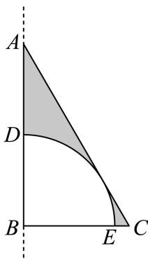
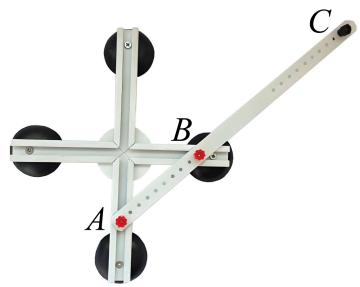
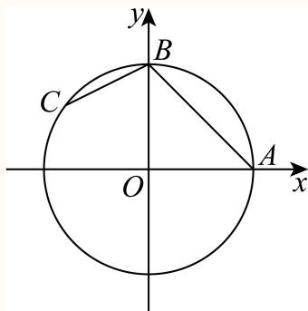
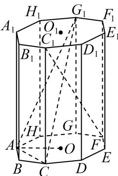
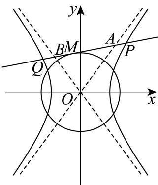

# 2025二模 杨浦区原卷 · 教师版

> 本地预览：题目、答案及分类尚未全部审定。校对使用的PDF为高中工作台解析版，尚未逐区确认区级印刷原卷。

## 填空题

按本区原卷题号顺序排列。

### 杨浦 · 第1题

已知集合A = {1, 2, 3, 4}， $B = \{ x \mid 1 < x < 4 \}$ ，则A ⋂ B=

**考点：** 集合交集

**难度依据：** 有限集合与区间交集；直接运用定义或基础公式，推理链短

**核查说明：** 已人工阅读完整底稿题干及原解，未逐页对照正式PDF，分类不等于数学终审。

【解析】

【分析】由交集的运算可得

【详解】因为集合 A中大于1且小于4的数只有 2, 3，所以 $A \cap B = \{ 2 , 3 \}$ ．故答案为：{2, 3}

### 杨浦 · 第2题

不等式 ${ \frac { x + 1 } { x - 2 } } <$ 0的解集为

**考点：** 分式不等式解集

**难度依据：** 分式不等式；直接运用定义或基础公式，推理链短

**核查说明：** 已人工阅读完整底稿题干及原解，未逐页对照正式PDF，分类不等于数学终审。

【解析】

将原不等式等价转化为 $\left( x + 1 \right) \left( x - 2 \right) < 0$ ，然后解该二次不等式可得出结果.不等式

${ \frac { x + 1 } { x - 2 } } <$ 0等价 $ { \mathbb { F } } ( x + 1 ) \left( x - 2 \right) < 0$ ，解得 $- 1 < x < 2$

因此，不等式 ${ \frac { x + 1 } { x - 2 } } <$ 0的解集为(−1, 2)，故答案为(−1, 2)

本题考查分式不等式的解法，解题的关键就是将分式不等式化为标准形式，转化为整式不等式求解，考查运算求解能力，属于基础题.

### 杨浦 · 第3题

函数y = sin2x的最小正周期是

**考点：** 最小正周期

**难度依据：** 正弦函数周期；直接运用定义或基础公式，推理链短

**核查说明：** 已人工阅读完整底稿题干及原解，未逐页对照正式PDF，分类不等于数学终审。

【答案】π

【解析】

y = sin2x的最小正周期是 ${ \frac { 2 \pi } { 2 } } = \pi$ ，

故答案为：π

### 杨浦 · 第4题

已知 $\sin\theta=\frac35$，则 $\cos2\theta=$______。

**考点：** 同角平方与二倍角

**难度依据：** 余弦二倍角公式；直接运用定义或基础公式，推理链短

**核查说明：** 已人工阅读完整底稿题干及原解，未逐页对照正式PDF，分类不等于数学终审。

【答案】$\frac { 7 } { 2 5 }$

【解析】

直接运用二倍角余弦公式进行求解即可.

因为 $| \sin \theta = \frac { 3 } { 5 }$

所以 $\cos 2 \theta = 1 - 2 \sin ^ { 2 } \theta = 1 - 2 \times { \bigg ( } { \frac { 3 } { 5 } } { \bigg ) } ^ { 2 } = { \frac { 7 } { 2 5 } } .$

故答案为： $\frac { 7 } { 2 5 }$

### 杨浦 · 第5题

已知 $\mid a > 0 , b > 0 , a + b = 2$ , ab的最大值为

**考点：** 定和积最大

**难度依据：** 基本不等式求积最值；直接运用定义或基础公式，推理链短

**核查说明：** 已人工阅读完整底稿题干及原解，未逐页对照正式PDF，分类不等于数学终审。

【答案】1

【解析】

利用基本不等式求解即可

由基本不等式得 $a b \leq \left( { \frac { a + b } { 2 } } \right) ^ { 2 } = 1$

故答案为：1

### 杨浦 · 第6题

$\left( x - { \frac { 1 } { \sqrt { x } } } \right)$ 6 的二项展开式中的常数项为

> 本题资料或解析有待核事项，预览不可作为已审定成品。

**考点：** 二项通项与常数项

**难度依据：** 二项展开常数项；需一次转化并结合定义域或几何条件计算

**核查说明：** 题干6次方脱离上标，原解也有错误指数OCR，需核改数学显示。；已人工阅读完整底稿题干及原解，未逐页对照正式PDF，分类不等于数学终审。

【答案】15

【解析】

根据二项式展开式的通项公式，结合题意，即可容易求得结果.

因为 $\left( x - { \frac { 1 } { \sqrt { x } } } \right) ^ { \mathrm { t } }$ 的通项公式 $T _ { r + 1 } = C _ { 6 } ^ { r } { ( x ) } ^ { 6 - r } { \left( - \frac { 1 } { \sqrt { x } } \right) } ^ { r } = C _ { 6 } ^ { r } \cdot { \left( - 1 \right) } ^ { r } \cdot x ^ { 6 - \frac { 3 } { 2 } r }$

$$
(r = 0, 1, 2, \dots , 6)
$$

${ \widehat { \vec { \mathbf { \tau } } } } { \mathbf 6 } - \frac { 3 } { 2 } r = 0$ ，故可得r = 4，则二项展开式的常数项为 $C _ { 6 } ^ { 4 } \cdot ( - 1 ) ^ { 4 } = 1 5$

故答案为：15

### 杨浦 · 第7题

已知复数z满足 $| z - 1 + \mathrm { i } | = 1$ ，其中i为虚数单位，则|z|的最小值为

**考点：** 复数轨迹圆与模最小值

**难度依据：** 复数模的几何最值；需一次转化并结合定义域或几何条件计算

**核查说明：** 已人工阅读完整底稿题干及原解，未逐页对照正式PDF，分类不等于数学终审。

【答案】${ \sqrt { 2 } } - 1$

【解析】

根据给定条件，利用复数模的几何意义求出最小值.

在复平面内，|z−1+i| = 1表示复数z对应的点Z与复数1−i对应点A(1,−1)的距离为1，

因此点Z的轨迹是以A(1,−1)为圆心，1为半径的圆，

|z|表示点Z到原点O的距离，所以|z|的最小值为 $| O A | - 1 = { \sqrt { 2 } } - 1$

故答案为： ${ \sqrt { 2 } } - 1$

### 杨浦 · 第8题

不等式 $| x + 3 | + | a - x | > 6$ 对一切实数x恒成立，则实数a的取值范围为

**考点：** 数轴两点距离和最小

**难度依据：** 绝对值距离和恒成立；需一次转化并结合定义域或几何条件计算

**核查说明：** 已人工阅读完整底稿题干及原解，未逐页对照正式PDF，分类不等于数学终审。

【答案】$\left( - \infty , - 9 \right) \cup \left( 3 , + \infty \right)$

【解析】

由绝对值的几何意义和结合三角不等式分析即可.

|x + 3|表示x到−3的距离， $| a - x | = | x - a |$ |表示x到a的距离，它们的和为x到−3和x到a的距离之和，

根据三角不等式，当x位于−3和a之间时，距离和取得最小值，即两点之间的距离为$| a - ( - 3 ) | = | a + 3 | ,$

所以不等式 $| x + 3 | + | a - x | >$ 6对一切实数x恒成立等价于若最小值 $\left| a + 3 \right| > 6$ ，则原式对所有x恒成立，

所以 $. a + 3 >$ 6或 $a + 3 < - 6$ ，解得a > 3或a < −9.

故答案为： $\left( - \infty , - 9 \right) \cup \left( 3 , + \infty \right)$

### 杨浦 · 第9题

植物社团的同学观察一株植物的生长情况，为了解植物高度y（单位：厘米）与生长期x（单位：天）之间的关系，随机统计了某4天的植物高度，并制作了如下对照表：

| 生长期 $x$（天） | 3 | 9 | 11 | 17 |
|---|---|---|---|---|
| 植物高度 $y$（厘米） | 2.4 | 3.4 | 3.8 | 5.2 |

由表中数据可得回归方程 $y=\hat ax+\hat b$ 中 $\hat a=0.2$，试预测生长期是30天时，植物高度约为 ______ 厘米。

$$\hat a=\frac{\sum_{i=1}^n x_iy_i-n\bar x\bar y}{\sum_{i=1}^n x_i^2-n\bar x^2},\qquad\hat b=\bar y-\hat a\bar x.$$

> 本题资料或解析有待核事项，预览不可作为已审定成品。

**考点：** 样本中心与回归预测

**难度依据：** 线性回归预测；需一次转化并结合定义域或几何条件计算

**核查说明：** 题干数据表未保留，回归系数与公式OCR破损，需补表。；已人工阅读完整底稿题干及原解，未逐页对照正式PDF，分类不等于数学终审。

【答案】7.7.

【解析】

根据表中数据求出线性回归方程，再代入x = 30即可.

由题意可得 $\overline { { { v } } } = \frac { 3 + 9 + 1 1 + 1 7 } { 4 } = 1 0 , \overline { { { y } } } = \frac { 2 . 4 + 3 . 4 + 3 . 8 + 5 . 2 } { 4 } = 3 . 7 ,$

所以 $\hat { b } = \overline { { y } } - \hat { a } \overline { { x } } = 3 . 7 - 0 . 2 \times 1 0 = 1 . 7 ,$

所以回归方程为 $| y = 0 . 2 x + 1 . 7 ,$

所以预测生长期是30天时，植物高度约为0.2×30+1.7 = 7.7厘米.

故答案为：7.7.

### 杨浦 · 第10题

如图，点D､E分别是直角三角形ABC的边AB､AC上的点，斜边 $A C { \stackrel { E } { = } }$ 扇形的弧DE相切，已知$A C = 4 , B C = 2$ ，则阴影部分绕直线AB旋转一周所形成的几何体的体积为

> 本题资料或解析有待核事项，预览不可作为已审定成品。

**考点：** 圆锥与半球体积差

**难度依据：** 旋转体体积；需连接多个条件或多步模型转化

**核查说明：** 题干相切关系文字破损，需要保留题图核对扇形圆心及阴影范围。；已人工阅读完整底稿题干及原解，未逐页对照正式PDF，分类不等于数学终审。

【答案】$\frac { 2 { \sqrt { 3 } } \pi } { 3 }$

【解析】

根据给定条件，求出 $\triangle A B C$ 斜边 $A C$ 上的高，再求出圆锥与半球体积的差即可得解.

在Rt $\triangle A B C$ 中， $\angle B = 9 0 ^ { \circ }$ ，则 $A B = { \sqrt { A C ^ { 2 } - B C ^ { 2 } } } = { \sqrt { 4 ^ { 2 } - 2 ^ { 2 } } } = 2 { \sqrt { 3 } } ,$

由斜边 $A C { \stackrel { E } {  } }$ 扇形的弧 $\hat { D E }$ 相切，扇形半径 $r = { \frac { A B \cdot B C } { A C } } = { \sqrt { 3 } } .$ ，

阴影部分绕直线AB旋转一周所形成的几何体是Rt $\triangle A B C$ 绕直线AB旋转一周所得圆锥，

挖去扇形弧 ⌢DE绕直线 $A B A .$ B旋转一周所得半球，

所以所求体积为 ${ \frac { 1 } { 3 } } \pi \times 2 ^ { 2 } \times 2 { \sqrt { 3 } } - { \frac { 1 } { 2 } } \times { \frac { 4 \pi } { 3 } } \times { \Big ( } { \sqrt { 3 } } { \Big ) } ^ { 3 } = { \frac { 2 { \sqrt { 3 } } \pi } { 3 } }$

故答案为： $\frac { 2 { \sqrt { 3 } } \pi } { 3 }$

### 杨浦 · 第11题

如图，阿基米德椭圆规是由基座､带孔的横杆､两条互相垂直的空槽､两个可动滑块A､B组成的一种绘图工具，横杆的一端C上装有铅笔，假设两条互相垂直的空槽和带孔的横杆都足够长，将滑块A､B固定在带孔的横杆上，令滑块A在中一条空槽上滑动，滑块B在另一条空槽上滑动，铅笔C随之运动就能画出椭圆.当A､B之间的距离为14厘米时，若需要画出一个离心率为 $\frac { 4 } { 5 }$ 的椭圆，则B､C之间的距离为 .厘米.

**考点：** 滑块轨迹半轴与离心率

**难度依据：** 椭圆规与离心率；需连接多个条件或多步模型转化

**核查说明：** 已人工阅读完整底稿题干及原解，未逐页对照正式PDF，分类不等于数学终审。

【答案】21

【解析】

根据给定条件，确定椭圆的长短半轴长，再利用椭圆离心率求法列式计算得解.

依题意，当滑块B在两条空槽的交点处时，BC长为椭圆的短半轴长b，

当滑块A在两条空槽的交点处时，AC长为椭圆的长半轴长a，则 $a = 1 4 + b$

由椭圆的离心率为 $\frac { 4 } { 5 }$ ，得 ${ \frac { { \sqrt { a ^ { 2 } - b ^ { 2 } } } } { a } } = { \sqrt { 1 - \left( { \frac { b } { a } } \right) ^ { 2 } } } = { \frac { 4 } { 5 } }$ ，解得 ${ \frac { b } { a } } = { \frac { 3 } { 5 } }$ ，即 ${ \frac { b } { 1 4 + b } } = { \frac { 3 } { 5 } }$ ，解

得 $b = 2 1$

所以B､C之间的距离为21厘米.

故答案为：21

### 杨浦 · 第12题

由若干个多边形所覆盖的区域，称为这些多边形的并集，例如图中，梯形ACDE是 $\triangle A C E$ 与矩形BCDE的并集.已知n是正整数，在平面直角坐标系 $x O y \boxed { \mathsf { H } }$ ，直线 $\therefore \boldsymbol { l } _ { n }$ 的方程为 $y = - 2 ^ { n } x + n ,$ ，若直线$l _ { n }$ 交x轴于点 $A _ { n }$ ，交y轴于点 $B _ { n }$ ，则 $\triangle A _ { 1 } O B _ { 1 } , \triangle A _ { 2 } O B _ { 2 } , \cdot \cdot \cdot , \triangle A _ { 1 0 } O B _ { 1 0 }$ 的并集，其面积为

**考点：** 截距三角形增量与数列求和

**难度依据：** 直线截距三角形并集；需参数分类、构造递推或综合最值分析

**核查说明：** 已人工阅读完整底稿题干及原解，未逐页对照正式PDF，分类不等于数学终审。

【答案】$\frac { 7 6 7 } { 1 0 2 4 }$

【解析】

先计算点 $A _ { n } , B _ { n }$ ，再通过数列的增减性检验点列 $A _ { n }$ 的变化趋势，则图形每次增加一个小三角形，设直线 $\mathrm { : } l _ { n }$ 与直线 $l _ { n + 1 }$ 的交点为 $C _ { n }$ ，计算 $S _ { \triangle C _ { n } B _ { n } B _ { n + 1 } }$ ，此为增加的面积，再得出前n个三角形的面积之和构成的数列 $\{ S _ { n } \}$ 的递推关系，即可利用累加法求出 $S _ { n }$ ，再计算 $S _ { 1 0 }$ 即可.

由题意可得 $A _ { n } \left( { \frac { n } { 2 ^ { n } } } , 0 \right) , B _ { n } \left( 0 , n \right)$ ，

令 $a _ { n } = { \frac { n } { 2 ^ { n } } }$ ，则 $\bar  | a _ { n + 1 } - a _ { n } = \frac { n + 1 } { 2 ^ { n + 1 } } - \frac { n } { 2 ^ { n } } = \frac { 1 - n } { 2 ^ { n + 1 } }$

当 $n = 1$ 时， $a _ { n + 1 } - a _ { n } = 0$ ；当 $n \geq$ 2时， $a _ { n + 1 } - a _ { n } < 0$ ，即 $a _ { 1 } = a _ { 2 } > a _ { 3 } > a _ { 4 } > \cdots$

则随着三角形的个数增加，所有三角形围成的图形每次增加一个小三角形，

设直线 $\displaystyle { l _ { n } } \Theta$ 直线 $l _ { n + 1 }$ 的交点为 $C _ { n }$ ，

联立 $\left\{ \begin{array} { l l } { y = - 2 ^ { n } x + n } \\ { y = - 2 ^ { n + 1 } x + n + 1 } \end{array} \right. ,$ 解得 $x = { \frac { 1 } { 2 ^ { n } } } , y = n - 1$ ，即 $\displaystyle | C _ { n } \left( { \frac { 1 } { 2 ^ { n } } } , n - 1 \right)$

$$
S _ {\triangle C _ {n} B _ {n} B _ {n + 1}} = \frac {1}{2} \left| B _ {n} B _ {n + 1} \right| \cdot x _ {C _ {n}} = \frac {1}{2} \times (n + 1 - n) \times \frac {1}{2 ^ {n}} = \frac {1}{2 ^ {n + 1}},
$$

设前 $\dot { n }$ 个三角形围成图形的面积为 $S _ { n }$ ，则 $S _ { n + 1 } - S _ { n } = S _ { \triangle C _ { n } B _ { n } B _ { n + 1 } } = { \frac { 1 } { 2 ^ { n + 1 } } }$

$$
S _ {1} = S _ {\triangle O A _ {1} B _ {1}} = \frac {1}{2} \times \frac {1}{2} \times 1 = \frac {1}{4},
$$

$$
S _ {2} - S _ {1} = \frac {1}{2 ^ {2}}, \quad S _ {3} - S _ {2} = \frac {1}{2 ^ {3}}, \dots , \quad S _ {n} - S _ {n - 1} = \frac {1}{2 ^ {n}}, \quad n \geq 2,
$$

由累加法可得， $S _ { n } - S _ { 1 } = { \frac { 1 } { 2 ^ { 2 } } } + { \frac { 1 } { 2 ^ { 3 } } } + \cdots + { \frac { 1 } { 2 ^ { n } } } = { \frac { { \frac { 1 } { 2 ^ { 2 } } } - { \frac { 1 } { 2 ^ { n + 1 } } } } { 1 - { \frac { 1 } { \lnot _ { \ l } } } } } = { \frac { 1 } { 2 } } - { \frac { 1 } { 2 ^ { n } } } , n \geq 2 ,$

2 $S _ { n } = { \frac { 3 } { 4 } } - { \frac { 1 } { 2 ^ { n } } } , n \geq 2 ,$ ，而 $S _ { 1 } = \frac { 1 } { 4 }$ 符合上式，则 $S _ { n } = \frac { 3 } { 4 } - \frac { 1 } { 2 ^ { n } } , n \in \mathbb { N } ^ { * }$ $S _ { 1 0 } = \frac { 3 } { 4 } - \frac { 1 } { 2 ^ { 1 0 } } = \frac { 7 6 7 } { 1 0 2 4 }$

则 $\triangle A _ { 1 } O B _ { 1 } , \triangle A _ { 2 } O B _ { 2 } , \cdot \cdot \cdot , \triangle A _ { 1 0 } O B _ { 1 0 }$ 的并集，其面积为 $\frac { 7 6 7 } { 1 0 2 4 }$

故答案为： $\frac { 7 6 7 } { 1 0 2 4 }$

## 二、选择题

## 选择题

按本区原卷题号顺序排列。

### 杨浦 · 第13题

△ABC中， $\mathbf { \ddot { s i n } } A = \sin B ^ { \prime }$ ”是“A = B”的（ ）条件.

A. 充分非必要

B. 必要非充分

C. 充要

D. 既非充分也非必要

**考点：** 三角形等角与正弦相等

**难度依据：** 充分必要条件；需一次转化并结合定义域或几何条件计算

**核查说明：** 已人工阅读完整底稿题干及原解，未逐页对照正式PDF，分类不等于数学终审。

【答案】C

【解析】

根据给定条件，利用正弦定理及充要条件的定义判断即可.

在△ABC中，令内角A,B,C所对的边分别为 $\displaystyle a , b , c ,$

由正弦定理得sin $A = \sin B \Leftrightarrow a = b \Leftrightarrow A = B .$

所以sinA = sinB”是“A = B”的充要条件.

故选：C

### 杨浦 · 第14题

3名同学报名参加社团活动，有4个社团可以报名，这些社团招收人数不限，但每位同学只能报名其中1个社团，则这3位同学可能的报名结果共有（ ）种.

A. 6

B. 24

C. 64

D. 81

**考点：** 独立报名选择计数

**难度依据：** 分步乘法计数；直接运用定义或基础公式，推理链短

**核查说明：** 已人工阅读完整底稿题干及原解，未逐页对照正式PDF，分类不等于数学终审。

【答案】C

【解析】

由分步乘法原理计算可得.

由题意可得每位同学有4种选择，根据乘法原理，共有43 = 64种.

故选：C

### 杨浦 · 第15题

已知 、 、 是单位圆上的三个点，若 ${ \overrightarrow { A B } } \vert = { \sqrt { 2 } }$ ，则 $\overrightarrow { A B } \cdot \overrightarrow { B C }$ 的最大值为（ ）.

A. $\sqrt { 2 }$

B. $1 + { \frac { \sqrt { 2 } } { 2 } }$

C. ${ \sqrt { 2 } } + 1$

D. ${ \sqrt { 2 } } - 1$

> 本题资料或解析有待核事项，预览不可作为已审定成品。

**考点：** 坐标化数量积与辅助角最值

**难度依据：** 单位圆上的数量积最值；需连接多个条件或多步模型转化

**核查说明：** 题干A、B、C名称与向量模符号有缺损，须回核。；已人工阅读完整底稿题干及原解，未逐页对照正式PDF，分类不等于数学终审。

【答案】D

【解析】

建立平面直角 坐标系，根据数量积的运算律得到 $\stackrel {  } { O B } . \stackrel { \longrightarrow } { O A } = 0$ ， 设 A (1, 0) ， B (0, 1)$C \left( \cos \alpha , \sin \alpha \right)$ ，再由数量积的坐标表示及两角差的正弦公式计算可得.

因为A、B、C是单位圆上的三个点，如图建立平面直角坐标系，

因为 $\left| { \overrightarrow { A B } } \right| = { \sqrt { 2 } } ,$ ，即 $\left| { \overrightarrow { O B } } - { \overrightarrow { O A } } \right| = { \sqrt { 2 } } ,$ ，所以 $\overrightarrow { O B } ^ { 2 } - 2 \overrightarrow { O B } \cdot \overrightarrow { O A } + \overrightarrow { O A } ^ { 2 } = 2 ,$

所以 $\stackrel { \longrightarrow } { O B } . \stackrel { \longrightarrow } { O A } = 0 .$ ，即 $\overrightarrow { 1 O B } \bot \overrightarrow { O A }$

不妨设A (1, 0)，B (0, 1)，设 $C \left( \cos \alpha , \sin \alpha \right)$ ，所以 $\overrightarrow { A B } = ( - 1 , 1 ) , \overrightarrow { B C } = ( \cos \alpha , \sin \alpha - 1 )$ 所以 $\overrightarrow { A B } \cdot \overrightarrow { B C } = - \cos \alpha + \sin \alpha - 1 = \sqrt { 2 } \sin \left( \alpha - \frac { \pi } { 4 } \right) - 1 ,$

所以当 $\sin \left( \alpha - { \frac { \pi } { 4 } } \right) = 1$ ，即 $\alpha - \frac { \pi } { 4 } = \frac { \pi } { 2 } + 2 k \pi$ , k ∈ Z时 $\overrightarrow { A B } \cdot \overrightarrow { B C }$ 取得最大值，且$\left( { \overrightarrow { A B } } \cdot { \overrightarrow { B C } } \right) _ { \mathrm { { m a x } } } = { \sqrt { 2 } } - 1$

故选：D

### 杨浦 · 第16题

设A是由k个二次函数组成的集合，对于连续的正整数1,2,3,⋯,2025，存在二次函数
$y = f _ { i } ( x ) \in A ( 1 \leq i \leq 2 0 2 5 , i \in \mathbf { Z } , y = f _ { i } ( x )$ 可重复)，使得f1 (1), f2 (2), f3 (3), ⋯ , f2025 (2025)是等差数列，则k的最小可能值是（ ）.

A. 507

B. 1013

C. 1519

D. 2025

> 本题资料或解析有待核事项，预览不可作为已审定成品。

**考点：** 每个二次函数最多覆盖两个整数点

**难度依据：** 二次函数与直线交点数；需参数分类、构造递推或综合最值分析

**核查说明：** 源解只证明至少1013个，未给能以1013个二次函数实现的构造，证明尚缺充分性。；已人工阅读完整底稿题干及原解，未逐页对照正式PDF，分类不等于数学终审。

【答案】B

【解析】

由等差数列的基本量法求出通项，结合题意与二次函数 ${ f } _ { i } \left( x \right)$ 的表达式合并后由二次方程解的个数求解.

设等差数列的首项为a，公差为d，则第i项满足 $a _ { i } = a + ( i - 1 ) d .$ ，

每个二次函数 $f _ { i } \left( x \right) = a _ { i } x ^ { 2 } + b _ { i } x + c _ { i }$ 满足 $f _ { i } \left( i \right) = a _ { i } i ^ { 2 } + b _ { i } i + c _ { i } = a _ { 1 } + ( i - 1 ) d ,$

变形为 $a _ { i } i ^ { 2 } + ( b _ { i } - d ) i + ( c _ { i } - a + d ) = 0$

对于固定的 $a _ { i } , b _ { i } , c _ { i } , d ,$ ，这是一个关于i的二次方程，最多有两个整数解，因此，每个二次函数最多能覆盖两个不同的i值.

所以总共2025个i值需要覆盖，因此需要 ${ \frac { 2 0 2 5 } { 2 } } = 1 0 1 2 . 5$ 个，但i为整数，所以需要1013个故选：B

## 三、解答题

## 解答题

按本区原卷题号顺序排列。

### 杨浦 · 第17题

已知函数 $y = f \left( x \right)$ 是定义在R上的偶函数.
(1) (6分)当 $x \in [ 0 , + \infty )$ 时， $f \left( x \right) = \log _ { 2 } \left( x + 1 \right)$ ，求 $x \in ( - \infty , 0 )$ 时， $y = f \left( x \right)$ 的表达式；
(2) (8分)当 $x \in [ 0 , + \infty )$ 时， $f \left( x \right) = x ^ { 3 } + 2 0 2 5 ^ { x }$ ，若实数t满足 $f \left( 3 t - 2 \right) < f \left( t - 1 \right)$ ，求t的取值范 围.

> 本题资料或解析有待核事项，预览不可作为已审定成品。

**考点：** (1)偶性补全解析式；(2)偶性单调性转绝对值不等式

**难度依据：** 偶函数与单调性；需连接多个条件或多步模型转化

**核查说明：** 第二问平方展开系数应为8t^2，底稿写18t^2，与解集不一致，须修复。；已人工阅读完整底稿题干及原解，未逐页对照正式PDF，分类不等于数学终审。

【解析】

(1) 因为函数 $y = f \left( x \right)$ 是定义在R上的偶函数，即 $f \left( - x \right) = f \left( x \right)$

当 $x \in ( - \infty , 0 )$ 时， $- x \in ( 0 , + \infty )$

所以 $f \left( - x \right) = \log _ { 2 } \left( - x + 1 \right)$

所以 $f \left( x \right) = \log _ { 2 } \left( - x + 1 \right)$

(2) 当 $x \in [ 0 , + \infty )$ 时， $f \left( x \right) = x ^ { 3 } + 2 0 2 5 ^ { x }$

由幂函数和指数函数的单调性可得f(x)为递增函数.

又函数为偶函数，

所以 $f \left( 3 t - 2 \right) < f \left( t - 1 \right) \Leftrightarrow \left| 3 t - 2 \right| < \left| t - 1 \right| ,$

两边平方后展开可得 $9 t ^ { 2 } - 1 2 t + 4 < t ^ { 2 } - 2 t + 1$ ，即 $1 8 t ^ { 2 } - 1 0 t + 3 < 0$

解得 $\frac { 1 } { 2 } < t < \frac { 3 } { 4 }$

### 杨浦 · 第18题

座落于杨浦滨江的世界技能博物馆由百年历史文化保护建筑改建而成，其中的支柱保留了原有的正八棱柱，既考虑了结构力学优势，又体现了对历史建筑的尊重和传承.如图， $O _ { 1 } , O$ 分别为正八棱柱的上下两个底面的中心，已知 $\lvert O A = 1 , A A _ { 1 } = 4$

(1) (6分)求证： $B C \bot C _ { 1 } F$ ；
(2) (8分)求点O到平面 $A C G _ { 1 }$ 的距离.

**考点：** (1)正八边形及线线垂直；(2)等体积法求点面距离

**难度依据：** 正八棱柱垂直与点面距离；需连接多个条件或多步模型转化

**核查说明：** 已人工阅读完整底稿题干及原解，未逐页对照正式PDF，分类不等于数学终审。

【解析】

(1)

连接 $C F$

因为底面为正八边形，所以 $C F \bot B C$

又正八棱柱侧棱 $C C _ { 1 \bot }$ 底面 $A B C D E F G H$ $B C \subset$ 底面ABCDEFGH，

所以 $C C _ { 1 } \bot B C$

$C C _ { 1 } \cap C F = C , C C _ { 1 } , C F \subset$ 平面 $C F C _ { 1 }$ ，

所以 $B C \bot$ 平面 $C F C _ { 1 }$

又 $C _ { 1 } F \subset$ 平面 $C F C _ { 1 }$ ，所以 $B C \bot C _ { 1 } F .$

(2)

连接 $O C , O G _ { 1 }$

因为 $O A = 1 , A A _ { 1 } = 4$

由正八边形ABCDEFGH的性质可得 $\angle A O B = { \frac { 3 6 0 ^ { \circ } } { 8 } } = 4 5 ^ { \circ }$ $O C = O A = 1$ $G { \cal G } _ { 1 } \dot { \mathcal { H } } { \cal G } _ { 1 }$ 到底面AOC的距离， $G G _ { 1 } = 4$

所以 $S _ { \triangle A O C } = \frac { 1 } { 2 } \times 1 \times 1 = \frac { 1 } { 2 }$ ，

由勾股定理可得， $A C ^ { 2 } = A O ^ { 2 } + C O ^ { 2 } = 2$

又 $A G ^ { 2 } = A C ^ { 2 } = 2$ ，所以 $A G _ { 1 } = \sqrt { 2 + 1 6 } = \sqrt { 1 8 } = 3 \sqrt { 2 } ,$

又 $C G = 2 A O = 2$ ，所以 $C G _ { 1 } = { \sqrt { 4 + 1 6 } } = { \sqrt { 2 0 } } = 2 { \sqrt { 5 } } ,$

因为 $A C ^ { 2 } + A G _ { 1 } ^ { 2 } = C G _ { 1 } ^ { 2 }$ ，所以 $A C \bot A G _ { 1 }$ ，即 $S _ { \triangle A C G _ { 1 } } = \frac { 1 } { 2 } \times \sqrt { 2 } \times 3 \sqrt { 2 } = 3$

设点O到平面 $A C G _ { 1 }$ 的距离为d，

则 $V _ { O - A C G _ { 1 } } = V _ { G _ { 1 } - O A C }$ ，即 $\frac { 1 } { 3 } \times S _ { \triangle A C G _ { 1 } } \cdot d = \frac { 1 } { 3 } \times S _ { \triangle A O C } \times 4$ ，即 $\left. 3 d = 2 \right.$ 解得 $\cdot d = \frac { 2 } { 3 }$ 所以点O到平面 $A C G _ { 1 }$ 的距离为 $\frac { 2 } { 3 }$

### 杨浦 · 第19题

为弘扬中华民族传统文化、增强民族自豪感，某学校开展中华古诗词背诵比赛，分为初赛和复赛.全校同学都参加了初赛，并随机抽取一个班级进行初赛成绩统计，已知该班级共有40位学生，他们的初赛分数的频率分布直方图如图所示：

(1) (4分)计算b的值，并估计该校这次初赛的平均分数.
(2) (4分)初赛分数达到80及以上的同学，称为优秀参赛选手，现从班级中随机选出2位同学，用X代表其中的优秀参赛选手人数，求X的分布；
(3) (6分)为增加比赛的趣味性，复赛规则如下：复赛试题将从题库中随机抽取，每位参赛选手将有机会回答填空、选择和简答各1题；每答对1题得1分，答错或不答得0分，每位选手可以自行选择回答问题的顺序，若答对一题可继续答下一题，直到3题全部答完；若答错或不答则比赛结束例如：选手甲可自行按“简答—填空—选择”顺序答题，甲答对第一题得1分，并继续回答第二题且答错得0分，结束比赛，总分为1分.
小杨作为优秀参赛选手，代表班级参加复赛.根据他初赛的答题正确频率，可估计他填空、选择和简答的答题正确概率分别为：

| 题型 | 填空 | 选择 | 简答 |
| --- | ---: | ---: | ---: |
| 答题正确概率 | 80% | 90% | 80% |

若小杨每次答题的结果都相互独立，那么为尽量在比赛中获得较高分数，小杨应该采用怎样的答题顺序？请说明理由.

> 本题资料或解析有待核事项，预览不可作为已审定成品。

**考点：** (1)频率直方图和均值；(2)超几何分布列；(3)独立作答顺序及得分期望

**难度依据：** 频率分布、抽样分布与策略期望；需参数分类、构造递推或综合最值分析

**核查说明：** 第三问答题正确概率表未保留，解析中给出的0.8/0.9/0.8不能代替原表核对；分布列表也未显示。；已人工阅读完整底稿题干及原解，未逐页对照正式PDF，分类不等于数学终审。

【解析】

(1) 由频率分步直方图中小矩形的面积和为1可得：

$$
2 0 \times (0. 0 0 5 + b + 0. 0 2 0 + 0. 0 1 5) = 1,
$$

解得b = 0.010；

该校这次初赛的平均分数为 $2 0 \times ( 3 0 \times 0 . 0 0 5 + 5 0 \times 0 . 0 1 0 + 7 0 \times 0 . 0 2 0 + 9 0 \times 0 . 0 1 5 ) = 6 8 .$

(2) 初赛分数达到80及以上的同学为 $0 . 0 1 5 \times 2 0 \times 4 0 = 1 2 { \AA }$ ，非优秀为28人，

由题意可得X的可能取值为0,1,2，

$$
P (X = 0) = \frac {\mathrm{C} _ {2 8} ^ {2}}{\mathrm{C} _ {4 0} ^ {2}} = \frac {\frac {2 8 \times 2 7}{2}}{\frac {4 0 \times 3 9}{2}} = \frac {6 3}{1 3 0},
$$

$$
P (X = 1) = \frac {\mathrm{C} _ {2 8} ^ {1} \mathrm{C} _ {1 2} ^ {1}}{\mathrm{C} _ {4 0} ^ {2}} = \frac {\overline {{2 8 \times 1 2}}}{\underline {{\frac {4 0 \times 3 9}{2}}}} = \frac {5 6}{1 3 0} = \frac {2 8}{6 5},
$$

$$
P (X = 2) = \frac {\mathrm{C} _ {1 2} ^ {2}}{\mathrm{C} _ {4 0} ^ {2}} = \frac {\frac {1 2 \times 1 1}{2}}{\frac {4 0 \times 3 9}{2}} = \frac {1 1}{1 3 0},
$$

所以X的分布列为：

(3) 按照不同题目顺序分类讨论：

填空，选择，简答：

得零分的概率： $1 - 0 . 8 = 0 . 2 ,$

得一分的概率： $0 . 8 \times ( 1 - 0 . 9 ) = 0 . 0 8$

得两分的概率： $0 . 8 \times 0 . 9 \times 0 . 2 = 0 . 1 4 4 _ { \cdot }$

得三分的概率： $0 . 8 \times 0 . 9 \times 0 . 8 = 0 . 5 7 6$

期望为 $E _ { 1 } = 0 \times 0 . 2 + 1 \times 0 . 0 8 + 2 \times 0 . 1 4 4 + 3 \times 0 . 5 7 6 = 2 . 0 9 6 \%$ ；

因为填空和简答的正确率相同，所以“简答，选择，填空”的期望与之相同；

填空，简答，选择：

得零分的概率：1 − 0.8 = 0.2，

得一分的概率： $0 . 8 \times 0 . 2 = 0 . 1 6 ,$

得两分的概率： $0 . 8 \times 0 . 8 \times 0 . 1 = 0 . 0 6 4 ,$

得三分的概率： $0 . 8 \times 0 . 8 \times 0 . 9 = 0 . 5 7 6 .$

期望为 $E _ { 2 } = 0 \times 0 . 2 + 1 \times 0 . 1 6 + 2 \times 0 . 0 6 4 + 3 \times 0 . 5 7 6 = 2 . 0 1 6 \dot { ^ { \circ } }$ 分；

因为填空和简答的正确率相同，所以“简答，填空，选择”的期望与之相同；

选择，填空，简答：

得零分的概率： $1 - 0 . 9 = 0 . 1$

得一分的概率： $0 . 9 \times ( 1 - 0 . 8 ) = 0 . 1 8$

得两分的概率： $0 . 9 \times 0 . 8 \times 0 . 2 = 0 . 1 4 4 ,$

得三分的概率： $0 . 9 \times 0 . 8 \times 0 . 8 = 0 . 5 7 6 ,$

期望为 $E _ { 3 } = 0 \times 0 . 1 + 1 \times 0 . 1 8 + 2 \times 0 . 1 4 4 + 3 \times 0 . 5 7 6 = 2 . 1 9 6 \%$ ；

因为填空和简答的正确率相同，所以“选择，简答，填空”的期望与之相同；

所以 $E _ { 3 } > E _ { 1 } > E _ { 2 }$

小杨应采用“选择，填空，简答”或“选择，简答，填空”的顺序.

### 杨浦 · 第20题

已知双曲线Γ的标准方程为 $x ^ { 2 } - { \frac { y ^ { 2 } } { 2 } } = 1$ ，点P是双曲线Γ右支上的一个动点.

(1) (4分)求双曲线Γ的焦点坐标和渐近线方程；
(2) (6分)过点P分别向两条渐近线作垂线，垂足为点 $P _ { 1 } , P _ { 2 }$ ，求− $\overrightarrow { P P _ { 1 } } \cdot \overrightarrow { P P _ { 2 } }$ 的值；
(3) (8分)若 $| O P | > { \sqrt { 2 } } ,$ ，如图，过P作圆 $O \colon x ^ { 2 } + y ^ { 2 } =$ 2的切线l，切点为M，交双曲线Γ的左支于 点Q，分别交两条渐近线于点A､B.设 $| P Q | = \lambda | A B |$ ，求实数λ的取值范围

> 本题资料或解析有待核事项，预览不可作为已审定成品。

**考点：** (1)焦点与渐近线；(2)垂足向量数量积；(3)圆切线与双曲线截弦比范围

**难度依据：** 双曲线渐近线与切线弦长；需处理新定义或多对象联动，包含一般性证明及边界

**核查说明：** 第三问联立渐近线的方程缺右端与0等符号，根号范围破损，需要逐式校对。；已人工阅读完整底稿题干及原解，未逐页对照正式PDF，分类不等于数学终审。

【解析】

(1) 双曲线Γ的标准方程为 $x ^ { 2 } - { \frac { y ^ { 2 } } { 2 } } = 1$ ，则 $c = { \sqrt { 3 } }$ 所以双曲线Γ的焦点坐标为 $\left( \pm { \sqrt { 3 } } , 0 \right)$ ，渐近线方程为 $y = \pm \sqrt { 2 } x$ ；

(2) 设 $P \left( m , n \right)$ ，则 $2 m ^ { 2 } - n ^ { 2 } = 2$

由 $\left\{ \begin{array} { l } { { y = \sqrt { 2 } x } } \\ { { } } \\ { { y - n = - { \frac { \sqrt { 2 } } { 2 } } ( x - m ) } } \end{array} \right. ,$ 解得 $\left\{ { \begin{array} { l } { x = { \frac { m + { \sqrt { 2 } } n } { 3 } } } \\ { y = { \frac { { \sqrt { 2 } } m + 2 n } { 3 } } } \end{array} } \right.$ ，所以 $P _ { 1 } \left( { \frac { m + { \sqrt { 2 } } n } { 3 } } , { \frac { { \sqrt { 2 } } m + 2 n } { 3 } } \right)$

由 $\left\{ \begin{array} { l } { { y = - \sqrt { 2 } x } } \\ { { \displaystyle y - n = \frac { \sqrt { 2 } } { 2 } ( x - m ) ^ { , } } } \end{array} \right.$ 解得 $\left\{ { \begin{array} { l } { \displaystyle \leq x = { \frac { m - { \sqrt { 2 } } n } { 3 } } } \\ { \displaystyle y = { \frac { - { \sqrt { 2 } } m + 2 n } { 3 } } } \end{array} } \right.$ ，所以 $P _ { 2 } \left( { \frac { m - { \sqrt { 2 } } n } { 3 } } , { \frac { - { \sqrt { 2 } } m + 2 n } { 3 } } \right)$

所以 $\overrightarrow { P P _ { 1 } } = \left( \frac { - 2 m + \sqrt { 2 } n } { 3 } , \frac { \sqrt { 2 } m - n } { 3 } \right) , \overrightarrow { P P _ { 2 } } = \left( \frac { - 2 m - \sqrt { 2 } n } { 3 } , \frac { - \sqrt { 2 } m - n } { 3 } \right)$

$$
\overrightarrow {P P _ {1}} \cdot \overrightarrow {P P _ {2}} = \frac {\left(\sqrt {2} n - 2 m\right) (- 2 m - \sqrt {2} n)}{9} + \frac {\left(\sqrt {2} m - n\right) (- \sqrt {2} m - n)}{9}
$$

$$
= \frac {4 m ^ {2} - 2 n ^ {2} + n ^ {2} - 2 m ^ {2}}{9} = \frac {2 m ^ {2} - n ^ {2}}{9} = \frac {2}{9},
$$

$$
\overrightarrow {P P _ {1}} \cdot \overrightarrow {P P _ {2}} = \frac {2}{9}.
$$

(3) 设切点 $M \left( s , t \right)$ ，则切线l的方程为 $ s x + t y = 2$ ，且 $s ^ { 2 } + t ^ { 2 } = 2$

由 $\left\{ { x ^ { 2 } + y ^ { 2 } = 2 \atop { x ^ { 2 } - { \frac { y ^ { 2 } } { 2 } } = 1 } } \right.$ ，解得 $\left\{ { \begin{array} { l } { y ^ { 2 } = { \frac { 2 } { 3 } } } \\ { x ^ { 2 } = { \frac { 4 } { 3 } } } \end{array} } \right. \mathrm { ~ }$ 所以 $\left\{ \begin{array} { l l } { \displaystyle | s | < \frac { 2 \sqrt { 3 } } { 3 } } \\ { \displaystyle \frac { \sqrt { 6 } } { 3 } < | t | \leq \sqrt { 2 } } \end{array} , \right.$

设P (x1, y1)，Q (x2, y2)，A (x3, y3)，B (x4, y4)，

由 $\left\{ { { s x + t y } = 2 \atop { { x ^ { 2 } } - { \frac { { y ^ { 2 } } } { 2 } } } } \right.$ ，消去y得 $\ { \big ( } 2 t ^ { 2 } - s ^ { 2 } { \big ) } x ^ { 2 } + 4 s x - 4 - 2 t ^ { 2 } = 0$ ，所以 $\left\{ { \begin{array} { l } { \displaystyle x _ { 1 } + x _ { 2 } = - { \frac { 4 s } { 2 t ^ { 2 } - s ^ { 2 } } } } \\ { \displaystyle x _ { 1 } x _ { 2 } = { \frac { - 4 - 2 t ^ { 2 } } { 2 t ^ { 2 } - s ^ { 2 } } } } \end{array} } \right.$

由 $\left\{ { { s x + t y } = 2 \atop { { x ^ { 2 } } - \frac { { y ^ { 2 } } } { 2 } } } \right.$ 消去y得 $ \big ( 2 t ^ { 2 } - s ^ { 2 } \big ) x ^ { 2 } + 4 s x - 4 = 0$ 所以 $\left\{ { \begin{array} { l } { \displaystyle x _ { 3 } + x _ { 4 } = - { \frac { 4 s } { 2 t ^ { 2 } - s ^ { 2 } } } } \\ { \displaystyle x _ { 3 } x _ { 4 } = { \frac { - 4 } { 2 t ^ { 2 } - s ^ { 2 } } } } \end{array} } \right.$

所以 $| P Q | = \sqrt { 1 ^ { 2 } + \left( - \frac { s } { t } \right) ^ { 2 } } | x _ { 1 } - x _ { 2 } | , | A B | = \sqrt { 1 ^ { 2 } + \left( - \frac { s } { t } \right) ^ { 2 } } | x _ { 3 } - x _ { 4 } | ,$

所以λ $= { \frac { | P Q | } { | A B | } } = { \frac { | x _ { 1 } - x _ { 2 } | } { | x _ { 3 } - x _ { 4 } | } } = { \frac { \sqrt { ( x _ { 1 } + x _ { 2 } ) ^ { 2 } - 4 x _ { 1 } x _ { 2 } } } { \sqrt { ( x _ { 3 } + x _ { 4 } ) ^ { 2 } - 4 x _ { 3 } x _ { 4 } } } }$

$$
\begin{array}{l} = \frac {\sqrt {\left(- \frac {4 s}{2 t ^ {2} - s ^ {2}}\right) ^ {2} + \frac {1 6 + 8 t ^ {2}}{2 t ^ {2} - s ^ {2}}}}{\sqrt {\left(- \frac {4 s}{2 t ^ {2} - s ^ {2}}\right) ^ {2} + \frac {1 6}{2 t ^ {2} - s ^ {2}}}} = \frac {\sqrt {1 6 s ^ {2} + (1 6 + 8 t ^ {2}) (2 t ^ {2} - s ^ {2})}}{\sqrt {1 6 s ^ {2} + 1 6 (2 t ^ {2} - s ^ {2})}} = \frac {\sqrt {3 2 t ^ {2} + 1 6 t ^ {4} - 8 t ^ {2} s ^ {2}}}{\sqrt {3 2 t ^ {2}}} \\ = \sqrt {1 + \frac {1}{2} t ^ {2} - \frac {1}{4} s ^ {2}}, \end{array}
$$

又 $s ^ { 2 } = 2 - t ^ { 2 }$ ，所以 ${ \sqrt { 1 + { \frac { 1 } { 2 } } t ^ { 2 } - { \frac { 1 } { 4 } } s ^ { 2 } } } = { \sqrt { 1 + { \frac { 1 } { 2 } } t ^ { 2 } - { \frac { 1 } { 4 } } ( 2 - t ^ { 2 } ) } } = { \sqrt { { \frac { 1 } { 2 } } + { \frac { 3 } { 4 } } t ^ { 2 } } }$ 因为 ${ \frac { { \sqrt { 6 } } } { 3 } } < | t | \leq { \sqrt { 2 } } .$ ，所以 $\frac { 2 } { 3 } < t ^ { 2 } \leq 2 .$ ，所以 $1 < \frac { 1 } { 2 } + \frac { 3 } { 4 } t ^ { 2 } \le 2 .$ ，所以 ${ \sf l } < \sqrt { \frac { 1 } { 2 } + \frac { 3 } { 4 } t ^ { 2 } } \le \sqrt { 2 }$ ，即 $\lambda = \sqrt { 1 + \frac { 1 } { 2 } t ^ { 2 } - \frac { 1 } { 4 } s ^ { 2 } } \in \left( 1 , \sqrt { 2 } \right]$

### 杨浦 · 第21题

已知函数y = f(x)的导函数为 $y = f ^ { \prime } ( x )$ ，若函数 $\cdot y = f ( x )$ 的定义域为R，且不等式 $f ( x ) > f ^ { \prime } ( x )$ )对任意 ${ \bf { \dot { x } } } \in { \bf R } ,$ 成立，则称函数 $\cdot y = f ( x )$ 是“超导函数”.
(1) (4分)判断 $f ( x ) = \mathbf { e } ^ { x } + 1$ 是否为“超导函数”，并说明理由；
(2) (6分)若函数 $[ { \mathfrak { y } } = { \mathfrak { g } } ( { \mathfrak { x } } ) { \overset { } { \div } } { \mathfrak { y } } = h ( { \mathfrak { x } } )$ 都是“超导函数”，且对任意 ${ \bf { \dot { x } } } \in { \bf { R } }$ ，都有 $h ^ { \prime } ( x ) > 0 , g ^ { \prime } ( x ) < 0$ ， $\exists F ( x ) = g ( x ) h ( x )$ ，求证：函数 $y = F ( x )$ 是“超导函数”；
(3) (8分)已知函数 $y = \varphi ( x )$ 是“超导函数”且 $\varphi ( 1 ) = \mathbf { e } _ { \mathrm { : } }$ ，若有且仅有一个实数t满足
$\varphi ( \ln t + 1 - a t ) = { \mathrm { e } } ^ { \ln t + 1 - a t }$ ，求a的取值范围.

> 本题资料或解析有待核事项，预览不可作为已审定成品。

**考点：** (1)定义判断；(2)乘积求导及恒等变形；(3)构造比值单调与参数方程根数

**难度依据：** 超导函数；需处理新定义或多对象联动，包含一般性证明及边界

**核查说明：** 第三问u=phi/e^x的导数应为(phi-prime减phi)/e^x<0，源解写反并判递增；唯一性转化仍可由严格递减得到，必须修正理由。末行a范围有OCR残留。；已人工阅读完整底稿题干及原解，未逐页对照正式PDF，分类不等于数学终审。

【解析】

(1) 函数 $f ( x ) = \mathrm { e } ^ { x } + 1$ ，求导得 $f ^ { \prime } ( x ) = \mathrm { e } ^ { x }$ ，则 $f ( x ) = \mathrm { e } ^ { x } + 1 > \mathrm { e } ^ { x } = f ^ { \prime } ( x )$ 所以f(x)是“超导函数”.

(2) 函数 $F ( x ) = g ( x ) h ( x )$ ，求导得 $F ^ { \prime } ( x ) = g ^ { \prime } ( x ) h ( x ) + g ( x ) h ^ { \prime } ( x )$

$$
F (x) - F ^ {\prime} (x) = g (x) h (x) - g ^ {\prime} (x) h (x) - g (x) h ^ {\prime} (x) = [ g (x) - g ^ {\prime} (x) ] [ h (x) - h ^ {\prime} (x) ] - g ^ {\prime} (x) h ^ {\prime} (x)
$$

由函数 $y = g ( x )$ 与y = h(x)都是“超导函数”，得 $g ( x ) - g ^ { \prime } ( x ) > 0 , h ( x ) - h ^ { \prime } ( x ) > 0$

由对任意 ${ \bf { \dot { x } } } \in { \bf { R } }$ ，都有 $h ^ { \prime } ( x ) > 0 , g ^ { \prime } ( x ) < 0$ ，得 $g ^ { \prime } ( x ) h ^ { \prime } ( x ) < 0$

因此 $F ( x ) - F ^ { \prime } ( x ) > 0$ ，即 $F ( x ) > F ^ { \prime } ( x )$

所以函数 $y = F ( x )$ 是“超导函数”.

(3) 由函数 $y = \varphi ( x )$ 是“超导函数”，得对任意 $x \in \mathbf { R } , \varphi ( x ) > \varphi ^ { \prime } ( x )$

${ \mathfrak { P } } u \left( x \right) = { \frac { \varphi ( x ) } { \mathrm { e } ^ { x } } }$ ，求导得 $u ^ { \prime } \left( x \right) = \frac { \varphi ( x ) - \varphi ^ { \prime } ( x ) } { \mathrm { e } ^ { x } } > 0$ 函数u(x)在R上单调递增，且 $u ( 1 ) = 1$ ，

由 $\textstyle | \varphi ( \ln t + 1 - a t ) = \mathrm { e } ^ { \ln t + 1 - a t }$ ，得 ${ \frac { \varphi ( \ln t + 1 - a t ) } { \mathrm { e } ^ { \ln t + 1 - a t } } } = 1$ 1，即 $u ( \ln t + 1 - a t ) = u ( 1 )$

因此 $\ln t + 1 - a t = 1$ ，即 $\mathbf { \alpha } _ { } \mathbf { | } _ { a \mathrm { ~ = ~ } } \frac { \ln t } { t }$ ，令 $\mathbf { \nabla } \cdot G \left( t \right) = \frac { \ln { t } } { t }$

由有且仅有一个实数t满足 $\varphi ( \ln t + 1 - a t ) = \mathrm { e } ^ { \ln t + 1 - a t }$ ，得直线 $\dot { \boldsymbol { \mathfrak { z } } } \boldsymbol { y } = a ^ { \underline { \boldsymbol { E } } }$ 函数 $y = G ( t )$ 的图象有且只有1个交点，

$G ^ { \prime } \left( t \right) = \frac { 1 - \ln t } { t ^ { 2 } }$ ，当 $0 < t < \mathrm { e } \mathbb { H } \bar { \cdot }$ ， $G ^ { \prime } ( t ) > 0 ;$ ；当t > e时， $G ^ { \prime } ( t ) < 0 ;$

函数G(t)在 $( 0 , \mathrm { e } ]$ 上单调递增，函数值的集合为 $\left( - \infty , { \frac { 1 } { \mathrm { e } } } \right]$ ，在 $[ \mathrm { e } , + \infty )$ 上单调递减，函数值的集合为 $\left( 0 , \frac { 1 } { \mathrm { { e } } } \right)$

因此当 $| a \leq$ 0或 $a = \frac { 1 } { \mathrm { e } }$ 时，直线 $y = a .$ 与函数 $\cdot y = G ( t )$ 的图象有且只有1个交点，

所以a的取值范围 $\mathrm { ~  ~ \omega ~ } _ { a } \leq 0 . 5 \mathrm { { \dot { \chi } } } a = \frac { 1 } { \mathrm { { e } } }$ .

