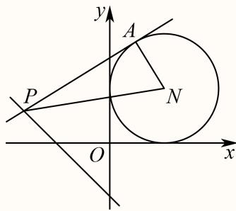
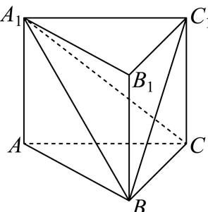
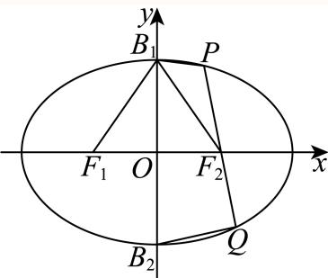

# 2025二模 松江区原卷 · 教师版

> 本地预览：题目、答案及分类尚未全部审定。校对使用的PDF为高中工作台解析版，尚未逐区确认区级印刷原卷。

## 填空题

按本区原卷题号顺序排列。

### 松江 · 第1题

已知集合A = {−1, 0, 1, 2}, $B = \{ x \mid y = \log _ { 2 } x \}$ ，则A ∩ B = .

**考点：** 对数定义域与交集

**难度依据：** 集合交集与对数定义域；直接运用定义或基础公式，推理链短

**核查说明：** 已人工阅读完整底稿题干及原解，未逐页对照正式PDF，分类不等于数学终审。

【答案】{1, 2}.

【解析】

化简集合B，根据交集运算求解.

集合B是函数 $[ y = \log _ { 2 } ]$ x的定义域，对数函数中真数大于0，所以 $B = \{ x \mid x > 0 \}$ }

又 $A = \{ - 1 , 0 , 1 , 2 \}$ ，所以 $A \cap B = \{ 1 , 2 \}$

故答案为：{1, 2}.

### 松江 · 第2题

抛物线y2 = 8x的焦点到准线的距离是

**考点：** 抛物线参数与焦准距离

**难度依据：** 抛物线焦准距离；直接运用定义或基础公式，推理链短

**核查说明：** 已人工阅读完整底稿题干及原解，未逐页对照正式PDF，分类不等于数学终审。

【解析】

由 $\mathtt { J } \mathbf { y } ^ { 2 } = 2 \mathtt { p } \mathrm { x } = 8 \mathrm { x } ^ { \sharp } { \cdot } \rVert \mathrm { p } = 4$ ，又焦点到准线的距离就是p，所以焦点到准线的距离为4.

### 松江 · 第3题

若复数z满足 ${ \frac { 1 + \mathrm { i } } { z } } = \mathrm { i }$ （其中i是虚数单位），则|z| = .

**考点：** 复数运算与模

**难度依据：** 复数除法与模；直接运用定义或基础公式，推理链短

**核查说明：** 已人工阅读完整底稿题干及原解，未逐页对照正式PDF，分类不等于数学终审。

【答案】${ \sqrt { 2 } } .$

【解析】

根据复数的四则运算法则求出复数z，再求模即可

已知 $\frac { 1 + \mathrm { i } } { - } = \mathrm { i } .$

则 $z = \frac { \triangledown _ { 1 + \mathrm { i } } ^ { \mathrm { ~ \tiny ~ \ } } } { \mathrm { ~ i ~ } }$ ．将分子分母同时乘以i的共轭−i进行化简

$z = { \frac { ( 1 + \mathrm { \hat { i } } ) ( - \mathrm { i } ) } { \mathrm { i } \times ( - \mathrm { i } ) } } = { \frac { - \mathrm { i } - \mathrm { i } ^ { 2 } } { - \mathrm { i } ^ { 2 } } }$ ，因为 $\mathrm { i } ^ { 2 } = - 1$ ，所 $\lambda z = { \frac { - \mathrm { i } - ( - 1 ) } { - ( - 1 ) } } = 1 - \mathrm { i }$

$$
| z | = \sqrt {1 + 1} = \sqrt {2}.
$$

故答案为： ${ \sqrt { 2 } } .$

### 松江 · 第4题

已知空间向量 $\vec { \imath } = ( 2 , m , 3 ) , \vec { b } = ( - 4 , 2 , 2 )$ ，若 $\overrightarrow { \cdot a } \bot \overrightarrow { b }$ ，则m =

**考点：** 数量积为零求参数

**难度依据：** 空间向量垂直的坐标条件；直接运用定义或基础公式，推理链短

**核查说明：** 已人工阅读完整底稿题干及原解，未逐页对照正式PDF，分类不等于数学终审。

【答案】1

【解析】

利用向量垂直数量积等于0即可得到结果.

因为 $\vec { \vert a \perp b }$ ，所以 ${ \vec { a } } \cdot { \vec { b } } = - 8 + 2 m + 6 = 0$ ，解得 $m = 1$

故答案为：1

### 松江 · 第5题

$\left( 3 x ^ { 2 } + { \frac { 1 } { x } } \right)$ 6 的二项展开式中的常数项为

> 本题资料或解析有待核事项，预览不可作为已审定成品。

**考点：** 二项通项与常数项

**难度依据：** 二项展开常数项；需一次转化并结合定义域或几何条件计算

**核查说明：** 题干6次方脱离上标，解析12-3r误为512-3r，需修复排版。；已人工阅读完整底稿题干及原解，未逐页对照正式PDF，分类不等于数学终审。

【答案】135.

【解析】

根据二项式展开式的通项特征即可求解.

由题，二项展开式的通项为

$$
T _ {r + 1} = \mathrm{C} _ {6} ^ {r} (3 x ^ {2}) ^ {6 - r} \cdot \left(\frac {1}{x}\right) ^ {r} = \mathrm{C} _ {6} ^ {r} 3 ^ {6 - r} \cdot x ^ {1 2 - 2 r} \cdot x ^ {- r} = \mathrm{C} _ {6} ^ {r} 3 ^ {6 - r} \cdot x ^ {1 2 - 3 r}.
$$

令 $5 1 2 - 3 r = 0 .$ ，得 $r = 4$

所以常数项为 $\mathrm { C _ { 6 } ^ { 4 } 3 ^ { 2 } } = \frac { 6 ! } { 4 ! ( 6 - 4 ) ! } \times 9 = 1 5 \times 9 = 1 3 5 .$

故答案为：135.

### 松江 · 第6题

根据如表所示的样本数据，用最小二乘法求得线性回归方程为 $\ y = \hat { a } x + 1 0 . 3$ ，则回归系数a^的值为

| $x$ | 6 | 8 | 9 | 10 | 12 |
|---|---|---|---|---|---|
| $y$ | 6 | 5 | 4 | 3 | 2 |

> 本题资料或解析有待核事项，预览不可作为已审定成品。

**考点：** 回归直线过样本中心

**难度依据：** 线性回归与样本中心；需一次转化并结合定义域或几何条件计算

**核查说明：** 题干所指样本数据表未保留，需补原表。；已人工阅读完整底稿题干及原解，未逐页对照正式PDF，分类不等于数学终审。

【答案】−0.7.

【解析】

根据线性回归方程过样本中心点进行求解即可.

首先计算 $\overline { { x } } = \frac { 6 + 8 + 9 + 1 0 + 1 2 } { 5 } = 9 , \overline { { y } } = \frac { 6 + 5 + 4 + 3 + 2 } { 5 } = 4 .$

因为回归直线过样本中心点(x,–y)，把(9,4)代入– $\mathbf { \nabla } \cdot y = \hat { a } x + 1 0 . 3$

可得 $4 = 9 \hat { a } + 1 0 . 3 , 9 \hat { a } = - 6 . 3$ ，解得 ${ \hat { a } } = - 0 . 7 .$

故答案为：−0.7.

### 松江 · 第7题

有4辆车停放在5个并排车位上，客车甲车体较宽，停放时需要占两个车位，并且乙车与客车甲相邻停放，则共有 种不同的停放方法.

**考点：** 捆绑排列与相邻条件

**难度依据：** 相邻排列的捆绑法；需一次转化并结合定义域或几何条件计算

**核查说明：** 已人工阅读完整底稿题干及原解，未逐页对照正式PDF，分类不等于数学终审。

【答案】12.

【解析】

利用相邻问题捆绑法求解.

因为客车甲占两个车位且乙车与客车甲相邻停放.

所以将乙车与客车甲捆绑，看成一个车有A2种排法，与余下的两辆车全排有A3种排法，

所以共有 $\mathrm { A _ { 2 } ^ { 2 } \cdot A _ { 3 } ^ { 3 } = 1 2 }$ 种不同的停放方法.

故答案为：12.

### 松江 · 第8题

在定向越野活动中，测得甲在乙北偏东80∘的方向，甲乙两人间的距离为2km，丙在乙北偏西40∘的方向，甲丙两人间的距离为 $\sqrt { 7 } \mathrm { k m }$ ，则乙丙两人间的距离为 km.

**考点：** 方向角转化与余弦定理

**难度依据：** 方向角与余弦定理；需一次转化并结合定义域或几何条件计算

**核查说明：** 已人工阅读完整底稿题干及原解，未逐页对照正式PDF，分类不等于数学终审。

【答案】1.

【解析】

根据题意画出示意图，利用余弦定理求解.

如图，在 $\triangle A B C \sharp$ ， $\angle A = 8 0 ^ { \circ } + 4 0 ^ { \circ } = 1 2 0 ^ { \circ } , A B = 2 , B C = { \sqrt { 7 } } .$

由余弦定理 $B C ^ { 2 } = A B ^ { 2 } + A C ^ { 2 } - 2 A B \cdot A C \cdot \cos A$ ，可得

$$
7 = 2 ^ {2} + A C ^ {2} - 2 \times 2 \times A C \times \cos 1 2 0 ^ {\circ} = 4 + A C ^ {2} - 4 A C \times \left(- \frac {1}{2}\right) = A C ^ {2} + 4 + 2 A C,
$$

即 $A C ^ { 2 } + 2 A C - 3 = 0$

解得 $A C = 1$ ，即乙丙两人间的距离为1km.

故答案为：1.

### 松江 · 第9题

已知点P为直线l: $x + y + 1 = 0 .$ 上的点，过点P作圆N: $( x - 1 ) ^ { 2 } + ( y - 1 ) ^ { 2 } = 1$ 的切线PA，切点为A，则 $\cos \angle P N A$ 最大值为

**考点：** 圆切线构造和距离最值

**难度依据：** 切线与点到直线距离最值；需连接多个条件或多步模型转化

**核查说明：** 已人工阅读完整底稿题干及原解，未逐页对照正式PDF，分类不等于数学终审。

【答案】$\frac { \sqrt { 2 } } { 3 }$

【解析】

结合图象得到 $\cos \angle P N A = { \frac { | N A | } { | N P | } } = { \frac { 1 } { | N P | } }$ ，问题转化成求|NP|最小值即可求解

圆 $N \colon ( x - 1 ) ^ { 2 } + ( y - 1 ) ^ { 2 } =$ 1的圆 $\therefore N ( 1 , 1 )$ ，半径r = 1，

$$
\therefore \cos \angle P N A = \frac {| N A |}{| N P |} = \frac {1}{| N P |},
$$

当 $| N P |$ 最小时， $\cos \angle P N A$ 最大.

$| N P |$ |的最小值为圆心N到直线l $: x + y + 1 = 0$ 的距离d，

根据点到直线距离公 $\overrightarrow { \overrightarrow { \mathrm { x } } } \overrightarrow { \mathrm { c } } d = \frac { | 1 + 1 + 1 | } { \sqrt { 1 ^ { 2 } + 1 ^ { 2 } } } = \frac { 3 } { \sqrt { 2 } } = \frac { 3 \sqrt { 2 } } { 2 }$

所以 $( \cos \angle P N A ) _ { \mathrm { m a x } } = { \frac { 1 } { \frac { 3 { \sqrt { 2 } } } { 2 } } } = { \frac { \sqrt { 2 } } { 3 } } .$

故答案为： $\frac { \sqrt { 2 } } { 3 }$

### 松江 · 第10题

如图在三棱锥 $P - A B C$ 中，PA、PB、PC两两垂直，且 $P A = 3 , P B = 2 , P C = 1$ ，设M是底面ABC内一点，定义 $f ( M ) = ( m , n , p )$ ，其中 $^ { \mathfrak { m } , n , p }$ 分别表示三棱锥 $M - P A B .$ ，三棱锥 $M - P B C$ 三棱锥 $M - P C A$ 的体积.若 $f \left( M \right) = \left( { \frac { 2 } { 3 } } , x , y \right)$ ，且 ${ \frac { a } { x } } + { \frac { 1 } { y } } \geq$ 12恒成立，则正实数 $\scriptstyle  \{ a$ 的最小值为

> 本题资料或解析有待核事项，预览不可作为已审定成品。

**考点：** 体积和约束与基本不等式

**难度依据：** 棱锥分割体积定义；需参数分类、构造递推或综合最值分析

**核查说明：** 底面内点是否排除边界及分母非零应回核原卷，解析按x,y>0处理。；已人工阅读完整底稿题干及原解，未逐页对照正式PDF，分类不等于数学终审。

【答案】1

【解析】

根据给定的信息求出三棱锥 $P - A B C$ 的体积，进而求出 $x + y ,$ ，再利用基本不等式“1”的妙用求出最小值，并建立不等式求解.

在三棱锥 $P - A B C$ 中，PA、PB、PC两两垂直，且 $P A = 3 , P B = 2 , P C = 1$ 1

则 $x + y + { \frac { 2 } { 3 } } = V _ { P - A B C } = { \frac { 1 } { 6 } } P A \cdot P B \cdot P C = 1$ ，解得 $x + y = { \frac { 1 } { 3 } }$ ，又 $x > 0 , y > 0 , a > 0$

$$
\frac {a}{x} + \frac {1}{y} = 3 \left(\frac {a}{x} + \frac {1}{y}\right) (x + y) = 3 \left(a + 1 + \frac {a y}{x} + \frac {x}{y}\right) \geq 3 (a + 1 + 2 \sqrt {a})
$$

当且仅当 ${ \frac { a y } { x } } = { \frac { x } { y } }$ 时取等号，由 $\frac { a } { x } + \frac { 1 } { y } \geq 1$ 2恒成立，得3 $\left( a + 1 + 2 { \sqrt { a } } \right) \geq 1 2$

于是 $\left( { \sqrt { a } } + 1 \right) ^ { 2 } \geq 4$ ，解得 $a \geq 1$ ，所以正实数a的最小值为1.

故答案为：1

### 松江 · 第11题

设向量 $\vec { \cdot a } = ( x _ { 1 } , y _ { 1 } ) , \vec { b } = ( x _ { 2 } , y _ { 2 } )$ ，记 $\displaystyle { \mathop { \ ? } { \vec { a } } } \star { \vec { b } } = x _ { 1 } x _ { 2 } - y _ { 1 } y _ { 2 }$ .若点 $A _ { 1 } , ~ A _ { 2 } , ~ A _ { 3 }$ 为圆C：
$x ^ { 2 } + y ^ { 2 } + 4 x - 2 y = 0 .$ 上任意三点，且满足 $A _ { 1 } A _ { 2 } \bot A _ { 2 } A _ { 3 }$ ，则 $\Bigl | \overrightarrow { O A _ { 1 } } \star \overrightarrow { O A _ { 2 } } + \overrightarrow { O A _ { 2 } } \star \overrightarrow { O A _ { 3 } } \Bigr |$ 的取值范围是

**考点：** 新运算化简、圆上线性函数范围

**难度依据：** 向量新运算；需参数分类、构造递推或综合最值分析

**核查说明：** 已人工阅读完整底稿题干及原解，未逐页对照正式PDF，分类不等于数学终审。

【答案】[0, 16].

【解析】

设 $A _ { 1 } ( x _ { 1 } , y _ { 1 } ) , A _ { 2 } ( x _ { 2 } , y _ { 2 } ) , A _ { 3 } ( x _ { 3 } , y _ { 3 } )$ ，根据题意可得 $A _ { 1 } A _ { 3 }$ 为圆的直径，得$\overrightarrow { O A _ { 1 } } * \overrightarrow { O A _ { 2 } } + \overrightarrow { O A _ { 2 } } * \overrightarrow { O A _ { 3 } } = - 4 x _ { 2 } - 2 y _ { 2 }$ ，将求 $\boxed { \overrightarrow { O A _ { 1 } } * \overrightarrow { O A _ { 2 } } + \overrightarrow { O A _ { 2 } } * \overrightarrow { O A _ { 3 } } }$ 范围问题转化为直线与圆相切的问题.

将圆 $C { : } x ^ { 2 } + y ^ { 2 } + 4 x - 2 y = 0$ 化为标准方程 $( x + 2 ) ^ { 2 } + ( y - 1 ) ^ { 2 } = 5$ ，圆 $\iota \mathsf { L C } ( - 2 , 1 )$ ，半径$r = { \sqrt { 5 } } .$

因为 $A _ { 1 } A _ { 2 } \bot A _ { 2 } A _ { 3 }$ ，所以 $A _ { 1 } A _ { 3 }$ 为圆的直径.

设 $\cdot A _ { 1 } \left( x _ { 1 } , y _ { 1 } \right) , A _ { 2 } \left( x _ { 2 } , y _ { 2 } \right) , A _ { 3 } \left( x _ { 3 } , y _ { 3 } \right) , \overrightarrow { O A _ { 1 } } = \left( x _ { 1 } , y _ { 1 } \right) , \overrightarrow { O A _ { 2 } } = \left( x _ { 2 } , y _ { 2 } \right) , \overrightarrow { O A _ { 3 } } = \left( x _ { 3 } , y _ { 3 } \right) .$ $\mathrm { E i } \overrightarrow { O A _ { 1 } } * \overrightarrow { O A _ { 2 } } + \overrightarrow { O A _ { 2 } } * \overrightarrow { O A _ { 3 } } = x _ { 1 } x _ { 2 } - y _ { 1 } y _ { 2 } + x _ { 2 } x _ { 3 } - y _ { 2 } y _ { 3 } = x _ { 2 } \left( x _ { 1 } + x _ { 3 } \right) - y _ { 2 } \left( y _ { 1 } + y _ { 3 } \right) .$

因为 $A _ { 1 } A _ { 3 }$ 为直径，所以 $x _ { 1 } + x _ { 3 } = - 4 , y _ { 1 } + y _ { 3 } = 2$

$$
\overrightarrow {O A _ {1}} * \overrightarrow {O A _ {2}} + \overrightarrow {O A _ {2}} * \overrightarrow {O A _ {3}} = - 4 x _ {2} - 2 y _ {2}
$$

$\stackrel { \wedge } { \prec } z = - 4 x - 2 y ,$ ，即 $y = - 2 x - \frac { z } { 2 }$ ，且 $( x + 2 ) ^ { 2 } + ( y - 1 ) ^ { 2 } = 5$

当直线 $y = - 2 x - \frac { z } { 2 }$ 与圆相切时，z取得最值.

根据圆心到直线的距离等于半径，可得 ${ \frac { | 4 \times ( - 2 ) + 2 \times 1 + z | } { { \sqrt { 4 ^ { 2 } + 2 ^ { 2 } } } } } = { \sqrt { 5 } }$ 解得 $z = 1 6 \not \equiv \not \{ z = - 4$ 所以 $| z | \in [ 0 , 1 6 ]$ ，则 $\left| \overrightarrow { O A _ { 1 } } * \overrightarrow { O A _ { 2 } } + \overrightarrow { O A _ { 2 } } * \overrightarrow { O A _ { 3 } } \right|$ 的取值范围是[0, 16].

故答案为：[0, 16].

### 松江 · 第12题

设 $a\in\mathbb R$，若函数

$$
f(x)=\begin{cases}
\sin(2\pi x-2\pi a),&x<a,\\
x^2-2(a+1)x+a^2+5,&x\ge a
\end{cases}
$$

在区间 $(0,+\infty)$ 内恰好有6个零点，则 $a$ 的取值范围是________。

> 本题资料或解析有待核事项，预览不可作为已审定成品。

**考点：** 正弦与二次函数分段零点计数

**难度依据：** 含参分段函数零点计数；需参数分类、构造递推或综合最值分析

**核查说明：** 源解把二次分支只有一个零点仅等同于重根，漏考虑a>5/2时一根落于x<a；例如a=3时正弦分支5根、二次分支1根，共6根，与源答(2,5/2]冲突。需核正式题干后修解。；已人工阅读完整底稿题干及原解，未逐页对照正式PDF，分类不等于数学终审。

【答案】$(2,3]$。

【校订说明】以下为按现有题设独立补写并经独立复核的解答。源解析给出的 $(2,\frac52]$ 漏掉了二次分支在 $x\ge a$ 上仅有一个零点的另一种情况，原解另行留存。

【解析】分段函数的零点应分别在各自区间内计数，不能只用二次方程的判别式判断二次分支的零点数。

当 $a\le0$ 时，正弦分支在正半轴上没有定义区间，二次分支也无实根，不满足题意。以下设 $a>0$。

正弦分支的正零点为 $x=a-\frac k2$，其中 $k$ 是满足 $1\le k<2a$ 的整数。因此其零点数为 $N_1=\lceil2a\rceil-1$。

二次方程可写为 $(x-a-1)^2=2a-4$，还需保留 $x\ge a$：

- 当 $a<2$ 时，无实根，$N_2=0$；
- 当 $a=2$ 时，只有重根 $x=3$，$N_2=1$；
- 当 $2<a\le\frac52$ 时，两个根 $a+1\pm\sqrt{2a-4}$ 均在 $[a,+\infty)$ 内，$N_2=2$；此时 $N_1=4$，合计6个；
- 当 $a>\frac52$ 时，较小根小于 $a$，只有较大根属于二次分支，$N_2=1$。要求 $N_1=5$，即 $5<2a\le6$，得 $\frac52<a\le3$。

前两种情况均不足6个零点。综上，$a\in(2,3]$。

端点核验：$a=\frac52$ 时为4个正弦零点加2个二次零点；$a=3$ 时为5个正弦零点加1个二次零点，均为6个。

## 选择题

按本区原卷题号顺序排列。

### 松江 · 第13题

已知 $\displaystyle { 1 a , b , c , d \in \mathbf { R } }$ ，则 $\ddot { \cdot } \cdot a + c > b + d "$ 是 ${ } ^ { \mathfrak { s } } a > b$ 且 $. c > d "$ 的（ ）

A. 充分不必要条件

B. 必要不充分条件

C. 充要条件

D. 既不充分也不必要条件

**考点：** 不等式相加与条件关系

**难度依据：** 充分必要条件；需一次转化并结合定义域或几何条件计算

**核查说明：** 已人工阅读完整底稿题干及原解，未逐页对照正式PDF，分类不等于数学终审。

【答案】B

【解析】

根据不等式的性质，分析条件间的推出关系判断充分、必要性.

当 $a = 3 , b = - 2 , c = 0 , d = 2$ 时， $a + c > b + d ,$ ，但 $c > d ^ { \prime }$ 不成立，充分性不成立；

若 $\dot { \boldsymbol { a } } > b \boxed { \mathrm { H } } \boldsymbol { c } > d ,$ 则必有 $a + c > b + d .$ ，必要性成立；

故选：B

所以 $\ " a + c > b + d "$ 是 ${ } ^ { \mathfrak { s } } a > b$ 且 $. c > d `$ ”的必要不充分条件.

### 松江 · 第14题

下列函数中，在区间(0, +∞)上为严格增函数的奇函数的是（ ）

A. $y = \ln \left| x \right|$

B. $y = | x - 1 |$

C. $y = { \frac { 1 } { 2 ^ { x } } }$

D. $y = - { \frac { 1 } { x } }$

**考点：** 基本函数的奇偶与单调

**难度依据：** 函数奇偶性和单调性；直接运用定义或基础公式，推理链短

**核查说明：** 已人工阅读完整底稿题干及原解，未逐页对照正式PDF，分类不等于数学终审。

【答案】D

【解析】

根据函数的奇偶性和单调性逐项验证.

对于A，y = ln|x|是偶函数，不符合奇函数要求，故A错误；

对于B， $y = | x - 1 |$ |既不是奇函数也不是偶函数，故B错误；

对于C， $y = { \frac { 1 } { 2 ^ { x } } }$ 是非奇非偶函数，故C错误；

对于D， $y = - { \frac { 1 } { x } }$ ，其定义域为 $( - \infty , 0 ) \cup ( 0 , + \infty )$ 关于原点对称，且 $- { \frac { 1 } { - x } } = { \frac { 1 } { x } } = - \left( - { \frac { 1 } { x } } \right)$ ，是奇函数，

同时在 $( 0 , + \infty ) \operatorname { \mathbb { E } } y = - { \frac { 1 } { x } }$ 是严格增函数，故D正确.

故选：D.

### 松江 · 第15题

在正三棱柱 $A B C - A _ { 1 } B _ { 1 } C _ { 1 }$ 中， $A B = A A _ { 1 } = 1$ ，动点P满足 $\overrightarrow { B P } = \lambda \overrightarrow { B C } + \overrightarrow { B B _ { 1 } } , \lambda \in ( 0 \mathrm { ~ , ~ } 1 )$ ，则下列几何体体积为定值的是（ ）

A. 四棱锥 $P - A _ { 1 } A B B _ { 1 }$

B. 四棱锥 $P - A _ { 1 } A C C _ { 1 }$

C. 三棱锥 $P - A _ { 1 } B _ { 1 } C _ { 1 }$

D. 三棱锥 $P - A _ { 1 } B C$

**考点：** 动点轨迹与线面平行定高

**难度依据：** 棱柱中动点与定体积；需连接多个条件或多步模型转化

**核查说明：** 已人工阅读完整底稿题干及原解，未逐页对照正式PDF，分类不等于数学终审。

【答案】D

【解析】

根据题设P在 $B _ { 1 } C _ { 1 }$ 上运动，结合棱柱的结构特征及线面平行的性质判断各棱锥的体积是否为定值即可.

对于正三棱柱 $A B C - A _ { 1 } B _ { 1 } C _ { 1 }$ ，且 $\overrightarrow { B P } = \lambda \overrightarrow { B C } + \overrightarrow { B B _ { 1 } } , ~ \lambda \in ( 0 , 1 )$ ，

则P在 $B _ { 1 } C _ { 1 }$ 上运动，

所以P到平面 $A _ { 1 } A B B _ { 1 }$ 、平面 $A _ { 1 } A C C _ { 1 }$ 的距离均是变化的，棱锥底面积都是定值，故A、B不符合条件，

P在平面 $A _ { 1 } B _ { 1 } C _ { 1 }$ 内， $P - A _ { 1 } B _ { 1 } C _ { 1 }$ 不是三棱锥，故C不符条件，

由 $B _ { 1 } C _ { 1 } / / B C _ { ; }$ $B C \subset$ 平面 $A _ { 1 } B C$ $B _ { 1 } C _ { 1 } \notin$ 平面 $A _ { 1 } B C$ ，则 $B _ { 1 } C _ { 1 } / / .$ 平面 $A _ { 1 } B C$

所以P到平面A BC的距离为定值，且底面A BC的面积是定值，

所以三棱锥 $P - A _ { 1 } B C$ 的体积为定值，D符合，

故选：D

### 松江 · 第16题

定义在 $( 0 , + \infty )$ 上的函数 $\cdot y = f ( x )$ 满足 $f ( x + 1 ) = f ( x ) - x$ ，当 $0 < x \leq 1 \mathbb { H } ]$ ， $f \left( x \right) = \sqrt { x } - x + 1$ 有以下两个命题：
①当n为正整数时， $f \left( n \right) = { \frac { - n ^ { 2 } + n + 2 } { 2 } }$ ；
②若函数 $y = f ( x )$ 在区间(0,k]内有3个极大值点，则k的取值范围是 $\left[ { \frac { 7 3 } { 3 6 } } , 3 \right)$
则以下选项正确的是（ ）

A. ①是真命题，②是假命题

B. 两个都是真命题

C. ①是假命题，②是真命题

D. 两个都是假命题

> 本题资料或解析有待核事项，预览不可作为已审定成品。

**考点：** 递推函数各区间极值与整数值

**难度依据：** 递推函数分段表达与极值；需参数分类、构造递推或综合最值分析

**核查说明：** 函数可不连续，端点极大值定义和截断区间口径须注意；原解局部导数不等式有字母OCR错误。；已人工阅读完整底稿题干及原解，未逐页对照正式PDF，分类不等于数学终审。

【答案】A

【解析】

对①，根据题意，可得 $f ( n ) - f ( n - 1 ) = - ( n - 1 )$ ，利用累加法求求答案；对②，分别求出$x \in ( 1 , 2 ]$ ，x ∈ (2,3]，x ∈ (3,4]的解析式，利用导数判断极大值情况，得解

对于①，当n为正整数时，已知f(x + 1) = f(x) − x，

则 $| f ( n ) - f ( n - 1 ) = - ( n - 1 )$

$$
f (n - 1) - f (n - 2) = - (n - 2), \dots , f (2) - f (1) = - 1, f (1) = \sqrt {1} - 1 + 1 = 1,
$$

将这些式子累加可得 $f ( n ) - f ( 1 ) = - ( 1 + 2 + \cdots + ( n - 1 ) )$ 1

由等差数列求和公式 $1 + 2 + \cdots + ( n - 1 ) = { \frac { ( n - 1 ) n } { 2 } }$ ，

所以 $f \left( n \right) = 1 - { \frac { ( n - 1 ) n } { 2 } } = { \frac { - n ^ { 2 } + n + 2 } { 2 } }$ ，故①正确，

对于②，当 $0 < x \le 1$ 时， $f \left( x + 1 \right) = f \left( x \right) - x = \sqrt { x } - 2 x + 1$ ，令 $t = x + 1 \in ( 1 , 2 ]$

$$
\therefore f (t) = \sqrt {t - 1} - 2 (t - 1) + 1 = \sqrt {t - 1} - 2 t + 3,
$$

即 $f \left( x \right) = \sqrt { x - 1 } - 2 x + 3 , x \in \left( 1 , 2 \right]$

同理，可得 $f \left( x \right) = { \sqrt { x - 2 } } - 3 x + 6 , x \in \left( 2 , 3 \right]$

$$
f (x) = \sqrt {x - 3} - 4 x + 1 0, x \in (3, 4 ],
$$

由0 $\mid < x \leq 1 , f \left( x \right) = \sqrt { x } - x + 1$ ，则 $f ^ { \prime } \left( x \right) = \frac { 1 } { 2 \sqrt { x } } - 1 = \frac { 1 - 2 \sqrt { x } } { 2 \sqrt { x } }$

令 $f ^ { \prime } \left( x \right) > 0$ ，得 $\displaystyle { c < \frac { 1 } { 4 } }$ ，令 $f ^ { \prime } \left( x \right) < 0$ ，得 $x > \frac { 1 } { 4 }$

所以f (x)在 $\left( 0 , { \frac { 1 } { 4 } } \right)$ 上单调递增，在 $\left( { \frac { 1 } { 4 } } , 1 \right]$ 上单调递减，

所以 $x = { \frac { 1 } { 4 } }$ 是极大值点，

当 $f \left( x \right) = \sqrt { x - 1 } - 2 x + 3 , x \in \left( 1 , 2 \right]$ ]时，则 $f ^ { \prime } \left( x \right) = { \frac { 1 } { 2 { \sqrt { x - 1 } } } } - 2 = { \frac { 1 - 4 { \sqrt { x - 1 } } } { 2 { \sqrt { x - 1 } } } }$ 同上易得 $x = { \frac { 1 7 } { 1 6 } }$ 是极大值点，

当 $f \left( x \right) = { \sqrt { x - 2 } } - 3 x + 6 , x \in \left( 2 , 3 \right]$ ]时，则 $f ^ { \prime } \left( x \right) = { \frac { 1 } { 2 { \sqrt { x - 2 } } } } - 3 = { \frac { 1 - 6 { \sqrt { x - 2 } } } { 2 { \sqrt { x - 2 } } } }$ 可得 $x = { \frac { 7 3 } { 3 6 } }$ 为极大值点，

当 $f \left( x \right) = \sqrt { x - 3 } - 4 x + 1 0 , x \in \left( 3 , \right.$ 4]时，则 $f ^ { \prime } \left( x \right) = { \frac { 1 } { 2 { \sqrt { x - 3 } } } } - 4 = { \frac { 1 - 8 { \sqrt { x - 3 } } } { 2 { \sqrt { x - 3 } } } }$ 易得 $x = \frac { 1 9 3 } { 6 4 }$ 为极大值点，

因为函数 $y = f \left( x \right)$ 在区间(0,k]内有3个极大值点，所以 $k \in \left[ \frac { 7 3 } { 3 6 } , \frac { 1 9 3 } { 6 4 } \right)$ ，故②错误.故选：A.

## 三、解答题

## 解答题

按本区原卷题号顺序排列。

### 松江 · 第17题

已知函数 $\begin{array} { r } { \mathopen { } : y = A \sin ( 2 x + \varphi ) , A > 0 , 0 < \varphi < \pi _ { : } } \end{array}$ ，当 $x = \frac { \pi } { 6 }$ 时函数取得最大值4， ${ \mathrm { i } } \exists y = f ( x )$
(1) (6分)求函数 $\cdot y = f ( x )$ 的表达式；
(2) (8分)若数列 $\left\{ a _ { n } \right\}$ 为等差数列， $a _ { 2 } = f ( 0 ) , a _ { 4 } = f \left( { \frac { \pi } { 6 } } \right)$ $\mathbb { E } b _ { n } = 2 ^ { a _ { n } }$ ，求数列 $\left\{ b _ { n } \right\}$ 的前n项和 $S _ { n }$

> 本题资料或解析有待核事项，预览不可作为已审定成品。

**考点：** (1)最大值确定振幅初相；(2)等差数列转等比数列并求和

**难度依据：** 正弦函数解析式；需连接多个条件或多步模型转化

**核查说明：** 题干f(x)标记位置与符号OCR损坏，需整理原式。；已人工阅读完整底稿题干及原解，未逐页对照正式PDF，分类不等于数学终审。

【解析】

(1) 已知当 $x = \frac { \pi } { 6 }$ 时函数 $\langle y = A \sin ( 2 x + \varphi )$ 取得最大值4，

因为 $A > 0 ,$ ，所以 $A = 4 .$ .此时2 $\times \ { \frac { \pi } { 6 } } + \varphi = { \frac { \pi } { 2 } } + 2 k \pi , k \in \mathbf { Z }$

又 $) < \varphi < \pi _ { : }$ ，解得 $\varphi = \frac { \pi } { 6 }$

所以函数 $y = f ( x )$ 的表达式为 $y = 4 \sin \left( 2 x + { \frac { \pi } { 6 } } \right)$

(2) 由（1）知 $f \left( x \right) = 4 \sin \left( 2 x + \frac { \pi } { 6 } \right)$ ，则 $a _ { 2 } = f ( 0 ) = 4 \sin { \frac { \pi } { 6 } } = 2$

$$
a _ {4} = f \left(\frac {\pi}{6}\right) = 4 \sin \left(\frac {\pi}{2}\right) = 4.
$$

因为 $\left\{ a _ { n } \right\}$ 是等差数列，设公差为d，则 $\displaystyle a _ { 4 } - a _ { 2 } = 2 d = 4 - 2 = 2$ ，解得 $d = 1$

$$
a _ {1} = a _ {2} - d = 2 - 1 = 1,
$$

所以 $\displaystyle { a _ { n } = 1 + ( n - 1 ) \times 1 = n . }$

可得 $S _ { n } = { \frac { 2 \left( 1 - 2 ^ { n } \right) } { 1 - 2 } } = 2 ^ { n + 1 } - 2$

又 $b _ { n } = 2 ^ { a _ { n } } = 2 ^ { n }$ ，数列 $\left\{ b _ { n } \right\}$ 是以 $b _ { 1 } = 2$ 为首项， $q = 2$ 为公比的等比数列，

### 松江 · 第18题

已知梯形PBCD中， $P D / / B C$ ，E为PD上的一点且 $B E \bot P D$ $P E = B E = 1$ $B C = \frac { 1 } { 2 } E D$ ，将$\triangle P B E$ 沿BE翻折使得二面角P−BE−C的平面角为θ，连接PC、PD，F为棱PD的中点.

(1) (6分)求证： $F C / /$ 平面PBE；
(2) (8分)当 $| \theta = { \frac { 2 \pi } { 3 } }$ 时，求直线FC和平面BCDE所成角的大小.

**考点：** (1)线面平行证明；(2)翻折后线面角

**难度依据：** 翻折模型与线面角；需连接多个条件或多步模型转化

**核查说明：** 已人工阅读完整底稿题干及原解，未逐页对照正式PDF，分类不等于数学终审。

【解析】

(1) 取ED的中点M，连接CM、FM，

因为点F为棱PD的中点，且 $B C = \frac { 1 } { 2 } E D$ ，所以 $F M / / P E$ 且 $C M / / B E$

$F M / / P E ,$ ，FM ⊄平面PBE， $P E \subset$ 平面PBE，

所 以 $F M / /$ 平 面 PBE ， 同 理 可 得 $C M / /$ 平 面 PBE

因为FM ⊂平面CFM，CM ⊂平面CFM，且 $F M \cap C M = M$

所以平面 $C F M / /$ 平面PBE.

因为 $F C \subset$ 平面CFM，所以FC//平面PBE.

(2) 过点F作 $F H \bot E D$ 于点H，连接CH，

因为 $\because B E \bot P E , B E \bot D E , P E \cap D E = E , P E , D E \subset \widehat { \mathbb { F } } \widehat { | \mathrm { H } | } P D E ,$

因为BE⊥平面PDE，所以 $B E \bot F H$

因为BE ⊂平面BCDE，ED ⊂平面BCDE，且 $B E \cap E D = E$

所以FH⊥平面BCDE.

所以 $\angle F C H$ 就是直线FC和平面BCDE所成角.

由题意得：二面角 − − 的平面角为 $\angle P E D = { \frac { 2 \pi } { 3 } }$

由（1）易得 $\angle F M D = \frac { 2 \pi } { 3 }$

在Rt $\triangle F H M ^ { \sharp }$ ，由 $\angle F M H = \frac { \pi } { 3 }$ $F M = \frac { 1 } { 2 }$ ，得 $F H = \frac { \sqrt { 3 } } { 4 }$

取PE中点为G，连接BG，

因为G,F分别为PE,PD的中点，

所以 $G F / / E D ,$ ，且 $G F = \frac { 1 } { 2 } E D$ ，又 $B C = { \frac { 1 } { 2 } } E D _ { ; }$

所以四边形 $B C F G$ 为平行四边形，所以 $B G = C F$

在Rt $\triangle B E G \sharp$ ，由 $E G = \frac { 1 } { 2 }$ $B E = 1$ ，得 $B G = { \frac { \sqrt { 5 } } { 2 } }$ ，则 $C F = { \frac { \sqrt { 5 } } { 2 } }$ 在Rt $\triangle F H C ^ { \prime }$ 中，由sin $\angle F C H = { \frac { F H } { F C } } = { \frac { \sqrt { 1 5 } } { 1 0 } }$ ，得 $\angle F C H = \arcsin { \frac { \sqrt { 1 5 } } { 1 0 } }$ 即得直线FC和平面BCDE所成角为 $\arcsin { \frac { \sqrt { 1 5 } } { 1 0 } }$

### 松江 · 第19题

某校组织学生在周末时间利用DeepSeek等人工智能平台进行线上学习，但要求学生学习时间不超过4小时．现从该校高三学生某周末的线上学习时间统计数据中，随机抽取100个学生的学习时间进行分析，绘制成如下频率分布直方图．以抽取的100个学生该周末线上学习时间作为样本，估计该校高三年级全体学生周末线上学习时间的情况

(1) (6分)试估计该校高三学生周末线上学习时间的平均数x及中位数x （注：为了计算均值，可–用区间的中点值给区间内的每个数据赋值）；
(2) (8分)现从全部高三年级学生中随机抽取n人，若其中有4人周末线上学习的时间不小于3小时的可能性最大，求n的值.

**考点：** (1)分组均值和中位数；(2)二项概率随试验次数变化的最值

**难度依据：** 频率直方图与二项概率最值；需参数分类、构造递推或综合最值分析

**核查说明：** 已人工阅读完整底稿题干及原解，未逐页对照正式PDF，分类不等于数学终审。

【解析】

(1) $\overline { { x } } = \left( 1 . 2 5 \times \frac { 1 } { 2 5 } + 1 . 7 5 \times \frac { 3 } { 2 5 } + 2 . 2 5 \times \frac { 6 } { 2 5 } + 2 . 7 5 \times \frac { 2 } { 5 } + + 3 . 2 5 \times \frac { 4 } { 5 } + 3 . 7 5 \times \frac { 2 } { 5 } \right) \times 0 . 5 = 3$ （小时）.因为学习时间小于3小时的频率为0 $. 5 \times { \frac { 1 } { 2 5 } } + 0 . 5 \times { \frac { 3 } { 2 5 } } + 0 . 5 \times { \frac { 6 } { 2 5 } } + 0 . 5 \times { \frac { 2 } { 5 } } = 0 . 4 ,$ 所以中位数在[3,3.5]内，由 $0 . 4 + ( x _ { 0 } - 3 ) \times \frac { 4 } { 5 } = 0 . 5$ ，解得 $x _ { 0 } = 3 . 1 2 5$ 小时.

(2) 由频率分布直方图可知，学习时间不小于3小时的频率为 $\left( { \frac { 2 } { 5 } } + { \frac { 4 } { 5 } } \right) \times 0 . 5 = 0 . 6$ 设从全部高三年级学生中随机抽取n人，线上学习时间不小于3小时的人数为X，其中有4人周末线上学习时间不小于3小时的概率为P(X = 4)，所以 $P ( X = 4 ) = \mathrm { C } _ { n } ^ { 4 } ( 0 . 6 ) ^ { 4 } ( 0 . 4 ) ^ { n - 4 }$ .要使 $P ( X = 4 )$ 最大，则 $\left\{ \begin{array} { l l } { \mathrm { C } _ { n } ^ { 4 } ( 0 . 6 ) ^ { 4 } ( 0 . 4 ) ^ { n - 4 } \geq \mathrm { C } _ { n - 1 } ^ { 4 } ( 0 . 6 ) ^ { 4 } ( 0 . 4 ) ^ { n - 5 } } \\ { \mathrm { C } _ { n } ^ { 4 } ( 0 . 6 ) ^ { 4 } ( 0 . 4 ) ^ { n - 4 } \geq \mathrm { C } _ { n + 1 } ^ { 4 } ( 0 . 6 ) ^ { 4 } ( 0 . 4 ) ^ { n - 3 } } \end{array} \right.$ 解不等式组得 ${ \frac { 1 7 } { 3 } } \leq n \leq { \frac { 2 0 } { 3 } }$ ，因为n为正整数，所以 ${ { n } } = 6$ 所以n = 6时， $P ( X = 4 )$ 最大.

### 松江 · 第20题

已知椭圆Γ: ${ \frac { x ^ { 2 } } { a ^ { 2 } } } + { \frac { y ^ { 2 } } { b ^ { 2 } } } = 1 ( a > b > 0 )$ 的左右焦点分别为 $F _ { 1 } , \ F _ { 2 } ,$ ，上下顶点分别为 $B _ { 1 } .$ 、
$B _ { 2 } , \triangle B _ { 1 } F _ { 1 } F _ { 2 }$ 是面积为 $\sqrt { 3 }$ 的正三角形，过焦点的直线交椭圆Γ于P、Q两点（P、Q分别在第一、四象限）.
(1) (4分)求椭圆Γ的离心率；
(2) (6分)已知点 $M ( 0 , m ) , ~ m > 0$ ，求椭圆Γ上的动点R到点M的最大距离；
(3) (8分)求四边形 $B _ { 1 } B _ { 2 } Q I$ P面积的取值范围.

> 本题资料或解析有待核事项，预览不可作为已审定成品。

**考点：** (1)等边三角形求离心率；(2)动点到定点最大距离；(3)焦点弦四边形面积范围

**难度依据：** 椭圆焦点弦与面积范围；需处理新定义或多对象联动，包含一般性证明及边界

**核查说明：** 题干四边形名称混入I，解析三角形面积sqrt3/2与题设sqrt3不符但后续参数按sqrt3计算；距离平方负号与韦达负号丢失，须逐式校核。；已人工阅读完整底稿题干及原解，未逐页对照正式PDF，分类不等于数学终审。

【解析】

(1) 如图，设椭圆C的焦距为 $| F _ { 1 } F _ { 2 } | = 2 c ( c > 0 )$ ，则 $| O F _ { 2 } | = c$

因为 $| O B _ { 1 } | = b ,$ ，所以Rt $\triangle B _ { 1 } O F _ { 2 } \sharp | B _ { 1 } F _ { 2 } | = a$

又因为 $\triangle B _ { 1 } F _ { 1 } F _ { 2 }$ 为正三角形，所以 $\left| B _ { 1 } F _ { 2 } \right| = 2 | O F _ { 2 } |$ ，即 $a = 2 c$

所以椭圆的离心率 $e = { \frac { c } { a } } = { \frac { 1 } { 2 } }$

(2) (2)

由于正三角形 $F _ { 1 } F _ { 2 } B _ { 1 }$ 的面积为 ${ \sqrt { 3 } } ,$ ，得到 $\left\{ \begin{array} { l l } { \displaystyle \frac { \sqrt { 3 } } { 2 } = \frac { 1 } { 2 } | F _ { 1 } F _ { 2 } | b = b c } \\ { { b = \displaystyle \frac { \sqrt { 3 } } { 2 } \times 2 c = \sqrt { 3 } c } } \end{array} \right.$

解得 $\mathsf { i } c = 1$ 9 $b = { \sqrt { 3 } } .$ ，又 $a ^ { 2 } = c ^ { 2 } + b ^ { 2 }$ ，得到 $\left[ a = 2 \right.$ ，故椭圆方程为 ${ \frac { x ^ { 2 } } { 4 } } + { \frac { y ^ { 2 } } { 3 } } = 1$

设 $R ( x , y )$ ，且 ${ \frac { x ^ { 2 } } { 4 } } + { \frac { y ^ { 2 } } { 3 } } = 1$ ，即 $x ^ { 2 } = 4 - { \frac { 4 y ^ { 2 } } { 3 } }$

|RM|2 = x2 + (y − m)2 = 4 − 4y2 + y2 − 2my + m2 = 1 y2 − 2my + m2 + 4， 3 3

其对称轴为 $y = - 3 m < 0$ ，而 $- { \sqrt { 3 } } \leq y \leq { \sqrt { 3 } } .$ ，当 $- 3 m \leq - { \sqrt { 3 } }$ ，即 $m \geq \frac { \sqrt { 3 } } { 3 }$ 时，

$\left| R M \right| ^ { 2 } \ddagger y = - \sqrt { 3 } |$ 时取得最大值， $| R M | _ { \mathrm { { m a x } } } = m + \sqrt { 3 }$

当0 $> - 3 m > - \sqrt { 3 }$ ，即 $0 < m < \frac { \sqrt { 3 } } { 3 }$ 时，

$\vert R M \vert ^ { 2 } \ddagger y = - 3 m$ 时取得最大值， $| R M | _ { \mathrm { m a x } } = 2 \sqrt { m ^ { 2 } + 1 }$

综上，当 $0 < m < \frac { \sqrt { 3 } } { 3 }$ 时，最大距离为 $2 \sqrt { m ^ { 2 } + 1 }$ ；当 $m \geq \frac { \sqrt { 3 } } { 3 }$ 时，最大距离为 $m + { \sqrt { 3 } } .$

(3) 设直线PQ的方程为 $x = m y + 1 , P \left( x _ { 1 } , y _ { 1 } \right) , Q \left( x _ { 2 } , y _ { 2 } \right)$

联立 $\left\{ { \begin{array} { l } { x = m y + 1 } \\ { { \frac { x ^ { 2 } } { 4 } } + { \frac { y ^ { 2 } } { 3 } } = 1 } \end{array} } \right.$ 消去x整理得 $( 3 m ^ { 2 } + 4 ) y ^ { 2 } + 6 m y - 9 = 0 \nonumber$

6m 9 则Δ > 0，y1 + y2 = 3m2 + 4 , y1y2 = 3m2 + 4 因为点 $P , Q$ 分别在第一、四象限，

所以 $\left\{ { \begin{array} { l } { x _ { 1 } + x _ { 2 } > 0 } \\ { x _ { 1 } \cdot x _ { 2 } > 0 } \end{array} } \right.$ ，即 $\left\{ { \begin{array} { l } { m \left( y _ { 1 } + y _ { 2 } \right) + 2 > 0 } \\ { m ^ { 2 } y _ { 1 } y _ { 2 } + m \left( y _ { 1 } + y _ { 2 } \right) + 1 > 0 } \end{array} } \right.$

$\left\{ \begin{array} { l } { { \frac { - 6 m ^ { 2 } } { 3 m ^ { 2 } + 4 } + 2 > 0 } } \\ { { \frac { - 9 m ^ { 2 } } { 3 m ^ { 2 } + 4 } - \frac { 6 m ^ { 2 } } { 3 m ^ { 2 } + 4 } + 1 > 0 } } \end{array} \right.$ 解得 $- { \frac { \sqrt { 3 } } { 3 } } < m < { \frac { \sqrt { 3 } } { 3 } }$

得到四边形 $B _ { 1 } B _ { 2 } Q P$ 的面积为 $S = S _ { \triangle O B _ { 1 } P } + S _ { \triangle O B _ { 2 } Q } + S _ { \triangle O P Q }$

$$
= \frac {1}{2} | O B _ {1} | \cdot x _ {1} + \frac {1}{2} | O B _ {2} | \cdot x _ {2} + \frac {1}{2} | O F _ {2} | \cdot | y _ {1} - y _ {2} |,
$$

因为 $| B _ { 1 } B _ { 2 } | = 2 \sqrt { 3 } , x _ { 1 } = m y _ { 1 } + 1 , x _ { 2 } = m y _ { 2 } + 1 ,$

$$
S = \frac {\sqrt {3}}{2} m (y _ {1} + y _ {2}) + \sqrt {3} + \frac {1}{2} \sqrt {(y _ {1} + y _ {2}) ^ {2} - 4 y _ {1} y _ {2}} = \frac {4 \sqrt {3} + 6 \sqrt {m ^ {2} + 1}}{3 m ^ {2} + 4},
$$

令 $\cdot t = 4 \sqrt { \overline { { 3 } } } + 6 \sqrt { m ^ { 2 } + 1 } , 4 \sqrt { \overline { { 3 } } } + 6 \leq t < 8 \sqrt { \overline { { 3 } } } ,$ ，则

$$
S = \frac {t}{\frac {1}{1 2} t ^ {2} - \frac {2 \sqrt {3}}{3} t + 5} = \frac {1}{\frac {t}{1 2} + \frac {5}{t} - \frac {2 \sqrt {3}}{3}},
$$

因为 $4 \sqrt { 3 } + 6 > 2 \sqrt { 1 5 }$ ，所 $\lambda y = \frac { t } { 1 2 } + \frac { 5 } { t }$ 在 $\left\lceil 4 { \sqrt { 3 } } + 6 , 8 { \sqrt { 3 } } \right.$ 上单调递增，

故 $S \in \left( { \frac { 8 { \sqrt { 3 } } } { 5 } } , { \frac { 3 } { 2 } } + { \sqrt { 3 } } \right]$ 即四边形 $B _ { 1 } B _ { 2 } Q P$ 面积的取值范围为 $\left( { \frac { 8 { \sqrt { 3 } } } { 5 } } , { \frac { 3 } { 2 } } + { \sqrt { 3 } } \right]$

### 松江 · 第21题

已知f ${ \overline { { \cdot ( x ) = \ln \left( x - 1 \right) + { \frac { 2 a } { x } } - { \frac { 4 } { 3 } } , a \in \mathrm { R } . } } }$
(1) (4分)若x = 4是函数 $y = f ( x )$ 的一个极值点，求曲线y = f(x)在点P (4, f (4))处的切线方程；
(2) (6分)讨论函数 $y = f ( x )$ 的单调性；
(3) (8分)已知实数 $[ a = 0 ,$ 若点A (x1, y1)、 $B \left( x _ { 2 } , y _ { 2 } \right) \left( x _ { 1 } < x _ { 2 } \right)$ )是曲线 $\dot { \boldsymbol { \mu } } y = f ( \boldsymbol { x } )$ 上两点，直线AB的斜率为k，求证： $x _ { 1 } < \frac { 1 + k } { k } < x _ { 2 }$

> 本题资料或解析有待核事项，预览不可作为已审定成品。

**考点：** (1)极值点与切线；(2)含参导数分类；(3)割线斜率与对数不等式

**难度依据：** 对数函数切线与含参单调；需参数分类、构造递推或综合最值分析

**核查说明：** 解析第一问导数分式、第三问割线分母及函数名有OCR损坏，需逐式修复。；已人工阅读完整底稿题干及原解，未逐页对照正式PDF，分类不等于数学终审。

【解析】

(1) f(x)的定义域为 $( 1 , + \infty )$ ，

由 $f \left( x \right) = \ln \left( x - 1 \right) + \frac { 2 a } { x } - \frac { 4 } { 3 }$ ，得 $f ^ { \prime } \left( x \right) = { \frac { 1 } { x - 1 } } - { \frac { 2 a } { x ^ { 2 } } }$

因为x = 4是函数 $y = f ( x )$ 的一个极值点，

所以 $f'(4)=\frac1{4-1}-\frac{2a}{4^2}=0$ ，即 $\frac { 1 } { 3 } - \frac { a } { 8 } = 0 .$ ，解得 $a = { \frac { 8 } { 3 } }$

则f (x) = ln (x − 1) + 16 43 ， f′ (x) = 1x − 1 162 (x − 4) (3x − 4)3 2 ( − 1) ，

则f′ (x) > 0得1 $< x < \frac { 4 } { 3 } \Re \backslash >$ 4；f′ (x) < 0得 $\frac { 4 } { 3 } < x < 4$

则 $f \left( x \right) \# \left( 1 , \frac { 4 } { 3 } \right)$ 和 $( 4 , + \infty )$ 上单调递增，在 $\left( { \frac { 4 } { 3 } } , 4 \right)$ 上单调递减，

则x = 4是f(x)的极小值点，

$$
f (4) = \ln 3 + \frac {4}{3} - \frac {4}{3} = \ln 3, f ^ {\prime} (4) = 0,
$$

则切线方程为 $y - \ln { 3 } = 0 \left( x - 4 \right)$ ，整理得 $y = \ln 3$

(2) f(x)的定义域为(1, +∞)， $f ^ { \prime } \left( x \right) = { \frac { 1 } { x - 1 } } - { \frac { 2 a } { x ^ { 2 } } } = { \frac { x ^ { 2 } - 2 a x + 2 a } { x ^ { 2 } ( x - 1 ) } }$

${ \mathfrak { P } } g \left( x \right) = x ^ { 2 } - 2 a x + 2 a$ ，其对称轴为 $x = a , \Delta = 4 a ^ { 2 } - 8 a = 4 a ( a - 2 )$

①当 $\Delta \le 0$ ，即 $0 \leq a \leq$ 2时， $g \left( x \right) \geq 0 , f ^ { \prime } \left( x \right) \geq 0$ ，则 $f \left( x \right) \overleftarrow { \mathbb { E } } ( 1 , + \infty )$ 上单调递增；②当 $\Delta > 0$ ，即 $\begin{array} { r } { \vert a < 0 \not \equiv \not \chi a > } \end{array}$ 2时，

（i）当a > 2时，g(x) = 0的两根为 $x _ { 1 } = a - { \sqrt { a ^ { 2 } - 2 a } } , x _ { 2 } = a + { \sqrt { a ^ { 2 } - 2 a } } ,$

且1 $< x _ { 1 } < x _ { 2 }$

则当 $1 < x < x _ { 1 }$ 或 $x > x _ { 2 }$ 时， $g \left( x \right) > 0 , f ^ { \prime } \left( x \right) > 0$ ；

当 $x _ { 1 } < x < x _ { 2 }$ 时， $g \left( x \right) < 0 , f ^ { \prime } \left( x \right) < 0$

（ii）当a < 0时，g(x)的对称轴 $x = a < 0$ ，且g (1) = 1，

则g(x) > 0在(1,+∞)上恒成立，即 $f ^ { \prime } \left( x \right) > 0 \overleftarrow { \pm } { } ( 1 , + \infty )$ 上恒成立.

综上，当a ≤ 2时，f(x)在(1,+∞)上单调递增；

当a > 2时，f (x)在 $\left( 1 , a - { \sqrt { a ^ { 2 } - 2 a } } \right)$ 和 $\left( a + { \sqrt { a ^ { 2 } - 2 a } } , + \infty \right)$ 上单调递增，在$\left( a - { \sqrt { a ^ { 2 } - 2 a } } , a + { \sqrt { a ^ { 2 } - 2 a } } \right)$ 上单调递减.

(3) 已知a = 0，则 $f \left( x \right) = \ln \left( x - 1 \right) - \frac { 4 } { 3 } .$

则 $| k = { \frac { f ( x _ { 2 } ) - f ( x _ { 1 } ) } { x \circ - x _ { 1 } } } = { \frac { \ln ( x _ { 2 } - 1 ) - \ln ( x _ { 1 } - 1 ) } { x \circ - x _ { 1 } } }$ $\frac { 1 + k } { k } = \frac { 1 } { k } + 1 = \frac { x _ { 2 } - x _ { 1 } } { \ln { ( x _ { 2 } - 1 ) } - \ln { ( x _ { 1 } - 1 ) } } + 1 ,$

要证 $x _ { 1 } < \frac { 1 + k } { k } < x _ { 2 }$ ，即证 $x _ { 1 } < \frac { x _ { 2 } - x _ { 1 } } { \ln { \left( x _ { 2 } - 1 \right) } - \ln { \left( x _ { 1 } - 1 \right) } } + 1 < x _ { 2 }$ ，

即证 $x _ { 1 } - 1 < \displaystyle \frac { x _ { 2 } - x _ { 1 } } { \ln \displaystyle \frac { x _ { 2 } - 1 } { x _ { 1 } - 1 } } < x _ { 2 } - 1$

令 $\dot { t } = \frac { x _ { 2 } - 1 } { x _ { 1 } - 1 } ( t > 1 )$ ，则只需证1 $< \frac { t - 1 } { \ln t } < t ,$

先证 $\frac { t - 1 } { \ln t } > 1 ( t > 1 )$ ，即证 $\vdots - 1 > \ln { t } ,$

令 $\begin{array} { r } { \ i ( t ) = t - 1 - \ln t \left( t > 1 \right) } \end{array}$ ，则 $h ^ { \prime } \left( t \right) = 1 - \frac { 1 } { t } = \frac { t - 1 } { t } > 0 _ { }$

所以h(t)在(1,+∞)上单调递增，则 $h ( t ) > h ( 1 ) = 0$ ，即 $t - 1 > \ln t$ ；

再证 $\frac { t - 1 } { \ln t } < t ( t > 1 )$ ，即证 $t - 1 < t \ln t$

令 $m ( t ) = t \ln t - ( t - 1 ) ( t > 1 )$ ，则 $\left| m ^ { \prime } ( t ) = \ln t + 1 - 1 = \ln t > 0 \right.$

综上， $x _ { 1 } < \frac { 1 + k } { k } < x _ { 2 }$ 得证.

所以m(t)在 $( 1 , + \infty )$ 上单调递增，则 $m ( t ) > m ( 1 ) = 0$ ，即 $t - 1 < t \ln t .$

