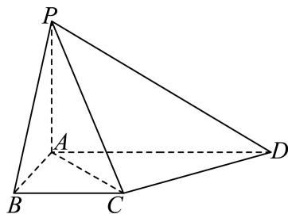

# 2025二模 虹口区原卷 · 学生版

> 本地预览：题目、答案及分类尚未全部审定。校对使用的PDF为高中工作台解析版，尚未逐区确认区级印刷原卷。

## 填空题

按本区原卷题号顺序排列。

### 虹口 · 第1题

已知全集U = {1, 2, 3, 4}，A = {1, 2}，则A =

> 本题资料或解析有待核事项，预览不可作为已审定成品。

### 虹口 · 第2题

不等式 $\frac { x - 2 } { x + 1 } \leq$ 0的解集是

### 虹口 · 第3题

若 $\mathrm { s i n } \alpha = \frac { 2 } { 3 }$ ，则 $\cos 2 \alpha =$

### 虹口 · 第4题

已知圆柱的底面半径为1，母线长为2，则其侧面积为

### 虹口 · 第5题

若直线l与直线y = x平行，且经过圆 $x ^ { 2 } - 2 x + y ^ { 2 }$ = 0的圆心，则l的方程为

> 本题资料或解析有待核事项，预览不可作为已审定成品。

### 虹口 · 第6题

某公司为了解用电量 $y$（单位：千瓦时）与气温 $x$（单位：摄氏度）之间的关系，随机统计了4天的用电量与当天气温，绘制了如下表格，由表中数据可得回归方程 $y=-2x+59.5$，则实数 $m=$____。

| $x$ | $-1$ | $10$ | $13$ | $18$ |
|---|---|---|---|---|
| $y$ | $62$ | $38$ | $34$ | $m$ |

> 本题资料或解析有待核事项，预览不可作为已审定成品。

### 虹口 · 第7题

若△ABC的三条边的长分别为4、5、6，则△ABC的外接圆面积为 .（结果保留π）

> 本题资料或解析有待核事项，预览不可作为已审定成品。

### 虹口 · 第8题

已知z是实系数一元二次方程 $x ^ { 2 } + p x + q = 0$ 的一个虚根，且 $. | z - 1 | = 2$ ，若z在复平面上所对应的点在抛物线 $\dot { y } ^ { 2 } = 4 x _ { - }$ 上，则p = .

### 虹口 · 第9题

某工厂生产的零件长度X（单位：毫米）服从正态分布 $N \left( 3 , \sigma ^ { 2 } \right)$ ，且 $P \left( | X - 3 | \leq 0 . 5 \right) = 0 . 8$ ，若对该工厂同批生产的4个零件逐一检查，则仅有1个零件的长度大于3.5毫米的概率为

> 本题资料或解析有待核事项，预览不可作为已审定成品。

### 虹口 · 第10题

已知9个小球的编号为1、 $2 , \cdots 9 ,$ ，从中有放回地摸取小球三次，并依次记录其编号，若这三个编号成等差数列，则共有 种不同的摸取方法.

### 虹口 · 第11题

1798年，人口学家马尔萨斯假设：①人口数x(t)是随着时间t连续变化的函数；②人口增长率r为常数，且单位时间内的人口增长量x′ (t)与x(t)成正比，进而建立了人口增长模型.19世纪中叶的生物学家们发现由于人类生存条件的限制，r不是常数，因此改进了马尔萨斯的假设②，并添加了1条假设：②r是随着时间t连续变化的函数，存在人口最大瞬时增长率r ，使 $r = r _ { 0 } - k \cdot x \left( t \right) \left( k > 0 \right)$ ，且$x ^ { \prime } \left( t \right)$ 仅与r和x(t)有关；③存在最大人口数N，当人口数达到N时， $r = 0$ .那么在这些假设下建立的人口增长模型 $x ^ { \prime } \left( t \right) = \underline { { \underline { { \mathbf { \sigma } } } } }$ .（用含有 $\mathit { x } \left( t \right) , \mathit { r } _ { 0 } .$ 、N的式子表示）

### 虹口 · 第12题

记|A|为有限集合A中的元素个数.设 $\omega > 0 , ~ S _ { \omega } = \left\{ \theta \ : | \ : 2 ^ { 2 0 2 5 } + \omega \right.$ ⋅θ能被7整除}，若对于任意实数a和任意正整数 ${ \mathrm { . } } n ,$ ，恒有 $\left| S _ { \omega } \cap \left( a , a + n \mathrm { e } ^ { - 0 . 5 n } \right) \right| \leq 3$ ，则实数ω的取值范围是

> 本题资料或解析有待核事项，预览不可作为已审定成品。

## 选择题

按本区原卷题号顺序排列。

### 虹口 · 第13题

若a是实数，则 $^ { \mathrm { 4 } } a ^ { 2 } > 1 ^ { \prime }$ 是 $^ { 6 } a > 2 ^ { , }$ ”的（ ）条件.

A. 充要

B. 充分非必要

C. 必要非充分

D. 既非充分又非必要

### 虹口 · 第14题

下列函数中为奇函数的是（ ）

A. $y = { \sqrt { x } }$

B. $y = x ^ { - 2 }$

C. $y = \sin \left( x + { \frac { \pi } { 2 } } \right)$

D. $y = \tan \left( x + \pi \right)$

### 虹口 · 第15题

春节期间，小明和弟弟玩起了一种自定义游戏，规定先由弟弟掷一颗质量均匀的骰子，若弟弟掷出的点数为6，则吃1颗花生；若掷出其他点数，则记下这个点数，然后由小明开始两个人轮流掷这颗骰子，直至任意一方掷出这个记下的点数或者6，一次游戏结束.若掷出的是这个记下的点数，则弟弟吃1颗花生；若是6，则小明吃3颗花生.任意一次游戏中弟弟能吃到1颗花生的概率为（ ）.

A. $\frac { 5 } { 2 4 }$

B. $\frac { 5 } { 1 2 }$

C. $\frac { 3 } { 8 }$

D. $\frac { 7 } { 1 2 }$

### 虹口 · 第16题

在空间中，点O为定点，设集合 $S = \left\{ P \bigg | \bigg | \overrightarrow { O P } \bigg | ^ { 2 } - 2 \overrightarrow { O A } \cdot \overrightarrow { O P } \leq 1 , \bigg | \overrightarrow { O A } \bigg | = 1 \right\}$ ，则以下说法正确的是（ ）.①若 $\overrightarrow { \cdot O P } \overleftrightarrow { \pm O A }$ 上的数量投影为 $- { \frac { 1 } { 5 } }$ ，则线段OP在运动过程中所形成的几何体体积为 ${ \frac { 1 4 } { 3 7 5 } } \pi ;$ ②对于任意的 $P _ { i } \in S |$ 以及任意的正实数 ${ \bf \dot { \alpha } } _ { a _ { i } }$ ，设 $\overrightarrow { O Q } = \sum _ { i = 1 } ^ { 4 } a _ { i } \overrightarrow { O P _ { i } }$ ，若 $\sum _ { i = 1 } ^ { 4 } a _ { i } = 1$ ，则 $| Q \in S$

A. ①是真命题，②是真命题

B. ①是真命题，②是假命题

C. ①是假命题，②是真命题

D. ①是假命题，②是假命题

> 本题资料或解析有待核事项，预览不可作为已审定成品。

## 解答题

按本区原卷题号顺序排列。

### 虹口 · 第17题

如图所示，在四棱锥 $P - A B C D$ 中，PA⊥平面ABCD， $A B \bot A D$ $A D / / B C$ $A B = B C = 2$
$$
A D = 4.
$$

(1) (6分)求证：平面 $P A C \bot$ 平面PCD；
(2) (8分)若异面直线PB和CD所成角为 $\frac { \pi } { 3 }$ ，求点B到平面PCD的距离.

### 虹口 · 第18题

已知函数 $\mathbf { \boldsymbol { y } } = \mathbf { \boldsymbol { f } } \left( \boldsymbol { x } \right)$ 的表达式为 $\left| f \left( x \right) \right. = 2 ^ { x } , \left. x \in \mathbf { R } \right.$
(1) (6分)解不等式： $\log _ { 2 } { [ f \left( x \right) - 1 ] } + \log _ { 2 } { [ f \left( x \right) ] } \leq 1$ ；
(2) (8分)若存在实数 $x _ { 0 } \in \left[ 0 , { \frac { \pi } { 2 } } \right]$ ，使得 $f ( m \sin x _ { 0 } ) , f ( 2 + \sin 2 x _ { 0 } ) , f ( m \cos x _ { 0 } )$ 成等比数列，求实数m的最小值.

> 本题资料或解析有待核事项，预览不可作为已审定成品。

### 虹口 · 第19题

已知某区组建了一支120人的志愿者队伍，并由其中72人组成“志愿模范队”.经过一年的实践，全队共有72人的周平均服务时长超过2小时，其中有54人来自“志愿模范队”，如下表所示.
(1) (4分)已知一名志愿者是“志愿模范队”成员，求其周平均服务时长超过2小时的概率.
(2) (4分)请完成2×2列联表，并根据表中数据回答：是否有99.9%的把握认为“是‘志愿模范队’成员”与“周平均服务时长超过2小时”有关系？
(3) (6分)现从周平均服务时长超过2小时的人员中按照是否为“志愿模范队”成员进行分层抽样，选取8人组建“志愿突击队”，并从这8人中再随机选取2人做深度访谈，记随机变量X为这2人中来自于“志愿模范队”的人数，求X的分布与方差
附录： $\chi ^ { 2 } = \frac { n ( a d - b c ) ^ { 2 } } { ( a + b ) \left( c + d \right) \left( a + c \right) \left( b + d \right) }$ ，其 $\displaystyle \mathsf { H } n = a + b + c + d .$

> 本题资料或解析有待核事项，预览不可作为已审定成品。

### 虹口 · 第20题

已知点 $F _ { 1 }$ 和 $F _ { 2 }$ 是双曲线 $C \colon \frac { x ^ { 2 } } { a ^ { 2 } } - y ^ { 2 } = 1 \left( a > 0 \right)$ 的左、右焦点.
(1) (4分)若 $y = x$ 是双曲线C的一条渐近线，求C的离心率；
(2) (6分)当 $a = { \sqrt { 2 } } \mathbb { H } { \bmod { } }$ ，若双曲线C上存在一点P满足 $| P F _ { 1 } | + | P F _ { 2 } | = 4 .$ ，求 $\triangle P F _ { 1 } F _ { 2 }$ 的面积；
(3) (8分)若在双曲线C上分别存在两点A和B，点A在第一象限，点B在第二象限，使得四边形$F _ { 1 } B A F _ { 2 }$ 的面积为 $2 \sqrt { a ^ { 2 } + 1 }$ ，且存在实数λ使 ${ \overline { { F _ { 2 } A } } } = \lambda { \overline { { F _ { 1 } B } } }$ ，求实数a的取值范围.

> 本题资料或解析有待核事项，预览不可作为已审定成品。

### 虹口 · 第21题

对于定义在 $\mathbf R$ 上的函数 $y=f(x)$ 和 $y=g(x)$，$a\in\mathbf R$，设 $M_a=\{t\mid t=f(x)-g(a),\ x\ge a\}$。

（1）（4分）若 $f(x)=2^x-1$，$g(x)=\cos x$，求 $M_0$；

（2）（6分）若 $f(x)=x^3-3x^2$，$g(x)=-x$，$M_a\subseteq[0,+\infty)$，求实数 $a$ 的取值范围；

（3）（8分）已知对任意 $a\in\mathbf R$，均有 $M_a=[0,+\infty)$，记 $h(x)=g(x)-a$，求证：“对任意 $a\in\mathbf R$，函数 $y=h(x)$ 零点个数均有限”的充要条件是“$y=f(x)$ 在 $\mathbf R$ 上是严格增函数”。

> 本题资料或解析有待核事项，预览不可作为已审定成品。

