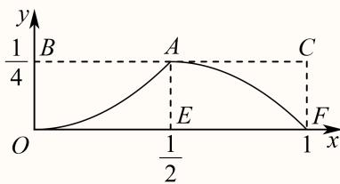
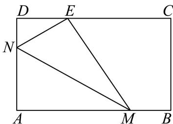
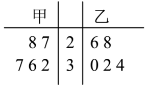
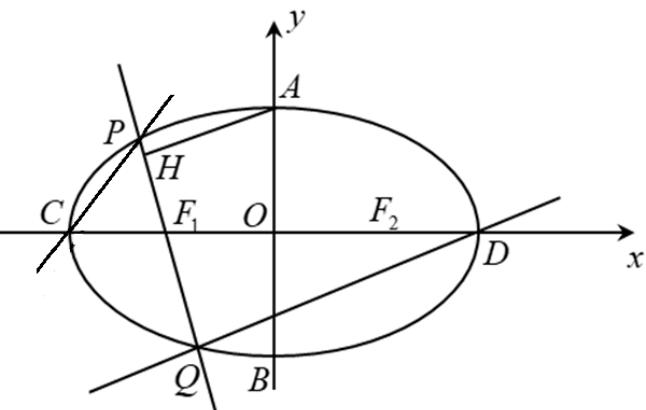

# 2025二模 金山区原卷 · 教师版

> 本地预览：题目、答案及分类尚未全部审定。校对使用的PDF为高中工作台解析版，尚未逐区确认区级印刷原卷。

## 填空题

按本区原卷题号顺序排列。

### 金山 · 第1题

已知集合 $A = \{ x \mid x ^ { 2 } - 5 x + 6 = 0 \} , B = \{ 2 , 4 , 6 \}$ ，则A ∩ B =

**考点：** 二次方程根与交集

**难度依据：** 方程根集与交集；直接运用定义或基础公式，推理链短

**核查说明：** 已人工阅读完整底稿题干及原解，未逐页对照正式PDF，分类不等于数学终审。

【答案】{2}.

【解析】

根据交集的定义求解即可.

因为 $A = \left\{ x \mid x ^ { 2 } - 5 x + 6 = 0 \right\} = \{ 2 , 3 \}$

所以A ∩ B = {2}.

故答案为：{2}.

### 金山 · 第2题

已知复数 z 满足 (1 + i)z = 1 − i（ i 为虚数单位），则 z =

**考点：** 复数四则运算

**难度依据：** 复数除法；直接运用定义或基础公式，推理链短

**核查说明：** 已人工阅读完整底稿题干及原解，未逐页对照正式PDF，分类不等于数学终审。

【答案】-i

【解析】

【分析】利用复数的除法计算即可

【详解】依题意， $z = { \frac { 1 - \mathrm { i } } { 1 + \mathrm { i } } } = { \frac { ( 1 - \mathrm { i } ) ( 1 - \mathrm { i } ) } { ( 1 + \mathrm { i } ) ( 1 - \mathrm { i } ) } } = { \frac { - 2 \mathrm { i } } { 2 } } = - \mathrm { i }$

故答案为：-i

### 金山 · 第3题

已知向 $\overrightarrow { \mathbb { E } } \overrightarrow { a } = ( x , 1 ) , \overrightarrow { b } = ( 1 , 2 - x )$ ， $\overrightarrow { \Pi } \overrightarrow { a } / \overrightarrow { / b }$ ，则实数x =

**考点：** 向量共线求参数

**难度依据：** 共线坐标条件；直接运用定义或基础公式，推理链短

**核查说明：** 已人工阅读完整底稿题干及原解，未逐页对照正式PDF，分类不等于数学终审。

【答案】1.

【解析】

根据平面向量共线的坐标公式计算即可.

因为 $\vec { \jmath _ { a } } = ( x , 1 ) , \vec { b } = ( 1 , 2 - x ) , \vec { a } / \vec { / b } ,$

所以 $x \left( 2 - x \right) - 1 = 0$ ，解得x = 1.

故答案为：1.

### 金山 · 第4题

若α为第二象限角，且 $\sin \alpha = \frac { 4 } { 5 }$ ，则tan α = .

**考点：** 同角三角及符号

**难度依据：** 象限与同角三角关系；直接运用定义或基础公式，推理链短

**核查说明：** 已人工阅读完整底稿题干及原解，未逐页对照正式PDF，分类不等于数学终审。

【答案】$- { \frac { 4 } { 3 } }$

【解析】

结合角所在象限，借助同角三角函数基本关系计算即可得.

由α为第二象限角，则 $\cos \alpha = - { \sqrt { 1 - \left( { \frac { 4 } { 5 } } \right) ^ { 2 } } } = - { \frac { 3 } { 5 } }$

$$
\tan \alpha = \frac {\sin \alpha}{\cos \alpha} = \frac {\frac {4}{5}}{- \frac {3}{5}} = - \frac {4}{3}
$$

故答案为： $- { \frac { 4 } { 3 } }$

### 金山 · 第5题

在 $\left( a x + { \frac { 1 } { x } } \right) ^ { \sharp }$ 展开式中x的系数为80，则实数a的值为

> 本题资料或解析有待核事项，预览不可作为已审定成品。

**考点：** 二项展开系数反求参数

**难度依据：** 指定项系数；需一次转化并结合定义域或几何条件计算

**核查说明：** 题干二项式指数识别为sharp，原解使用5次方，必须回核指数。；已人工阅读完整底稿题干及原解，未逐页对照正式PDF，分类不等于数学终审。

【答案】2

【解析】

利用二项式定理求出展开式中x的项，再由给定的系数求出a值.

$\left( a x + { \frac { 1 } { x } } \right) ^ { 5 }$ 展开式中x的项为 $\mathrm { C } _ { 5 } ^ { 2 } ( a x ) ^ { 3 } \cdot \left( { \frac { 1 } { x } } \right) ^ { 2 } = 1 0 a ^ { 3 } x .$

依题意， $1 0 a ^ { 3 } = 8 0$ ，所以 $. a = 2$

故答案为：2

### 金山 · 第6题

若直线l是曲线 $\lfloor y = { \frac { 2 } { x - 1 } }$ 在x = 3处的切线，则l的斜率为

**考点：** 切线斜率

**难度依据：** 导数几何意义；直接运用定义或基础公式，推理链短

**核查说明：** 已人工阅读完整底稿题干及原解，未逐页对照正式PDF，分类不等于数学终审。

【答案】$- { \frac { 1 } { 2 } }$

【解析】

求出函数的导数，再利用导数的几何意义求出斜率.

函数 $\ [ y = { \frac { 2 } { x - 1 } }$ ，求导得 $y ^ { \prime } = - \frac { 2 } { ( x - 1 ) ^ { 2 } }$ ，则 $y ^ { \prime } | _ { x = 3 } = - \frac { 2 } { ( 3 - 1 ) ^ { 2 } } = - \frac { 1 } { 2 }$

所以l的斜率为 $- \frac 1 2$

故答案为： $- { \frac { 1 } { 2 } }$

### 金山 · 第7题

已知圆锥底面半径为1，高为 ${ \sqrt { 3 } } ,$ ，则过圆锥母线的截面面积的最大值为

**考点：** 母线截面角与面积

**难度依据：** 圆锥截面面积最大；需一次转化并结合定义域或几何条件计算

**核查说明：** 已人工阅读完整底稿题干及原解，未逐页对照正式PDF，分类不等于数学终审。

【答案】${ \sqrt { 3 } } .$

【解析】

依题意求得圆锥的母线长，确定轴截面的顶角，从而求出截面面积的取值的最大值，由此得解．

依题意，设圆锥的母线长为l，

∵圆锥的底面半径为1，高为 $\sqrt { 3 }$ ，

$$
\therefore l = \sqrt {3 + 1} = 2,
$$

设圆锥的轴截面的两母线夹角为θ，显然 $\wp = { \frac { \pi } { 3 } }$

则过该圆锥的母线作截面，截面上的两母线夹角设为 $\alpha , \alpha \in \left( 0 , { \frac { \pi } { 3 } } \right]$

故截面的面积为 $S = { \frac { 1 } { 2 } } \times 2 \times 2 \times \sin \alpha = 2 \sin \alpha \leq { \sqrt { 3 } }$ ，当且仅当 $\alpha = \frac { \pi } { 3 }$ 时，等号成立，故截面的面积的最大值为 $\sqrt { 3 }$

故答案为： ${ \sqrt { 3 } } .$

### 金山 · 第8题

已知 $\left\{ a _ { n } \right\}$ 是等差数列，若 $\dot { a } _ { 3 } , a _ { 7 }$ 分别是函数 $y = x ^ { 2 } - 4 x +$ 2的两个零点，则 $\stackrel { } { a } _ { 5 } =$

**考点：** 对称项等差中项

**难度依据：** 等差中项与韦达关系；需一次转化并结合定义域或几何条件计算

**核查说明：** 已人工阅读完整底稿题干及原解，未逐页对照正式PDF，分类不等于数学终审。

【答案】2

【解析】

转化为 $| a _ { 3 } , a _ { 7 }$ 是 $x ^ { 2 } - 4 x + 2 = 0$ 0的两个根，由韦达定理和等差数列性质得到 $a _ { 5 } = { \frac { a _ { 3 } + a _ { 7 } } { 2 } } = 2 \qquad $ 由题意得 $a _ { 3 } , a _ { 7 }$ 是 $x ^ { 2 } - 4 x + 2 = 0$ 的两个根，

由韦达定理得 $a _ { 3 } + a _ { 7 } = 4$

因为 $\{ a _ { n } \}$ 是等差数列，所以 $a _ { 5 } = { \frac { a _ { 3 } + a _ { 7 } } { 2 } } = 2$

故答案为：2

### 金山 · 第9题

投篮测试中，每人投3次，至少投中2次才能通过测试.已知某同学每次投篮投中的概率为0.6，且各次投篮是否投中相互独立，则该同学通过测试的概率为

**考点：** 二项概率与至少事件

**难度依据：** 独立投篮二项概率；需一次转化并结合定义域或几何条件计算

**核查说明：** 已人工阅读完整底稿题干及原解，未逐页对照正式PDF，分类不等于数学终审。

【解析】

该同学通过测试的概率为 $C _ { 3 } ^ { 2 }$ $0 . 6 ^ { 2 } \cdot 0 . 4 + C _ { 3 } ^ { 3 } \cdot 0 . 6 ^ { 3 } = { \frac { 8 1 } { 1 2 5 } }$ ，故答案为 $\frac { 8 1 } { 1 2 5 }$

### 金山 · 第10题

已知函数 $\cdot y = g \left( x \right)$ 的图象是折线段 $A B C$ ，且 $A \left( 0 , 0 \right) , B \left( \frac { 1 } { 2 } , \frac { 1 } { 2 } \right) , C \left( 1 , 0 \right)$ ，则函数$y = x \cdot g \left( x \right) \left( 0 \leq x \leq 1 \right)$ )的图象与x轴围成的图形面积为

> 本题资料或解析有待核事项，预览不可作为已审定成品。

**考点：** 分段二次函数与对称面积转化

**难度依据：** 分段函数曲边面积；需连接多个条件或多步模型转化

**核查说明：** 面积转化依赖题图标点，而图中A与题干A重名；需核图并清晰区分辅助点。；已人工阅读完整底稿题干及原解，未逐页对照正式PDF，分类不等于数学终审。

【答案】$\frac 1 8$

【解析】

根据题意，求出 ${ \stackrel { \cdot } { \operatorname { J } } } g \left( x \right)$ 的表达式，进而得到 $y = x \cdot g \left( x \right)$ 的表达式，利用图象分割求解面积.

由题可得， $g \left( x \right) = \left\{ \begin{array} { l l } { { x , 0 \leq x \leq \frac 1 2 } } \\ { { \qquad \quad - x + 1 , \frac 1 2 < x \leq 1 } } \end{array} \right.$

$$
\therefore y = x \cdot g (x) = \left\{ \begin{array}{l} x ^ {2}, 0 \leq x \leq \frac {1}{2} \\ - x ^ {2} + x, \frac {1}{2} <   x \leq 1 \end{array} , \right.
$$

设函数 $y = x \cdot g ( x ) ( 0 \leq x \leq 1 )$ 的图象与x轴围成的图形面积为S，

如图，由二次函数 $\scriptstyle \cdot y = x ^ { 2 }$ 和 $| y = - x ^ { 2 } + x \overline { { \Theta } } ]$ 知，曲边三角形OEA的面积等于曲边三角形ACF的面积，

所以 $S = S _ { A C F E } = \frac { 1 } { 2 } \times \frac { 1 } { 4 } = \frac { 1 } { 8 }$

故答案为： $\frac 1 8$

### 金山 · 第11题

如图，现对某景区一长 $A B = 6 0 0 \mathrm { m }$ ，宽 $A D = 3 6 0 \mathrm { m }$ 的矩形空地进行建设.规划在边AB,AD上分别取点M,N修建人行步道（不考虑宽度），且满足点A关于步道MN的对称点E在边DC上.在△AMN内种植花卉，在△EMN内搭建娱乐设施，其余区域规划为露营区，则人行步道MN的最短距离为m.（结果精确到1m）

**考点：** 折叠对称与三角换元导数最值

**难度依据：** 对称步道几何建模；需参数分类、构造递推或综合最值分析

**核查说明：** 已人工阅读完整底稿题干及原解，未逐页对照正式PDF，分类不等于数学终审。

【答案】468.

【解析】

由题设有Rt $\triangle M A N \triangle \mathrm { R t } \triangle M E N$ ，设 $\angle A M N = \theta \left( 0 < \theta < \frac { \pi } { 2 } \right)$ 根据图形中边角关系，结合三角函数可得 $M N = \frac { 1 8 0 } { \sin \theta \left( 1 - \sin ^ { 2 } \theta \right) }$ 注意sinθ的范围，进而应用换元法并构造函数，利用导数求最值.

由题意， $\mathrm { R t } \triangle M A N \triangle \mathrm { R t } \triangle M E N$

设 $\angle A M N = \theta \left( 0 < \theta < \frac { \pi } { 2 } \right)$ ，则 $\angle D N E = \pi - 2 \left( { \frac { \pi } { 2 } } - \theta \right) = 2 \theta \mathrm { { , } }$

在R $; \triangle D E N \forall \deg { \cos { 2 \theta } } = \frac { \bar { D } N } { N E } = \frac { 3 6 0 - A N } { A N }$ ，得 $\overset { \overline { { } } } { A N } = \frac { 3 6 0 } { \cos 2 \theta + 1 } = \frac { 1 8 0 } { \cos ^ { 2 } \theta }$

$$
M N = \frac {A N}{\sin \theta} = \frac {1 8 0}{\sin \theta \cos^ {2} \theta} = \frac {1 8 0}{\sin \theta (1 - \sin^ {2} \theta)}
$$

由于 $\left\{ \begin{array} { l } { \displaystyle A N = \frac { 1 8 0 } { \cos ^ { 2 } \theta } = 1 8 0 \left( 1 + \tan ^ { 2 } \theta \right) \leq 3 6 0 } \\ { \displaystyle A M = \frac { A N } { \tan \theta } = 1 8 0 \left( \tan \theta + \frac { 1 } { \tan \theta } \right) \leq 6 0 0 } \end{array} , \right.$ 解得 $\frac 1 3 \leq \tan \theta \leq 1$

则 $| \tan ^ { 2 } \theta = { \frac { \sin ^ { 2 } \theta } { \cos ^ { 2 } \theta } } = { \frac { \sin ^ { 2 } \theta } { 1 - \sin ^ { 2 } \theta } } \in [ { \frac { 1 } { 9 } } , 1 ]$ ，解得 ${ \frac { \sqrt { 1 0 } } { 1 0 } } \leq \sin \theta \leq { \frac { \sqrt { 2 } } { 2 } }$

$\mathfrak { P s i n } \theta = t , \ t \in \left\lceil \frac { \sqrt { 1 0 } } { 1 0 } , \frac { \sqrt { 2 } } { 2 } \right\rceil$ ，则 $M N = \frac { 1 8 0 } { t - t ^ { 3 } }$

令 $\cdot f ( t ) = t - t ^ { 3 }$ ，则 $f ^ { \prime } ( t ) = 1 - 3 t ^ { 2 }$

令 $\cdot f ^ { \prime } ( t ) > 0 ;$ ，则t $\in \left\lceil { \frac { \sqrt { 1 0 } } { 1 0 } } , { \frac { \sqrt { 3 } } { 3 } } \right\rceil$ ，函数f(t)单调递增；

$\widehat { \asymp } f ^ { \prime } ( t ) < 0$ ，则 $: \in \left( \frac { \sqrt { 3 } } { 3 } , \frac { \sqrt { 2 } } { 2 } \right]$ 函数f(t)单调递减；

所以 $f ( t ) _ { \mathrm { m a x } } = f \left( { \frac { \sqrt { 3 } } { 3 } } \right) = { \frac { 2 { \sqrt { 3 } } } { 9 } }$

所以 $M N _ { \mathrm { m i n } } = 2 7 0 \sqrt { 3 } \approx 4 6 8$

即人行步道MN的最短距离为468m.

故答案为：468.

### 金山 · 第12题

$\mathrm { i } \frac { \pi } { \times } x _ { 1 } , x _ { 2 } , x _ { 3 } , x _ { 4 } , x _ { 5 }$ 均是正整数，且
$\{ x \mid x \mid x = x _ { m } x _ { n } x _ { p } x _ { q } , 1 \leq m < n < p < q \leq 5 \} = \{ 1 0 8 , 1 4 4 , 2 8 8 , 4 3 2 \} , \ : \ : \ : \forall \| x _ { 1 } + x _ { 2 } + x _ { 3 } + x _ { 4 } + x _ { 5 }$ 的值为

> 本题资料或解析有待核事项，预览不可作为已审定成品。

**考点：** 质因数分解与多重集合反推

**难度依据：** 四数积集合反推整数；需参数分类、构造递推或综合最值分析

**核查说明：** 题干集合花括号和量词有乱码；源解将108分解只列两类但未证明穷尽所有整数分解，需补唯一性论证。；已人工阅读完整底稿题干及原解，未逐页对照正式PDF，分类不等于数学终审。

【答案】22.

【解析】

先将108,144,288,432四个数都写成2的指数幂和3的指数幂的积的形式，再根据$1 0 8 = 2 \times 3 \times 3 \times 6 = 3 \times 3 \times 3 \times 4$ ，分 $1 0 8 = 2 \times 3 \times 3 \times$ 6和 $1 0 8 = 3 \times 3 \times 3 \times 4$ 两种情况讨论，即可得解.

108 = 22 × 33 = 2 × 3 × 3 × 6 = 3 × 3 × 3 × 4，

144 = 24 × 32, 288 = 25 × 32, 432 = 24 × 33，

当 $\lvert 1 0 8 = 2 \times 3 \times 3 \times 6 \rvert \tilde { \lvert }$ ，

不妨取 $x _ { 1 } = 2 , x _ { 2 } = 3 , x _ { 3 } = 3 , x _ { 4 } = 6 ,$

则 $| 4 3 2 = 2 ^ { 4 } \times 3 ^ { 3 } = 3 \times 3 \times 6 \times 8 = 8 x _ { 2 } x _ { 3 } x _ { 4 }$ ，此时 $x _ { 5 } = 8$

而144 = 24 × 32 = 2 × 3 × 3 × 8, 288 = 25 × 32 = 2 × 3 × 6 × 8，

所以 $\mathbf { \langle } x _ { 1 } = 2 , x _ { 2 } = 3 , x _ { 3 } = 3 , x _ { 4 } = 6 , x _ { 5 } = 8$ 满足题目条件；

当 $1 0 8 = 3 \times 3 \times 3 \times 4 \boxed { \div }$

不妨取 $x _ { 1 } = 3 , x _ { 2 } = 3 , x _ { 3 } = 3 , x _ { 4 } = 4 ,$

则 $( 4 3 2 = 2 ^ { 4 } \times 3 ^ { 3 } = 3 \times 3 \times 3 \times 1 6 = 1 6 x _ { 1 } x _ { 2 } x _ { 3 }$ ，此时 $x _ { 5 } = 1 6$

而从 $\begin{array} { r } { , x _ { 1 } = 3 , x _ { 2 } = 3 , x _ { 3 } = 3 , x _ { 4 } = 4 , x _ { 5 } = 1 6 ^ { \textnormal { \scriptsize { F } } } } \end{array}$ 中任取4个数相乘不能得出144，

所以 $\lvert { , x _ { 1 } = 3 , x _ { 2 } = 3 , x _ { 3 } = 3 , x _ { 4 } = 4 , x _ { 5 } = 1 6 }$ 不满足条件，

综上所述， $x _ { 1 } = 2 , x _ { 2 } = 3 , x _ { 3 } = 3 , x _ { 4 } = 6 , x _ { 5 } = 8 ,$

所以 $x _ { 1 } + x _ { 2 } + x _ { 3 } + x _ { 4 } + x _ { 5 } = 2 2 .$

故答案为：22.

## 二、选择题

## 选择题

按本区原卷题号顺序排列。

### 金山 · 第13题

已 $\Im a \in \mathbf { R }$ ，则下列结论不恒成立的是（ ）

A. $a + 1 > a$

B. $a + { \frac { 1 } { a } } \geq 2$

C. $| 1 - a | + | a + 2 | \geq 3$

D. $a ^ { 2 } + a + 1 > 0$

> 本题资料或解析有待核事项，预览不可作为已审定成品。

**考点：** 基本不等式条件及绝对值

**难度依据：** 不等式性质与反例；需一次转化并结合定义域或几何条件计算

**核查说明：** a=0时选项B分母无定义，判断不恒成立仍可，但讲解应标注定义条件。；已人工阅读完整底稿题干及原解，未逐页对照正式PDF，分类不等于数学终审。

【答案】B

【解析】

利用不等式性质判断AD；举例说明判断B；利用绝对值的三角形不等式判断C.

对于A， $1 > 0 \Leftrightarrow a + 1 > a .$ ，A正确；

对于B，取 $\stackrel { \cdot } { a } = - 1 , \stackrel { a } { a } + \frac { 1 } { a } = - 2 < 2$ ，B错误；

对于C， $| 1 - a | + | a + 2 | \geq | 1 - a + 2 + a | = 3$ ，当且仅当(1 − a)(a + 2) ≥ 0时取等号，C正确；

对于D， $a ^ { 2 } + a + 1 = \left( a + { \frac { 1 } { 2 } } \right) ^ { 2 } + { \frac { 3 } { 4 } } > 0$ ，D正确.

故选：B

### 金山 · 第14题

某人统计了甲、乙两家零售商店在周一到周五的营业额（单位：百元）情况，得到了如下的茎叶图（其中茎表示十位数，叶表示个位数），关于这5天的营业额情况，下列结论正确的是（ ）

A. 甲、乙两家商店营业额的极差相同

B. 甲、乙两家商店营业额的中位数相同

C. 从营业额超过3000元的天数所占比例来看，甲商店较高

D. 甲商店营业额的方差小于乙商店营业额的方差

> 本题资料或解析有待核事项，预览不可作为已审定成品。

**考点：** 极差中位数比例与方差

**难度依据：** 茎叶图及统计量比较；需一次转化并结合定义域或几何条件计算

**核查说明：** 题干所指营业额茎叶图未保留，需补图。；已人工阅读完整底稿题干及原解，未逐页对照正式PDF，分类不等于数学终审。

【答案】C

【解析】

对于A，由极差的定义，即最大值减最小值即可判断；对于B，由中位数的定义判断即可（从小到大排列数据）；对于C，直接由茎叶图即可判断；对于D，由方差公式运算即可判断.

A选项：甲商店营业额的极差为10，乙商店营业额的极差为8，故A错误；

B选项：甲商店营业额的中位数为32，乙商店营业额的中位数为30，故B错误；

C选项：甲商店营业额超过3000元的天数为3，乙商店营业额超过3000元的天数为2，故从营业额超过3000元的天数所占比例来看，甲商店较高，故C正确；

D选项：甲商店营业额的平均值为 $\frac { 2 7 + 2 8 + 3 2 + 3 6 + 3 7 } { 5 } = 3 2$ 乙商店营业额的平均值为${ \frac { 2 6 + 2 8 + 3 0 + 3 2 + 3 4 } { 5 } } = 3 0 ,$

故甲商店营业额的方差

$$
s _ {\text {甲}} ^ {2} = \frac {1}{5} \times \left[ (2 7 - 3 2) ^ {2} + (2 8 - 3 2) ^ {2} + (3 2 - 3 2) ^ {2} + (3 6 - 3 2) ^ {2} + (3 7 - 3 2) ^ {2} \right] = 1 6. 4,
$$

乙商店营业额的方差

$s _ { \scriptscriptstyle { \mathscr { Z } } } ^ { 2 } = \frac { 1 } { 5 } \times \left[ \left( 2 6 - 3 0 \right) ^ { 2 } + \left( 2 8 - 3 0 \right) ^ { 2 } + \left( 3 0 - 3 0 \right) ^ { 2 } + \left( 3 2 - 3 0 \right) ^ { 2 } + \left( 3 4 - 3 0 \right) ^ { 2 } \right] = 8 ,$ ，则 $s _ { \perp } ^ { 2 } > s _ { Z } ^ { 2 }$

，故甲商店营业额的方差大于乙商店营业额的方差，故D错误.

故选：C.

### 金山 · 第15题

已知定义在R上的函数 $\mathbf { \boldsymbol { y } } = \mathbf { \boldsymbol { f } } \left( \boldsymbol { x } \right)$ ，满足以下两个条件：（1）f(x) > 0对任意x ∈ R恒成立，且$f \left( 1 \right) = 1 ; \ \left( 2 \right)$ 对任意 ${ \boldsymbol { x } } _ { 1 } , { \boldsymbol { x } } _ { 2 } \in \mathbf { R }$ 都有 $\dot { \boldsymbol f } \left( \boldsymbol x _ { 1 } + 2 \boldsymbol x _ { 2 } \right) = 4 \boldsymbol f \left( \boldsymbol x _ { 1 } \right) \cdot \boldsymbol f ^ { 2 } \left( \boldsymbol x _ { 2 } \right)$ ，则下列关于函数 $\cdot y = f \left( x \right)$ )的表述中正确的个数为（ ）① $f \left( 0 \right) = \frac { 1 } { 2 } ; \ \textcircled { 2 } f \left( x \right) \cdot f \left( - x \right) = \frac { 1 } { 4 }$ ；③函数y = f(x)有最小值.

A. 0

B. 1

C. 2

D. 3

**考点：** 函数方程赋值与构造反例

**难度依据：** 抽象函数赋值与最值反例；需连接多个条件或多步模型转化

**核查说明：** 已人工阅读完整底稿题干及原解，未逐页对照正式PDF，分类不等于数学终审。

【答案】C

【解析】

通过赋值法判断①②，举反例判断③.

由任意 $x _ { 1 } , x _ { 2 } \in \mathbf { R }$ ，都有 $f \left( x _ { 1 } + 2 x _ { 2 } \right) = 4 f \left( x _ { 1 } \right) \cdot f ^ { 2 } \left( x _ { 2 } \right)$

令 $\mathbf { \dot { x } } _ { 1 } = x _ { 2 } = 0$ ，可得 $f \left( 0 \right) = 4 f ^ { 3 } \left( 0 \right)$ ，因为 $f \left( 0 \right) > 0 .$ ，解得 $f \left( 0 \right) = { \frac { 1 } { 2 } }$ ，故①正确；

$\ \stackrel {  } { \vec { \asymp } } x _ { 1 } = - x , ~ x _ { 2 } = x$ ，可得 $f \left( - x + 2 x \right) = 4 f \left( - x \right) \cdot f ^ { 2 } \left( x \right)$

整理得 $f \left( x \right) = 4 f \left( - x \right) \cdot f ^ { 2 } \left( x \right)$ ，又 $f \left( x \right) > 0$ ，得 $f \left( x \right) \cdot f \left( - x \right) = { \frac { 1 } { 4 } }$ ，故②正确；

对于③举反例，如 $f \left( x \right) = 2 ^ { x - 1 }$

满足条件（1），又 $. f \left( x _ { 1 } + 2 x _ { 2 } \right) = 2 ^ { x _ { 1 } + 2 x _ { 2 } - 1 }$ $4 f \left( x _ { 1 } \right) \cdot f ^ { 2 } \left( x _ { 2 } \right) = 4 \times 2 ^ { x _ { 1 } - 1 } \times \left( 2 ^ { x _ { 2 } - 1 } \right) ^ { 2 }$

则 $f \left( x _ { 1 } + 2 x _ { 2 } \right)$ = 4 $f \left( x _ { 1 } \right) \cdot f ^ { 2 } \left( x _ { 2 } \right)$ ，满足条件（2），

而 $f \left( x \right) = 2 ^ { x - 1 } >$ 0没有最小值，故③错误.

所以正确的有2个.

故选：C.

### 金山 · 第16题

已知点A $( x _ { 1 } , y _ { 1 } )$ 在圆 $x ^ { 2 } + y ^ { 2 } = 9 .$ 上，点 $B \left( x _ { 2 } , y _ { 2 } \right)$ 在圆 $x ^ { 2 } + y ^ { 2 } = 1 2$ 上，且
$x _ { 1 } x _ { 2 } + y _ { 1 } y _ { 2 } = x _ { 1 } + x _ { 2 } - 1$ ,O为坐标原点.对于以下两个命题，判断正确的是（ ）
①在坐标平面内存在点P，使得 $A P \bot B P$ 恒成立；
②三角形OAB面积的最小值为 ${ \sqrt { 2 2 } }$

A. ①是真命题，②是真命题

B. ①是假命题，②是真命题

C. ①是真命题，②是假命题

D. ①是假命题，②是假命题

> 本题资料或解析有待核事项，预览不可作为已审定成品。

**考点：** 数量积转定点、三角参数化面积最值

**难度依据：** 坐标数量积与定点垂直；需参数分类、构造递推或综合最值分析

**核查说明：** 原解只给面积下界，尚未显式验证取等条件可达；辅助角gamma区间需处理系数为负情况。；已人工阅读完整底稿题干及原解，未逐页对照正式PDF，分类不等于数学终审。

【答案】A

【解析】

对于①，注意到 $x _ { 1 } x _ { 2 } + y _ { 1 } y _ { 2 } = x _ { 1 } + x _ { 2 } - 1 \Rightarrow \left( x _ { 1 } - 1 \right) \left( x _ { 2 } - 1 \right) + y _ { 1 } y _ { 2 } = 0 ,$

则可想到当P(1,0)时满足题意；对于②，设 $4 \left( 3 \cos \theta , 3 \sin \theta \right) , B \left( 2 { \sqrt { 3 } } \cos \beta , 2 { \sqrt { 3 } } \sin \beta \right)$

则 $S _ { \triangle A O B } = 3 \sqrt { 3 } \left| \sin \left( \theta - \beta \right) \right|$ ， 后 由 $x _ { 1 } x _ { 2 } + y _ { 1 } y _ { 2 } = x _ { 1 } + x _ { 2 } - 1$ 可 得$6 \sqrt { 3 } \cos \left( \theta - \beta \right) = 3 \cos \theta + 2 \sqrt { 3 } \cos \beta - 1$ ，利用三角函数知识可得 $| \sin \alpha | \geq { \frac { \sqrt { 2 2 } } { 3 { \sqrt { 3 } } } }$ ，据此可判断命题正误.

$$
x _ {1} x _ {2} + y _ {1} y _ {2} = x _ {1} + x _ {2} - 1 \Rightarrow x _ {1} x _ {2} - x _ {1} - x _ {2} + 1 + y _ {1} y _ {2} = 0 \Rightarrow
$$

$( x _ { 1 } - 1 ) ( x _ { 2 } - 1 ) + y _ { 1 } y _ { 2 } = 0$ ，则当 $P \left( 1 , 0 \right)$ 时， $\stackrel {  } { A P } = ( 1 - x _ { 1 } , - y _ { 1 } ) , \stackrel {  } { B P } = ( 1 - x _ { 2 } , - y _ { 2 } )$

AP ⋅ BP = (1 − x1) (1 − x2) + y1y2 = 0，

即当 $P \left( 1 , 0 \right)$ 时，AP⊥BP恒成立，则①是真命题；

设 $. A \left( 3 \cos \theta , 3 \sin \theta \right) , B \left( 2 \sqrt { 3 } \cos \beta , 2 \sqrt { 3 } \sin \beta \right)$ ，

则OA = (3 cos θ, 3 sin θ), OB = (2√3 cos β, 2√3 sin β)，

$$
\text {又} \cos \angle A O B = \frac {\vec {O A} \cdot \vec {O B}}{\left| \vec {O A} \right| \cdot \left| \vec {O B} \right|} = \frac {6 \sqrt {3} \cos \theta \cos \beta + 6 \sqrt {3} \sin \theta \sin \beta}{3 \cdot 2 \sqrt {3}} = \cos (\theta - \beta),
$$

则 $| S _ { \triangle A O B } = \frac { 1 } { 2 } | O A | | O B | \sin \angle A O B = 3 \sqrt { 3 } | \sin ( \theta - \beta ) | .$

因 $| x _ { 1 } x _ { 2 } + y _ { 1 } y _ { 2 } = x _ { 1 } + x _ { 2 } - 1$ ，

则6√3 cos θ cos β + 6√3 sin θ sin β = 3 cos θ + 2√3 cos β − 1，

$$
\text { 则 } 6 \sqrt {3} \cos (\theta - \beta) = 3 \cos \theta + 2 \sqrt {3} \cos \beta - 1, \text { 令 } \theta - \beta = \alpha ,
$$

$$
\text { 则 } 6 \sqrt {3} \cos \alpha = 3 \cos \theta + 2 \sqrt {3} \cos (\theta - \alpha) - 1,
$$

即6√3 cos α = 3 cos θ + 2√3 cos θ cos α + 2√3 sin θ sin α − 1，

则6√3 cos α + 1 = (3 + 2√3 cos α) cos θ + 2√3 sin α sin θ

$$
= \sqrt {\left(3 + 2 \sqrt {3} \cos \alpha\right) ^ {2} + \left(2 \sqrt {3} \sin \alpha\right) ^ {2}} \cos (\theta - \gamma), \text {其中} \tan \gamma = \frac {2 \sqrt {3} \sin \alpha}{3 + 2 \sqrt {3} \cos \alpha},
$$

$$
\gamma \in \left(- {\frac {\pi}{2}}, {\frac {\pi}{2}}\right), \text {则} \cos (\theta - \gamma) = {\frac {6 {\sqrt {3}} \cos \alpha + 1}{\sqrt {\left(3 + 2 {\sqrt {3}} \cos \alpha\right) ^ {2} + \left(2 {\sqrt {3}} \sin \alpha\right) ^ {2}}}},
$$

$$
\text {因} \cos (\theta - \gamma) \in [ - 1, 1 ], \text {则} {\frac {6 \sqrt {3} \cos \alpha + 1}{\sqrt {(3 + 2 \sqrt {3} \cos \alpha) ^ {2} + (2 \sqrt {3} \sin \alpha) ^ {2}}}} \in [ - 1, 1 ] \Rightarrow
$$

$$
\frac {\left(6 \sqrt {3} \cos \alpha + 1\right) ^ {2}}{\left(3 + 2 \sqrt {3} \cos \alpha\right) ^ {2} + \left(2 \sqrt {3} \sin \alpha\right) ^ {2}} \in [ 0, 1 ] \Rightarrow \left(6 \sqrt {3} \cos \alpha + 1\right) ^ {2} \leq \left(3 + 2 \sqrt {3} \cos \alpha\right) ^ {2} +   \left(2 \sqrt {3} \sin \alpha\right) ^ {2}
$$

$$
\text {则} 1 0 8 \cos^ {2} \alpha \leq 2 0 \Rightarrow 1 0 8 \left(1 - \sin^ {2} \alpha\right) \leq 2 0 \Rightarrow \sin^ {2} \alpha \geq {\frac {2 2}{2 7}} \Rightarrow | \sin \alpha | \geq {\frac {\sqrt {2 2}}{3 \sqrt {3}}},
$$

则 $S _ { \triangle A O B } = 3 \sqrt { 3 } \left| \sin \left( \theta - \beta \right) \right| = 3 \sqrt { 3 } \left| \sin \alpha \right| \geq \sqrt { 2 2 }$ ，故②是真命题.

故选：A.

关键点睛：对于命题①，关键为注意到 $x _ { 1 } x _ { 2 } - x _ { 1 } - x _ { 2 } + 1 = \left( x _ { 1 } - 1 \right) \left( x _ { 2 } - 1 \right)$ ；

对于命题②，难点在于确定 $| \sin \left( \theta - \beta \right)$ |的范围，为此首先将 $\left[ \theta - \beta \right]$ 看作整体，随后将 $\mathbf { \partial } \cdot \theta - \beta ,$ 从相关等式中分离出来，最后利用三角函数的值域确定范围.

## 三、解答题

## 解答题

按本区原卷题号顺序排列。

### 金山 · 第17题

已知函数 $y = f \left( x \right)$ 是定义在R上的奇函数，当 $x > 0$ 时， $f \left( x \right) = \log _ { 2 } x$
(1) (6分)求 $f \left( - 2 \right) + f \left( 0 \right)$ 的值；
(2) (8分)若 ${ \mathrm { : } } g \left( x \right) = f \left( x \right) \cdot f \left( { \frac { x } { 4 } } \right) , x \in \left[ 1 , 8 \right]$ ，求函数 $\scriptstyle \left( y = g \left( x \right) \right.$ 的值域.

**考点：** (1)奇性与原点值；(2)对数换元为二次函数求值域

**难度依据：** 奇函数与对数换元最值；需连接多个条件或多步模型转化

**核查说明：** 已人工阅读完整底稿题干及原解，未逐页对照正式PDF，分类不等于数学终审。

【解析】

(1) 因为函数 $y = f \left( x \right)$ 是定义在R上的奇函数，

所以 $\mathcal { f } \left( - x \right) = - f \left( x \right) , f \left( 0 \right) = 0$

所以 $. f \left( - 2 \right) + f \left( 0 \right) = - f \left( 2 \right) + f \left( 0 \right) = - 1 + 0 = - 1 ;$

(2) $g \left( x \right) = \left( \log _ { 2 } x \right) \cdot \left( \log _ { 2 } \frac { x } { A } \right) = \left( \log _ { 2 } x \right) \cdot \left( \log _ { 2 } x - 2 \right) = \left( \log _ { 2 } x \right) ^ { 2 } - 2 \log _ { 2 } x , x \in \left[ 1 , 8 \right] ,$

令 $\log _ { 2 } x = t , t \in [ 0 , 3 ]$ ，问题等价于求h $( t ) = t ^ { 2 } - 2 t , t \in [ 0 , 3 ]$ ]的值域，

∵函数 $h \left( t \right) = t ^ { 2 } - 2 t$ 图象开口向上，对称轴为直线 $\mathbf { \boldsymbol { t } } = 1$

$$
\therefore h (t) _ {\min} = h (1) = - 1, h (t) _ {\max} = h (3) = 3,
$$

∴函数 ${ \bf \dot { \boldsymbol { g } } } \left( \boldsymbol { x } \right)$ 的值域为[−1, 3]

### 金山 · 第18题

如图，在四棱锥 $P - A B C D$ 中，PA⊥平面 $P B C , A B = 2 D C = 4 , B C = 2 \sqrt { 2 } , A B \bot B C , D C / / A B$
(1) (6分)证明：平面 $A B C D \bot$ 平面 $P A B$
(2) (8分)若 $\angle A B P = { \frac { \pi } { 3 } }$ ，求点C到平面PAD的距离.

**考点：** (1)线面垂直推面面垂直；(2)空间坐标与法向量点面距离

**难度依据：** 面面垂直与点面距离；需连接多个条件或多步模型转化

**核查说明：** 已人工阅读完整底稿题干及原解，未逐页对照正式PDF，分类不等于数学终审。

【解析】

(1) 因为PA⊥平面PBC，BC ⊂平面PBC，

所以 $P A \bot B C$

又 $A B \bot B C , A B \cap P A = A , A B , P A \subset { \widehat { \mathbb { F } } } { \widehat { \mathbb { H } } } P A B ,$

所以 $B C \bot$ 平面 $P A B ,$

又 $B C \subset$ 平面 $A B C D$

所以平面ABCD⊥平面PAB；

(2) 因为PA⊥平面PBC，PB ⊂平面PBC，

所以 $P A \bot P B ,$

在Rt $\triangle P A B ^ { \rvert }$ 中， $A B = 4 , \angle A B P = \frac { \pi } { 3 }$ ，则 $P B = 2$

如图，以点B为原点建立空间直角坐标系，

$$
A (4, 0, 0), C (0, 0, 2 \sqrt {2}), D (2, 0, 2 \sqrt {2}), P (1, \sqrt {3}, 0)
$$

故 $\overrightarrow { A D } = \left( - 2 , 0 , 2 \sqrt { 2 } \right) , \overrightarrow { A P } = \left( - 3 , \sqrt { 3 } , 0 \right) , \overrightarrow { D C } = ( - 2 , 0 , 0 ) ,$

设平面PAD的法向量为 $\vec { n } = ( x , y , z )$

则有 $\left\{ { \begin{array} { l } { { \vec { n } } \cdot { \overrightarrow { A D } } = - 2 x + 2 { \sqrt { 2 } } z = 0 } \\ { { \overrightarrow { n } } \cdot { \overrightarrow { A P } } = - 3 x + { \sqrt { 3 } } y = 0 } \end{array} } \right.$ ${ \mathfrak { H } } x = { \sqrt { 2 } } ,$ 则 $y = \sqrt { 6 } , z = 1$ ，所以→n $= \left( { \sqrt { 2 } } , { \sqrt { 6 } } , 1 \right)$

所以点C到平面PAD的距离为 $\frac { \left| { \vec { n } } \cdot { \overrightarrow { D C } } \right| } { \left| { \vec { n } } \right| } = { \frac { 2 { \sqrt { 2 } } } { 3 } }$

### 金山 · 第19题

为了研究高三学生每天整理数学错题的情况，某校数学建模兴趣小组的同学在本校高三年级学生中采用随机抽样的方法抽取了40名学生，调查他们平时的数学成绩和整理数学错题的情况，现统计得部分数据如下：

| 整理数学错题情况 | 数学成绩总评优秀人数 | 数学成绩总评非优秀人数 | 合计 |
| --- | ---: | ---: | ---: |
| 每天都整理数学错题人数 | 14 |  |  |
| 不是每天都整理数学错题人数 |  | 15 | 20 |
| 合计 |  |  | 40 |

(1) (4分)完成上述样本数据的2 × 2列联表，并计算：每天都整理数学错题且数学成绩总评优秀的经验概率；
(2) (4分)是否有99%的把握认为“数学成绩总评优秀与每天都整理数学错题有关”？
附： $\chi ^ { 2 } = \frac { n ( a d - b c ) ^ { 2 } } { \left( a + b \right) \left( c + d \right) \left( a + c \right) \left( b + d \right) } ;$

| 显著性水平 | 0.10 | 0.01 | 0.001 |
| --- | ---: | ---: | ---: |
| $\chi^2$ 临界值 | 2.706 | 6.635 | 10.828 |

(3) (6分)从不是每天都整理数学错题的学生中随机抽取3名学生做进一步访谈，设恰好抽取到数学成绩总评优秀的人数为X，求X的分布列和期望.

> 本题资料或解析有待核事项，预览不可作为已审定成品。

**考点：** (1)列联表与交事件频率；(2)独立性检验；(3)超几何分布列和期望

**难度依据：** 列联表独立检验及分布列；需连接多个条件或多步模型转化

**核查说明：** 样本数据表、2x2列联表与临界值表未显示，需补原表；分布列汇总也缺失。；已人工阅读完整底稿题干及原解，未逐页对照正式PDF，分类不等于数学终审。

【解析】

(1) 完善2×2列联表，如下：

每天都整理数学错题且数学成绩总评优秀的经验概率为 $\frac { 1 4 } { 4 0 } = 0 . 3 5$

(2) 由（1）得 $\chi ^ { 2 } = \frac { 4 0 ( 1 4 \times 1 5 - 5 \times 6 ) ^ { 2 } } { 2 0 \times 2 0 \times 1 9 \times 2 1 } \approx 8 . 1 2 > 6 . 6 3 5 ,$

所以有99%的把握认为“数学成绩总评优秀与每天都整理数学错题有关”.

(3) 不是每天都整理数学错题的学生有20人，其中数学成绩总评优秀人数为5，

X的所有可能值为0，1，2，3，

$$
P (X = 0) = \frac {\mathrm{C} _ {5} ^ {0} \mathrm{C} _ {1 5} ^ {3}}{\mathrm{C} _ {2 0} ^ {3}} = \frac {9 1}{2 2 8}, P (X = 1) = \frac {\mathrm{C} _ {5} ^ {1} \mathrm{C} _ {1 5} ^ {2}}{\mathrm{C} _ {2 0} ^ {3}} = \frac {3 5}{7 6},
$$

$$
P (X = 2) = \frac {\mathrm{C} _ {5} ^ {2} \mathrm{C} _ {1 5} ^ {1}}{\mathrm{C} _ {2 0} ^ {3}} = \frac {5}{3 8}, P (X = 3) = \frac {\mathrm{C} _ {5} ^ {3} \mathrm{C} _ {1 5} ^ {0}}{\mathrm{C} _ {2 0} ^ {3}} = \frac {1}{1 1 4},
$$

所以X的分布列为：

期望 $E \left( X \right) = 0 \times \frac { 9 1 } { 2 2 8 } + 1 \times \frac { 3 5 } { 7 6 } + 2 \times \frac { 5 } { 3 8 } + 3 \times \frac { 1 } { 1 1 4 } = \frac { 3 } { 4 } .$

### 金山 · 第20题

已知椭圆Γ: ${ \frac { x ^ { 2 } } { 4 } } + { \frac { y ^ { 2 } } { 3 } } = 1$ ，左右焦点分别为 $F _ { 1 } , F _ { 2 }$ ，上下顶点分别为A,B，左右顶点分别为 $C , D ,$ P,Q是Γ上异于椭圆顶点的两点.
(1) (4分)求 $\triangle A F _ { 1 } F _ { 2 }$ 的周长；
(2) (6分)若点Q在第一象限且满足 $. \triangle A B Q$ 的面积比 $\triangle F _ { 1 } F _ { 2 } Q$ 的面积大，求点Q的横坐标的取值范围；
(3) (8分)记点A在直线PQ上的投影为H，且直线CP的斜率是直线DQ的斜率的3倍，试判断：过点A,H,O(O为坐标原点)三点的圆是否为定圆？若是，求出该圆的方程；若不是，请说明理由.

> 本题资料或解析有待核事项，预览不可作为已审定成品。

**考点：** (1)焦点三角形周长；(2)面积比较与横坐标范围；(3)斜率比导出定点弦及垂足定圆

**难度依据：** 椭圆面积范围与定圆；需处理新定义或多对象联动，包含一般性证明及边界

**核查说明：** 第三问联立直线条件缺失，y_P曾误写分母4k²+3，后文改为12k²+1；PQ方程点斜式正负号有OCR错误，须逐式复核。；已人工阅读完整底稿题干及原解，未逐页对照正式PDF，分类不等于数学终审。

【解析】

(1) 由椭圆Γ: ${ \frac { x ^ { 2 } } { 4 } } + { \frac { y ^ { 2 } } { 3 } } = 1$

得 $\displaystyle { \dot { \cdot } a ^ { 2 } = 4 , b ^ { 2 } = 3 , c ^ { 2 } = 1 }$ ，所以 $\cdot a = 2 , c = 1$ ，

所以 $\triangle A F _ { 1 } F _ { 2 }$ 的周长为 $2 a + 2 c = 6 ;$ ；

(2) 设 $Q \left( x _ { 0 } , y \right) \left( x _ { 0 } > 0 , y _ { 0 } > 0 \right)$

由 $S _ { \triangle A B Q } > S _ { \triangle F _ { 1 } F _ { 2 } Q }$ ，得 $\frac { 1 } { 2 } | A B | | x _ { 0 } | > \frac { 1 } { 2 } | F _ { 1 } F _ { 2 } | | y _ { 0 } | .$

所以 ${ \sqrt { 3 } } \left. x _ { 0 } \right. > \left. y _ { 0 } \right.$ ，即 $3 x _ { 0 } ^ { 2 } > y _ { 0 } ^ { 2 }$ ，

又因为 $\frac { x _ { 0 } ^ { 2 } } { 4 } + \frac { y _ { 0 } ^ { 2 } } { 3 } = 1$ ，所以 $0 < y _ { 0 } ^ { 2 } = 3 - \frac { 3 x _ { 0 } ^ { 2 } } { 4 } < 3 x _ { 0 } ^ { 2 } .$

解得 $\frac { 2 \sqrt { 5 } } { 5 } < x _ { 0 } < 2 .$

即点Q的横坐标的取值范围为 $\left( { \frac { 2 { \sqrt { 5 } } } { 5 } } , 2 \right)$

(3) C (−2, 0), D (2, 0)，

设直线CP的方程为 $\mathinner { | { y = 3 k \left( x + 2 \right) } }$ ，直线DQ的方程为 $y = k ( x - 2 ) , k \neq 0$

联立 $\left\{ { \frac { x ^ { 2 } } { 4 } } + { \frac { y ^ { 2 } } { 3 } } = 1 \right.$ ，消y得 $\big ( 4 k ^ { 2 } + 3 \big ) x ^ { 2 } - 1 6 k ^ { 2 } x + 1 6 k ^ { 2 } - 1 2 = 0 \mathrm { { } } _ { \mathrm { { ; } } }$

则2 $x _ { Q } = \frac { 1 6 k ^ { 2 } - 1 2 } { 4 k ^ { 2 } + 3 }$ ，所以 $x _ { Q } = \frac { 8 k ^ { 2 } - 6 } { 4 k ^ { 2 } + 3 }$ ，所以 $y _ { Q } = k \left( \frac { 8 k ^ { 2 } - 6 } { 4 k ^ { 2 } + 3 } - 2 \right) = \frac { - 1 2 k } { 4 k ^ { 2 } + 3 } ,$

故Q $\left( { \frac { 8 k ^ { 2 } - 6 } { 4 k ^ { 2 } + 3 } } , { \frac { - 1 2 k } { 4 k ^ { 2 } + 3 } } \right)$

联立 $\left\{ { \frac { x ^ { 2 } } { 4 } } + { \frac { y ^ { 2 } } { 3 } } = 1 \right.$ ，消y得 $\big ( 1 2 k ^ { 2 } + 1 \big ) x ^ { 2 } + 4 8 k ^ { 2 } x + 4 8 k ^ { 2 } - 4 = 0 ,$ y = 3k (x + 2)

则 $- 2 x _ { P } = \frac { 4 8 k ^ { 2 } - 4 } { 1 2 k ^ { 2 } + 1 }$ ，所以 $x _ { P } = { \frac { - 2 4 k ^ { 2 } + 2 } { 1 2 k ^ { 2 } + 1 } }$ ，所以 $y _ { P } = 3 k \left( { \frac { - 2 4 k ^ { 2 } + 2 } { 1 2 k ^ { 2 } + 1 } } + 2 \right) = { \frac { 1 2 k } { 4 k ^ { 2 } + 3 } }$

故 $P \left( { \frac { - 2 4 k ^ { 2 } + 2 } { 1 2 k ^ { 2 } + 1 } } , { \frac { 1 2 k } { 1 2 k ^ { 2 } + 1 } } \right)$ ，

当 $; _ { P } \ne x _ { Q }$ ，即 $k ^ { 2 } \neq \frac { 1 } { 4 }$ 时，

$$
k _ {P Q} = \frac {\frac {- 1 2 k}{4 k ^ {2} + 3} - \frac {1 2 k}{1 2 k ^ {2} + 1}}{\frac {8 k ^ {2} - 6}{4 k ^ {2} + 3} - \frac {- 2 4 k ^ {2} + 2}{1 2 k ^ {2} + 1}} = \frac {4 k}{1 - 4 k ^ {2}},
$$

则直线PQ的方程为 $\quad y + { \frac { - 1 2 k } { 4 k ^ { 2 } + 3 } } = { \frac { 4 k } { 1 - 4 k ^ { 2 } } } \left( x - { \frac { 8 k ^ { 2 } - 6 } { 4 k ^ { 2 } + 3 } } \right)$

即 $\operatorname { J } y = { \frac { 4 k } { 1 - 4 k ^ { 2 } } } ( x + 1 )$ ，过定点 $F _ { 1 } \left( - 1 , 0 \right)$

当x $\mathbf { \boldsymbol { P } } = \mathbf { \boldsymbol { x } } _ { Q }$ ，即 $k ^ { 2 } = \frac { 1 } { 4 }$ 时，

此时 $x _ { P } = x _ { Q } = - 1$ ，直线 $P Q \dot { \iota } \dot { \mathsf { J } }$ 定点 $F _ { 1 } \left( - 1 , 0 \right)$

设 $H \left( x , y \right)$ ，因为 $A H \bot P Q , A O \bot O F _ { 1 }$ ，

所以过点 $A , H , O ( O$ 为坐标原点)三点的圆即为过点 $A , F _ { 1 } , O ( O$ 为坐标原点)三点的圆，因为 $( x + 1 ) x + y \left( y - { \sqrt { 3 } } \right) = 0 { \mathrm { : } }$ 过原点，点 $F _ { 1 } \left( - 1 , 0 \right)$ ，点A $\left( 0 , { \sqrt { 3 } } \right)$

所以过点 $A , H , O ( O$ 为坐标原点)三点的圆是定圆 $\left( x + { \frac { 1 } { 2 } } \right) ^ { 2 } + \left( y - { \frac { \sqrt { 3 } } { 2 } } \right) ^ { 2 } = 1$

### 金山 · 第21题

若函数y = f (x)和y = g (x)同时满足下列条件：①对任意x ∈ R，都有 $f \left( x \right) \leq g \left( x \right)$ 成立；②存在$\boldsymbol { x } _ { 0 } \in \mathbf { R }$ ，使得 $\left. f \left( x _ { 0 } \right) = g \left( x _ { 0 } \right) \right.$ ，则称函数 $\boldsymbol { \mathfrak { y } } = \boldsymbol { \mathfrak { g } } \left( \boldsymbol { \mathfrak { x } } \right)$ 为y = f(x)的“W函数”，其中 $\scriptstyle { \mathrm { ~ } } x _ { 0 }$ 称为“W点”.
(1) (4分)已知图像为一条直线的函数 $y = g \left( x \right)$ 是y = sinx的“W函数”，请求出所有的“W点”；
(2) (6分)设函数y = g(x)为y = f(x)的“W函数”，其“W点”组成集合M；函数 $\mathbf { \dot { \boldsymbol { y } } } = h \left( \mathbf { \boldsymbol { x } } \right) \mathbf { \dot { \boldsymbol { y } } } y = g \left( \mathbf { \boldsymbol { x } } \right)$ 的“W函数”，其“W点”组成集合N.试证明：“函数y = h(x)为y = f(x)的‘W函数’”的一个充分必要条件是 $\mathbf { \partial } ^ { \cdot } M \cap N \neq \emptyset ^ { \cdot \prime }$ ；
(3) (8分)记 $\left\{ f \left( x \right) = \frac { x } { \mathrm { e } ^ { x } } \right.$ （e为自然对数的底数）， $g \left( x \right) = k x + m \left( k , m \in \mathbf { R } \right)$ )，若 $y = g \left( x \right)$ 为$y = f \left( x \right)$ )的“W函数”，且 $^ { \ast } W _ { \ast \ast } ^ { \ast } x _ { 0 } > 0$ ，求实数m的最大值.

> 本题资料或解析有待核事项，预览不可作为已审定成品。

**考点：** (1)正弦函数全局线性上界；(2)接触点集合与充要条件；(3)指数函数上切线及截距最大值

**难度依据：** W函数及接触点；需处理新定义或多对象联动，包含一般性证明及边界

**核查说明：** 第二问将接触点集写成有限列表并非普遍成立，应改用任意元素论证；第三问“W点x0>0”附近OCR破损，需核清原限制。；已人工阅读完整底稿题干及原解，未逐页对照正式PDF，分类不等于数学终审。

【解析】

(1) 取 $x _ { 0 } = \frac { \pi } { 2 } + 2 k \pi , k \in \mathrm { Z } , ~ g ( x ) = 1$

此时 $\sin x _ { 0 } = \sin \left( { \frac { \pi } { 2 } } + 2 k \pi \right) = 1 , k \in \mathrm { Z } , ~ g \left( x _ { 0 } \right) = 1 ,$

故函数g(x) = 1是y = sinx的“W函数”，“W点”为 $x _ { 0 } = { \frac { \pi } { 2 } } + 2 k \pi , k \in \mathbf { Z }$

(2) y = g(x)为y = f(x)的“W函数”，其“W点”组成集合M，

故f (x) ≤ g (x)，设 $\cdot M = \{ x _ { 1 } , x _ { 2 } , x _ { 3 } , \cdot \cdot \cdot , x _ { n } \}$ ，

函数y = h(x)为y = g(x)的“W函数”，其“W点”组成集合N，

故g (x) ≤ h (x)，设N = {x′1, x′2, x′3, ⋯ , x′k}，

显然对任意x ∈ R，f(x) ≤ g(x) ≤ h(x)成立，①成立，

充分性，若M∩N ≠ ∅，

不妨设 $x _ { i } = x _ { j } ^ { ' } ,$ ，此时 $f \left( x _ { i } \right) = g \left( x _ { i } \right) = g \left( x _ { j } ^ { ' } \right) = h \left( x _ { j } ^ { ' } \right)$ ，②成立，

故②成立，所以函数y = h(x)为y = f(x)的‘W函数’，充分性成立；

必要性，若函数y = h(x)为y = f(x)的‘W函数’，

则存在xt，使得f (xt) = h (xt)，

由于对任意x ∈ R，f (x) ≤ g (x) ≤ h (x)成立，故f (xt) = g (xt) = h (xt)，

故 $\mathbf { \Psi } _ { \cdot } { x } _ { t } \in M , { x } _ { t } \in N$ ，所以M∩N ≠ ∅，充分性成立；

故“函数y = h(x)为y = f(x)的‘W函数’”的一个充分必要条件是 $M \cap N \neq \emptyset ^ { * }$

(3) $f \left( x \right) = \frac { x } { \mathrm { e } ^ { x } }$ 定义域为R，

$f ^ { \prime } \left( x \right) = { \frac { 1 - x } { \mathrm { e } ^ { x } } }$ ，当x < 1时， $f ^ { \prime } \left( x \right) > 0 .$ ，当x > 1时， $f ^ { \prime } \left( x \right) < 0 .$

所以 $f \left( x \right) = \frac { x } { \mathrm { e } ^ { x } } \overleftarrow { \mathrm { i } \pm } ( - \infty , 1 )$ 上单调递增，在(1,+∞)上单调递减，

且当x > 0时， $f \left( x \right) = \frac { x } { \mathrm { e } ^ { x } } >$ 0恒成立，

又 $f \left( 1 \right) = \frac { 1 } { \mathrm { e } }$ ，取 $\mathrm {  ~ \xi ~ } _ { x _ { 0 } } = 1 , g \left( x \right) = \frac { 1 } { \mathrm {  ~ e ~ } }$

满足 $f \left( x \right) \leq g \left( x \right)$ 且 $f \left( x _ { 0 } \right) = g \left( x _ { 0 } \right)$ ，

y = g (x)为y = f (x)的“W函数”，此时 $m = \frac { 1 } { \mathrm { e } }$

当x ∈ (0, 1)时，取 $x = x _ { a }$ a

故当 $y = g \left( x \right)$ 为 $f \left( x \right) = { \frac { x } { \mathrm { e } ^ { x } } } { \overleftarrow { \mathrm { 1 } \mathrm { \pm } x } } = x _ { a }$ 处的切线方程时，才满足要求，

$f ^ { \prime } \left( x _ { a } \right) = \frac { 1 - x _ { a } } { \mathrm { e } ^ { x _ { a } } } ,$ 故切线方程为 $y - { \frac { x _ { a } } { \mathrm { e } ^ { x _ { a } } } } = { \frac { 1 - x _ { a } } { \mathrm { e } ^ { x _ { a } } } } ( x - x _ { a } )$ ，

令x = 0得 $m = { \frac { x _ { a } ^ { 2 } } { \mathrm { e } ^ { x _ { a } } } }$ ，

由于 $x _ { a } \in ( 0 , 1 )$ ，设h $( x ) = { \frac { x ^ { 2 } } { \rho ^ { x } } } , ~ x \in ( 0 , 1 )$ ，

所以 $h ^ { \prime } \left( x \right) = { \frac { 2 x - x ^ { 2 } } { \mathrm { e } ^ { x } } } = { \frac { x \left( 2 - x \right) } { \mathrm { e } ^ { x } } } >$ 0在 $x \in ( 0 , 1 )$ 上恒成立，

故 $h \left( x \right) = \frac { x ^ { 2 } } { \mathrm { e } ^ { x } } \ddag \pmb { x } \in \left( 0 , 1 \right)$ 上单调递增，

所以 $\ m = { \frac { x _ { a } ^ { 2 } } { \mathrm { e } ^ { x _ { a } } } } < { \frac { 1 ^ { 2 } } { \mathrm { e } ^ { 1 } } } = { \frac { 1 } { \mathrm { e } } }$

当 $x \in ( 1 , + \infty )$ 时，结合图象，可知 $f \left( x \right) = \frac { x } { \mathrm { e } ^ { x } }$ 单调递减且下凸，

对任意的 $\displaystyle | g \left( x \right) = k x + m \left( k , m \in \mathbf { R } \right)$ ，无法做到 $f \left( x \right) \leq g \left( x \right)$ 恒成立，

综上，实数m的最大值为 $\frac { 1 } { \mathrm { e } }$

