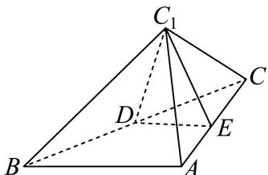
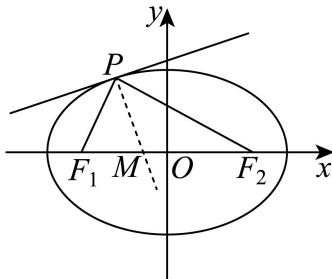
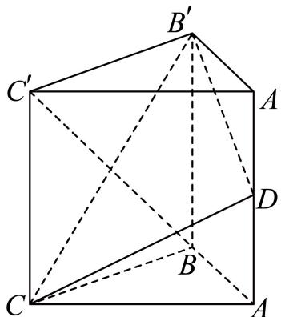

# 2025二模 长宁区原卷 · 学生版

> 本地预览：题目、答案及分类尚未全部审定。校对使用的PDF为高中工作台解析版，尚未逐区确认区级印刷原卷。

## 填空题

按本区原卷题号顺序排列。

### 长宁 · 第1题

已知集合A = (−2, 1), B = (0, 3]，则A ∩ B =

### 长宁 · 第2题

复数 $z _ { 1 } = 2 - 3 i , z _ { 2 } = 1 - 2 i$ ，则 $z _ { 1 } \cdot \overline { { z _ { 2 } } } =$

### 长宁 · 第3题

已知数列 $\left\{ a _ { n } \right\}$ 是等差数列，且 $a _ { 1 } = 2 , a _ { 6 } = 1 7$ ，则其前7项和 $S _ { 7 } =$

### 长宁 · 第4题

某水果店的苹果，60%来自A基地，40%来自B基地，A基地苹果的新鲜率为90%，B基地苹果的新鲜率为85%，从该水果店随机选取一个苹果，则选到新鲜苹果的概率是

### 长宁 · 第5题

为了研究吸烟习惯与慢性气管炎患病的关系，某疾病预防中心对相关调查数据进行了研究，假设$H _ { 0 }$ ：患慢性气管炎与吸烟没有关系，并通过计算得到统计量 $\chi ^ { 2 } \approx 3 . 4 6 8$ ，则可推断 原假设$H _ { 0 }$ ．（填“拒绝”或“接受”，规定显著性水 $\yen \alpha =0.1, P \left( \chi ^ { 2 } \geq 2 . 7 0 6 \right) \approx 0 . 1 . \ )$

### 长宁 · 第6题

已知随机变量X的分布是 $\left| { \begin{array} { c c c } { - 1 } & { 0 } & { 1 } \\ { 1 } & { 1 } & { 1 } \\ { 4 } & { { \frac { 1 } { 4 } } } & { { \frac { 1 } { 2 } } } \end{array} } \right|$ ，则其方差D[X] =

> 本题资料或解析有待核事项，预览不可作为已审定成品。

### 长宁 · 第7题

已知 $\log_{18}9=a$，$18^b=5$，用 $a,b$ 表示 $\log_{36}45$ 为____。

> 本题资料或解析有待核事项，预览不可作为已审定成品。

### 长宁 · 第8题

顶角为36∘的等腰三角形被称为黄金三角形，其底边和腰之比正好为黄金比 $\varphi$ ，用黄金比 $\varphi$ 表示$\cos 3 6 ^ { \circ }$ =

### 长宁 · 第9题

一项过关游戏的规则规定：在第n关要投掷骰子n次，如果这n次投掷所得的点数之和大于 $3 n$ ，则算过关，问一个人连过第一、二关的概率为

### 长宁 · 第10题

已知点D、E分别是三角形ABC的边AC、BC的中点，且 $A E = 2 , B D = 3$ ，则三角形ABC的面积的取值范围是

### 长宁 · 第11题

现有一块正四面体木料PABC，其边长为3，现需要将木料进行切割，要求切割后底面ABC上任意一点Q到顶点P的距离不大于 ${ \sqrt { 7 } } ,$ ，则切割好后，木料体积的最大值是 ．（结果保留π）

### 长宁 · 第12题

已知函数 $\begin{array} { r } { { \bf \nabla } [ y = f ( x ) \mathcal { \bar { H } } ] y = g ( x ) } \end{array}$ ，其中 $f ( x ) = \log _ { 2 } x$ ，且 $y = g ( x )$ 是定义在R上的函数，其图像关于原点对称，当 $x \in ( 0 , 1 ]$ ]时， $g ( x ) = x ^ { 2 } - m x - m + 5$ ．若对任意的 $x _ { 1 } \in \left[ { \frac { 1 } { 2 } } , 2 \right]$ ，存在 $x _ { 2 } \in [ - 1 , 1 ]$ ，使得 $\pmb { f } \left( \pmb { x } _ { 1 } \right) = \pmb { g } \left( \pmb { x } _ { 2 } \right)$ ，则m的取值范围是

## 选择题

按本区原卷题号顺序排列。

### 长宁 · 第13题

已知非零实数 $a > b _ { \colon }$ ，则下列命题中成立的是（ ）

A. $a ^ { 2 } > b ^ { 2 }$

B. $a b > b ^ { 2 }$

C. $a ^ { 2 } + b ^ { 2 } \geq 2 { \sqrt { a b } }$

D. $a ^ { 3 } > b ^ { 3 }$

### 长宁 · 第14题

某书店为了分析书籍销量与宣传投入之间的关系，对宣传投入x（千元）和书籍销量y（百本）的情况进行了调研，并统计得到表中几组对应数据，同时用最小二乘法得到y关于x的线性回归方程为$y = 1 . 2 x + 1 . 6$ ，则下列说法不正确的是（ ）

| $x$ | 3 | 4 | 5 | 6 |
| --- | ---: | ---: | ---: | ---: |
| $y$ | 5 | 6.2 | 7.4 | $m$ |

A. 变量x、y之间呈正相关

B. 预测当宣传投入2千元时，书籍销量约为400本

C. $m = 8 . 8$

D. 拟合误差 $Q = 0 . 4 8$

> 题给回归方程与原始数据表存在数值冲突；暂不将源解作为标准答案。

### 长宁 · 第15题

如图，等腰直角三角形ABC中， $\angle A = 9 0 ^ { \circ }$ ，点E是边AC的中点，点D是边BC上一点（不与C重合），将三角形DCE沿DE逆时针翻折，点C的对应点是 $C _ { 1 }$ ，连接 $C C _ { 1 }$ ，设θ为二面角 $C _ { 1 } - D E - C$ 大小， $\theta \in ( 0 , \pi )$ ．在翻折过程中，下列说法当中不正确的是（ ）

A. 存在点D和θ，使得 $D C _ { 1 } \bot A C$

B. 存在点D和θ，使得 $B C _ { 1 } \bot A C$

C. 存在点D和θ，使得 $B C _ { 1 } \bot D E$

D. 存在点D和θ，使得 $C C _ { 1 } \bot D E$

### 长宁 · 第16题

椭圆具有如下光学性质：如图， $F _ { 1 } \left( - c , 0 \right) , F _ { 2 } \left( c , 0 \right)$ 分别是椭圆 ${ \frac { x ^ { 2 } } { a ^ { 2 } } } + { \frac { y ^ { 2 } } { b ^ { 2 } } } = 1$ 1的左、右焦点，从点 $F _ { 1 }$ 发出的光线在到达椭圆上的点P后，经过到达点的切线反射后经过点 $F _ { 2 }$ ，有以下两个命题：

①若P是椭圆上除长轴端点外的一点，设法线与x轴的交点为M(t,0)，则 $t \in \left( - \frac { c ^ { 2 } } { a } , \frac { c ^ { 2 } } { a } \right)$
②若从 $F _ { 1 }$ 发出的光线，经椭圆两次反射后，第一次回到 $F _ { 1 }$ 所经过的路程为8c，则该椭圆的离心率为$\frac { 1 } { 2 }$ ；
则以下说法正确的是（ ）

A. ①是真命题，②是真命题

B. ①是真命题，②是假命题

C. ①是假命题，②是真命题

D. ①是假命题，②是假命题

> 本题资料或解析有待核事项，预览不可作为已审定成品。

## 解答题

按本区原卷题号顺序排列。

### 长宁 · 第17题

已知向量 ${ \vec { m } } = ( \sin x + \cos x , 2 \sin x ) , { \vec { n } } = \left( \sin x - \cos x , { \sqrt { 3 } } \cos x \right) , f ( x ) = { \vec { m } } \cdot { \vec { n } } .$
(1) (6分)求函数y = f(x)的单调递减区间；
(2) (8分)若函数 $\boldsymbol { \mathfrak { y } } = \boldsymbol { f } ( \boldsymbol { x } ) - \boldsymbol { a }$ 在区间 $\left( 0 , { \frac { \pi } { 2 } } \right)$ 上恰有2个零点，求实数a的取值范围

### 长宁 · 第18题

如图，在直三棱柱 $A B C - A ^ { \prime } B ^ { \prime } C ^ { \prime }$ 中， $A B \bot A C , A C = A B = 2 , A A ^ { \prime } = 2 { \sqrt { 2 } }$ ，点D是棱AA′的中点

(1) (6分)求证：平面 $C D B ^ { \prime } \perp$ 平面 $C B B ^ { \prime } C ^ { \prime }$ ；
(2) (8分)求点 $C ^ { \prime }$ 到平面 $C D B ^ { \prime }$ 的距离以及三棱锥 $C ^ { \prime } - C D B ^ { \prime }$ 的体积

> 本题资料或解析有待核事项，预览不可作为已审定成品。

### 长宁 · 第19题

为响应国家促进消费的政策，某大型商场举办了“消费满减乐翻天”的优惠活动，顾客消费满800元（含800元）可抽奖一次，抽奖方案有两种（顾客只能选择其中的一种）
方案1：从装有5个红球，3个蓝球（形状、大小完全相同）的抽奖盒中，有放回地依次摸出3个球每摸出1次红球，立减150元，若3次都摸到红球，则额外再减200元（即总共减650元）；
方案2：从装有5个红球，3个蓝球（形状、大小完全相同）的抽奖盒中，不放回地依次摸出3个球中奖规则为：若摸出3个红球，享受免单优惠；若摸出2个红球，则打5折；其余情况无优惠
(1) (4分)顾客A选择抽奖方案2，已知他第一次摸出红球，求他能够享受优惠的概率；
(2) (10分)顾客B恰好消费了800元，
①若他选择抽奖方案1，求他实付金额的分布列和期望（结果精确到0.01）；
②试从实付金额的期望值分析顾客B选择何种抽奖方案更合理

### 长宁 · 第20题

已知双曲线Γ: ${ \frac { x ^ { 2 } } { a ^ { 2 } } } - { \frac { y ^ { 2 } } { b ^ { 2 } } } = 1$ 的左、右焦点分别为 $F _ { 1 } , F _ { 2 }$ ，点A是其左顶点，点P是双曲线上一点，且位于第一象限，若双曲线Γ的离心率 $\displaystyle { e = 2 , b = 2 \sqrt { 3 } } .$
(1) (4分)求双曲线Γ的方程；
(2) (6分)若三角形 $A P F _ { 2 }$ 是等腰三角形，求点P的坐标；
(3) (8分)直线 $P F _ { 2 }$ 不垂直于x轴，且与曲线Γ的另一个交点为Q，若 $\angle P F _ { 1 } Q$ 是锐角，求直线 $P F _ { 2 }$ 的斜率的取值范围

> 本题资料或解析有待核事项，预览不可作为已审定成品。

### 长宁 · 第21题

已知函数 $\cdot y = f ( x )$ 的定义域 $D \subseteq \mathbf { R }$ ，对任意实数a，定义集合 $Q _ { f } ( a ) = \{ x \mid f ( x ) \leq a , x \in D \}$
(1) (4分)已知 $f \left( x \right) = { \frac { 1 + x } { 1 - x } }$ ，求 $Q _ { f } ( 2 )$
(2) (6分)已知 $f ( x ) = \mathbf { e } ^ { x } - a x$ ，若集合 $Q _ { f } ( a )$ 只有一个元素，求a的值；
(3) (8分)已知 $f \left( x \right) = - \frac a 4 x ^ { 2 } + \frac { a + 2 } { 2 } x - \ln x + \frac 1 2$ ，其中 $\iota _ { a } \in \mathrm { R }$ 且 $a > 0$ ，求证：集合 $Q _ { f } ( a )$ 是一个区间

> 本题资料或解析有待核事项，预览不可作为已审定成品。

