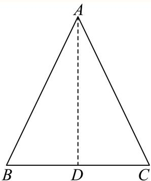
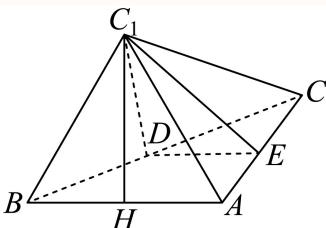

# 2025二模 长宁区原卷 · 教师版

> 本地预览：题目、答案及分类尚未全部审定。校对使用的PDF为高中工作台解析版，尚未逐区确认区级印刷原卷。

## 填空题

按本区原卷题号顺序排列。

### 长宁 · 第1题

已知集合A = (−2, 1), B = (0, 3]，则A ∩ B =

**考点：** 区间交集

**难度依据：** 区间交集；直接调用定义或基本公式，路径短

**核查说明：** 已人工阅读底稿题干和原解；未逐页对照PDF，不作为数学终审。

【答案】(0,1)

【解析】

根据交集的定义可求A∩B.

由交集的定义可得 $A \cap B = ( 0 , 1 )$

故答案为：(0,1)

### 长宁 · 第2题

复数 $z _ { 1 } = 2 - 3 i , z _ { 2 } = 1 - 2 i$ ，则 $z _ { 1 } \cdot \overline { { z _ { 2 } } } =$

**考点：** 共轭复数相乘

**难度依据：** 共轭复数相乘；直接调用定义或基本公式，路径短

**核查说明：** 已人工阅读底稿题干和原解；未逐页对照PDF，不作为数学终审。

【答案】8+i

【解析】

因为 z2 = 1 − 2i ，所以 $\overline { { z _ { 2 } } } = 1 + 2 i$ ，

所以 $z _ { 1 } \cdot { \overline { { z _ { 2 } } } } = ( 2 - 3 \mathrm { i } ) ( 1 + 2 \mathrm { i } ) = 2 + 4 \mathrm { i } - 3 \mathrm { i } - 6 \mathrm { i } ^ { 2 } = 8 + \mathrm { i }$

故答案为： 8+i

### 长宁 · 第3题

已知数列 $\left\{ a _ { n } \right\}$ 是等差数列，且 $a _ { 1 } = 2 , a _ { 6 } = 1 7$ ，则其前7项和 $S _ { 7 } =$

**考点：** 等差通项与前项和

**难度依据：** 等差通项与前项和；直接调用定义或基本公式，路径短

**核查说明：** 已人工阅读底稿题干和原解；未逐页对照PDF，不作为数学终审。

【答案】77

【解析】

利用公式法可求S .

设等差数列的公差为d，则 $d = \frac { a _ { 6 } - a _ { 1 } } { 5 } = 3$

故 $; a _ { 7 } = a _ { 6 } + d = 1 7 + 3 = 2 0 ,$

故 $S _ { 7 } = \frac { 7 \left( 2 + 2 0 \right) } { 2 } = 7 7 ,$

故答案为：77

### 长宁 · 第4题

某水果店的苹果，60%来自A基地，40%来自B基地，A基地苹果的新鲜率为90%，B基地苹果的新鲜率为85%，从该水果店随机选取一个苹果，则选到新鲜苹果的概率是

**考点：** 全概率公式

**难度依据：** 全概率公式；需一次代换或条件转换后计算

**核查说明：** 已人工阅读底稿题干和原解；未逐页对照PDF，不作为数学终审。

【答案】0.88.

【解析】

由已知结合全概率公式求解即可.

设选取的苹果来自A基地为事件M，选取的苹果来自B基地为事件N，

选到新鲜苹果为事件 $C ,$

所以 $P ( M ) = 0 . 6 , P ( N ) = 0 . 4 , P ( C | M ) = 0 . 9 , P ( C | N ) = 0 . 8 5 ,$

所以 $. P ( C ) = P ( M ) P ( C | M ) + P ( N ) P ( C | N )$

= 0.6 × 0.9 + 0.4 × 0.85 = 0.88，

所以从该水果店随机选取一个苹果，则选到新鲜苹果的概率是0.88.

故答案为：0.88.

### 长宁 · 第5题

为了研究吸烟习惯与慢性气管炎患病的关系，某疾病预防中心对相关调查数据进行了研究，假设$H _ { 0 }$ ：患慢性气管炎与吸烟没有关系，并通过计算得到统计量 $\chi ^ { 2 } \approx 3 . 4 6 8$ ，则可推断 原假设$H _ { 0 }$ ．（填“拒绝”或“接受”，规定显著性水 $\yen \alpha =0.1, P \left( \chi ^ { 2 } \geq 2 . 7 0 6 \right) \approx 0 . 1 . \ )$

**考点：** 独立性检验临界值

**难度依据：** 独立性检验临界值；直接调用定义或基本公式，路径短

**核查说明：** 已人工阅读底稿题干和原解；未逐页对照PDF，不作为数学终审。

【答案】拒绝.

【解析】

在独立性检验中，当计算得到的统计量 $\cdot \chi ^ { 2 }$ 大于临界值时，就拒绝原假设，即可求解.

已知显著性水平 $\alpha = 0 . 1 , ~ P \left( \chi ^ { 2 } \geq 2 . 7 0 6 \right) \approx 0 . 1$ ，即临界值为2.706，

因为 $3 . 4 6 8 > 2 . 7 0 6$ ，所以可推断拒绝原假设 $H _ { 0 }$

故答案为：拒绝.

### 长宁 · 第6题

已知随机变量X的分布是 $\left| { \begin{array} { c c c } { - 1 } & { 0 } & { 1 } \\ { 1 } & { 1 } & { 1 } \\ { 4 } & { { \frac { 1 } { 4 } } } & { { \frac { 1 } { 2 } } } \end{array} } \right|$ ，则其方差D[X] =

> 本题资料或解析有待核事项，预览不可作为已审定成品。

**考点：** 分布列期望与方差

**难度依据：** 分布列期望与方差；需一次代换或条件转换后计算

**核查说明：** 分布列概率的1/4断裂为独立两行，方差计算式大面积错位，需回PDF。；已人工阅读底稿题干和原解；未逐页对照PDF，不作为数学终审。

【答案】$\frac { 1 1 } { 1 6 }$

【解析】

利用方差公式可求方差.

X的期望为 $- 1 \times { \frac { 1 } { 4 } } + 0 \times { \frac { 1 } { 4 } } + { \frac { 1 } { 2 } } = { \frac { 1 } { 4 } }$

故D [X] = (−1)2 × 1 + 12 × 1 1 3 1 1116 ，

故答案为： $\frac { 1 1 } { 1 6 }$

### 长宁 · 第7题

已知 $\log_{18}9=a$，$18^b=5$，用 $a,b$ 表示 $\log_{36}45$ 为____。

> 本题资料或解析有待核事项，预览不可作为已审定成品。

**考点：** 对数换底和指数转对数

**难度依据：** 对数换底和指数转对数；需一次代换或条件转换后计算

**核查说明：** 题干已回源；原解析未全面数学审校，公式及其他问题仍需处理。；题干log18、指数条件及目标log36有严重TeX乱码，回源后方可发布。；已人工阅读底稿题干和原解；未逐页对照PDF，不作为数学终审。

【答案】$\frac { a + b } { 2 - a }$

【解析】

根据对数的运算性质和换底公式求解.

因为 $\log _ { 1 8 } 9 = a , b = \log _ { 1 8 } 5 ,$

所以 $a + b = \log _ { 1 8 } 9 + \log _ { 1 8 } 5 = \log _ { 1 8 } ( 9 \times 5 ) = \log _ { 1 8 } 4 5$

18 log18 36 = log18 (2 × 18) = 1 + log18 2 = 1 + log18 9 = 2 − log18 9 = 2 − a；

所以 $\log _ { 3 6 } 4 5 = { \frac { \log _ { 1 8 } 4 5 } { \log _ { 1 8 } 3 6 } } = { \frac { a + b } { 2 - a } }$

故答案为: $\frac { a + b } { 2 - a }$

### 长宁 · 第8题

顶角为36∘的等腰三角形被称为黄金三角形，其底边和腰之比正好为黄金比 $\varphi$ ，用黄金比 $\varphi$ 表示$\cos 3 6 ^ { \circ }$ =

**考点：** 黄金三角形与半角二倍角

**难度依据：** 黄金三角形与半角二倍角；需一次代换或条件转换后计算

**核查说明：** 已人工阅读底稿题干和原解；未逐页对照PDF，不作为数学终审。

【答案】$1 - { \frac { \varphi ^ { 2 } } { 2 } }$

【解析】

根据已知可得 $\sin 1 8 ^ { \circ } = { \frac { \varphi } { 2 } }$ ，由二倍角的余弦函数即可求解.

如图等腰三角形ABC中， $\angle B A C = 3 6 ^ { \circ }$ ∘，过A作AD交BC于D，

所以AD为角平分线，

所以 $\sin 1 8 ^ { \circ } = { \frac { B D } { A B } }$ ，即 $B D = A B \cdot \sin 1 8 ^ { \circ }$

由已知可得 $\varphi = { \frac { \mathbf { \tilde { { \cal { B } } } } C } { A B } } = { \frac { 2 B D } { A B } } = { \frac { 2 A B \cdot \sin 1 8 ^ { \circ } } { A B } } = 2 \sin 1 8 ^ { \circ } ,$

所以 $\sin 1 8 ^ { \circ } = { \frac { \varphi } { 2 } }$

所以cos 36∘ = 1 − 2 sin2 18∘ = 1 − 2 × ( φ 2 = 1 − φ2 2

故答案为： $1 - { \frac { \varphi ^ { 2 } } { 2 } }$

### 长宁 · 第9题

一项过关游戏的规则规定：在第n关要投掷骰子n次，如果这n次投掷所得的点数之和大于 $3 n$ ，则算过关，问一个人连过第一、二关的概率为

**考点：** 骰子古典概型和独立过关

**难度依据：** 骰子古典概型和独立过关；需一次代换或条件转换后计算

**核查说明：** 已人工阅读底稿题干和原解；未逐页对照PDF，不作为数学终审。

【答案】$\frac { 7 } { 2 4 }$

【解析】

利用古典概型的概率公式可求过第一、二关的概率，从而可得连过两关的概率.

由题设，在第一关投1次骰子，点数大于3，即掷得点数为4,5,6，

则过第一关的概率为 ${ \frac { 3 } { 6 } } = { \frac { 1 } { 2 } }$

第二关投2次骰子，点数之和大于6，则两次掷得点数分别为：

(1, 6), (2, 5), (2, 6), (3, 4), (3, 5), (3, 6), (4, 3), (4, 4), (4, 5)，

(4, 6), (5, 2), (5, 3), (5, 4), (5, 5), (5, 6), (6, 1), (6, 2), (6, 3), (6, 4), (6, 5), (6, 6)

故过第二关系的概率为 ${ \frac { 2 1 } { 3 6 } } = { \frac { 7 } { 1 2 } }$

故一个人连过第一、二关的概率为 $\frac { 7 } { 2 4 }$

故答案为： $\frac { 7 } { 2 4 }$

### 长宁 · 第10题

已知点D、E分别是三角形ABC的边AC、BC的中点，且 $A E = 2 , B D = 3$ ，则三角形ABC的面积的取值范围是

**考点：** 三角形中线与补形面积；两边夹角面积范围

**难度依据：** 三角形中线与补形面积；两边夹角面积范围；需组合两类关系并检查区间或等号

**核查说明：** 已人工阅读底稿题干和原解；未逐页对照PDF，不作为数学终审。

【答案】(0,4]

【解析】

如图，利用补形可得 $S _ { \triangle B F G } = \frac { 3 } { 2 } S _ { \triangle A B C }$ 结合面积公式可求范围

如图，过A作 $A F / / B C , A F = B C$ ，过F作 $F G / / A$ E交BC的延长线于G，

则四边形AFGE、四边形 $A B C F$ 为平行四边形，连接BF，

则 $A C , B F \bot$ 相平分，故B,D,F共线且D为BF的中点，

而 $A F = B C = E G ,$ ，故 $B G = { \frac { 3 } { 2 } } B C$ ，故 $S _ { \triangle B F G } = \frac { 3 } { 2 } S _ { \triangle A B C }$

$\triangle B F G$ 中， $B F = 2 B D = 6 , G F = A E = 2 , \angle B F G \in ( 0 , \pi )$

故S△BFG = 1 BF × FG sin ∠BFG = 6 sin ∠BFG ∈ (0, 6]，

故 $S _ { \triangle A B C } \in ( 0 , 4 ]$

故答案为：(0,4]

### 长宁 · 第11题

现有一块正四面体木料PABC，其边长为3，现需要将木料进行切割，要求切割后底面ABC上任意一点Q到顶点P的距离不大于 ${ \sqrt { 7 } } ,$ ，则切割好后，木料体积的最大值是 ．（结果保留π）

**考点：** 正四面体切割及曲边锥体体积；圆与三角形交域面积

**难度依据：** 正四面体切割及曲边锥体体积；圆与三角形交域面积；需多步建模、分类或参数约束

**核查说明：** 已人工阅读底稿题干和原解；未逐页对照PDF，不作为数学终审。

【答案】$\frac { 3 \sqrt { 2 } } { 4 } + \frac { \sqrt { 6 } \pi } { 6 }$

【解析】

设正四面体定点P在底面ABC的投影为O，连接OA，可得以O为圆心，半径为1的圆在底面$\triangle A B C$ 内的部分为底，以P为顶点的几何体即为符合要求的部分，先求解底面面积，PO为高，即可求解切割好后，木料体积的最大值

设正四面体定点P在底面ABC的投影为O，则O为正三角形ABC的中心，

连接 $O A$ ，所以 $A O = { \frac { 2 } { 3 } } \times { \frac { \sqrt { 3 } } { 2 } } \times 3 = { \sqrt { 3 } } , P O = { \sqrt { P A ^ { 2 } - A O ^ { 2 } } } = { \sqrt { 6 } } ,$

若底面 $A B C$ 上任意一点Q到顶点P的距离不大于 ${ \sqrt { 7 } } ,$

设 $P Q = { \sqrt { 7 } } .$ ，则 $O Q = { \sqrt { P Q ^ { 2 } - P O ^ { 2 } } } = 1$ ，

所以以O为圆心，半径为1的圆在底面 $\triangle A B C$ 内的部分为底，以P为顶点的几何体即为符合要求的部分，

如图以O为圆心，半径为1的圆与底面 $\triangle A B C$ 相交的交点为 $M , N _ { \mathrm { { i } } }$

延长 $. O A { \stackrel { . } { \times } } B C { \mp } E$ ，连接OM，ON，

所以 $O E = \frac { 1 } { 3 } \times \frac { \sqrt { 3 } } { 2 } \times 3 = \frac { \sqrt { 3 } } { 2 } , \ O M = O N = 1$

所以 $\cos \angle E O M = { \frac { O E } { O M } } = { \frac { \sqrt { 3 } } { 2 } }$ ，所以 $\angle E O M = \frac { \pi } { 6 }$

所以 $\angle M O N = \frac { \pi } { 3 }$ ，所以 $\triangle M O N$ 为等边三角形，

所以以O为圆心，半径为1的圆在底面 $\triangle A B C$ 内的部分的面积为

$$
\pi \times 1 ^ {2} - 3 \times \left(\frac {1}{6} \pi \times 1 ^ {2} - \frac {\sqrt {3}}{4} \times 1 ^ {2}\right) = \frac {\pi}{2} + \frac {3 \sqrt {3}}{4},
$$

所以切割好后，木料体积的最大值是 ${ \frac { 1 } { 3 } } \times \left( { \frac { \pi } { 2 } } + { \frac { 3 { \sqrt { 3 } } } { 4 } } \right) \times { \sqrt { 6 } } = { \frac { 3 { \sqrt { 2 } } } { 4 } } + { \frac { { \sqrt { 6 } } \pi } { 6 } }$

故答案为： $\frac { 3 \sqrt { 2 } } { 4 } + \frac { \sqrt { 6 } \pi } { 6 }$

### 长宁 · 第12题

已知函数 $\begin{array} { r } { { \bf \nabla } [ y = f ( x ) \mathcal { \bar { H } } ] y = g ( x ) } \end{array}$ ，其中 $f ( x ) = \log _ { 2 } x$ ，且 $y = g ( x )$ 是定义在R上的函数，其图像关于原点对称，当 $x \in ( 0 , 1 ]$ ]时， $g ( x ) = x ^ { 2 } - m x - m + 5$ ．若对任意的 $x _ { 1 } \in \left[ { \frac { 1 } { 2 } } , 2 \right]$ ，存在 $x _ { 2 } \in [ - 1 , 1 ]$ ，使得 $\pmb { f } \left( \pmb { x } _ { 1 } \right) = \pmb { g } \left( \pmb { x } _ { 2 } \right)$ ，则m的取值范围是

**考点：** 奇函数值域包含与参数分类；任意存在量词转值域包含

**难度依据：** 奇函数值域包含与参数分类；任意存在量词转值域包含；需多步建模、分类或参数约束

**核查说明：** 已人工阅读底稿题干和原解；未逐页对照PDF，不作为数学终审。

【答案】[3, 5].

【解析】

根据题意可知f(x)的值域是g(x)值域的子集，先求出f(x)的值域，再对g(x)分类讨论求值 域，从而求得m的取值范围.

∵对任意的 $\lceil x _ { 1 } \in \left[ { \frac { 1 } { 2 } } , 2 \right]$ ，存 $\ddagger x _ { 2 } \in [ - 1 , 1 ]$ ，使得 $f \left( x _ { 1 } \right) = g \left( x _ { 2 } \right)$

$\therefore f \left( x \right)$ 的值域是g (x)值域的子集，

当 $x _ { 1 } \in \left\lceil { \frac { 1 } { 2 } } , 2 \right\rceil$ 时，f(x)的值域为 $[ - 1 , 1 ]$

$\because y = g ( x )$ 是定义在R上的函数，其图像关于原点对称，

$\therefore g \left( x \right)$ 是奇函数，且 $g \left( 0 \right) = 0$

$\because \ Y \boldsymbol { x } \in ( 0 , 1 ]$ 时， $g ( x ) = x ^ { 2 } - m x - m + 5 , { \mathit { \Omega } } \cdot { \mathit { \Omega } } g ( x )$ 的对称轴方程为 $x = { \frac { m } { 2 } }$ ，

当 $| m \leq$ 0时，g (x)在(0, 1]上单调递增，

$\therefore g ( x ) \# x \in ( 0 , 1$ ]时的范围是 $( - m + 5 , 6 - 2 m ] , ~ - m + 5 > 0 , ~ 6 - 2 m > 0 ,$

$\therefore g \left( x \right)$ 在[−1, 1]上的值域为 $[ 2 m - 6 , m - 5 ) \cup ( - m + 5 , 6 - 2 m ] \cup \{ 0 \}$

此时f(x)的值域不可能为g(x)值域的子集，舍去；

当 $0 < \frac { m } { 2 } \leq \frac { 1 } { 2 }$ ，即 $0 < m \leq$ 1时，g (x)在 $\left( 0 , { \frac { m } { 2 } } \right]$ 上单调递减，在 $\left( { \frac { m } { 2 } } , 1 \right]$ 上单调递增，

$\therefore g ( x ) \# x \in ( 0 , 1 ]$ ]时的范围是 $\left[ - \frac { m ^ { 2 } } { 4 } - m + 5 , 6 - 2 m \right] , ~ - \frac { m ^ { 2 } } { 4 } - m + 5 > 0 , ~ 6 - 2 m > 0 ,$

$\therefore g \left( x \right)$ 在[−1,1]上的值域为 $\left[ 2 m - 6 , \frac { m ^ { 2 } } { 4 } + m - 5 , \right] \cup \left[ - \frac { m ^ { 2 } } { 4 } - m + 5 , 6 - 2 m \right] \cup \{ 0 \}$

此时f (x)的值域不可能为g (x)值域的子集，舍去；

当 $\frac { 1 } { 2 } < \frac { m } { 2 } \leq 1$ 1即1 $< m \le 2$ 时，g (x)在 $\left( 0 , { \frac { m } { 2 } } \right]$ 上单调递减，在 $\left( { \frac { m } { 2 } } , 1 \right]$ 上单调递增，

$\therefore g ( x ) \# x \in ( 0 , 1 ]$ ]时的范围是 $\left\lceil - { \frac { m ^ { 2 } } { 4 } } - m + 5 , - m + 5 \right\rceil$ $- { \frac { m ^ { 2 } } { 4 } } - m + 5 > 0 , - m + 5 > 0 ,$

$\therefore g ( x ) \# [ - 1 , 1 ]$ 上的值域为 $\left[ m ^ { - } 5 , \frac { m ^ { 2 } } { 4 } + m - 5 , \right] \cup \left[ - \frac { m ^ { 2 } } { 4 } - m + 5 , - m + 5 \right] \cup \left\{ 0 \right\}$

此时f(x)的值域不可能为g(x)值域的子集，舍去；

当 $\frac { m } { 2 } > 1$ ，即m > 2时，g(x)在(0,1]上单调递减，

$\therefore g ( x ) \# x \in ( 0 , 1 ]$ 时的范围是 $[ 6 - 2 m , - m + 5 )$ ，

若2 $< m < 3$ ，则6 $- 2 m > 0 , - m + 5 > 0 ,$

$\therefore g ( x ) \not \equiv [ - 1 , 1 ]$ 上的值域为 $( m - 5 , - 6 + 2 m ] \cup [ 6 - 2 m , - m + 5 ) \cup \{ 0 \}$ 1

此时f(x)的值域不可能为g(x)值域的子集，舍去；

若3 $\leq m \leq 5$ ，则6 $- 2 m \leq 0 , - m + 5 \geq 0 ,$

$\therefore \left\{ { \begin{array} { l } { 6 - 2 m \leq 0 } \\ { - m + 5 > 1 } \end{array} } , \right.$ 或 $\left\{ { \begin{array} { l } { 6 - 2 m \leq - 1 } \\ { - m + 5 \geq 0 } \end{array} } \right.$ 解得 $3 \leq m < 4$ ，或 ${ \frac { 7 } { 2 } } \leq m \leq 5 , \ \therefore 3 \leq m \leq 5 ;$

若 $\mathrm { i } _ { m } > 5 _ { \mathrm { i } }$ ，则 $6 - 2 m < 0 , - m + 5 < 0 \nonumber$

$\therefore g \left( x \right)$ 在[−1,1]上的值域为 $( m - 5 , - 6 + 2 m ] \cup [ 6 - 2 m , - m + 5 ) \cup \{ 0 \}$

此时f(x)的值域不可能为g(x)值域的子集，舍去；

综上，m的取值范围是[3,5].

故答案为：[3, 5].

## 二、选择题

## 选择题

按本区原卷题号顺序排列。

### 长宁 · 第13题

已知非零实数 $a > b _ { \colon }$ ，则下列命题中成立的是（ ）

A. $a ^ { 2 } > b ^ { 2 }$

B. $a b > b ^ { 2 }$

C. $a ^ { 2 } + b ^ { 2 } \geq 2 { \sqrt { a b } }$

D. $a ^ { 3 } > b ^ { 3 }$

**考点：** 不等式性质与反例

**难度依据：** 不等式性质与反例；需一次代换或条件转换后计算

**核查说明：** 已人工阅读底稿题干和原解；未逐页对照PDF，不作为数学终审。

【答案】D

【解析】

利用赋值法即可判断A，B，C，根据函数的单调性即可判断D.

由已知当 $a = 2 , \ b = - 4$ ，所以 $\ a ^ { 2 } < b ^ { 2 }$ ，故A错误；

因为 $\dot { \mathbf { \zeta } } a > b ,$ ，当 $b < 0 \mathbb { H } \mathbb { H }$ ，所以 $. a b < b ^ { 2 }$ ，故B错误；

当非零实数a，b一正一负时， $\sqrt { a b }$ 无意义，故C错误；

因为 $\boldsymbol { y } = x ^ { 3 }$ 在R上单调递增，且 $. a > b$

所以 $a ^ { 3 } > b ^ { 3 }$ ，故D正确.

故选：D.

### 长宁 · 第14题

某书店为了分析书籍销量与宣传投入之间的关系，对宣传投入x（千元）和书籍销量y（百本）的情况进行了调研，并统计得到表中几组对应数据，同时用最小二乘法得到y关于x的线性回归方程为$y = 1 . 2 x + 1 . 6$ ，则下列说法不正确的是（ ）

| $x$ | 3 | 4 | 5 | 6 |
| --- | ---: | ---: | ---: | ---: |
| $y$ | 5 | 6.2 | 7.4 | $m$ |

A. 变量x、y之间呈正相关

B. 预测当宣传投入2千元时，书籍销量约为400本

C. $m = 8 . 8$

D. 拟合误差 $Q = 0 . 4 8$

> 题给回归方程与原始数据表存在数值冲突；暂不将源解作为标准答案。

**考点：** 回归中心与残差平方和

**难度依据：** 回归中心与残差平方和；需组合两类关系并检查区间或等号

**核查说明：** 原PDF表格及回归式存在内在冲突：由过均值点得m=9.4时最小二乘斜率为1.44，并非题给1.2；题干按原PDF恢复，不能认定源题数学已正确。；回归原数据表缺失，无法核实m与残差。原解列出的点与声称最小二乘回归方程的斜率还需复算。；已人工阅读底稿题干和原解；未逐页对照PDF，不作为数学终审。

【答案】C

【解析】

根据线性回归方程即可判断A；将x = 2代入线性回归方程即可判断B；由 $( { \overline { { x } } } , { \overline { { y } } } )$ 在线性回归方程上，即可求解 ；根据拟合误差计算公式求解即可

因为线性回归方程为 $y = 1 . 2 x + 1 . 6 , 1 . 2 > 0$

所以变量x、y之间呈正相关，故A正确；

当x = 2时， $y = 1 . 2 \times 2 + 1 . 6 = 4$ （百本），所以书籍销量约为400本，故B正确；

由表中数据可得 ${ \overline { { c } } } = { \frac { 3 + 4 + 5 + 6 } { 4 } } = { \frac { 9 } { 2 } } , { \overline { { y } } } = { \frac { 5 + 6 . 2 + 7 . 4 + m } { 4 } } = { \frac { 1 8 . 6 + m } { 4 } }$

所以 $\frac { 1 8 . 6 + m } { 4 } = 1 . 2 \times \frac { 9 } { 2 } + 1 . 6$ ，解得 $m = 9 . 4$ ，故C错误；

当x = 3时， $y = 1 . 2 \times 3 + 1 . 6 = 5 . 2 , ( 5 - 5 . 2 ) ^ { 2 } = 0 . 0 4 ,$

当x = 4时， $y = 1 . 2 \times 4 + 1 . 6 = 6 . 4 , ( 6 . 2 - 6 . 4 ) ^ { 2 } = 0 . 0 4 ,$

当x = 5时， $y = 1 . 2 \times 5 + 1 . 6 = 7 . 6 , ( 7 . 4 - 7 . 6 ) ^ { 2 } = 0 . 0 4 _ { 2 }$

当x = 6时， $y = 1 . 2 \times 6 + 1 . 6 = 8 . 8 , ( 9 . 4 - 8 . 8 ) ^ { 2 } = 0 . 3 6 ,$

所以 $Q = 0 . 0 4 + 0 . 0 4 + 0 . 0 4 + 0 . 3 6 = 0 . 4 8$ ，故D正确.

故选：C.

### 长宁 · 第15题

如图，等腰直角三角形ABC中， $\angle A = 9 0 ^ { \circ }$ ，点E是边AC的中点，点D是边BC上一点（不与C重合），将三角形DCE沿DE逆时针翻折，点C的对应点是 $C _ { 1 }$ ，连接 $C C _ { 1 }$ ，设θ为二面角 $C _ { 1 } - D E - C$ 大小， $\theta \in ( 0 , \pi )$ ．在翻折过程中，下列说法当中不正确的是（ ）

A. 存在点D和θ，使得 $D C _ { 1 } \bot A C$

B. 存在点D和θ，使得 $B C _ { 1 } \bot A C$

C. 存在点D和θ，使得 $B C _ { 1 } \bot D E$

D. 存在点D和θ，使得 $C C _ { 1 } \bot D E$

**考点：** 翻折中垂直关系存在性

**难度依据：** 翻折中垂直关系存在性；需多步建模、分类或参数约束

**核查说明：** 已人工阅读底稿题干和原解；未逐页对照PDF，不作为数学终审。

【答案】B

【解析】

取特例判断ACD，利用反证法判断B后可得正确的选项.

对 $\mathbb { F } \mathrm { A D } .$ ，取D为BC中点， $\theta = \frac { \pi } { 2 }$ ，则 $E D / / A B$ ，而 $A B \bot A C$

故 $D E \bot A C$ ，故在几何体 $C _ { 1 } - A B D E \Psi$ ， $D E \bot C _ { 1 } E .$

而 $C E \bot D E$ ，故 $\angle C E C _ { 1 }$ 为二面角 $C _ { 1 } - D E - C$ 的平面角，故 $\angle C E C _ { 1 } = 9 0 ^ { \circ }$

故 $C _ { 1 } E \bot A C$ ，而 $C _ { 1 } E \cap D E = E , C _ { 1 } E , D E \subset$ 平面 $D E C _ { 1 }$ •

故 $A C \bot$ 平面 $D E C _ { 1 }$ ，而 $D C _ { 1 } \subset$ 平面 $D E C _ { 1 }$ ，故 $A C \bot D C _ { 1 }$ ，故A成立.

因 $D E \bot A C$ $D E \bot C _ { 1 } E$ ，AC ∩ C E = E,AC,C E ⊂平面 $A C C _ { 1 }$

故 $D E \bot$ 平面 $A C C _ { 1 }$ ，而 $C C _ { 1 } \subset$ 平面 $A C C _ { 1 }$ ，故 $D E \bot C C _ { 1 }$ ，故D成立.

对 $\operatorname { F C } ,$ ，过E作 $D E \bot B C$ ，D为垂足， ${ \bar { \mathbb { H } } } \times \theta = { \frac { \pi } { 2 } }$ ，同理可证 $D E \bot$ 平面 $B C C _ { 1 }$

而 $B C _ { 1 } \subset$ 平面 $B C C _ { 1 }$ ，故 $D E \bot B C _ { 1 }$ ，故C成立.

对于B，过 $C _ { 1 }$ 作 $\mathrm { \dot { C } } _ { 1 } H \bot$ 平面 $A B C$ ，垂足为H，

因为 $A C \subset$ 平面 $A B C$ ，故 $C _ { 1 } H \bot A C ,$

若 $B C _ { 1 } \bot A C _ { \cdot }$ ，因为 $C _ { 1 } H \cap B C _ { 1 } = C _ { 1 } , C _ { 1 } H , B C _ { 1 } \subset$ 平面 $B C _ { 1 } H$

故 $A C \bot$ 平面 $B C _ { 1 } H$ ，而 $B H \subset$ 平面 $B C _ { 1 } H$ ，故 $A C \bot B H$ ，

而 $A C \bot B A$ ，故H在BA上，

因为 $C _ { 1 } H \cap B A = H , \ C _ { 1 } H , B A \subset$ 平面 $B C _ { 1 } A$ ，故 $A C \bot$ 平面 $B C _ { 1 } A$

而 $C _ { 1 } A \subset \cdot$ 平面 $B C _ { 1 } A$ ，故 $C A \bot C _ { 1 } A$ ，故 $C _ { 1 } E > A E$ ，但 $C _ { 1 } E = C E = A E$

矛盾，故 $B C _ { 1 } \bot A C$ 不成立即B不成立，

故选：B.

### 长宁 · 第16题

椭圆具有如下光学性质：如图， $F _ { 1 } \left( - c , 0 \right) , F _ { 2 } \left( c , 0 \right)$ 分别是椭圆 ${ \frac { x ^ { 2 } } { a ^ { 2 } } } + { \frac { y ^ { 2 } } { b ^ { 2 } } } = 1$ 1的左、右焦点，从点 $F _ { 1 }$ 发出的光线在到达椭圆上的点P后，经过到达点的切线反射后经过点 $F _ { 2 }$ ，有以下两个命题：

①若P是椭圆上除长轴端点外的一点，设法线与x轴的交点为M(t,0)，则 $t \in \left( - \frac { c ^ { 2 } } { a } , \frac { c ^ { 2 } } { a } \right)$
②若从 $F _ { 1 }$ 发出的光线，经椭圆两次反射后，第一次回到 $F _ { 1 }$ 所经过的路程为8c，则该椭圆的离心率为$\frac { 1 } { 2 }$ ；
则以下说法正确的是（ ）

A. ①是真命题，②是真命题

B. ①是真命题，②是假命题

C. ①是假命题，②是真命题

D. ①是假命题，②是假命题

> 本题资料或解析有待核事项，预览不可作为已审定成品。

**考点：** 椭圆切线法线与光学性质；椭圆函数求导

**难度依据：** 椭圆切线法线与光学性质；椭圆函数求导；需多步建模、分类或参数约束

**核查说明：** 原解法线斜率法除以x₀，x₀=0（短轴端点）情形须另验；结论t=0成立。；已人工阅读底稿题干和原解；未逐页对照PDF，不作为数学终审。

【答案】A

【解析】

设 $P \left( x _ { 0 } , y _ { 0 } \right)$ 通过求导可得椭圆 ${ \frac { x ^ { 2 } } { a ^ { 2 } } } + { \frac { y ^ { 2 } } { b ^ { 2 } } } = 1$ 在点 $P \left( x _ { 0 } , y _ { 0 } \right)$ 处的切线的斜率为 $k = - { \frac { b ^ { 2 } x _ { 0 } } { a ^ { 2 } y _ { 0 } } }$ 由法线和切线垂直可得 $t = { \frac { c ^ { 2 } x _ { 0 } } { a ^ { 2 } } }$ 即可判断①；由已知结合椭圆的定义可得 $4 a = 8 c$ 即可判断②.设 $P \left( x _ { 0 } , y _ { 0 } \right)$ ，因为 ${ \frac { x ^ { 2 } } { a ^ { 2 } } } + { \frac { y ^ { 2 } } { b ^ { 2 } } } = 1$ ，所以 $\cdot y = \pm b { \sqrt { 1 - { \frac { x ^ { 2 } } { a ^ { 2 } } } } }$ 当 $y = b { \sqrt { 1 - { \frac { x ^ { 2 } } { a ^ { 2 } } } } }$ 时， $y ^ { \prime } = { \frac { - { \frac { b } { a } } x } { \sqrt { a ^ { 2 } - x ^ { 2 } } } }$ 所以在点 $P \left( x _ { 0 } , y _ { 0 } \right)$ 处的切线的斜率为 $k = { \frac { - { \frac { b } { a } } x _ { 0 } } { \sqrt { a ^ { 2 } - x _ { 0 } ^ { 2 } } } } = { \frac { - { \frac { b } { a } } x _ { 0 } } { \sqrt { \frac { a ^ { 2 } y _ { 0 } ^ { 2 } } { b ^ { 2 } } } } } = - { \frac { b ^ { 2 } x _ { 0 } } { a ^ { 2 } y _ { 0 } } } ,$ 同理可得当 $y = - b { \sqrt { 1 - { \frac { x ^ { 2 } } { a ^ { 2 } } } } }$ 时，在点 $P \left( x _ { 0 } , y _ { 0 } \right)$ 处的切线的斜率为 $k = - { \frac { b ^ { 2 } x _ { 0 } } { a ^ { 2 } y _ { 0 } } }$ 所以椭圆 ${ \frac { x ^ { 2 } } { a ^ { 2 } } } + { \frac { y ^ { 2 } } { b ^ { 2 } } }$ = 1在点 $P \left( x _ { 0 } , y _ { 0 } \right)$ 处的切线的斜率为 $k = - \frac { b ^ { 2 } x _ { 0 } } { a ^ { 2 } y _ { 0 } } ;$ 因为 $M \left( t , 0 \right)$ ，所以k ${ \mathrm { \Delta } } _ { P M } = { \frac { y _ { 0 } } { x _ { 0 } - t } }$ 因为 $k _ { P M } \cdot k = - 1$ ，所以 ${ \frac { y _ { 0 } } { x _ { 0 } - t } } \cdot \left( - { \frac { b ^ { 2 } x _ { 0 } } { a ^ { 2 } y _ { 0 } } } \right) = - 1$ 所以 $t = x _ { 0 } - { \frac { b ^ { 2 } x _ { 0 } } { a ^ { 2 } } } = { \frac { a ^ { 2 } x _ { 0 } - b ^ { 2 } x _ { 0 } } { a ^ { 2 } } } = { \frac { c ^ { 2 } x _ { 0 } } { a ^ { 2 } } }$

因为 $x _ { 0 } \in ( - a , a )$ ，所以 $t \in \left( - \frac { c ^ { 2 } } { a } , \frac { c ^ { 2 } } { a } \right)$ ，故①是真命题；

因为 $F _ { 1 }$ 发出的光线在到达椭圆上的点P后，经过到达点的切线反射后经过点 $F _ { 2 }$

所以两次反射后，第一次回到 $F _ { 1 }$ 所经过的路程为 $4 a ,$ ，

所以 $4 a = 8 c ,$ ，所以 $e = { \frac { c } { a } } = { \frac { 1 } { 2 } }$ ，故②是真命题.

故选：A.

## 三、解答题

## 解答题

按本区原卷题号顺序排列。

### 长宁 · 第17题

已知向量 ${ \vec { m } } = ( \sin x + \cos x , 2 \sin x ) , { \vec { n } } = \left( \sin x - \cos x , { \sqrt { 3 } } \cos x \right) , f ( x ) = { \vec { m } } \cdot { \vec { n } } .$
(1) (6分)求函数y = f(x)的单调递减区间；
(2) (8分)若函数 $\boldsymbol { \mathfrak { y } } = \boldsymbol { f } ( \boldsymbol { x } ) - \boldsymbol { a }$ 在区间 $\left( 0 , { \frac { \pi } { 2 } } \right)$ 上恰有2个零点，求实数a的取值范围

**考点：** （1）数量积化三角函数并求递减区间；（2）开区间水平截线交点个数

**难度依据：** 数量积生成三角函数；辅助角与零点个数；需组合两类关系并检查区间或等号

**核查说明：** 已人工阅读底稿题干和原解；未逐页对照PDF，不作为数学终审。

【解析】

$$
f (x) = \sin^ {2} x - \cos^ {2} x + 2 \sqrt {3} \sin x \cos x = \sqrt {3} \sin 2 x - \cos 2 x = 2 \sin \left(2 x - \frac {\pi}{6}\right)
$$

C令 $2 k \pi + { \frac { \pi } { 2 } } \leq 2 x - { \frac { \pi } { 6 } } \leq 2 k \pi + { \frac { 3 \pi } { 2 } }$ ，则 $k \pi + \frac { \pi } { 3 } \leq x \leq k \pi + \frac { 5 \pi } { 6 }$ ，其中 $k \in \mathbf { Z }$ 故函数 $y = f ( x )$ 的单调递减区间为 $\left\lceil k \pi + { \frac { \pi } { 3 } } , k \pi + { \frac { 5 \pi } { 6 } } \right\rceil , k \in \mathrm { Z } .$

(2) 由题设有 $a = f \left( x \right) = 2 \sin \left( 2 x - \frac { \pi } { 6 } \right)$ 在 $\left( 0 , { \frac { \pi } { 2 } } \right)$ 有两个不同的零点，

而 $2 x - { \frac { \pi } { 6 } } \in \left( - { \frac { \pi } { 6 } } , { \frac { 5 \pi } { 6 } } \right)$ ，故 ${ \frac { a } { 2 } } = \sin$ t在 $\left( - \frac { \pi } { 6 } , \frac { 5 \pi } { 6 } \right)$ 有两个不同的解，

故 $\dot { y } = \frac { a } { 2 } \xi s \left( t \right) = \sin$ t的图象在 $\left( - \frac { \pi } { 6 } , \frac { 5 \pi } { 6 } \right)$ 上有两个不同的交点，

而 $s \left( t \right) = \sin \cdot$ t在 $\left( - \frac { \pi } { 6 } , \frac { \pi } { 2 } \right]$ 为增函数，在 $\left\lceil { \frac { \pi } { 2 } } , { \frac { 5 \pi } { 6 } } \right\rceil$ 为减函数，

且 $s \left( - { \frac { \pi } { 6 } } \right) = - { \frac { 1 } { 2 } } , s \left( { \frac { \pi } { 2 } } \right) = 1 , s \left( { \frac { 5 \pi } { 6 } } \right) = { \frac { 1 } { 2 } }$ ，故 $\frac { 1 } { 2 } < \frac { a } { 2 } < 1$

故1 $. < a < 2$

### 长宁 · 第18题

如图，在直三棱柱 $A B C - A ^ { \prime } B ^ { \prime } C ^ { \prime }$ 中， $A B \bot A C , A C = A B = 2 , A A ^ { \prime } = 2 { \sqrt { 2 } }$ ，点D是棱AA′的中点

(1) (6分)求证：平面 $C D B ^ { \prime } \perp$ 平面 $C B B ^ { \prime } C ^ { \prime }$ ；
(2) (8分)求点 $C ^ { \prime }$ 到平面 $C D B ^ { \prime }$ 的距离以及三棱锥 $C ^ { \prime } - C D B ^ { \prime }$ 的体积

> 本题资料或解析有待核事项，预览不可作为已审定成品。

**考点：** （1）平行四边形及线面垂直推出面面垂直；（2）曲面外点到平面距离与等体积

**难度依据：** 面面垂直与等体积求距离；需多步建模、分类或参数约束

**核查说明：** 第（2）问B′C等长度式混入异常字符，但后续采用长度4，须回源校净。；已人工阅读底稿题干和原解；未逐页对照PDF，不作为数学终审。

【解析】

(1)

连接 $B C ^ { \prime } \cap B ^ { \prime } C = M$ ，取BC的中点N，连接AN，MN，

∵ AB = AC，∴ AN⊥BC，

∵在直三棱柱 $A B C - A ^ { \prime } B ^ { \prime } C ^ { \prime }$ 中，平面 $A B C \bot$ 平面 $C B B ^ { \prime } C ^ { \prime }$

平面 $A B C \cap$ 平面 $C B B ^ { \prime } C ^ { \prime } = B C$ $A N \subset$ 平面 $A B C$

$\therefore A N \bot$ 平面 $C B B ^ { \prime } C ^ { \prime }$

$\because M , N$ 分别为BC， $B ^ { \prime } C$ 的中点，∴ $M N / / B B ^ { \prime }$ 且 $M N = \frac { 1 } { 2 } B B ^ { \prime }$

∵点D是棱AA′的中点， $\therefore A D / / B B ^ { \prime }$ 且 $A D = { \frac { 1 } { 2 } } B B ^ { \prime }$

$\therefore A D / / M N \mathbb { H } A D = M N ,$ ，∴四边形 $A D M N$ 是平行四边形，

$\therefore A N / / M D , \ \therefore M D \bot$ 平面 $C B B ^ { \prime } C ^ { \prime }$

∵ MD ⊂平面CDB′，∴平面 $C D B ^ { \prime } \perp$ 平面 $C B B ^ { \prime } C ^ { \prime }$ ；

(2) $\because A B \bot A C , A C = A B = 2 , A A ^ { \prime } = 2 { \sqrt { 2 } } , \ \therefore B C = B ^ { \prime } C ^ { \prime } = 2 { \sqrt { 2 } } , \ B ^ { \prime } C = 4 { \sqrt { 2 } } \oplus B = 2 .$

∵点D是棱AA′的中点， $\therefore A D = D A ^ { \prime } = { \sqrt { 2 } } ,$

$$
\because A C = A B = A ^ {\prime} B ^ {\prime} = 2, \therefore C D = B ^ {\prime} D = \sqrt {6},
$$

由(1)知MD⊥平面 $C B B ^ { \prime } C ^ { \prime } , ~ \cdot \cdot M D \bot B ^ { \prime } C .$

$$
\therefore M D = \sqrt {C D ^ {2} - C M ^ {2}} = \sqrt {6 - 4} = \sqrt {2},
$$

$$
\therefore S _ {\triangle C D B ^ {\prime}} = \frac {1}{2} \times B ^ {\prime} C \times M D = \frac {1}{2} \times 4 \times \sqrt {2} = 2 \sqrt {2},
$$

$$
S _ {\triangle B ^ {\prime} C ^ {\prime} C} = \frac {1}{2} \times B ^ {\prime} C ^ {\prime} \times C C ^ {\prime} = \frac {1}{2} \times 2 \sqrt {2} \times 2 \sqrt {2} = 4,
$$

设点 $C ^ { \prime }$ 到平面CDB′的距离为h，

$$
\begin{array}{l} \therefore V _ {C ^ {\prime} - C D B ^ {\prime}} = V _ {D - B ^ {\prime} C ^ {\prime} C} = \frac {1}{3} \times S _ {\triangle B ^ {\prime} C ^ {\prime} C} \times D M = \frac {1}{3} \times 4 \times \sqrt {2} = \frac {4 \sqrt {2}}{3}, \\ \therefore \frac {1}{3} S _ {\triangle C D B ^ {\prime}} h = \frac {1}{3} \times 2 \sqrt {2} h = \frac {4 \sqrt {2}}{3}, \therefore h = 2, \end{array}
$$

∴点 $C ^ { \prime }$ 到平面 $C D B ^ { \prime }$ 的距离为2，三棱锥 $C ^ { \prime } - C D B ^ { \prime }$ ′的体积为 $\frac { 4 { \sqrt { 2 } } } { 3 }$

### 长宁 · 第19题

为响应国家促进消费的政策，某大型商场举办了“消费满减乐翻天”的优惠活动，顾客消费满800元（含800元）可抽奖一次，抽奖方案有两种（顾客只能选择其中的一种）
方案1：从装有5个红球，3个蓝球（形状、大小完全相同）的抽奖盒中，有放回地依次摸出3个球每摸出1次红球，立减150元，若3次都摸到红球，则额外再减200元（即总共减650元）；
方案2：从装有5个红球，3个蓝球（形状、大小完全相同）的抽奖盒中，不放回地依次摸出3个球中奖规则为：若摸出3个红球，享受免单优惠；若摸出2个红球，则打5折；其余情况无优惠
(1) (4分)顾客A选择抽奖方案2，已知他第一次摸出红球，求他能够享受优惠的概率；
(2) (10分)顾客B恰好消费了800元，
①若他选择抽奖方案1，求他实付金额的分布列和期望（结果精确到0.01）；
②试从实付金额的期望值分析顾客B选择何种抽奖方案更合理

**考点：** （1）条件不放回抽样；（2）①二项概率与实付分布列；②期望比较方案

**难度依据：** 条件概率分布列与方案期望；需多步建模、分类或参数约束

**核查说明：** 已人工阅读底稿题干和原解；未逐页对照PDF，不作为数学终审。

【解析】

(1) 设事件M表示“第一次摸到红球”，事件N表示“能够享受优惠”，

在第一次摸到红球后，抽奖盒中还剩4个红球和3个蓝球，共7个球，

享受优惠包含摸出2个红球和摸出3个红球这两种情况，

从7个球中不放回摸2个球，总情况有 $\mathrm { A } _ { 7 } ^ { 2 } = 7 \times 6 = 4 2 \ddagger$ ，

摸出两个红球的情况有 $\mathbf { A } _ { 4 } ^ { 2 } = 4 \times 3 = 1 2 \# \mathbb { 1 }$ ，

摸出1红1蓝的情况有 $\mathrm { C _ { 4 } ^ { 1 } C _ { 3 } ^ { 1 } A _ { 2 } ^ { 2 } = 2 4 \mathcal { \hat { H } } }$ ，

所以 $P \left( N \left| M \right. \right) = \frac { 1 2 + 2 4 } { 4 2 } = \frac { 6 } { 7 }$ ；

(2) ①设顾客B选择抽奖方案1时实付金额为 $X { \overline { { \mathcal { T } } } } { \overline { { \mathsf { L } } } }$

从装有5个红球，3个蓝球的抽奖盒中摸一个球，摸到红球的概率为 $\frac { 5 } { 8 }$ ，摸到蓝球的概率为${ \frac { 3 } { 8 } } ;$

当摸出0个红球时， $P \left( X = 8 0 0 \right) = \left( { \frac { 3 } { 8 } } \right) ^ { 3 } = { \frac { 2 7 } { 5 1 2 } } ,$

当摸出1个红球时， $P \left( X = 6 5 0 \right) = \mathrm { C _ { 3 } ^ { 1 } } \times \frac { 5 } { 8 } \times \left( \frac { 3 } { 8 } \right) ^ { 2 } = \frac { 1 3 5 } { 5 1 2 } ,$

当摸出2个红球时， $P \left( X = 5 0 0 \right) = \mathrm { { C } _ { 3 } ^ { 2 } \times \left( \frac { 5 } { 8 } \right) ^ { 2 } \times \frac { 3 } { 8 } = \frac { 2 2 5 } { 5 1 2 } , }$

当摸出3个红球时， $P \left( X = 1 5 0 \right) = \left( { \frac { 5 } { 8 } } \right) ^ { 3 } = { \frac { 1 2 5 } { 5 1 2 } }$

所以实付金额的分布列为

实付金额的期望为

$$
E (X) = 8 0 0 \times \frac {2 7}{5 1 2} + 6 5 0 \times \frac {1 3 5}{5 1 2} + 5 0 0 \times \frac {2 2 5}{5 1 2} + 1 5 0 \times \frac {1 2 5}{5 1 2} = \frac {2 4 0 6 0 0}{5 1 2} \approx 4 6 9. 9 2;
$$

②设顾客B选择抽奖方案2时实付金额为 $Y { \overline { { \mathcal { T } } } } { \overline { { \mathsf { L } } } }$ ，

当摸出0个红球或1个红球时， $P \left( Y = 8 0 0 \right) = \frac { \mathrm { C } _ { 3 } ^ { 3 } } { \mathrm { C } _ { 8 } ^ { 3 } } + \frac { \mathrm { C } _ { 5 } ^ { 1 } \mathrm { C } _ { 3 } ^ { 2 } } { \mathrm { C } _ { 8 } ^ { 3 } } = \frac { 2 } { 7 } ,$

当摸出2个红球时， $P \left( Y = 4 0 0 \right) = \frac { \mathrm { C _ { 5 } ^ { 2 } C _ { 3 } ^ { 1 } } } { \mathrm { C _ { 8 } ^ { 3 } } } = \frac { 1 5 } { 2 8 } ,$

当摸出3个红球时， $P \left( Y = 0 \right) = \frac { \mathrm { C } _ { 5 } ^ { 3 } } { \mathrm { C } _ { \mathrm { { s } } } ^ { 3 } } = \frac { 5 } { 2 8 } \ :$

所以 $E \left( Y \right) = 8 0 0 \times \frac { 2 } { 7 } + 4 0 0 \times \frac { 1 5 } { 2 8 } + 0 \times \frac { 5 } { 2 8 } = \frac { 2 4 8 0 0 } { 5 6 } \approx 4 4 2 . 8 6 ,$

所以 $E \left( Y \right) < E \left( X \right)$ ，所以从实付金额的期望值分析，顾客B选择抽奖方案2更合理.

### 长宁 · 第20题

已知双曲线Γ: ${ \frac { x ^ { 2 } } { a ^ { 2 } } } - { \frac { y ^ { 2 } } { b ^ { 2 } } } = 1$ 的左、右焦点分别为 $F _ { 1 } , F _ { 2 }$ ，点A是其左顶点，点P是双曲线上一点，且位于第一象限，若双曲线Γ的离心率 $\displaystyle { e = 2 , b = 2 \sqrt { 3 } } .$
(1) (4分)求双曲线Γ的方程；
(2) (6分)若三角形 $A P F _ { 2 }$ 是等腰三角形，求点P的坐标；
(3) (8分)直线 $P F _ { 2 }$ 不垂直于x轴，且与曲线Γ的另一个交点为Q，若 $\angle P F _ { 1 } Q$ 是锐角，求直线 $P F _ { 2 }$ 的斜率的取值范围

> 本题资料或解析有待核事项，预览不可作为已审定成品。

**考点：** （1）离心率求双曲线方程；（2）等腰三角形三种情况；（3）联立韦达及锐角数量积

**难度依据：** 双曲线等腰三角形与角度斜率；锐角数量积条件；需证明新定义命题或完成复杂参数分类

**核查说明：** 第（3）问推导出的(9−7k²)/(3−k²)<0与随后区间解相反；需核原卷。还应排除k=0对应P不在第一象限的情况，不能照抄区间。；已人工阅读底稿题干和原解；未逐页对照PDF，不作为数学终审。

【解析】

(1) 设半焦距为c，则 ${ \frac { c } { a } } = { }$ 1即 $\boldsymbol { \mathrm { \Pi } } \boldsymbol { \mathrm { \Pi } } | \boldsymbol { c } = 2 a$ ，而 $\dot { \vert } b = 2 \sqrt { 3 }$ ，故 $c ^ { 2 } - a ^ { 2 } = 1 2$ $^ { \ddagger } { \ x| } { \chi } a = 2 , ~ c = 4 .$ ，故双曲线Γ的方程为： ${ \frac { x ^ { 2 } } { 4 } } - { \frac { y ^ { 2 } } { 1 2 } } = 1$

(2) 由（1）得 $F _ { 2 } \left( 4 , 0 \right)$ ，A (−2, 0)，

因为P在第一象限，故设 $P \left( m , n \right)$ ，其中 $m > 2 , n > 0$

因为三角形 $A P F _ { 2 }$ 是等腰三角形，故 $| A P | = | P F _ { 2 } | \overrightarrow { \sf z } \overrightarrow { \sf z } | A F _ { 2 } | = | P F _ { 2 } |$ |或 $| A F _ { 2 } | = | P A |$

若 $A P | = | P F _ { 2 } |$ ，则P在 $A F _ { 2 }$ 的中垂线上，则 $m = { \frac { - 2 + 4 } { 2 } } = 1 < 2$ ，舍；

若 $A F _ { 2 } | = | P F _ { 2 } |$ ，则 $| A F _ { 2 } | = a + c = 6$ ，故 $| P F _ { 2 } | = 6$

$\left\{ { \frac { m ^ { 2 } } { 4 } } - { \frac { n ^ { 2 } } { 1 2 } } = 1 \right. \qquad \quad \quad \quad \quad \quad \quad \quad \quad \quad \quad \quad \quad \quad \quad \left. ( m - 4 ) ^ { 2 } + n ^ { 2 } = 3 6 \right. \qquad \quad \quad$ ，解得 $\begin{array} { c } { { m = 4 } } \\ { { n = 6 } } \end{array}$ ，故 $P \left( 4 , 6 \right)$

若 $A F _ { 2 } | = | P A |$ ，同理有 $\left\{ { \begin{array} { l } { { \displaystyle { \frac { m ^ { 2 } } { 4 } } } - { \frac { n ^ { 2 } } { 1 2 } } = 1 } \\ { { \displaystyle ( m + 2 ) ^ { 2 } } + n ^ { 2 } = 3 6 ^ { , } } \\ { { \displaystyle m > 2 } } \end{array} } \right. \left\{ m = { \frac { 3 \sqrt { 5 } - 1 } { 2 } } \right.$

故 $P \left( { \frac { 3 { \sqrt { 5 } } - 1 } { 2 } } , { \frac { 3 { \sqrt { 1 0 - 2 { \sqrt { 5 } } } } } { 2 } } \right)$

综上， $P \left( 4 , 6 \right)$ 或 $P \left( { \frac { 3 { \sqrt { 5 } } - 1 } { 2 } } , { \frac { 3 { \sqrt { 1 0 - 2 { \sqrt { 5 } } } } } { 2 } } \right)$

(3)

设直线 $P F _ { 2 } { : } y = k ( x - 4 )$ ，设 $P ( x _ { 1 } , y _ { 1 } ) , Q \left( x _ { 2 } , y _ { 2 } \right)$ ，

而 $F _ { 1 } \left( - 4 , 0 \right)$ ，故 $\overrightarrow { . P F _ { 1 } } = ( - 4 - x _ { 1 } , - y _ { 1 } ) , \overrightarrow { Q F _ { 1 } } = ( - 4 - x _ { 2 } , - y _ { 2 } )$

因为 $\angle P F _ { 1 } Q$ 是锐角，故 $( x _ { 1 } + 4 ) ( x _ { 2 } + 4 ) + y _ { 1 } y _ { 2 } > 0$

所以 $( x _ { 1 } + 4 ) ( x _ { 2 } + 4 ) + k ^ { 2 } ( x _ { 1 } - 4 ) ( x _ { 2 } - 4 ) > 0 ,$

整理得到 $\left( 1 + k ^ { 2 } \right) x _ { 1 } x _ { 2 } + \left( 4 - 4 k ^ { 2 } \right) \left( x _ { 1 } + x _ { 2 } \right) + 1 6 + 1 6 k ^ { 2 } > 0$

由 $\left\{ \begin{array} { l l } { y = k ( x - 4 ) } \\ { 3 x ^ { 2 } - y ^ { 2 } = 1 2 } \end{array} \right.$ 可得 $\left( 3 - k ^ { 2 } \right) x ^ { 2 } + 8 k ^ { 2 } x - 1 6 k ^ { 2 } - 1 2 = 0 ,$

$$
3 - k ^ {2} \neq 0 \text {且} \Delta = 6 4 k ^ {4} + 4 (3 - k ^ {2}) (1 6 k ^ {2} + 1 2) = 1 4 4 k ^ {2} + 1 4 4 > 0,
$$

且 $x _ { 1 } + x _ { 2 } = { \frac { - 8 k ^ { 2 } } { 3 - k ^ { 2 } } } , x _ { 1 } x _ { 2 } = { \frac { - 1 6 k ^ { 2 } - 1 2 } { 3 - k ^ { 2 } } }$ ，所以k $\neq \pm { \sqrt { 3 } } .$

$$
\text { 又 } \left(1 + k ^ {2}\right) \times \frac {- 1 6 k ^ {2} - 1 2}{3 - k ^ {2}} + \left(4 - 4 k ^ {2}\right) \times \frac {- 8 k ^ {2}}{3 - k ^ {2}} + 1 6 + 1 6 k ^ {2} > 0,
$$

整理得： $\frac { 9 - 7 k ^ { 2 } } { 3 - k ^ { 2 } } < 0 .$ ，故 $- { \frac { 3 { \sqrt { 7 } } } { 7 } } < k < { \frac { 3 { \sqrt { 7 } } } { 7 } }$ 或k $< - \sqrt { 3 }$ 或k $> \sqrt { 3 } .$

### 长宁 · 第21题

已知函数 $\cdot y = f ( x )$ 的定义域 $D \subseteq \mathbf { R }$ ，对任意实数a，定义集合 $Q _ { f } ( a ) = \{ x \mid f ( x ) \leq a , x \in D \}$
(1) (4分)已知 $f \left( x \right) = { \frac { 1 + x } { 1 - x } }$ ，求 $Q _ { f } ( 2 )$
(2) (6分)已知 $f ( x ) = \mathbf { e } ^ { x } - a x$ ，若集合 $Q _ { f } ( a )$ 只有一个元素，求a的值；
(3) (8分)已知 $f \left( x \right) = - \frac a 4 x ^ { 2 } + \frac { a + 2 } { 2 } x - \ln x + \frac 1 2$ ，其中 $\iota _ { a } \in \mathrm { R }$ 且 $a > 0$ ，求证：集合 $Q _ { f } ( a )$ 是一个区间

> 本题资料或解析有待核事项，预览不可作为已审定成品。

**考点：** （1）下水平集转分式不等式；（2）下水平集单元素转极小值；（3）分类讨论导数零点和解集连通性

**难度依据：** 函数下水平集；参数极值及不等式解集区间；需证明新定义命题或完成复杂参数分类

**核查说明：** 第（2）问a≤0时原解声称单调递增即g(x)>g(0)对全R成立，错误；第（3）问导数相邻等式符号及a=2时单调、极限叙述矛盾，需数学修订。；已人工阅读底稿题干和原解；未逐页对照PDF，不作为数学终审。

【解析】

(1) 函数 $f \left( x \right) = { \frac { 1 + x } { 1 - x } }$ 的定义域为 $\left( - \infty , 1 \right) \cup \left( 1 , + \infty \right)$

由题意可知 $| Q _ { f } ( 2 )$ 即不等式 $\frac { 1 + x } { 1 - x } \leq$ 2的解集，

${ \frac { 1 + x } { 1 - x } } \leq 2 \exists ]$ 化为 ${ \frac { 1 + x } { 1 - x } } - 2 \leq 0 .$ ，整理可得 ${ \frac { 3 x - 1 } { x - 1 } } \geq 0 .$

$\left\{ { \begin{array} { l } { \left( 3 x - 1 \right) \left( x - 1 \right) \geq 0 } \\ { x - 1 \neq 0 } \end{array} } \right.$ ，解得 $x \leq \frac 1 3$ 或 $x > 1$

所以 $Q _ { f } \left( 2 \right) = \left( - \infty , \frac { 1 } { 3 } \right] \cup \left( 1 , + \infty \right)$

(2) 函数 $f ( x ) = \mathrm { e } ^ { x } - a x$ 的定义域为R，

由题意可知 $| Q _ { f } ( a )$ 即不等式 $\mathrm { e } ^ { x } - a x \leq a \sharp { \overset { \cdot } { \cdot } } \ G ^ { x } \ G ^ { x }$ 解集，

令 $\mathbf { \dot { \boldsymbol { z } } } _ { g } ( \mathbf { \boldsymbol { x } } ) = \mathbf { e } ^ { x } - a x - a ,$ ，所以 $Q _ { f } ( a )$ 即g(x) ≤ 0的解集，

若集合 $\cdot Q _ { f } ( a )$ 只有一个元素，即方程g(x) = 0有唯一解，

且函数g(x)在该点处与x轴相切.

因为 $\begin{array} { r } { g ^ { \prime } ( x ) = \mathrm { e } ^ { x } - a , } \end{array}$

（i）当a ≤ 0时， $g ^ { \prime } ( x ) > 1$ 0恒成立，g(x)在R上单调递增，

所以g(x) > g(0) = 1 − a > 0，g(x) = 0无解，故不成立；

（ii）当a > 0时，令g′(x) = 0，解得x = ln a，

当x > lna时， $g ^ { \prime } ( x ) > 0 , g ( x )$ 单调递增，

当 $\scriptstyle { \mathcal { x } } < \ln a \mid$ 时， $g ^ { \prime } ( x ) < 0 , g ( x )$ 单调递减，

所 $\therefore g ( x ) \geq g ( \ln a ) = 0$ ，即 $\mathrm { e } ^ { \ln a } - a \ln a - a = 0$

即ln a = 0，解得a = 1.

经检验，当a = 1时， $g ( x ) \geq g ( \ln a ) = g ( 0 ) = 0 ,$

所以 $\begin{array} { r } { l g ( x ) \le 0 \mathfrak { F } } \end{array}$ 只有一个解，且 $Q _ { f } ( a ) = Q _ { f } ( 1 ) = \{ 0 \}$ ，

符合题意，故a的值为1；

(3) 函数 $f \left( x \right) = - \frac a 4 x ^ { 2 } + \frac { a + 2 } { 2 } x - \ln x + \frac 1 2$ 的定义域为 $( 0 , + \infty )$

由题意可知 $| Q _ { f } ( a )$ 即不等式 $- { \frac { a } { 4 } } x ^ { 2 } + { \frac { a + 2 } { 2 } } x - \ln x + { \frac { 1 } { 2 } } \leq a \ \left( a \in \mathrm { R H } a > 0 \right)$ 的解集，

即 $- { \frac { a } { 4 } } x ^ { 2 } + { \frac { a + 2 } { 2 } } x - \ln x + { \frac { 1 } { 2 } } - a \leq 0 ( a \in \mathrm { R H } a > 0 )$ 的解集

$$
h (x) = - \frac {a}{4} x ^ {2} + \frac {a + 2}{2} x - \ln x + \frac {1}{2} - a,
$$

$$
h ^ {\prime} (x) = - \frac {a}{2} x + \frac {a + 2}{2} - \frac {1}{x} = \frac {(a x - 2) (x - 1)}{2 x} = - \frac {a \left(x - \frac {2}{a}\right) (x - 1)}{2 x},
$$

①当a = 2时， $h ^ { \prime } ( x ) \leq$ 0恒成立， $h ( x )$ 单调递增，当 $x  + \infty , h ( x )  + \infty$

所以 $h ( x ) \leq$ 0的解集，即集合 $Q _ { f } ( a )$ 必是一个区间；

②当 $a >$ 2时，令 $\mathbf { \partial } \cdot h ^ { \prime } ( x ) > 0$ ，解得 $x \in \left( { \frac { 2 } { a } } , 1 \right)$

所以h(x)在 $\left( { \frac { 2 } { a } } , 1 \right)$ 上单调递增，在 $\left( 0 , { \frac { 2 } { a } } \right)$ 和 $( 1 , + \infty )$ 单调递减，

且 $h \left( 1 \right) = \frac { 3 } { 2 } - \frac { 3 a } { 4 } < 0$ ，所以 $h ( x ) \leq 0$ 的解集，即集合 $Q _ { f } ( a )$ 必是一个区间；

③当 $a <$ 2时， ${ \widehat { \vec { \times } } } h ^ { \prime } ( x ) > 0$ ，解得 $x \in \left( 1 , \frac { 2 } { a } \right)$

所以h(x)在 $\left( 1 , { \frac { 2 } { a } } \right)$ 上单调递增，在(0,1)和 $\left( { \frac { 2 } { a } } , + \infty \right)$ 单调递减，

且 $h \left( 1 \right) = \frac { 3 } { 2 } - \frac { 3 a } { 4 } > 0 _ { \because }$ ，所以 $h ( x ) \leq 0$ 0的解集，即集合 $Q _ { f } ( a )$ 必是一个区间；

