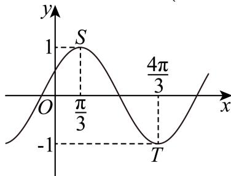

# 2025二模 闵行区原卷 · 学生版

> 本地预览：题目、答案及分类尚未全部审定。校对使用的PDF为高中工作台解析版，尚未逐区确认区级印刷原卷。

## 填空题

按本区原卷题号顺序排列。

### 闵行 · 第1题

设全集U = {−1, 0, 1, 2}，若集合A = {0, 2}，则A =

> 本题资料或解析有待核事项，预览不可作为已审定成品。

### 闵行 · 第2题

设 $\mathbf { { \bar { x } } \in \mathbf { R } }$ ，则不等式 $| x - 2 | \leq$ 5的解集为 .

### 闵行 · 第3题

已知i是虚数单位，则 $\lvert \frac { 1 + \mathrm { i } } { \mathrm { ~ i ~ } } \rvert$

### 闵行 · 第4题

已知圆柱的底面半径为 ${ \sqrt { 3 } } .$ ，高为3，则圆柱的体积为

### 闵行 · 第5题

在 $\left( 2 x + { \frac { 1 } { x } } \right)$ 6 的二项展开式中，常数项是 ．（用数值作答）

> 本题资料或解析有待核事项，预览不可作为已审定成品。

### 闵行 · 第6题

已知向量 $\vec { \mathbf { a } } ^ { + } = ( \mathbf { 3 } , 4 ) , \vec { b } ^ { - } = ( \cos \theta , \sin \theta )$ ，若 $\overrightarrow { \mathrm { a } } / / \overrightarrow { \mathrm { b } }$ ， 则tanθ=

### 闵行 · 第7题

已知数据 $\smash {  { \vert x _ { 1 } , ~ x _ { 2 } , ~ \ldots , ~ x _ { 1 0 0 } } }$ 的平均数为2，方差为5，则 $x _ { 1 } ^ { 2 } , x _ { 2 } ^ { 2 } , \cdots , x _ { 1 0 0 } ^ { 2 }$ 的平均数为

### 闵行 · 第8题

已知函数 ${ \overline { { \cdot f \left( x \right) } } } = { \left\{ \begin{array} { l l } { ( 1 - 2 m ) x + 3 m , x < 1 } \\ { x ^ { 2 } , x \geq 1 } \end{array} \right. }$ 的值域为R，则m的取值范围是

### 闵行 · 第9题

某公司生产的糖果每包的标识质量是500克，但公司承认实际质量存在误差．已知每包糖果的实际质量服从正态分布 $N \left( 5 0 0 , \sigma ^ { 2 } \right)$ ，且任意一包的糖果质量介于495克到505克之间的可能性为95.4%，则随意买一包该公司生产的糖果，其质量超过505克的可能性约为 ．（精确到0.1%）

### 闵行 · 第10题

已知数列 $\left\{ a _ { n } \right\}$ 为等差数列，数列 $\left\{ b _ { n } \right\}$ 为等比数列，且 $a _ { 1 } = b _ { 1 } = 1$ $a _ { 2 } = b _ { 2 } = t$ ，若 $\dot { a } _ { 6 } + b _ { 6 } > 3 8$ 则实数t的取值范围为

### 闵行 · 第11题

已知某星球的球心为F，半径为R，该星球的卫星的运行轨道是以F为一个焦点的椭圆，该椭圆的离心率为 $\frac { 3 } { 5 }$ ，卫星运行过程中离该星球表面最近的距离为R，若当卫星处于某位置时，用卫星上的光学仪器观测该星球，把光学仪器的镜头与星球表面被观测点的连线称为视线，任意两条视线所成的最大夹角称为张角，则卫星运行过程中张角的最小值为 ．（精确到0.1°）

### 闵行 · 第12题

定义 $D = [ a , b ]$ 的区间长度为b−a．若 $m < 0$ 且关于x的不等式 $| ( x - 1 ) ^ { 3 } + m ( x - 1 ) | \leq 1$ 6的解集的区间长度之和为T，则当T取最大值时，实数m的值为

> 本题资料或解析有待核事项，预览不可作为已审定成品。

## 选择题

按本区原卷题号顺序排列。

### 闵行 · 第13题

两个变量x与y之间的回归方程（ ）

A. 表示x与y之间的函数关系；

B. 表示x与y之间的不确定关系；

C. 反映x与y之间的真实关系；

D. 是反映x与y之间的真实关系的一种最佳拟合

### 闵行 · 第14题

已知a > 0，b > 0，则“a + b > 2”是“ab > 1”的（ ）

A. 充分不必要条件

B. 必要不充分条件

C. 充要条件

D. 既不充分也不必要条件

### 闵行 · 第15题

已知函数 $y=\cos\left(\dfrac\pi6x+\dfrac\pi3\right)$ 在区间 $[a,a+9]$ 上既有最大值又有最小值 $-1$，则关于实数 $a$ 的取值，以下不可能的是（　）。

A. $2024$

B. $2025$

C. $2026$

D. $2027$

> 本地PDF题面与源解析实际使用的最值条件不一致；未擅自补条件，暂不作为已审定练习。

### 闵行 · 第16题

设n为正整数，空间中n个单位向量构成集合 $A _ { n } = \left\{ { \vec { a } } _ { 1 } , { \vec { a } } _ { 2 } , \cdot \cdot \cdot , { \vec { a } } _ { n } \right\}$ ，若存在实数t，满足对任意$\vec { a } _ { i } \in A _ { n } , \vec { a } _ { j } \in A _ { n } , \vec { a } _ { i } \neq \vec { a } _ { j }$ ，都有 ${ \vec { a } } _ { i } \cdot { \vec { a } } _ { j } = t$ ，则当 $_ n$ 取得最大值时，t的值为（ ）

A. $- { \frac { 1 } { 2 } }$

B. $\frac { 1 } { 2 }$

C. $- { \frac { 1 } { 3 } }$

D. $\frac 1 3$

> 本题资料或解析有待核事项，预览不可作为已审定成品。

## 解答题

按本区原卷题号顺序排列。

### 闵行 · 第17题

如图，在四棱锥P − ABCD中，底面ABCD为长方形，PA⊥底面ABCD，E是 $P C ^ { \mathsf { \Pi } }$ 中点，已知$A B = 2 , A D = 2 { \sqrt { 2 } } , P A = 2$

(1) (6分)证明： $A D \bot B P ;$
(2) (8分)求二面角E − AD − B的大小

### 闵行 · 第18题

已知 $f \left( x \right) = \sin \left( \omega x + \varphi \right) \left( \omega > 0 , 0 < \varphi < \pi \right)$ ，函数 $y = f \left( x \right)$ 的部分图像如图所示，图中最高点$S \left( { \frac { \pi } { 3 } } , 1 \right)$ ，最低点 $T \left( { \frac { 4 \pi } { 3 } } , - 1 \right)$

(1) (6分)求函数 $y = f \left( x \right)$ 的解析式；
(2) (8分)若 $\triangle A B C$ 的内角A,B,C所对的边分别为 $\displaystyle { | a , b , c , }$ 若 $A \neq B , f ( A ) = f ( B ) , c = 2$ ，求 $\triangle A B C { \overrightarrow { \mathbb { H } } }$ 积的取值范围

### 闵行 · 第19题

某社团共有12名成员，其中高一男生2人，女生4人，高二男生3人，女生3人．现从中随机抽选2人参加数学知识问答
(1) (4分)若逐个抽选，求恰好第一个抽选的是男生的概率；
(2) (4分)若恰好抽选了1名男生与1名女生，求这2人都是高二学生的概率；
(3) (6分)若恰好抽选了1名高一学生与1名高二学生，记抽选出来的男生与女生的人数之差的绝对值为X，求X的分布列与数学期望E(X)

> 本题资料或解析有待核事项，预览不可作为已审定成品。

### 闵行 · 第20题

已知双曲线Γ: $x ^ { 2 } - { \frac { y ^ { 2 } } { 3 } } = 1$ 的右焦点为F，过点F的直线l交双曲线Γ右支于A、B两点（点A在x轴上方），点C在双曲线Γ上，直线AC交x轴于点Q（点Q在点F的右侧）
(1) (4分)求双曲线Γ的渐近线方程；
(2) (6分)若点A (2, 3)，且 $\tan \angle B A C = \frac { 1 } { 2 }$ ，求点C的坐标；
(3) (8分)若 $\triangle A B C$ 的重心G在x轴上，记 $\triangle A F G , \ \triangle C Q G$ 的面积分别为S1、 $S _ { 2 }$ ，求 $\frac { S _ { 1 } } { S _ { 2 } }$ 的最小值

### 闵行 · 第21题

已知函数y = f (x)在定义域D上存在导函数f′ (x)．对于给定的一个有序实数对(k, m)，若存在$x _ { 1 } , x _ { 2 } \in D$ ，使得 $\left[ k x _ { 1 } - f \left( x _ { 1 } \right) + m \right] \cdot \left[ k x _ { 2 } - f \left( x _ { 2 } \right) + m \right] < 0$ ，则称(k, m)为y = f (x)在定义域D上的一个“分割数对”
(1) (4分)已知 $f \left( x \right) = x ^ { 2 } , D = { \bf R }$ ，判断数对(1,0)是否为y = f(x)在D上的“分割数对”，并说明理由；
(2) (6分)已知f (x) = ln x, D = (1, 2)，若(ln 2, m)为y = f (x)在区间D上的“分割数对”，求实数m 的取值范围；
(3) (8分)已知 $f \left( x \right) = \left( x ^ { 2 } + a x + b \right) \cdot \mathrm { e } ^ { x } , D = \mathbf { R }$ ，若有且仅有一个实数a满足对任意 $t \in \mathbf { R }$
$\left( f ^ { \prime } \left( t \right) , f \left( t \right) - t f ^ { \prime } \left( t \right) \right)$ )都不是y = f (x)在D上的“分割数对”，求实数b的值

