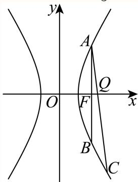

# 2025二模 闵行区原卷 · 教师版

> 本地预览：题目、答案及分类尚未全部审定。校对使用的PDF为高中工作台解析版，尚未逐区确认区级印刷原卷。

## 填空题

按本区原卷题号顺序排列。

### 闵行 · 第1题

设全集U = {−1, 0, 1, 2}，若集合A = {0, 2}，则A =

> 本题资料或解析有待核事项，预览不可作为已审定成品。

**考点：** 有限全集补集

**难度依据：** 有限全集补集；直接调用定义或基本公式，路径短

**核查说明：** 求补集的横线标识丢失，题面误写求A。；已人工阅读底稿题干和原解；未逐页对照PDF，不作为数学终审。

【答案】{−1, 1}.

【解析】

结合题意，由补集的运算直接求出即可.

由题意可得A = {−1,1}.–

故答案为：{−1, 1}.

### 闵行 · 第2题

设 $\mathbf { { \bar { x } } \in \mathbf { R } }$ ，则不等式 $| x - 2 | \leq$ 5的解集为 .

**考点：** 绝对值不等式

**难度依据：** 绝对值不等式；直接调用定义或基本公式，路径短

**核查说明：** 已人工阅读底稿题干和原解；未逐页对照PDF，不作为数学终审。

【答案】[−3,7]

【解析】

解含绝对值的不等式可得解集.

由|x − 2| ≤ 5⇒−5 ≤ x − 2 ≤ 5⇒−3 ≤ x ≤ 7.

所以不等式|x − 2| ≤ 5的解集为：[−3,7].

故答案为：[−3,7]

### 闵行 · 第3题

已知i是虚数单位，则 $\lvert \frac { 1 + \mathrm { i } } { \mathrm { ~ i ~ } } \rvert$

**考点：** 复数除法与模

**难度依据：** 复数除法与模；直接调用定义或基本公式，路径短

**核查说明：** 已人工阅读底稿题干和原解；未逐页对照PDF，不作为数学终审。

【答案】${ \sqrt { 2 } } .$

【解析】

由复数的除法运算结合模长计算即可.

$$
\left| \frac {1 + \mathrm{i}}{\mathrm{i}} \right| = | - (1 + \mathrm{i}) \mathrm{i} | = | - \mathrm{i} + 1 | = \sqrt {(- 1) ^ {2} + 1 ^ {2}} = \sqrt {2}.
$$

故答案为： ${ \sqrt { 2 } } .$

### 闵行 · 第4题

已知圆柱的底面半径为 ${ \sqrt { 3 } } .$ ，高为3，则圆柱的体积为

**考点：** 圆柱体积

**难度依据：** 圆柱体积；直接调用定义或基本公式，路径短

**核查说明：** 已人工阅读底稿题干和原解；未逐页对照PDF，不作为数学终审。

【答案】9π.

【解析】

由圆柱的体积公式计算即可.

由圆柱的体积公式可得 $V = S h = \pi \times \left( \sqrt { 3 } \right) ^ { 2 } \times 3 = 9 \pi .$

故答案为：9π.

### 闵行 · 第5题

在 $\left( 2 x + { \frac { 1 } { x } } \right)$ 6 的二项展开式中，常数项是 ．（用数值作答）

> 本题资料或解析有待核事项，预览不可作为已审定成品。

**考点：** 二项式常数项

**难度依据：** 二项式常数项；需一次代换或条件转换后计算

**核查说明：** 题干幂6游离，原解常数项指数等式乱码，需校净。；已人工阅读底稿题干和原解；未逐页对照PDF，不作为数学终审。

【答案】160.

【解析】

由二项展开式的通项令r = 3计算即可.

展开式的通项为 $T _ { r + 1 } = \mathrm { C } _ { 6 } ^ { r } { ( 2 x ) } ^ { 6 - r } { ( x ^ { - 1 } ) } ^ { r }$

令 $\displaystyle { \mathrm {  ~ \tilde { \theta } ~ } } - r - r = 0 \Rightarrow r = 3 ,$

所以常数项为 $\mathrm { C _ { 6 } ^ { 3 } 2 ^ { 3 } } = 1 6 0$

故答案为：160.

### 闵行 · 第6题

已知向量 $\vec { \mathbf { a } } ^ { + } = ( \mathbf { 3 } , 4 ) , \vec { b } ^ { - } = ( \cos \theta , \sin \theta )$ ，若 $\overrightarrow { \mathrm { a } } / / \overrightarrow { \mathrm { b } }$ ， 则tanθ=

**考点：** 平行坐标与三角比；同角商数关系

**难度依据：** 平行坐标与三角比；同角商数关系；需一次代换或条件转换后计算

**核查说明：** 已人工阅读底稿题干和原解；未逐页对照PDF，不作为数学终审。

【答案】${ \frac { 4 } { 3 } } .$

【解析】

根据向量平行的坐标运算得到 $4 \cos \theta = 3 \sin \theta ,$ ，进而结合同角的商数关系即可求出结果因为 $\overrightarrow { \mathrm { a } } / / \overrightarrow { \mathrm { b } }$ ，且 $\vec { [ \mathfrak { a } } = ( 3 , 4 ) , \vec { b } = ( \cos \theta , \sin \theta )$ ，所以4 $\cos \theta = 3 \sin \theta$ ，显然 $\cos \theta \neq 0$ ，所以${ \frac { 4 } { 3 } } = { \frac { \sin \theta } { \cos \theta } }$ ，即 $\tan \theta = \frac { 4 } { 3 }$ ；

故答案为： ${ \frac { 4 } { 3 } } .$

### 闵行 · 第7题

已知数据 $\smash {  { \vert x _ { 1 } , ~ x _ { 2 } , ~ \ldots , ~ x _ { 1 0 0 } } }$ 的平均数为2，方差为5，则 $x _ { 1 } ^ { 2 } , x _ { 2 } ^ { 2 } , \cdots , x _ { 1 0 0 } ^ { 2 }$ 的平均数为

**考点：** 方差与二阶矩

**难度依据：** 方差与二阶矩；需一次代换或条件转换后计算

**核查说明：** 已人工阅读底稿题干和原解；未逐页对照PDF，不作为数学终审。

【答案】9.

【解析】

由方差和平均数的计算公式结合已知计算即可

由题意可得 ${ \frac { 1 } { 1 0 0 } } \sum _ { i = 1 } ^ { 1 0 0 } { ( x _ { i } - 2 ) } ^ { 2 } = 5 , { \frac { 1 } { 1 0 0 } } \sum _ { i = 1 } ^ { 1 0 0 } x _ { i } = 2 ,$

所以 ${ \frac { 1 } { 1 0 0 } } \sum _ { i = 1 } ^ { 1 0 0 } \left( x _ { i } - 2 \right) ^ { 2 } = { \frac { 1 } { 1 0 0 } } \sum _ { i = 1 } ^ { 1 0 0 } \left( x _ { i } ^ { 2 } - 4 x _ { i } + 4 \right) = 5 ,$

又

$$
\frac {1}{1 0 0} \sum_ {i = 1} ^ {1 0 0} \left(x _ {i} ^ {2} - 4 x _ {i} + 4\right) = \frac {1}{1 0 0} \left(\sum_ {i = 1} ^ {1 0 0} x _ {i} ^ {2} - 4 \sum_ {i = 1} ^ {1 0 0} x _ {i} + \sum_ {i = 1} ^ {1 0 0} 4\right) = \frac {1}{1 0 0} \left(\sum_ {i = 1} ^ {1 0 0} x _ {i} ^ {2} - 4 \times 2 0 0 + 4 0 0\right) = 5
$$

即 $\sum _ { i = 1 } ^ { 1 0 0 } x _ { i } ^ { 2 } - 4 0 0 = 5 0 0$ ，即 $| \sum _ { i = 1 } ^ { 1 0 0 } x _ { i } ^ { 2 } = 9 0 0$

所以 $\therefore x _ { 2 } ^ { 2 } , \cdots x _ { 1 0 0 } ^ { 2 }$ 的平均数为9.

故答案为：9.

### 闵行 · 第8题

已知函数 ${ \overline { { \cdot f \left( x \right) } } } = { \left\{ \begin{array} { l l } { ( 1 - 2 m ) x + 3 m , x < 1 } \\ { x ^ { 2 } , x \geq 1 } \end{array} \right. }$ 的值域为R，则m的取值范围是

**考点：** 分段函数值域拼接

**难度依据：** 分段函数值域拼接；需组合两类关系并检查区间或等号

**核查说明：** 已人工阅读底稿题干和原解；未逐页对照PDF，不作为数学终审。

【答案】$\left[ 0 , { \frac { 1 } { 2 } } \right)$

【解析】

要使得函数f(x)的值域为R，结合一次函数的性质，列出不等式组，即可求解.

由 $\operatorname { \mathbb { F } } f \left( x \right)$ 的值域为R，当 $x \ge .$ 1时， $x ^ { 2 } \geq 1$

所以 $\left\{ \begin{array} { l l } { 1 - 2 m > 0 } \\ { 1 - 2 m + 3 m \ge 1 } \end{array} \right. ,$ 解得 $) \leq m < \frac { 1 } { 2 }$

故m的范围是 $\left\lceil 0 , { \frac { 1 } { 2 } } \right\rceil$

故答案为： $\left[ 0 , { \frac { 1 } { 2 } } \right)$

### 闵行 · 第9题

某公司生产的糖果每包的标识质量是500克，但公司承认实际质量存在误差．已知每包糖果的实际质量服从正态分布 $N \left( 5 0 0 , \sigma ^ { 2 } \right)$ ，且任意一包的糖果质量介于495克到505克之间的可能性为95.4%，则随意买一包该公司生产的糖果，其质量超过505克的可能性约为 ．（精确到0.1%）

**考点：** 正态分布对称性

**难度依据：** 正态分布对称性；直接调用定义或基本公式，路径短

**核查说明：** 已人工阅读底稿题干和原解；未逐页对照PDF，不作为数学终审。

【答案】2.3%.

【解析】

根据正态分布的对称性即可得结论

设每包糖果的实际质量为X，则 $X \sim \mathit { N } \left( 5 0 0 , \sigma ^ { 2 } \right)$

又 $P \left( 4 9 5 < X < 5 0 5 \right) = 9 5 . 4 \%$

所以 $P \left( X > 5 0 5 \right) = \frac { 1 - 9 5 . 4 \% } { 2 } = 2 . 3 \% ,$

故质量超过505克的可能性约为2.3%.

故答案为：2.3%.

### 闵行 · 第10题

已知数列 $\left\{ a _ { n } \right\}$ 为等差数列，数列 $\left\{ b _ { n } \right\}$ 为等比数列，且 $a _ { 1 } = b _ { 1 } = 1$ $a _ { 2 } = b _ { 2 } = t$ ，若 $\dot { a } _ { 6 } + b _ { 6 } > 3 8$ 则实数t的取值范围为

**考点：** 等差等比通项；幂函数单调比较

**难度依据：** 等差等比通项；幂函数单调比较；需组合两类关系并检查区间或等号

**核查说明：** 已人工阅读底稿题干和原解；未逐页对照PDF，不作为数学终审。

【答案】$( 2 , + \infty )$

【解析】

先结合题意由等差和等比数列的基本量法求出两数列的通项进而求出 ${ \mathrm { I } a _ { 6 } , b _ { 6 } }$ ，再构成函数f(t)，分析单调性和根即可

由题意可得等差数列的公差为t−1，所以 $\left. a _ { n } = 1 + \left( n - 1 \right) \left( t - 1 \right) \right.$ ，所以 $. a _ { 6 } = 5 t - 4 .$ 等比数列的公比为t，则 $\lvert b _ { n } = b _ { 1 } q ^ { n - 1 } \Rightarrow b _ { 6 } = t ^ { 5 }$

因为 $ { \vert a _ { 6 } + b _ { 6 } > 3 8 }$ ，即 $t ^ { 5 } + 5 t - 4 > 3 8$ ，即 $\lvert t ^ { 5 } + 5 t - 4 2 > 0$

设 $f \left( t \right) = t ^ { 5 } + 5 t - 4 2$

由复合函数的单调性可得f(t)在R上单调递增，

再由二分法确定当t = 2时， $f \left( t \right) = 0$

所以实数t的取值范围为 $( 2 , + \infty )$

故答案为： $( 2 , + \infty )$

### 闵行 · 第11题

已知某星球的球心为F，半径为R，该星球的卫星的运行轨道是以F为一个焦点的椭圆，该椭圆的离心率为 $\frac { 3 } { 5 }$ ，卫星运行过程中离该星球表面最近的距离为R，若当卫星处于某位置时，用卫星上的光学仪器观测该星球，把光学仪器的镜头与星球表面被观测点的连线称为视线，任意两条视线所成的最大夹角称为张角，则卫星运行过程中张角的最小值为 ．（精确到0.1°）

**考点：** 椭圆近远焦距；球体张角与反三角

**难度依据：** 椭圆近远焦距；球体张角与反三角；需组合两类关系并检查区间或等号

**核查说明：** 已人工阅读底稿题干和原解；未逐页对照PDF，不作为数学终审。

【答案】14.4∘.

【解析】

结合题意由椭圆的几何性质和离心率确定椭圆的 $[ a , c ,$ 再由椭圆的光学性质和反三角函数计算. 设椭圆轨道的半长轴为a，焦距为 $\lceil 2 c$

由题意可得，卫星运行过程中离该星球表面最近的距离为R，在近日点即 $\displaystyle { \lvert { a - c = 2 R } }$ ，又椭圆的离心率为 $\frac { 3 } { 5 }$ ，即 ${ \frac { c } { a } } = { \frac { 3 } { 5 } }$

由以上可得 $a = 5 R , c = 3 R$

又由椭圆的光学性质可得在远日点时张角最小，

设此时张角为θ，则 $\sin \left( { \frac { \theta } { 2 } } \right) = { \frac { R } { 8 R } } = { \frac { 1 } { 8 } }$ ，即 $1 \theta = 2 \arcsin \left( { \frac { 1 } { 8 } } \right) \approx 1 4 . 4 ^ { \circ }$

故答案为：14.4∘.

### 闵行 · 第12题

定义 $D = [ a , b ]$ 的区间长度为b−a．若 $m < 0$ 且关于x的不等式 $| ( x - 1 ) ^ { 3 } + m ( x - 1 ) | \leq 1$ 6的解集的区间长度之和为T，则当T取最大值时，实数m的值为

> 本题资料或解析有待核事项，预览不可作为已审定成品。

**考点：** 三次函数水平截线与区间总长；绝对值三次不等式

**难度依据：** 三次函数水平截线与区间总长；绝对值三次不等式；需证明新定义命题或完成复杂参数分类

**核查说明：** 阈值16断裂为1和6；多处−12断裂；需核源。；已人工阅读底稿题干和原解；未逐页对照PDF，不作为数学终审。

【答案】−12.

【解析】

先由图象平移的性质得到 $| x ^ { 3 } + m x | \leq 1 6 |$ 区间长度与原题一致，再构造函数 $\cdot f \left( x \right)$ ，利用导数分析单调性，利用对称性仅考虑 $x > 0$ 即可，然后 $f \left( { \sqrt { \frac { - m } { 3 } } } \right)$ 等于，大于和小于−16三种情况讨论，结合三次韦达定理求解.

由题意， $( x - 1 ) ^ { 3 } + m ( x - 1 ) ^ { \sharp } \varkappa x ^ { 3 } + m x$ 向右平移得到，即 $| x ^ { 3 } + m x | \leq 1 6$ 区间长度与原题一致，

不妨设 $f \left( x \right) = x ^ { 3 } + m x$ ，易得 $f ^ { \prime } \left( x \right) = 3 x ^ { 2 } + m \geq 0 \Rightarrow x \geq \sqrt { \frac { - m } { 3 } } \Re \hat { \zeta } x x \leq - \sqrt { \frac { - m } { 3 } }$

即f (x)在 $( - \infty , - { \sqrt { \frac { - m } { 3 } } } ) \not \exists \not \in { \sqrt { \frac { - m } { 3 } } } , + \infty )$ 上单调递增， $\left. \sqrt { \pm } \left( - \sqrt { \frac { - m } { 3 } } , \sqrt { \frac { - m } { 3 } } \right) \right.$ 上单调递

减，

由 $f \left( x \right)$ 关于(0, 0)对称，仅考虑x > 0即可，当分类讨论：

当 $f \left( { \sqrt { \frac { - m } { 3 } } } \right) = { \frac { - m } { 3 } } { \sqrt { \frac { - m } { 3 } } } + m { \sqrt { \frac { - m } { 3 } } } = - 1 6 \Rightarrow m = - 1$ 2时，

易得 $f \left( x \right) = x ^ { 3 } - 1 2 x = 1 6 \Rightarrow x _ { 1 } = - 2 , x _ { 2 } = 4$ ，即 $T = 8$ ；

当f $\cdot \left( { \sqrt { \frac { - m } { 3 } } } \right) = { \frac { - m } { 3 } } { \sqrt { \frac { - m } { 3 } } } + m { \sqrt { \frac { - m } { 3 } } } > - 1 6 \Rightarrow m > - 1$ 12时，

$$
f (4) = 6 4 + 4 m > 1 6 \Rightarrow T <   8;
$$

当f $: \left( \sqrt { \frac { - m } { 3 } } \right) = { \frac { - m } { 3 } } \sqrt { \frac { - m } { 3 } } + m \sqrt { \frac { - m } { 3 } } < - 1 6 \Rightarrow m < - 1 ^ { \cdot }$ 2时，

如下图，

不妨设 $x ^ { 3 } + m x = 1$ 6的三个跟分别为 $\displaystyle x _ { 2 } , x _ { 3 } , x _ { 6 }$

不妨设 $\ x ^ { 3 } + m x = - 1$ 16的三个跟分别为 $x _ { 1 } , x _ { 4 } , x _ { 5 }$

由三次韦达定理可得 $x _ { 2 } + x _ { 3 } + x _ { 6 } = 0 , x _ { 1 } + x _ { 4 } + x _ { 5 } = 0$

$$
T = x _ {2} - x _ {1} + x _ {4} - x _ {3} + x _ {6} - x _ {5} = 2 \left(x _ {4} - x _ {3}\right) <   8,
$$

综上，当且仅当 $m = - 1$ 2时， $T = 8$

故答案为：−12.

## 二、选择题

## 选择题

按本区原卷题号顺序排列。

### 闵行 · 第13题

两个变量x与y之间的回归方程（ ）

A. 表示x与y之间的函数关系；

B. 表示x与y之间的不确定关系；

C. 反映x与y之间的真实关系；

D. 是反映x与y之间的真实关系的一种最佳拟合

**考点：** 回归模型意义

**难度依据：** 回归模型意义；直接调用定义或基本公式，路径短

**核查说明：** 已人工阅读底稿题干和原解；未逐页对照PDF，不作为数学终审。

【答案】D

【解析】

根据回归直线方程的定义，结合选项，即可求解.

根据回归方程的定义，可得两个变量x与y之间的回归方程是反映x与y之间的真实关系的一种

最佳拟合

故选：D.

### 闵行 · 第14题

已知a > 0，b > 0，则“a + b > 2”是“ab > 1”的（ ）

A. 充分不必要条件

B. 必要不充分条件

C. 充要条件

D. 既不充分也不必要条件

**考点：** 充分必要条件；均值不等式及反例

**难度依据：** 充分必要条件；均值不等式及反例；需一次代换或条件转换后计算

**核查说明：** 已人工阅读底稿题干和原解；未逐页对照PDF，不作为数学终审。

【答案】B

【解析】

通过举例的方法，以及基本不等式，结合充分，必要条件的定义，即可判断选项$a = 1 . 5 , b = 0 . 6$ ，满足 $a + b > 2$ ，但 $. a b < 1$ - ，$\stackrel { . } { a } > 0 , b > 0 , \ a b > 1$ ，则 $a + b \geq 2 { \sqrt { a b } } > 2$ ，即 $\left| a + b > 2 \right.$ 1

所以“a + b > 2”是“ab > 1”的必要不充分条件.

故选：B

### 闵行 · 第15题

已知函数 $y=\cos\left(\dfrac\pi6x+\dfrac\pi3\right)$ 在区间 $[a,a+9]$ 上既有最大值又有最小值 $-1$，则关于实数 $a$ 的取值，以下不可能的是（　）。

A. $2024$

B. $2025$

C. $2026$

D. $2027$

> 本地PDF题面与源解析实际使用的最值条件不一致；未擅自补条件，暂不作为已审定练习。

**考点：** 余弦周期与区间最值点

**难度依据：** 余弦周期与区间最值点；需组合两类关系并检查区间或等号

**核查说明：** 回源PDF第7页本身未写最大值1，仅写“既有最大值又有最小值-1”；本补丁仅清理OCR，不能按解析反推增加最大值1。；题干最大值1缺失，仅写既有最大值又有最小值−1，条件需回核。；已人工阅读底稿题干和原解；未逐页对照PDF，不作为数学终审。

【解析】

由余弦函数的周期和最值点的分布，以及区间内包含最值点的条件逐项判断即可由题意可得函数的周期为 $T = \frac { 2 \pi } { \frac { \pi } { 6 } } = 1 2 .$ 最大值点满足 $\frac { \pi } { 6 } x + \frac { \pi } { 3 } = 2 k \pi , k \in \mathrm { Z }$ ，解得 $x = 1 2 k - 2 , k \in \mathrm { Z }$ 最小值点满足 ${ \frac { \pi } { 6 } } x + { \frac { \pi } { 3 } } = 2 k \pi + \pi , k \in \mathrm { Z }$ ，解得 $x = 1 2 k + 4 , k \in { \mathrm { Z } }$ 因为函数 $\langle y = \cos \left( \frac { \pi } { 6 } x + \frac { \pi } { 3 } \right)$ 在区间 $[ a , a + 9 ]$ 上既有最大值又有最小值，区间的长度为9，对于A，若 $\dot { \bar { t } } a = 2 0 2 4$ 当k = 169时，最大值点为2026，最小值点为2032，此时位于区间[2024, 2033]内，故A正确；对于B，若a = 2025，当k = 169时，最大值点为2026，最小值点为2032，此时位于区间[2025, 2034]内，故B正确；对于C，若a = 2026，当k = 169时，最大值点为2026，最小值点为2032，此时位于区间[2026, 2035]内，故C正确；对于D，若a = 2027，当k = 169时，最大值点为2026，当k = 170时，最大值点为2038，不位于区间[2027 2036]内，故D错误

### 闵行 · 第16题

设n为正整数，空间中n个单位向量构成集合 $A _ { n } = \left\{ { \vec { a } } _ { 1 } , { \vec { a } } _ { 2 } , \cdot \cdot \cdot , { \vec { a } } _ { n } \right\}$ ，若存在实数t，满足对任意$\vec { a } _ { i } \in A _ { n } , \vec { a } _ { j } \in A _ { n } , \vec { a } _ { i } \neq \vec { a } _ { j }$ ，都有 ${ \vec { a } } _ { i } \cdot { \vec { a } } _ { j } = t$ ，则当 $_ n$ 取得最大值时，t的值为（ ）

A. $- { \frac { 1 } { 2 } }$

B. $\frac { 1 } { 2 }$

C. $- { \frac { 1 } { 3 } }$

D. $\frac 1 3$

> 本题资料或解析有待核事项，预览不可作为已审定成品。

**考点：** 空间等角单位向量与正四面体；球面等距点组

**难度依据：** 空间等角单位向量与正四面体；球面等距点组；需证明新定义命题或完成复杂参数分类

**核查说明：** 原解析多段只有公式无连接文字，需核PDF；不能把现稿当完整证明。；已人工阅读底稿题干和原解；未逐页对照PDF，不作为数学终审。

【答案】C

【解析】

根据给定条件可得集合 $A _ { n } { } ^ { \mathfrak { k } }$ 中所有向量共起点时，终点在球面上，再利用数量积的运算律求出n的最大值，进而求出t值.

$$
A _ {n} = \left\{\vec {a} _ {1}, \vec {a} _ {2}, \dots , \vec {a} _ {n} \right\}
$$

$$
A _ {1}, A _ {2}, \dots , A _ {n}
$$

$$
\overrightarrow {a _ {i}} (i \in \mathrm{N} ^ {*}, i \leq n)
$$

$$
A _ {1}, A _ {2}, \dots , A _ {n}
$$

$$
\exists \vec {a} _ {i} \in A _ {n}, \vec {a} _ {j} \in A _ {n}, \vec {a} _ {i} \neq \vec {a} _ {j}
$$

$$
A _ {1}, A _ {2}, \dots , A _ {n} \text {中}
$$

$$
t = \vec {a} _ {1} \cdot \vec {a} _ {2} = \vec {a} _ {2} \cdot \vec {a} _ {3}
$$

$$
\overrightarrow {O A _ {2}} \cdot \left(\overrightarrow {O A _ {1}} - \overrightarrow {O A _ {3}}\right) = \overrightarrow {O A _ {2}} \cdot \overrightarrow {A _ {3} A _ {1}} = 0
$$

$$
O A _ {2} \bot A _ {1} A _ {3}
$$

$$
t = \vec {a} _ {4} \cdot \vec {a} _ {2} = \vec {a} _ {2} \cdot \vec {a} _ {3}
$$

$$
O A _ {2} \bot A _ {4} A _ {3}
$$

$$
A _ {1}, A _ {3}, A _ {4}
$$

$$
A _ {1}, A _ {2}, A _ {3}, A _ {4}
$$

$$
A _ {1}, A _ {2}, A _ {3}, A _ {4}
$$

$$
n \geq 5.
$$

$$
n = 5
$$

$$
O A _ {5} \perp A _ {1} A _ {3}, O A _ {5} \perp A _ {4} A _ {3}, O A _ {5 -}
$$

$$
A _ {1} A _ {3} A _ {4}
$$

又 $O A _ { 5 } \bot A _ { 2 } A _ { 3 }$ ，由过一点有且只有一个平面垂直于已知直线，得点 $A _ { 2 } \in$ 平面 $A _ { 1 } A _ { 3 } A _ { 4 }$ 与点 $A _ { 1 } , A _ { 2 } , A _ { 3 } , A _ { 4 }$ 不共面矛盾，因此 $n _ { \mathrm { m a x } } = 4$ ，设正四面体 $A _ { 1 } A _ { 2 } A _ { 3 } A _ { 4 }$ 的棱长为 $m$ ，

$$
\triangle A _ {1} A _ {2} A _ {3}
$$

$$
\frac {\sqrt {3}}{2} m \cdot \frac {2}{3} = \frac {\sqrt {3}}{3} m
$$

$$
\sqrt {m ^ {2} - \left(\frac {\sqrt {3}}{3} m\right) ^ {2}} = \frac {\sqrt {6}}{3} m
$$

球心到平面 $A _ { 1 } A _ { 2 } A _ { 3 }$ 的距离为 $\frac { \sqrt { 6 } } { 3 } m - 1$ ，因此 $\left( { \frac { \sqrt { 6 } } { 3 } } m - 1 \right) ^ { 2 } + \left( { \frac { \sqrt { 3 } } { 3 } } m \right) ^ { 2 } = 1 ^ { 2 }$ ，解得$m = { \frac { 2 { \sqrt { 6 } } } { 3 } }$

所以 $\quad : = \cos \angle A _ { 1 } O A _ { 2 } = { \frac { 1 ^ { 2 } + 1 ^ { 2 } - \left( { \frac { 2 { \sqrt { 6 } } } { 3 } } \right) ^ { 2 } } { 2 \times 1 \times 1 } } = - { \frac { 1 } { 3 } } .$

故选：C

## 三、解答题

## 解答题

按本区原卷题号顺序排列。

### 闵行 · 第17题

如图，在四棱锥P − ABCD中，底面ABCD为长方形，PA⊥底面ABCD，E是 $P C ^ { \mathsf { \Pi } }$ 中点，已知$A B = 2 , A D = 2 { \sqrt { 2 } } , P A = 2$

(1) (6分)证明： $A D \bot B P ;$
(2) (8分)求二面角E − AD − B的大小

**考点：** （1）线面垂直证明线线垂直；（2）法向量求二面角

**难度依据：** 线面垂直与二面角；空间法向量；需组合两类关系并检查区间或等号

**核查说明：** 已人工阅读底稿题干和原解；未逐页对照PDF，不作为数学终审。

【解析】

(1) 因为PA⊥底面ABCD，AD ⊂底面ABCD，所以 $P A \bot A D$ 又底面 $A B C D$ 为长方形，所以 $A B \bot A D$ $P A \cap A B = A , P A , A B \subset$ 平面 $P A B$ 所以 $A D \perp$ 平面PAB， $B P \subset$ 平面 $P A B ,$ ，所以 $A D \bot B P$

(2) 以A为原点，射线AB,AD,AP分别为 $x , y ,$ z轴建立如图所示空间直角坐标系，

易知底面ABCD的一个法向量为(0,0,1)，设为 $\vec { \mathbf { \nabla } m }$

A (0, 0, 0), D (0, 2√2, 0), E (1, √2, 1)，

设平面EAD的法向量为 $\vec { n } = ( x , y , z )$ ，则 $\begin{cases}2\sqrt2 y=0\\x+\sqrt2y+z=0\end{cases}$

取 $\iota x = 1$ ，可得 $\vec { n } = ( 1 , 0 , - 1 )$

设二面角E − AD − B的大小为θ，

→m ⋅ →n 1 √2 则cos θ = cos ⟨→m,→n = →m →n √2 2

所以二面角E−AD−B的大小为 $\frac { \pi } { 4 }$

### 闵行 · 第18题

已知 $f \left( x \right) = \sin \left( \omega x + \varphi \right) \left( \omega > 0 , 0 < \varphi < \pi \right)$ ，函数 $y = f \left( x \right)$ 的部分图像如图所示，图中最高点$S \left( { \frac { \pi } { 3 } } , 1 \right)$ ，最低点 $T \left( { \frac { 4 \pi } { 3 } } , - 1 \right)$

(1) (6分)求函数 $y = f \left( x \right)$ 的解析式；
(2) (8分)若 $\triangle A B C$ 的内角A,B,C所对的边分别为 $\displaystyle { | a , b , c , }$ 若 $A \neq B , f ( A ) = f ( B ) , c = 2$ ，求 $\triangle A B C { \overrightarrow { \mathbb { H } } }$ 积的取值范围

**考点：** （1）图像周期相位；（2）三角方程对称及正弦定理面积范围

**难度依据：** 读图参数与三角形面积范围；需多步建模、分类或参数约束

**核查说明：** 已人工阅读底稿题干和原解；未逐页对照PDF，不作为数学终审。

【解析】

(1) 因为 $f \left( x \right) = \sin \left( \omega x + \varphi \right)$ 图像经过S $\left( { \frac { \pi } { 3 } } , 1 \right)$ ， $T \left( { \frac { 4 \pi } { 3 } } , - 1 \right)$

所以 ${ \frac { 4 \pi } { 3 } } - { \frac { \pi } { 3 } } = { \frac { T } { 2 } }$ 得周期 $T = 2 \pi$ ，由 ${ \frac { 2 \pi } { \omega } } = 2 \pi$ 得， $\omega = 1$

又 $f \left( { \frac { \pi } { 3 } } \right) = 1$ 得 ${ \frac { \pi } { 3 } } + \varphi = 2 k \pi + { \frac { \pi } { 2 } }$ ，k ∈ Z，

又因为 $1 0 < \varphi < \pi$

所以 $\varphi = \frac { \pi } { 6 }$ ，所以 $f \left( x \right) = \sin \left( x + \frac { \pi } { 6 } \right)$

(2) 因为 $f \left( A \right) = f \left( B \right)$ ，又 $0 < A + B < \pi$ ，

结合图像对称性可知： $A + B = { \frac { 2 \pi } { 3 } }$ ，则 $C = \frac { \pi } { 3 }$

又 $. c = 2$ ，由正弦定理得： ${ \frac { a } { \sin A } } = { \frac { b } { \sin B } } = { \frac { c } { \sin C } } = { \frac { 2 } { \frac { \sqrt { 3 } } { 2 } } } = { \frac { 4 { \sqrt { 3 } } } { 3 } } ,$

则a $= { \frac { 4 { \sqrt { 3 } } } { 3 } } \sin A , b = { \frac { 4 { \sqrt { 3 } } } { 3 } } \sin B ,$

所以 $a b = { \frac { 1 6 } { 3 } } \mathrm { s i n } A \sin B = { \frac { 1 6 } { 3 } } \mathrm { s i n } A \sin \left( { \frac { 2 \pi } { 3 } } - A \right)$

$$
= \frac {1 6}{3} \sin A \left(\frac {\sqrt {3}}{2} \cos A + \frac {1}{2} \sin A\right) = \frac {8 \sqrt {3}}{3} \sin A \cos A + \frac {8}{3} \sin^ {2} A
$$

$$
\frac {4 \sqrt {3}}{3} \sin 2 A + \frac {4}{3} - \frac {4}{3} \cos 2 A = \frac {8}{3} \sin \left(2 A - \frac {\pi}{6}\right) + \frac {4}{3},
$$

由 $A + B = { \frac { 2 \pi } { 3 } } , A \neq B _ { \mathrm { { f } } }$ ，可得 $A \in \left( 0 , \frac { \pi } { 3 } \right) \cup \left( \frac { \pi } { 3 } , \frac { 2 \pi } { 3 } \right)$

所以 $2 A - { \frac { \pi } { 6 } } \in \left( - { \frac { \pi } { 6 } } , { \frac { \pi } { 2 } } \right) \cup \left( { \frac { \pi } { 2 } } , { \frac { 7 \pi } { 6 } } \right)$ ，则 $| \sin ( 2 A - { \frac { \pi } { 6 } } ) \in ( - { \frac { 1 } { 2 } } , 1 )$

$$
\text { 故 } a b \in (0, 4)
$$

于是可得△ABC的面积为 ${ \frac { 1 } { 2 } } a b \sin C = { \frac { 1 } { 2 } } a b \cdot { \frac { \sqrt { 3 } } { 2 } } = { \frac { \sqrt { 3 } } { 4 } } a b \in \left( 0 , { \sqrt { 3 } } \right)$ 故 $\triangle A B C$ 面积的取值范围为 $\left( 0 , { \sqrt { 3 } } \right)$

### 闵行 · 第19题

某社团共有12名成员，其中高一男生2人，女生4人，高二男生3人，女生3人．现从中随机抽选2人参加数学知识问答
(1) (4分)若逐个抽选，求恰好第一个抽选的是男生的概率；
(2) (4分)若恰好抽选了1名男生与1名女生，求这2人都是高二学生的概率；
(3) (6分)若恰好抽选了1名高一学生与1名高二学生，记抽选出来的男生与女生的人数之差的绝对值为X，求X的分布列与数学期望E(X)

> 本题资料或解析有待核事项，预览不可作为已审定成品。

**考点：** （1）首抽男生概率；（2）性别条件下的年级概率；（3）按年级分层的性别人数差分布列与期望

**难度依据：** 条件抽样与人数差分布列；需组合两类关系并检查区间或等号

**核查说明：** 第（3）问分布列表格缺失，分情况文字也残缺；虽然概率和期望可辨，需回源。；已人工阅读底稿题干和原解；未逐页对照PDF，不作为数学终审。

【解析】

(1) 逐个抽选，恰好第一个抽选的是男生的情况为男生所占人数总比例，故概率为 ${ \frac { 2 + 3 } { 1 2 } } = { \frac { 5 } { 1 2 } }$

(2) 记事件B为恰好抽选了1名男生与1名女生，事件C为这2人都是高二学生，

由条件概率可得 $P \left( C | B \right) = \frac { P \left( B C \right) } { P \left( B \right) } = \frac { \mathrm { C _ { 3 } ^ { 1 } C _ { 3 } ^ { 1 } } } { \mathrm { C _ { 5 } ^ { 1 } C _ { 7 } ^ { 1 } } } = \frac { 9 } { 3 5 } .$

(3) 已知抽取了1名高一学生与1名高二学生，两组均有6人，因此共有 $6\times6=36$ 种等可能结果。

若抽到一男一女，则 $X=0$，对应 $2\times3+4\times3=18$ 种；若抽到两男或两女，则 $X=2$，对应 $2\times3+4\times3=18$ 种。

因此 $X$ 的分布列为：

| $X$ | 0 | 2 |
|:---:|:---:|:---:|
| $P$ | $\frac12$ | $\frac12$ |

$E(X)=0\times\frac12+2\times\frac12=1$。

本小问补全分布表并独立核验，原解析另存。

### 闵行 · 第20题

已知双曲线Γ: $x ^ { 2 } - { \frac { y ^ { 2 } } { 3 } } = 1$ 的右焦点为F，过点F的直线l交双曲线Γ右支于A、B两点（点A在x轴上方），点C在双曲线Γ上，直线AC交x轴于点Q（点Q在点F的右侧）
(1) (4分)求双曲线Γ的渐近线方程；
(2) (6分)若点A (2, 3)，且 $\tan \angle B A C = \frac { 1 } { 2 }$ ，求点C的坐标；
(3) (8分)若 $\triangle A B C$ 的重心G在x轴上，记 $\triangle A F G , \ \triangle C Q G$ 的面积分别为S1、 $S _ { 2 }$ ，求 $\frac { S _ { 1 } } { S _ { 2 } }$ 的最小值

**考点：** （1）双曲线渐近线；（2）角度条件与直线交双曲线；（3）重心条件转面积比及最小值

**难度依据：** 双曲线焦点弦与重心面积比；均值求比值最小；需证明新定义命题或完成复杂参数分类

**核查说明：** 已人工阅读底稿题干和原解；未逐页对照PDF，不作为数学终审。

【解析】

(1) 已知双曲线Γ: $: x ^ { 2 } - { \frac { y ^ { 2 } } { 3 } } = 1$ ，则 $a = 1 , b = { \sqrt { 3 } } ,$ ，所以双曲线方程为 $y = \pm \sqrt { 3 } x$

(2) 双曲线Γ: $x ^ { 2 } - { \frac { y ^ { 2 } } { 3 } } = 1$ 的右焦点 $F \left( 2 , 0 \right)$

又A (2, 3)，所以 $A B \bot O F$ ，则B (2, −3)，

因为 $\tan \angle B A C = \frac { 1 } { 2 }$ ，所以k $\ O _ { A C } = \tan \left( \angle B A C + \frac { \pi } { 2 } \right) = - \frac { 1 } { \tan \angle B A C } = - 2 ,$

则直线 $A C \colon y - 3 = - 2 \left( x - 2 \right)$ ，即 $y = - 2 x + 7$

所以 $\left\{ x ^ { 2 } - { \frac { y ^ { 2 } } { 3 } } = 1 \right. \Rightarrow x ^ { 2 } - 2 8 x + 5 2 = 0$ 解得 $x _ { 1 } = 2 , x _ { 2 } = 2 6$ ，即 $; c = 2 6$

则 $| y _ { C } = - 2 \times 2 6 + 7 = - 4 5$ ，所以点C的坐标为(26,−45)；

(3) 设直线 $A B : x = t y + 2 , A ( x _ { 1 } , y _ { 1 } ) , B ( x _ { 2 } , y _ { 2 } ) , C ( x _ { 3 } , y _ { 3 } )$

$$
\left\{ \begin{array}{l} x = t y + 2 \\ x ^ {2} - \frac {y ^ {2}}{3} = 1 \end{array} \Rightarrow (3 t ^ {2} - 1) y ^ {2} + 1 2 t y + 9 = 0, t ^ {2} \neq \frac {1}{3}, \Delta = 3 6 (t ^ {2} + 1) > 0 \right.
$$

则 $| y _ { 1 } + y _ { 2 } = - { \frac { 1 2 t } { 3 t ^ { 2 } - 1 } } , y _ { 1 } y _ { 2 } = { \frac { 9 } { 3 t ^ { 2 } - 1 } }$

因为直线l过点F且与双曲线Γ右支交于A、B两点，所以 $t \in \left( - { \frac { \sqrt { 3 } } { 3 } } , { \frac { \sqrt { 3 } } { 3 } } \right)$

又因为 $\triangle A B C$ 的重心G在x轴上，所以 $y _ { 1 } + y _ { 2 } + y _ { 3 } = 0$ ，

由点Q在点F的右侧，可得 $y _ { 3 } < 0 _ { : }$ ，所以 $y _ { 1 } + y _ { 2 } > 0$ ，解得 $t > 0 _ { : }$ ，所以 $: \in \left( 0 , \frac { \sqrt { 3 } } { 3 } \right)$

而 $| y _ { 1 } - y _ { 2 } | = { \sqrt { \left( y _ { 1 } + y _ { 2 } \right) ^ { 2 } - 4 y _ { 1 } y _ { 2 } } }$ ，代入可得 $y _ { 1 } - y _ { 2 } = - { \frac { 6 { \sqrt { t ^ { 2 } + 1 } } } { 3 t ^ { 2 } - 1 } }$

所以 $\frac { S _ { 1 } } { S _ { 2 } } = \frac { \displaystyle \frac { S _ { 1 } } { S _ { \bigtriangleup A B G } } } { \displaystyle \frac { S _ { 2 } } { S _ { \bigtriangleup A C G } } } = \frac { \displaystyle \frac { | A F | } { | A B | } } { \displaystyle \frac { | C Q | } { | A C | } } = \frac { \displaystyle \frac { y _ { 1 } } { y _ { 1 } - y _ { 2 } } } { \displaystyle \frac { - y _ { 3 } } { y _ { 1 } - y _ { 3 } } } = \frac { \displaystyle \frac { y _ { 1 } } { y _ { 1 } - y _ { 2 } } } { \displaystyle \frac { y _ { 1 } + y _ { 2 } } { 2 y _ { 1 } + y _ { 2 } } }$

$$
= \frac {\left(y _ {1} + y _ {2} + y _ {1}\right) \left(y _ {1} + y _ {2} - y _ {2}\right)}{\left(y _ {1} - y _ {2}\right) \left(y _ {1} + y _ {2}\right)} = \frac {y _ {1} + y _ {2}}{y _ {1} - y _ {2}} + 1 - \frac {y _ {1} y _ {2}}{\left(y _ {1} - y _ {2}\right) \left(y _ {1} + y _ {2}\right)},
$$

代入化简可得： $\frac { S _ { 1 } } { S _ { 2 } } = \frac { 1 3 t ^ { 2 } + 1 } { 8 t \sqrt { t ^ { 2 } + 1 } } + 1$

所以

$$
\begin{array}{l} \frac {S _ {1}}{S _ {2}} = \frac {1 3 t ^ {2} + 1}{8 t \sqrt {t ^ {2} + 1}} + 1 = \frac {1 2 t ^ {2}}{8 t \sqrt {t ^ {2} + 1}} + \frac {t ^ {2} + 1}{8 t \sqrt {t ^ {2} + 1}} + 1 \geq 2 \sqrt {\frac {1 2 t ^ {2}}{8 t \sqrt {t ^ {2} + 1}} \cdot \frac {t ^ {2} + 1}{8 t \sqrt {t ^ {2} + 1}}} + 1 = \\ \frac {\sqrt {3}}{2} + 1 \end{array}
$$

当且仅当 $t = { \frac { \sqrt { 1 1 } } { 1 1 } }$ 时等号成立，所以 $\frac { S _ { 1 } } { S _ { 2 } }$ 的最小值为 ${ \frac { \sqrt { 3 } } { 2 } } + 1$

### 闵行 · 第21题

已知函数y = f (x)在定义域D上存在导函数f′ (x)．对于给定的一个有序实数对(k, m)，若存在$x _ { 1 } , x _ { 2 } \in D$ ，使得 $\left[ k x _ { 1 } - f \left( x _ { 1 } \right) + m \right] \cdot \left[ k x _ { 2 } - f \left( x _ { 2 } \right) + m \right] < 0$ ，则称(k, m)为y = f (x)在定义域D上的一个“分割数对”
(1) (4分)已知 $f \left( x \right) = x ^ { 2 } , D = { \bf R }$ ，判断数对(1,0)是否为y = f(x)在D上的“分割数对”，并说明理由；
(2) (6分)已知f (x) = ln x, D = (1, 2)，若(ln 2, m)为y = f (x)在区间D上的“分割数对”，求实数m 的取值范围；
(3) (8分)已知 $f \left( x \right) = \left( x ^ { 2 } + a x + b \right) \cdot \mathrm { e } ^ { x } , D = \mathbf { R }$ ，若有且仅有一个实数a满足对任意 $t \in \mathbf { R }$
$\left( f ^ { \prime } \left( t \right) , f \left( t \right) - t f ^ { \prime } \left( t \right) \right)$ )都不是y = f (x)在D上的“分割数对”，求实数b的值

**考点：** （1）分割数对取点验证；（2）对数函数差的正负值；（3）全部切线不分割与二阶导数约束唯一参数

**难度依据：** 分割数对与切线支撑；函数正负值和导函数单调；需证明新定义命题或完成复杂参数分类

**核查说明：** 已人工阅读底稿题干和原解；未逐页对照PDF，不作为数学终审。

【解析】

(1) 是，

存在 $x _ { 1 } = { \frac { 1 } { 2 } } , x _ { 2 } = 2 .$

由函数新定义有 $\left( 1 \times { \frac { 1 } { 2 } } - { \frac { 1 } { 4 } } + 0 \right) \cdot ( 1 \times 2 - 4 + 0 ) = { \frac { 1 } { 4 } } \times ( - 2 ) < 0 ;$ 满足.

(2) 令d (x) = x ln 2 − ln x + m，

令d′ (x) = 0，得 $x = { \frac { 1 } { \ln 2 } }$

所以当1 $\cdot < x < { \frac { 1 } { \ln 2 } }$ 时， $d ^ { \prime } \left( x \right) < 0$ 函数d(x)为递减函数；当 $\frac { 1 } { \ln 2 } < x <$ < 2时， $d ^ { \prime } \left( x \right) > 0$ 函数d(x)为递增函数，

所 $\lambda y = d \left( x \right) \overleftarrow { \mathrm { t } } x = \frac { 1 } { \ln { 2 } }$ 处取得极小值，也是最小值，

所以y = d(x)在区间(1,2)上的值域为 $[ 1 + m + \ln { ( \ln { 2 } ) } , m + \ln { 2 } )$

若(ln2,m)为y = f(x)在区间D上的“分割数对”，既要满足y = d(x)在区间(1,2)上的函数值 有正有负，

所以 $\begin{array} { r } { { \left\{ \begin{array} { l l } { m + \ln 2 > 0 } \\ { 1 + m + \ln { ( \ln { 2 } ) } < 0 } \end{array} \right. } \Rightarrow - \ln 2 < m < - 1 - \ln { ( \ln { 2 } ) } } \end{array}$

即实数m的取值范围为(− ln 2, −1 − ln (ln 2)).

(3) 对任意t ∈ R，考虑 $d \left( x \right) = f ^ { \prime } \left( t \right) x - f \left( x \right) + f \left( t \right) - t f ^ { \prime } \left( t \right)$

$\left( f ^ { \prime } \left( t \right) , f \left( t \right) - t f ^ { \prime } \left( t \right) \right)$ 不是y = f(x)在D上的“分割数对”等价于d(x) ≥ 0或d(x) ≤ 0恒成

显然， $d \left( t \right) = t f ^ { \prime } \left( t \right) - f \left( t \right) + f \left( t \right) - t f ^ { \prime } \left( t \right) = 0 ,$

由于d′ (x) = f′ (t) − f′ (x)，显然 $d ^ { \prime } \left( t \right) = f ^ { \prime } \left( t \right) - f ^ { \prime } \left( t \right) = 0$ 9

令h (x) = d′ (x) = f′ (t) − f′ (x)，

因为 $f ^ { \prime } \left( x \right) = \left\lceil x ^ { 2 } + ( a + 2 ) x + a + b \right\rceil \mathrm { e } ^ { x }$ ，则 $h \left( x \right) = f ^ { \prime } \left( t \right) - \left[ x ^ { 2 } + ( a + 2 ) x + a + b \right] \mathrm { e } ^ { x }$

所以 $, h ^ { \prime } ( x ) = - \left\lceil x ^ { 2 } + ( a + 4 ) x + 2 a + b + 2 \right\rceil \mathrm { e } ^ { x }$ ，结合函数 $y = h ^ { \prime } \left( x \right)$ 的性质可知 ${ } ^ { \cdot \cdot } h ^ { \prime } \left( x \right) \leq 0 ^ { \prime }$ 恒成立”等价于“对任意t ∈ R，d(x) ≤ 0恒成立”，

即 $\begin{array} { r } { \mathrm { l } x ^ { 2 } + ( a + 4 ) x + 2 a + b + 2 \geq 0 } \end{array}$ 在R上恒成立，

即 $\Delta = a ^ { 2 } - 4 b + 8 \leq 0$

由题意，满足 $a ^ { 2 } - 4 b + 8 \leq$ 0的实数a有且仅有一个，则 $b = 2$

