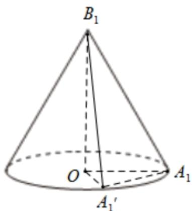
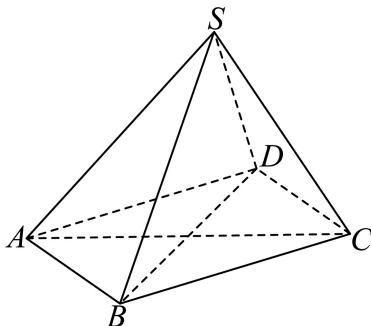
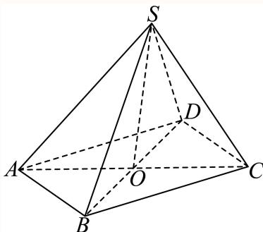
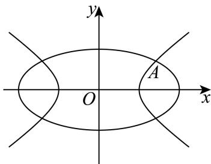
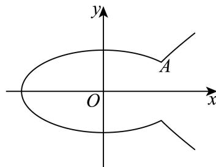
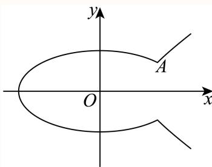
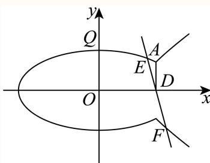
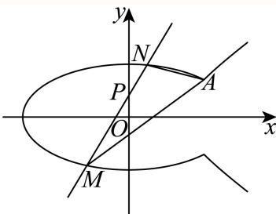

# 2025二模 青浦区原卷 · 教师版

> 本地预览：题目、答案及分类尚未全部审定。校对使用的PDF为高中工作台解析版，尚未逐区确认区级印刷原卷。

## 填空题

按本区原卷题号顺序排列。

### 青浦 · 第1题

已知集合 $A = \{ x \mid 2 x \leq 1 \} , B = \{ - 1 , 0 , 1 , 2 \}$ ，则A ∩ B =

**考点：** 集合交集

**难度依据：** 集合交集；直接调用定义或基本公式，运算路径短

**核查说明：** 已人工阅读底稿题干和解析；尚未逐页对照原PDF，不作为数学终审。

【答案】{−1,0}

【解析】

解不等式求出集合A，即可求集合的交集.

解集合A中的不等式2x ≤ 1，得 $x \leq \frac 1 2$

A∩B就是求既属于A又属于B的元素，所以 $A \cap B = \{ - 1 , 0 \}$

故答案为：{−1,0}

### 青浦 · 第2题

函数 $y = 2 \sin x - 3 \cos x$ 的值域是

**考点：** 辅助角公式与值域

**难度依据：** 辅助角公式求值域；直接调用定义或基本公式，运算路径短

**核查说明：** 已人工阅读底稿题干和解析；尚未逐页对照原PDF，不作为数学终审。

【答案】$[ - { \sqrt { 1 3 } } , { \sqrt { 1 3 } } ]$

【解析】

【分析】利用辅助角公式化简函数，再结合正弦函数求值域即可

【详解】

$$
y = 2 \sin x - 3 \cos x = \sqrt {1 3} \left(\frac {2}{\sqrt {1 3}} \sin x - \frac {3}{\sqrt {1 3}} \cos x\right) = \sqrt {1 3} \sin (x - \varphi) \in [ - \sqrt {1 3}, \sqrt {1 3} ]
$$

中 $\tan \varphi = { \frac { 3 } { 2 } }$ ，

则其值域为 $[ - { \sqrt { 1 3 } } , { \sqrt { 1 3 } } ]$

故答案为： $[ - { \sqrt { 1 3 } } , { \sqrt { 1 3 } } ]$

### 青浦 · 第3题

$( 1 - a x ) ^ { \ell }$ 6的二项展开式中x3项的系数是20，则实数a的值是

> 本题资料或解析有待核事项，预览不可作为已审定成品。

**考点：** 二项式通项与系数

**难度依据：** 二项式指定项系数；需完成一次转化或结合基本条件后计算

**核查说明：** 展开指数OCR破损，系数方程20误识为0，需回核原式。；已人工阅读底稿题干和解析；尚未逐页对照原PDF，不作为数学终审。

【答案】−1.

【解析】

利用二项式定理展开式的通项公式求解即可.

根据二项式展开式的通项公式 $T _ { r + 1 } = \mathrm { C } _ { n } ^ { r } a ^ { n - r } b ^ { r }$

则 $( 1 - a x ) ^ { \ell }$ 6展开式中 $\mathrm { i } x ^ { 3 }$ 项为 $\mathrm { C } _ { 6 } ^ { 3 } \times 1 ^ { 6 - 3 } \times ( - a x ) ^ { 3 }$ ，

又 $\mathrm { C } _ { 6 } ^ { 3 } = \frac { 6 ! } { 3 ! ( 6 - 3 ) ! } = 2 0$ ，则该项为 $2 0 \times ( - a ) ^ { 3 } x ^ { 3 }$

已知x3项的系数是20，则 $0 \times ( - a ) ^ { 3 } = 2 0$ ，即 $( - a ) ^ { 3 } = 1$ ，

解得a = −1.

故答案为：−1.

### 青浦 · 第4题

如图是6株果树植株挂果个数（两位数）的茎叶图，则6株果数植株挂果个数的中位数为
1 68 2 12 3

> 本题资料或解析有待核事项，预览不可作为已审定成品。

**考点：** 读取茎叶图与中位数

**难度依据：** 茎叶图与中位数；直接调用定义或基本公式，运算路径短

**核查说明：** 茎叶图已压成散落数字，缺明确答案字段，需回核原图而非仅靠解析恢复。；已人工阅读底稿题干和解析；尚未逐页对照原PDF，不作为数学终审。

【解析】

将茎叶图中的数据按照从小到大排列后，根据中位数的定义即可求得.

将这6个数从小到大排列为16，18，21，22，22，31，

因数据有偶数个，则中位数是中间两个数的平均数，故中位数为 ${ \frac { 2 1 + 2 2 } { 2 } } = 2 1 . 5 .$ 故答案为：21.5.

### 青浦 · 第5题

向 $\overrightarrow { \mathbb { E } } \overrightarrow { a } = ( 3 1 0 , 1 1 8 )$ 在向 $\stackrel { \Xi } { \scriptscriptstyle \Xi } \vec { b } = ( 0 , 2 0 2 5 )$ 方向上的数量投影是

> 本题资料或解析有待核事项，预览不可作为已审定成品。

**考点：** 数量积与数量投影

**难度依据：** 坐标向量的数量投影；直接调用定义或基本公式，运算路径短

**核查说明：** 向量符号与坐标附近严重OCR噪声，需核原卷。；已人工阅读底稿题干和解析；尚未逐页对照原PDF，不作为数学终审。

【答案】118

【解析】

根据题意，由数量投影的定义代入计算，即可得到结果.

因为 $|\vec b|=2025$

向量 $\vec { \cdot a }$ 在向量 $\vec { \mathfrak { z } } \vec { b }$ 方向上的数量投影公式为 ${ \frac { { \stackrel {  } { a } } \cdot { \stackrel {  } { b } } } { { \stackrel {  } { | b | } } } } = { \frac { 3 1 0 \times 0 + 1 1 8 \times 2 0 2 5 } { 2 0 2 5 } } = 1 1 8 .$

故答案为：118

### 青浦 · 第6题

已知△ABC的角A、B、C对应边长分别为 $\displaystyle a = 4 , b = 5 , c = 6$ ，则A = .

**考点：** 余弦定理与反三角函数

**难度依据：** 余弦定理求角；直接调用定义或基本公式，运算路径短

**核查说明：** 已人工阅读底稿题干和解析；尚未逐页对照原PDF，不作为数学终审。

【答案】$\operatorname { a r c c o s } { \frac { 3 } { 4 } }$

【解析】

由余弦定理求解cosA，再由反三角函数求得角A.

根据余弦定理得 $\cos A = { \frac { b ^ { 2 } + c ^ { 2 } - a ^ { 2 } } { 2 b c } }$ ，把 $\displaystyle a = 4 , b = 5 , c = 6$ 代入可得 $\cos A = { \frac { 5 ^ { 2 } + 6 ^ { 2 } - 4 ^ { 2 } } { 2 \times 5 \times 6 } } = { \frac { 3 } { 4 } } .$ 因为 $A \in ( 0 , \pi )$ ，所以 $A = \operatorname { a r c c o s } { \frac { 3 } { 4 } }$

故答案为： $\operatorname { a r c c o s } { \frac { 3 } { 4 } }$

### 青浦 · 第7题

已知无穷数列 $\left\{ a _ { n } \right\}$ 满足 $\boldsymbol { a } _ { n + 1 } = \frac { 1 } { 2 } \boldsymbol { a } _ { n }$ （n为正整数），且 $a _ { 1 } = 2 $ ，则 $\sum _ { i = 1 } ^ { + \infty } a _ { i } =$

**考点：** 无穷等比级数求和

**难度依据：** 无穷等比数列求和；直接调用定义或基本公式，运算路径短

**核查说明：** 已人工阅读底稿题干和解析；尚未逐页对照原PDF，不作为数学终审。

【答案】4

【解析】

由题意可知数列 $\{ a _ { n } \}$ 为等比数列，公比为 $\frac { 1 } { 2 }$ ，首项为2，再根据等比数列的求和公式计算即可

因为穷数列 $\{ a _ { n } \}$ 满足 $a _ { n + 1 } = { \frac { 1 } { 2 } } a _ { n }$ （n为正整数），且 $. a _ { 1 } = 2$

所以数列 $\{ a _ { n } \}$ 为等比数列，公比为 $\frac { 1 } { 2 }$ ，首项为2，

所以 $\sum _ { i = 1 } ^ { + \infty } a _ { i } = \frac { 2 } { 1 - \displaystyle \frac { 1 } { 2 } } = 4 .$

故答案为：4

### 青浦 · 第8题

已知随机变量 $\xi \sim { \cal N } \left( 3 , \sigma ^ { 2 } \right) \left( \sigma > 0 \right)$ ，若 $P ( \xi \geq 1 ) = 0 . 9$ ，则 $P ( \mathbf { 3 } \leq \xi \leq 5 ) =$

**考点：** 正态分布概率

**难度依据：** 正态分布对称性；需完成一次转化或结合基本条件后计算

**核查说明：** 已人工阅读底稿题干和解析；尚未逐页对照原PDF，不作为数学终审。

【答案】0.4.

【解析】

由正态分布曲线的对称性求解即可

因为随机变量 $\xi \sim { \cal N } \left( 3 , \sigma ^ { 2 } \right) \left( \sigma > 0 \right)$ ，正态曲线关于 = 3对称.

$P ( \xi \geq 1 ) = 0 . 9$ ，则 $P ( \xi \leq 1 ) = 1 - 0 . 9 = 0 . 1 , P ( 1 \leq \xi \leq 3 ) = 0 . 5 - 0 . 1 = 0 . 4 _ { \mathrm { { \scriptscriptstyle { \cdot } } } }$

根据正态曲线的对称性 $P ( 3 \leq \xi \leq 5 ) = P ( 1 \leq \xi \leq 3 ) = 0 . 4 .$

故答案为：0.4.

### 青浦 · 第9题

已知复数z、w满 $\Re { | z | } = 2 , z = ( 1 + \mathrm { i } ) w$ （i是虚数单位），则|w+2|的最大值是

**考点：** 复数模与圆的距离最值

**难度依据：** 复数模的几何最值；需完成一次转化或结合基本条件后计算

**核查说明：** 已人工阅读底稿题干和解析；尚未逐页对照原PDF，不作为数学终审。

【答案】$2 + { \sqrt { 2 } } .$

【解析】

由模长运算，可得复数 的模长，根据复数的几何意义与圆的性质，可得答案

已知 $| z | = 2 , z = ( 1 + \mathrm { i } ) w _ { \cdot }$ ，则 $| z | = | ( 1 + \mathrm { i } ) w | = | 1 + \mathrm { i } | | w |$

因为 $| 1 + \mathbf { i } | = { \sqrt { 1 ^ { 2 } + 1 ^ { 2 } } } = { \sqrt { 2 } }$ ，所以 $| w | = { \frac { | z | } { | 1 + \mathrm { i } | } } = { \frac { 2 } { \sqrt { 2 } } } = { \sqrt { 2 } }$

$\vert w + 2 \vert$ 表示复数w所对应的点到−2所对应的点的距离，

$| w | = { \sqrt { 2 } }$ 说明w对应的点在以原点为圆心， ${ \sqrt { 2 } }$ 为半径的圆上，

所以|w+2|的最大值为圆心(0,0)到点(−2,0)的距离加上半径， $\mathbb { H } \mathbb { J } 2 + { \sqrt { 2 } } .$

故答案为： $2 + { \sqrt { 2 } } .$

### 青浦 · 第10题

已知点P是抛物线 $y ^ { 2 } = 8 x$ 上一动点，点Q在圆 $( x - 5 ) ^ { 2 } + y ^ { 2 } = 1$ 上运动，则P与Q两点间最短距离为

**考点：** 点到圆心距离及二次函数最值

**难度依据：** 抛物线与圆距离最值；需连接多个条件、建模或作分类讨论

**核查说明：** 已人工阅读底稿题干和解析；尚未逐页对照原PDF，不作为数学终审。

【答案】$2 \sqrt { 6 } - 1$

【解析】

因为点P在圆外，P与Q两点间最短距离是抛物线上的点到圆心距离减去圆的半径，设出点P坐标，写出距离，再根据二次函数性质即可求解.

设抛物线 $\operatorname { i } _ { \mathit { y } ^ { 2 } } = 8 x$ 上的点P坐标为 $\left( { \frac { y ^ { 2 } } { 8 } } , y \right)$

圆 $( x - 5 ) ^ { 2 } + y ^ { 2 } = 1$ 的圆心为C(5,0)，半径r = 1.

点P到圆心C的距离 $d = { \sqrt { \left( { \frac { y ^ { 2 } } { 8 } } - 5 \right) ^ { 2 } + y ^ { 2 } } } = { \sqrt { { \frac { y ^ { 4 } } { 6 4 } } - { \frac { 5 } { 4 } } y ^ { 2 } + 2 5 + y ^ { 2 } } } = { \sqrt { { \frac { y ^ { 4 } } { 6 4 } } - { \frac { 1 } { 4 } } y ^ { 2 } + 2 5 } } .$

令 $\cdot t = y ^ { 2 } ( t \geq 0 )$ ，则 $d = \sqrt { \frac { t ^ { 2 } } { 6 4 } - \frac { 1 } { 4 } t + 2 5 } = \sqrt { \frac { 1 } { 6 4 } ( t - 8 ) ^ { 2 } + 2 4 }$ ，对其求最小值，

根据二次函数性质，当t = 8时，d最小为2√6.

则 $P { \stackrel { E } { \neg } } Q { \dot { | } }$ 两点间最短距离为 $\vert d _ { \mathrm { m i n } \sim } - r = 2 \sqrt { 6 } - 1$

故答案为： $2 \sqrt { 6 } - 1$

### 青浦 · 第11题

道路通行能力指单位时间（ 小时）内通过道路上指定断面的最大车辆数，是度量道路疏导交通能力的指标.同时为了行驶安全，车辆之间必须保持一定的安全距离.为了研究某城市道路通行能力，现给出如下假设：
假设1：车身长度均为4.8米；
假设2：所有车辆以相同的速度v（单位：千米／小时）匀速行驶；
假设3：安全距离d（单位：米）与车辆速度v近似满足 $d = 3 . 2 + 0 . 6 5 2 2 v + 0 . 0 1 v ^ { 2 }$
该城市道路通行能力的最大值约为 .（结果保留整数）

**考点：** 实际问题建模与基本不等式

**难度依据：** 道路通行能力建模；需连接多个条件、建模或作分类讨论

**核查说明：** 已人工阅读底稿题干和解析；尚未逐页对照原PDF，不作为数学终审。

【答案】821.

【解析】

由题意，先进行单位换算统一单位，整理函数解析式，利用基本不等式，可得答案.1小时= 3600秒，车辆速度v（千米／小时）换算为米／秒是 $\frac { v } { 3 . 6 }$ 米／秒.

1小时内通过的车辆数

$$
n = \frac {3 6 0 0 \times \frac {v}{3 . 6}}{4 . 8 + 3 . 2 + 0 . 6 5 2 2 v + 0 . 0 1 v ^ {2}} = \frac {1 0 0 0 v}{8 + 0 . 6 5 2 2 v + 0 . 0 1 v ^ {2}} = \frac {1 0 0 0}{0 . 0 1 v + \frac {8}{v} + 0 . 6 5 2 2}.
$$

根据基本不等 $\overrightarrow { \mathrm { x } } \mathrm { \xi } a + b \geq 2 \sqrt { a b } \left( a , b > 0 \right)$ $0 . 0 1 v + \frac { 8 } { v } \geq 2 \sqrt { 0 . 0 1 v \times \frac { 8 } { v } } = \frac { 2 \sqrt { 2 } } { 5 }$

当且仅当 $0 . 0 1 v = { \frac { 8 } { v } }$ 时等号成立.所 $\tan \leq { \frac { 1 0 0 0 } { \frac { 2 { \sqrt { 2 } } } { 5 } + 0 . 6 5 2 2 } } \approx 8 2 1$

即该城市道路通行能力的最大值约为821.

故答案为：821.

### 青浦 · 第12题

如图，正方体 $A B C D - A _ { 1 } B _ { 1 } C _ { 1 } D _ { 1 }$ 绕直线 $D B _ { 1 }$ 旋转 $\frac { \pi } { 3 }$ ，直线AB旋转至直线 $A ^ { \prime } B ^ { \prime }$ ，则直线AB与直线$A ^ { \prime } B ^ { \prime }$ 所成角的大小为

**考点：** 旋转轨迹与线线角

**难度依据：** 正方体旋转与异面直线角；需综合转化、参数分析或完整证明，推理链较长

**核查说明：** 已人工阅读底稿题干和解析；尚未逐页对照原PDF，不作为数学终审。

【答案】$\operatorname { a r c } \cos { \frac { 2 } { 3 } }$

【解析】

利用旋转思想把正方体问题转化到圆锥问题来求解即可.

根据 $A B / / A _ { 1 } B _ { 1 }$ 可由题意将所求角转化为将 $A _ { 1 } B _ { 1 }$ 绕 $B _ { 1 } D$ 旋转 $\frac { \pi } { 3 }$ 所得到的直线 $B _ { 1 } A _ { 1 } ^ { ' }$ 与 $A _ { 1 } B _ { 1 }$ 所成的角，

即可将其转移到圆锥 $B _ { 1 } O ^ { \scriptscriptstyle | }$ 中求解，图中直线 $B _ { 1 } O \Xi B _ { 1 } D$ 重合，圆锥母线为 $A _ { 1 } B _ { 1 }$ ,如下图：

由旋转 $\frac { \pi } { 3 }$ 可转化到 $\angle A _ { 1 } ^ { \prime } O A _ { 1 } = \frac { \pi } { 3 }$

在正方体中，假设正方体的边长为1，则可知 $A _ { 1 } B _ { 1 } = 1 , A _ { 1 } D = { \sqrt { 2 } } , B _ { 1 } D = { \sqrt { 3 } } ,$

所以 $\cos \angle A _ { 1 } B _ { 1 } D = \frac { 1 } { \sqrt { 3 } }$ 即在圆锥中有 $\cos \angle A _ { 1 } B _ { 1 } O = \frac { 1 } { \sqrt { 3 } }$ $\sin \angle A _ { 1 } B _ { 1 } O = { \frac { \sqrt { 2 } } { \sqrt { 3 } } } ;$

由 $A _ { 1 } B _ { 1 } = 1$ ,可得 $A _ { 1 } O = A _ { 1 } B _ { 1 } \sin \angle A _ { 1 } B _ { 1 } O = { \frac { \sqrt { 2 } } { \sqrt { 3 } } }$

由等边三角形 $O A _ { 1 } A _ { 1 } ^ { ' }$ ，可得 $A _ { 1 } A _ { 1 } ^ { ' } = \frac { \sqrt { 2 } } { \sqrt { 3 } }$

在 $\cdot \triangle A _ { 1 } B _ { 1 } A _ { 1 } ^ { ' }$ 中，由余弦定理， $\cos \angle A _ { 1 } B _ { 1 } A _ { 1 } ^ { ^ { \prime } } = { \frac { 1 + 1 - { \frac { 2 } { 3 } } } { 2 } } = { \frac { 2 } { 3 } }$

从而可得旋转后直线 $A ^ { \prime } B ^ { \prime }$ 方向向量与直线AB方向向量夹角的余弦值为 $\frac { 2 } { 3 }$

所以直线AB与直线 $A ^ { \prime } B ^ { \prime }$ 所成角的大小为 $\operatorname { a r c } \cos { \frac { 2 } { 3 } }$

故答案为： $\operatorname { a r c } \cos { \frac { 2 } { 3 } }$

## 二、选择题

## 选择题

按本区原卷题号顺序排列。

### 青浦 · 第13题

“函数 $f ( x ) = \sin ( x + \varphi )$ 为偶函数”是 ${ \mathrm { \Sigma } } ^ { * } \varphi = \frac { \pi } { 2 }$ ”的( )

A. 充分不必要条件

B. 必要不充分条件

C. 充分必要条件

D. 既不充分也不必要条件

> 本题资料或解析有待核事项，预览不可作为已审定成品。

**考点：** 三角函数偶性及充分必要关系

**难度依据：** 充分必要条件；需完成一次转化或结合基本条件后计算

**核查说明：** 解析把sin(x+pi/2)写成cos(phi)，应核对原解（按恒等式为cos x）。；已人工阅读底稿题干和解析；尚未逐页对照原PDF，不作为数学终审。

【答案】B

【解析】

若 $\varphi = \frac { \pi } { 2 }$ 时， $f ( x ) = \sin ( x + \varphi ) = \cos \varphi$ 为偶函数；

若 $f ( x ) = \sin ( x + \varphi )$ 为偶函数，则 $\varphi = { \frac { \pi } { 2 } } + k \pi \ , \ k \in { \bf Z }$ ；

∴“函数 $f ( x ) = \sin ( x + \varphi )$ 为偶函数”是 ${ \overset {  } { \varphi } } = { \frac { \pi } { 2 } }$ ”的必要不充分条件，

故选：B

### 青浦 · 第14题

若正数 $m , n , a$ 均不为1，则下列不等式中与 $^ { * } m > n ^ { * }$ ”等价的是（ ）

A. $a ^ { m } > a ^ { n }$

B. $\log _ { a } m > \log _ { a } n$

C. $m ^ { a } > n ^ { a }$

D. $\log _ { m } a > \log _ { n } a$

**考点：** 指数、对数及幂函数单调性

**难度依据：** 指数对数幂函数单调性；需完成一次转化或结合基本条件后计算

**核查说明：** 已人工阅读底稿题干和解析；尚未逐页对照原PDF，不作为数学终审。

【答案】C

【解析】

根据指数函数、对数函数的单调性可逐一排除A，B项，通过举反例排除D项，利用幂函数的单调性可推理C项正确

对 $\operatorname { F A } ,$ 当0 $< a <$ 1时，函数 $\dot { \boldsymbol { y } } = a ^ { x }$ 单调递减，由 $m > n \bar { \mathsf { H } }$ 得 $\cdot a ^ { m } < a ^ { n }$ ，故A错误；

对 于 B ， 当 $0 < a < 1$ 时 ， 函 数 $y = \log _ { a } x$ 在 $( 0 , + \infty )$ 单 调 递 减 ， 由 $m > n > 0$ 可 得$\log _ { a } m < \log _ { a } n$ ，故B错误；

对于C，因 $m > 0 , n > 0 , \ a > 0$ ，函数 $y = x ^ { a }$ 在 $( 0 , + \infty )$ 上单调递增，由 $m > n > 0$ ，可得$m ^ { a } > n ^ { a }$ ，由 $m ^ { a } > n ^ { a }$ ，也可得 $m > n$ ，故C正确；

对于D，若取 $m = 4 , n = 2 , a = 8$ ，显然满足正数 ${ \mathrm { m } } , n , a .$ 均不为1，且 $m > n$

但 $\log _ { m } a = \log _ { 4 } 8 = { \frac { 3 } { 2 } } < \log _ { n } a = \log _ { 2 } 8 = 3$ ，即l $\log _ { m } a > \log _ { n } a \not \to m > n$ 不等价，故D错误.故选：C.

### 青浦 · 第15题

一个质地均匀的正四面体，四个面上分别标有数字1，2，3，4.任意掷一次该四面体，观察它与地面接触面上的数字，得到样本空间 $| \Omega = \{ 1 , 2 , 3 , 4 \}$ ，记事件 $A = \{ 1 , 2 \}$ ，事件 $B = \{ 1 , 3 \}$ ，事件$C = \{ 1 , 4 \}$ ，则（ ）

A. 事件A,B,C两两独立，事件 $A , B , C$ 相互独立

B. 事件A,B,C两两独立，事件A,B,C不相互独立

C. 事件A,B,C不两两独立，事件A,B,C相互独立

D. 事件A,B,C不两两独立，事件 $A , B , C$ 不相互独立

**考点：** 事件独立性的区别

**难度依据：** 两两独立与相互独立；需完成一次转化或结合基本条件后计算

**核查说明：** 已人工阅读底稿题干和解析；尚未逐页对照原PDF，不作为数学终审。

【答案】B

【解析】

根据独立事件的定义，结合题意即可判断各选项的正误.

由题知： $P \left( A \right) = \frac { 2 } { 4 } = \frac { 1 } { 2 } , P \left( B \right) = \frac { 2 } { 4 } = \frac { 1 } { 2 } , P \left( C \right) = \frac { 2 } { 4 } = \frac { 1 } { 2 } ,$

$$
P (A B) = \frac {1}{4}, P (A C) = \frac {1}{4}, P (B C) = \frac {1}{4}, P (A B C) = \frac {1}{4}.
$$

因为 $P \left( A B \right) = \frac { 1 } { 4 } = P \left( A \right) P \left( B \right) , P \left( A C \right) = \frac { 1 } { 4 } = P \left( A \right) P \left( C \right) , P \left( B C \right) = \frac { 1 } { 4 } = P \left( B \right) P \left( C \right) ,$ 所以事件 , , 两两独立；

但 $P \left( A B C \right) = \frac { 1 } { 4 } \neq P \left( A \right) P \left( B \right) P \left( C \right) = \frac { 1 } { 8 }$ ，所以事件A,B,C不相互独立.

故选：B.

### 青浦 · 第16题

数学上用符号 $\operatorname { I } _ { i = 1 } ^ { n } a _ { i }$ 表示n个实数 $\mathbf { \dot { \omega } } _ { a _ { 1 } , a _ { 2 } , \ldots , a _ { n } }$ 的积.设 $x _ { 1 } , x _ { 2 } , \cdot \cdot \cdot , x _ { 2 0 0 } , y _ { 1 } , y _ { 2 } , . . . ,$ y200为互不相同的实数，已知∏ $[ _ { j = 1 } ^ { 2 0 0 } \left( x _ { i } + y _ { j } \right) = 2 0 2 5 \left( i = 1 , 2 , \cdot \cdot \cdot , 2 0 0 \right)$ ，则∏ $\binom { 2 0 0 } { i = 1 } \left( x _ { i } + y _ { j } \right) = \left( \begin{array} { l l } { } & { } \end{array} \right)$

A. −2025

B. 2025

C. −2026

D. 2026

> 本题资料或解析有待核事项，预览不可作为已审定成品。

**考点：** 构造多项式、根与因式分解

**难度依据：** 乘积符号与多项式构造；需构造新对象、综合多问并处理一般性或参数边界

**核查说明：** 乘积符号与上下标破损，需回核原卷并修复数学渲染。；已人工阅读底稿题干和解析；尚未逐页对照原PDF，不作为数学终审。

【答案】A

【解析】

定义多项式 $\begin{array} { r } { P \left( t \right) = \prod _ { j = 1 } ^ { 2 0 0 } \left( t + y _ { j } \right) } \end{array}$ ， 每 个 $x _ { i }$ 都 是 方 程 $P ( t ) - 2 0 2 5 = 0$ 的 根 ， 可 分 解 为$\begin{array} { r } { P \left( t \right) - 2 0 2 5 = k \cdot \prod _ { i = 1 } ^ { 2 0 0 } \left( t - x _ { i } \right) } \end{array}$ ，求出k联立即可求解.

定义多项式 $\begin{array} { r } { P \left( t \right) = \prod _ { j = 1 } ^ { 2 0 0 } \left( t + y _ { j } \right) } \end{array}$ ，

当 $\dot { \mathbf { \tau } } _ { t } = \boldsymbol { x } _ { i } \mathbb { H } \mathbf { \updownarrow }$ $P \left( x _ { i } \right) = 2 0 2 5 .$

即每个 $\setminus x _ { i }$ 都是方程 $P ( t ) - 2 0 2 5 = 0 \sharp \sharp \sharp$

多项式P(t) − 2025有200个根 $x _ { 1 } , x _ { 2 } , \ldots , x _ { 2 0 0 }$

因此可分解为 $\begin{array} { r } { P \left( t \right) - 2 0 2 5 = k \cdot \prod _ { i = 1 } ^ { 2 0 0 } \left( t - x _ { i } \right) } \end{array}$ ，

由于P(t)的最高次项系数为1，

比较两边最高次项系数可得k = 1，

故 $\begin{array} { r } { { \cal P } \left( t \right) - 2 0 2 5 = \prod _ { i = 1 } ^ { 2 0 0 } \big ( t - x _ { i } \big ) , } \end{array}$

当 $\dot { \iota } = - y _ { j }$ 时，左边为 $\begin{array} { r } { P \left( - y _ { j } \right) - 2 0 2 5 = \prod _ { j ^ { \prime } = 1 } ^ { 2 0 0 } \left( - y _ { i } + y _ { j ^ { \prime } } \right) - 2 0 2 5 , } \end{array}$

当j′ = j时， $- y _ { j } + y _ { j } = 0 ,$

因此 $\begin{array} { r } { \prod _ { j ^ { \prime } = 1 } ^ { 2 0 0 } \left( - y _ { i } + y _ { j ^ { \prime } } \right) = 0 } \end{array}$

代入得左边值为−2025，

右边此时为∏ $\begin{array} { r } { \mathrm { [ } _ { i = 1 } ^ { 2 0 0 } \left( - y _ { j } - x _ { i } \right) = ( - 1 ) ^ { 2 0 0 } \prod _ { i = 1 } ^ { 2 0 0 } \left( x _ { i } + y _ { j } \right) = \prod _ { i = 1 } ^ { 2 0 0 } \left( x _ { i } + y _ { j } \right) , } \end{array}$

联立左右两边得 $\textstyle \prod _ { i = 1 } ^ { 2 0 0 } ( x _ { i } + y _ { j } ) = - 2 0 2 5 .$ .

故选：A.

## 三、解答题

## 解答题

按本区原卷题号顺序排列。

### 青浦 · 第17题

对于函数 $\cdot y = f ( x )$ ，其中 $f ( x ) = \log _ { a } x ( a > 0 , a \neq 1 )$
(1) (6分)若函数 $y = f ( x )$ 的图像过点(4,2)，求 $f ( 2 x - 2 ) < f ( x )$ 的解集；
(2) (8分)求证：当 $a = { \sqrt { 2 } } \mathbb { H } { \bmod { } }$ ，存在x使得 $f ( x + 1 ) , f ( a x ) , f ( x + 2 )$ 成等差数列.

> 本题资料或解析有待核事项，预览不可作为已审定成品。

**考点：** (1)对数函数单调性解不等式；(2)等差中项转化为对数方程

**难度依据：** 对数函数性质与方程；需连接多个条件、建模或作分类讨论

**核查说明：** 第二问源解仅由判别式正推出存在，尚需验证所得根满足对数真数为正。；已人工阅读底稿题干和解析；尚未逐页对照原PDF，不作为数学终审。

【解析】

(1) 已知函数 $\ b { \operatorname { \mathrm { ? } } y } = \ b { f } ( \ b { x } ) = \log _ { a }$ x的图像过点(4, 2)，

所以 $\log _ { a } 4 = 2 .$ ，即 $a ^ { 2 } = 4$ ，因为 $\textstyle { a > 0 , a \neq 1 }$ ，所以 $\left\lceil a = 2 \right.$

则 $f ( x ) = \log _ { 2 } x$

函数 $f ( x ) = \log _ { 2 }$ x的定义域为 $( 0 , + \infty )$ ，且在定义域上单调递增

由 $f ( 2 x - 2 ) < f ( x )$ 可得 $\left\{ { \begin{array} { l } { 2 x - 2 > 0 } \\ { x > 0 } \\ { 2 x - 2 < x } \end{array} } \right. ,$

解得 $1 < x < 2$ ，所以不等式的解集为(1,2).

(2) 当 $\mathsf { \Pi } ^ { ' } i = \sqrt { 2 } \mathbb { H } \mathbb { \Sigma } , f \left( x \right) = \log _ { \sqrt { 2 } } x , f \left( x + 1 \right) = \log _ { \sqrt { 2 } } \left( x + 1 \right)$ ，

$$
f (a x) = \log_ {\sqrt {2}} (\sqrt {2} x) = \log_ {\sqrt {2}} \sqrt {2} + \log_ {\sqrt {2}} x = 1 + \log_ {\sqrt {2}} x, f (x + 2) = \log_ {\sqrt {2}} (x + 2).
$$

若f(x + 1)、f(ax)、f(x + 2)成等差数列，则2 $f ( a x ) = f ( x + 1 ) + f ( x + 2 )$ ，

即2 $\left( 1 + \log _ { \sqrt { 2 } } x \right) = \log _ { \sqrt { 2 } } \left( x + 1 \right) + \log _ { \sqrt { 2 } } \left( x + 2 \right) .$

所以 $2 + 2 \log _ { \sqrt { 2 } } x = \log _ { \sqrt { 2 } } \left[ \left( x + 1 \right) \left( x + 2 \right) \right] _ { }$ ，

$$
\log_ {\sqrt {2}} (\sqrt {2}) ^ {2} + \log_ {\sqrt {2}} x ^ {2} = \log_ {\sqrt {2}} (x ^ {2} + 3 x + 2),
$$

即l $\log _ { \sqrt { 2 } } \left( 2 x ^ { 2 } \right) = \log _ { \sqrt { 2 } } \left( x ^ { 2 } + 3 x + 2 \right)$ ，则 $2 x ^ { 2 } = x ^ { 2 } + 3 x + 2$ ，移项可得 $x ^ { 2 } - 3 x - 2 = 0$

对于一元二次方程 $x ^ { 2 } - 3 x - 2 = 0 , \Delta = ( - 3 ) ^ { 2 } - 4 \times ( - 2 ) = 9 + 8 = 1 7 > 0 ,$

所以方程有实数解，即存在x使得f(x+1)、f(ax)、f(x+2)成等差数列.

### 青浦 · 第18题

如图，已知四棱锥S−ABCD的底面为菱形， $\angle B A D = \frac { \pi } { 3 } , A S = C S$

(1) (6分)求证：AC⊥平面BDS；
(2) (8分)若 $A B = 2 , B S = \sqrt { 3 } , D S = 1$ ，求四棱锥S−ABCD的体积.

> 本题资料或解析有待核事项，预览不可作为已审定成品。

**考点：** (1)线面垂直证明；(2)菱形底棱锥体积

**难度依据：** 线面垂直与棱锥体积；需连接多个条件、建模或作分类讨论

**核查说明：** 第二问原解将SO当作S到BD的高，但O为BD中点，BS不等于DS；公式标记错误，须改用S到BD垂线段并复核。；已人工阅读底稿题干和解析；尚未逐页对照原PDF，不作为数学终审。

【解析】

(1) 设AC与BD相交于点O，

因为底面ABCD为菱形，所以 $A C \bot B D$ ，且O为AC、BD中点.

又因为 $A S = C S$ ，所以 $S O \bot A C , S O \cap B D = O , S O$ $B D \subset$ 平面BDS，

(2) 因为底面ABCD是菱形， $\angle B A D = \frac { \pi } { 3 } , A B = 2$ ，所以 $\triangle A B D$ 是等边三角形，则$B D = A B = 2$

在 $\triangle B D S ^ { \ E }$ 中， $B S = \sqrt { 3 } , D S = 1 , B D = 2$ ，满足 $B S ^ { 2 } + D S ^ { 2 } = B D ^ { 2 }$

根据勾股定理逆定理可知 $\angle B S D = 9 0 ^ { ^ { \circ } }$ ，即 $S D \bot S B$

由（1）知AC⊥平面BDS，所以 $V _ { S - A B C D } = { \frac { 1 } { 3 } } S _ { \not \equiv \not \equiv \not \equiv \not \equiv A B C D } \cdot S O$

√3 S菱形ABCD = 2S△ABD = 2 × 4 × 22 = 2√3.

在Rt $\triangle B D S ^ { \ E }$ 中， $S O = { \frac { B S \cdot D S } { B D } } = { \frac { { \sqrt { 3 } } \times 1 } { 2 } } = { \frac { \sqrt { 3 } } { 2 } }$ ，则VS $\mathbf { \sigma } _ { \cdot A B C D } = { \frac { 1 } { 3 } } \times 2 { \sqrt { 3 } } \times { \frac { \sqrt { 3 } } { 2 } } = 1$

### 青浦 · 第19题

某工厂生产某款电池，在满电状态下能够持续放电时间不低于10小时的为合格品，工程师选择某台生产电池的机器进行参数调试，在调试前后，分别在其产品中随机抽取样本数据进行统计，制作了如下的2×2列联表：
(1) (4分)根据表中数据，依据 $\alpha = 0 . 0 1$ 的独立性检验，能否认为参数调试与产品质量有关联；
(2) (4分)现从调试前的样本中按合格和不合格，用分层随机抽样法抽取8件产品重新做参数调试，再从这8件产品中随机抽取3件做对比分析，记抽取的3件中合格的件数为X，求X的分布列和数学期望；
(3) (6分)用样本分布的频率估计总体分布的概率，若现在随机抽取调试后的产品1000件，记其中合格的件数为Y，求使事件“Y = k”的概率最大时k的取值.
参考公式及数据： $\chi ^ { 2 } = \frac { n ( a d - b c ) ^ { 2 } } { \left( a + b \right) \left( c + d \right) \left( a + c \right) \left( b + d \right) }$ ，其 $\displaystyle \# n = a + b + c + d .$

> 本题资料或解析有待核事项，预览不可作为已审定成品。

**考点：** (1)列联表与独立性检验；(2)分层抽样与分布列期望；(3)二项分布概率最大

**难度依据：** 独立性检验与分布列；需综合转化、参数分析或完整证明，推理链较长

**核查说明：** 题干缺2x2列联表及临界值表，解析分布列未显示；检验不拒绝零假设不能据此断言无关联，需修正结论措辞。；已人工阅读底稿题干和解析；尚未逐页对照原PDF，不作为数学终审。

【解析】

(1) 零假设为 $H _ { 0 } { \mathrm { : } }$ ：假设依据 $\alpha = 0 . 0 1$ 的独立性检验，认为参数调试与产品质量无关联；

$$
\left| \chi^ {2} = \frac {1 0 0 (4 5 \times 5 - 3 5 \times 1 5) ^ {2}}{8 0 \times 2 0 \times 4 0 \times 6 0} \approx 2. 3 4 4 <   x _ {0. 0 1} = 6. 6 3 5, \right.
$$

故依据 $\alpha = 0 . 0 1$ 的独立性检验，没有充分证据说明零假设 $H _ { 0 }$ 不成立，

因此可认为 $H _ { 0 }$ 成立，即认为参数调试与产品质量无关联；

(2) 依题意，用分层随机抽样法抽取的8件产品中，

合格产品有 $8 \times { \frac { 4 5 } { 6 0 } } = 6$ 件，不合格产品有2件，

而从这8件产品中随机抽取3件，其中的合格品件数X的可能值有1,2,3.

$$
P (X = 1) = \frac {\mathrm{C} _ {6} ^ {1} \mathrm{C} _ {2} ^ {2}}{\mathrm{C} _ {8} ^ {3}} = \frac {3}{2 8}, P (X = 2) = \frac {\mathrm{C} _ {6} ^ {2} \mathrm{C} _ {2} ^ {1}}{\mathrm{C} _ {8} ^ {3}} = \frac {1 5}{2 8}, P (X = 3) = \frac {\mathrm{C} _ {6} ^ {3} \mathrm{C} _ {2} ^ {0}}{\mathrm{C} _ {8} ^ {3}} = \frac {1 0}{2 8}.
$$

故X的分布列为：

$$
E (X) = 1 \times \frac {3}{2 8} + 2 \times \frac {1 5}{2 8} + 3 \times \frac {1 0}{2 8} = \frac {9}{4};
$$

(3) 依题意，因随机抽取调试后的产品的合格率为 ${ \frac { 3 5 } { 4 0 } } = { \frac { 7 } { 8 } }$ ，故Y $\sim B \left( 1 0 0 0 , \frac { 7 } { 8 } \right)$

$$
P (Y = k) = \mathrm{C} _ {1 0 0 0} ^ {k} \left(\frac {7}{8}\right) ^ {k} \left(\frac {1}{8}\right) ^ {1 0 0 0 - k}, k = 0, 1, \dots , 1 0 0 0,
$$

$$
\text {由} \frac {P (Y = k + 1)}{P (Y = k)} = \frac {\mathrm{C} _ {1 0 0 0} ^ {k + 1} \left(\frac {7}{8}\right) ^ {k + 1} \left(\frac {1}{8}\right) ^ {9 9 9 - k}}{\mathrm{C} _ {1 0 0 0} ^ {k} \left(\frac {7}{8}\right) ^ {k} \left(\frac {1}{8}\right) ^ {1 0 0 0 - k}} = \frac {1 0 0 0 - k}{k + 1} \times 7 = \frac {7 0 0 0 - 7 k}{k + 1},
$$

故由 $\frac { 7 0 0 0 - 7 k } { k + 1 } > 1$ 可解得 $k < 8 7 4 { \frac { 7 } { 8 } }$ 1 ，

因 $k \in \mathbf { Z }$ ，故当 $0 < k \le 8 7 4$ 时， $P ( Y = k )$ 单调递增；

由 ${ \frac { 7 0 0 0 - 7 0 0 0 k } { k + 1 } } \leq 1 { \overline { { \boxplus } } }$ 解得 $k \geq 8 7 4 { \frac { 7 } { 8 } }$ ，即当 $k \geq 8 7 5$ 时， $P ( \boldsymbol { Y } = k )$ 单调递减.

故当事件 ${ } ^ { \mathrm { : 6 } } Y = k { } ^ { \mathrm { : 9 } }$ 的概率最大时， $k = 8 7 5$

### 青浦 · 第20题

如图，椭圆 $C _ { 1 } \colon \frac { x ^ { 2 } } { 8 } + \frac { y ^ { 2 } } { b ^ { 2 } } = 1 \left( 0 < b < 2 \sqrt { 2 } \right)$ 与双曲线 $C _ { 2 } \colon \frac { x ^ { 2 } } { b ^ { 2 } } - y ^ { 2 } = 1$ 在第一象限的公共点为$A \left( x _ { A } , y _ { A } \right) \left( x _ { A } > 0 \right)$ .曲线Γ由两段曲线组成：当 $x \leq x _ { A }$ 时，曲线Γ与椭圆 $C _ { 1 }$ 重合，当 $x > x _ { A }$ 时，曲线Γ与双曲线 $C _ { 2 }$ 重合.

(1) (4分)当 $x _ { A } = 2$ 时，求b的值；
(2) (6分)已知 $| b = { \sqrt { 2 } } ,$ ，直线l过点 $D ( 2 , 0 )$ 与曲线Γ交于E、F两点，若 $\overrightarrow { \cdot } \overrightarrow { A D } \cdot \overrightarrow { E F } = 2$ ，求直线l的方程；
(3) (8分)已知A(2, 1)，斜率为 $k ( k \geq 1 )$ 的直线m过点 $P ( 0 , 1 )$ 与曲线Γ交于M、N两点，若$S _ { \triangle A M N } = \lambda \tan \angle M A N$ ，求实数λ的最大值.

> 本题资料或解析有待核事项，预览不可作为已审定成品。

**考点：** (1)公共点求参数；(2)直线交点与数量积；(3)面积角关系及最值

**难度依据：** 椭圆双曲线拼接与直线；需构造新对象、综合多问并处理一般性或参数边界

**核查说明：** 源解析第（2）问的排除论证不完整；新解析补足，并纠正源文代数笔误。；原解多处式子OCR损坏（如4/b^4、参数代换与最终有理式），需逐式核对原卷。；已人工阅读底稿题干和解析；尚未逐页对照原PDF，不作为数学终审。

【解析】

（1）

$x_A=2$ 代入椭圆方程，得 $y_A^2=\dfrac{b^2}{2}$。再代入双曲线方程，得

$$\frac4{b^2}-\frac{b^2}{2}=1.$$

令 $t=b^2>0$，则 $t^2+2t-8=0$，得 $t=2$，故 $b=\sqrt2$。

（2）

此时两曲线的第一象限公共点为 $A(2,1)$，$D(2,0)$，所以 $\overrightarrow{AD}=(0,-1)$。当直线 $l$ 为 $x=2$ 时，取 $E(2,1)$，$F(2,-1)$，满足 $\overrightarrow{AD}\cdot\overrightarrow{EF}=2$。

设 $l$ 的斜率为 $k$。先考虑两个交点均在椭圆部分：当 $k=0$ 时，两点纵坐标差为0；当 $k\ne0$ 时，令 $t=1/k^2>0$，由 $x=2+y/k$ 代入椭圆方程得

$$(4+t)y^2+\frac4k y-4=0.$$

该方程两根的差的平方为

$$\frac{16(2t+4)}{(t+4)^2}=4-\frac{4t^2}{(t+4)^2}<4.$$

因此纵坐标差的绝对值小于2，不符合条件。

再考虑有交点在双曲线右支 $x>2$ 上。令 $K=|k|$，则必须有 $K>1/\sqrt2$，因为右支上 $|y|=\sqrt{x^2/2-1}>(x-2)/\sqrt2$。令 $v=x-2>0$，联立直线与双曲线得到

$$\left(K^2-\frac12\right)v^2-2v-1=0.$$

当 $K>1/\sqrt2$ 时，此方程两根异号，所以右支上恰有一个交点；当 $K\leq1/\sqrt2$ 时无正根。故另一交点在椭圆的 $x<2$ 部分，设为 $(x_E,y_E)$。若 $|y_E|\leq1$，由椭圆方程与 $x_E<2$ 可得 $x_E\leq-2$，从而 $|y_E|=K(2-x_E)\geq4K>1$，矛盾。因此 $|y_E|>1$；右支交点的纵坐标绝对值也大于1，且两交点位于 $x$ 轴两侧，故其纵坐标差的绝对值大于2，不满足条件。

综上，所求直线为 $x=2$。

（3）

直线 $m$ 的方程为 $y=kx+1$。由于 $k\geq1$，直线在 $x>2$ 时位于双曲线右支上方，所以交点 $M,N$ 均在椭圆部分。设其横坐标分别为 $x_1,x_2$，联立直线与椭圆方程，得

$$ (4k^2+1)x^2+8kx-4=0,$$

故 $x_1+x_2=-\dfrac{8k}{4k^2+1}$，$x_1x_2=-\dfrac4{4k^2+1}$。由面积公式及题设，得

$$\lambda=\frac12\overrightarrow{AM}\cdot\overrightarrow{AN}
=\frac12\cdot\frac{12k^2+16k}{4k^2+1}.$$

记 $F(k)=\dfrac{12k^2+16k}{4k^2+1}$，则

$$F'(k)=\frac{-64k^2+24k+16}{(4k^2+1)^2}<0\qquad(k\geq1).$$

因此 $F(k)$ 的最大值为 $F(1)=\dfrac{28}{5}$，故 $\lambda$ 的最大值为 $\dfrac{14}{5}$。

### 青浦 · 第21题

函数的导函数有很多有趣的性质，例如：函数y = c（实数c为常数）的导函数为y = 0；反之，若函数 $\langle y = \Phi ( x )$ 的导函数为Φ′(x) = 0，则Φ(x) = c（实数c为常数）.已知函数 $y = f ( x )$ 与 $y = g ( x )$ 定义域都是R，导函数分别为y = f′(x)和 $\begin{array} { r } { | y = g ^ { \prime } ( x ) } \end{array}$ .若 $f ^ { \prime } ( x ) = f ( x )$ ，则称 $\operatorname { \mathrm { ? } } y = f ( x )$ 是“自导函数”；落$f ^ { \prime } ( x ) = g ( x )$ 且g′(x) = −f(x)，则称y = f(x)与y = g(x)是“共轭互导函数”.
(1) (4分)请判断函数 ${ \bf \dot { \boldsymbol { y } } } = \mathrm { e } ^ { a x + b } ( a , b \in { \bf R } , a \neq 0 )$ 是否是“自导函数”，并说明理由；
(2) (6分)若函数 $\{ y = f ( x )$ 是“自导函数”，且满足f(0) = 1，求证： $f ( x ) f ( - x ) = 1$
(3) (8分)若函数 $\begin{array} { r } { { \mathbf { \dot { y } } } = f ( x ) \boxed { \div } y = g ( x ) } \end{array}$ 是“共轭互导函数”，满足f(0) = 0, g(0) = 1，求证：
$f ^ { 2 } ( x ) + g ^ { 2 } ( x ) = 1$ .进而证明f(x) = sin x且g(x) = cos x.

> 本题资料或解析有待核事项，预览不可作为已审定成品。

**考点：** (1)自导函数判断；(2)乘积求导证恒等式；(3)平方和及三角函数唯一性

**难度依据：** 自导与共轭互导函数；需构造新对象、综合多问并处理一般性或参数边界

**核查说明：** 原解导数式有下标、变量缺漏等OCR问题，须校对；分类不等于完整数学终审。；已人工阅读底稿题干和解析；尚未逐页对照原PDF，不作为数学终审。

【解析】

(1) 对 $y =  { \mathrm { e } } ^ { a x + b }$ 求导，根据复合函数求导公式 $\left( \mathrm { e } ^ { u } \right) ^ { \prime } = \mathrm { e } ^ { u } \cdot u ^ { \prime } .$ ，

令u = ax + b，则 $| y ^ { \prime } = ( a x + b ) ^ { \prime } \mathrm { e } ^ { a x + b } = a \mathrm { e } ^ { a x + b }$

若 $\dot { \boldsymbol y } = \mathrm { e } ^ { a x + b }$ 是“自导函数”，则y′ = y，即 $a \mathbf { e } ^ { a x + b } = \mathbf { e } ^ { a x + b }$ ，

因为 $\mathrm { e } ^ { a x + b } \neq 0$ ，所以a = 1.

故当a = 1时，y = eax+b是“ 自导函数”；当a ≠ 1时， $y =  { \mathrm { e } } ^ { a x + b }$ 不是“自导函数”.

(2) 因为函数y = f(x)是“ 自 导函数”，所以f′(x) = f(x)，同时f′ (−x) = f (−x)，

记F (x) = f (x)f (−x)，求导得

F′ (x) = f′(x)f (−x) − f (x)f′(−x) = f (x)f (−x) − f (x)f (−x) = 0，

由题干条件可知F(x) = c（实数c为常数），又f(0) = 1，

所以F (0) = f (0)f (−0) = 1，故c = 1，于是f(x)f(−x) = 1.

(3) 设G (x) = f2(x) + g2(x)，

由复合函数求导公式 $\left( u ^ { 2 } \right) ^ { \prime } = 2 u \cdot u ^ { \prime }$ 可得 $G ^ { \prime } \left( x \right) = \left[ f ^ { 2 } ( x ) + g ^ { 2 } ( x ) \right] ^ { \prime } = 2 f ( x ) f ^ { \prime } ( x ) + 2 g ( x ) g ^ { \prime } ( x )$

因为函数 $y = f ( x )  y = g ( x )$ 是“共轭互导函数”，所以f′(x) = g(x)且g′(x) = −f(x)，

于是G′ (x) = 2f (x)g (x) − 2g (x)f (x) = 0，故G(x) = c（实数c为常数），

而G (0) = f2(0) + g2(0) = 1，所以f2(x) + g2(x) = 1.

下证f(x) = sin x且g(x) = cos x：

首先容易验证f(x) = sinx和g(x) = cosx是一对满足条件的“共轭互导函数”，

接着证明满足条件的函数只有f(x) = sinx和g(x) = cosx，采用反证法，

假设除了 $f ( x ) = \sin { x } \Re { \mathbb { I } } g ( x ) = \cos x \Re$ 外，还存在满足条件的一对“共轭互导函数 $\mathbf { \bar { \boldsymbol { y } } } = f _ { 1 } \left( \boldsymbol { x } \right)$ 和y = g1 (x)，

即 $f _ { 1 } ^ { ' } ( x ) = g _ { 1 } ( x ) \mathrm { H } g _ { 1 } ^ { ' } ( x ) = - f _ { 1 } ( x )$ ，同时满足 $f _ { 1 } \left( 0 \right) = 0 , g _ { 1 } \left( 0 \right) = 1$ ，

令u (x) = f1 (x) sin x + g1 (x) cos x，

则

u′ (x) = f′ (x) sin x + f1 (x) cos x + g′ (x) cos x − g1 (x) sin x = g1 (x) sin x + f1 (x) cos x − f1 (x) cos x − g1 (x) sin x = 0

于是u(x) = c（实数c为常数），又u(0) = 1，所以u(x) = 1，即

$$
f _ {1} (x) \sin x + g _ {1} (x) \cos x = 1 \qquad(1),
$$

同理可令t $\begin{array} { r } { \left( x \right) = f _ { 1 } \left( x \right) \cos x - g _ { 1 } \left( x \right) \sin x , } \end{array}$ ，则

$$
t ^ {\prime} (x) = f _ {1} ^ {\prime} (x) \cos - f _ {1} (x) \sin x - g _ {1} ^ {\prime} (x) \sin x - g _ {1} (x) \cos x = 0,
$$

于是于是t(x) = c（实数c为常数），又t(0) = 0，所以t(x) = 0，即

$$
f _ {1} (x) \cos x - g _ {1} (x) \sin x = 0 \qquad(2),
$$

由公式(1)、(2)可得 $f _ { 1 } \left( x \right) = \sin x , g _ { 1 } \left( x \right) = \cos x$ ，由此，满足条件的“共轭互导函数”只有一对，

所以 $\begin{array} { r } { f ( x ) = \sin x \mathbb { H } g ( x ) = \cos x . } \end{array}$

