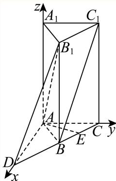
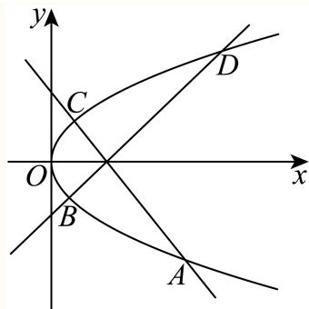

# 2025二模 静安区原卷 · 教师版

> 本地预览：题目、答案及分类尚未全部审定。校对使用的PDF为高中工作台解析版，尚未逐区确认区级印刷原卷。

## 填空题

按本区原卷题号顺序排列。

### 静安 · 第1题

已知全集为R，集合 $A = \{ x | - 2 < x \leq 1 \}$ }，则 $\overline { { A } }$ =

> 本题资料或解析有待核事项，预览不可作为已审定成品。

**考点：** 区间补集

**难度依据：** 区间补集；直接调用定义或基本公式，路径短

**核查说明：** 答案中“或”被错识为存在符号等噪声，需校净。；已人工阅读底稿题干和原解；未逐页对照PDF，不作为数学终审。

【答案】$\{ x | x \leq - 2 \exists { \stackrel { } { \chi } } x > 1 \}$ .

【解析】

根据补集的定义即可得解.

因为集合 $A = \{ x | - 2 < x \leq 1 \}$

所以 $\overline { { A } } = \{ x | x \leq - 2 \exists \hat { \chi } x > 1 \}$ .

故答案为： $\{ x | x \leq - 2 \exists { \stackrel { } { \chi } } x > 1 \}$ .

### 静安 · 第2题

不等式 $\frac { 2 x - 1 } { x + 2 } <$ 0的解集为

**考点：** 分式不等式

**难度依据：** 分式不等式；直接调用定义或基本公式，路径短

**核查说明：** 已人工阅读底稿题干和原解；未逐页对照PDF，不作为数学终审。

【解析】

由分式不等式的解法直接求解即可.

由 $\frac { 2 x - 1 } { x + 2 } <$ < 0得： $\left( 2 x - 1 \right) \left( x + 2 \right) < 0$ ，解得： $- 2 < x < { \frac { 1 } { 2 } }$ ，∴不等式的解集为 $\left( - 2 , { \frac { 1 } { 2 } } \right)$ 故答案为： $\left( - 2 , { \frac { 1 } { 2 } } \right)$

### 静安 · 第3题

椭圆 ${ \frac { x ^ { 2 } } { 4 } } + { \frac { y ^ { 2 } } { 3 } } = 1$ 的离心率是

**考点：** 椭圆离心率

**难度依据：** 椭圆离心率；直接调用定义或基本公式，路径短

**核查说明：** 已人工阅读底稿题干和原解；未逐页对照PDF，不作为数学终审。

【解析】

求出a、b、c的值，即可得出椭圆 ${ \frac { x ^ { 2 } } { 4 } } + { \frac { y ^ { 2 } } { 3 } } =$ 1的离心率.在椭圆 ${ \frac { x ^ { 2 } } { 4 } } + { \frac { y ^ { 2 } } { 3 } } = 1 ^ { \varepsilon }$ 中， $a = 2 , \ b = { \sqrt { 3 } } , \ c = { \sqrt { a ^ { 2 } - b ^ { 2 } } } = 1$ 因此，椭圆 ${ \frac { x ^ { 2 } } { 4 } } + { \frac { y ^ { 2 } } { 3 } } = 1$ 1的离心率是 $\displaystyle { \boldsymbol { \cdot } } { \boldsymbol { e } } = { \frac { c } { a } } = { \frac { 1 } { 2 } }$ 故答案为： $\frac { 1 } { 2 }$

### 静安 · 第4题

已知随机变量 X服从二项分布 $B ( n , p )$ ，若 E(X) = 30，D(X) = 20，则 P =

**考点：** 二项分布期望方差求参数

**难度依据：** 二项分布期望方差求参数；需一次代换或条件转换后计算

**核查说明：** 已人工阅读底稿题干和原解；未逐页对照PDF，不作为数学终审。

【答案】$\frac 1 3$

【解析】

随机变量 X服从二项分布 $B ( n , p )$ ，若 $E ( X ) = 3 0 , D ( X ) = 2 0$

可得 np = 30，npq = 20， $q = \frac { 2 } { 3 }$ ，则 $p = \frac 1 3$

故答案为： $\frac 1 3$

### 静安 · 第5题

已知log3 2 = a，则log2 48 = ．（请用含a的代数式表达）

**考点：** 对数换底运算

**难度依据：** 对数换底运算；需一次代换或条件转换后计算

**核查说明：** 已人工阅读底稿题干和原解；未逐页对照PDF，不作为数学终审。

【答案】$4 + { \frac { 1 } { a } }$

【解析】

根据换底公式及对数的运算性质可得结果.

由题意得， $\log _ { 2 } 4 8 = { \frac { \log _ { 3 } 4 8 } { \log _ { 3 } 2 } } = { \frac { \log _ { 3 } 1 6 + \log _ { 3 } 3 } { \log _ { 3 } 2 } } = { \frac { 4 \log _ { 3 } 2 + 1 } { \log _ { 3 } 2 } } = { \frac { 4 a + 1 } { a } } = 4 + { \frac { 1 } { a } } .$

故答案为： $4 + { \frac { 1 } { a } }$

### 静安 · 第6题

已知 $| \sin ( \frac { \pi } { 4 } - x ) = \frac { 3 } { 5 }$ ，则sin2x的值为

**考点：** 诱导和二倍角

**难度依据：** 诱导和二倍角；需一次代换或条件转换后计算

**核查说明：** 已人工阅读底稿题干和原解；未逐页对照PDF，不作为数学终审。

【解析】

$$
\sin 2 x = \cos \left(\frac {\pi}{2} - 2 x\right) = 1 - 2 \sin^ {2} \left(\frac {\pi}{4} - x\right) = 1 - 2 \times \left(\frac {3}{5}\right) ^ {2} = \frac {7}{2 5}
$$

### 静安 · 第7题

设一个罐子中有大小与质地相同的黑、白、红三个球，不放回的每次摸一个球，设第一次没有摸到黑球是事件A，第二次没有摸到黑球是事件B，则 $P \left( B | A \right)$ )的值为

**考点：** 不放回抽样条件概率

**难度依据：** 不放回抽样条件概率；需一次代换或条件转换后计算

**核查说明：** 已人工阅读底稿题干和原解；未逐页对照PDF，不作为数学终审。

【答案】$\frac { 1 } { 2 }$

【解析】

利用条件概率公式求解即可.

第一次没有摸到黑球，则还剩下一个黑球，一个不是黑球，共两个球，

所以 $P \left( B | A \right) = \frac { 1 } { 2 }$

故答案为： $\frac { 1 } { 2 }$

### 静安 · 第8题

设某港口水的深度 $y$（米）关于时间 $t$（时）的函数近似满足 $y=h+A\sin(\omega t+\varphi)$。根据某一天的测量，港口水的深度在早上3点达到最大值18米，之后持续减少，并在上午9点达到最小值14米。则该港口水的深度 $y$（米）关于时间 $t$（时）的函数的近似表达式为 ______。

> 本题资料或解析有待核事项，预览不可作为已审定成品。

**考点：** 潮汐正弦模型待定参数

**难度依据：** 潮汐正弦模型待定参数；需组合两类关系并检查区间或等号

**核查说明：** 本次仅核此字段，不代表全卷数学与视觉终审。；题干模型及答案sin的自变量括号丢失，须规范sin((π/6)t)。；已人工阅读底稿题干和原解；未逐页对照PDF，不作为数学终审。

【答案】$y=2\sin\frac{\pi t}{6}+16$

【解析】

根据函数的最值求出 $h,A$ 和周期，再求出 $\omega$，利用待定系数法求出 $\varphi$。

由题意，$\begin{cases}h+A=18\\h-A=14\end{cases}$，解得 $\begin{cases}h=16\\A=2\end{cases}$。

$\frac T2=6$，所以 $T=\frac{2\pi}{\omega}=12$，$\omega=\frac\pi6$，从而 $y=16+2\sin(\frac\pi6t+\varphi)$。

又当 $t=3$ 时，函数取得最大值18，所以 $\sin(\frac\pi2+\varphi)=1$，即 $\frac\pi2+\varphi=\frac\pi2+2k\pi\ (k\in\mathbf Z)$，故 $\varphi=2k\pi$。

因此 $y=16+2\sin(\frac\pi6t+2k\pi)=2\sin\frac{\pi t}{6}+16$。

### 静安 · 第9题

用总长为14.8m的钢条制作一个长方体容器的框架，且容器底面的长边比短边长0.5m（不计损耗）若要使该容器的容积最大，则容器的高为 m

**考点：** 长方体框架体积；三次函数导数求最值

**难度依据：** 长方体框架体积；三次函数导数求最值；需组合两类关系并检查区间或等号

**核查说明：** 已人工阅读底稿题干和原解；未逐页对照PDF，不作为数学终审。

【答案】1.2.

【解析】

设底面短边长为 m，求出容器的容积的表达式，再利用导数求出最大值即可

设底面短边长为xm，

则长边长为 $( x + 0 . 5 ) \mathrm { m } .$ ，高为 ${ \frac { 1 4 . 8 - 4 x - 4 ( x + 0 . 5 ) } { 4 } } = ( 3 . 2 - 2 x ) \mathrm { m } ,$

则 $\displaystyle { \int _ { 3 . 2 - 2 x > 0 } ^ { x > 0 } }$ 解得 $0 < x < 1 . 6$

则容器的容积 $^ { 1 } V \left( x \right) = x \left( x + 0 . 5 \right) \left( 3 . 2 - 2 x \right) = - 2 x ^ { 3 } + 2 . 2 x ^ { 2 } + 1 . 6 x , 0 < x < 1 . 6 ,$

则 $\begin{array} { r } { V ^ { \prime } \left( x \right) = - 6 x ^ { 2 } + 4 . 4 x + 1 . 6 = - \left( 6 x + 1 . 6 \right) \left( x - 1 \right) } \end{array}$

令 $V ^ { \prime } \left( x \right) > 0 ,$ ，得 $0 < x < 1$ ，令 $V ^ { \prime } \left( x \right) < 0 ,$ ，得 $1 < x < 1 . 6$

所以函数V(x)在(0,1)上单调递增，在(1,1.6)上单调递减，

所以当x = 1时，V(x)取得最大值，

所以要使该容器的容积最大，则容器的高为 $3 . 2 - 2 = 1 . 2 \mathrm { m }$

故答案为：1.2.

### 静安 · 第10题

已知 $a > b , a b = 1$ ，则 $\frac { a ^ { 2 } + b ^ { 2 } } { a - b }$ 的最小值是

**考点：** 换元与基本不等式

**难度依据：** 换元与基本不等式；需一次代换或条件转换后计算

**核查说明：** 已人工阅读底稿题干和原解；未逐页对照PDF，不作为数学终审。

【解析】

∵ ab = 1，a > b，

$$
\therefore \frac {a ^ {2} + b ^ {2}}{a - b} = \frac {(a - b) ^ {2} + 2 a b}{a - b} = a - b + \frac {2}{a - b} \geqslant 2 \sqrt {(a - b) \cdot \frac {2}{a - b}} = 2 \sqrt {2},
$$

当且仅当 $a - b = { \frac { 2 } { a - b } }$

即 $a - b = { \sqrt { 2 } }$ 时取等号，

故 $\frac { a ^ { 2 } + b ^ { 2 } } { a - b }$ 的最小值是 $2 { \sqrt { 2 } } .$

### 静安 · 第11题

从m个男生和n个女生 $( 1 0 \geq m > n \geq 4 )$ 中任选2个人当队长，假设事件A表示选出的2人性别相同，事件B表示选出的2人性别不同．如果事件A的概率和事件B的概率相等，那么m−n的可能值为

**考点：** 同异性别等概率；组合计数与整数限制

**难度依据：** 同异性别等概率；组合计数与整数限制；需组合两类关系并检查区间或等号

**核查说明：** 已人工阅读底稿题干和原解；未逐页对照PDF，不作为数学终审。

【答案】4.

【解析】

根 据 $P ( A ) = P ( B )$ ， 可 得 $( m - n ) ^ { 2 } = m + n$ ， 易 得 $9 \leq m + n \leq 1 9$ ， 从 而 可 得 出$3 \leq m - n \leq 4$ ，再分m−n = 3和m−n = 4两种情况讨论即可.

因为 $P ( A ) = P ( B )$ ，所以 ${ \frac { \mathrm { { C } } _ { m } ^ { 2 } + \mathrm { { C } } _ { n } ^ { 2 } } { \mathrm { { C } } _ { m + n } ^ { 2 } } } = { \frac { \mathrm { { C } } _ { m } ^ { 1 } \mathrm { { C } } _ { n } ^ { 1 } } { \mathrm { { C } } _ { m + n } ^ { 2 } } }$

即 $\mathrm { C } _ { m } ^ { 2 } + \mathrm { C } _ { n } ^ { 2 } = \mathrm { C } _ { m } ^ { 1 } \mathrm { C } _ { n } ^ { 1 }$ ，整理得 $( m - n ) ^ { 2 } = m + n$

因为 $1 0 \geq m > n \geq 4$ ，所以 $) \leq m + n \leq 1 9$ ，即 $9 \leq ( m - n ) ^ { 2 } \leq 1 9$

所以 $\ : \leq m - n \leq \sqrt { 1 9 } \ :$ ，又因为m,n都是正整数，

所以 $3 \leq m - n \leq 4 ,$

当m−n = 3时，此时 $m + n = 9$

所以 $\left\{ { \begin{array} { l } { m = 6 } \\ { n = 3 } \end{array} } \right.$ （舍去），

当 $m - n = 4$ 时，此时m + n = 16，

所以 $\begin{array} { l } { { \int } m = 1 0 } \\ { { \it \Omega } } \\ { { \it \Omega } } \end{array} ,$ ，

综上所述， $\begin{array} { l } { m = 1 0 } \\ { n = 6 } \end{array} ,$

所以 $m - n = 4 .$

故答案为：4.

### 静安 · 第12题

在边长为1的正三角形ABC的边AB、AC上分别取D、E两点，若沿线段DE折叠该三角形时，顶点A恰好落在边BC上．则线段AD的长度的最小值为

**考点：** 平面折叠与正弦定理最值

**难度依据：** 平面折叠与正弦定理最值；需多步建模、分类或参数约束

**核查说明：** 已人工阅读底稿题干和原解；未逐页对照PDF，不作为数学终审。

【答案】$2 { \sqrt { 3 } } - 3$

【解析】

设 $\angle B A P = \theta , A D = x$ ，求出 $\angle B D P$ 、DP、BD关于所设参数的表达式，在 $\triangle B D P$ 中应用正

弦定理求DP，再根据θ的取值范围求最值

由题意可得A,P两点关于折线DE对称，连结 $\mathit { D P } _ { : }$

设 $\angle B A P = \angle A P D = \theta , A D = x$

则 $\angle B D P = 2 \theta , D P = x , B D = 1 - x .$

在 $\triangle A B C ^ { \prime }$ 中， $\angle A P B = \pi - \angle A B P - \angle B A P = \frac { 2 \pi } { 3 } - \theta .$

在 $\triangle B D P ^ { \mathrm { \scriptsize { t } } }$ 中， $\angle B P D = \angle A P B - \angle A P D = { \frac { 2 \pi } { 3 } } - 2 \theta ,$

由正弦定理知： $\frac { B D } { \sin \angle B P D } = \frac { D P } { \sin \angle D B P } ,$ ，即 ${ \frac { 1 - x } { \sin \left( { \frac { 2 \pi } { 3 } } - 2 \theta \right) } } = { \frac { x } { \sin { \frac { \pi } { 3 } } } } ,$

所以 $x = { \frac { \sqrt { 3 } } { 2 \sin \left( { \frac { 2 \pi } { 3 } } - 2 \theta \right) + { \sqrt { 3 } } } } ,$

因为 $0 \leq \theta \leq \frac { \pi } { 3 }$ ，即 $) \leq { \frac { 2 \pi } { 3 } } - 2 \theta \leq { \frac { 2 \pi } { 3 } }$

当 $\frac { 2 \pi } { 3 } - 2 \theta = \frac { \pi } { 2 }$ ，即 $\displaystyle { | \theta = \frac { \pi } { 1 2 } }$ 时， $\sin \left( { \frac { 2 \pi } { 3 } } - 2 \theta \right) = 1$

此时x取得最小值 $\frac { \sqrt { 3 } } { 2 + \sqrt { 3 } } = 2 \sqrt { 3 } - 3$ ，且 $\angle A D E = { \frac { 5 \pi } { 1 2 } }$

所以AD的最小值为 $\phantom { - } 2 \sqrt { 3 } - 3$

故答案为： $2 { \sqrt { 3 } } - 3$

## 二、选择题

## 选择题

按本区原卷题号顺序排列。

### 静安 · 第13题

$^ { * } m < 2 ^ { * }$ 是“一元二次不等 $\ ` x ^ { 2 } + m x + 1 >$ 0的解集为R”的

A. 充分不必要条件

B. 必要不充分条件

C. 充要条件

D. 既不充分也不必要条件

**考点：** 必要非充分条件；二次不等式恒成立

**难度依据：** 必要非充分条件；二次不等式恒成立；需一次代换或条件转换后计算

**核查说明：** 已人工阅读底稿题干和原解；未逐页对照PDF，不作为数学终审。

【答案】B

【解析】

由题根据一元二次不等式 $\dot { x } ^ { 2 } + m x + 1 >$ 0的解集为R，

可得 $\Delta = m ^ { 2 } - 4 < 0 , - 2 < m < 2$

所以 $^ { * } m < 2 ^ { * }$ 是“一元二次不等 $\ ` x ^ { 2 } + m x + 1 >$ 0的解集为R”的必要不充分条件.故选：B.

### 静安 · 第14题

若复数 $z = { \frac { a \mathrm { i } } { b + \mathrm { i } } } ( \mathrm { a } _ { \cdot } b \in \mathbb { R }$ ，i是虚数单位）在复平面上对应的点位于第二象限，则（ ）

A. a > 0且b > 0

B. a > 0且b < 0

C. $a < 0 \mathrm { E } . b > 0$

D. $a < 0 . \mathrm { { H } } b < 0$

> 本题资料或解析有待核事项，预览不可作为已审定成品。

**考点：** 复数除法与象限条件

**难度依据：** 复数除法与象限条件；需一次代换或条件转换后计算

**核查说明：** 原解最终条件误识为a=0，与第二象限不符；应回PDF确认a<0、b<0。；已人工阅读底稿题干和原解；未逐页对照PDF，不作为数学终审。

【答案】D

【解析】

先根据复数的除法化简，再根据复数的几何意义即可得解.

$$
z = \frac {a \mathrm{i}}{b + \mathrm{i}} = \frac {a \mathrm{i} (b - \mathrm{i})}{(b + \mathrm{i}) (b - \mathrm{i})} = \frac {a}{b ^ {2} + 1} + \frac {a b}{b ^ {2} + 1} \mathrm{i},
$$

因为复数 $z = { \frac { a \mathrm { i } } { b + \mathrm { i } } } ( \mathrm { a } _ { \cdot } b \in \mathrm { R }$ ，i是虚数单位）在复平面上对应的点位于第二象限，

所以 $\left\{ \begin{array} { l } { { a } } \\ { { b ^ { 2 } + 1 } } \\ { { \phantom { a b } a b } } \\ { { b ^ { 2 } + 1 } } \end{array} \right. 0$ 解得 $\begin{array} { r } { \left\{ { a = 0 } \atop { b < 0 } \right. } \end{array}$

故选：D.

### 静安 · 第15题

设f(x)是一个三次函数，f′(x)为其导函数.图中所示的是 ${ \boldsymbol { \cdot } } { \boldsymbol { y } } = { \boldsymbol { x } } { \boldsymbol { f } } ^ { \prime } \left( { \boldsymbol { x } } \right)$ )的图像的一部分.则f (x)的极大值与极小值分别是（ ）.

A. f (1)与f (−1)

B. f (−1)与f (1)

C. f (−2)与f (2)

D. f (2)与f (−2)

**考点：** 导函数乘x图像与极值

**难度依据：** 导函数乘x图像与极值；需组合两类关系并检查区间或等号

**核查说明：** 已人工阅读底稿题干和原解；未逐页对照PDF，不作为数学终审。

【答案】C

【解析】

易知， $y = x f ^ { \prime } \left( x \right)$ 有三个零点 $x = 0 , \pm 2$

因为f′ (x)为二次函数，所以，它有两个零点 $x = \pm 2$

由图像易知，当 $0 < x <$ 2时， $f ^ { \prime } \left( x \right) < 0$ ；

当x > 2时， $f ^ { \prime } \left( x \right) > 0$ ，故f(2)是极小值

类似地可知，f(−2)是极大值.

故答案为C

### 静安 · 第16题

设函数y = f (x)的定义域为R，若f (0) = 2025，且对任意 $x \in \mathrm { R }$ ，满足 $f \left( x + 1 \right) - f \left( x \right) \leq 2 ^ { x }$ $f \left( x + 2 \right) - f \left( x \right) \geq 3 \times 2 ^ { x }$ ，则f(2025)的值为（ ）

A. $2 ^ { 2 0 2 5 } + 2 0 2 4$

B. $2 ^ { 2 0 2 4 } + 2 0 2 5$

C. $2 ^ { 2 0 2 5 } + 2 0 2 5$

D. 以上答案均不对

**考点：** 函数差分不等式夹逼；累加与等比求和

**难度依据：** 函数差分不等式夹逼；累加与等比求和；需多步建模、分类或参数约束

**核查说明：** 已人工阅读底稿题干和原解；未逐页对照PDF，不作为数学终审。

【答案】A

【解析】

由题意可得 $f ( x + 1 ) - f ( x ) = - [ f ( x + 2 ) - f ( x + 1 ) ] + f ( x + 2 ) - f ( x ) \geq - 2 ^ { x + 1 } + 3 \times 2 ^ { x } = 2 ^ { x }$ ，从而可得出 $f ( x + 1 ) - f ( x ) = 2 ^ { x }$ ，再利用累加法即可得解

由 $f \left( x + 1 \right) - f \left( x \right) \leq 2 ^ { x } ,$ ，可得 $f \left( x + 2 \right) - f \left( x + 1 \right) \leq 2 ^ { x + 1 }$

因为 $\mid f \left( x + 2 \right) - f \left( x \right) \geq 3 \times 2 ^ { x } ,$

所以 $\left[ f ( x + 1 ) - f ( x ) = - [ f ( x + 2 ) - f ( x + 1 ) ] + f ( x + 2 ) - f ( x ) \geq - 2 ^ { x + 1 } + 3 \times 2 ^ { x } = 2 ^ { x } , f ( x + 1 ) \right] \in S o S .$

又因为 $f \left( x + 1 \right) - f \left( x \right) \leq 2 ^ { x } .$

所以 $f ( x + 1 ) - f ( x ) = 2 ^ { x } { \mathrm { , } }$

则f(2025) − f(0) = [f (2025) − f (2024)] + [f (2024) − f (2023)] + ⋯ + [f (1) − f (0)]

22024 + 22023 + ⋅ ⋅ ⋅ + 2 + 1 = 1 − 22025 = 22025 − 1， 1 − 2

所以 $f ( 2 0 2 5 ) = 2 ^ { 2 0 2 5 } + 2 0 2 4 .$

故选：A.

## 三、解答题

## 解答题

按本区原卷题号顺序排列。

### 静安 · 第17题

已知向 $\begin{array} { l } { \displaystyle { \frac { \overrightarrow { \sf E q . } } { \overrightarrow { \sf E q . } } } = \left( \cos \left( x + \frac { \pi } { 6 } \right) , \sin \left( x + \frac { \pi } { 6 } \right) \right) , \overrightarrow { \sf b } } = \left( \cos \left( x + \frac { \pi } { 6 } \right) , - \sin \left( x + \frac { \pi } { 6 } \right) \right)  \end{array}$ ，记 $f ( x ) = \stackrel {  } { a } \cdot \stackrel {  } { b }$
(1) (6分)求函数 $y = f \left( x \right)$ 的最小正周期；
(2) (8分)若函数 $\left[ { { y } } = { { f } \left( { x + \theta } \right) } \right.$ （其中常数 $\theta \in \left( 0 , \frac { \pi } { 2 } \right) )$ ）为奇函数，求θ的值

> 本题资料或解析有待核事项，预览不可作为已审定成品。

**考点：** （1）向量数量积与二倍角周期；（2）平移后奇函数相位

**难度依据：** 数量积化二倍角；周期与平移奇偶；需组合两类关系并检查区间或等号

**核查说明：** 向量名称被分式和sf Eq覆盖，虽然坐标可辨，题干需回源。；已人工阅读底稿题干和原解；未逐页对照PDF，不作为数学终审。

【解析】

(1) $f \left( x \right) = \overrightarrow { a } \cdot \overrightarrow { b } = \cos ^ { 2 } \left( x + \frac { \pi } { 6 } \right) - \sin ^ { 2 } \left( x + \frac { \pi } { 6 } \right) = \cos \left( 2 x + \frac { \pi } { 3 } \right)$

所以函数 $y = f \left( x \right)$ 的最小正周期 $T = { \frac { 2 \pi } { 2 } } = \pi ;$ ；

(2) $y = f \left( x + \theta \right) = \cos \left( 2 x + 2 \theta + { \frac { \pi } { 3 } } \right)$ ，

因为函数 $\boldsymbol { \cdot } \boldsymbol { y } = \boldsymbol { f } \left( \boldsymbol { x } + \boldsymbol { \theta } \right)$ 为奇函数，

所以 $2 \theta + \frac { \pi } { 3 } = \frac { \pi } { 2 } + k \pi$ ，解得 $\theta = { \frac { \pi } { 1 2 } } + { \frac { 1 } { 2 } } k \pi , k \in \mathbf { Z } .$

又因为 $\theta \in \left( 0 , \frac { \pi } { 2 } \right)$ ，所以 $\wp = { \frac { \pi } { 1 2 } }$

### 静安 · 第18题

某校高三学生体检后，为了解高三学生的视力情况，该校从高三六个班的300名学生中以班为单位（每班学生50人），每班按随机抽样方法抽取了8名学生的视力数据.其中高三（1）班抽取的8名学生的视力数据与人数见下表：

| 视力 | 4.0 | 4.1 | 4.2 | 4.3 | 4.4 | 4.5 | 4.6 | 4.7 | 4.8 | 4.9 | 5.0 | 5.1 | 5.2 | 5.3 |
|---|---|---|---|---|---|---|---|---|---|---|---|---|---|---|
| 人数 |  |  |  |  | 2 |  | 2 |  | 2 | 1 |  | 1 |  |  |

（1）用上述样本数据估计高三（1）班学生视力的平均值；
（2）已知其余五个班学生视力的平均值分别为4.3、4.4、4.5、4.6、4.8.若从这六个班中任意抽取两个班学生视力的平均值作比较，求抽取的两个班学生视力的平均值之差的绝对值不小于0.2的概率.

> 本题资料或解析有待核事项，预览不可作为已审定成品。

**考点：** （1）样本加权平均估计总体；（2）枚举两班平均视力之差

**难度依据：** 样本平均与古典概型；需组合两类关系并检查区间或等号

**核查说明：** 视力人数表完全缺失；题干高三班级与原解“文科班”表述不同，需核原PDF。；已人工阅读底稿题干和原解；未逐页对照PDF，不作为数学终审。

【解析】

$$
\overline {{x}} = \frac {S}{n}
$$

试题分析：（1）平均数与一组数据里的每个数据都有关系， ；（2）古典概型的概率问题，关键是正确找出基本事件总数和所求事件包含的基本事件数，然后利用古典概型的概率计算公式计算；（3)当基本事件总数较少时，用列举法把所有的基本事件一一列举出来，要做到不重不漏，有时可借助列表，树状图列举，当基本事件总数较多时，注意去分排列与组合；（4）注意判断是古典概型还是几何概型，基本事件前者是有限的，后者是无限的，两者都是等可能性

试题解析：（1）高三文科（1）班抽取的8名学生视力的平均值为

$$
\frac {4 . 4 \times 2 + 4 . 6 \times 2 + 4 . 8 \times 2 + 4 . 9 + 5 . 1}{8} = 4. 7.
$$

据此估计高三文科（1）班学生视力的平均值约为4.7．3分

（2）因为高三文科六个班学生视力的平均值分别为4.3、4.4、4.5、4.6、4.7、4.8，所以任意抽取两个文科班学生视力的平均值数对有(4.3 4.4)，(4.3 4.5)，(4.3 4.6)，(4.3 4.7)，(4.3 4.8)，(4.4 4.5)，(4.4 4.6)，(4.4 4.7)，(4.4 4.8)，(4.5 4.6)，(4.5 4.7)，(4.5 4.8)，(4.6 4.7)，(4.6 4.8)，(4.7 4.8)，共15种情形． 7分其中抽取的两个班学生视力的平均值之差的绝对值不小于0.2的有(4.3 4.5)，(4.3 4.6)(4.3 4.7)， (4.3 4.8)，(4.4 4.6)，(4.4 4.7)，(4.4 4.8)，(4.5 4.7)，(4.5 4.8)，(4.6 4.8)，共10种． 10分

所以抽取的两个班学生视力的平均值之差的绝对值不小于0.2的概率为 $\frac { 1 0 } { 1 5 } = \frac { 2 } { 3 }$ ． 12分考点：1、数据的平均数；2、利用古典概型求随机事件概率

### 静安 · 第19题

如图，在正三棱柱 $A B C - A _ { 1 } B _ { 1 } C _ { 1 }$ 中， $A A _ { 1 } = 2 A C = 4$ ，延长CB至D，使 $C B = B D$ ，E是线段BC的中点

(1) (8分)求证：
①直线 $C _ { 1 } B / /$ 平面 $A B _ { 1 } D$ ；
② $A E \bot D B _ { 1 }$
(2) (6分)求二面角 $B _ { 1 } - A D -$ C的正弦值

**考点：** （1）①线面平行；②线线垂直；（2）空间法向量求二面角正弦

**难度依据：** 棱柱平行垂直与二面角；空间法向量求二面角；需多步建模、分类或参数约束

**核查说明：** 已人工阅读底稿题干和原解；未逐页对照PDF，不作为数学终审。

【解析】

(1) ①在正三棱柱 $A B C - A _ { 1 } B _ { 1 } C _ { 1 }$ 中， $B C = B _ { 1 } C _ { 1 } , B C / / B _ { 1 } C _ { 1 }$

因为 $\begin{array} { r } { { \cal C } { \cal B } = B D } \end{array}$ ，所以 $B D = B _ { 1 } C _ { 1 } , B D / / B _ { 1 } C _ { 1 }$

所以四边形 $B D B _ { 1 } C _ { 1 }$ 为平行四边形，所以 ${ C _ { 1 } B / } / { B _ { 1 } D }$

又 $C _ { 1 } B \subset \supset \overrightarrow { \mathrm { I f } } \overrightarrow { \mathrm { I f } } A B _ { 1 } D , B _ { 1 } D \subset \overrightarrow { \mathrm { I f } } A B _ { 1 } D ,$

所以 $C _ { 1 } B / / .$ 平面 $A B _ { 1 } D _ { 1 } ^ { \prime }$ ；

②因为 $A B = A C$ ，E是线段BC的中点，所以 $A E \bot B C$

因为 $B B _ { 1 } \bot$ 平面ABC， $A E \subset$ 平面 $A B C$

所以 $B B _ { 1 } \bot A E _ { \cdot }$

又 $B B _ { 1 } \cap B C = B , B B _ { 1 } , B C \subset$ 平面 $B C C _ { 1 } B _ { 1 }$ ，所以 $A E \bot$ 平面 $B C C _ { 1 } B _ { 1 }$

又 $D B _ { 1 } \subset$ 平面 $B C C _ { 1 } B _ { 1 }$

所以 $A E \bot D B _ { 1 }$ ；

(2) 在 $\triangle A C D \#$ ，由 $\mp C B = B D = B A$ ，所以 $\angle C A D = 9 0 ^ { \circ }$

则 $A D = 2 { \sqrt { 3 } } .$

如图，以点A为原点建立空间直角坐标系，

则 $A ( 0 , 0 , 0 ) , D \left( 2 { \sqrt { 3 } } , 0 , 0 \right) , B _ { 1 } \left( { \sqrt { 3 } } , 1 , 4 \right)$

故 $\overrightarrow { A B _ { 1 } } = \left( \sqrt { 3 } , 1 , 4 \right) , \overrightarrow { A D } = \left( 2 \sqrt { 3 } , 0 , 0 \right)$ ,，

设平面 $B _ { 1 } A D$ 的法向量为 $\vec { \vert m } = ( x , y , z )$ ，

则有 $\left\{ \begin{array} { l l } { { \overrightarrow { m } } \cdot { \overrightarrow { A D } } = { \sqrt { 3 } } x = 0 } \\ { { \overrightarrow { m } } \cdot { \overrightarrow { A B _ { 1 } } } = { \sqrt { 3 } } x + y + 4 z = 0 } \end{array} \right.$ 令 $y = - 4$ 则 $z = 1 , x = 0$

所 $\downarrow \downarrow \vec { m } = ( 0 , - 4 , 1 )$

因为z轴垂直平面 $A C D$

则可取平面ACD的法向量为 $\vec { \vert n \rangle } = ( 0 , 0 , 1 )$ ，

则cos ⟨m, n m ⋅ n→m →n 1√ √17

所以二面角 $B _ { 1 } - A D -$ C的正弦值为 ${ \sqrt { 1 - \left( { \frac { \sqrt { 1 7 } } { 1 7 } } \right) ^ { 2 } } } = { \frac { 4 { \sqrt { 1 7 } } } { 1 7 } }$

### 静安 · 第20题

如图，在直角坐标平面 $\mathrm { \bf x O y }$ 中， $\triangle A _ { i } B _ { i } A _ { i + 1 }$ 中 $( i = 1 , 2 , \cdot \cdot \cdot , n , \cdot \cdot \cdot )$ 为正三角形，且满足$\overrightarrow { O A _ { 1 } } = \left( - \frac { 1 } { 4 } , 0 \right) , \overrightarrow { A _ { i } A _ { i + 1 } } = ( 2 i - 1 , 0 )$

(1) (4分)求点 $A _ { n }$ 的横坐标 $X _ { n }$ 关于正整数n的表达式；
(2) (6分)求证：点 $B _ { 1 } , \ B _ { 2 } , . . . , \ B _ { n } . .$ 在抛物线Γ： $y ^ { 2 } = 3 x .$ 上；
(3) (8分)过（2）中抛物线Γ： $y ^ { 2 } = 3 x$ 的焦点F作两条互相垂直的弦AC和BD，求四边形ABCD面积的最小值

> 本题资料或解析有待核事项，预览不可作为已审定成品。

**考点：** （1）等差求和得顶点横坐标；（2）正三角形顶点代入抛物线；（3）垂直焦点弦与四边形面积最小值

**难度依据：** 奇数项累加及点坐标；抛物线焦点垂直弦面积；需多步建模、分类或参数约束

**核查说明：** 第（1）问和式尾部多出log(2n−1)；第（2）问误把n写成x；第（3）问韦达乘积错标为和，需回源校净。；已人工阅读底稿题干和原解；未逐页对照PDF，不作为数学终审。

【解析】

(1) − $\overrightarrow { \mathrm { E H } O A _ { n } } = \overrightarrow { O A _ { 1 } } + \overrightarrow { A _ { 1 } A _ { 2 } } + \cdot \cdot \cdot + \overrightarrow { A _ { n - 1 } A _ { n } } ,$

可得 $X _ { n } = - { \frac { 1 } { 4 } } + \sum _ { i = 1 } ^ { n - 1 } \left( 2 i - 1 \right) = - { \frac { 1 } { 4 } } + { \frac { \left( 1 + 2 n - 3 \right) \left( n - 1 \right) } { 2 } } = - { \frac { 1 } { 4 } } + ( n - 1 ) ^ { 2 } \log ( 2 n - 1 )$

(2) 设点 $B _ { n }$ 的坐标为(x,y)，

则 $\left\{ \begin{array} { l l } { \displaystyle x = X _ { n } + \frac { 2 n - 1 } { 2 } = - \frac { 1 } { 4 } + \left( n - 1 \right) ^ { 2 } + \frac { 2 n - 1 } { 2 } } \\ { \displaystyle | y | = \frac { \sqrt { 3 } } { 2 } ( 2 n - 1 ) } \end{array} \right.$ 即 $\left\{ \begin{array} { l l } { \displaystyle x = \left( n - \frac 1 2 \right) ^ { 2 } } \\ { \displaystyle | y | = \sqrt { 3 } \left( n - \frac 1 2 \right) ^ { , } } \end{array} \right.$

所以 $\cdot y ^ { 2 } = 3 { \Bigg ( } x - { \frac { 1 } { 2 } } { \Bigg ) } ^ { 2 } = 3 x$

所以点 $B _ { 1 } , ~ B _ { 2 } , ~ \cdot \cdot \cdot , ~ B _ { n } \cdot \cdot$ ⋅在抛物线Γ： $y ^ { 2 } = 3 x .$ 上；

(3) 抛物线Γ： $y ^ { 2 } = 3 x$ 的焦点为 $F \left( { \frac { 3 } { 4 } } , 0 \right)$

互相垂直的弦AC和BD显然都不垂直坐标轴，

设直线AC的方程为 $\qquad x = m y + { \frac { 3 } { 4 } } , m \neq 0$ ，

代入Γ： $: y ^ { 2 } = 3 x$ ，得 $y ^ { 2 } - 3 m y - { \frac { 9 } { 4 } } = 0$

则有 $y _ { A } + y _ { C } = 3 m , y _ { A } + y _ { C } = - { \frac { 9 } { 4 } }$ ，

所以 $| A C | = \sqrt { 1 + m ^ { 2 } } | y _ { A } - y _ { C } | = 3 ( 1 + m ^ { 2 } )$

将上式中的m用 $- \frac { 1 } { m }$ 代换，得 $| B D | = 3 \left( 1 + { \frac { 1 } { m ^ { 2 } } } \right)$

$$
S _ {A B C D} = \frac {1}{2} | A C | \cdot | B D | = \frac {9}{2} (1 + m ^ {2}) \left(1 + \frac {1}{m ^ {2}}\right) = \frac {9}{2} \left(2 + m ^ {2} + \frac {1}{m ^ {2}}\right) \geq 1 8.
$$

当且仅当 $m ^ { 2 } = { \frac { 1 } { m ^ { 2 } } }$ ，即 $\mid m = \pm 1$ 时，取等号，

所以四边形 $A B C D$ 面积的最小值为18

### 静安 · 第21题

若存在实数常数 $k$，$m$，对任意 $x\in D$，不等式 $f(x)\geq kx+m\geq g(x)$ 恒成立，则称直线 $y=kx+m$ 是函数 $y=f(x)$ 和函数 $y=g(x)$ 在 $D$ 上的分界线。
(1) (4分) 请写出函数 $y=\frac12x^2$ 和函数 $y=\ln x$ 在 $(0,+\infty)$ 上的一条斜率为1的分界线；（不必证明）
(2) (6分) 求证：函数 $y=x+\frac1x$ 和函数 $y=2-\frac1x$ 在 $(0,+\infty)$ 上过坐标原点的分界线有且只有一条；
(3) (8分) 试探究函数 $y=\mathrm e^x(x+1)$（$\mathrm e$ 为自然对数的底数）和函数 $y=-x^2+2x+1$ 在 $\mathbb R$ 上是否存在分界线。若存在，求出分界线方程；若不存在，请说明理由。

> 本题资料或解析有待核事项，预览不可作为已审定成品。

**考点：** （1）给定斜率分界线截距范围；（2）过原点分界线唯一性；（3）代特殊点与导数证明分界线存在

**难度依据：** 上下函数分界线；切线支撑与恒成立；需证明新定义命题或完成复杂参数分类

**核查说明：** 题干已回源；原解析未全面数学审校，公式及其他问题仍需处理。；题干多处函数和区间连接处严重乱码，需PDF核符号。；已人工阅读底稿题干和原解；未逐页对照PDF，不作为数学终审。

【解析】

(1) 由题意直线 $y = x + b$ 是函数 $y = { \frac { 1 } { 2 } } x$ 2和函数 $\mathbf { \chi } ^ { } \cdot \mathbf { \mathcal { Y } } = \ln x ^ { } \overleftarrow { \mathbb { \pm } } ( 0 , + \infty )$ 上的一条分界线，

则 ${ \frac { 1 } { 2 } } x ^ { 2 } \geq x + b \geq \ln x$ 在 $( 0 , + \infty )$ 上恒成立，

即 ${ \frac { 1 } { 2 } } x ^ { 2 } - x \geq b \geq \ln x - x { \mathrm { / } } \pmb { \mathscr { E } } ( 0 , + \infty )$ 上恒成立，

因为 ${ \frac { 1 } { 2 } } x ^ { 2 } - x = { \frac { 1 } { 2 } } ( x - 1 ) ^ { 2 } - { \frac { 1 } { 2 } } \geq - { \frac { 1 } { 2 } }$ ，所 $\textcircled { \times } \lambda b \leq - \frac { 1 } { 2 }$

令h $( x ) = \ln x - x$ ，则 $h ^ { \prime } \left( x \right) = \frac { 1 } { x } - 1 = \frac { 1 - x } { x }$

令 $h ^ { \prime } \left( x \right) > 0 ,$ ，则0 $< x < 1$ ，令 $h ^ { \prime } \left( x \right) < 0$ ，则 $x > 1$

所以函数h(x)在(0,1)上单调递增，在(1,+∞)上单调递减，

所以 $h ( x ) _ { \mathrm { m a x } } = h \left( 1 \right) = - 1$ ，所以b ≥ −1，

综上所述， $b \in \left[ - 1 , - \frac { 1 } { 2 } \right]$

所以满足题意的直线可以是 $y = x - 1$ ；（答案不唯一，满足 $y = x + b , b \in \left[ - 1 , - \frac { 1 } { 2 } \right]$ 的均可）

(2) 由题意，设y = kx是函数 $y = x + { \frac { 1 } { x } }$ 和函数 $\left[ y = 2 - { \frac { 1 } { x } } \right.$ 在 $( 0 , + \infty )$ 上过坐标原点的分界线，则 $x + \frac { 1 } { x } \geq k x \geq 2 - \frac { 1 } { x } \overleftarrow { \mathbb { E } } ( 0 , + \infty )$ 上恒成立，即1 $+ \frac { 1 } { x ^ { 2 } } \geq k \geq \frac { 2 } { x } - \frac { 1 } { x ^ { 2 } }$ 在 $( 0 , + \infty )$ 上恒成立，因为 $1 + { \frac { 1 } { x ^ { 2 } } } > 1$ ，所以 $k \leq 1$ •

因为 ${ \frac { 2 } { x } } - { \frac { 1 } { x ^ { 2 } } } = - \biggl ( { \frac { 1 } { x } } - 1 \biggr ) ^ { 2 } + 1 \leq 1$ ，所以k ≥ 1，

综上所述k = 1，

所以函数 $y = x + { \frac { 1 } { x } }$ 和函数 $\overset { \cdot } { y } = 2 - \frac { 1 } { x } \overset { \cdot } { \underset { x } { \mathbb { E } } } ( 0 , + \infty )$ 上过坐标原点的分界线有且只有一条；

(3) 若存在，则 $\mathrm { e } ^ { x } ( x + 1 ) \geq k x + m \geq - x ^ { 2 } + 2 x + 1$ 恒成立，

$\stackrel { \wedge } { \prec } x = 0$ ，则1 $\ge m \ge 1$ ，所以m = 1，

因此， $k x + m \geq - x ^ { 2 } + 2 x + 1$ 恒成立，即 $x ^ { 2 } + ( k - 2 ) x \geq$ 0恒成立，

由 $\Delta \le$ 0得，k = 2，

现在只要判断 $\mathrm { e } ^ { x } ( x + 1 ) \geq 2 x + 1$ 是否恒成立，

设 $\begin{array} { r } { \varphi ( x ) = \mathrm { e } ^ { x } ( x + 1 ) - ( 2 x + 1 ) } \end{array}$ ，则 $\varphi ^ { \prime } ( x ) = \operatorname { e } ^ { x } ( x + 2 ) - 2$

当 $\mid x >$ 0时， $\mathrm { e } ^ { x } > 1 , x + 2 > 2 , \varphi ^ { \prime } ( x ) > 0$ ，

当 $x <$ 0 0时， $\mathrm { e } ^ { x } ( x + 2 ) < 2 \mathrm { e } ^ { x } < 2 , \varphi ^ { \prime } ( x ) < 0 ,$

所以 $\varphi ( x ) \geq \varphi ( 0 ) = 0 .$ ，即 $\mathrm { e } ^ { x } ( x + 1 ) \geq 2 x + 1$ 恒成立

所以函数 $y = \mathrm { e } ^ { x } ( x + 1 )$ 和函数 $y = - x ^ { 2 } + 2 x + 1$ 在R上存在分界线，

其方程为 $y = 2 x + 1$

