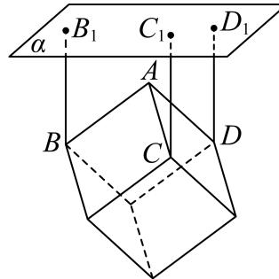
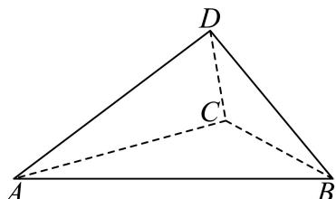

# 2025二模 黄浦区原卷 · 学生版

> 本地预览：题目、答案及分类尚未全部审定。校对使用的PDF为高中工作台解析版，尚未逐区确认区级印刷原卷。

## 填空题

按本区原卷题号顺序排列。

### 黄浦 · 第1题

不等式 $\frac { x } { x - 2 } <$ 0的解集是 .

### 黄浦 · 第2题

设 $[ a \in \mathbf { R } ]$ ，集合 $A = [ 1 , 3 ]$ $B = [ a , 4 ]$ ，若 $A \cap B = [ 2 , 3 ]$ ，则a =

### 黄浦 · 第3题

抛物线 $\operatorname { i } y ^ { 2 } = x $ 的焦点到其顶点的距离为

### 黄浦 · 第4题

在 $\triangle \mathrm { A B C } |$ 中，若 $A = 4 5 ^ { \circ }$ $B = 3 0 ^ { \circ }$ $a = 2 { \sqrt { 6 } }$ ，则 $| b =$

### 黄浦 · 第5题

i为虚数单位，若复数z满足 $z - \overline { { z } } = 2 \mathrm { i }$ 且 $\begin{array} { r } { \overline { { z } } = \mathrm { i } z , } \end{array}$ ，则Rez =

### 黄浦 · 第6题

函数 $\operatorname { f ( x ) } = { \sqrt { 3 } } \sin x + \sin \left( { \frac { \pi } { 2 } } + x \right)$ 的最大值是

### 黄浦 · 第7题

已知等比数列 $\left\{ a _ { n } \right\}$ 为严格增数列，其前n项和为 $S _ { n }$ ,若 $a _ { 1 } a _ { 1 0 } = a _ { 8 } , S _ { 4 } - S _ { 1 } = { \frac { 2 1 } { 4 } }$ ，则该数列的公比为

### 黄浦 · 第8题

已知a为常数，圆 $( x - a ) ^ { 2 } + ( y + a - 2 ) ^ { 2 } = r ^ { 2 } ( r > 0 )$ 与圆 $x ^ { 2 } + y ^ { 2 } = 1$ 有公共点，当r取到最小值时，a的值为

### 黄浦 · 第9题

某商场要悬挂一个棱长为2米的正方体物件作为装饰，如图，A、B、C、D为该正方体的顶点，$B B _ { 1 } , ~ C C _ { 1 } , ~ D D _ { 1 }$ 为三根直绳索，且均垂直于屋顶所在平面α．若平面BCD与平面α平行，且点A到α的距离为2米，则直绳索 $B B _ { 1 }$ 的长度约为 米．（结果精确到0.01米）

> 本题资料或解析有待核事项，预览不可作为已审定成品。

### 黄浦 · 第10题

若从2025的所有正约数中任取一个数，则这个数是一个完全平方数的概率为

### 黄浦 · 第11题

设 $\left\{ a _ { n } \right\}$ 为等差数列，其前n项和为 $S _ { n }$ ，若 $\left( S _ { 8 } - S _ { 7 } \right) \left( S _ { 9 } - S _ { 7 } \right) < 0$ ，则满足 $S _ { m } S _ { m + 1 } <$ 0的正整数 m =

> 本题资料或解析有待核事项，预览不可作为已审定成品。

### 黄浦 · 第12题

设a、b为常数， $f \left( x \right) = \left| a + \sin x \right| + \left| a - \sin x \right|$ ，若对任意的 $| b \in ( 1 , 2 )$ ，函数 $\dot { \boldsymbol { y } } = \boldsymbol { f } \left( \boldsymbol { x } \right) - \boldsymbol { b }$ 在区间$[ 0 , 2 \pi ]$ 上恰有4个零点，则a的取值范围是

> 本题资料或解析有待核事项，预览不可作为已审定成品。

## 选择题

按本区原卷题号顺序排列。

### 黄浦 · 第13题

如果两种证券在一段时间内收益数据的相关系数为0.8，那么表明（ ）

A. 两种证券的收益有反向变动的倾向

B. 两种证券的收益有同向变动的倾向

C. 两种证券的收益之间存在完全反向的联动关系，即涨或跌是相反的

D. 两种证券的收益之间存在完全同向的联动关系，即同时涨或同时跌

### 黄浦 · 第14题

如图，在平行六面体 $A B C D - A _ { 1 } B _ { 1 } C _ { 1 } D _ { 1 }$ 1中， $\mathrm { i } \overrightarrow { \times a } = \overrightarrow { A A _ { 1 } } , \overrightarrow { b } = \overrightarrow { D B _ { 1 } }$ ，若→a、 $\vec { b } .$ 、→c组成空间向量的一个基底，则→c 可以是（ ）

A.  − $\overrightarrow { B B _ { 1 } }$ 

B. − $\overrightarrow { B C _ { 1 } }$ 

C. − $\xrightarrow [ B D ] { }$ 

D.  − $\xrightarrow { }$

> 本题资料或解析有待核事项，预览不可作为已审定成品。

### 黄浦 · 第15题

设 $x_1<x_2<x_3<x_4$，随机变量 $X$ 取值 $x_1$、$x_2$、$x_3$、$x_4$ 的概率均为0.25，随机变量 $X_1$ 取值 $\frac{x_1+x_2}{2}$、$\frac{x_2+x_3}{2}$、$\frac{x_3+x_4}{2}$、$\frac{x_4+x_1}{2}$ 的概率也均为0.25，随机变量 $X_2$ 取值 $2x_1-x_2$、$2x_2-x_3$、$2x_3-x_4$、$2x_4-x_1$ 的概率也均为0.25。若记 $D[X_1]$、$D[X_2]$ 分别为 $X_1$、$X_2$ 的方差，则（ ）。

A. $D[X_1]<D[X_2]$

B. $D[X_1]=D[X_2]$

C. $D[X_1]>D[X_2]$

D. $D[X_1]$ 与 $D[X_2]$ 的大小关系与 $x_1$、$x_2$、$x_3$、$x_4$ 的取值有关

> 本题资料或解析有待核事项，预览不可作为已审定成品。

### 黄浦 · 第16题

给定四面体ABCD．平面α满足：①A、B、C、D四个点均不在平面α上，也不在α的同侧；②若平面α与四面体ABCD的棱有公共点，则该公共点一定是此棱的中点或两个三等分点之一．设A、B、C、D四个点到平面α的距离分别为d (i = 1,2,3,4)，那 $\ L d _ { i }$ 的所有不同值的个数组成的集合为（ ）

A. {1, 2, 3, 4}

B. {1, 2, 3}

C. {1, 2}

D. {1}

> 本题资料或解析有待核事项，预览不可作为已审定成品。

## 解答题

按本区原卷题号顺序排列。

### 黄浦 · 第17题

已知f (x) = 2x
(1) (6分)若 $f \left( x \right) - f \left( 2 - x \right) = 3$ ，求x的值；
(2) (8分)是否存在实数a，使函数 $\left[ { y = f \left( x \right) + a f \left( - x \right) } \right]$ 是奇函数？请说明理由

> 本题资料或解析有待核事项，预览不可作为已审定成品。

### 黄浦 · 第18题

在四面体ABCD中， $D B = D C = 2$ $D B \bot D C$

(1) (6分)若△ABC为正三角形，平面 $A B C \bot$ 平面DBC，求四面体ABCD体积；
(2) (8分)若AB = AC = 4，AD = 3，求二面角A − BC − D的大小

### 黄浦 · 第19题

一盒子中有大小与质地均相同的20个小球，其中白球 $n ( 3 \leq n \leq 1 3 )$ 个，其余为黑球
(1) (6分)当盒中的白球数n = 6时，从盒中不放回地随机取两次，每次取一个球，用A表示事件“第一次取到白球”，用B表示事件“第二次取到白球”，求 $P ( B | A )$ 和 $P ( B )$ ，并判断事件A与B是否相互独立；
(2) (8分)某同学要策划一个抽奖活动，参与者从盒中一次性随机取10个球，若其中恰有3个白球，则获奖，否则不获奖，要使参与者获奖的可能性最大、最小，该同学应该分别如何放置白球的数量n？

### 黄浦 · 第20题

椭圆Γ: ${ \frac { x ^ { 2 } } { a ^ { 2 } } } + { \frac { y ^ { 2 } } { b ^ { 2 } } } = 1 ( a > b > 0 )$ 的左、右焦点分别为 $F _ { 1 } ( - c , 0 ) , F _ { 2 } ( c , 0 ) ( c > 0 )$ ，过点 $F _ { 1 }$ 的直线l与Γ 交于点P
(1) (4分)若c = 2，点P的坐标为 $\left( 2 , { \sqrt { 2 } } \right)$ ，求点 $F _ { 2 }$ 到直线l的距离；
(2) (6分)当b ≤ c时，求满足 $P F _ { 1 } \bot P F _ { 2 }$ 的点P的个数；
(3) (8分)设直线l与Γ的另一个交点为Q，− $\overrightarrow { F _ { 1 } Q } = \lambda \overrightarrow { Q P } \left( \lambda \in \bf R \right)$ ，点P的横坐标为 $\frac { c } { 2 }$ ，若Γ的离心率 $e > \frac 1 2$ ，求λ的取值范围

### 黄浦 · 第21题

设D是R的一个非空子集，函数y = f(x)的定义域为D，若y = f(x)在D上不是单调函数，且存在常数b，使得f(x) ≥ b对任意的 $x \in D$ 成立，则称函数 $\scriptstyle \left\{ y = f ( x ) \right.$ 具有性质H，称b为该函数的一个下界
(1) (4分)设 $f \left( x \right) = x + \frac { 1 } { x } , D = \left( - \infty , 0 \right)$ ，判断函数y = f(x)，x ∈ D是否具有性质H；
(2) (6分)设m为常数， $f \left( x \right) = \frac { 1 } { 3 } x ^ { 3 } - x + 1 , \ D = \left( m , 2 \right)$ ，当且仅当m满足什么条件时，函数$y = f ( x ) , x \in D$ 具有性质H，且 $b = \frac 1 3$ 是该函数的一个下界；
(3) (8分)设 $0 < a \leq 1 , f ( x ) = \ln ( x + 1 ) + a x ( x - 2 ) , D = ( 0 , 1 )$ ，若函数y = f(x)，x ∈ D具有性质H，求a的取值范围：当a在上述范围内变化时，若b总是该函数的下界，求b的取值范围

