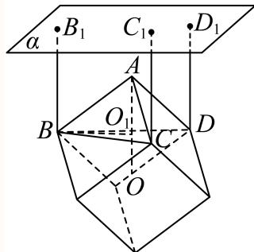
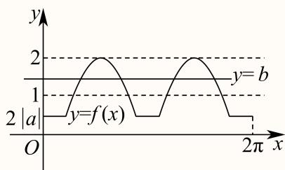
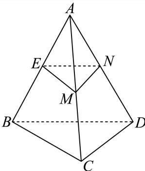
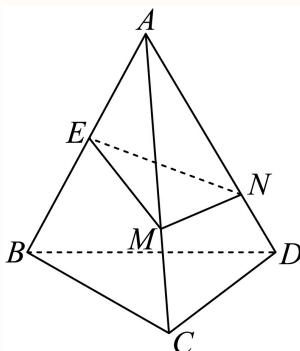
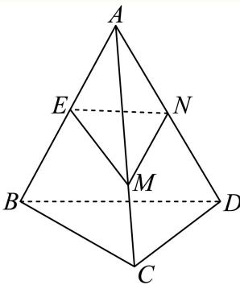
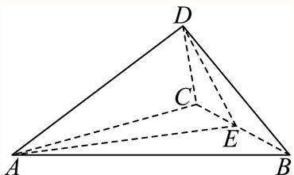
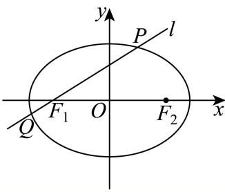

# 2025二模 黄浦区原卷 · 教师版

> 本地预览：题目、答案及分类尚未全部审定。校对使用的PDF为高中工作台解析版，尚未逐区确认区级印刷原卷。

## 填空题

按本区原卷题号顺序排列。

### 黄浦 · 第1题

不等式 $\frac { x } { x - 2 } <$ 0的解集是 .

**考点：** 分式不等式

**难度依据：** 分式不等式；直接调用定义或基本公式，路径短

**核查说明：** 已人工阅读底稿题干和原解；未逐页对照PDF，不作为数学终审。

【答案】(0,2)

【解析】

【分析】解分式不等式即可得解.

【详解】不等式 $\frac { x } { x - 2 } <$ 0化为 $x ( x - 2 ) < 0$ ，解得 $\textstyle \cdot 0 < x < 2$

所以不等式 $\frac { x } { x - 2 } <$ < 0的解集是(0, 2).

故答案为：(0,2)

### 黄浦 · 第2题

设 $[ a \in \mathbf { R } ]$ ，集合 $A = [ 1 , 3 ]$ $B = [ a , 4 ]$ ，若 $A \cap B = [ 2 , 3 ]$ ，则a =

**考点：** 交集端点求参数

**难度依据：** 交集端点求参数；直接调用定义或基本公式，路径短

**核查说明：** 已人工阅读底稿题干和原解；未逐页对照PDF，不作为数学终审。

【答案】2.

【解析】

根据交集的定义求解即可.

由 $A = [ 1 , 3 ]$ ， $B = [ a , 4 ]$ ，且 $A \cap B = \left\lceil 2 , 3 \right\rceil$

所以a = 2.

故答案为：2.

### 黄浦 · 第3题

抛物线 $\operatorname { i } y ^ { 2 } = x $ 的焦点到其顶点的距离为

**考点：** 抛物线焦点距顶点

**难度依据：** 抛物线焦点距顶点；直接调用定义或基本公式，路径短

**核查说明：** 已人工阅读底稿题干和原解；未逐页对照PDF，不作为数学终审。

【答案】$\frac 1 4$

【解析】

求出抛物线的焦点及顶点即可得解.

抛物线 $\dot { y } ^ { 2 } = x$ 的焦点为 $\left( { \frac { 1 } { 4 } } , 0 \right)$ ，顶点为(0, 0)，

所以该抛物线的焦点到其顶点的距离为 $\frac 1 4$

故答案为： $\frac 1 4$

### 黄浦 · 第4题

在 $\triangle \mathrm { A B C } |$ 中，若 $A = 4 5 ^ { \circ }$ $B = 3 0 ^ { \circ }$ $a = 2 { \sqrt { 6 } }$ ，则 $| b =$

**考点：** 正弦定理求边

**难度依据：** 正弦定理求边；直接调用定义或基本公式，路径短

**核查说明：** 已人工阅读底稿题干和原解；未逐页对照PDF，不作为数学终审。

【答案】$2 \sqrt { 3 }$

【解析】

由正弦定理得到方程，求出答案.

由正弦定理得 ${ \frac { a } { \sin A } } = { \frac { b } { \sin B } }$ ，故 ${ \frac { 2 { \sqrt { 6 } } } { \sin 4 5 ^ { \circ } } } = { \frac { b } { \sin 3 0 ^ { \circ } } }$

即 ${ \frac { 2 { \sqrt { 6 } } } { \frac { \sqrt { 2 } } { 2 } } } = { \frac { b } { \frac { 1 } { 2 } } }$ ，解得 $\begin{array} { r } { b = 2 \sqrt { 3 } . } \end{array}$

故答案为： $2 \sqrt { 3 }$

### 黄浦 · 第5题

i为虚数单位，若复数z满足 $z - \overline { { z } } = 2 \mathrm { i }$ 且 $\begin{array} { r } { \overline { { z } } = \mathrm { i } z , } \end{array}$ ，则Rez =

**考点：** 共轭与复数相等求实部

**难度依据：** 共轭与复数相等求实部；需一次代换或条件转换后计算

**核查说明：** 已人工阅读底稿题干和原解；未逐页对照PDF，不作为数学终审。

【答案】−1

【解析】

设出复数z的代数形式，由给定条件列式，结合复数乘法及复数相等求解.

设 $z = a + b \mathrm { i } , a , b \in \mathrm { R }$ ，则–z $= a - b \mathrm { i }$ ，由 $z - \bar { z } = 2 \mathrm { i }$ ，得2bi = 2i，解得b = 1，

即 $\mathtt { J } _ { \mathcal { Z } } = a + \mathrm { i } , \overline { { \mathfrak { z } } } = a - \mathrm { i }$ ，由–z = iz，得 $\mathbf { \nabla } \cdot a - \mathbf { i } = \mathbf { i } ( a + \mathbf { i } ) = - 1 + a \mathbf { i }$ ，所以 $\mathrm { R e } z = a = - 1$

故答案为：−1

### 黄浦 · 第6题

函数 $\operatorname { f ( x ) } = { \sqrt { 3 } } \sin x + \sin \left( { \frac { \pi } { 2 } } + x \right)$ 的最大值是

**考点：** 诱导公式与辅助角最值

**难度依据：** 诱导公式与辅助角最值；需一次代换或条件转换后计算

**核查说明：** 已人工阅读底稿题干和原解；未逐页对照PDF，不作为数学终审。

【解析】

$$
f (x) = \sqrt {3} \sin x + \cos x = 2 \sin \left(x + \frac {\pi}{6}\right) \Rightarrow f (x) _ {\max} = 2.
$$

### 黄浦 · 第7题

已知等比数列 $\left\{ a _ { n } \right\}$ 为严格增数列，其前n项和为 $S _ { n }$ ,若 $a _ { 1 } a _ { 1 0 } = a _ { 8 } , S _ { 4 } - S _ { 1 } = { \frac { 2 1 } { 4 } }$ ，则该数列的公比为

**考点：** 等比通项求和与严格单调

**难度依据：** 等比通项求和与严格单调；需组合两类关系并检查区间或等号

**核查说明：** 已人工阅读底稿题干和原解；未逐页对照PDF，不作为数学终审。

【解析】

设出等比数列公比，由题意建立方程，解方程并验根，可得答案.

设等比数列 $\{ a _ { n } \}$ 的公比为q，由 $\{ a _ { 1 } a _ { 1 0 } = a _ { 8 }$ ，则 $a _ { 1 } a _ { 1 } q ^ { 9 } = a _ { 1 } q ^ { 7 }$ ，解得 $a _ { 1 } = q ^ { - 2 }$

由 $S _ { 4 } - S _ { 1 } = \frac { 2 1 } { 4 }$ ，则 $\frac { a _ { 1 } \left( 1 - q ^ { 4 } \right) } { 1 - q } - a _ { 1 } = \frac { 2 1 } { 4 }$ ，代入上式可得 ${ \frac { 1 - q ^ { 4 } } { ( 1 - q ) q ^ { 2 } } } - { \frac { 1 } { q ^ { 2 } } } = { \frac { 2 1 } { 4 } }$

去分母可得 $4 q ^ { 4 } - 2 1 q ^ { 3 } + 2 1 q ^ { 2 } - 4 q = 0$ ，易知 $\vert q \ne 0$

可得 $4 q ^ { 3 } - 2 1 q ^ { 2 } + 2 1 q - 4 = 0$ ，分解因式可得 $\left( q - 1 \right) \left( 4 q - 1 \right) \left( q - 4 \right) = 0$

易知 $q \neq 1$ ，解得 $q = \frac { 1 } { 4 }$ 或4，

当 $q = \frac 1 4$ 时， $a _ { 1 } = 1 6$ ，则 $a _ { n } = 1 6 \times \left( { \frac { 1 } { 4 } } \right) ^ { n - 1 } = 4 ^ { 3 - n }$ ，单调递减，不合题意故答案为：4.

### 黄浦 · 第8题

已知a为常数，圆 $( x - a ) ^ { 2 } + ( y + a - 2 ) ^ { 2 } = r ^ { 2 } ( r > 0 )$ 与圆 $x ^ { 2 } + y ^ { 2 } = 1$ 有公共点，当r取到最小值时，a的值为

**考点：** 动圆圆心距与最小半径

**难度依据：** 动圆圆心距与最小半径；需组合两类关系并检查区间或等号

**核查说明：** 已人工阅读底稿题干和原解；未逐页对照PDF，不作为数学终审。

【答案】1

【解析】

根据给定条件，求出两圆的圆心距，利用两圆有公共点的条件建立不等式求解.

圆 $( x - a ) ^ { 2 } + ( y + a - 2 ) ^ { 2 } = r ^ { 2 } ( r > 0 )$ 的圆 $\iota \dot { \operatorname { L } } ( a , 2 - a )$ ，半径r，圆 $x ^ { 2 } + y ^ { 2 } = 1$ 的圆心(0, 0)，半径为1，

由两圆有公共点，得 $\left| r - 1 \right| \leq { \sqrt { ( a - 0 ) ^ { 2 } + ( 2 - a - 0 ) ^ { 2 } } } \leq r + 1$

$d = { \sqrt { ( a - 0 ) ^ { 2 } + ( 2 - a - 0 ) ^ { 2 } } } = { \sqrt { 2 ( a - 1 ) ^ { 2 } + 2 } } \geq { \sqrt { 2 } }$ ，当且仅当a = 1时取等号，

$\ Y q _ { a } = 1$ 时，d取得最小值 ${ \sqrt { 2 } }$ ，r取得最小值 ${ \sqrt { 2 } } - 1$ ，此时两圆外切，满足两圆有公共点所以当r取到最小值时，a的值为1.

故答案为：1

### 黄浦 · 第9题

某商场要悬挂一个棱长为2米的正方体物件作为装饰，如图，A、B、C、D为该正方体的顶点，$B B _ { 1 } , ~ C C _ { 1 } , ~ D D _ { 1 }$ 为三根直绳索，且均垂直于屋顶所在平面α．若平面BCD与平面α平行，且点A到α的距离为2米，则直绳索 $B B _ { 1 }$ 的长度约为 米．（结果精确到0.01米）

> 本题资料或解析有待核事项，预览不可作为已审定成品。

**考点：** 正方体斜悬挂与面间距离

**难度依据：** 正方体斜悬挂与面间距离；需组合两类关系并检查区间或等号

**核查说明：** 原解分析与详解使用不同的外接圆半径；AB=BC等棱长描述混淆，需据原图核算，不能将摘要当结论。；已人工阅读底稿题干和原解；未逐页对照PDF，不作为数学终审。

【解析】

设正方体的中心为O，连接AO，得到 $A O _ { 1 \perp }$ 平面BCD，由三角形BCD是正三角形，得到外接圆的半径为 $r = { \frac { 2 { \sqrt { 3 } } } { 3 } }$ 米，利用勾股定理求得 $A O _ { 1 } = \sqrt { A B ^ { 2 } - B O _ { 1 } ^ { 2 } } = \frac { 2 \sqrt { 6 } } { 3 }$ 米，设 $B B _ { 1 } = h$ 米，结合h $\begin{array} { r } { \mathbf { \nabla } _ { \cdot } = B B _ { 1 } = 2 + A O _ { 1 } } \end{array}$ ，即可得到对答案.

解：由正方体的棱长 $A B = B C = C D = D A = 2$ 米，

因为平面 $B C D / /$ 平面α，且 $B B _ { 1 \perp }$ 平面α， $C C _ { 1 - }$ ⊥平面α， $D D _ { 1 \perp }$ 平面 $\overset { \cdot } { \alpha }$ ，

如图所示，设正方体的中心为O，连接AO，交平面 $B C D ^ { . }$ 于点 $O _ { 1 }$ ，则 $A O _ { 1 \perp }$ 平面 $B C D$

在正方体中，底面BCD是正三角形，其外接圆的半径为 $r = { \frac { \sqrt { 3 } } { 3 } } \times 2 { \sqrt { 2 } } = { \frac { 2 { \sqrt { 6 } } } { 3 } }$ 米，

又由勾股定理，可得 $A O _ { 1 } = \sqrt { A B ^ { 2 } - B O _ { 1 } ^ { 2 } } = \surd 2 ^ { 2 } - \left( \frac { 2 \sqrt { 6 } } { 3 } \right) ^ { 2 } = \frac { 2 \sqrt { 3 } } { 3 }$

设 $B B _ { 1 } = h$ 米，因为点A到平面α的距离为2米，

所以 $h = B B _ { 1 } = 2 + A O _ { 1 } = 2 + { \frac { 2 { \sqrt { 3 } } } { 3 } } \approx 2 + { \frac { 2 \times 1 . 7 3 1 } { 3 } } = 2 + { \frac { 3 . 4 6 2 } { 3 } } = 2 + 1 . 1 5 4 = 3 . 1 5 3$ 5米.故答案为：3.15.

### 黄浦 · 第10题

若从2025的所有正约数中任取一个数，则这个数是一个完全平方数的概率为

**考点：** 质因数指数计数；随机约数为平方数

**难度依据：** 质因数指数计数；随机约数为平方数；需组合两类关系并检查区间或等号

**核查说明：** 已人工阅读底稿题干和原解；未逐页对照PDF，不作为数学终审。

【解析】

利用质因数可得2025的所有正约数，从而可求概率.

因为 $\phantom { - } 2 0 2 5 = 3 ^ { 4 } \times 5 ^ { 2 }$ ，所以2025的正约数为1, 3, 5, 9, 15, 25, 27, 45, 75, 81, 135, 225, 405, 675, 2025共15个数，

其中完全平方数有1, 9, 25, 81, 225, 2025共6个数，

所以从2025的所有正约数中任取一个数，则这个数是一个完全平方数的概率为 ${ \frac { 6 } { 1 5 } } = { \frac { 2 } { 5 } }$

$$
\frac {2}{5}
$$

### 黄浦 · 第11题

设 $\left\{ a _ { n } \right\}$ 为等差数列，其前n项和为 $S _ { n }$ ，若 $\left( S _ { 8 } - S _ { 7 } \right) \left( S _ { 9 } - S _ { 7 } \right) < 0$ ，则满足 $S _ { m } S _ { m + 1 } <$ 0的正整数 m =

> 本题资料或解析有待核事项，预览不可作为已审定成品。

**考点：** 等差中项与前项和变号

**难度依据：** 等差中项与前项和变号；需组合两类关系并检查区间或等号

**核查说明：** 原解第二种情况误称数列递增，S16公式系数也错为15，须回源并修订。；已人工阅读底稿题干和原解；未逐页对照PDF，不作为数学终审。

【答案】15.

【解析】

由题意可得 $\left\{ { \begin{array} { l } { S _ { 8 } - S _ { 7 } < 0 } \\ { S _ { 9 } - S _ { 7 } > 0 } \end{array} } \right.$ 或 $\left\{ { \begin{array} { l l } { S _ { 8 } - S _ { 7 } > 0 } \\ { S _ { 9 } - S _ { 7 } < 0 } \end{array} } \right.$ 分类讨论可求得m的值.

由 $\left( S _ { 8 } - S _ { 7 } \right) \left( S _ { 9 } - S _ { 7 } \right) < 0$ ，可得 $\left\{ { S } _ { 8 } - { S } _ { 7 } < 0 \atop { S } _ { 9 } - { S } _ { 7 } > 0 \right\} { S } _ { 8 } - { S } _ { 7 } > 0$

当 $\left\{ { \begin{array} { l } { S _ { 8 } - S _ { 7 } < 0 } \\ { S _ { 9 } - S _ { 7 } > 0 } \end{array} } \right.$ 可得 $\left\{ { a _ { 8 } < 0 \atop a _ { 8 } + a _ { 9 } > 0 } \right\} _ { }$ 所以 $\left\{ { a _ { 8 } < 0 \atop a _ { 9 } > - a _ { 8 } > 0 } \right\} \nonumber$

所以 $\left\{ a _ { n } \right\}$ 为单调递增数列，且前8项为负，从第9项开始为正，

$$
S _ {1 5} = \frac {1 5 \left(a _ {1} + a _ {1 5}\right)}{2} = 1 5 a _ {8} <   0, S _ {1 6} = \frac {1 5 \left(a _ {1} + a _ {1 6}\right)}{2} = \frac {1 5 \left(a _ {8} + a _ {9}\right)}{2} > 0,
$$

所以 $S _ { 1 5 } S _ { 1 6 } < 0 ,$ ，所以 $. m = 1 5 ;$ ；

当 $\left\{ { \begin{array} { l l } { S _ { 8 } - S _ { 7 } > 0 } \\ { S _ { 9 } - S _ { 7 } < 0 } \end{array} } \right.$ 可得 $\begin{array} { r } { \left\{ { a } _ { 8 } > 0 \atop { a } _ { 8 } + { a } _ { 9 } < 0 ^ { , } \right. } \end{array}$ ，所以 $\left\{ { a _ { 8 } > 0 } \atop { a _ { 9 } < - a _ { 8 } < 0 }  , \right.$

所以 $\{ a _ { n } \}$ 为单调递增数列，且前8项为正，从第9项开始为负，

$$
S _ {1 5} = \frac {1 5 \left(a _ {1} + a _ {1 5}\right)}{2} = 1 5 a _ {8} > 0, S _ {1 6} = \frac {1 5 \left(a _ {1} + a _ {1 6}\right)}{2} = \frac {1 5 \left(a _ {8} + a _ {9}\right)}{2} <   0,
$$

所以 $S _ { 1 5 } S _ { 1 6 } < 0 _ { ; }$ ，所以 $m = 1 5$ ；

综上所述： $m = 1 5$

故答案为：15.

### 黄浦 · 第12题

设a、b为常数， $f \left( x \right) = \left| a + \sin x \right| + \left| a - \sin x \right|$ ，若对任意的 $| b \in ( 1 , 2 )$ ，函数 $\dot { \boldsymbol { y } } = \boldsymbol { f } \left( \boldsymbol { x } \right) - \boldsymbol { b }$ 在区间$[ 0 , 2 \pi ]$ 上恰有4个零点，则a的取值范围是

> 本题资料或解析有待核事项，预览不可作为已审定成品。

**考点：** 含绝对值正弦方程根数；参数零点分类

**难度依据：** 含绝对值正弦方程根数；参数零点分类；需多步建模、分类或参数约束

**核查说明：** 原解分段函数缺少2|sin x|分支，需补全。；已人工阅读底稿题干和原解；未逐页对照PDF，不作为数学终审。

【答案】$- \frac { 1 } { 2 } \leq a \leq \frac { 1 } { 2 }$

【解析】

根据已知讨论 $a \geq 1 , a \leq - 1 , 0 \leq | a | < 1$ ，结合对应f(x)的解析式求值域， $b \in ( 1 , 2 )$ 及零点个数求参数范围.

$\mathbb { H } x \in [ 0 , 2 \pi ]$ ，则 $\sin x \in [ - 1 , 1 ]$ ，又 $b \in ( 1 , 2 )$

当 $\mid a \geq 1 , f \left( x \right) = a + \sin x + a - \sin x = 2 a \geq 2$ ，此时 $y = 2 a - b$ 无零点，

当 $\mid a \leq - 1 , f \left( x \right) = - a - \sin x - a + \sin x = - 2 a \geq 2$ ，此时 $y = - 2 a - b \bar { \lambda }$ 无零点，

当 $| 0 \leq | a | < 1$ $f \left( x \right) = \left\{ 2 | a | , 0 \leq | \sin { x } | \leq | a | \right. \quad$ 如下图，此时 $f \left( x \right) \in [ 2 | a | , 2 ]$ ，而 $\mathrm { b } \in ( 1 , 2 )$

要使f(x) = b在区间[0,2π]上恰有4个根，则 $2 | a | \le 1$ ，则 $- \frac { 1 } { 2 } \leq a \leq \frac { 1 } { 2 }$

故答案为： $- \frac { 1 } { 2 } \leq a \leq \frac { 1 } { 2 }$

## 二、选择题

## 选择题

按本区原卷题号顺序排列。

### 黄浦 · 第13题

如果两种证券在一段时间内收益数据的相关系数为0.8，那么表明（ ）

A. 两种证券的收益有反向变动的倾向

B. 两种证券的收益有同向变动的倾向

C. 两种证券的收益之间存在完全反向的联动关系，即涨或跌是相反的

D. 两种证券的收益之间存在完全同向的联动关系，即同时涨或同时跌

**考点：** 相关系数方向与强度

**难度依据：** 相关系数方向与强度；直接调用定义或基本公式，路径短

**核查说明：** 已人工阅读底稿题干和原解；未逐页对照PDF，不作为数学终审。

【答案】B

【解析】

根据正相关的定义可得出结论.

因为两种证券在一段时间内收益数据的相关系数为0.8 > 0，所以两种证券是正相关，

故选：B.

那么表明两种证券的收益有同向变动的倾向，B正确，ACD错误.

### 黄浦 · 第14题

如图，在平行六面体 $A B C D - A _ { 1 } B _ { 1 } C _ { 1 } D _ { 1 }$ 1中， $\mathrm { i } \overrightarrow { \times a } = \overrightarrow { A A _ { 1 } } , \overrightarrow { b } = \overrightarrow { D B _ { 1 } }$ ，若→a、 $\vec { b } .$ 、→c组成空间向量的一个基底，则→c 可以是（ ）

A.  − $\overrightarrow { B B _ { 1 } }$ 

B. − $\overrightarrow { B C _ { 1 } }$ 

C. − $\xrightarrow [ B D ] { }$ 

D.  − $\xrightarrow { }$

> 本题资料或解析有待核事项，预览不可作为已审定成品。

**考点：** 空间向量基底与共面判断

**难度依据：** 空间向量基底与共面判断；需组合两类关系并检查区间或等号

**核查说明：** D选项向量端点完全丢失，A/B/C含游离负号，须核原卷。；已人工阅读底稿题干和原解；未逐页对照PDF，不作为数学终审。

【答案】B

【解析】

利用平行六面体的结构特征，结合空间共面向量定理爱空间向量基本定理逐项判断.

由→a $= \overrightarrow { A A _ { 1 } } , \overrightarrow { b } = \overrightarrow { D B _ { 1 } } , \overrightarrow { a } , \overrightarrow { b }$ 、→c组成空间向量的一个基，得向量→a、 $\vec { b }$ 、→c不共面，

对于A，在平行六面体 $A B C D - A _ { 1 } B _ { 1 } C _ { 1 } D _ { 1 }$ 1中， $\xrightarrow { } { B B _ { 1 } } = \overline { { A A _ { 1 } } }$ ，则 $\overrightarrow { B B _ { 1 } }$ 与→a、 $\vec { b }$ 共面，A不是；

对于C， $\overrightarrow { B D } = \overrightarrow { B B _ { 1 } } + \overrightarrow { B _ { 1 } D } = \overrightarrow { A A _ { 1 } } - \overrightarrow { D B _ { 1 } } = \overrightarrow { a } - \overrightarrow { b } , \overrightarrow { B D }  \overrightarrow { a } , \overrightarrow { b }$ 共面，C不是；

对于D， $\overrightarrow { B D _ { 1 } } = \overrightarrow { B D } + \overrightarrow { D D _ { 1 } } = \overrightarrow { a } - \overrightarrow { b } + \overrightarrow { a } = 2 \overrightarrow { a } - \overrightarrow { b } , \overrightarrow { B D _ { 1 } } \bot  \overrightarrow { b }$ 共面，D不是；

对于B，由 $\overrightarrow { D B _ { 1 } } = \overrightarrow { D A } + \overrightarrow { D C } + \overrightarrow { D D _ { 1 } }$ ，得 $\stackrel {  } { b } = \overrightarrow { D A } + \overrightarrow { D C } + \overrightarrow { a } , \overrightarrow { D A } , \overrightarrow { D C } , \overrightarrow { a }$ 不共面，

假设 $\overrightarrow { B C _ { 1 } }$ 与→a、 $\stackrel {  } { b } \mathrm { : }$ 共面，则存在x, $y \in \mathrm { R }$ ，使得 $\overrightarrow { B C _ { 1 } } = \overrightarrow { x a } + \overrightarrow { y b }$

而 $\overrightarrow { B C _ { 1 } } = \overrightarrow { C C _ { 1 } } - \overrightarrow { C B } = \overrightarrow { a } - \overrightarrow { D A }$ ，则 ${ \overrightarrow { a } } - { \overrightarrow { D A } } = x { \overrightarrow { a } } + y \left( { \overrightarrow { D A } } + { \overrightarrow { D C } } + { \overrightarrow { a } } \right)$

整理得 $\cdot ( x + y - 1 ) \overrightarrow { a } + ( y + 1 ) \overrightarrow { D A } + y \overrightarrow { D C } = \overrightarrow { 0 }$ ，从而 $\left\{ { \begin{array} { l l } { x + y - 1 = 0 } \\ { y + 1 = 0 } \\ { y = 0 } \end{array} } \right.$ ，此方程组无解，假设不成立，因此 $\overrightarrow { B C _ { 1 } }  \overrightarrow { a } , \overrightarrow { b }$ 不共面，→c可以是 $\overrightarrow { B C _ { 1 } }$

故选：B

### 黄浦 · 第15题

设 $x_1<x_2<x_3<x_4$，随机变量 $X$ 取值 $x_1$、$x_2$、$x_3$、$x_4$ 的概率均为0.25，随机变量 $X_1$ 取值 $\frac{x_1+x_2}{2}$、$\frac{x_2+x_3}{2}$、$\frac{x_3+x_4}{2}$、$\frac{x_4+x_1}{2}$ 的概率也均为0.25，随机变量 $X_2$ 取值 $2x_1-x_2$、$2x_2-x_3$、$2x_3-x_4$、$2x_4-x_1$ 的概率也均为0.25。若记 $D[X_1]$、$D[X_2]$ 分别为 $X_1$、$X_2$ 的方差，则（ ）。

A. $D[X_1]<D[X_2]$

B. $D[X_1]=D[X_2]$

C. $D[X_1]>D[X_2]$

D. $D[X_1]$ 与 $D[X_2]$ 的大小关系与 $x_1$、$x_2$、$x_3$、$x_4$ 的取值有关

> 本题资料或解析有待核事项，预览不可作为已审定成品。

**考点：** 线性组合二阶矩与方差比较；平方和及严格等号条件

**难度依据：** 线性组合二阶矩与方差比较；平方和及严格等号条件；需多步建模、分类或参数约束

**核查说明：** 题干已回源；原解析未全面数学审校，公式及其他问题仍需处理。；已人工阅读底稿题干和原解；未逐页对照PDF，不作为数学终审。

【答案】A

【解析】

根据随机变量 $X _ { 1 } , X _ { 2 }$ 的取值情况，计算出它们的期望和方差，再借助均值不等式即可判断作答.

由随机变 $\sharp X _ { 1 } , X _ { 2 }$ 的取值情况，它们的期望分别为：

$$
E X _ {1} = \frac {1}{4} \left(\frac {x _ {1} + x _ {2}}{2} + \frac {x _ {2} + x _ {3}}{2} + \frac {x _ {3} + x _ {4}}{2} + \frac {x _ {4} + x _ {1}}{2}\right) = \frac {1}{4} (x _ {1} + x _ {2} + x _ {3} + x _ {4}),
$$

$E X _ { 2 } = { \frac { 1 } { 4 } } ( 2 x _ { 1 } - x _ { 2 } + 2 x _ { 2 } - x _ { 3 } + 2 x _ { 3 } - x _ { 4 } + 2 x _ { 4 } - x _ { 1 } ) = { \frac { 1 } { 4 } } ( x _ { 1 } + x _ { 2 } + x _ { 3 } + x _ { 4 } ) ,$ ，即

$$
E X _ {2} = E X _ {1},
$$

$$
D X _ {1} = \frac {1}{4} \left[ \left(\frac {x _ {1} + x _ {2}}{2}\right) ^ {2} + \left(\frac {x _ {2} + x _ {3}}{2}\right) ^ {2} + \left(\frac {x _ {3} + x _ {4}}{2}\right) ^ {2} + \left(\frac {x _ {4} + x _ {1}}{2}\right) ^ {2} \right] - (E X _ {1}) ^ {2},
$$

$$
\left(\frac {x _ {1} + x _ {2}}{2}\right) ^ {2} + \left(\frac {x _ {2} + x _ {3}}{2}\right) ^ {2} + \left(\frac {x _ {3} + x _ {4}}{2}\right) ^ {2} + \left(\frac {x _ {4} + x _ {1}}{2}\right) ^ {2}
$$

$$
= \frac {2 \left(x _ {1} ^ {2} + x _ {2} ^ {2} + x _ {3} ^ {2} + x _ {4} ^ {2}\right) + 2 x _ {1} x _ {2} + 2 x _ {2} x _ {3} + 2 x _ {3} x _ {4} + 2 x _ {4} x _ {1}}{4}
$$

同理 $\begin{array} { l } { \displaystyle { D X _ { 2 } = \frac { 1 } { 4 } \big [ ( 2 x _ { 1 } - x _ { 2 } ) ^ { 2 } + ( 2 x _ { 2 } - x _ { 3 } ) ^ { 2 } + ( 2 x _ { 3 } - x _ { 4 } ) ^ { 2 } + ( 2 x _ { 4 } - x _ { 1 } ) ^ { 2 } \big ] - ( E X _ { 2 } ) ^ { 2 } , } } \end{array}$

$$
\left[ \left(2 x _ {1} - x _ {2}\right) ^ {2} + \left(2 x _ {2} - x _ {3}\right) ^ {2} + \left(2 x _ {3} - x _ {4}\right) ^ {2} + \left(2 x _ {4} - x _ {1}\right) ^ {2} \right.
$$

$$
= 5 \left(x _ {1} ^ {2} + x _ {2} ^ {2} + x _ {3} ^ {2} + x _ {4} ^ {2}\right) - 4 \left(x _ {1} x _ {2} + x _ {2} x _ {3} + x _ {3} x _ {4} + x _ {4} x _ {1}\right)
$$

则 $D \left[ X _ { 2 } \right] - D \left[ X _ { 1 } \right]$

$$
= \frac {1}{4}
$$

$$
\left[ 5 \left(x _ {1} ^ {2} + x _ {2} ^ {2} + x _ {3} ^ {2} + x _ {4} ^ {2}\right) - 4 \left(x _ {1} x _ {2} + x _ {2} x _ {3} + x _ {3} x _ {4} + x _ {4} x _ {1}\right) - \right.
$$

$$
\left. \frac {\left(x _ {1} ^ {2} + x _ {2} ^ {2} + x _ {3} ^ {2} + x _ {4} ^ {2}\right) + \left(x _ {1} x _ {2} + x _ {2} x _ {3} + x _ {3} x _ {4} + x _ {4} x _ {1}\right)}{2} \right]
$$

$$
\frac {9 \left[ \left(x _ {1} ^ {2} + x _ {2} ^ {2} + x _ {3} ^ {2} + x _ {4} ^ {2}\right) - \left(x _ {1} x _ {2} + x _ {2} x _ {3} + x _ {3} x _ {4} + x _ {4} x _ {1}\right) \right]}{8},
$$

因为 $\begin{array} { r } { \iota x _ { 1 } ^ { 2 } + x _ { 2 } ^ { 2 } \geq 2 x _ { 1 } x _ { 2 } , x _ { 3 } ^ { 2 } + x _ { 2 } ^ { 2 } \geq 2 x _ { 3 } x _ { 2 } , x _ { 3 } ^ { 2 } + x _ { 4 } ^ { 2 } \geq 2 x _ { 4 } x _ { 3 } , x _ { 1 } ^ { 2 } + x _ { 4 } ^ { 2 } \geq 2 x _ { 4 } x _ { 1 } } \end{array}$

所以x21 + x22 + x23 + x24 ≥ x1x2 + x2x3 + x3x4 + x4x1，

因为 $x _ { 1 } < x _ { 2 } < x _ { 3 } < x _ { 4 }$ ，不能取等号，所以 $x _ { 1 } ^ { 2 } + x _ { 2 } ^ { 2 } + x _ { 3 } ^ { 2 } + x _ { 4 } ^ { 2 } > x _ { 1 } x _ { 2 } + x _ { 2 } x _ { 3 } + x _ { 3 } x _ { 4 } + x _ { 4 } x _ { 1 }$

所以 $D \left[ X _ { 2 } \right] - D \left[ X _ { 1 } \right] > 0$

所以 $D \left[ X _ { 2 } \right] > D \left[ X _ { 1 } \right]$

故选：A.

### 黄浦 · 第16题

给定四面体ABCD．平面α满足：①A、B、C、D四个点均不在平面α上，也不在α的同侧；②若平面α与四面体ABCD的棱有公共点，则该公共点一定是此棱的中点或两个三等分点之一．设A、B、C、D四个点到平面α的距离分别为d (i = 1,2,3,4)，那 $\ L d _ { i }$ 的所有不同值的个数组成的集合为（ ）

A. {1, 2, 3, 4}

B. {1, 2, 3}

C. {1, 2}

D. {1}

> 本题资料或解析有待核事项，预览不可作为已审定成品。

**考点：** 截面分点与点面距离种数

**难度依据：** 截面分点与点面距离种数；需证明新定义命题或完成复杂参数分类

**核查说明：** 题干dᵢ下标与集合表述乱码；原解仅列举部分截面，且称四种距离必在同侧未证明，需独立核验完整分类。；已人工阅读底稿题干和原解；未逐页对照PDF，不作为数学终审。

【答案】B

【解析】

根据题意，分类讨论，确定平面α的位置，结合点到平面的距离的定义，进行分析判断，即可求解.

当平面α与四面体ABCD的一条棱的中点相交时，

不妨设平面α过棱 $A B , A C , A D$ 的中点 $E , M , N _ { \colon }$ ，此时点A,B到平面α的距离相等，

且平面 $\dot { \alpha } / /$ 平面BCD，如图（1）所示

此时B,C,D到平面α的距离可能与A,B到平面α的距离相同，此时 $d _ { i }$ 有1不同的值；

图(1)

不妨设平面α过棱AB的中点 $E ,$ ，且过 $A C , A D$ 分别为的三等分点M,N时，

如图（2）所示，此时点A,B到平面α的距离相等，且 $C ,$ D到平面α的距离相等，

且A,B到平面α的距离与 $C ,$ D到平面α的距离不相等，此时 $\mathbf { \dot { \alpha } } d _ { i }$ 有2不同的值；

图(2)

不妨设平面α过棱AB,AD的中点E,N，且过AC分别为的三等分点M时，

如图（3）所示，此时点A,B,D到平面α的距离相等，

其中A,B,D到平面α的距离与C到平面α的距离不相等，此时 $\mathbf { \dot { d } } _ { i }$ 有2不同的值；

图(3)

不妨设平面α过棱AB的中点 $E _ { i }$ ，过AC的靠近C的三等分点M，过AD靠近A点的三等分点 $N$ ，此时A,B到平面α的距离不同， $C ,$ D到平面α的距离不同，

且A,B,C,D到平面α的距离两两之间都可能不同，此时 $\dot { d } _ { i }$ 有3个不同的值；

又因为A,B,C,D四个点均不在平面α上，也不在平面α的同侧，

所以 $d _ { i }$ 不能有4个不同的值（若有4个不同的值，四个点必然在平面α的同侧），

所以 $d _ { i }$ 的所有不同值的个数组成的集合为{1,2,3}.

故选：B.

图(4)

## 三、解答题

## 解答题

按本区原卷题号顺序排列。

### 黄浦 · 第17题

已知f (x) = 2x
(1) (6分)若 $f \left( x \right) - f \left( 2 - x \right) = 3$ ，求x的值；
(2) (8分)是否存在实数a，使函数 $\left[ { y = f \left( x \right) + a f \left( - x \right) } \right]$ 是奇函数？请说明理由

> 本题资料或解析有待核事项，预览不可作为已审定成品。

**考点：** （1）指数方程换元；（2）奇函数必要条件和验证

**难度依据：** 指数方程与奇函数构造；需组合两类关系并检查区间或等号

**核查说明：** 题干f(x)=2x丢失指数，原解为2^x，实质影响题意，须回源。；已人工阅读底稿题干和原解；未逐页对照PDF，不作为数学终审。

【解析】

(1) 由题意， $f \left( x \right) - f \left( 2 - x \right) = 2 ^ { x } - 2 ^ { 2 - x } = 2 ^ { x } - \frac { 4 } { 2 ^ { x } } = 3 ,$

令 $t = 2 ^ { x } , t > 0$ ，则有 $t - { \frac { 4 } { t } } = 3$ ，即 $t ^ { 2 } - 3 t - 4 = 0$ ，得 $\left( t - 4 \right) \left( t + 1 \right) = 0$ ，解得t = 4或t = −1（舍去），

所以t = 2x = 4，则x = 2.

(2) 假设存在实数a，使函数 $\langle y = f \left( x \right) + a f \left( - x \right) = 2 ^ { x } + a \cdot 2 ^ { - x }$ 是奇函数，

则x = 0时， $y = 1 + a = 0$ ，解得a = −1.

a = −1时，函数 $\left[ y = f \left( x \right) + a f \left( - x \right) = 2 ^ { x } - 2 ^ { - x } \right.$ ，定义域为R.

设函数 $\left[ g \left( x \right) = y = 2 ^ { x } - 2 ^ { - x } , x \in \mathbf { R } \right]$

对任意 $x \in \mathbf { R } , g \left( - x \right) = 2 ^ { - x } - 2 ^ { x } = - g \left( x \right)$ ，故函数 $\ [ g ( x ) = 2 ^ { x } - 2 ^ { - x }$ 为奇函数.

综上，存在实数a = −1，使函数 $\left[ { \boldsymbol { y } } = { \boldsymbol { f } } \left( { \boldsymbol { x } } \right) + a { \boldsymbol { f } } \left( - { \boldsymbol { x } } \right) \right.$ 是奇函数.

### 黄浦 · 第18题

在四面体ABCD中， $D B = D C = 2$ $D B \bot D C$

(1) (6分)若△ABC为正三角形，平面 $A B C \bot$ 平面DBC，求四面体ABCD体积；
(2) (8分)若AB = AC = 4，AD = 3，求二面角A − BC − D的大小

**考点：** （1）面面垂直和四面体体积；（2）公共垂线构造二面角

**难度依据：** 四面体体积与二面角；需组合两类关系并检查区间或等号

**核查说明：** 已人工阅读底稿题干和原解；未逐页对照PDF，不作为数学终审。

【解析】

(1) 由题设 $\triangle B C D$ 为等腰直角三角形，且 $D B = D C = 2$ $D B \bot D C ,$

所以 $B C = 2 { \sqrt { 2 } } , \ \subset \triangle A B C$ 为正三角形，故 $S _ { \triangle A B C } = \frac { 1 } { 2 } \times \left( 2 \sqrt { 2 } \right) ^ { 2 } \times \sin 6 0 ^ { \circ } = 2 \sqrt { 3 } ,$

若E为BC的中点，连接DE，则 $D E \bot B C$ ，又平面 $A B C \bot$ 平面 $D B C$ ，

平面 $A B C \cap$ 平面 $D B C = B C$ 9 $D E \subset$ 平面 $D B C$ ，故 $D E \bot$ 平面 $A B C _ { \mathrm { { \scriptscriptstyle 2 } } }$

所以 $D E = { \sqrt { 2 } }$ 是 $D - A B C$ 的高，则其体积 $\{ V = { \frac { 1 } { 3 } } \cdot D E \cdot S _ { \triangle A B C } = { \frac { 1 } { 3 } } \times { \sqrt { 2 } } \times 2 { \sqrt { 3 } } = { \frac { 2 { \sqrt { 6 } } } { 3 } }$

(2) 由（1） $D E \bot B C$ 且 $B C = 2 { \sqrt { 2 } } , D E = { \sqrt { 2 } } ,$

又 $A B = A C = 4$ ，则 $A E = { \sqrt { 1 4 } }$ ，且 $A E \bot B C$ ，又 $A D = 3$ ，

所以二面角 $A - B C - L$ 的平面角为 $\angle D E A$ ，且

$$
\cos \angle D E A = \frac {A E ^ {2} + D E ^ {2} - A D ^ {2}}{2 A E \cdot D E} = \frac {1 4 + 2 - 9}{2 \sqrt {1 4} \times \sqrt {2}} = \frac {\sqrt {7}}{4}.
$$

所以二面角大小为 $\operatorname { a r c c o s } { \frac { \sqrt { 7 } } { 4 } }$

### 黄浦 · 第19题

一盒子中有大小与质地均相同的20个小球，其中白球 $n ( 3 \leq n \leq 1 3 )$ 个，其余为黑球
(1) (6分)当盒中的白球数n = 6时，从盒中不放回地随机取两次，每次取一个球，用A表示事件“第一次取到白球”，用B表示事件“第二次取到白球”，求 $P ( B | A )$ 和 $P ( B )$ ，并判断事件A与B是否相互独立；
(2) (8分)某同学要策划一个抽奖活动，参与者从盒中一次性随机取10个球，若其中恰有3个白球，则获奖，否则不获奖，要使参与者获奖的可能性最大、最小，该同学应该分别如何放置白球的数量n？

**考点：** （1）不放回条件概率与独立性；（2）组合数函数相邻比求最值

**难度依据：** 条件概率独立性与超几何最值；组合数相邻比值；需多步建模、分类或参数约束

**核查说明：** 已人工阅读底稿题干和原解；未逐页对照PDF，不作为数学终审。

【解析】

(1) 当n = 6时，盒中有6个白球，14个黑球， $P \left( A \right) = \frac { 6 } { 2 0 } = \frac { 3 } { 1 0 } , \ P \left( B | A \right) = \frac { 5 } { 1 9 }$ $P \left( B | { \overline { { A } } } \right) = { \frac { 6 } { 1 9 } } , P \left( B \right) = P \left( A B \right) + P \left( { \overline { { A } } } B \right) = P \left( A \right) P \left( B | A \right) + P \left( { \overline { { A } } } \right) P \left( B | { \overline { { A } } } \right)$ $= { \frac { 3 } { 1 0 } } \times { \frac { 5 } { 1 9 } } + { \frac { 7 } { 1 0 } } \times { \frac { 6 } { 1 9 } } = { \frac { 3 } { 1 0 } }$ ，则 $P ( B | A ) \neq P ( B )$ ，所以事件A与B相互不独立(2) 从20个球中取10个球，恰有3个白球的概率 $P = { \frac { \mathrm { C } _ { n } ^ { 3 } \mathrm { C } _ { 2 0 - n } ^ { 7 } } { \mathrm { C } _ { 2 0 } ^ { 1 0 } } }$

设 ${ \bf \ddot { \it f } } ( n ) = { \bf C } _ { n } ^ { 3 } { \bf C } _ { 2 0 - n } ^ { 7 } ,$ 当 $3 \leq n \leq 1 2 \mathbb { H } { \mathrm { . } } { \mathrm { ] } }$ ，

$$
\frac {f (n + 1)}{f (n)} = \frac {\mathrm{C} _ {n + 1} ^ {3} \mathrm{C} _ {1 9 - n} ^ {7}}{\mathrm{C} _ {n} ^ {3} \mathrm{C} _ {2 0 - n} ^ {7}} = \frac {\frac {(n + 1) !}{3 ! (n - 2) !} \cdot \frac {(1 9 - n) !}{7 ! (1 2 - n) !}}{\frac {n !}{3 ! (n - 3) !} \cdot \frac {(2 0 - n) !}{7 ! (1 3 - n) !}} = \frac {- n ^ {2} + 1 2 n + 1 3}{- n ^ {2} + 2 2 n - 4 0},
$$

$$
- n ^ {2} + 1 2 n + 1 3 - \left(- n ^ {2} + 2 2 n - 4 0\right) = 5 3 - 1 0 n, \text {当} 3 \leq n \leq 5 \text {时，} f (n + 1) > f (n),
$$

$6 \leq n \leq 1$ 2时， $f ( n + 1 ) < f ( n )$ ，因此 $f ( 3 ) < f ( 4 ) < f ( 5 ) < f ( 6 ) > f ( 7 ) > \cdots > f ( 1 3 )$ $f ( 3 ) = \mathbf { C } _ { 1 7 } ^ { 7 } > \mathbf { C } _ { 1 3 } ^ { 3 } = f ( 1 3 )$ ，则 $f ( n ) _ { \mathrm { m a x } } = f ( 6 ) , f ( n ) _ { \mathrm { m i n } } = f ( 1 3 )$

所以当 $n = 6 \mathbb { H }$ 时，参与者获奖的可能性最大；当 ${ \mathrm { i } n = 1 }$ 3时，参与者获奖的可能性最小.

### 黄浦 · 第20题

椭圆Γ: ${ \frac { x ^ { 2 } } { a ^ { 2 } } } + { \frac { y ^ { 2 } } { b ^ { 2 } } } = 1 ( a > b > 0 )$ 的左、右焦点分别为 $F _ { 1 } ( - c , 0 ) , F _ { 2 } ( c , 0 ) ( c > 0 )$ ，过点 $F _ { 1 }$ 的直线l与Γ 交于点P
(1) (4分)若c = 2，点P的坐标为 $\left( 2 , { \sqrt { 2 } } \right)$ ，求点 $F _ { 2 }$ 到直线l的距离；
(2) (6分)当b ≤ c时，求满足 $P F _ { 1 } \bot P F _ { 2 }$ 的点P的个数；
(3) (8分)设直线l与Γ的另一个交点为Q，− $\overrightarrow { F _ { 1 } Q } = \lambda \overrightarrow { Q P } \left( \lambda \in \bf R \right)$ ，点P的横坐标为 $\frac { c } { 2 }$ ，若Γ的离心率 $e > \frac 1 2$ ，求λ的取值范围

**考点：** （1）点到直线距离；（2）直径圆与椭圆交点个数；（3）焦点分点向量与离心率范围

**难度依据：** 椭圆焦点弦与圆交点；分点向量与离心率；需多步建模、分类或参数约束

**核查说明：** 已人工阅读底稿题干和原解；未逐页对照PDF，不作为数学终审。

【解析】

(1) 依题意， $F _ { 1 } ( - 2 , 0 ) , F _ { 2 } ( 2 , 0 )$ ，而 $P \left( 2 , { \sqrt { 2 } } \right)$ 则直线l的方程为 $y = { \frac { \sqrt { 2 } } { 4 } } ( x + 2 )$ 即 $\ : | x - 2 \sqrt { 2 } y + 2 = 0 \ :$ ，所以点 $F _ { 2 }$ 到直线l的距离 $: d = { \frac { | 2 - 2 { \sqrt { 2 } } \times 0 + 2 | } { \sqrt { 1 ^ { 2 } + \left( - 2 { \sqrt { 2 } } \right) ^ { 2 } } } } = { \frac { 4 } { 3 } }$

(2) 由 $P F _ { 1 } \bot P F _ { 2 }$ ，得点P在以线段 $F _ { 1 } F _ { 2 }$ 为直径的圆 $x^2+y^2=c^2,\quad c^2=a^2-b^2$ 由 $\left\{ { x ^ { 2 } + y ^ { 2 } = c ^ { 2 } \qquad } \right. \qquad \mathrm { { } }$ 消去y得 $( a ^ { 2 } - b ^ { 2 } ) x ^ { 2 } = a ^ { 2 } ( c ^ { 2 } - b ^ { 2 } )$ ，即 $\displaystyle { \lvert c ^ { 2 } x ^ { 2 } = a ^ { 2 } ( c ^ { 2 } - b ^ { 2 } ) }$ 当b = c时， $x = 0 , \ y = \pm b$ ，因此点 $P ( 0 , \pm b )$ ，共2个；当b < c时， $c ^ { 2 } x ^ { 2 } = a ^ { 2 } ( c ^ { 2 } - b ^ { 2 } )$ ，解得 $x ^ { 2 } = { \frac { a ^ { 2 } ( c ^ { 2 } - b ^ { 2 } ) } { c ^ { 2 } } } , y ^ { 2 } = { \frac { b ^ { 4 } } { c ^ { 2 } } }$ 因此点 $P \left( \pm { \frac { a { \sqrt { c ^ { 2 } - b ^ { 2 } } } } { c } } , \pm { \frac { b ^ { 2 } } { c } } \right)$ ，共4个，

所以当b = c时，点P的个数为2；当b < c时，点P的个数为4.

(3) 设 $P \left( { \frac { c } { 2 } } , y _ { P } \right) , Q \left( x _ { Q } , y _ { Q } \right)$ ，由 $\overrightarrow { F _ { 1 } Q } = \lambda \overrightarrow { Q P }$ ，且 $F _ { 1 }$ 在线段PQ上，得 $- 1 < \lambda < 0$ 则 $( x _ { Q } + c , y _ { Q } ) = \lambda \left( \frac { c } { 2 } - x _ { Q } , y _ { P } - y _ { Q } \right)$ ，解得 $\left\{ \begin{array} { l l } { x _ { Q } = { \frac { c } { 2 } } \cdot { \frac { \lambda - 2 } { \lambda + 1 } } } \\ { y _ { Q } = { \frac { \lambda } { \lambda + 1 } } y _ { P } } \end{array} \right.$ ，而 $k = { \frac { c } { a } }$ 由点P,Q在Γ上，得 $\left\{ \begin{array} { l l } { \displaystyle \frac { c ^ { 2 } } { 4 a ^ { 2 } } + \frac { y _ { P } ^ { 2 } } { b ^ { 2 } } = 1 } \\ { \displaystyle \frac { c ^ { 2 } ( \lambda - 2 ) ^ { 2 } } { 4 a ^ { 2 } ( \lambda + 1 ) ^ { 2 } } + \frac { \lambda ^ { 2 } } { ( \lambda + 1 ) ^ { 2 } } \cdot \frac { y _ { P } ^ { 2 } } { b ^ { 2 } } = 1 } \end{array} \right. ,$ 即$\left\{ \begin{array} { l l } { \displaystyle \frac { e ^ { 2 } } { 4 } + \frac { y _ { P } ^ { 2 } } { b ^ { 2 } } = 1 } \\ { \displaystyle \frac { e ^ { 2 } ( \lambda - 2 ) ^ { 2 } } { 4 \lambda ^ { 2 } } + \frac { y _ { P } ^ { 2 } } { b ^ { 2 } } = \frac { ( \lambda + 1 ) ^ { 2 } } { \lambda ^ { 2 } } } \end{array} \right. ,$ 整理得 $e ^ { 2 } ( - \lambda + 1 ) = 2 \lambda + 1$ ，即 $| e ^ { 2 } = \frac { 2 \lambda + 1 } { - \lambda + 1 }$ ，由 $e > \frac 1 2$ ，得 $\frac { 1 } { 4 } < \frac { 2 \lambda + 1 } { - \lambda + 1 } < 1$ ，解得$- \frac { 1 } { 3 } < \lambda < 0 .$ 所以λ的取值范围是 $- \frac { 1 } { 3 } < \lambda < 0$

### 黄浦 · 第21题

设D是R的一个非空子集，函数y = f(x)的定义域为D，若y = f(x)在D上不是单调函数，且存在常数b，使得f(x) ≥ b对任意的 $x \in D$ 成立，则称函数 $\scriptstyle \left\{ y = f ( x ) \right.$ 具有性质H，称b为该函数的一个下界
(1) (4分)设 $f \left( x \right) = x + \frac { 1 } { x } , D = \left( - \infty , 0 \right)$ ，判断函数y = f(x)，x ∈ D是否具有性质H；
(2) (6分)设m为常数， $f \left( x \right) = \frac { 1 } { 3 } x ^ { 3 } - x + 1 , \ D = \left( m , 2 \right)$ ，当且仅当m满足什么条件时，函数$y = f ( x ) , x \in D$ 具有性质H，且 $b = \frac 1 3$ 是该函数的一个下界；
(3) (8分)设 $0 < a \leq 1 , f ( x ) = \ln ( x + 1 ) + a x ( x - 2 ) , D = ( 0 , 1 )$ ，若函数y = f(x)，x ∈ D具有性质H，求a的取值范围：当a在上述范围内变化时，若b总是该函数的下界，求b的取值范围

**考点：** （1）单调性及无下界判断H性质；（2）非单调区间及给定下界；（3）参数非单调条件与统一下界

**难度依据：** 非单调有下界的H性质；导数单调与参数统一下界；需证明新定义命题或完成复杂参数分类

**核查说明：** 已人工阅读底稿题干和原解；未逐页对照PDF，不作为数学终审。

【解析】

(1) 函数 $f \left( x \right) = x + \frac { 1 } { x } , \ x \in \left( - \infty , 0 \right)$ ，求导得 $f ^ { \prime } \left( x \right) = 1 - { \frac { 1 } { x ^ { 2 } } } = { \frac { x ^ { 2 } - 1 } { x ^ { 2 } } } ,$

当 $x \in ( - \infty , - 1 )$ 时， $f ^ { \prime } ( x ) > 0 ;$ ；当 $x \in ( - 1 , 0 )$ 时， $f ^ { \prime } ( x ) < 0$

函数f(x)在(−∞,−1)上单调递增，(−1,0)上单调递减，

于是函数y = f(x)在(−∞,0)上不是单调函数， $\forall x \in ( - \infty , 0 ) , f ( x ) \leq f ( - 1 ) = - 2 .$

函数f(x)在(−∞,0)上的值域为(−∞,−2]，

不存在常数b，使得f(x) ≥ b对任意的x ∈ (−∞,0)成立，

所以函数y = f(x)，x ∈ D不具有性质H.

(2) 函数 $f \left( x \right) = \frac { 1 } { 3 } x ^ { 3 } - x + 1$ ，求导得 $f ^ { \prime } ( x ) = x ^ { 2 } - 1 = ( x + 1 ) ( x - 1 )$

当x < −1或x > 1时，f′(x) > 0；当−1 < x < 1时，f′(x) < 0，

函数f(x)在(−∞,−1),(1,+∞)上单调递增，在(−1,1)上单调递减，

由函数 $y = f ( x ) , x \in ( m , 2 )$ 具有性质H，且 $b = \frac 1 3$ 是该函数的一个下界，得 $f ( x ) _ { \mathrm { m i n } } \geq \frac { 1 } { 3 }$ 当m < 1时，函数y = f(x)在(m,2)上不单调， $f \left( - 1 \right) = \frac { 5 } { 3 } , f \left( 1 \right) = \frac { 1 } { 3 }$

由 $f \left( x \right) = \frac { 1 } { 3 }$ ，即 $x ^ { 3 } - 3 x + 2 = 0$ ，整理得 $( x + 2 ) ( x - 1 ) ^ { 2 } = 0$ ，解得x = −2或x = 1，

当x < −2时， $f \left( x \right) < f \left( - 2 \right) = \frac { 1 } { 3 }$ ，当−2 ≤ x < 1时， $f \left( x \right) \geq f \left( - 2 \right) = \frac { 1 } { 3 } .$

因此∀x ∈ [−2, 1)， $f \left( x \right) \geq { \frac { 1 } { 3 } }$ ，则−2 ≤ m < 1，

所以当且仅当m ∈ [−2,1)时，函数y = f(x)，x ∈ D具有性质H，且 $b = \frac 1 3$ 是该函数的一个下界.

(3) 当 $a \in ( 0 , 1 ] , x \in ( 0 , 1 )$ 时，函数 $f ( x ) = \ln ( x + 1 ) + a x ^ { 2 } - 2 a x$

求导得 $f ^ { \prime } \left( x \right) = { \frac { 1 } { x + 1 } } + 2 a x - 2 a = { \frac { 2 a x ^ { 2 } - ( 2 a - 1 ) } { x + 1 } }$

当0 $< a \leq \frac { 1 } { 2 }$ 时， $2 a - 1 \leq 0 , f ^ { \prime } ( x ) > 0$ ，函数f(x)在(0,1)上单调递增，不符合题意；

当 $\frac { 1 } { 2 } < a \leq$ 1时， $0 < 2 a - 1 \leq 1$ ，由 $f ^ { \prime } ( x ) < 0 .$ ，得0 $< x < { \sqrt { 1 - { \frac { 1 } { 2 a } } } }$ ；由 $f ^ { \prime } ( x ) > 0$ ，得$\sqrt { 1 - \frac { 1 } { 2 a } } < x < 1$

函数f(x)在 $\left( 0 , { \sqrt { 1 - { \frac { 1 } { 2 a } } } } \right)$ 上单调递减，在 $\left( { \sqrt { 1 - { \frac { 1 } { 2 a } } } } , 1 \right)$ 上单调递增，f(x)在(0,1)上不是

单调函数，

f(x)min = f √1 − 12a = ln 1 − 12a + 1) + a − 12 − 2a√ 1 − 12a ，b ≤ f(x)min，因

此 $\frac { 1 } { 2 } < a \leq 1$

令 ${ \sqrt { 1 - { \frac { 1 } { 2 a } } } } = t \in \left( 0 , { \frac { \sqrt { 2 } } { 2 } } \right]$ ，则 $\nonumber | 2 a = { \frac { 1 } { 1 - t ^ { 2 } } } ;$ ，令

$$
g (t) = f \left(\sqrt {1 - \frac {1}{2 a}}\right) = \ln (t + 1) + \frac {1 - 2 t}{2 \left(1 - t ^ {2}\right)} - \frac {1}{2},
$$

求导得 $\cdot g ^ { \prime } ( t ) = { \frac { 1 } { 1 + t } } + { \frac { - 2 ( 1 - t ^ { 2 } ) - ( 1 - 2 t ) ( - 2 t ) } { 2 ( 1 - t ^ { 2 } ) ^ { 2 } } } = { \frac { t ^ { 3 } - 2 t ^ { 2 } } { ( 1 - t ^ { 2 } ) ^ { 2 } } } < 0 ,$

函数g(t)在 $\left( 0 , { \frac { \sqrt { 2 } } { 2 } } \right]$ 上单调递减， $g ( t ) _ { \mathrm { m i n } } = g \left( { \frac { \sqrt { 2 } } { 2 } } \right) = \ln { \frac { 2 + \sqrt { 2 } } { 2 } } - \sqrt { 2 } + { \frac { 1 } { 2 } }$ V 7

由当 $a$ 变化时，b总是该函数的下界，得 $b \leq g ( t ) _ { \mathrm { m i n } } = \ln { \frac { 2 + { \sqrt { 2 } } } { 2 } } - { \sqrt { 2 } } + { \frac { 1 } { 2 } } \mathrm { . }$

所以a的取值范围是 $\frac { 1 } { 2 } < a \leq 1$ 的取值范围是 $b \leq \ln { \frac { 2 + { \sqrt { 2 } } } { 2 } } - { \sqrt { 2 } } + { \frac { 1 } { 2 } } .$

