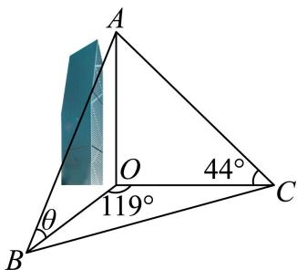
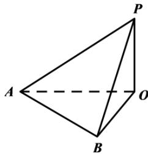

# 2025二模 三角函数与解三角形专题 · 学生版

> 本地预览：题目、答案及分类尚未全部审定。校对使用的PDF为高中工作台解析版，尚未逐区确认区级印刷原卷。

## 同角、诱导与倍角求值

先用象限或角范围定符号，再选同角、和差及倍角公式。

### 嘉定 · 第6题

已知θ ∈ R，若 $\tan \theta + \cot \theta = 5$ ，则sin 2θ =

### 奉贤 · 第6题

已知θ是斜率为−1的直线的倾斜角，计算 $\sin \left( \theta - { \frac { \pi } { 2 } } \right) =$

### 崇明 · 第4题

求直线x = −2与直线 ${ \sqrt { 3 } } x - y + 1 = 0$ 的夹角为 .

### 徐汇 · 第6题

已知 $\cos \theta = - \frac { 3 } { 5 } , \theta \in ( 0 , \pi )$ ，则 $\tan \left( \theta - { \frac { \pi } { 4 } } \right)$ 的值为

### 普陀 · 第14题

设m ∈ R，在平面直角坐标系xOy中，角α的顶点在坐标原点，始边与x轴的正半轴重合，若角α的终边经过点 $P \left( - 3 , m \right)$ ，且 $\sin { ( \pi + 2 \alpha ) } > 0$ ，则角α属于（ ）

A. 第一象限

B. 第二象限

C. 第三象限

D. 第四象限

### 杨浦 · 第4题

已知 $\sin\theta=\frac35$，则 $\cos2\theta=$______。

### 虹口 · 第3题

若 $\mathrm { s i n } \alpha = \frac { 2 } { 3 }$ ，则 $\cos 2 \alpha =$

### 金山 · 第4题

若α为第二象限角，且 $\sin \alpha = \frac { 4 } { 5 }$ ，则tan α = .

### 长宁 · 第8题

顶角为36∘的等腰三角形被称为黄金三角形，其底边和腰之比正好为黄金比 $\varphi$ ，用黄金比 $\varphi$ 表示$\cos 3 6 ^ { \circ }$ =

### 闵行 · 第6题

已知向量 $\vec { \mathbf { a } } ^ { + } = ( \mathbf { 3 } , 4 ) , \vec { b } ^ { - } = ( \cos \theta , \sin \theta )$ ，若 $\overrightarrow { \mathrm { a } } / / \overrightarrow { \mathrm { b } }$ ， 则tanθ=

### 静安 · 第6题

已知 $| \sin ( \frac { \pi } { 4 } - x ) = \frac { 3 } { 5 }$ ，则sin2x的值为

## 解析式、周期与相位性质

从最高最低点、周期或向量表达式恢复标准形式，平移后重新检验奇偶与单调。

### 崇明 · 第6题

函数 $y=2\sin(\omega x-\frac\pi{16})$（$\omega>0$）的最小正周期是 $\pi$，则 $\omega=$______。

### 杨浦 · 第3题

函数y = sin2x的最小正周期是

### 松江 · 第17题

已知函数 $\begin{array} { r } { \mathopen { } : y = A \sin ( 2 x + \varphi ) , A > 0 , 0 < \varphi < \pi _ { : } } \end{array}$ ，当 $x = \frac { \pi } { 6 }$ 时函数取得最大值4， ${ \mathrm { i } } \exists y = f ( x )$
(1) (6分)求函数 $\cdot y = f ( x )$ 的表达式；
(2) (8分)若数列 $\left\{ a _ { n } \right\}$ 为等差数列， $a _ { 2 } = f ( 0 ) , a _ { 4 } = f \left( { \frac { \pi } { 6 } } \right)$ $\mathbb { E } b _ { n } = 2 ^ { a _ { n } }$ ，求数列 $\left\{ b _ { n } \right\}$ 的前n项和 $S _ { n }$

> 本题资料或解析有待核事项，预览不可作为已审定成品。

### 浦东 · 第4题

若 $f ( x ) = \cos { ( 3 x ) } \cos { x } + \sin { ( 3 x ) } \sin { x }$ ，则函数 $y = f ( x )$ 的最小正周期为

### 虹口 · 第14题

下列函数中为奇函数的是（ ）

A. $y = { \sqrt { x } }$

B. $y = x ^ { - 2 }$

C. $y = \sin \left( x + { \frac { \pi } { 2 } } \right)$

D. $y = \tan \left( x + \pi \right)$

### 长宁 · 第17题

已知向量 ${ \vec { m } } = ( \sin x + \cos x , 2 \sin x ) , { \vec { n } } = \left( \sin x - \cos x , { \sqrt { 3 } } \cos x \right) , f ( x ) = { \vec { m } } \cdot { \vec { n } } .$
(1) (6分)求函数y = f(x)的单调递减区间；
(2) (8分)若函数 $\boldsymbol { \mathfrak { y } } = \boldsymbol { f } ( \boldsymbol { x } ) - \boldsymbol { a }$ 在区间 $\left( 0 , { \frac { \pi } { 2 } } \right)$ 上恰有2个零点，求实数a的取值范围

### 青浦 · 第13题

“函数 $f ( x ) = \sin ( x + \varphi )$ 为偶函数”是 ${ \mathrm { \Sigma } } ^ { * } \varphi = \frac { \pi } { 2 }$ ”的( )

A. 充分不必要条件

B. 必要不充分条件

C. 充分必要条件

D. 既不充分也不必要条件

> 本题资料或解析有待核事项，预览不可作为已审定成品。

### 静安 · 第8题

设某港口水的深度 $y$（米）关于时间 $t$（时）的函数近似满足 $y=h+A\sin(\omega t+\varphi)$。根据某一天的测量，港口水的深度在早上3点达到最大值18米，之后持续减少，并在上午9点达到最小值14米。则该港口水的深度 $y$（米）关于时间 $t$（时）的函数的近似表达式为 ______。

> 本题资料或解析有待核事项，预览不可作为已审定成品。

### 静安 · 第17题

已知向 $\begin{array} { l } { \displaystyle { \frac { \overrightarrow { \sf E q . } } { \overrightarrow { \sf E q . } } } = \left( \cos \left( x + \frac { \pi } { 6 } \right) , \sin \left( x + \frac { \pi } { 6 } \right) \right) , \overrightarrow { \sf b } } = \left( \cos \left( x + \frac { \pi } { 6 } \right) , - \sin \left( x + \frac { \pi } { 6 } \right) \right)  \end{array}$ ，记 $f ( x ) = \stackrel {  } { a } \cdot \stackrel {  } { b }$
(1) (6分)求函数 $y = f \left( x \right)$ 的最小正周期；
(2) (8分)若函数 $\left[ { { y } } = { { f } \left( { x + \theta } \right) } \right.$ （其中常数 $\theta \in \left( 0 , \frac { \pi } { 2 } \right) )$ ）为奇函数，求θ的值

> 本题资料或解析有待核事项，预览不可作为已审定成品。

## 区间值域、解集与周期参数

区分周期与给定区间，统计零点或不等式解集中的指定解，注意端点与整数约束。

### 嘉定 · 第15题

已知关于x的不等式 $| \sin 2 x | > \cos$ x在区间 $[ 0 , 2 \pi ]$ ]内有k个整数解，则k的值为（ ）

A. 3

B. 4

C. 5

D. 6

### 嘉定 · 第16题

设数列 $\left\{ a _ { n } \right\}$ 满足 $a _ { n } = \sin \left( { \frac { n \pi } { 3 } } \right) + ( - 1 ) ^ { n } \cos \left( { \frac { n \pi } { 4 } } \right)$ ，记其前n项和为 $S _ { n }$ ，前n项积为 $T _ { n }$ ．则下列结论正确的是（ ）

A. 数列 $\{ S _ { n } \}$ 和数列 $\left\{ T _ { n } \right\}$ 均不是周期数列

B. 数列 $\{ S _ { n } \}$ 是周期数列，数列 $\left\{ T _ { n } \right\}$ 不是周期数列

C. 数列 $\{ S _ { n } \}$ 不是周期数列，数列 $\left\{ T _ { n } \right\}$ 是周期数列

D. 数列 $\{ S _ { n } \}$ 和数列 $\left\{ T _ { n } \right\}$ 均为周期数列

### 奉贤 · 第16题

若5π是函数 $\stackrel { \prime } { y } = \cos n x \sin \frac { 2 0 0 0 } { n ^ { 2 } } x$ 的一个周期，则正整数n所有可能取值个数是（ ）

A. 2

B. 3

C. 4

D. 9

### 宝山 · 第21题

定义在D上的可导函数y = f(x)，集合 $A _ { ( k , m ) } = \{ f ( x ) | F \left( x _ { i } \right) = k , x _ { i } \in D , i = 1 , 2 , \cdot \cdot \cdot , m , m $ 为正整数 } ， 其 中 $F \left( x \right) = f \left( x \right) + f ^ { \prime } \left( x \right)$ 称为f(x)的 自 和函数， $x _ { i }$ 称为 $y = f \left( x \right)$ 的固着点. 已知$f \left( x \right) = a \mathbf { e } ^ { x } + b x + c \sin x \ \left( a , b , c \in \mathrm { R } \right)$
(1) (4分)若a = c = 0, b = 2, D = R， $f \left( x \right) \in A _ { \left( 1 , m \right) }$ ，求m的值及 $y = f ( x )$ 的固着点；
(2) (6分)若a = 0, b = 1, c = 1, D = [s, t](s > 0)，F(x)是f(x)的 自 和函数，且F(x)在D上是严格增函数，求t−s的最大值；
(3) (8分)若b = −1, c = 0, D = (0, +∞)， $f ( x ) \in A _ { ( 0 , 1 ) }$ ，且t是y = f(x)的固着点，求a的取值范 围，并证明： $\frac { 1 } { 2 a } < \mathbf { e } ^ { t } < \frac { 1 } { a ^ { 2 } }$

> 本题资料或解析有待核事项，预览不可作为已审定成品。

### 崇明 · 第16题

数列 $\{a_n\}$ 是等差数列，周期数列 $\{b_n\}$ 满足 $b_n=\cos(a_n)$。若集合 $X=\{x\mid x=b_n,\ n\text{ 是正整数}\}$ 中恰有三个元素，则数列 $\{b_n\}$ 的周期 $T$ 的取值不可能是（　）。

A. $4$

B. $5$

C. $6$

D. $7$

> 本题资料或解析有待核事项，预览不可作为已审定成品。

### 徐汇 · 第12题

设实数 $[ \omega > 0 ,$ ，若 $f ( x ) = \sin \omega x$ 满足对任意 $x _ { 1 } \in [ 0 , \pi ]$ ，都存在 $x _ { 2 } \in [ \pi , 2 \pi ]$ ，使得 $ f ( x _ { 1 } ) + f ( x _ { 2 } ) = 0$ 成立，则ω的最小值是

### 普陀 · 第10题

设 $\bar { \mathsf { k } } \geq \overline { { 1 , k \in } } \mathrm { N } , 0 < \varphi < \frac { \pi } { 2 }$ ，函数 $y = f ( x )$ 的表达式为 $f ( x ) = 2 \sin ( k x + \varphi )$ )，则对任意的实数a，皆有 $\{ f ( x ) \mid a < x < a + 2 \} = \{ f ( x ) \mid x \in \operatorname { R } \}$ 成立的一个充分条件是

> 本地版本的第9、10题题号顺序存在冲突，当前题号尚待正式原卷核对。

### 普陀 · 第18题

$\begin{array} { r } { \operatorname { i } \frac { \hbar } { \mathsf { X } } \omega > 0 , } \end{array}$ ，函数 $y = f ( x )$ 的表达式为 $f \left( x \right) = \cos { \left( \omega x - \frac { \pi } { 6 } \right) }$
(1) $( 6 \mathcal { W } ) _ { \# } \underline { { { \sf _ { \Pi } } } } \omega = 2$ ，设 $\triangle A B C$ 的内角A,B,C的对边分别为 $a , b , c$ $f \left( C \right) = - \frac { \sqrt { 3 } } { 2 }$ ，且$c ^ { 2 } - a ^ { 2 } - b ^ { 2 } = 4$ ，求 $\triangle A B C$ 的面积.
(2) (8分)对任意的 $\mathbf { \boldsymbol { x } } _ { 0 } \in \mathbf { \mathbb { R } }$ ，皆有 $f \left( x _ { 0 } \right) \leq f \left( { \frac { \pi } { 3 } } \right)$ 成立，且该函数在区间 $\left( { \frac { \pi } { 6 } } , { \frac { \pi } { 2 } } \right)$ 上不存在最小值，求函数 $\boldsymbol { \cdot } \boldsymbol { y } = \boldsymbol { f } \left( \boldsymbol { x } \right)$ 在 $x \in \left( { \frac { 4 \pi } { 3 } } , { \frac { 1 7 \pi } { 6 } } \right)$ 的单调区间.

### 松江 · 第12题

设 $a\in\mathbb R$，若函数

$$
f(x)=\begin{cases}
\sin(2\pi x-2\pi a),&x<a,\\
x^2-2(a+1)x+a^2+5,&x\ge a
\end{cases}
$$

在区间 $(0,+\infty)$ 内恰好有6个零点，则 $a$ 的取值范围是________。

> 本题资料或解析有待核事项，预览不可作为已审定成品。

### 闵行 · 第15题

已知函数 $y=\cos\left(\dfrac\pi6x+\dfrac\pi3\right)$ 在区间 $[a,a+9]$ 上既有最大值又有最小值 $-1$，则关于实数 $a$ 的取值，以下不可能的是（　）。

A. $2024$

B. $2025$

C. $2026$

D. $2027$

> 本地PDF题面与源解析实际使用的最值条件不一致；未擅自补条件，暂不作为已审定练习。

### 黄浦 · 第12题

设a、b为常数， $f \left( x \right) = \left| a + \sin x \right| + \left| a - \sin x \right|$ ，若对任意的 $| b \in ( 1 , 2 )$ ，函数 $\dot { \boldsymbol { y } } = \boldsymbol { f } \left( \boldsymbol { x } \right) - \boldsymbol { b }$ 在区间$[ 0 , 2 \pi ]$ 上恰有4个零点，则a的取值范围是

> 本题资料或解析有待核事项，预览不可作为已审定成品。

## 正余弦定理、面积与外接圆

在角边关系中切换正弦定理、余弦定理和面积公式，三角形角范围要保留。

### 奉贤 · 第7题

已知 $\Delta A B C , ~  A , ~ B , ~ C \}$ 成等差数列且sinA、sinB、sinC成等比数列”是 $^ { * } \Delta A B C$ 是正三角形”的条件

### 宝山 · 第9题

已知 $\triangle A B C$ 中， $A B = A C = 4 , \angle B A C = \frac { 2 } { 3 } \pi$ ，点D在线段BC上，且 $S _ { \triangle A C D } = 2 S _ { \triangle A B D }$ ，则$\overrightarrow { A B } \cdot \overrightarrow { A D }$ 的值为

### 崇明 · 第8题

在 $\triangle A B C ^ { \scriptscriptstyle \mathrm { F } }$ 中，若 ${ \mathsf { i } } c = 3 , C = { \frac { \pi } { 3 } }$ ，其面积为 ${ \sqrt { 3 } } ,$ ，则a + b =

### 崇明 · 第11题

已知双曲线 $x ^ { 2 } - { \frac { y ^ { 2 } } { b ^ { 2 } } } = 1 \left( b > 0 \right)$ 的左、右焦点为 $F _ { 1 } , F _ { 2 }$ ，以O为顶点， $F _ { 2 }$ 为焦点作抛物线交双曲线于P，且 $\angle P F _ { 1 } F _ { 2 } = 4 5 ^ { \circ }$ ，则 $| b ^ { 2 } = |$

> 本题资料或解析有待核事项，预览不可作为已审定成品。

### 杨浦 · 第13题

△ABC中， $\mathbf { \ddot { s i n } } A = \sin B ^ { \prime }$ ”是“A = B”的（ ）条件.

A. 充分非必要

B. 必要非充分

C. 充要

D. 既非充分也非必要

### 虹口 · 第7题

若△ABC的三条边的长分别为4、5、6，则△ABC的外接圆面积为 .（结果保留π）

> 本题资料或解析有待核事项，预览不可作为已审定成品。

### 长宁 · 第10题

已知点D、E分别是三角形ABC的边AC、BC的中点，且 $A E = 2 , B D = 3$ ，则三角形ABC的面积的取值范围是

### 闵行 · 第18题

已知 $f \left( x \right) = \sin \left( \omega x + \varphi \right) \left( \omega > 0 , 0 < \varphi < \pi \right)$ ，函数 $y = f \left( x \right)$ 的部分图像如图所示，图中最高点$S \left( { \frac { \pi } { 3 } } , 1 \right)$ ，最低点 $T \left( { \frac { 4 \pi } { 3 } } , - 1 \right)$

(1) (6分)求函数 $y = f \left( x \right)$ 的解析式；
(2) (8分)若 $\triangle A B C$ 的内角A,B,C所对的边分别为 $\displaystyle { | a , b , c , }$ 若 $A \neq B , f ( A ) = f ( B ) , c = 2$ ，求 $\triangle A B C { \overrightarrow { \mathbb { H } } }$ 积的取值范围

### 青浦 · 第6题

已知△ABC的角A、B、C对应边长分别为 $\displaystyle a = 4 , b = 5 , c = 6$ ，则A = .

### 黄浦 · 第4题

在 $\triangle \mathrm { A B C } |$ 中，若 $A = 4 5 ^ { \circ }$ $B = 3 0 ^ { \circ }$ $a = 2 { \sqrt { 6 } }$ ，则 $| b =$

## 辅助角、单位圆与三角最值

将三角组合、单位圆上的数量积或面积表达式转化，最值须满足几何约束。

### 杨浦 · 第15题

已知 、 、 是单位圆上的三个点，若 ${ \overrightarrow { A B } } \vert = { \sqrt { 2 } }$ ，则 $\overrightarrow { A B } \cdot \overrightarrow { B C }$ 的最大值为（ ）.

A. $\sqrt { 2 }$

B. $1 + { \frac { \sqrt { 2 } } { 2 } }$

C. ${ \sqrt { 2 } } + 1$

D. ${ \sqrt { 2 } } - 1$

> 本题资料或解析有待核事项，预览不可作为已审定成品。

### 虹口 · 第18题

已知函数 $\mathbf { \boldsymbol { y } } = \mathbf { \boldsymbol { f } } \left( \boldsymbol { x } \right)$ 的表达式为 $\left| f \left( x \right) \right. = 2 ^ { x } , \left. x \in \mathbf { R } \right.$
(1) (6分)解不等式： $\log _ { 2 } { [ f \left( x \right) - 1 ] } + \log _ { 2 } { [ f \left( x \right) ] } \leq 1$ ；
(2) (8分)若存在实数 $x _ { 0 } \in \left[ 0 , { \frac { \pi } { 2 } } \right]$ ，使得 $f ( m \sin x _ { 0 } ) , f ( 2 + \sin 2 x _ { 0 } ) , f ( m \cos x _ { 0 } )$ 成等比数列，求实数m的最小值.

> 本题资料或解析有待核事项，预览不可作为已审定成品。

### 金山 · 第7题

已知圆锥底面半径为1，高为 ${ \sqrt { 3 } } ,$ ，则过圆锥母线的截面面积的最大值为

### 金山 · 第16题

已知点A $( x _ { 1 } , y _ { 1 } )$ 在圆 $x ^ { 2 } + y ^ { 2 } = 9 .$ 上，点 $B \left( x _ { 2 } , y _ { 2 } \right)$ 在圆 $x ^ { 2 } + y ^ { 2 } = 1 2$ 上，且
$x _ { 1 } x _ { 2 } + y _ { 1 } y _ { 2 } = x _ { 1 } + x _ { 2 } - 1$ ,O为坐标原点.对于以下两个命题，判断正确的是（ ）
①在坐标平面内存在点P，使得 $A P \bot B P$ 恒成立；
②三角形OAB面积的最小值为 ${ \sqrt { 2 2 } }$

A. ①是真命题，②是真命题

B. ①是假命题，②是真命题

C. ①是真命题，②是假命题

D. ①是假命题，②是假命题

> 本题资料或解析有待核事项，预览不可作为已审定成品。

### 青浦 · 第2题

函数 $y = 2 \sin x - 3 \cos x$ 的值域是

### 黄浦 · 第6题

函数 $\operatorname { f ( x ) } = { \sqrt { 3 } } \sin x + \sin \left( { \frac { \pi } { 2 } } + x \right)$ 的最大值是

## 测量、方向与几何建模

将仰角、方向角、投影或折叠条件转为可计算三角形，再进行距离和最值研究。

### 奉贤 · 第11题

中企联合大厦是奉贤区的第一高楼，是奉贤美奉贤强的一个缩影．某数学建模兴趣小组的同学们去实地进行测量，经过多次的测量，最终在平行于地面的同一水平面上选取三个点：点B、点C、点O作为测量基点．设大厦的最高点为A，在点B处测得点A的仰角为 $\angle A B O = \theta = 7 1 . 5 ^ { \circ }$ ，在点C处测得点A的仰角为 $\angle A C O = 4 4 ^ { \circ }$ ，又测得 $B C = 2 2 1$ 米， $\angle B O C = 1 1 9 ^ { \circ }$ ，（见图）．现作出以下几个假设：
①直线AO垂直于平面OBC；
②平面OBC到地面的距离等于测角仪高度，在计算过程中测角仪高度忽略不计；
③其它次要因素等忽略不计．根据以上信息估算奉贤第一高楼的高度约

### 宝山 · 第20题

已知双曲线 $C { : } x ^ { 2 } - \frac { y ^ { 2 } } { 3 } = 1 , F _ { 1 }$ 、 $F _ { 2 }$ 分别是其左、右焦点，直线l与双曲线C的右支交于A、B两点.
(1) (4分)当直线l过点 $F _ { 2 }$ ，且 $| A B | = 6 \mathbb { H }$ ，求 $\triangle A B F _ { 1 }$ 的周长；
(2) (6分)已知点N (−2, 3)，若直线AN、BN的斜率之和为0，且 $\tan \angle A N B = \frac { 4 } { 3 }$ ，当AN、BN分别与y轴交于点R、S时，求 $\triangle R S N$ 的面积；
(3) (8分)已知直线l过点F2，P是双曲线C上一点且位于第一象限，且满足− $F _ { 2 }$ $\overrightarrow { O Q } = 2 \overrightarrow { O P }$ 的点Q在线段AB上，若 $\overrightarrow { A B } = 2 \overrightarrow { Q F _ { 2 } }$ ，求点P的坐标.

> 本题资料或解析有待核事项，预览不可作为已审定成品。

### 徐汇 · 第11题

如图，某处有一块圆心角为 $\frac { 2 } { 3 } \pi \sharp$ 的扇形绿地AOB，扇形的半径为20米，AB是一条原有的人行直路，由于工程建设需要，现要在绿地中建一条直路 ，以便在图中阴影部分区域分类堆放物料.为了尽量减少对绿地的破坏（不计路宽），则原直路AB与新直路OC的交叉点D到O的距离为米.

> 本题资料或解析有待核事项，预览不可作为已审定成品。

### 杨浦 · 第10题

如图，点D､E分别是直角三角形ABC的边AB､AC上的点，斜边 $A C { \stackrel { E } { = } }$ 扇形的弧DE相切，已知$A C = 4 , B C = 2$ ，则阴影部分绕直线AB旋转一周所形成的几何体的体积为

> 本题资料或解析有待核事项，预览不可作为已审定成品。

### 松江 · 第8题

在定向越野活动中，测得甲在乙北偏东80∘的方向，甲乙两人间的距离为2km，丙在乙北偏西40∘的方向，甲丙两人间的距离为 $\sqrt { 7 } \mathrm { k m }$ ，则乙丙两人间的距离为 km.

### 浦东 · 第10题

如图，某建筑物OP垂直于地面，从地面点A处测得建筑物顶部P的仰角为30∘，从地面点B处测得建筑物顶部P的仰角为 $4 5 ^ { \circ }$ ，已知A、B相距100米， $\angle A O B = 6 0 ^ { \circ }$ ，则该建筑物 $O P$ 高度约为米．（保留一位小数）

> 本题资料或解析有待核事项，预览不可作为已审定成品。

### 金山 · 第11题

如图，现对某景区一长 $A B = 6 0 0 \mathrm { m }$ ，宽 $A D = 3 6 0 \mathrm { m }$ 的矩形空地进行建设.规划在边AB,AD上分别取点M,N修建人行步道（不考虑宽度），且满足点A关于步道MN的对称点E在边DC上.在△AMN内种植花卉，在△EMN内搭建娱乐设施，其余区域规划为露营区，则人行步道MN的最短距离为m.（结果精确到1m）

### 闵行 · 第11题

已知某星球的球心为F，半径为R，该星球的卫星的运行轨道是以F为一个焦点的椭圆，该椭圆的离心率为 $\frac { 3 } { 5 }$ ，卫星运行过程中离该星球表面最近的距离为R，若当卫星处于某位置时，用卫星上的光学仪器观测该星球，把光学仪器的镜头与星球表面被观测点的连线称为视线，任意两条视线所成的最大夹角称为张角，则卫星运行过程中张角的最小值为 ．（精确到0.1°）

### 静安 · 第12题

在边长为1的正三角形ABC的边AB、AC上分别取D、E两点，若沿线段DE折叠该三角形时，顶点A恰好落在边BC上．则线段AD的长度的最小值为

## 三角函数的导数恒等关系

由互导关系构造恒等量和唯一性证明；保留完整函数综合题。

### 青浦 · 第21题

函数的导函数有很多有趣的性质，例如：函数y = c（实数c为常数）的导函数为y = 0；反之，若函数 $\langle y = \Phi ( x )$ 的导函数为Φ′(x) = 0，则Φ(x) = c（实数c为常数）.已知函数 $y = f ( x )$ 与 $y = g ( x )$ 定义域都是R，导函数分别为y = f′(x)和 $\begin{array} { r } { | y = g ^ { \prime } ( x ) } \end{array}$ .若 $f ^ { \prime } ( x ) = f ( x )$ ，则称 $\operatorname { \mathrm { ? } } y = f ( x )$ 是“自导函数”；落$f ^ { \prime } ( x ) = g ( x )$ 且g′(x) = −f(x)，则称y = f(x)与y = g(x)是“共轭互导函数”.
(1) (4分)请判断函数 ${ \bf \dot { \boldsymbol { y } } } = \mathrm { e } ^ { a x + b } ( a , b \in { \bf R } , a \neq 0 )$ 是否是“自导函数”，并说明理由；
(2) (6分)若函数 $\{ y = f ( x )$ 是“自导函数”，且满足f(0) = 1，求证： $f ( x ) f ( - x ) = 1$
(3) (8分)若函数 $\begin{array} { r } { { \mathbf { \dot { y } } } = f ( x ) \boxed { \div } y = g ( x ) } \end{array}$ 是“共轭互导函数”，满足f(0) = 0, g(0) = 1，求证：
$f ^ { 2 } ( x ) + g ^ { 2 } ( x ) = 1$ .进而证明f(x) = sin x且g(x) = cos x.

> 本题资料或解析有待核事项，预览不可作为已审定成品。

