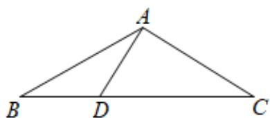
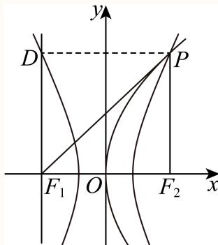
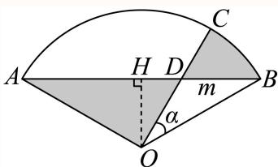
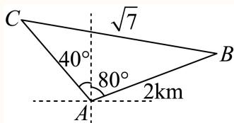
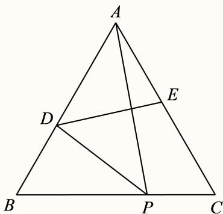

# 2025二模 三角函数与解三角形专题 · 教师版

> 本地预览：题目、答案及分类尚未全部审定。校对使用的PDF为高中工作台解析版，尚未逐区确认区级印刷原卷。

## 同角、诱导与倍角求值

先用象限或角范围定符号，再选同角、和差及倍角公式。

### 嘉定 · 第6题

已知θ ∈ R，若 $\tan \theta + \cot \theta = 5$ ，则sin 2θ =

**考点：** 二倍角与三角化简

**难度依据：** 二倍角公式；需完成一次转化或结合基本条件后计算

**核查说明：** 已人工阅读底稿题干和解析；尚未逐页对照原PDF，不作为数学终审。

【解析】

根据已知，应用商数关系及平方关系可得 $\sin \theta \cos \theta = { \frac { 1 } { 5 } }$ 再应用二倍角正弦公式求函数值由 $\tan \theta + \cot \theta = { \frac { \sin \theta } { \cos \theta } } + { \frac { \cos \theta } { \sin \theta } } = { \frac { \sin ^ { 2 } \theta + \cos ^ { 2 } \theta } { \sin \theta \cos \theta } } = { \frac { 1 } { \sin \theta \cos \theta } } = 5 ,$ 所以 $\sin \theta \cos \theta = { \frac { 1 } { 5 } }$ ，则 $| \sin 2 \theta = 2 \sin \theta \cos \theta = \frac { 2 } { 5 }$ 故答案为： $\frac { 2 } { 5 }$

### 奉贤 · 第6题

已知θ是斜率为−1的直线的倾斜角，计算 $\sin \left( \theta - { \frac { \pi } { 2 } } \right) =$

**考点：** 直线倾角与三角函数

**难度依据：** 直线倾角与三角函数；需完成一次转化或结合基本条件后计算

**核查说明：** 已人工阅读底稿题干和解析；尚未逐页对照原PDF，不作为数学终审。

【答案】$\frac { \sqrt { 2 } } { 2 }$

【解析】

根据正切函数值求出角进而得出正弦值即可.

因为θ是斜率为−1的直线的倾斜角，所以 $\tan \theta = - 1 \ , \theta \in [ 0 , \pi )$ ，

所以 $\theta = \frac { 3 \pi } { 4 }$ ，

所以 $\sin \left( \theta - { \frac { \pi } { 2 } } \right) = \sin \left( { \frac { 3 \pi } { 4 } } - { \frac { \pi } { 2 } } \right) = \sin { \frac { \pi } { 4 } } = { \frac { \sqrt { 2 } } { 2 } } .$

故答案为： $\frac { \sqrt { 2 } } { 2 }$

### 崇明 · 第4题

求直线x = −2与直线 ${ \sqrt { 3 } } x - y + 1 = 0$ 的夹角为 .

**考点：** 直线倾角及夹角

**难度依据：** 直线倾角与夹角；直接运用定义或基础公式，推理链短

**核查说明：** 已人工阅读完整底稿题干及原解，未逐页对照正式PDF，分类不等于数学终审。

【答案】$\frac { \pi } { 6 } .$

【解析】

先求出直线的斜率，可得它们的倾斜角，从而求出两条直线的夹角

解：∵直线 $x = - 2$ 的斜率不存在，倾斜角为 $\frac { \pi } { 2 }$

直线 ${ \sqrt { 3 } } x - y + 1 = 0$ 的斜率为 ${ \sqrt { 3 } }$ ，倾斜角为 $\frac { \pi } { 3 }$ ，

故直线 $x = - 2 ^ { \frac { 1 } { - } }$ 与直线 ${ \sqrt { 3 } } x - y + 1 = 0$ 的夹角为 ${ \frac { \pi } { 2 } } - { \frac { \pi } { 3 } } = { \frac { \pi } { 6 } }$ ，

故答案为： $\frac { \pi } { 6 } .$

### 徐汇 · 第6题

已知 $\cos \theta = - \frac { 3 } { 5 } , \theta \in ( 0 , \pi )$ ，则 $\tan \left( \theta - { \frac { \pi } { 4 } } \right)$ 的值为

**考点：** 象限判断及两角差正切

**难度依据：** 两角差正切公式；需一次转化并结合定义域或几何条件计算

**核查说明：** 已人工阅读完整底稿题干及原解，未逐页对照正式PDF，分类不等于数学终审。

【答案】7

【解析】

先根据同角三角函数关系得出 tanθ，再根据两角差正切公式计算求解

$$
\cos \theta = - \frac {3}{5}, \theta \in (0, \pi),
$$

所以 $\sin \theta = { \sqrt { 1 - \cos ^ { 2 } \theta } } = { \frac { 4 } { 5 } } , \tan \theta = - { \frac { 4 } { 3 } }$ ，

$$
\tan \left(\theta - \frac {\pi}{4}\right) = \frac {- \frac {4}{3} - 1}{1 - \frac {4}{3}} = \frac {- \frac {7}{3}}{- \frac {1}{3}} = 7
$$

故答案为：7

### 普陀 · 第14题

设m ∈ R，在平面直角坐标系xOy中，角α的顶点在坐标原点，始边与x轴的正半轴重合，若角α的终边经过点 $P \left( - 3 , m \right)$ ，且 $\sin { ( \pi + 2 \alpha ) } > 0$ ，则角α属于（ ）

A. 第一象限

B. 第二象限

C. 第三象限

D. 第四象限

**考点：** 象限与倍角关系

**难度依据：** 角的象限与倍角；需完成一次转化或结合基本条件后计算

**核查说明：** 已人工阅读底稿题干和解析；尚未逐页对照原PDF，不作为数学终审。

【答案】B

【解析】

根据诱导公式和二倍角公式可得2 $\cos \alpha \sin \alpha < 0$ ，再根据角α的终边经过点 $P \left( - 3 , m \right)$ ，即可求解.

因为sin (π + 2α) = − sin 2α > 0，所以 $s \mathrm { i n } 2 \alpha < 0 .$ ，所以2 $\cos \alpha \sin \alpha < 0$

所以sin α，cos α异号，

所以α在第二、四象限，

又 $P \left( - 3 , m \right)$ ，所以α在第二象限.

故选：B.

### 杨浦 · 第4题

已知 $\sin\theta=\frac35$，则 $\cos2\theta=$______。

**考点：** 同角平方与二倍角

**难度依据：** 余弦二倍角公式；直接运用定义或基础公式，推理链短

**核查说明：** 已人工阅读完整底稿题干及原解，未逐页对照正式PDF，分类不等于数学终审。

【答案】$\frac { 7 } { 2 5 }$

【解析】

直接运用二倍角余弦公式进行求解即可.

因为 $| \sin \theta = \frac { 3 } { 5 }$

所以 $\cos 2 \theta = 1 - 2 \sin ^ { 2 } \theta = 1 - 2 \times { \bigg ( } { \frac { 3 } { 5 } } { \bigg ) } ^ { 2 } = { \frac { 7 } { 2 5 } } .$

故答案为： $\frac { 7 } { 2 5 }$

### 虹口 · 第3题

若 $\mathrm { s i n } \alpha = \frac { 2 } { 3 }$ ，则 $\cos 2 \alpha =$

**考点：** 二倍角公式

**难度依据：** 余弦二倍角公式；直接运用定义或基础公式，推理链短

**核查说明：** 已人工阅读完整底稿题干及原解，未逐页对照正式PDF，分类不等于数学终审。

【答案】$\frac { 1 } { 9 }$

【解析】

根据余弦的二倍角公式即可计算.

$$
\cos 2 \alpha = 1 - 2 \sin^ {2} \alpha = 1 - 2 \times \left(\frac {2}{3}\right) ^ {2} = \frac {1}{9}.
$$

故答案为： $\frac { 1 } { 9 }$

### 金山 · 第4题

若α为第二象限角，且 $\sin \alpha = \frac { 4 } { 5 }$ ，则tan α = .

**考点：** 同角三角及符号

**难度依据：** 象限与同角三角关系；直接运用定义或基础公式，推理链短

**核查说明：** 已人工阅读完整底稿题干及原解，未逐页对照正式PDF，分类不等于数学终审。

【答案】$- { \frac { 4 } { 3 } }$

【解析】

结合角所在象限，借助同角三角函数基本关系计算即可得.

由α为第二象限角，则 $\cos \alpha = - { \sqrt { 1 - \left( { \frac { 4 } { 5 } } \right) ^ { 2 } } } = - { \frac { 3 } { 5 } }$

$$
\tan \alpha = \frac {\sin \alpha}{\cos \alpha} = \frac {\frac {4}{5}}{- \frac {3}{5}} = - \frac {4}{3}
$$

故答案为： $- { \frac { 4 } { 3 } }$

### 长宁 · 第8题

顶角为36∘的等腰三角形被称为黄金三角形，其底边和腰之比正好为黄金比 $\varphi$ ，用黄金比 $\varphi$ 表示$\cos 3 6 ^ { \circ }$ =

**考点：** 黄金三角形与半角二倍角

**难度依据：** 黄金三角形与半角二倍角；需一次代换或条件转换后计算

**核查说明：** 已人工阅读底稿题干和原解；未逐页对照PDF，不作为数学终审。

【答案】$1 - { \frac { \varphi ^ { 2 } } { 2 } }$

【解析】

根据已知可得 $\sin 1 8 ^ { \circ } = { \frac { \varphi } { 2 } }$ ，由二倍角的余弦函数即可求解.

如图等腰三角形ABC中， $\angle B A C = 3 6 ^ { \circ }$ ∘，过A作AD交BC于D，

所以AD为角平分线，

所以 $\sin 1 8 ^ { \circ } = { \frac { B D } { A B } }$ ，即 $B D = A B \cdot \sin 1 8 ^ { \circ }$

由已知可得 $\varphi = { \frac { \mathbf { \tilde { { \cal { B } } } } C } { A B } } = { \frac { 2 B D } { A B } } = { \frac { 2 A B \cdot \sin 1 8 ^ { \circ } } { A B } } = 2 \sin 1 8 ^ { \circ } ,$

所以 $\sin 1 8 ^ { \circ } = { \frac { \varphi } { 2 } }$

所以cos 36∘ = 1 − 2 sin2 18∘ = 1 − 2 × ( φ 2 = 1 − φ2 2

故答案为： $1 - { \frac { \varphi ^ { 2 } } { 2 } }$

### 闵行 · 第6题

已知向量 $\vec { \mathbf { a } } ^ { + } = ( \mathbf { 3 } , 4 ) , \vec { b } ^ { - } = ( \cos \theta , \sin \theta )$ ，若 $\overrightarrow { \mathrm { a } } / / \overrightarrow { \mathrm { b } }$ ， 则tanθ=

**考点：** 平行坐标与三角比；同角商数关系

**难度依据：** 平行坐标与三角比；同角商数关系；需一次代换或条件转换后计算

**核查说明：** 已人工阅读底稿题干和原解；未逐页对照PDF，不作为数学终审。

【答案】${ \frac { 4 } { 3 } } .$

【解析】

根据向量平行的坐标运算得到 $4 \cos \theta = 3 \sin \theta ,$ ，进而结合同角的商数关系即可求出结果因为 $\overrightarrow { \mathrm { a } } / / \overrightarrow { \mathrm { b } }$ ，且 $\vec { [ \mathfrak { a } } = ( 3 , 4 ) , \vec { b } = ( \cos \theta , \sin \theta )$ ，所以4 $\cos \theta = 3 \sin \theta$ ，显然 $\cos \theta \neq 0$ ，所以${ \frac { 4 } { 3 } } = { \frac { \sin \theta } { \cos \theta } }$ ，即 $\tan \theta = \frac { 4 } { 3 }$ ；

故答案为： ${ \frac { 4 } { 3 } } .$

### 静安 · 第6题

已知 $| \sin ( \frac { \pi } { 4 } - x ) = \frac { 3 } { 5 }$ ，则sin2x的值为

**考点：** 诱导和二倍角

**难度依据：** 诱导和二倍角；需一次代换或条件转换后计算

**核查说明：** 已人工阅读底稿题干和原解；未逐页对照PDF，不作为数学终审。

【解析】

$$
\sin 2 x = \cos \left(\frac {\pi}{2} - 2 x\right) = 1 - 2 \sin^ {2} \left(\frac {\pi}{4} - x\right) = 1 - 2 \times \left(\frac {3}{5}\right) ^ {2} = \frac {7}{2 5}
$$

## 解析式、周期与相位性质

从最高最低点、周期或向量表达式恢复标准形式，平移后重新检验奇偶与单调。

### 崇明 · 第6题

函数 $y=2\sin(\omega x-\frac\pi{16})$（$\omega>0$）的最小正周期是 $\pi$，则 $\omega=$______。

**考点：** 周期公式求参数

**难度依据：** 正弦函数周期参数；直接运用定义或基础公式，推理链短

**核查说明：** 已人工阅读完整底稿题干及原解，未逐页对照正式PDF，分类不等于数学终审。

【答案】2.

【解析】

由正弦型函数的周期公式可求得ω的值.

因为函数 $y = 2 \sin \left( \omega x - \frac { \pi } { 1 6 } \right) ( \omega > 0 )$ )的最小正周期是π，则 $\omega = \frac { 2 \pi } { \pi } = 2$

故答案为：2.

### 杨浦 · 第3题

函数y = sin2x的最小正周期是

**考点：** 最小正周期

**难度依据：** 正弦函数周期；直接运用定义或基础公式，推理链短

**核查说明：** 已人工阅读完整底稿题干及原解，未逐页对照正式PDF，分类不等于数学终审。

【答案】π

【解析】

y = sin2x的最小正周期是 ${ \frac { 2 \pi } { 2 } } = \pi$ ，

故答案为：π

### 松江 · 第17题

已知函数 $\begin{array} { r } { \mathopen { } : y = A \sin ( 2 x + \varphi ) , A > 0 , 0 < \varphi < \pi _ { : } } \end{array}$ ，当 $x = \frac { \pi } { 6 }$ 时函数取得最大值4， ${ \mathrm { i } } \exists y = f ( x )$
(1) (6分)求函数 $\cdot y = f ( x )$ 的表达式；
(2) (8分)若数列 $\left\{ a _ { n } \right\}$ 为等差数列， $a _ { 2 } = f ( 0 ) , a _ { 4 } = f \left( { \frac { \pi } { 6 } } \right)$ $\mathbb { E } b _ { n } = 2 ^ { a _ { n } }$ ，求数列 $\left\{ b _ { n } \right\}$ 的前n项和 $S _ { n }$

> 本题资料或解析有待核事项，预览不可作为已审定成品。

**考点：** (1)最大值确定振幅初相；(2)等差数列转等比数列并求和

**难度依据：** 正弦函数解析式；需连接多个条件或多步模型转化

**核查说明：** 题干f(x)标记位置与符号OCR损坏，需整理原式。；已人工阅读完整底稿题干及原解，未逐页对照正式PDF，分类不等于数学终审。；历史分类审查记录（不把旧记录直接判为当前未解决）：题干f(x)标记位置与符号OCR损坏，需整理原式。 本次只归组，未修改题干、答案或专题归属；上述具体疑点仍交回源/数学复核处理。

【解析】

(1) 已知当 $x = \frac { \pi } { 6 }$ 时函数 $\langle y = A \sin ( 2 x + \varphi )$ 取得最大值4，

因为 $A > 0 ,$ ，所以 $A = 4 .$ .此时2 $\times \ { \frac { \pi } { 6 } } + \varphi = { \frac { \pi } { 2 } } + 2 k \pi , k \in \mathbf { Z }$

又 $) < \varphi < \pi _ { : }$ ，解得 $\varphi = \frac { \pi } { 6 }$

所以函数 $y = f ( x )$ 的表达式为 $y = 4 \sin \left( 2 x + { \frac { \pi } { 6 } } \right)$

(2) 由（1）知 $f \left( x \right) = 4 \sin \left( 2 x + \frac { \pi } { 6 } \right)$ ，则 $a _ { 2 } = f ( 0 ) = 4 \sin { \frac { \pi } { 6 } } = 2$

$$
a _ {4} = f \left(\frac {\pi}{6}\right) = 4 \sin \left(\frac {\pi}{2}\right) = 4.
$$

因为 $\left\{ a _ { n } \right\}$ 是等差数列，设公差为d，则 $\displaystyle a _ { 4 } - a _ { 2 } = 2 d = 4 - 2 = 2$ ，解得 $d = 1$

$$
a _ {1} = a _ {2} - d = 2 - 1 = 1,
$$

所以 $\displaystyle { a _ { n } = 1 + ( n - 1 ) \times 1 = n . }$

可得 $S _ { n } = { \frac { 2 \left( 1 - 2 ^ { n } \right) } { 1 - 2 } } = 2 ^ { n + 1 } - 2$

又 $b _ { n } = 2 ^ { a _ { n } } = 2 ^ { n }$ ，数列 $\left\{ b _ { n } \right\}$ 是以 $b _ { 1 } = 2$ 为首项， $q = 2$ 为公比的等比数列，

### 浦东 · 第4题

若 $f ( x ) = \cos { ( 3 x ) } \cos { x } + \sin { ( 3 x ) } \sin { x }$ ，则函数 $y = f ( x )$ 的最小正周期为

**考点：** 差角化简及周期

**难度依据：** 余弦差角与周期；直接运用定义或基础公式，推理链短

**核查说明：** 已人工阅读完整底稿题干及原解，未逐页对照正式PDF，分类不等于数学终审。

【答案】π

【解析】

利用两角和差的余弦公式化简，再利用周期公式求解.

$$
f (x) = \cos (3 x) \cos x + \sin (3 x) \sin x = \cos (3 x - x) = \cos (2 x),
$$

故最小正周期为 $\frac { 2 \pi } { 2 } = \pi .$

故答案为：π

### 虹口 · 第14题

下列函数中为奇函数的是（ ）

A. $y = { \sqrt { x } }$

B. $y = x ^ { - 2 }$

C. $y = \sin \left( x + { \frac { \pi } { 2 } } \right)$

D. $y = \tan \left( x + \pi \right)$

**考点：** 定义域对称及三角恒等

**难度依据：** 基本函数奇偶性；直接运用定义或基础公式，推理链短

**核查说明：** 已人工阅读完整底稿题干及原解，未逐页对照正式PDF，分类不等于数学终审。

【答案】D

【解析】

利用基本初等函数的奇偶性逐项判断即可.

对于A选项，函数 $y = { \sqrt { x } }$ 的定义域为 $[ 0 , + \infty )$ ，该函数为非奇非偶函数，A不满足要求；对于B选项，函数 $\cdot y = x ^ { - 2 }$ 的定义域为 $\{ x | x \neq 0 \}$ ，且 $y = { \frac { 1 } { x ^ { 2 } } }$ 设 $f \left( x \right) = { \frac { 1 } { x ^ { 2 } } }$ ，则 $f \left( - x \right) = { \frac { 1 } { \left( - x \right) ^ { 2 } } } = { \frac { 1 } { x ^ { 2 } } } = f \left( x \right)$ ，故函数 $\{ y = x \}$ −2为偶函数，B不满足要求；对于C选项，函数 $y = \sin \left( x + { \frac { \pi } { 2 } } \right) = \cos x$ 为偶函数，C不满足要求；对于D选项，函数 $\langle y = \tan \left( x + \pi \right) = \tan x$ 为奇函数，D满足要求.故选：D.

### 长宁 · 第17题

已知向量 ${ \vec { m } } = ( \sin x + \cos x , 2 \sin x ) , { \vec { n } } = \left( \sin x - \cos x , { \sqrt { 3 } } \cos x \right) , f ( x ) = { \vec { m } } \cdot { \vec { n } } .$
(1) (6分)求函数y = f(x)的单调递减区间；
(2) (8分)若函数 $\boldsymbol { \mathfrak { y } } = \boldsymbol { f } ( \boldsymbol { x } ) - \boldsymbol { a }$ 在区间 $\left( 0 , { \frac { \pi } { 2 } } \right)$ 上恰有2个零点，求实数a的取值范围

**考点：** （1）数量积化三角函数并求递减区间；（2）开区间水平截线交点个数

**难度依据：** 数量积生成三角函数；辅助角与零点个数；需组合两类关系并检查区间或等号

**核查说明：** 已人工阅读底稿题干和原解；未逐页对照PDF，不作为数学终审。

【解析】

$$
f (x) = \sin^ {2} x - \cos^ {2} x + 2 \sqrt {3} \sin x \cos x = \sqrt {3} \sin 2 x - \cos 2 x = 2 \sin \left(2 x - \frac {\pi}{6}\right)
$$

C令 $2 k \pi + { \frac { \pi } { 2 } } \leq 2 x - { \frac { \pi } { 6 } } \leq 2 k \pi + { \frac { 3 \pi } { 2 } }$ ，则 $k \pi + \frac { \pi } { 3 } \leq x \leq k \pi + \frac { 5 \pi } { 6 }$ ，其中 $k \in \mathbf { Z }$ 故函数 $y = f ( x )$ 的单调递减区间为 $\left\lceil k \pi + { \frac { \pi } { 3 } } , k \pi + { \frac { 5 \pi } { 6 } } \right\rceil , k \in \mathrm { Z } .$

(2) 由题设有 $a = f \left( x \right) = 2 \sin \left( 2 x - \frac { \pi } { 6 } \right)$ 在 $\left( 0 , { \frac { \pi } { 2 } } \right)$ 有两个不同的零点，

而 $2 x - { \frac { \pi } { 6 } } \in \left( - { \frac { \pi } { 6 } } , { \frac { 5 \pi } { 6 } } \right)$ ，故 ${ \frac { a } { 2 } } = \sin$ t在 $\left( - \frac { \pi } { 6 } , \frac { 5 \pi } { 6 } \right)$ 有两个不同的解，

故 $\dot { y } = \frac { a } { 2 } \xi s \left( t \right) = \sin$ t的图象在 $\left( - \frac { \pi } { 6 } , \frac { 5 \pi } { 6 } \right)$ 上有两个不同的交点，

而 $s \left( t \right) = \sin \cdot$ t在 $\left( - \frac { \pi } { 6 } , \frac { \pi } { 2 } \right]$ 为增函数，在 $\left\lceil { \frac { \pi } { 2 } } , { \frac { 5 \pi } { 6 } } \right\rceil$ 为减函数，

且 $s \left( - { \frac { \pi } { 6 } } \right) = - { \frac { 1 } { 2 } } , s \left( { \frac { \pi } { 2 } } \right) = 1 , s \left( { \frac { 5 \pi } { 6 } } \right) = { \frac { 1 } { 2 } }$ ，故 $\frac { 1 } { 2 } < \frac { a } { 2 } < 1$

故1 $. < a < 2$

### 青浦 · 第13题

“函数 $f ( x ) = \sin ( x + \varphi )$ 为偶函数”是 ${ \mathrm { \Sigma } } ^ { * } \varphi = \frac { \pi } { 2 }$ ”的( )

A. 充分不必要条件

B. 必要不充分条件

C. 充分必要条件

D. 既不充分也不必要条件

> 本题资料或解析有待核事项，预览不可作为已审定成品。

**考点：** 三角函数偶性及充分必要关系

**难度依据：** 充分必要条件；需完成一次转化或结合基本条件后计算

**核查说明：** 解析把sin(x+pi/2)写成cos(phi)，应核对原解（按恒等式为cos x）。；已人工阅读底稿题干和解析；尚未逐页对照原PDF，不作为数学终审。；历史分类审查记录（不把旧记录直接判为当前未解决）：解析把sin(x+pi/2)写成cos(phi)，应核对原解（按恒等式为cos x）。 本次只归组，未修改题干、答案或专题归属；上述具体疑点仍交回源/数学复核处理。

【答案】B

【解析】

若 $\varphi = \frac { \pi } { 2 }$ 时， $f ( x ) = \sin ( x + \varphi ) = \cos \varphi$ 为偶函数；

若 $f ( x ) = \sin ( x + \varphi )$ 为偶函数，则 $\varphi = { \frac { \pi } { 2 } } + k \pi \ , \ k \in { \bf Z }$ ；

∴“函数 $f ( x ) = \sin ( x + \varphi )$ 为偶函数”是 ${ \overset {  } { \varphi } } = { \frac { \pi } { 2 } }$ ”的必要不充分条件，

故选：B

### 静安 · 第8题

设某港口水的深度 $y$（米）关于时间 $t$（时）的函数近似满足 $y=h+A\sin(\omega t+\varphi)$。根据某一天的测量，港口水的深度在早上3点达到最大值18米，之后持续减少，并在上午9点达到最小值14米。则该港口水的深度 $y$（米）关于时间 $t$（时）的函数的近似表达式为 ______。

> 本题资料或解析有待核事项，预览不可作为已审定成品。

**考点：** 潮汐正弦模型待定参数

**难度依据：** 潮汐正弦模型待定参数；需组合两类关系并检查区间或等号

**核查说明：** 本次仅核此字段，不代表全卷数学与视觉终审。；题干模型及答案sin的自变量括号丢失，须规范sin((π/6)t)。；已人工阅读底稿题干和原解；未逐页对照PDF，不作为数学终审。；历史分类审查记录（不把旧记录直接判为当前未解决）：题干模型及答案sin的自变量括号丢失，须规范sin((π/6)t)。 当前底稿已有回源补丁，涉及answer_and_solution,question；具体修复范围以底稿patches和2025二模-解析公式回源补丁-第二批.json,2025二模-残余OCR回源补丁-第四批.json,第四批独立复核-题干及量词补丁.json为准。本题仍按可辨数学任务归组，不据分组宣称数学已审定。

【答案】$y=2\sin\frac{\pi t}{6}+16$

【解析】

根据函数的最值求出 $h,A$ 和周期，再求出 $\omega$，利用待定系数法求出 $\varphi$。

由题意，$\begin{cases}h+A=18\\h-A=14\end{cases}$，解得 $\begin{cases}h=16\\A=2\end{cases}$。

$\frac T2=6$，所以 $T=\frac{2\pi}{\omega}=12$，$\omega=\frac\pi6$，从而 $y=16+2\sin(\frac\pi6t+\varphi)$。

又当 $t=3$ 时，函数取得最大值18，所以 $\sin(\frac\pi2+\varphi)=1$，即 $\frac\pi2+\varphi=\frac\pi2+2k\pi\ (k\in\mathbf Z)$，故 $\varphi=2k\pi$。

因此 $y=16+2\sin(\frac\pi6t+2k\pi)=2\sin\frac{\pi t}{6}+16$。

### 静安 · 第17题

已知向 $\begin{array} { l } { \displaystyle { \frac { \overrightarrow { \sf E q . } } { \overrightarrow { \sf E q . } } } = \left( \cos \left( x + \frac { \pi } { 6 } \right) , \sin \left( x + \frac { \pi } { 6 } \right) \right) , \overrightarrow { \sf b } } = \left( \cos \left( x + \frac { \pi } { 6 } \right) , - \sin \left( x + \frac { \pi } { 6 } \right) \right)  \end{array}$ ，记 $f ( x ) = \stackrel {  } { a } \cdot \stackrel {  } { b }$
(1) (6分)求函数 $y = f \left( x \right)$ 的最小正周期；
(2) (8分)若函数 $\left[ { { y } } = { { f } \left( { x + \theta } \right) } \right.$ （其中常数 $\theta \in \left( 0 , \frac { \pi } { 2 } \right) )$ ）为奇函数，求θ的值

> 本题资料或解析有待核事项，预览不可作为已审定成品。

**考点：** （1）向量数量积与二倍角周期；（2）平移后奇函数相位

**难度依据：** 数量积化二倍角；周期与平移奇偶；需组合两类关系并检查区间或等号

**核查说明：** 向量名称被分式和sf Eq覆盖，虽然坐标可辨，题干需回源。；已人工阅读底稿题干和原解；未逐页对照PDF，不作为数学终审。；历史分类审查记录（不把旧记录直接判为当前未解决）：向量名称被分式和sf Eq覆盖，虽然坐标可辨，题干需回源。 本次只归组，未修改题干、答案或专题归属；上述具体疑点仍交回源/数学复核处理。

【解析】

(1) $f \left( x \right) = \overrightarrow { a } \cdot \overrightarrow { b } = \cos ^ { 2 } \left( x + \frac { \pi } { 6 } \right) - \sin ^ { 2 } \left( x + \frac { \pi } { 6 } \right) = \cos \left( 2 x + \frac { \pi } { 3 } \right)$

所以函数 $y = f \left( x \right)$ 的最小正周期 $T = { \frac { 2 \pi } { 2 } } = \pi ;$ ；

(2) $y = f \left( x + \theta \right) = \cos \left( 2 x + 2 \theta + { \frac { \pi } { 3 } } \right)$ ，

因为函数 $\boldsymbol { \cdot } \boldsymbol { y } = \boldsymbol { f } \left( \boldsymbol { x } + \boldsymbol { \theta } \right)$ 为奇函数，

所以 $2 \theta + \frac { \pi } { 3 } = \frac { \pi } { 2 } + k \pi$ ，解得 $\theta = { \frac { \pi } { 1 2 } } + { \frac { 1 } { 2 } } k \pi , k \in \mathbf { Z } .$

又因为 $\theta \in \left( 0 , \frac { \pi } { 2 } \right)$ ，所以 $\wp = { \frac { \pi } { 1 2 } }$

## 区间值域、解集与周期参数

区分周期与给定区间，统计零点或不等式解集中的指定解，注意端点与整数约束。

### 嘉定 · 第15题

已知关于x的不等式 $| \sin 2 x | > \cos$ x在区间 $[ 0 , 2 \pi ]$ ]内有k个整数解，则k的值为（ ）

A. 3

B. 4

C. 5

D. 6

**考点：** 三角不等式及整数解

**难度依据：** 三角不等式与整数解；需连接多个条件、建模或作分类讨论

**核查说明：** 已人工阅读底稿题干和解析；尚未逐页对照原PDF，不作为数学终审。

【答案】C

【解析】

由二倍角正弦公式有 $2 \left| \sin x \cos x \right| > \cos x$ ，讨论 $x \in \left( 0 , \frac { \pi } { 2 } \right) \cup \left( \frac { 3 \pi } { 2 } , 2 \pi \right)$ $x \in \left( { \frac { \pi } { 2 } } , { \frac { 3 \pi } { 2 } } \right)$ ，结合正余弦函数的性质解不等式求解集，进而确定整数解的个数.由题设2 $| \sin x \cos x | > \cos x$ ，显然 $: x \notin \left\{ 0 , \frac { \pi } { 2 } , \frac { 3 \pi } { 2 } , 2 \pi \right\}$ ，当 $x \in \left( 0 , \frac { \pi } { 2 } \right) \cup \left( \frac { 3 \pi } { 2 } , 2 \pi \right)$ ，则 $| \sin x | > { \frac { 1 } { 2 } }$ ，此时 $x \in \left( { \frac { \pi } { 6 } } , { \frac { \pi } { 2 } } \right) \cup \left( { \frac { 3 \pi } { 2 } } , { \frac { 1 1 \pi } { 6 } } \right)$ 当 $x \in \left( { \frac { \pi } { 2 } } , { \frac { 3 \pi } { 2 } } \right)$ 则2 $| \sin x \cos x | \geq 0 > \cos x$ ，此时 $x \in \left( { \frac { \pi } { 2 } } , { \frac { 3 \pi } { 2 } } \right)$ 所以，整数解有1,2,3,4,5，共5个整数解.

故选：C

### 嘉定 · 第16题

设数列 $\left\{ a _ { n } \right\}$ 满足 $a _ { n } = \sin \left( { \frac { n \pi } { 3 } } \right) + ( - 1 ) ^ { n } \cos \left( { \frac { n \pi } { 4 } } \right)$ ，记其前n项和为 $S _ { n }$ ，前n项积为 $T _ { n }$ ．则下列结论正确的是（ ）

A. 数列 $\{ S _ { n } \}$ 和数列 $\left\{ T _ { n } \right\}$ 均不是周期数列

B. 数列 $\{ S _ { n } \}$ 是周期数列，数列 $\left\{ T _ { n } \right\}$ 不是周期数列

C. 数列 $\{ S _ { n } \}$ 不是周期数列，数列 $\left\{ T _ { n } \right\}$ 是周期数列

D. 数列 $\{ S _ { n } \}$ 和数列 $\left\{ T _ { n } \right\}$ 均为周期数列

**考点：** 周期规律及数列和、积

**难度依据：** 三角函数周期性；需综合转化、参数分析或完整证明，推理链较长

**核查说明：** 已人工阅读底稿题干和解析；尚未逐页对照原PDF，不作为数学终审。

【答案】B

【解析】

$\widehat { \check { \mathbf { \asymp } } } b _ { n } = \sin \left( \frac { n \pi } { 3 } \right)$ 可得数列 $\left\{ b _ { n } \right\}$ }的周期为6， ${ \mathfrak { H } } c _ { n } = ( - 1 ) ^ { n } \cos \left( { \frac { n \pi } { 4 } } \right)$ 可得数列 $\left\{ c _ { n } \right\}$ 的周期为8，进而依次得数列 $\{ a _ { n } \}$ 和数列 $\{ S _ { n } \}$ 的周期， $\nabla T _ { 1 } = \frac { \sqrt { 3 } } { 2 } - \frac { \sqrt { 2 } } { 2 }$ 和 $\lvert T _ { n } = 0 \left( n \geq 6 , n \in \mathrm { N } ^ { * } \right)$ 判断数列 $\{ T _ { n } \}$ 的周期性.$\cdot b _ { n } = \sin \left( { \frac { n \pi } { 3 } } \right)$ ，则数列 $\left\{ b _ { n } \right\}$ 的一个周期为 $^ { 1 6 , }$ ，$\therefore b _ { 1 } = { \frac { \sqrt { 3 } } { 2 } } , b _ { 2 } = { \frac { \sqrt { 3 } } { 2 } } , b _ { 3 } = 0 , b _ { 4 } = - { \frac { \sqrt { 3 } } { 2 } } , b _ { 5 } = - { \frac { \sqrt { 3 } } { 2 } } , b _ { 6 } = 0 ,$ $| b _ { 1 } + b _ { 2 } + b _ { 3 } + b _ { 4 } + b _ { 5 } + b _ { 6 } = 0 _ { }$ $c _ { n } = ( - 1 ) ^ { n } \cos \left( { \frac { n \pi } { 4 } } \right)$ ，则数列 $\left\{ c _ { n } \right\}$ 的一个周期为8，$c _ { 1 } = - \frac { \sqrt { 2 } } { 2 } , c _ { 2 } = 0 , c _ { 3 } = \frac { \sqrt { 2 } } { 2 } , c _ { 4 } = - 1 , c _ { 5 } = \frac { \sqrt { 2 } } { 2 } , c _ { 6 } = 0 , c _ { 7 } = - \frac { \sqrt { 2 } } { 2 } , c _ { 8 } = 1 ,$ $\begin{array} { r } { | c _ { 1 } + c _ { 2 } + c _ { 3 } + c _ { 4 } + c _ { 5 } + c _ { 6 } + c _ { 7 } + c _ { 8 } = 0 , } \end{array}$

所以数列 $\{ a _ { n } \}$ 的一个周期为24，且 $S _ { 2 4 } = 0$ ，所以 $S _ { n } = S _ { n + 2 4 }$ ，则 $\{ S _ { n } \}$ 的一个周期为24，

√3 √2 又a1 = b1 + c1 = 2 2 ≠ 0，a6 = 0，

所以 $T _ { 1 } = \frac { \sqrt { 3 } } { 2 } - \frac { \sqrt { 2 } } { 2 } , T _ { 6 } = 0$ ，故 $T _ { n } = 0 ( n \geq 6 , n \in \mathrm { N } ^ { * } )$ ，所以 $\left\{ T _ { n } \right\}$ 不是周期数列.故选：B.

## 三、解答题

### 奉贤 · 第16题

若5π是函数 $\stackrel { \prime } { y } = \cos n x \sin \frac { 2 0 0 0 } { n ^ { 2 } } x$ 的一个周期，则正整数n所有可能取值个数是（ ）

A. 2

B. 3

C. 4

D. 9

**考点：** 三角函数周期与整数参数

**难度依据：** 周期参数与整数；需连接多个条件、建模或作分类讨论

**核查说明：** 已人工阅读底稿题干和解析；尚未逐页对照原PDF，不作为数学终审。

【答案】B

【解析】

根据周期的定义以及三角函数诱导公式，由正整数以及因数，可得答案.

由题意可得 $\cos n \left( x + 5 \pi \right) \cdot \sin \frac { 2 0 0 0 } { n ^ { 2 } } ( x + 5 \pi ) = \cos \left( n x + 5 n \pi \right) \cdot \sin \left( \frac { 2 0 0 0 } { n ^ { 2 } } x + \frac { 1 0 0 0 0 } { n ^ { 2 } } \pi \right)$

$$
= \cos n x \sin \frac {2 0 0 0}{n ^ {2}} x,
$$

$$
| 5 n \pi = 2 k _ {1} \pi , k _ {1} \in \mathrm{Z}, \frac {1 0 0 0 0}{n ^ {2}} \pi = 2 k _ {2} \pi , k _ {2} \in \mathrm{Z},
$$

$$
5 n \pi = 2 k _ {1} \pi + \pi , k _ {1} \in \mathrm{Z}, \frac {1 0 0 0 0}{n ^ {2}} \pi = 2 k _ {2} \pi + \pi , k _ {2} \in \mathrm{Z},
$$

解得 $\cdot n = { \frac { 2 } { 5 } } k _ { 1 } , k _ { 1 } \in \mathrm { Z } , n = 5 0 { \sqrt { \frac { 2 } { k _ { 2 } } } } , k _ { 2 } \in \mathrm { Z } ,$ ，①

或 $n = \frac { 2 k _ { 1 } + 1 } { 5 } , k _ { 1 } \in { \bf Z } , n = 1 0 0 \sqrt { \frac { 1 } { 2 k _ { 2 } + 1 } } , k _ { 2 } \in { \bf Z } ,$ ②

①由n为正整数，且50的因数为1, 2, 5, 10, 25, 50，

则 $\lvert \boldsymbol { k } _ { 2 }$ 的取值可能有2, 8, 50, 200, 1250, 5000，

此时n的可能取值有50, 25, 10, 5, 2, 1，

由 $\mathrm { J } k _ { 1 } \in \mathrm { Z }$ ，则n为2的倍数，故n的可能取值有50,10,2.

②由n为正整数，且100的因数为1, 2, 4, 5, 10, 20, 25, 50, 100，

则奇数 $\sqrt { 2 k _ { 2 } + { } } .$ 1的取值只可能有5,25,，

此时n的可能取值有20,4，由 $k _ { 1 } \in \mathrm { Z }$ ，则n奇数，所以此时n无取值.

故选：B.

## 三、解答题

### 宝山 · 第21题

定义在D上的可导函数y = f(x)，集合 $A _ { ( k , m ) } = \{ f ( x ) | F \left( x _ { i } \right) = k , x _ { i } \in D , i = 1 , 2 , \cdot \cdot \cdot , m , m $ 为正整数 } ， 其 中 $F \left( x \right) = f \left( x \right) + f ^ { \prime } \left( x \right)$ 称为f(x)的 自 和函数， $x _ { i }$ 称为 $y = f \left( x \right)$ 的固着点. 已知$f \left( x \right) = a \mathbf { e } ^ { x } + b x + c \sin x \ \left( a , b , c \in \mathrm { R } \right)$
(1) (4分)若a = c = 0, b = 2, D = R， $f \left( x \right) \in A _ { \left( 1 , m \right) }$ ，求m的值及 $y = f ( x )$ 的固着点；
(2) (6分)若a = 0, b = 1, c = 1, D = [s, t](s > 0)，F(x)是f(x)的 自 和函数，且F(x)在D上是严格增函数，求t−s的最大值；
(3) (8分)若b = −1, c = 0, D = (0, +∞)， $f ( x ) \in A _ { ( 0 , 1 ) }$ ，且t是y = f(x)的固着点，求a的取值范 围，并证明： $\frac { 1 } { 2 a } < \mathbf { e } ^ { t } < \frac { 1 } { a ^ { 2 } }$

> 本题资料或解析有待核事项，预览不可作为已审定成品。

**考点：** (1)定义转化求固着点；(2)三角导数确定最长单调区间；(3)唯一根参数及指数根界

**难度依据：** 自和函数与固着点；需处理新定义或多对象联动，包含一般性证明及边界

**核查说明：** 新定义集合记号不规范，f(x)与f(x_i)需原卷核清；第三问方法一m(x)导数应为-4x ln x-2，源解漏常数且单调性结论疑错；方法二2a-1>=1也不成立（应>=0）。；已人工阅读完整底稿题干及原解，未逐页对照正式PDF，分类不等于数学终审。；历史分类审查记录（不把旧记录直接判为当前未解决）：新定义集合记号不规范，f(x)与f(x_i)需原卷核清；第三问方法一m(x)导数应为-4x ln x-2，源解漏常数且单调性结论疑错；方法二2a-1>=1也不成立（应>=0）。 本次只归组，未修改题干、答案或专题归属；上述具体疑点仍交回源/数学复核处理。

【解析】

(1) 由题得 $f ( x ) = 2 x , \ f ^ { \prime } ( x ) = 2$ ，所以 $F ( x ) = 2 x + 2$

因为 $f ( x ) \in A _ { ( 1 , m ) }$ ，所以 $2 x + 2 = 1$ ，解得 $x = - { \frac { 1 } { 2 } }$

所以m = 1，固着点 $x = - { \frac { 1 } { 2 } }$

(2) 由题得 $f ( x ) = x + \sin x .$ ，则 $f ^ { \prime } \left( x \right) = 1 + \cos x$

所以 $F \left( x \right) = x + 1 + \sqrt { 2 } \sin \left( x + \frac { \pi } { 4 } \right)$ ，因为F(x)是D上的严格增函数，

所以 $F ^ { \prime } \left( x \right) = 1 + \sqrt { 2 } \cos \left( x + \frac { \pi } { 4 } \right) \bar { \geq } 0$ 0在区间[s,t]上恒成立，

${ \mathrm { f f } } \cos \left( x + { \frac { \pi } { 4 } } \right) \geq - { \frac { \sqrt { 2 } } { 2 } }$ ，得到 $2 k \pi + \pi \leq x \leq 2 k \pi + { \frac { 5 \pi } { 2 } } ( k \in \mathbf { Z } )$ ，所以[s, t]

$$
\subseteq \left[ 2 k \pi + \pi , 2 k \pi + \frac {5 \pi}{2} \right] (k \in \mathbf {Z}),
$$

所以t $- s \leq { \bigg ( } 2 k \pi + { \frac { 5 \pi } { 2 } } { \bigg ) } - ( 2 k \pi + \pi ) = { \frac { 3 \pi } { 2 } }$ ，因此t−s的最大值是 $\frac { 3 \pi } { 2 }$

(3) （方法一）由题得 $f ( x ) = a \mathrm { e } ^ { x } - x , f ^ { \prime } \left( x \right) = a \mathrm { e } ^ { x } - 1$ ，

所以 $F ( x ) = 2 a \mathrm { e } ^ { x } - x - 1$

因为 $f ( x ) \in A _ { ( 0 , 1 ) }$ ，且t是f(x)的固着点，所以 $2 a = { \frac { x + 1 } { \mathrm { e } ^ { x } } } \ ( * )$ 在 $( 0 , + \infty )$ 上有唯一的解t，记 $\overset { \cdot } { \boldsymbol { g } } \left( \boldsymbol { x } \right) = \frac { \boldsymbol { x } + 1 } { \mathrm { e } ^ { \boldsymbol { x } } } ( \boldsymbol { x } > 0 )$ ，则 $| g ^ { \prime } ( x ) = - \frac { x } { \mathrm { e } ^ { x } } < 0 .$ ，所以g(x)在(0,+∞)是严格减函数，

从 $\widehat { \Pi } g ( x ) < g ( 0 ) = 1$ ，又当x → +∞时，g(x) → 0，故g(x)的值域是(0,1)，

所以 $0 < 2 a < 1$ ，即 $a \in \left( 0 , \frac { 1 } { 2 } \right)$

记 $\ i \left( x \right) = \frac { x + 1 } { \mathrm { e } ^ { x } } - 2 a$ 则由上述可知h(x)是(0,+∞)的严格减函数且h(t) = 0，

$$
h \left(\ln \frac {1}{2 a}\right) = \frac {\ln \frac {1}{2 a} + 1}{\mathrm{e} ^ {\ln \frac {1}{2 a}}} - 2 a = - 2 a \ln (2 a),
$$

因为 $\displaystyle { 0 < a < \frac { 1 } { 2 } }$ ，所以 $\langle \ln ( 2 a ) < 0$ ，所以 $h \left( \ln { \frac { 1 } { 2 a } } \right) > 0$ ①

$$
\left(\ln \frac {1}{a ^ {2}}\right) = \frac {\ln \frac {1}{a ^ {2}} + 1}{\mathrm{e} ^ {\ln \frac {1}{a ^ {2}}}} - 2 a = a ^ {2} - 2 a ^ {2} \ln a - 2 a,
$$

记 $m \left( x \right) = x ^ { 2 } - 2 x ^ { 2 } \ln x - 2 x \left( 0 < x < \frac { 1 } { 2 } \right)$ ，则 $m ^ { \prime } ( x ) = - 2 x ( 2 \ln x + 1 )$

因为 $\quad \ j 0 < x < { \frac { 1 } { 2 } }$ ，所以2 $\ln x + 1 < 2 \ln { \frac { 1 } { 2 } } + 1 < 0$ ，所以 $m ^ { \prime } ( x ) > 0$

所以m(x)是 $\left( 0 , { \frac { 1 } { 2 } } \right)$ 上的严格增函数，

故 $m \left( x \right) < m \left( \frac { 1 } { 2 } \right) = \left( \frac { 1 } { 2 } \right) ^ { 2 } - 2 \cdot \left( \frac { 1 } { 2 } \right) ^ { 2 }$ $\ln { \frac { 1 } { 2 } } - 2 \cdot { \frac { 1 } { 2 } } < 0 .$ ，从而h $\left( \ln { \frac { 1 } { a ^ { 2 } } } \right) < 0$ ②

由①②可知， $h \left( \ln { \frac { 1 } { a ^ { 2 } } } \right) < 0 < h \left( \ln { \frac { 1 } { 2 a } } \right)$ ，即h $\left( \ln { \frac { 1 } { a ^ { 2 } } } \right) < h \left( t \right) < h \left( \ln { \frac { \dot { 1 } } { 2 a } } \right)$

又h(x)是 $( 0 , + \infty )$ 的严格减函数，所以l $\mathrm { n } { \frac { 1 } { 2 a } } < t < \ln { \frac { 1 } { a ^ { 2 } } }$ ，故 ${ \frac { 1 } { 2 a } } < \mathbf { e } ^ { t } < { \frac { 1 } { a ^ { 2 } } }$ （方法二）

由题得 $f ( x ) = a \mathrm { e } ^ { x } - x , f ^ { \prime } \left( x \right) = a \mathrm { e } ^ { x } - 1$ ，所以 $F ( x ) = 2 a \mathrm { e } ^ { x } - x - 1$

因为 $f ( x ) \in A _ { ( 0 , 1 ) }$ 且t是f(x)的固着点，所以 $F ( x ) = 0 ( * )$ 在 $( 0 , + \infty )$ 上有唯一的解t求导得 $F ^ { \prime } \left( x \right) = 2 a \mathrm { e } ^ { x } - 1$

当a ≤ 0时， $F ^ { \prime } \left( x \right) < 0 , F ( x )$ 是 $( 0 , + \infty )$ 上的严格减函数，

所以 $F ( x ) < F ( 0 ) = 2 a - 1 \leq - 1$ ，所以方程（\*）无解；

当a > 0时，

（ⅰ）当 $a \geq \frac 1 2$ 时， $F ^ { \prime } \left( x \right) > 2 a - 1 \geq$ 0在 $( 0 , + \infty )$ 恒成立，故F(x)是 $( 0 , + \infty )$ 上的严格增函数，

所以 $F ( x ) > F ( 0 ) = 2 a - 1 \geq 1 > 0$ ，所以方程（\*）无解；

（ⅱ）当0 $\mathbf { \Sigma } < a < \frac { 1 } { 2 }$ 时，如下表

可知 $F ( x ) \mathcal { \ K } \bigg ( 0 , \ln { \frac { 1 } { 2 a } } \bigg )$ 严格减，在 $\left( \ln { \frac { 1 } { 2 a } } , + \infty \right)$ 严格增，

又F(0) = 2a − 1 < 0， $F \left( \ln { \frac { 1 } { 2 a } } \right) = \ln ( 2 a ) < 0$ ，当 $x \to + \infty$ 时， $F ( x ) \to + \infty$

所以方程（\*）在 $\left( 0 , \ln { \frac { 1 } { 2 a } } \right)$ 无解，在 $\left( \ln { \frac { 1 } { 2 a } } , + \infty \right)$ 有唯一解，满足题意的 的取值范围$0 < a < \frac { 1 } { 2 }$

因为t是 $\left( \ln { \frac { 1 } { 2 a } } , + \infty \right)$ 的唯一解，所以t $> \ln { \frac { 1 } { 2 a } }$

又 $F \left( \ln { \frac { 1 } { a ^ { 2 } } } \right) = { \frac { 2 } { a } } + 2 \ln a - 1$ ，令 $h \left( x \right) = \frac { 2 } { x } + 2 \ln x - 1 , 0 < x < \frac { 1 } { 2 }$

则 $h ^ { \prime } \left( x \right) = - \frac { 2 } { x ^ { 2 } } + \frac { 2 } { x } = - 2 { \left( \frac { 1 } { x } - \frac { 1 } { 2 } \right) } ^ { 2 } + \frac { 1 } { 2 } < - 4$ ，所以h(x)是 $\left( 0 , { \frac { 1 } { 2 } } \right)$ 上的严格减函数，所以 $\mathfrak { i } \left( x \right) > h \left( \frac { 1 } { 2 } \right) = 4 + 2 \ln \frac { 1 } { 2 } - 1 \approx 1 . 6 1 4 > 0$ ，即 $F \left( \ln { \frac { 1 } { a ^ { 2 } } } \right) ^ { \cdot } > 0$ 又当 $0 < a < \frac { 1 } { 2 }$ 时， $\ln { \frac { 1 } { 2 a } } - \ln { \frac { 1 } { a ^ { 2 } } } = \ln { \frac { a } { 2 } } < 0 ,$ 所以 $\ln { \frac { 1 } { 2 a } } < \ln { \frac { 1 } { a ^ { 2 } } }$ 又F(x)在 $\left( \ln { \frac { 1 } { 2 a } } , \ln { \frac { 1 } { a ^ { 2 } } } \right)$ 上有唯一的零点，则ln ${ \frac { 1 } { 2 a } } < t < \ln { \frac { 1 } { a ^ { 2 } } }$

综上， $a \in \left( 0 , \frac { 1 } { 2 } \right)$ ，此时 ${ \frac { 1 } { 2 a } } < \mathbf { e } ^ { t } < { \frac { 1 } { a ^ { 2 } } }$

### 崇明 · 第16题

数列 $\{a_n\}$ 是等差数列，周期数列 $\{b_n\}$ 满足 $b_n=\cos(a_n)$。若集合 $X=\{x\mid x=b_n,\ n\text{ 是正整数}\}$ 中恰有三个元素，则数列 $\{b_n\}$ 的周期 $T$ 的取值不可能是（　）。

A. $4$

B. $5$

C. $6$

D. $7$

> 本题资料或解析有待核事项，预览不可作为已审定成品。

**考点：** 等差数列与余弦取值个数

**难度依据：** 等差角数列的周期余弦；需参数分类、构造递推或综合最值分析

**核查说明：** 原PDF仍只称“周期T”，未明确最小正周期；原解取公差2π/T的充分必要性另待数学复核。；选择题D选项缺失；源解将一般周期直接取d=2pi/T未论充分必要；T是否指最小正周期须核正式原题。；已人工阅读完整底稿题干及原解，未逐页对照正式PDF，分类不等于数学终审。；历史分类审查记录（不把旧记录直接判为当前未解决）：选择题D选项缺失；源解将一般周期直接取d=2pi/T未论充分必要；T是否指最小正周期须核正式原题。 本次只归组，未修改题干、答案或专题归属；上述具体疑点仍交回源/数学复核处理。

【答案】D。

【解析】设等差数列的公差为 $d$。先构造符合条件的三个例子：

- $T=4$：取 $a_1=0$、$d=\frac\pi2$，依次得到 $1,0,-1,0$，恰有3个不同值。
- $T=5$：取 $a_1=0$、$d=\frac{2\pi}5$。五个角中，除 $0$ 外其余角两两互为相反角，恰有3个不同余弦值。
- $T=6$：取 $a_1=\frac\pi6$、$d=\frac\pi3$，依次得到 $\frac{\sqrt3}2,0,-\frac{\sqrt3}2,-\frac{\sqrt3}2,0,\frac{\sqrt3}2$，恰有3个不同值。

再说明7不可能。若 $d\in\pi\mathbb Z$，余弦序列至多有2个不同值，与题设矛盾，因此 $\sin d\ne0$。

假设7是一个周期，则对所有正整数 $n$，有 $\cos(a_n+7d)=\cos a_n$，即

$$
-2\sin\left(a_n+\frac{7d}2\right)\sin\frac{7d}2=0.
$$

若 $\sin\frac{7d}2\ne0$，由上式对连续两个 $n$ 均成立可得 $d\in\pi\mathbb Z$，与前述矛盾。故 $7d\in2\pi\mathbb Z$。若 $d\in2\pi\mathbb Z$，序列为常数，也矛盾；因此前7个角模 $2\pi$ 互不相同。一个余弦值在 $[0,2\pi)$ 中至多对应2个角，这7个角至少产生4个不同的值，与恰有3个元素矛盾。

故 $T=7$ 不可能，选D。这里不需要额外假定 $T$ 是最小正周期。证明为针对源解缺口的独立补写，原解析另存。

### 徐汇 · 第12题

设实数 $[ \omega > 0 ,$ ，若 $f ( x ) = \sin \omega x$ 满足对任意 $x _ { 1 } \in [ 0 , \pi ]$ ，都存在 $x _ { 2 } \in [ \pi , 2 \pi ]$ ，使得 $ f ( x _ { 1 } ) + f ( x _ { 2 } ) = 0$ 成立，则ω的最小值是

**考点：** 全称存在条件转化为值域包含

**难度依据：** 区间值域覆盖与参数；需参数分类、构造递推或综合最值分析

**核查说明：** 已人工阅读完整底稿题干及原解，未逐页对照正式PDF，分类不等于数学终审。

【答案】$\frac 3 4$

【解析】

先证明 $\omega \geq \frac { 3 } { 4 }$ ，再说明 $\omega = \frac { 3 } { 4 }$ 满足条件，即可得到ω的最小值是 $\frac 3 4$

假设 $0 < \omega < \frac { 1 } { 2 }$ ，则 $\mathbb { H } \omega \pi \in \left( 0 , \frac { \pi } { 2 } \right)$ 可 $\sharp \mathrm { s i n } \left( \omega \pi \right) > 0$ ，取 $x _ { 1 } = \pi$ ，则对任意 $x _ { 2 } \in [ \pi , 2 \pi ]$ ]，由于$\omega x _ { 2 } \in [ 0 , \pi ]$ ，故sin $\omega x _ { 2 } \geq 0 _ { \mathrm { { \ell } } }$ ，从而 $f \left( x _ { 1 } \right) + f \left( x _ { 2 } \right) = \sin \omega x _ { 1 } + \sin \omega x _ { 2 } \geq \sin \omega x _ { 1 } = \sin \left( \omega \pi \right) > 0$ ，不满足条件，矛盾；

假设 $\frac { 1 } { 2 } \leq \omega < \frac { 3 } { 4 }$ ，取 $[ x _ { 1 } = \frac { \pi } { 2 \omega } \in [ 0 , \pi ]$ ，则对任意 $x _ { 2 } \in [ \pi , 2 \pi ]$ ，由 $\mp \frac { \pi } { 2 } \leq \omega x _ { 2 } < \frac { 3 \pi } { 2 }$ ，故$\sin \omega x _ { 2 } > - 1$ ，从而 $\stackrel { . } { f } \left( x _ { 1 } \right) + f \left( x _ { 2 } \right) = \sin \omega x _ { 1 } + \sin \omega x _ { 2 } > \sin \omega x _ { 1 } - 1 = \sin \frac { \pi } { 2 } - 1 = 0$ ，不满足条件，矛盾；

以上结果表明必有 $\stackrel { \cdot } { \omega } \geq \frac { 3 } { 4 }$ ，而当 $\omega = \frac { 3 } { 4 }$ 时，对任意 $x _ { 1 } \in [ 0 , \pi ]$ ，由 ${ \frac { 3 } { 4 } } x _ { 1 } \in \left[ 0 , { \frac { 3 \pi } { 4 } } \right]$ ]可知

$$
\sin \frac {3}{4} x _ {1} \in [ 0, 1 ]
$$

$$
- 1 \leq - \sin \frac {3}{4} x _ {1} \leq 0.
$$

而 $\mathrm { s i n } \left( \frac { 3 } { 4 } \cdot \pi \right) > 0 , \ \mathrm { s i n } \left( \frac { 3 } { 4 } \cdot 2 \pi \right) = - 1$ ，所以一定存在 $x _ { 2 } \in [ \pi , 2 \pi ]$ ，使得

$\sin { \frac { 3 } { 4 } } x _ { 2 } = - \sin { \frac { 3 } { 4 } } x _ { 1 }$ ，即 $f \left( x _ { 1 } \right) + f \left( x _ { 2 } \right) = \sin { \frac { 3 } { 4 } } x _ { 1 } + \sin { \frac { 3 } { 4 } } x _ { 2 } = 0 ,$ ，满足条件.

综上，ω的最小值是 $\frac { 3 } { 4 }$

故答案为： $\frac 3 4$

## 二、选择题

### 普陀 · 第10题

设 $\bar { \mathsf { k } } \geq \overline { { 1 , k \in } } \mathrm { N } , 0 < \varphi < \frac { \pi } { 2 }$ ，函数 $y = f ( x )$ 的表达式为 $f ( x ) = 2 \sin ( k x + \varphi )$ )，则对任意的实数a，皆有 $\{ f ( x ) \mid a < x < a + 2 \} = \{ f ( x ) \mid x \in \operatorname { R } \}$ 成立的一个充分条件是

> 本地版本的第9、10题题号顺序存在冲突，当前题号尚待正式原卷核对。

**考点：** 周期性与开区间值域

**难度依据：** 周期函数区间值域；需连接多个条件、建模或作分类讨论

**核查说明：** 已人工阅读底稿题干和解析；尚未逐页对照原PDF，不作为数学终审。；本机题目版PDF将该两题排序为第10、第9题，与底稿相反；PDF为重编候选，正式原卷题号需另核。；历史分类审查记录（不把旧记录直接判为当前未解决）：本机题目版PDF将该两题排序为第10、第9题，与底稿相反；PDF为重编候选，正式原卷题号需另核。 本次只归组，未修改题干、答案或专题归属；上述具体疑点仍交回源/数学复核处理。

【答案】k = 4

【解析】

由题意分析出区间 $( a , a + 2 )$ 至少包含一个完整的周期，才能保证f(x)能取到 $x \in \mathrm { R }$ 时的所有函数值，再利用周期的公式求出k的取值范围，结合充分条件的定义即可得到结果

因为函数 $f ( x ) = 2 \sin ( k x + \varphi )$ ，要使 $\{ f ( x ) \mid a < x < a + 2 \} = \{ f ( x ) \mid x \in \operatorname { R } \}$

则周期 $T = \frac { 2 \pi } { k } \leq 2$ ，即k $\geq \pi \approx 3 . 1 4$

因为 $k \in \mathbf N$ ，所以一个充分条件是 $k = 4$

故答案为：k = 4

### 普陀 · 第18题

$\begin{array} { r } { \operatorname { i } \frac { \hbar } { \mathsf { X } } \omega > 0 , } \end{array}$ ，函数 $y = f ( x )$ 的表达式为 $f \left( x \right) = \cos { \left( \omega x - \frac { \pi } { 6 } \right) }$
(1) $( 6 \mathcal { W } ) _ { \# } \underline { { { \sf _ { \Pi } } } } \omega = 2$ ，设 $\triangle A B C$ 的内角A,B,C的对边分别为 $a , b , c$ $f \left( C \right) = - \frac { \sqrt { 3 } } { 2 }$ ，且$c ^ { 2 } - a ^ { 2 } - b ^ { 2 } = 4$ ，求 $\triangle A B C$ 的面积.
(2) (8分)对任意的 $\mathbf { \boldsymbol { x } } _ { 0 } \in \mathbf { \mathbb { R } }$ ，皆有 $f \left( x _ { 0 } \right) \leq f \left( { \frac { \pi } { 3 } } \right)$ 成立，且该函数在区间 $\left( { \frac { \pi } { 6 } } , { \frac { \pi } { 2 } } \right)$ 上不存在最小值，求函数 $\boldsymbol { \cdot } \boldsymbol { y } = \boldsymbol { f } \left( \boldsymbol { x } \right)$ 在 $x \in \left( { \frac { 4 \pi } { 3 } } , { \frac { 1 7 \pi } { 6 } } \right)$ 的单调区间.

**考点：** (1)正余弦定理解三角形；(2)相位、周期与单调区间

**难度依据：** 解三角形与三角函数性质；需连接多个条件、建模或作分类讨论

**核查说明：** 已人工阅读底稿题干和解析；尚未逐页对照原PDF，不作为数学终审。

【解析】

(1) 因 $\Re \omega = 2$ ，所以 $f \left( x \right) = \cos { \left( 2 x - \frac { \pi } { 6 } \right) }$ ，

所以 $f \left( C \right) = \cos \left( 2 C - \frac { \pi } { 6 } \right) = - \frac { \sqrt { 3 } } { 2 }$ ，解得 $2 C - { \frac { \pi } { 6 } } = { \frac { 7 \pi } { 6 } }$ 或 $\frac { 5 \pi } { 6 }$

所以 $\mathit { S } = \frac { \pi } { 2 } \mathit { \Pi } _ { \exists } \mathit { \hat { \Psi } } _ { 3 } ^ { 2 \pi }$

若 $C = \frac { \pi } { 2 }$ ，则 $| c ^ { 2 } = a ^ { 2 } + b ^ { 2 } |$ ，不符；所以 $C = \frac { 2 \pi } { 3 }$

所以 $\cos { C } = { \frac { a ^ { 2 } + b ^ { 2 } - c ^ { 2 } } { 2 a b } } = - { \frac { 1 } { 2 } }$ ，所以 $c ^ { 2 } = a ^ { 2 } + b ^ { 2 } + a b$

由 $\displaystyle { \mathrm {  ~ \nabla ~ } } \mathrm { f } c ^ { 2 } - a ^ { 2 } - b ^ { 2 } = 4 ,$

得 $\cdot 4 + a ^ { 2 } + b ^ { 2 } = a ^ { 2 } + b ^ { 2 } + a b$ ，所以 $a b = 4$

$$
S _ {\triangle A B C} = \frac {1}{2} a b \sin C = \frac {1}{2} \times 4 \times \frac {\sqrt {3}}{2} = \sqrt {3};
$$

(2) 由 $f \left( { \frac { \pi } { 3 } } \right) = 1$ ，得 $\frac { \omega \pi } { 3 } - \frac { \pi } { 6 } = 2 k \pi$ ，所以 $\omega = 6 k + { \frac { 1 } { 2 } } , k \in \mathbf { Z } .$

$\stackrel { \triangledown } {  } t = \omega x - \frac { \pi } { 6 }$ ，因为 $x \in \left( { \frac { \pi } { 6 } } , { \frac { \pi } { 2 } } \right)$ ，所以 $t \in \left( \frac { \pi } { 6 } \omega - \frac { \pi } { 6 } , \frac { \pi } { 2 } \omega - \frac { \pi } { 6 } \right)$

又函数在 $\left( { \frac { \pi } { 6 } } , { \frac { \pi } { 2 } } \right)$ 无最小值，

所以 $\left\{ \begin{array} { l l } { \displaystyle \frac { \pi } { 6 } \omega - \displaystyle \frac { \pi } { 6 } > - \displaystyle \frac { \pi } { 2 } } \\ { \displaystyle \frac { \pi } { 2 } \omega - \displaystyle \frac { \pi } { 6 } < \displaystyle \frac { 3 \pi } { 2 } } \\ { \omega > 0 } \end{array} \right.$ 解得 $\omega \in \left( 0 , \frac { 1 0 } { 3 } \right)$

所以 $. k = 0$ ，则 $\omega = \frac { 1 } { 2 }$ ，所以 $f \left( x \right) = \cos \left( \frac { 1 } { 2 } x - \frac { \pi } { 6 } \right)$ ，

令 $2 k \pi \leq { \frac { 1 } { 2 } } x - { \frac { \pi } { 6 } } \leq 2 k \pi + \pi _ { \cdot }$ ，所以 $4 k \pi + \frac { \pi } { 3 } \leq x \leq 4 k \pi + \frac { 7 \pi } { 3 }$ , k ∈ Z，

当k = 0时， $\frac { \pi } { 3 } \leq x \leq \frac { 7 \pi } { 3 }$

因为 $x \in \left( { \frac { 4 \pi } { 3 } } , { \frac { 1 7 \pi } { 6 } } \right)$ ， 所以f (x)在 $\left( { \frac { 4 \pi } { 3 } } , { \frac { 7 \pi } { 3 } } \right)$ 单调递减， $\sharp \left( { \frac { 7 \pi } { 3 } } , { \frac { 1 7 \pi } { 6 } } \right)$ 单调递增.

### 松江 · 第12题

设 $a\in\mathbb R$，若函数

$$
f(x)=\begin{cases}
\sin(2\pi x-2\pi a),&x<a,\\
x^2-2(a+1)x+a^2+5,&x\ge a
\end{cases}
$$

在区间 $(0,+\infty)$ 内恰好有6个零点，则 $a$ 的取值范围是________。

> 本题资料或解析有待核事项，预览不可作为已审定成品。

**考点：** 正弦与二次函数分段零点计数

**难度依据：** 含参分段函数零点计数；需参数分类、构造递推或综合最值分析

**核查说明：** 源解把二次分支只有一个零点仅等同于重根，漏考虑a>5/2时一根落于x<a；例如a=3时正弦分支5根、二次分支1根，共6根，与源答(2,5/2]冲突。需核正式题干后修解。；已人工阅读完整底稿题干及原解，未逐页对照正式PDF，分类不等于数学终审。；历史分类审查记录（不把旧记录直接判为当前未解决）：源解把二次分支只有一个零点仅等同于重根，漏考虑a>5/2时一根落于x<a；例如a=3时正弦分支5根、二次分支1根，共6根，与源答(2,5/2]冲突。需核正式题干后修解。 本次只归组，未修改题干、答案或专题归属；上述具体疑点仍交回源/数学复核处理。

【答案】$(2,3]$。

【校订说明】以下为按现有题设独立补写并经独立复核的解答。源解析给出的 $(2,\frac52]$ 漏掉了二次分支在 $x\ge a$ 上仅有一个零点的另一种情况，原解另行留存。

【解析】分段函数的零点应分别在各自区间内计数，不能只用二次方程的判别式判断二次分支的零点数。

当 $a\le0$ 时，正弦分支在正半轴上没有定义区间，二次分支也无实根，不满足题意。以下设 $a>0$。

正弦分支的正零点为 $x=a-\frac k2$，其中 $k$ 是满足 $1\le k<2a$ 的整数。因此其零点数为 $N_1=\lceil2a\rceil-1$。

二次方程可写为 $(x-a-1)^2=2a-4$，还需保留 $x\ge a$：

- 当 $a<2$ 时，无实根，$N_2=0$；
- 当 $a=2$ 时，只有重根 $x=3$，$N_2=1$；
- 当 $2<a\le\frac52$ 时，两个根 $a+1\pm\sqrt{2a-4}$ 均在 $[a,+\infty)$ 内，$N_2=2$；此时 $N_1=4$，合计6个；
- 当 $a>\frac52$ 时，较小根小于 $a$，只有较大根属于二次分支，$N_2=1$。要求 $N_1=5$，即 $5<2a\le6$，得 $\frac52<a\le3$。

前两种情况均不足6个零点。综上，$a\in(2,3]$。

端点核验：$a=\frac52$ 时为4个正弦零点加2个二次零点；$a=3$ 时为5个正弦零点加1个二次零点，均为6个。

### 闵行 · 第15题

已知函数 $y=\cos\left(\dfrac\pi6x+\dfrac\pi3\right)$ 在区间 $[a,a+9]$ 上既有最大值又有最小值 $-1$，则关于实数 $a$ 的取值，以下不可能的是（　）。

A. $2024$

B. $2025$

C. $2026$

D. $2027$

> 本地PDF题面与源解析实际使用的最值条件不一致；未擅自补条件，暂不作为已审定练习。

**考点：** 余弦周期与区间最值点

**难度依据：** 余弦周期与区间最值点；需组合两类关系并检查区间或等号

**核查说明：** 回源PDF第7页本身未写最大值1，仅写“既有最大值又有最小值-1”；本补丁仅清理OCR，不能按解析反推增加最大值1。；题干最大值1缺失，仅写既有最大值又有最小值−1，条件需回核。；已人工阅读底稿题干和原解；未逐页对照PDF，不作为数学终审。；历史分类审查记录（不把旧记录直接判为当前未解决）：题干最大值1缺失，仅写既有最大值又有最小值−1，条件需回核。 本次只归组，未修改题干、答案或专题归属；上述具体疑点仍交回源/数学复核处理。

【解析】

由余弦函数的周期和最值点的分布，以及区间内包含最值点的条件逐项判断即可由题意可得函数的周期为 $T = \frac { 2 \pi } { \frac { \pi } { 6 } } = 1 2 .$ 最大值点满足 $\frac { \pi } { 6 } x + \frac { \pi } { 3 } = 2 k \pi , k \in \mathrm { Z }$ ，解得 $x = 1 2 k - 2 , k \in \mathrm { Z }$ 最小值点满足 ${ \frac { \pi } { 6 } } x + { \frac { \pi } { 3 } } = 2 k \pi + \pi , k \in \mathrm { Z }$ ，解得 $x = 1 2 k + 4 , k \in { \mathrm { Z } }$ 因为函数 $\langle y = \cos \left( \frac { \pi } { 6 } x + \frac { \pi } { 3 } \right)$ 在区间 $[ a , a + 9 ]$ 上既有最大值又有最小值，区间的长度为9，对于A，若 $\dot { \bar { t } } a = 2 0 2 4$ 当k = 169时，最大值点为2026，最小值点为2032，此时位于区间[2024, 2033]内，故A正确；对于B，若a = 2025，当k = 169时，最大值点为2026，最小值点为2032，此时位于区间[2025, 2034]内，故B正确；对于C，若a = 2026，当k = 169时，最大值点为2026，最小值点为2032，此时位于区间[2026, 2035]内，故C正确；对于D，若a = 2027，当k = 169时，最大值点为2026，当k = 170时，最大值点为2038，不位于区间[2027 2036]内，故D错误

### 黄浦 · 第12题

设a、b为常数， $f \left( x \right) = \left| a + \sin x \right| + \left| a - \sin x \right|$ ，若对任意的 $| b \in ( 1 , 2 )$ ，函数 $\dot { \boldsymbol { y } } = \boldsymbol { f } \left( \boldsymbol { x } \right) - \boldsymbol { b }$ 在区间$[ 0 , 2 \pi ]$ 上恰有4个零点，则a的取值范围是

> 本题资料或解析有待核事项，预览不可作为已审定成品。

**考点：** 含绝对值正弦方程根数；参数零点分类

**难度依据：** 含绝对值正弦方程根数；参数零点分类；需多步建模、分类或参数约束

**核查说明：** 原解分段函数缺少2|sin x|分支，需补全。；已人工阅读底稿题干和原解；未逐页对照PDF，不作为数学终审。；历史分类审查记录（不把旧记录直接判为当前未解决）：原解分段函数缺少2|sin x|分支，需补全。 本次只归组，未修改题干、答案或专题归属；上述具体疑点仍交回源/数学复核处理。

【答案】$- \frac { 1 } { 2 } \leq a \leq \frac { 1 } { 2 }$

【解析】

根据已知讨论 $a \geq 1 , a \leq - 1 , 0 \leq | a | < 1$ ，结合对应f(x)的解析式求值域， $b \in ( 1 , 2 )$ 及零点个数求参数范围.

$\mathbb { H } x \in [ 0 , 2 \pi ]$ ，则 $\sin x \in [ - 1 , 1 ]$ ，又 $b \in ( 1 , 2 )$

当 $\mid a \geq 1 , f \left( x \right) = a + \sin x + a - \sin x = 2 a \geq 2$ ，此时 $y = 2 a - b$ 无零点，

当 $\mid a \leq - 1 , f \left( x \right) = - a - \sin x - a + \sin x = - 2 a \geq 2$ ，此时 $y = - 2 a - b \bar { \lambda }$ 无零点，

当 $| 0 \leq | a | < 1$ $f \left( x \right) = \left\{ 2 | a | , 0 \leq | \sin { x } | \leq | a | \right. \quad$ 如下图，此时 $f \left( x \right) \in [ 2 | a | , 2 ]$ ，而 $\mathrm { b } \in ( 1 , 2 )$

要使f(x) = b在区间[0,2π]上恰有4个根，则 $2 | a | \le 1$ ，则 $- \frac { 1 } { 2 } \leq a \leq \frac { 1 } { 2 }$

故答案为： $- \frac { 1 } { 2 } \leq a \leq \frac { 1 } { 2 }$

## 二、选择题

## 正余弦定理、面积与外接圆

在角边关系中切换正弦定理、余弦定理和面积公式，三角形角范围要保留。

### 奉贤 · 第7题

已知 $\Delta A B C , ~  A , ~ B , ~ C \}$ 成等差数列且sinA、sinB、sinC成等比数列”是 $^ { * } \Delta A B C$ 是正三角形”的条件

**考点：** 充分必要条件与三角形边角关系

**难度依据：** 充分必要条件；需连接多个条件、建模或作分类讨论

**核查说明：** 已人工阅读底稿题干和解析；尚未逐页对照原PDF，不作为数学终审。

【答案】充要.

【解析】

根据给定条件，利用等差、等比数列的定义，结合正余弦定理及充分条件、必要条件的定义判断即得.

在 $\Delta A B C ^ { \prime }$ 中，由A、B、C成等差数列，得 $2 B = A + C$ ，而 $A + B + C = \pi$ ，则 $B = \frac { \pi } { 3 }$

由sinA、sinB、sinC成等比数列，得 $\sin ^ { 2 } B = \sin A \sin C$ ，由正弦定理得 $b ^ { 2 } = a c$

由余弦定理得 $b ^ { 2 } = a ^ { 2 } + c ^ { 2 } - 2 a c \cos B$ ，即 $\ l a c = a ^ { 2 } + c ^ { 2 } - a c$ ，解得 $a = c ,$ ，因此 $\Delta A B C$ 是正三角形；

若 $\Delta A B C$ 是正三角形，则 $A = B = C = { \frac { \pi } { 3 } } , \ \sin B = \sin A = \sin C = { \frac { \sqrt { 3 } } { 2 } }$

因此A、B、C成等差数列且sinA、sinB、sinC成等比数列，

所以“A、B、C成等差数列且sinA、sinB、sinC成等比数列”是 $^ { * } \Delta A B C$ 是正三角形”的充要条件.

故答案为：充要.

### 宝山 · 第9题

已知 $\triangle A B C$ 中， $A B = A C = 4 , \angle B A C = \frac { 2 } { 3 } \pi$ ，点D在线段BC上，且 $S _ { \triangle A C D } = 2 S _ { \triangle A B D }$ ，则$\overrightarrow { A B } \cdot \overrightarrow { A D }$ 的值为

**考点：** 面积比确定分点及数量积

**难度依据：** 分点向量与数量积；需一次转化并结合定义域或几何条件计算

**核查说明：** 已人工阅读完整底稿题干及原解，未逐页对照正式PDF，分类不等于数学终审。

【答案】8.

【解析】

根据 $S _ { \triangle A C D } = 2 S _ { \triangle A B D }$ 确定 $C D = 2 B D$ ，从而可得 $\overrightarrow { A D } = \frac { 2 } { 3 } \overrightarrow { A B } + \frac { 1 } { 3 } \overrightarrow { A C }$ ，从而用向量数量积的运算律即可求解.

设等腰 $\triangle A B C$ 在BC边上的高为h，

因为 $S _ { \triangle A C D } = 2 S _ { \triangle A B D }$ ，所以 $\frac { 1 } { 2 } \times C D \times h = 2 \times \frac { 1 } { 2 } \times B D \times h$

所以 $C D = 2 B D$

$$
\overrightarrow {A D} = \overrightarrow {A B} + \overrightarrow {B D} = \overrightarrow {A B} + \frac {1}{3} \overrightarrow {B C} = \overrightarrow {A B} + \frac {1}{3} \left(\overrightarrow {A C} - \overrightarrow {A B}\right) = \frac {2}{3} \overrightarrow {A B} + \frac {1}{3} \overrightarrow {A C},
$$

$$
\overrightarrow {A B} \cdot \overrightarrow {A D} = \overrightarrow {A B} \cdot \left(\frac {2}{3} \overrightarrow {A B} + \frac {1}{3} \overrightarrow {A C}\right) = \frac {2}{3} \overrightarrow {A B} ^ {2} + \frac {1}{3} \overrightarrow {A B} \cdot \overrightarrow {A C}
$$

$$
= \frac {2}{3} \left| \overrightarrow {A B} \right| ^ {2} + \frac {1}{3} \left| \overrightarrow {A B} \right| \cdot \left| \overrightarrow {A C} \right| \cos \angle B A C
$$

$$
= \frac {2}{3} \times 4 ^ {2} + \frac {1}{3} \times 4 \times 4 \times \left(- \frac {1}{2}\right) = 8.
$$

故答案为：8.

### 崇明 · 第8题

在 $\triangle A B C ^ { \scriptscriptstyle \mathrm { F } }$ 中，若 ${ \mathsf { i } } c = 3 , C = { \frac { \pi } { 3 } }$ ，其面积为 ${ \sqrt { 3 } } ,$ ，则a + b =

**考点：** 面积确定边积及边和

**难度依据：** 面积公式与余弦定理；需一次转化并结合定义域或几何条件计算

**核查说明：** 已人工阅读完整底稿题干及原解，未逐页对照正式PDF，分类不等于数学终审。

【答案】$\sqrt { 2 1 }$

【解析】

先根据三角形面积公式求出ab的值，再结合余弦定理求出 $( a + b )$ 2的值，进而求出a+b的值.

已知 $\vert C = \frac { \pi } { 3 } , S _ { \triangle A B C } = \sqrt { 3 }$ ，代入面积公式可得： ${ \sqrt { 3 } } = { \frac { 1 } { 2 } } a b \sin { \frac { \pi } { 3 } }$

则 ${ \sqrt { 3 } } = { \frac { 1 } { 2 } } a b \times { \frac { \sqrt { 3 } } { 2 } }$ ，可得： $a b = 4 .$

根据余弦定理为 $c ^ { 2 } = a ^ { 2 } + b ^ { 2 } - 2 a b \cos C ,$ ，可得 $3 ^ { 2 } = a ^ { 2 } + b ^ { 2 } - 2 a b \cos { \frac { \pi } { 3 } }$

则 $9 = a ^ { 2 } + b ^ { 2 } - a b$ .即 $\begin{array} { r } { \mathfrak { z } = ( a + b ) ^ { 2 } - 2 a b - a b = ( a + b ) ^ { 2 } - 3 a b . } \end{array}$

把ab = 4代入可得： $ \ 9 = ( a + b ) ^ { 2 } - 3 \times 4$ ，即 $( a + b ) ^ { 2 } = 9 + 1 2 = 2 1$ .

由于a,b为边长，可得 ${ \begin{array} { l } { { \frac { \mathfrak { a } } { \mathfrak { f } } } a + b = { \sqrt { 2 1 } } } \end{array} }$

故答案为： $\sqrt { 2 1 }$

### 崇明 · 第11题

已知双曲线 $x ^ { 2 } - { \frac { y ^ { 2 } } { b ^ { 2 } } } = 1 \left( b > 0 \right)$ 的左、右焦点为 $F _ { 1 } , F _ { 2 }$ ，以O为顶点， $F _ { 2 }$ 为焦点作抛物线交双曲线于P，且 $\angle P F _ { 1 } F _ { 2 } = 4 5 ^ { \circ }$ ，则 $| b ^ { 2 } = |$

> 本题资料或解析有待核事项，预览不可作为已审定成品。

**考点：** 焦准定义及双曲线焦距

**难度依据：** 共焦点抛物线与双曲线；需连接多个条件或多步模型转化

**核查说明：** 源解直接写PD=p但未展开由45度及抛物线定义推出交点横坐标为焦点横坐标的步骤，需核原图和补齐推导。；已人工阅读完整底稿题干及原解，未逐页对照正式PDF，分类不等于数学终审。；历史分类审查记录（不把旧记录直接判为当前未解决）：源解直接写PD=p但未展开由45度及抛物线定义推出交点横坐标为焦点横坐标的步骤，需核原图和补齐推导。 当前底稿已有回源补丁，涉及answer_and_solution；具体修复范围以底稿patches和2025二模-解析公式回源补丁-第二批.json为准。本题仍按可辨数学任务归组，不据分组宣称数学已审定。

【答案】$2 + 2 \sqrt { 2 }$

【解析】

由抛物线得定义过点P作准线的垂线，可构造直角三角形，由此可得 $| P F _ { 1 } |$ ，再在 $\triangle P F _ { 1 } F _ { 2 } \ntrianglerighteq$ 由余弦定理可得 $| P F _ { 2 } |$ ，接着利用双曲线的定义可求p，最后利用共焦点求得b2.

由题意可知， $| F _ { 1 } F _ { 2 } | = p = 2 \sqrt { b ^ { 2 } + 1 }$

如图，过点P作准线的垂线，垂足为D，则 $| P D | = p$

则 $\cos\angle PF_1F_2=\cos\angle F_1PD=\frac{|DP|}{|PF_1|}=\frac{p}{|PF_1|}=\frac{\sqrt2}{2}$ ，得 $| P F _ { 1 } | = \sqrt { 2 } p$

在 $\triangle P F _ { 1 } F _ { 2 }$ 中由余弦定理可得， $| P F _ { 2 } | ^ { 2 } = | P F _ { 1 } | ^ { 2 } + | F _ { 1 } F _ { 2 } | ^ { 2 } - 2 | P F _ { 1 } | | F _ { 1 } F _ { 2 } | \cos { \frac { \pi } { 4 } }$

$= 2 p ^ { 2 } + p ^ { 2 } - 2 { \sqrt { 2 } } p ^ { 2 } \times { \frac { \sqrt { 2 } } { 2 } } = p ^ { 2 }$ ，即 $| P F _ { 2 } | = p ,$

则由双曲线的定义可得 $| P F _ { 1 } | - | P F _ { 2 } | = { \Big ( } { \sqrt { 2 } } - 1 { \Big ) } p = 2$ ，得 $\cdot p = 2 + 2 { \sqrt { 2 } }$

则 $b ^ { 2 } = \frac { p ^ { 2 } } { 4 } - 1 = 2 + 2 \sqrt { 2 }$

故答案为： $2 + 2 \sqrt { 2 }$

### 杨浦 · 第13题

△ABC中， $\mathbf { \ddot { s i n } } A = \sin B ^ { \prime }$ ”是“A = B”的（ ）条件.

A. 充分非必要

B. 必要非充分

C. 充要

D. 既非充分也非必要

**考点：** 三角形等角与正弦相等

**难度依据：** 充分必要条件；需一次转化并结合定义域或几何条件计算

**核查说明：** 已人工阅读完整底稿题干及原解，未逐页对照正式PDF，分类不等于数学终审。

【答案】C

【解析】

根据给定条件，利用正弦定理及充要条件的定义判断即可.

在△ABC中，令内角A,B,C所对的边分别为 $\displaystyle a , b , c ,$

由正弦定理得sin $A = \sin B \Leftrightarrow a = b \Leftrightarrow A = B .$

所以sinA = sinB”是“A = B”的充要条件.

故选：C

### 虹口 · 第7题

若△ABC的三条边的长分别为4、5、6，则△ABC的外接圆面积为 .（结果保留π）

> 本题资料或解析有待核事项，预览不可作为已审定成品。

**考点：** 三边求角及外接圆半径

**难度依据：** 正余弦定理与外接圆；需一次转化并结合定义域或几何条件计算

**核查说明：** 解析sinC根号括号及正弦定理分母中的/8丢失，需修复。；已人工阅读完整底稿题干及原解，未逐页对照正式PDF，分类不等于数学终审。；历史分类审查记录（不把旧记录直接判为当前未解决）：解析sinC根号括号及正弦定理分母中的/8丢失，需修复。 本次只归组，未修改题干、答案或专题归属；上述具体疑点仍交回源/数学复核处理。

【答案】$\frac { 6 4 \pi } { 7 }$

【解析】

设 $a = 4 , b = 5 , c = 6$ ，利用余弦定理可求得cosC的值，进而可求得sinC的值，利用正弦定理结合圆的面积公式可求得 $\triangle A B C ^ { \prime }$ 外接圆面积.

不妨设 $\overset { \cdot } { a } = 4 , b = 5 , c = 6$ ，由余弦定理可得 $\cos C = { \frac { a ^ { 2 } + b ^ { 2 } - c ^ { 2 } } { 2 a b } } = { \frac { 1 6 + 2 5 - 3 6 } { 2 \times 4 \times 5 } } = { \frac { 1 } { 8 } }$

所以，角C为锐角，故 $\sin C = { \sqrt { 1 - \cos ^ { 2 } C } } = { \sqrt { 1 - \left( { \frac { 1 } { 8 } } \right) ^ { 2 } = { \frac { 3 { \sqrt { 7 } } } { 8 } } } } ,$

设 $\triangle A B C$ 的外接圆半径为r，则 $2 r = { \frac { c } { \sin C } } = { \frac { 6 } { 3 { \sqrt { 7 } } } } = { \frac { 1 6 } { \sqrt { 7 } } }$ ，所以， $r = { \frac { 8 } { \sqrt { 7 } } }$

因此， $\triangle A B C$ 的外接圆的面积为 $\pi r ^ { 2 } = \pi \times { \bigg ( } { \frac { 8 } { \sqrt { 7 } } } { \bigg ) } ^ { 2 } = { \frac { 6 4 \pi } { 7 } }$

故答案为： $\frac { 6 4 \pi } { 7 }$

### 长宁 · 第10题

已知点D、E分别是三角形ABC的边AC、BC的中点，且 $A E = 2 , B D = 3$ ，则三角形ABC的面积的取值范围是

**考点：** 三角形中线与补形面积；两边夹角面积范围

**难度依据：** 三角形中线与补形面积；两边夹角面积范围；需组合两类关系并检查区间或等号

**核查说明：** 已人工阅读底稿题干和原解；未逐页对照PDF，不作为数学终审。

【答案】(0,4]

【解析】

如图，利用补形可得 $S _ { \triangle B F G } = \frac { 3 } { 2 } S _ { \triangle A B C }$ 结合面积公式可求范围

如图，过A作 $A F / / B C , A F = B C$ ，过F作 $F G / / A$ E交BC的延长线于G，

则四边形AFGE、四边形 $A B C F$ 为平行四边形，连接BF，

则 $A C , B F \bot$ 相平分，故B,D,F共线且D为BF的中点，

而 $A F = B C = E G ,$ ，故 $B G = { \frac { 3 } { 2 } } B C$ ，故 $S _ { \triangle B F G } = \frac { 3 } { 2 } S _ { \triangle A B C }$

$\triangle B F G$ 中， $B F = 2 B D = 6 , G F = A E = 2 , \angle B F G \in ( 0 , \pi )$

故S△BFG = 1 BF × FG sin ∠BFG = 6 sin ∠BFG ∈ (0, 6]，

故 $S _ { \triangle A B C } \in ( 0 , 4 ]$

故答案为：(0,4]

### 闵行 · 第18题

已知 $f \left( x \right) = \sin \left( \omega x + \varphi \right) \left( \omega > 0 , 0 < \varphi < \pi \right)$ ，函数 $y = f \left( x \right)$ 的部分图像如图所示，图中最高点$S \left( { \frac { \pi } { 3 } } , 1 \right)$ ，最低点 $T \left( { \frac { 4 \pi } { 3 } } , - 1 \right)$

(1) (6分)求函数 $y = f \left( x \right)$ 的解析式；
(2) (8分)若 $\triangle A B C$ 的内角A,B,C所对的边分别为 $\displaystyle { | a , b , c , }$ 若 $A \neq B , f ( A ) = f ( B ) , c = 2$ ，求 $\triangle A B C { \overrightarrow { \mathbb { H } } }$ 积的取值范围

**考点：** （1）图像周期相位；（2）三角方程对称及正弦定理面积范围

**难度依据：** 读图参数与三角形面积范围；需多步建模、分类或参数约束

**核查说明：** 已人工阅读底稿题干和原解；未逐页对照PDF，不作为数学终审。

【解析】

(1) 因为 $f \left( x \right) = \sin \left( \omega x + \varphi \right)$ 图像经过S $\left( { \frac { \pi } { 3 } } , 1 \right)$ ， $T \left( { \frac { 4 \pi } { 3 } } , - 1 \right)$

所以 ${ \frac { 4 \pi } { 3 } } - { \frac { \pi } { 3 } } = { \frac { T } { 2 } }$ 得周期 $T = 2 \pi$ ，由 ${ \frac { 2 \pi } { \omega } } = 2 \pi$ 得， $\omega = 1$

又 $f \left( { \frac { \pi } { 3 } } \right) = 1$ 得 ${ \frac { \pi } { 3 } } + \varphi = 2 k \pi + { \frac { \pi } { 2 } }$ ，k ∈ Z，

又因为 $1 0 < \varphi < \pi$

所以 $\varphi = \frac { \pi } { 6 }$ ，所以 $f \left( x \right) = \sin \left( x + \frac { \pi } { 6 } \right)$

(2) 因为 $f \left( A \right) = f \left( B \right)$ ，又 $0 < A + B < \pi$ ，

结合图像对称性可知： $A + B = { \frac { 2 \pi } { 3 } }$ ，则 $C = \frac { \pi } { 3 }$

又 $. c = 2$ ，由正弦定理得： ${ \frac { a } { \sin A } } = { \frac { b } { \sin B } } = { \frac { c } { \sin C } } = { \frac { 2 } { \frac { \sqrt { 3 } } { 2 } } } = { \frac { 4 { \sqrt { 3 } } } { 3 } } ,$

则a $= { \frac { 4 { \sqrt { 3 } } } { 3 } } \sin A , b = { \frac { 4 { \sqrt { 3 } } } { 3 } } \sin B ,$

所以 $a b = { \frac { 1 6 } { 3 } } \mathrm { s i n } A \sin B = { \frac { 1 6 } { 3 } } \mathrm { s i n } A \sin \left( { \frac { 2 \pi } { 3 } } - A \right)$

$$
= \frac {1 6}{3} \sin A \left(\frac {\sqrt {3}}{2} \cos A + \frac {1}{2} \sin A\right) = \frac {8 \sqrt {3}}{3} \sin A \cos A + \frac {8}{3} \sin^ {2} A
$$

$$
\frac {4 \sqrt {3}}{3} \sin 2 A + \frac {4}{3} - \frac {4}{3} \cos 2 A = \frac {8}{3} \sin \left(2 A - \frac {\pi}{6}\right) + \frac {4}{3},
$$

由 $A + B = { \frac { 2 \pi } { 3 } } , A \neq B _ { \mathrm { { f } } }$ ，可得 $A \in \left( 0 , \frac { \pi } { 3 } \right) \cup \left( \frac { \pi } { 3 } , \frac { 2 \pi } { 3 } \right)$

所以 $2 A - { \frac { \pi } { 6 } } \in \left( - { \frac { \pi } { 6 } } , { \frac { \pi } { 2 } } \right) \cup \left( { \frac { \pi } { 2 } } , { \frac { 7 \pi } { 6 } } \right)$ ，则 $| \sin ( 2 A - { \frac { \pi } { 6 } } ) \in ( - { \frac { 1 } { 2 } } , 1 )$

$$
\text { 故 } a b \in (0, 4)
$$

于是可得△ABC的面积为 ${ \frac { 1 } { 2 } } a b \sin C = { \frac { 1 } { 2 } } a b \cdot { \frac { \sqrt { 3 } } { 2 } } = { \frac { \sqrt { 3 } } { 4 } } a b \in \left( 0 , { \sqrt { 3 } } \right)$ 故 $\triangle A B C$ 面积的取值范围为 $\left( 0 , { \sqrt { 3 } } \right)$

### 青浦 · 第6题

已知△ABC的角A、B、C对应边长分别为 $\displaystyle a = 4 , b = 5 , c = 6$ ，则A = .

**考点：** 余弦定理与反三角函数

**难度依据：** 余弦定理求角；直接调用定义或基本公式，运算路径短

**核查说明：** 已人工阅读底稿题干和解析；尚未逐页对照原PDF，不作为数学终审。

【答案】$\operatorname { a r c c o s } { \frac { 3 } { 4 } }$

【解析】

由余弦定理求解cosA，再由反三角函数求得角A.

根据余弦定理得 $\cos A = { \frac { b ^ { 2 } + c ^ { 2 } - a ^ { 2 } } { 2 b c } }$ ，把 $\displaystyle a = 4 , b = 5 , c = 6$ 代入可得 $\cos A = { \frac { 5 ^ { 2 } + 6 ^ { 2 } - 4 ^ { 2 } } { 2 \times 5 \times 6 } } = { \frac { 3 } { 4 } } .$ 因为 $A \in ( 0 , \pi )$ ，所以 $A = \operatorname { a r c c o s } { \frac { 3 } { 4 } }$

故答案为： $\operatorname { a r c c o s } { \frac { 3 } { 4 } }$

### 黄浦 · 第4题

在 $\triangle \mathrm { A B C } |$ 中，若 $A = 4 5 ^ { \circ }$ $B = 3 0 ^ { \circ }$ $a = 2 { \sqrt { 6 } }$ ，则 $| b =$

**考点：** 正弦定理求边

**难度依据：** 正弦定理求边；直接调用定义或基本公式，路径短

**核查说明：** 已人工阅读底稿题干和原解；未逐页对照PDF，不作为数学终审。

【答案】$2 \sqrt { 3 }$

【解析】

由正弦定理得到方程，求出答案.

由正弦定理得 ${ \frac { a } { \sin A } } = { \frac { b } { \sin B } }$ ，故 ${ \frac { 2 { \sqrt { 6 } } } { \sin 4 5 ^ { \circ } } } = { \frac { b } { \sin 3 0 ^ { \circ } } }$

即 ${ \frac { 2 { \sqrt { 6 } } } { \frac { \sqrt { 2 } } { 2 } } } = { \frac { b } { \frac { 1 } { 2 } } }$ ，解得 $\begin{array} { r } { b = 2 \sqrt { 3 } . } \end{array}$

故答案为： $2 \sqrt { 3 }$

## 辅助角、单位圆与三角最值

将三角组合、单位圆上的数量积或面积表达式转化，最值须满足几何约束。

### 杨浦 · 第15题

已知 、 、 是单位圆上的三个点，若 ${ \overrightarrow { A B } } \vert = { \sqrt { 2 } }$ ，则 $\overrightarrow { A B } \cdot \overrightarrow { B C }$ 的最大值为（ ）.

A. $\sqrt { 2 }$

B. $1 + { \frac { \sqrt { 2 } } { 2 } }$

C. ${ \sqrt { 2 } } + 1$

D. ${ \sqrt { 2 } } - 1$

> 本题资料或解析有待核事项，预览不可作为已审定成品。

**考点：** 坐标化数量积与辅助角最值

**难度依据：** 单位圆上的数量积最值；需连接多个条件或多步模型转化

**核查说明：** 题干A、B、C名称与向量模符号有缺损，须回核。；已人工阅读完整底稿题干及原解，未逐页对照正式PDF，分类不等于数学终审。；历史分类审查记录（不把旧记录直接判为当前未解决）：题干A、B、C名称与向量模符号有缺损，须回核。 本次只归组，未修改题干、答案或专题归属；上述具体疑点仍交回源/数学复核处理。

【答案】D

【解析】

建立平面直角 坐标系，根据数量积的运算律得到 $\stackrel {  } { O B } . \stackrel { \longrightarrow } { O A } = 0$ ， 设 A (1, 0) ， B (0, 1)$C \left( \cos \alpha , \sin \alpha \right)$ ，再由数量积的坐标表示及两角差的正弦公式计算可得.

因为A、B、C是单位圆上的三个点，如图建立平面直角坐标系，

因为 $\left| { \overrightarrow { A B } } \right| = { \sqrt { 2 } } ,$ ，即 $\left| { \overrightarrow { O B } } - { \overrightarrow { O A } } \right| = { \sqrt { 2 } } ,$ ，所以 $\overrightarrow { O B } ^ { 2 } - 2 \overrightarrow { O B } \cdot \overrightarrow { O A } + \overrightarrow { O A } ^ { 2 } = 2 ,$

所以 $\stackrel { \longrightarrow } { O B } . \stackrel { \longrightarrow } { O A } = 0 .$ ，即 $\overrightarrow { 1 O B } \bot \overrightarrow { O A }$

不妨设A (1, 0)，B (0, 1)，设 $C \left( \cos \alpha , \sin \alpha \right)$ ，所以 $\overrightarrow { A B } = ( - 1 , 1 ) , \overrightarrow { B C } = ( \cos \alpha , \sin \alpha - 1 )$ 所以 $\overrightarrow { A B } \cdot \overrightarrow { B C } = - \cos \alpha + \sin \alpha - 1 = \sqrt { 2 } \sin \left( \alpha - \frac { \pi } { 4 } \right) - 1 ,$

所以当 $\sin \left( \alpha - { \frac { \pi } { 4 } } \right) = 1$ ，即 $\alpha - \frac { \pi } { 4 } = \frac { \pi } { 2 } + 2 k \pi$ , k ∈ Z时 $\overrightarrow { A B } \cdot \overrightarrow { B C }$ 取得最大值，且$\left( { \overrightarrow { A B } } \cdot { \overrightarrow { B C } } \right) _ { \mathrm { { m a x } } } = { \sqrt { 2 } } - 1$

故选：D

### 虹口 · 第18题

已知函数 $\mathbf { \boldsymbol { y } } = \mathbf { \boldsymbol { f } } \left( \boldsymbol { x } \right)$ 的表达式为 $\left| f \left( x \right) \right. = 2 ^ { x } , \left. x \in \mathbf { R } \right.$
(1) (6分)解不等式： $\log _ { 2 } { [ f \left( x \right) - 1 ] } + \log _ { 2 } { [ f \left( x \right) ] } \leq 1$ ；
(2) (8分)若存在实数 $x _ { 0 } \in \left[ 0 , { \frac { \pi } { 2 } } \right]$ ，使得 $f ( m \sin x _ { 0 } ) , f ( 2 + \sin 2 x _ { 0 } ) , f ( m \cos x _ { 0 } )$ 成等比数列，求实数m的最小值.

> 本题资料或解析有待核事项，预览不可作为已审定成品。

**考点：** (1)指数换元与对数定义域；(2)等比中项、三角代换与参数最小

**难度依据：** 指数对数方程不等式；需连接多个条件或多步模型转化

**核查说明：** 原解第二问指数等式跨行截断，需修复，避免将sin2x丢失。；已人工阅读完整底稿题干及原解，未逐页对照正式PDF，分类不等于数学终审。；历史分类审查记录（不把旧记录直接判为当前未解决）：原解第二问指数等式跨行截断，需修复，避免将sin2x丢失。 本次只归组，未修改题干、答案或专题归属；上述具体疑点仍交回源/数学复核处理。

【解析】

（1）由题意，$2^x-1>0$，且

$$\log_2\bigl[(2^x-1)2^x\bigr]\leq\log_2 2.$$

由对数函数的单调性，得 $(2^x-1)2^x\leq2$。结合 $x>0$，解得 $0<x\leq1$。

（2）由等比中项关系，得

$$2^{m\sin x_0}\cdot2^{m\cos x_0}=\left(2^{2+\sin2x_0}\right)^2,$$

所以 $m(\sin x_0+\cos x_0)=4+2\sin2x_0$。令 $t=\sin x_0+\cos x_0$，则 $t\in[1,\sqrt2]$，且

$$m=2\left(t+\frac1t\right).$$

函数 $t+\dfrac1t$ 在 $[1,\sqrt2]$ 上单调递增，故 $m\in[4,3\sqrt2]$，最小值为 $4$。

### 金山 · 第7题

已知圆锥底面半径为1，高为 ${ \sqrt { 3 } } ,$ ，则过圆锥母线的截面面积的最大值为

**考点：** 母线截面角与面积

**难度依据：** 圆锥截面面积最大；需一次转化并结合定义域或几何条件计算

**核查说明：** 已人工阅读完整底稿题干及原解，未逐页对照正式PDF，分类不等于数学终审。

【答案】${ \sqrt { 3 } } .$

【解析】

依题意求得圆锥的母线长，确定轴截面的顶角，从而求出截面面积的取值的最大值，由此得解．

依题意，设圆锥的母线长为l，

∵圆锥的底面半径为1，高为 $\sqrt { 3 }$ ，

$$
\therefore l = \sqrt {3 + 1} = 2,
$$

设圆锥的轴截面的两母线夹角为θ，显然 $\wp = { \frac { \pi } { 3 } }$

则过该圆锥的母线作截面，截面上的两母线夹角设为 $\alpha , \alpha \in \left( 0 , { \frac { \pi } { 3 } } \right]$

故截面的面积为 $S = { \frac { 1 } { 2 } } \times 2 \times 2 \times \sin \alpha = 2 \sin \alpha \leq { \sqrt { 3 } }$ ，当且仅当 $\alpha = \frac { \pi } { 3 }$ 时，等号成立，故截面的面积的最大值为 $\sqrt { 3 }$

故答案为： ${ \sqrt { 3 } } .$

### 金山 · 第16题

已知点A $( x _ { 1 } , y _ { 1 } )$ 在圆 $x ^ { 2 } + y ^ { 2 } = 9 .$ 上，点 $B \left( x _ { 2 } , y _ { 2 } \right)$ 在圆 $x ^ { 2 } + y ^ { 2 } = 1 2$ 上，且
$x _ { 1 } x _ { 2 } + y _ { 1 } y _ { 2 } = x _ { 1 } + x _ { 2 } - 1$ ,O为坐标原点.对于以下两个命题，判断正确的是（ ）
①在坐标平面内存在点P，使得 $A P \bot B P$ 恒成立；
②三角形OAB面积的最小值为 ${ \sqrt { 2 2 } }$

A. ①是真命题，②是真命题

B. ①是假命题，②是真命题

C. ①是真命题，②是假命题

D. ①是假命题，②是假命题

> 本题资料或解析有待核事项，预览不可作为已审定成品。

**考点：** 数量积转定点、三角参数化面积最值

**难度依据：** 坐标数量积与定点垂直；需参数分类、构造递推或综合最值分析

**核查说明：** 原解只给面积下界，尚未显式验证取等条件可达；辅助角gamma区间需处理系数为负情况。；已人工阅读完整底稿题干及原解，未逐页对照正式PDF，分类不等于数学终审。；历史分类审查记录（不把旧记录直接判为当前未解决）：原解只给面积下界，尚未显式验证取等条件可达；辅助角gamma区间需处理系数为负情况。 本次只归组，未修改题干、答案或专题归属；上述具体疑点仍交回源/数学复核处理。

【答案】A

【解析】

对于①，注意到 $x _ { 1 } x _ { 2 } + y _ { 1 } y _ { 2 } = x _ { 1 } + x _ { 2 } - 1 \Rightarrow \left( x _ { 1 } - 1 \right) \left( x _ { 2 } - 1 \right) + y _ { 1 } y _ { 2 } = 0 ,$

则可想到当P(1,0)时满足题意；对于②，设 $4 \left( 3 \cos \theta , 3 \sin \theta \right) , B \left( 2 { \sqrt { 3 } } \cos \beta , 2 { \sqrt { 3 } } \sin \beta \right)$

则 $S _ { \triangle A O B } = 3 \sqrt { 3 } \left| \sin \left( \theta - \beta \right) \right|$ ， 后 由 $x _ { 1 } x _ { 2 } + y _ { 1 } y _ { 2 } = x _ { 1 } + x _ { 2 } - 1$ 可 得$6 \sqrt { 3 } \cos \left( \theta - \beta \right) = 3 \cos \theta + 2 \sqrt { 3 } \cos \beta - 1$ ，利用三角函数知识可得 $| \sin \alpha | \geq { \frac { \sqrt { 2 2 } } { 3 { \sqrt { 3 } } } }$ ，据此可判断命题正误.

$$
x _ {1} x _ {2} + y _ {1} y _ {2} = x _ {1} + x _ {2} - 1 \Rightarrow x _ {1} x _ {2} - x _ {1} - x _ {2} + 1 + y _ {1} y _ {2} = 0 \Rightarrow
$$

$( x _ { 1 } - 1 ) ( x _ { 2 } - 1 ) + y _ { 1 } y _ { 2 } = 0$ ，则当 $P \left( 1 , 0 \right)$ 时， $\stackrel {  } { A P } = ( 1 - x _ { 1 } , - y _ { 1 } ) , \stackrel {  } { B P } = ( 1 - x _ { 2 } , - y _ { 2 } )$

AP ⋅ BP = (1 − x1) (1 − x2) + y1y2 = 0，

即当 $P \left( 1 , 0 \right)$ 时，AP⊥BP恒成立，则①是真命题；

设 $. A \left( 3 \cos \theta , 3 \sin \theta \right) , B \left( 2 \sqrt { 3 } \cos \beta , 2 \sqrt { 3 } \sin \beta \right)$ ，

则OA = (3 cos θ, 3 sin θ), OB = (2√3 cos β, 2√3 sin β)，

$$
\text {又} \cos \angle A O B = \frac {\vec {O A} \cdot \vec {O B}}{\left| \vec {O A} \right| \cdot \left| \vec {O B} \right|} = \frac {6 \sqrt {3} \cos \theta \cos \beta + 6 \sqrt {3} \sin \theta \sin \beta}{3 \cdot 2 \sqrt {3}} = \cos (\theta - \beta),
$$

则 $| S _ { \triangle A O B } = \frac { 1 } { 2 } | O A | | O B | \sin \angle A O B = 3 \sqrt { 3 } | \sin ( \theta - \beta ) | .$

因 $| x _ { 1 } x _ { 2 } + y _ { 1 } y _ { 2 } = x _ { 1 } + x _ { 2 } - 1$ ，

则6√3 cos θ cos β + 6√3 sin θ sin β = 3 cos θ + 2√3 cos β − 1，

$$
\text { 则 } 6 \sqrt {3} \cos (\theta - \beta) = 3 \cos \theta + 2 \sqrt {3} \cos \beta - 1, \text { 令 } \theta - \beta = \alpha ,
$$

$$
\text { 则 } 6 \sqrt {3} \cos \alpha = 3 \cos \theta + 2 \sqrt {3} \cos (\theta - \alpha) - 1,
$$

即6√3 cos α = 3 cos θ + 2√3 cos θ cos α + 2√3 sin θ sin α − 1，

则6√3 cos α + 1 = (3 + 2√3 cos α) cos θ + 2√3 sin α sin θ

$$
= \sqrt {\left(3 + 2 \sqrt {3} \cos \alpha\right) ^ {2} + \left(2 \sqrt {3} \sin \alpha\right) ^ {2}} \cos (\theta - \gamma), \text {其中} \tan \gamma = \frac {2 \sqrt {3} \sin \alpha}{3 + 2 \sqrt {3} \cos \alpha},
$$

$$
\gamma \in \left(- {\frac {\pi}{2}}, {\frac {\pi}{2}}\right), \text {则} \cos (\theta - \gamma) = {\frac {6 {\sqrt {3}} \cos \alpha + 1}{\sqrt {\left(3 + 2 {\sqrt {3}} \cos \alpha\right) ^ {2} + \left(2 {\sqrt {3}} \sin \alpha\right) ^ {2}}}},
$$

$$
\text {因} \cos (\theta - \gamma) \in [ - 1, 1 ], \text {则} {\frac {6 \sqrt {3} \cos \alpha + 1}{\sqrt {(3 + 2 \sqrt {3} \cos \alpha) ^ {2} + (2 \sqrt {3} \sin \alpha) ^ {2}}}} \in [ - 1, 1 ] \Rightarrow
$$

$$
\frac {\left(6 \sqrt {3} \cos \alpha + 1\right) ^ {2}}{\left(3 + 2 \sqrt {3} \cos \alpha\right) ^ {2} + \left(2 \sqrt {3} \sin \alpha\right) ^ {2}} \in [ 0, 1 ] \Rightarrow \left(6 \sqrt {3} \cos \alpha + 1\right) ^ {2} \leq \left(3 + 2 \sqrt {3} \cos \alpha\right) ^ {2} +   \left(2 \sqrt {3} \sin \alpha\right) ^ {2}
$$

$$
\text {则} 1 0 8 \cos^ {2} \alpha \leq 2 0 \Rightarrow 1 0 8 \left(1 - \sin^ {2} \alpha\right) \leq 2 0 \Rightarrow \sin^ {2} \alpha \geq {\frac {2 2}{2 7}} \Rightarrow | \sin \alpha | \geq {\frac {\sqrt {2 2}}{3 \sqrt {3}}},
$$

则 $S _ { \triangle A O B } = 3 \sqrt { 3 } \left| \sin \left( \theta - \beta \right) \right| = 3 \sqrt { 3 } \left| \sin \alpha \right| \geq \sqrt { 2 2 }$ ，故②是真命题.

故选：A.

关键点睛：对于命题①，关键为注意到 $x _ { 1 } x _ { 2 } - x _ { 1 } - x _ { 2 } + 1 = \left( x _ { 1 } - 1 \right) \left( x _ { 2 } - 1 \right)$ ；

对于命题②，难点在于确定 $| \sin \left( \theta - \beta \right)$ |的范围，为此首先将 $\left[ \theta - \beta \right]$ 看作整体，随后将 $\mathbf { \partial } \cdot \theta - \beta ,$ 从相关等式中分离出来，最后利用三角函数的值域确定范围.

## 三、解答题

### 青浦 · 第2题

函数 $y = 2 \sin x - 3 \cos x$ 的值域是

**考点：** 辅助角公式与值域

**难度依据：** 辅助角公式求值域；直接调用定义或基本公式，运算路径短

**核查说明：** 已人工阅读底稿题干和解析；尚未逐页对照原PDF，不作为数学终审。

【答案】$[ - { \sqrt { 1 3 } } , { \sqrt { 1 3 } } ]$

【解析】

【分析】利用辅助角公式化简函数，再结合正弦函数求值域即可

【详解】

$$
y = 2 \sin x - 3 \cos x = \sqrt {1 3} \left(\frac {2}{\sqrt {1 3}} \sin x - \frac {3}{\sqrt {1 3}} \cos x\right) = \sqrt {1 3} \sin (x - \varphi) \in [ - \sqrt {1 3}, \sqrt {1 3} ]
$$

中 $\tan \varphi = { \frac { 3 } { 2 } }$ ，

则其值域为 $[ - { \sqrt { 1 3 } } , { \sqrt { 1 3 } } ]$

故答案为： $[ - { \sqrt { 1 3 } } , { \sqrt { 1 3 } } ]$

### 黄浦 · 第6题

函数 $\operatorname { f ( x ) } = { \sqrt { 3 } } \sin x + \sin \left( { \frac { \pi } { 2 } } + x \right)$ 的最大值是

**考点：** 诱导公式与辅助角最值

**难度依据：** 诱导公式与辅助角最值；需一次代换或条件转换后计算

**核查说明：** 已人工阅读底稿题干和原解；未逐页对照PDF，不作为数学终审。

【解析】

$$
f (x) = \sqrt {3} \sin x + \cos x = 2 \sin \left(x + \frac {\pi}{6}\right) \Rightarrow f (x) _ {\max} = 2.
$$

## 测量、方向与几何建模

将仰角、方向角、投影或折叠条件转为可计算三角形，再进行距离和最值研究。

### 奉贤 · 第11题

中企联合大厦是奉贤区的第一高楼，是奉贤美奉贤强的一个缩影．某数学建模兴趣小组的同学们去实地进行测量，经过多次的测量，最终在平行于地面的同一水平面上选取三个点：点B、点C、点O作为测量基点．设大厦的最高点为A，在点B处测得点A的仰角为 $\angle A B O = \theta = 7 1 . 5 ^ { \circ }$ ，在点C处测得点A的仰角为 $\angle A C O = 4 4 ^ { \circ }$ ，又测得 $B C = 2 2 1$ 米， $\angle B O C = 1 1 9 ^ { \circ }$ ，（见图）．现作出以下几个假设：
①直线AO垂直于平面OBC；
②平面OBC到地面的距离等于测角仪高度，在计算过程中测角仪高度忽略不计；
③其它次要因素等忽略不计．根据以上信息估算奉贤第一高楼的高度约

**考点：** 仰角模型与三角关系

**难度依据：** 仰角测量与解三角形；需完成一次转化或结合基本条件后计算

**核查说明：** 已人工阅读底稿题干和解析；尚未逐页对照原PDF，不作为数学终审。

【答案】180

【解析】

在△ABO以及 $\triangle A C O ^ { \scriptscriptstyle \perp }$ 中，根据三角形正弦定理用高度h表示BO，CO，在 $\triangle B C O \sharp$ ，由余弦定理列出等式，解出h即可.

设高度为h，在 $\triangle A B O$ 中，根据正弦定理有： ${ \frac { h } { \sin 7 1 . 5 ^ { \circ } } } = { \frac { B O } { \sin \left( 9 0 ^ { \circ } - 7 1 . 5 ^ { \circ } \right) } }$ ，即$B O = \tan 1 8 . 5 ^ { \circ } h \approx 0 . 3 3 h$

在 $\triangle A C O ^ { \scriptscriptstyle \dag }$ 中，根据正弦定理有： ${ \frac { h } { \sin 4 4 ^ { \circ } } } = { \frac { C O } { \sin \left( 9 0 ^ { \circ } - 4 4 ^ { \circ } \right) } }$ ，即 $\begin{array} { r } { { \cal T } C O = \tan 4 6 ^ { \circ } h \approx 1 . 0 4 h } \end{array}$ 由余弦定理可知：

$B C ^ { 2 } = B O ^ { 2 } + C O ^ { 2 } - 2 B O \cdot C O \cos { ( 1 1 9 ^ { \circ } ) } = 0 . 3 3 ^ { 2 } h ^ { 2 } + 1 . 0 4 ^ { 2 } h ^ { 2 } - 2 \times 0 . 3 3 h \times 1 . 0 4 h \times ( - 0 . 4 8 )$ $= 0 . 1 1 h ^ { 2 } + 1 . 0 8 h ^ { 2 } + 0 . 3 3 h ^ { 2 } \approx 1 . 5 h ^ { 2 } = 2 2 1 ^ { 2 } .$

解得： $h \approx 1 8 0$

故答案为：180

### 宝山 · 第20题

已知双曲线 $C { : } x ^ { 2 } - \frac { y ^ { 2 } } { 3 } = 1 , F _ { 1 }$ 、 $F _ { 2 }$ 分别是其左、右焦点，直线l与双曲线C的右支交于A、B两点.
(1) (4分)当直线l过点 $F _ { 2 }$ ，且 $| A B | = 6 \mathbb { H }$ ，求 $\triangle A B F _ { 1 }$ 的周长；
(2) (6分)已知点N (−2, 3)，若直线AN、BN的斜率之和为0，且 $\tan \angle A N B = \frac { 4 } { 3 }$ ，当AN、BN分别与y轴交于点R、S时，求 $\triangle R S N$ 的面积；
(3) (8分)已知直线l过点F2，P是双曲线C上一点且位于第一象限，且满足− $F _ { 2 }$ $\overrightarrow { O Q } = 2 \overrightarrow { O P }$ 的点Q在线段AB上，若 $\overrightarrow { A B } = 2 \overrightarrow { Q F _ { 2 } }$ ，求点P的坐标.

> 本题资料或解析有待核事项，预览不可作为已审定成品。

**考点：** (1)双曲线定义与周长；(2)斜率和、夹角及截距面积；(3)焦点弦与向量条件

**难度依据：** 双曲线焦点弦与向量点；需参数分类、构造递推或综合最值分析

**核查说明：** 第三问题干向量关系附近混入F2与异常上下标，需回核原题；韦达公式末尾杂入2。；已人工阅读完整底稿题干及原解，未逐页对照正式PDF，分类不等于数学终审。；历史分类审查记录（不把旧记录直接判为当前未解决）：第三问题干向量关系附近混入F2与异常上下标，需回核原题；韦达公式末尾杂入2。 当前底稿已有回源补丁，涉及answer_and_solution；具体修复范围以底稿patches和2025二模-解析公式回源补丁-第二批.json为准。本题仍按可辨数学任务归组，不据分组宣称数学已审定。

【解析】

(1)

根据双曲线定义得： $| A F _ { 1 } | - | A F _ { 2 } | = 2 , | B F _ { 1 } | - | B F _ { 2 } | = 2$

两式相加得 $| A F _ { 1 } | + | B F _ { 1 } | - \left( | A F _ { 2 } | + | B F _ { 2 } | \right) = 4$ ，即 $A F _ { 1 } | + | B F _ { 1 } | - | A B | = 4$

由已知 $A B | = 6$ 得 $| A F _ { 1 } | + | B F _ { 1 } | = 1 0$ ，所以 $\triangle A B F _ { 1 }$ 的周长为16，

(2)

设直线AN、BN的倾斜角分别为α、 $\beta ,$

由已知 $k _ { A N } + k _ { B N } = 0 / \sharp \alpha + \beta = \pi$ ，不妨设 $0 < \alpha < \frac { \pi } { 2 } < \beta < \pi$ ，则 $\angle A N B = 2 \alpha$

则 $\tan \angle A N B = \tan 2 \alpha = \frac { 4 } { 3 }$ 可求得 $\tan \alpha = \frac { 1 } { 2 } \overrightarrow { \sf z } - 2$ （舍）， $\tan \beta = - \frac 1 2$

所以直线 $A N \colon y - 3 = { \frac { 1 } { 2 } } ( x + 2 )$ 解得 $R ( 0 , 4 )$

直线 $B N ; y - 3 = - \frac 1 2 ( x + 2 )$ 解得S(0, 2)，

所以 $\triangle R S N$ 的面积为 $\frac 1 2 | R S | \cdot | x _ { N } | = \frac 1 2 \times 2 \times 2 = 2$

(3) 设 $P \left( x _ { 0 } , y _ { 0 } \right) , \left( x _ { 0 } > 0 , y _ { 0 } > 0 \right)$ ，由 $\overrightarrow { O Q } = 2 \overrightarrow { O P } \dot { \ast } \mathbb { I } Q \left( 2 x _ { 0 } , 2 y _ { 0 } \right)$

若直线l斜率不存在，则 $l \colon x = 2$ ，此时 $P \left( 1 , 0 \right) , Q \left( 2 , 0 \right)$ 与点 $F _ { 2 } \left( 2 , 0 \right)$ 重合，不符题意，舍去；设直线l方程为： $y = k \left( x - 2 \right)$

与双曲线 $C { : } x ^ { 2 } - { \frac { y ^ { 2 } } { 3 } } = 1$ 联立化简得 $\left( k ^ { 2 } - 3 \right) x ^ { 2 } - 4 k ^ { 2 } x + 4 k ^ { 2 } + 3 = 0 \nonumber$

$k ^ { 2 } - 3 \neq 0 , \Delta >$ 0显然成立，设交点 $A \left( x _ { 1 } , y _ { 1 } \right) , B \left( x _ { 2 } , y _ { 2 } \right)$

由韦达定理： $x _ { 1 } + x _ { 2 } = { \frac { 4 k ^ { 2 } } { k ^ { 2 } - 3 } } , x _ { 1 } x _ { 2 } = { \frac { 4 k ^ { 2 } + 3 } { k ^ { 2 } - 3 } }$ 2

由 $\overrightarrow { A B } = 2 \overrightarrow { Q F _ { 2 } }$ 得 $\left( x _ { 2 } - x _ { 1 } , y _ { 2 } - y _ { 1 } \right) = 2 \left( 2 - 2 x _ { 0 } , - 2 y _ { 0 } \right)$

从而 $x _ { 2 } - x _ { 1 } = 2 \left( 2 - 2 x _ { 0 } \right)$ ，即 $( x _ { 1 } - x _ { 2 } ) ^ { 2 } = 1 6 ( x _ { 0 } - 1 ) ^ { 2 }$

将韦达定理代入 $\left( \frac { 4 k ^ { 2 } } { k ^ { 2 } - 3 } \right) ^ { 2 } - 4 \times \frac { 4 k ^ { 2 } + 3 } { k ^ { 2 } - 3 } = 1 6 ( x _ { 0 } - 1 ) ^ { 2 }$

化简得 $9 ( k ^ { 2 } + 1 ) = 4 ( x _ { 0 } - 1 ) ^ { 2 } ( k ^ { 2 } - 3 ) ^ { 2 } ( \ast \ast )$ ），

因为 $k = k _ { Q F _ { 2 } } = \frac { 2 y _ { 0 } } { 2 x _ { 0 } - 2 } = \frac { y _ { 0 } } { x _ { 0 } - 1 }$ ，即 $y _ { 0 } = k ( x _ { 0 } - 1 )$

由已知 $P \left( x _ { 0 } , y _ { 0 } \right)$ 在双曲线上， $3x_0^2-y_0^2=3$

从而 $3 x _ { 0 } ^ { 2 } - ( k ( x _ { 0 } - 1 ) ) ^ { 2 } = :$ 3得 $k ^ { 2 } = { \frac { 3 x _ { 0 } ^ { 2 } - 3 } { ( x _ { 0 } - 1 ) ^ { 2 } } } = { \frac { 3 ( x _ { 0 } + 1 ) } { x _ { 0 } - 1 } }$ 代入（※）式，

$$
9 \left(\frac {3 x _ {0} + 3}{x _ {0} - 1} + 1\right) = 4 (x _ {0} - 1) ^ {2} \left(\frac {3 x _ {0} + 3}{x _ {0} - 1} - 3\right) ^ {2}
$$

化简得 $9 \frac { 4 x _ { 0 } + 2 } { x _ { 0 } - 1 } = 4 ( x _ { 0 } - 1 ) ^ { 2 } \bigg ( \frac { 6 } { x _ { 0 } - 1 } \bigg ) ^ { 2 }$ ，即9 ${ \frac { 4 x _ { 0 } + 2 } { x _ { 0 } - 1 } } = 4 \times 3 6$

解得 $x _ { 0 } = \frac { 3 } { 2 }$ 则点P的坐标为 $\left( { \frac { 3 } { 2 } } , { \frac { \sqrt { 1 5 } } { 2 } } \right)$

### 徐汇 · 第11题

如图，某处有一块圆心角为 $\frac { 2 } { 3 } \pi \sharp$ 的扇形绿地AOB，扇形的半径为20米，AB是一条原有的人行直路，由于工程建设需要，现要在绿地中建一条直路 ，以便在图中阴影部分区域分类堆放物料.为了尽量减少对绿地的破坏（不计路宽），则原直路AB与新直路OC的交叉点D到O的距离为米.

> 本题资料或解析有待核事项，预览不可作为已审定成品。

**考点：** 扇形面积建模与导数最值

**难度依据：** 扇形面积与正弦定理；需参数分类、构造递推或综合最值分析

**核查说明：** 题干新直路OC名称丢失，导数展开行及角参数范围有OCR损坏，需核图与原解。；已人工阅读完整底稿题干及原解，未逐页对照正式PDF，分类不等于数学终审。；历史分类审查记录（不把旧记录直接判为当前未解决）：题干新直路OC名称丢失，导数展开行及角参数范围有OCR损坏，需核图与原解。 本次只归组，未修改题干、答案或专题归属；上述具体疑点仍交回源/数学复核处理。

【答案】$: ~ 1 0 \sqrt { 2 }$

【解析】

过点O作 ${ \tt O H \bot A B }$ ，设 $\angle B O D = \alpha , B D = m$ 根据正弦定理求得 $\begin{array} { c c c } { \displaystyle { m = \frac { 2 0 \sin \alpha } { \sin \left( \alpha + \frac { \pi } { 6 } \right) } } } \end{array}$ ，求得阴

影的面积为 $S = 2 0 0 \left( \alpha - { \frac { \sin \alpha } { \sin \left( \alpha + { \frac { \pi } { 6 } } \right) } } \right) + 1 0 0 { \sqrt { 3 } } ,$ 令 $f \left( \alpha \right) = \alpha - \frac { \sin \alpha } { \sin \left( \alpha + \displaystyle \frac { \pi } { 6 } \right) }$ ，求得

$f ^ { \prime } \left( \alpha \right) = 1 - \frac { \frac { 1 } { 2 } } { \sin ^ { 2 } \left( \alpha + \displaystyle \frac { \pi } { 6 } \right) }$ ，得出函数的单调性，得到 $\alpha = \frac { \pi } { 1 2 }$ 时，f(α)取得最小值，结合

$\triangle O D H$ 为等腰直角三角形，即可求解.

过点O作 $: O H \bot A B$ 垂足为H，可得 $O H = 1 0$ ， $A B = 2 0 { \sqrt { 3 } } .$

设 $\angle B O D = \alpha , B D = m$ ，在 $: \triangle B O D \ntrianglelefteq$ ，由正弦定理得 ${ \frac { m } { \sin \alpha } } = { \frac { O B } { \sin \angle O D B } }$

因为 $\sin \angle O D B = \sin \left( \alpha + \angle O B D \right) = \sin \left( \alpha + { \frac { \pi } { 6 } } \right)$ ，所以 $m = \frac { 2 0 \sin \alpha } { \sin \left( \alpha + \displaystyle \frac { \pi } { 6 } \right) } ;$

又由阴影部分的面积： $S = S _ { \hat { \mathbb { H } } \times \hat { \mathbb { H } } \times O B C } - S _ { \triangle O B D } + S _ { \triangle O A D }$

$$
= \frac {1}{2} \alpha \times (2 0) ^ {2} - \frac {1}{2} m \times 1 0 + \frac {1}{2} (2 0 \sqrt {3} - m) \times 1 0 = 2 0 0 \alpha + 1 0 0 \sqrt {3} - 1 0 m
$$

$= 2 0 0 \alpha + 1 0 0 \sqrt { 3 } - \frac { 2 0 0 \sin \alpha } { \sin \left( \alpha + \frac { \pi } { 6 } \right) } = 2 0 0 \left( \alpha - \frac { \sin \alpha } { \sin \left( \alpha + \frac { \pi } { 6 } \right) } \right) + 1 0 0 \sqrt { 3 } ,$ 其中 $) < \alpha \leq \frac { \pi } { 2 }$

$$
f (\alpha) = \alpha - \frac {\sin \alpha}{\sin \left(\alpha + \frac {\pi}{6}\right)}, 0 <   \alpha \leq \frac {\pi}{2},
$$

可得f′ (α) = 1 − cos α sin (α + π − sin x cos (α + 6 12 = 1 − sin2 (α + π 6 sin2 (α + π 6

令 $: f ^ { \prime } \left( \alpha \right) = 0 ;$ ，可得 $\sin \left( \alpha + { \frac { \pi } { 6 } } \right) = { \frac { \sqrt { 2 } } { 2 } }$ ，解得 $\alpha = \frac { \pi } { 1 2 }$

当 $) < \alpha < \frac { \pi } { 1 2 }$ 时， $f ^ { \prime } \left( \alpha \right) < 0 ;$ 当 $\frac { \pi ^ { - } } { 1 2 } < \alpha < \frac { \pi } { 2 }$ 时， $f ^ { \prime } \left( \alpha \right) > 0$

所以f (α)在 $\left( 0 , { \frac { \pi } { 1 2 } } \right)$ 上单调递减，在 $\left( { \frac { \pi } { 1 2 } } , { \frac { \pi } { 2 } } \right)$ 上单调递增，当 $\alpha = \frac { \pi } { 1 2 }$ 时，函数 ${ \bf \nabla } \cdot \ f \left( \alpha \right)$ 取得最小值，则 $\angle \bar { D O H } = \frac { \pi } { 4 }$ ，所以 $\triangle O D H$ 为等腰直角三角形，因为 $| O H | = 1 0 $ ，所以 $| O D | = 1 0 { \sqrt { 2 } }$

故答案为 $: ~ 1 0 \sqrt { 2 }$

### 杨浦 · 第10题

如图，点D､E分别是直角三角形ABC的边AB､AC上的点，斜边 $A C { \stackrel { E } { = } }$ 扇形的弧DE相切，已知$A C = 4 , B C = 2$ ，则阴影部分绕直线AB旋转一周所形成的几何体的体积为

> 本题资料或解析有待核事项，预览不可作为已审定成品。

**考点：** 圆锥与半球体积差

**难度依据：** 旋转体体积；需连接多个条件或多步模型转化

**核查说明：** 题干相切关系文字破损，需要保留题图核对扇形圆心及阴影范围。；已人工阅读完整底稿题干及原解，未逐页对照正式PDF，分类不等于数学终审。；历史分类审查记录（不把旧记录直接判为当前未解决）：题干相切关系文字破损，需要保留题图核对扇形圆心及阴影范围。 本次只归组，未修改题干、答案或专题归属；上述具体疑点仍交回源/数学复核处理。

【答案】$\frac { 2 { \sqrt { 3 } } \pi } { 3 }$

【解析】

根据给定条件，求出 $\triangle A B C$ 斜边 $A C$ 上的高，再求出圆锥与半球体积的差即可得解.

在Rt $\triangle A B C$ 中， $\angle B = 9 0 ^ { \circ }$ ，则 $A B = { \sqrt { A C ^ { 2 } - B C ^ { 2 } } } = { \sqrt { 4 ^ { 2 } - 2 ^ { 2 } } } = 2 { \sqrt { 3 } } ,$

由斜边 $A C { \stackrel { E } {  } }$ 扇形的弧 $\hat { D E }$ 相切，扇形半径 $r = { \frac { A B \cdot B C } { A C } } = { \sqrt { 3 } } .$ ，

阴影部分绕直线AB旋转一周所形成的几何体是Rt $\triangle A B C$ 绕直线AB旋转一周所得圆锥，

挖去扇形弧 ⌢DE绕直线 $A B A .$ B旋转一周所得半球，

所以所求体积为 ${ \frac { 1 } { 3 } } \pi \times 2 ^ { 2 } \times 2 { \sqrt { 3 } } - { \frac { 1 } { 2 } } \times { \frac { 4 \pi } { 3 } } \times { \Big ( } { \sqrt { 3 } } { \Big ) } ^ { 3 } = { \frac { 2 { \sqrt { 3 } } \pi } { 3 } }$

故答案为： $\frac { 2 { \sqrt { 3 } } \pi } { 3 }$

### 松江 · 第8题

在定向越野活动中，测得甲在乙北偏东80∘的方向，甲乙两人间的距离为2km，丙在乙北偏西40∘的方向，甲丙两人间的距离为 $\sqrt { 7 } \mathrm { k m }$ ，则乙丙两人间的距离为 km.

**考点：** 方向角转化与余弦定理

**难度依据：** 方向角与余弦定理；需一次转化并结合定义域或几何条件计算

**核查说明：** 已人工阅读完整底稿题干及原解，未逐页对照正式PDF，分类不等于数学终审。

【答案】1.

【解析】

根据题意画出示意图，利用余弦定理求解.

如图，在 $\triangle A B C \sharp$ ， $\angle A = 8 0 ^ { \circ } + 4 0 ^ { \circ } = 1 2 0 ^ { \circ } , A B = 2 , B C = { \sqrt { 7 } } .$

由余弦定理 $B C ^ { 2 } = A B ^ { 2 } + A C ^ { 2 } - 2 A B \cdot A C \cdot \cos A$ ，可得

$$
7 = 2 ^ {2} + A C ^ {2} - 2 \times 2 \times A C \times \cos 1 2 0 ^ {\circ} = 4 + A C ^ {2} - 4 A C \times \left(- \frac {1}{2}\right) = A C ^ {2} + 4 + 2 A C,
$$

即 $A C ^ { 2 } + 2 A C - 3 = 0$

解得 $A C = 1$ ，即乙丙两人间的距离为1km.

故答案为：1.

### 浦东 · 第10题

如图，某建筑物OP垂直于地面，从地面点A处测得建筑物顶部P的仰角为30∘，从地面点B处测得建筑物顶部P的仰角为 $4 5 ^ { \circ }$ ，已知A、B相距100米， $\angle A O B = 6 0 ^ { \circ }$ ，则该建筑物 $O P$ 高度约为米．（保留一位小数）

> 本题资料或解析有待核事项，预览不可作为已审定成品。

**考点：** 俯仰角与余弦定理

**难度依据：** 仰角建模与余弦定理；需连接多个条件或多步模型转化

**核查说明：** 解析有长串Omega OCR乱码，应回原PDF校复。；已人工阅读完整底稿题干及原解，未逐页对照正式PDF，分类不等于数学终审。；历史分类审查记录（不把旧记录直接判为当前未解决）：解析有长串Omega OCR乱码，应回原PDF校复。 本次只归组，未修改题干、答案或专题归属；上述具体疑点仍交回源/数学复核处理。

【解析】

先在 $\Re \triangle A O P \hat { \mathbb { H } } \mathrm { R t } \triangle B O P$ 中，根据仰角分别用建筑物高度OP表示出OA和OB，然后在$\triangle A O B ^ { \rvert }$ 中利用余弦定理建立关于 的方程，最后求解方程得到 的值

在 $\mathrm { R t } \triangle A O P ^ { \natural }$ 中，已知从地面点A处测得建筑物顶部P的仰角为 $3 0 ^ { \circ }$ ，即 $\angle P A O = 3 0 ^ { \circ }$ ∘.因为$\tan \angle P A O = { \frac { O P } { O A } }$ ，所以 $O A = { \frac { O P } { \tan 3 0 ^ { \circ } } } = { \sqrt { 3 } } O P .$

在R $\mathrm { \Omega } \mathrm { \Omega } \mathrm { \Omega } \mathrm { \Omega } \mathrm { \Omega } \mathrm { \Omega } \mathrm { \Omega } \mathrm { \Omega } \mathrm { \Omega } \mathrm { \Omega } \mathrm { \Omega } \mathrm { \Omega } \mathrm { \Omega } \mathrm { \Omega } \mathrm { \Omega } \mathrm { \Omega } \mathrm { \Omega } \mathrm { \Omega } \mathrm { \Omega } \mathrm { \Omega } \mathrm { \Omega } \mathrm { \Omega } \mathrm { \Omega } \mathrm { \Omega } \mathrm { \Omega } \mathrm { \Omega }$ 中，从地面点B处测得建筑物顶部P的仰角为 $4 5 ^ { \circ }$ ，即 $\angle P B O = 4 5 ^ { \circ }$ .因为$\tan \angle P B O = { \frac { O P } { O B } }$ ，且 $\tan { 4 5 ^ { \circ } } = 1$ ，所以 $. O B = O P$

在 $\triangle A O B ^ { \ r }$ 中，已知 $A B = 1 0 0$ 米， $\angle A O B = 6 0 ^ { \circ }$ .根据余弦定理

$A B ^ { 2 } = O A ^ { 2 } + O B ^ { 2 } - 2 \cdot O A \cdot O B \cdot \cos \angle A O B$ ，将 $O A = \sqrt { 3 } O P , O B = O P$ 代入可得：

$1 0 0 ^ { 2 } = \left( { \sqrt { 3 } } O P \right) ^ { 2 } + O P ^ { 2 } - 2 \cdot { \sqrt { 3 } } O P \cdot O P \cdot \cos 6 0 ^ { \circ }$ ，即 $1 0 0 0 0 = \Big ( 4 - \sqrt { 3 } \Big ) O P ^ { 2 }$

可得 $\cdot O P ^ { 2 } = { \frac { 1 0 0 0 0 } { 4 - { \sqrt { 3 } } } } = { \frac { 1 0 0 0 0 \left( 4 + { \sqrt { 3 } } \right) } { \left( 4 - { \sqrt { 3 } } \right) \left( 4 + { \sqrt { 3 } } \right) } } = { \frac { 1 0 0 0 0 \left( 4 + { \sqrt { 3 } } \right) } { 1 6 - 3 } } = { \frac { 1 0 0 0 0 \left( 4 + { \sqrt { 3 } } \right) } { 1 3 } }$

$$
| O P = \sqrt {\frac {1 0 0 0 0 (4 + \sqrt {3})}{1 3}} \approx \sqrt {\frac {1 0 0 0 0 (4 + 1 . 7 3 2)}{1 3}} \approx \sqrt {4 4 0 9 . 2 3} \approx 6 6. 4.
$$

### 金山 · 第11题

如图，现对某景区一长 $A B = 6 0 0 \mathrm { m }$ ，宽 $A D = 3 6 0 \mathrm { m }$ 的矩形空地进行建设.规划在边AB,AD上分别取点M,N修建人行步道（不考虑宽度），且满足点A关于步道MN的对称点E在边DC上.在△AMN内种植花卉，在△EMN内搭建娱乐设施，其余区域规划为露营区，则人行步道MN的最短距离为m.（结果精确到1m）

**考点：** 折叠对称与三角换元导数最值

**难度依据：** 对称步道几何建模；需参数分类、构造递推或综合最值分析

**核查说明：** 已人工阅读完整底稿题干及原解，未逐页对照正式PDF，分类不等于数学终审。

【答案】468.

【解析】

由题设有Rt $\triangle M A N \triangle \mathrm { R t } \triangle M E N$ ，设 $\angle A M N = \theta \left( 0 < \theta < \frac { \pi } { 2 } \right)$ 根据图形中边角关系，结合三角函数可得 $M N = \frac { 1 8 0 } { \sin \theta \left( 1 - \sin ^ { 2 } \theta \right) }$ 注意sinθ的范围，进而应用换元法并构造函数，利用导数求最值.

由题意， $\mathrm { R t } \triangle M A N \triangle \mathrm { R t } \triangle M E N$

设 $\angle A M N = \theta \left( 0 < \theta < \frac { \pi } { 2 } \right)$ ，则 $\angle D N E = \pi - 2 \left( { \frac { \pi } { 2 } } - \theta \right) = 2 \theta \mathrm { { , } }$

在R $; \triangle D E N \forall \deg { \cos { 2 \theta } } = \frac { \bar { D } N } { N E } = \frac { 3 6 0 - A N } { A N }$ ，得 $\overset { \overline { { } } } { A N } = \frac { 3 6 0 } { \cos 2 \theta + 1 } = \frac { 1 8 0 } { \cos ^ { 2 } \theta }$

$$
M N = \frac {A N}{\sin \theta} = \frac {1 8 0}{\sin \theta \cos^ {2} \theta} = \frac {1 8 0}{\sin \theta (1 - \sin^ {2} \theta)}
$$

由于 $\left\{ \begin{array} { l } { \displaystyle A N = \frac { 1 8 0 } { \cos ^ { 2 } \theta } = 1 8 0 \left( 1 + \tan ^ { 2 } \theta \right) \leq 3 6 0 } \\ { \displaystyle A M = \frac { A N } { \tan \theta } = 1 8 0 \left( \tan \theta + \frac { 1 } { \tan \theta } \right) \leq 6 0 0 } \end{array} , \right.$ 解得 $\frac 1 3 \leq \tan \theta \leq 1$

则 $| \tan ^ { 2 } \theta = { \frac { \sin ^ { 2 } \theta } { \cos ^ { 2 } \theta } } = { \frac { \sin ^ { 2 } \theta } { 1 - \sin ^ { 2 } \theta } } \in [ { \frac { 1 } { 9 } } , 1 ]$ ，解得 ${ \frac { \sqrt { 1 0 } } { 1 0 } } \leq \sin \theta \leq { \frac { \sqrt { 2 } } { 2 } }$

$\mathfrak { P s i n } \theta = t , \ t \in \left\lceil \frac { \sqrt { 1 0 } } { 1 0 } , \frac { \sqrt { 2 } } { 2 } \right\rceil$ ，则 $M N = \frac { 1 8 0 } { t - t ^ { 3 } }$

令 $\cdot f ( t ) = t - t ^ { 3 }$ ，则 $f ^ { \prime } ( t ) = 1 - 3 t ^ { 2 }$

令 $\cdot f ^ { \prime } ( t ) > 0 ;$ ，则t $\in \left\lceil { \frac { \sqrt { 1 0 } } { 1 0 } } , { \frac { \sqrt { 3 } } { 3 } } \right\rceil$ ，函数f(t)单调递增；

$\widehat { \asymp } f ^ { \prime } ( t ) < 0$ ，则 $: \in \left( \frac { \sqrt { 3 } } { 3 } , \frac { \sqrt { 2 } } { 2 } \right]$ 函数f(t)单调递减；

所以 $f ( t ) _ { \mathrm { m a x } } = f \left( { \frac { \sqrt { 3 } } { 3 } } \right) = { \frac { 2 { \sqrt { 3 } } } { 9 } }$

所以 $M N _ { \mathrm { m i n } } = 2 7 0 \sqrt { 3 } \approx 4 6 8$

即人行步道MN的最短距离为468m.

故答案为：468.

### 闵行 · 第11题

已知某星球的球心为F，半径为R，该星球的卫星的运行轨道是以F为一个焦点的椭圆，该椭圆的离心率为 $\frac { 3 } { 5 }$ ，卫星运行过程中离该星球表面最近的距离为R，若当卫星处于某位置时，用卫星上的光学仪器观测该星球，把光学仪器的镜头与星球表面被观测点的连线称为视线，任意两条视线所成的最大夹角称为张角，则卫星运行过程中张角的最小值为 ．（精确到0.1°）

**考点：** 椭圆近远焦距；球体张角与反三角

**难度依据：** 椭圆近远焦距；球体张角与反三角；需组合两类关系并检查区间或等号

**核查说明：** 已人工阅读底稿题干和原解；未逐页对照PDF，不作为数学终审。

【答案】14.4∘.

【解析】

结合题意由椭圆的几何性质和离心率确定椭圆的 $[ a , c ,$ 再由椭圆的光学性质和反三角函数计算. 设椭圆轨道的半长轴为a，焦距为 $\lceil 2 c$

由题意可得，卫星运行过程中离该星球表面最近的距离为R，在近日点即 $\displaystyle { \lvert { a - c = 2 R } }$ ，又椭圆的离心率为 $\frac { 3 } { 5 }$ ，即 ${ \frac { c } { a } } = { \frac { 3 } { 5 } }$

由以上可得 $a = 5 R , c = 3 R$

又由椭圆的光学性质可得在远日点时张角最小，

设此时张角为θ，则 $\sin \left( { \frac { \theta } { 2 } } \right) = { \frac { R } { 8 R } } = { \frac { 1 } { 8 } }$ ，即 $1 \theta = 2 \arcsin \left( { \frac { 1 } { 8 } } \right) \approx 1 4 . 4 ^ { \circ }$

故答案为：14.4∘.

### 静安 · 第12题

在边长为1的正三角形ABC的边AB、AC上分别取D、E两点，若沿线段DE折叠该三角形时，顶点A恰好落在边BC上．则线段AD的长度的最小值为

**考点：** 平面折叠与正弦定理最值

**难度依据：** 平面折叠与正弦定理最值；需多步建模、分类或参数约束

**核查说明：** 已人工阅读底稿题干和原解；未逐页对照PDF，不作为数学终审。

【答案】$2 { \sqrt { 3 } } - 3$

【解析】

设 $\angle B A P = \theta , A D = x$ ，求出 $\angle B D P$ 、DP、BD关于所设参数的表达式，在 $\triangle B D P$ 中应用正

弦定理求DP，再根据θ的取值范围求最值

由题意可得A,P两点关于折线DE对称，连结 $\mathit { D P } _ { : }$

设 $\angle B A P = \angle A P D = \theta , A D = x$

则 $\angle B D P = 2 \theta , D P = x , B D = 1 - x .$

在 $\triangle A B C ^ { \prime }$ 中， $\angle A P B = \pi - \angle A B P - \angle B A P = \frac { 2 \pi } { 3 } - \theta .$

在 $\triangle B D P ^ { \mathrm { \scriptsize { t } } }$ 中， $\angle B P D = \angle A P B - \angle A P D = { \frac { 2 \pi } { 3 } } - 2 \theta ,$

由正弦定理知： $\frac { B D } { \sin \angle B P D } = \frac { D P } { \sin \angle D B P } ,$ ，即 ${ \frac { 1 - x } { \sin \left( { \frac { 2 \pi } { 3 } } - 2 \theta \right) } } = { \frac { x } { \sin { \frac { \pi } { 3 } } } } ,$

所以 $x = { \frac { \sqrt { 3 } } { 2 \sin \left( { \frac { 2 \pi } { 3 } } - 2 \theta \right) + { \sqrt { 3 } } } } ,$

因为 $0 \leq \theta \leq \frac { \pi } { 3 }$ ，即 $) \leq { \frac { 2 \pi } { 3 } } - 2 \theta \leq { \frac { 2 \pi } { 3 } }$

当 $\frac { 2 \pi } { 3 } - 2 \theta = \frac { \pi } { 2 }$ ，即 $\displaystyle { | \theta = \frac { \pi } { 1 2 } }$ 时， $\sin \left( { \frac { 2 \pi } { 3 } } - 2 \theta \right) = 1$

此时x取得最小值 $\frac { \sqrt { 3 } } { 2 + \sqrt { 3 } } = 2 \sqrt { 3 } - 3$ ，且 $\angle A D E = { \frac { 5 \pi } { 1 2 } }$

所以AD的最小值为 $\phantom { - } 2 \sqrt { 3 } - 3$

故答案为： $2 { \sqrt { 3 } } - 3$

## 二、选择题

## 三角函数的导数恒等关系

由互导关系构造恒等量和唯一性证明；保留完整函数综合题。

### 青浦 · 第21题

函数的导函数有很多有趣的性质，例如：函数y = c（实数c为常数）的导函数为y = 0；反之，若函数 $\langle y = \Phi ( x )$ 的导函数为Φ′(x) = 0，则Φ(x) = c（实数c为常数）.已知函数 $y = f ( x )$ 与 $y = g ( x )$ 定义域都是R，导函数分别为y = f′(x)和 $\begin{array} { r } { | y = g ^ { \prime } ( x ) } \end{array}$ .若 $f ^ { \prime } ( x ) = f ( x )$ ，则称 $\operatorname { \mathrm { ? } } y = f ( x )$ 是“自导函数”；落$f ^ { \prime } ( x ) = g ( x )$ 且g′(x) = −f(x)，则称y = f(x)与y = g(x)是“共轭互导函数”.
(1) (4分)请判断函数 ${ \bf \dot { \boldsymbol { y } } } = \mathrm { e } ^ { a x + b } ( a , b \in { \bf R } , a \neq 0 )$ 是否是“自导函数”，并说明理由；
(2) (6分)若函数 $\{ y = f ( x )$ 是“自导函数”，且满足f(0) = 1，求证： $f ( x ) f ( - x ) = 1$
(3) (8分)若函数 $\begin{array} { r } { { \mathbf { \dot { y } } } = f ( x ) \boxed { \div } y = g ( x ) } \end{array}$ 是“共轭互导函数”，满足f(0) = 0, g(0) = 1，求证：
$f ^ { 2 } ( x ) + g ^ { 2 } ( x ) = 1$ .进而证明f(x) = sin x且g(x) = cos x.

> 本题资料或解析有待核事项，预览不可作为已审定成品。

**考点：** (1)自导函数判断；(2)乘积求导证恒等式；(3)平方和及三角函数唯一性

**难度依据：** 自导与共轭互导函数；需构造新对象、综合多问并处理一般性或参数边界

**核查说明：** 原解导数式有下标、变量缺漏等OCR问题，须校对；分类不等于完整数学终审。；已人工阅读底稿题干和解析；尚未逐页对照原PDF，不作为数学终审。；本组仅一题：互导函数识别及唯一性证明具有独立的教学机制，不与同角公式或常规解三角形混编；样本有限，不据此推断命题频率。

【解析】

(1) 对 $y =  { \mathrm { e } } ^ { a x + b }$ 求导，根据复合函数求导公式 $\left( \mathrm { e } ^ { u } \right) ^ { \prime } = \mathrm { e } ^ { u } \cdot u ^ { \prime } .$ ，

令u = ax + b，则 $| y ^ { \prime } = ( a x + b ) ^ { \prime } \mathrm { e } ^ { a x + b } = a \mathrm { e } ^ { a x + b }$

若 $\dot { \boldsymbol y } = \mathrm { e } ^ { a x + b }$ 是“自导函数”，则y′ = y，即 $a \mathbf { e } ^ { a x + b } = \mathbf { e } ^ { a x + b }$ ，

因为 $\mathrm { e } ^ { a x + b } \neq 0$ ，所以a = 1.

故当a = 1时，y = eax+b是“ 自导函数”；当a ≠ 1时， $y =  { \mathrm { e } } ^ { a x + b }$ 不是“自导函数”.

(2) 因为函数y = f(x)是“ 自 导函数”，所以f′(x) = f(x)，同时f′ (−x) = f (−x)，

记F (x) = f (x)f (−x)，求导得

F′ (x) = f′(x)f (−x) − f (x)f′(−x) = f (x)f (−x) − f (x)f (−x) = 0，

由题干条件可知F(x) = c（实数c为常数），又f(0) = 1，

所以F (0) = f (0)f (−0) = 1，故c = 1，于是f(x)f(−x) = 1.

(3) 设G (x) = f2(x) + g2(x)，

由复合函数求导公式 $\left( u ^ { 2 } \right) ^ { \prime } = 2 u \cdot u ^ { \prime }$ 可得 $G ^ { \prime } \left( x \right) = \left[ f ^ { 2 } ( x ) + g ^ { 2 } ( x ) \right] ^ { \prime } = 2 f ( x ) f ^ { \prime } ( x ) + 2 g ( x ) g ^ { \prime } ( x )$

因为函数 $y = f ( x )  y = g ( x )$ 是“共轭互导函数”，所以f′(x) = g(x)且g′(x) = −f(x)，

于是G′ (x) = 2f (x)g (x) − 2g (x)f (x) = 0，故G(x) = c（实数c为常数），

而G (0) = f2(0) + g2(0) = 1，所以f2(x) + g2(x) = 1.

下证f(x) = sin x且g(x) = cos x：

首先容易验证f(x) = sinx和g(x) = cosx是一对满足条件的“共轭互导函数”，

接着证明满足条件的函数只有f(x) = sinx和g(x) = cosx，采用反证法，

假设除了 $f ( x ) = \sin { x } \Re { \mathbb { I } } g ( x ) = \cos x \Re$ 外，还存在满足条件的一对“共轭互导函数 $\mathbf { \bar { \boldsymbol { y } } } = f _ { 1 } \left( \boldsymbol { x } \right)$ 和y = g1 (x)，

即 $f _ { 1 } ^ { ' } ( x ) = g _ { 1 } ( x ) \mathrm { H } g _ { 1 } ^ { ' } ( x ) = - f _ { 1 } ( x )$ ，同时满足 $f _ { 1 } \left( 0 \right) = 0 , g _ { 1 } \left( 0 \right) = 1$ ，

令u (x) = f1 (x) sin x + g1 (x) cos x，

则

u′ (x) = f′ (x) sin x + f1 (x) cos x + g′ (x) cos x − g1 (x) sin x = g1 (x) sin x + f1 (x) cos x − f1 (x) cos x − g1 (x) sin x = 0

于是u(x) = c（实数c为常数），又u(0) = 1，所以u(x) = 1，即

$$
f _ {1} (x) \sin x + g _ {1} (x) \cos x = 1 \qquad(1),
$$

同理可令t $\begin{array} { r } { \left( x \right) = f _ { 1 } \left( x \right) \cos x - g _ { 1 } \left( x \right) \sin x , } \end{array}$ ，则

$$
t ^ {\prime} (x) = f _ {1} ^ {\prime} (x) \cos - f _ {1} (x) \sin x - g _ {1} ^ {\prime} (x) \sin x - g _ {1} (x) \cos x = 0,
$$

于是于是t(x) = c（实数c为常数），又t(0) = 0，所以t(x) = 0，即

$$
f _ {1} (x) \cos x - g _ {1} (x) \sin x = 0 \qquad(2),
$$

由公式(1)、(2)可得 $f _ { 1 } \left( x \right) = \sin x , g _ { 1 } \left( x \right) = \cos x$ ，由此，满足条件的“共轭互导函数”只有一对，

所以 $\begin{array} { r } { f ( x ) = \sin x \mathbb { H } g ( x ) = \cos x . } \end{array}$

