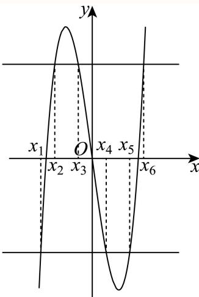
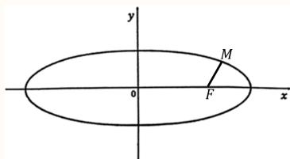
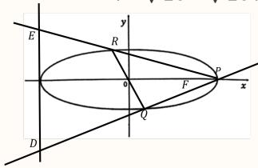

# 2025二模 不等式专题 · 教师版

> 本地预览：题目、答案及分类尚未全部审定。校对使用的PDF为高中工作台解析版，尚未逐区确认区级印刷原卷。

## 分式与绝对值不等式求解

零点和无定义点分开，绝对值分段或用距离意义；保留边界。

### 嘉定 · 第2题

不等 $\updownarrow \frac { x - 2 } { x + 1 } <$ 0的解集为

> 本题资料或解析有待核事项，预览不可作为已审定成品。

**考点：** 分式不等式与符号

**难度依据：** 分式不等式求解；需完成一次转化或结合基本条件后计算

**核查说明：** 题干出现“不等\updownarrow”等乱码，解析不等式阈值排版破损，需核原卷。；已人工阅读底稿题干和解析；尚未逐页对照原PDF，不作为数学终审。；历史分类审查记录（不把旧记录直接判为当前未解决）：题干出现“不等\updownarrow”等乱码，解析不等式阈值排版破损，需核原卷。 本次只归组，未修改题干、答案或专题归属；上述具体疑点仍交回源/数学复核处理。

【答案】(−1,2)

【解析】

由分式不等式的解法得原不等式 $\frac { x - 2 } { x + 1 } < 1$ 0等价于 $\left( x - 2 \right) \left( x + 1 \right) < 0$

解不等式 $\left( x - 2 \right) \left( x + 1 \right) < 0$ 得 $- 1 < x < 2$

故不等式 $\frac { x - 2 } { x + 1 } <$ 0的解集为(−1, 2).

故答案为：(−1,2)

### 崇明 · 第1题

不等式 $| x - 1 | < 2$ 的解集为

**考点：** 绝对值不等式解集

**难度依据：** 绝对值不等式；直接运用定义或基础公式，推理链短

**核查说明：** 已人工阅读完整底稿题干及原解，未逐页对照正式PDF，分类不等于数学终审。

【答案】(−1, 3)

【解析】

【分析】：由不等式 |x−1| < 2，可得 $- 2 < x - 1 < 2$ ，解得 $- 1 < x < 3$

由不等式 $| x - 1 | < 2$ 可得 $- 2 < x - 1 < 2$

$$
\therefore - 1 <   x <   3,
$$

故不等式 |x − 1| < 2 的解集为 (−1, 3)

故答案为：(−1, 3)

### 普陀 · 第1题

不等 $\Re { \left( 1 + \frac { 1 } { x } \right) } <$ 0的解集是

**考点：** 分式不等式求解

**难度依据：** 分式不等式；直接调用定义或基本公式，运算路径短

**核查说明：** 已人工阅读底稿题干和解析；尚未逐页对照原PDF，不作为数学终审。

【答案】(−1,0)

【解析】

根据分式不等式的解法求解即可.

因为 $1 + \frac { 1 } { x } < 0 { \Rightarrow } \frac { x + 1 } { x } < 0 { \Rightarrow } x \left( x + 1 \right) < 0 .$

所以原不等式的解集为：(−1,0).

故答案为：(−1,0)

### 杨浦 · 第2题

不等式 ${ \frac { x + 1 } { x - 2 } } <$ 0的解集为

**考点：** 分式不等式解集

**难度依据：** 分式不等式；直接运用定义或基础公式，推理链短

**核查说明：** 已人工阅读完整底稿题干及原解，未逐页对照正式PDF，分类不等于数学终审。

【解析】

将原不等式等价转化为 $\left( x + 1 \right) \left( x - 2 \right) < 0$ ，然后解该二次不等式可得出结果.不等式

${ \frac { x + 1 } { x - 2 } } <$ 0等价 $ { \mathbb { F } } ( x + 1 ) \left( x - 2 \right) < 0$ ，解得 $- 1 < x < 2$

因此，不等式 ${ \frac { x + 1 } { x - 2 } } <$ 0的解集为(−1, 2)，故答案为(−1, 2)

本题考查分式不等式的解法，解题的关键就是将分式不等式化为标准形式，转化为整式不等式求解，考查运算求解能力，属于基础题.

### 浦东 · 第1题

不等式 $\frac { x } { x - 2 } <$ 0的解集是 .

**考点：** 分式不等式解集

**难度依据：** 分式不等式；直接运用定义或基础公式，推理链短

**核查说明：** 已人工阅读完整底稿题干及原解，未逐页对照正式PDF，分类不等于数学终审。

【答案】(0,2)

【解析】

【分析】解分式不等式即可得解.

【详解】不等式 $\frac { x } { x - 2 } <$ 0化为 $x ( x - 2 ) < 0$ ，解得 $\textstyle \cdot 0 < x < 2$

所以不等式 $\frac { x } { x - 2 } <$ < 0的解集是(0, 2).

故答案为：(0,2)

### 虹口 · 第2题

不等式 $\frac { x - 2 } { x + 1 } \leq$ 0的解集是

**考点：** 分式不等式与端点

**难度依据：** 分式不等式；直接运用定义或基础公式，推理链短

**核查说明：** 已人工阅读完整底稿题干及原解，未逐页对照正式PDF，分类不等于数学终审。

【答案】(−1, 2]

【解析】

分析：把分式不等式转化为整式不等式，再利用二次不等式的结论得解

详解：原不等式等价于(x − 2)(x + 1) ≤ 0且x ≠ −1，解为− $\cdot 1 < x \leq 2$

故答案为(−1, 2]

点睛：分式不等式 ${ \frac { f ( x ) } { g ( x ) } } > 0 \Leftrightarrow f ( x ) g ( x ) > 0 , { \frac { f ( x ) } { g ( x ) } } \geq 0 \Leftrightarrow { \left\{ \begin{array} { l l } { f ( x ) g ( x ) \geq 0 } \\ { g ( x ) \neq 0 } \end{array} \right. }$ 这里容易出错，要注意

### 闵行 · 第2题

设 $\mathbf { { \bar { x } } \in \mathbf { R } }$ ，则不等式 $| x - 2 | \leq$ 5的解集为 .

**考点：** 绝对值不等式

**难度依据：** 绝对值不等式；直接调用定义或基本公式，路径短

**核查说明：** 已人工阅读底稿题干和原解；未逐页对照PDF，不作为数学终审。

【答案】[−3,7]

【解析】

解含绝对值的不等式可得解集.

由|x − 2| ≤ 5⇒−5 ≤ x − 2 ≤ 5⇒−3 ≤ x ≤ 7.

所以不等式|x − 2| ≤ 5的解集为：[−3,7].

故答案为：[−3,7]

### 静安 · 第2题

不等式 $\frac { 2 x - 1 } { x + 2 } <$ 0的解集为

**考点：** 分式不等式

**难度依据：** 分式不等式；直接调用定义或基本公式，路径短

**核查说明：** 已人工阅读底稿题干和原解；未逐页对照PDF，不作为数学终审。

【解析】

由分式不等式的解法直接求解即可.

由 $\frac { 2 x - 1 } { x + 2 } <$ < 0得： $\left( 2 x - 1 \right) \left( x + 2 \right) < 0$ ，解得： $- 2 < x < { \frac { 1 } { 2 } }$ ，∴不等式的解集为 $\left( - 2 , { \frac { 1 } { 2 } } \right)$ 故答案为： $\left( - 2 , { \frac { 1 } { 2 } } \right)$

### 黄浦 · 第1题

不等式 $\frac { x } { x - 2 } <$ 0的解集是 .

**考点：** 分式不等式

**难度依据：** 分式不等式；直接调用定义或基本公式，路径短

**核查说明：** 已人工阅读底稿题干和原解；未逐页对照PDF，不作为数学终审。

【答案】(0,2)

【解析】

【分析】解分式不等式即可得解.

【详解】不等式 $\frac { x } { x - 2 } <$ 0化为 $x ( x - 2 ) < 0$ ，解得 $\textstyle \cdot 0 < x < 2$

所以不等式 $\frac { x } { x - 2 } <$ < 0的解集是(0, 2).

故答案为：(0,2)

## 不等式性质、逻辑与反例

检查正负、零点与单调区间，比较命题强弱并构造反例。

### 嘉定 · 第13题

已知实数 $a,b$ 满足 $a>b$，则下列不等式中，不恒成立的是（　）。

A. $a^3>b^3$

B. $\dfrac ab>1$

C. $a^2+b^2>2ab$

D. $2^a>2^b$

> 本题资料或解析有待核事项，预览不可作为已审定成品。

**考点：** 不等式恒成立

**难度依据：** 恒成立条件判断；需连接多个条件、建模或作分类讨论

**核查说明：** 解析疑似截断且无明确答案标记，不能认定解析齐备。；已人工阅读底稿题干和解析；尚未逐页对照原PDF，不作为数学终审。；历史分类审查记录（不把旧记录直接判为当前未解决）：解析疑似截断且无明确答案标记，不能认定解析齐备。 本次只归组，未修改题干、答案或专题归属；上述具体疑点仍交回源/数学复核处理。

【答案】B。

【解析】选项A：$y=x^3$ 在 $\mathbb R$ 上严格递增，由 $a>b$ 得 $a^3>b^3$，恒成立。

选项B：取 $a=-1$，$b=-2$，则 $a>b$，但 $a/b=1/2<1$，不恒成立；当 $b=0$ 时该商还没有定义。

选项C：由 $a>b$ 得 $a\ne b$，故 $a^2+b^2-2ab=(a-b)^2>0$，恒成立。

选项D：$y=2^x$ 在 $\mathbb R$ 上严格递增，由 $a>b$ 得 $2^a>2^b$，恒成立。故选B。

本解析根据题设补写并独立复核；源解析截断部分另存。

### 崇明 · 第13题

若a $> b > 0 , c > d ,$ ，则下列结论正确的是（ ）

A. $a - b < 0$

B. $a c > b d$

C. $a c ^ { 2 } > b c ^ { 2 }$

D. ${ \frac { a } { c ^ { 2 } + 1 } } > { \frac { b } { c ^ { 2 } + 1 } }$

**考点：** 乘除正负及零值反例

**难度依据：** 不等式性质与反例；需一次转化并结合定义域或几何条件计算

**核查说明：** 已人工阅读完整底稿题干及原解，未逐页对照正式PDF，分类不等于数学终审。

【答案】D

【解析】
因为 $\begin{array} { r } { a > b > 0 , c > d , } \end{array}$
对于A选项， $a - b > 0$ ，A错；
对于B选项，不妨取a = 2，b = 1，c = −1，d = −2，则 $a c = - 2 = b d$ ，B错；
对于C选项，取c = 0，则 $a c ^ { 2 } = 0 = b c ^ { 2 }$ ，C错；
对于D选项，由题意可知， $c ^ { 2 } + 1 > 0$ ，由不等式的基本性质可得 ${ \frac { a } { c ^ { 2 } + 1 } } > { \frac { b } { c ^ { 2 } + 1 } }$ ，D对.故选：D.

### 松江 · 第13题

已知 $\displaystyle { 1 a , b , c , d \in \mathbf { R } }$ ，则 $\ddot { \cdot } \cdot a + c > b + d "$ 是 ${ } ^ { \mathfrak { s } } a > b$ 且 $. c > d "$ 的（ ）

A. 充分不必要条件

B. 必要不充分条件

C. 充要条件

D. 既不充分也不必要条件

**考点：** 不等式相加与条件关系

**难度依据：** 充分必要条件；需一次转化并结合定义域或几何条件计算

**核查说明：** 已人工阅读完整底稿题干及原解，未逐页对照正式PDF，分类不等于数学终审。

【答案】B

【解析】

根据不等式的性质，分析条件间的推出关系判断充分、必要性.

当 $a = 3 , b = - 2 , c = 0 , d = 2$ 时， $a + c > b + d ,$ ，但 $c > d ^ { \prime }$ 不成立，充分性不成立；

若 $\dot { \boldsymbol { a } } > b \boxed { \mathrm { H } } \boldsymbol { c } > d ,$ 则必有 $a + c > b + d .$ ，必要性成立；

故选：B

所以 $\ " a + c > b + d "$ 是 ${ } ^ { \mathfrak { s } } a > b$ 且 $. c > d `$ ”的必要不充分条件.

### 虹口 · 第13题

若a是实数，则 $^ { \mathrm { 4 } } a ^ { 2 } > 1 ^ { \prime }$ 是 $^ { 6 } a > 2 ^ { , }$ ”的（ ）条件.

A. 充要

B. 充分非必要

C. 必要非充分

D. 既非充分又非必要

**考点：** 条件对应集合包含关系

**难度依据：** 充分必要条件；直接运用定义或基础公式，推理链短

**核查说明：** 已人工阅读完整底稿题干及原解，未逐页对照正式PDF，分类不等于数学终审。

【答案】C。

【解析】

$a^2>1$ 等价于 $a>1$ 或 $a<-1$，所以 $a^2>1$ 不能推出 $a>2$；而 $a>2$ 可以推出 $a^2>1$。

因此，$a^2>1$ 是 $a>2$ 的必要非充分条件，故选C。

### 金山 · 第13题

已 $\Im a \in \mathbf { R }$ ，则下列结论不恒成立的是（ ）

A. $a + 1 > a$

B. $a + { \frac { 1 } { a } } \geq 2$

C. $| 1 - a | + | a + 2 | \geq 3$

D. $a ^ { 2 } + a + 1 > 0$

> 本题资料或解析有待核事项，预览不可作为已审定成品。

**考点：** 基本不等式条件及绝对值

**难度依据：** 不等式性质与反例；需一次转化并结合定义域或几何条件计算

**核查说明：** a=0时选项B分母无定义，判断不恒成立仍可，但讲解应标注定义条件。；已人工阅读完整底稿题干及原解，未逐页对照正式PDF，分类不等于数学终审。；历史分类审查记录（不把旧记录直接判为当前未解决）：a=0时选项B分母无定义，判断不恒成立仍可，但讲解应标注定义条件。 本次只归组，未修改题干、答案或专题归属；上述具体疑点仍交回源/数学复核处理。

【答案】B

【解析】

利用不等式性质判断AD；举例说明判断B；利用绝对值的三角形不等式判断C.

对于A， $1 > 0 \Leftrightarrow a + 1 > a .$ ，A正确；

对于B，取 $\stackrel { \cdot } { a } = - 1 , \stackrel { a } { a } + \frac { 1 } { a } = - 2 < 2$ ，B错误；

对于C， $| 1 - a | + | a + 2 | \geq | 1 - a + 2 + a | = 3$ ，当且仅当(1 − a)(a + 2) ≥ 0时取等号，C正确；

对于D， $a ^ { 2 } + a + 1 = \left( a + { \frac { 1 } { 2 } } \right) ^ { 2 } + { \frac { 3 } { 4 } } > 0$ ，D正确.

故选：B

### 长宁 · 第13题

已知非零实数 $a > b _ { \colon }$ ，则下列命题中成立的是（ ）

A. $a ^ { 2 } > b ^ { 2 }$

B. $a b > b ^ { 2 }$

C. $a ^ { 2 } + b ^ { 2 } \geq 2 { \sqrt { a b } }$

D. $a ^ { 3 } > b ^ { 3 }$

**考点：** 不等式性质与反例

**难度依据：** 不等式性质与反例；需一次代换或条件转换后计算

**核查说明：** 已人工阅读底稿题干和原解；未逐页对照PDF，不作为数学终审。

【答案】D

【解析】

利用赋值法即可判断A，B，C，根据函数的单调性即可判断D.

由已知当 $a = 2 , \ b = - 4$ ，所以 $\ a ^ { 2 } < b ^ { 2 }$ ，故A错误；

因为 $\dot { \mathbf { \zeta } } a > b ,$ ，当 $b < 0 \mathbb { H } \mathbb { H }$ ，所以 $. a b < b ^ { 2 }$ ，故B错误；

当非零实数a，b一正一负时， $\sqrt { a b }$ 无意义，故C错误；

因为 $\boldsymbol { y } = x ^ { 3 }$ 在R上单调递增，且 $. a > b$

所以 $a ^ { 3 } > b ^ { 3 }$ ，故D正确.

故选：D.

### 闵行 · 第14题

已知a > 0，b > 0，则“a + b > 2”是“ab > 1”的（ ）

A. 充分不必要条件

B. 必要不充分条件

C. 充要条件

D. 既不充分也不必要条件

**考点：** 充分必要条件；均值不等式及反例

**难度依据：** 充分必要条件；均值不等式及反例；需一次代换或条件转换后计算

**核查说明：** 已人工阅读底稿题干和原解；未逐页对照PDF，不作为数学终审。

【答案】B

【解析】

通过举例的方法，以及基本不等式，结合充分，必要条件的定义，即可判断选项$a = 1 . 5 , b = 0 . 6$ ，满足 $a + b > 2$ ，但 $. a b < 1$ - ，$\stackrel { . } { a } > 0 , b > 0 , \ a b > 1$ ，则 $a + b \geq 2 { \sqrt { a b } } > 2$ ，即 $\left| a + b > 2 \right.$ 1

所以“a + b > 2”是“ab > 1”的必要不充分条件.

故选：B

### 青浦 · 第14题

若正数 $m , n , a$ 均不为1，则下列不等式中与 $^ { * } m > n ^ { * }$ ”等价的是（ ）

A. $a ^ { m } > a ^ { n }$

B. $\log _ { a } m > \log _ { a } n$

C. $m ^ { a } > n ^ { a }$

D. $\log _ { m } a > \log _ { n } a$

**考点：** 指数、对数及幂函数单调性

**难度依据：** 指数对数幂函数单调性；需完成一次转化或结合基本条件后计算

**核查说明：** 已人工阅读底稿题干和解析；尚未逐页对照原PDF，不作为数学终审。

【答案】C

【解析】

根据指数函数、对数函数的单调性可逐一排除A，B项，通过举反例排除D项，利用幂函数的单调性可推理C项正确

对 $\operatorname { F A } ,$ 当0 $< a <$ 1时，函数 $\dot { \boldsymbol { y } } = a ^ { x }$ 单调递减，由 $m > n \bar { \mathsf { H } }$ 得 $\cdot a ^ { m } < a ^ { n }$ ，故A错误；

对 于 B ， 当 $0 < a < 1$ 时 ， 函 数 $y = \log _ { a } x$ 在 $( 0 , + \infty )$ 单 调 递 减 ， 由 $m > n > 0$ 可 得$\log _ { a } m < \log _ { a } n$ ，故B错误；

对于C，因 $m > 0 , n > 0 , \ a > 0$ ，函数 $y = x ^ { a }$ 在 $( 0 , + \infty )$ 上单调递增，由 $m > n > 0$ ，可得$m ^ { a } > n ^ { a }$ ，由 $m ^ { a } > n ^ { a }$ ，也可得 $m > n$ ，故C正确；

对于D，若取 $m = 4 , n = 2 , a = 8$ ，显然满足正数 ${ \mathrm { m } } , n , a .$ 均不为1，且 $m > n$

但 $\log _ { m } a = \log _ { 4 } 8 = { \frac { 3 } { 2 } } < \log _ { n } a = \log _ { 2 } 8 = 3$ ，即l $\log _ { m } a > \log _ { n } a \not \to m > n$ 不等价，故D错误.故选：C.

### 静安 · 第13题

$^ { * } m < 2 ^ { * }$ 是“一元二次不等 $\ ` x ^ { 2 } + m x + 1 >$ 0的解集为R”的

A. 充分不必要条件

B. 必要不充分条件

C. 充要条件

D. 既不充分也不必要条件

**考点：** 必要非充分条件；二次不等式恒成立

**难度依据：** 必要非充分条件；二次不等式恒成立；需一次代换或条件转换后计算

**核查说明：** 已人工阅读底稿题干和原解；未逐页对照PDF，不作为数学终审。

【答案】B

【解析】

由题根据一元二次不等式 $\dot { x } ^ { 2 } + m x + 1 >$ 0的解集为R，

可得 $\Delta = m ^ { 2 } - 4 < 0 , - 2 < m < 2$

所以 $^ { * } m < 2 ^ { * }$ 是“一元二次不等 $\ ` x ^ { 2 } + m x + 1 >$ 0的解集为R”的必要不充分条件.故选：B.

## 基本不等式与等号可达

先统一约束再配凑或换元，最值须核实等号条件能否同时成立。

### 奉贤 · 第18题

函数 $y = f \left( x \right)$ ，其中 $\mathfrak { 1 } f \left( x \right) = \mathbf { e } ^ { - \frac { \left( x - \mu \right) ^ { 2 } } { 2 } }$
(1) (6分)若函数 $\boldsymbol { \cdot } \boldsymbol { y } = \boldsymbol { f } \left( \boldsymbol { x } \right)$ 是偶函数，当 $f \left( t \right) = \frac { 1 } { \sqrt { \mathrm { e } } }$ 时，求t的值；
(2) (8分)求函数 $\boldsymbol { \{ y = f \left( x \right) } $ 的值域并证明对任意的正实数k和实数x，不等式 $\mathfrak { z } + \frac { 1 } { k } \geq 2 f \left( x \right)$ 恒成立

> 本题资料或解析有待核事项，预览不可作为已审定成品。

**考点：** (1)指数函数偶性与方程；(2)指数范围与基本不等式

**难度依据：** 指数函数性质与范围；需连接多个条件、建模或作分类讨论

**核查说明：** 第二问不等式左端OCR为z加1/k，需核是否为k加1/k。；已人工阅读底稿题干和解析；尚未逐页对照原PDF，不作为数学终审。；历史分类审查记录（不把旧记录直接判为当前未解决）：第二问不等式左端OCR为z加1/k，需核是否为k加1/k。 本次只归组，未修改题干、答案或专题归属；上述具体疑点仍交回源/数学复核处理。

【解析】

(1) 由已知，函数 $y = f \left( x \right)$ 的定义域为R

∵函数 $y = f \left( x \right)$ 是偶函数，∴对任意的 $x \in \mathrm { R }$ ，都有 $f \left( - x \right) = f \left( x \right)$ ，

$$
\therefore \mathrm{e} ^ {- \frac {(x - \mu) ^ {2}}{2}} = \mathrm{e} ^ {- \frac {(- x - \mu) ^ {2}}{2}}, \therefore (x + u) ^ {2} = (x - u) ^ {2}, \therefore u = 0,
$$

$$
\therefore y = f (x) = \mathrm{e} ^ {- \frac {x ^ {2}}{2}}, \because f (t) = \frac {1}{\sqrt {\mathrm{e}}}, \therefore \mathrm{e} ^ {- \frac {t ^ {2}}{2}} = \mathrm{e} ^ {- \frac {1}{2}},
$$

$\therefore y = \mathrm { e } ^ { x }$ 是R上的严格增函数， $\therefore - \frac { t ^ { 2 } } { 2 } = - \frac { 1 } { 2 }$

$$
\therefore t ^ {2} = 1, \therefore t = \pm 1;
$$

(2) $\because - \frac { ( x - u ) ^ { 2 } } { 2 } \leq 0$ 又∵ $y = \mathrm { e } ^ { x }$ 是R上的严格增函数， $\therefore f \left( x \right) = \mathrm { e } ^ { - \frac { ( x - u ) ^ { 2 } } { 2 } } \in \left( 0 , 1 \right]$ $\because k > 0 , \therefore k + { \frac { 1 } { k } } \geq 2$ 当且仅当k = 1时等号成立， $k + { \frac { 1 } { k } }$ 的最小值为2，$\because 2 f \left( x \right) \leq 2 ,$ ∴对任意的正实数k和实数x， $k + \frac { 1 } { k } \geq 2 f \left( x \right)$ 恒成立.

### 杨浦 · 第5题

已知 $\mid a > 0 , b > 0 , a + b = 2$ , ab的最大值为

**考点：** 定和积最大

**难度依据：** 基本不等式求积最值；直接运用定义或基础公式，推理链短

**核查说明：** 已人工阅读完整底稿题干及原解，未逐页对照正式PDF，分类不等于数学终审。

【答案】1

【解析】

利用基本不等式求解即可

由基本不等式得 $a b \leq \left( { \frac { a + b } { 2 } } \right) ^ { 2 } = 1$

故答案为：1

### 松江 · 第10题

如图在三棱锥 $P - A B C$ 中，PA、PB、PC两两垂直，且 $P A = 3 , P B = 2 , P C = 1$ ，设M是底面ABC内一点，定义 $f ( M ) = ( m , n , p )$ ，其中 $^ { \mathfrak { m } , n , p }$ 分别表示三棱锥 $M - P A B .$ ，三棱锥 $M - P B C$ 三棱锥 $M - P C A$ 的体积.若 $f \left( M \right) = \left( { \frac { 2 } { 3 } } , x , y \right)$ ，且 ${ \frac { a } { x } } + { \frac { 1 } { y } } \geq$ 12恒成立，则正实数 $\scriptstyle  \{ a$ 的最小值为

> 本题资料或解析有待核事项，预览不可作为已审定成品。

**考点：** 体积和约束与基本不等式

**难度依据：** 棱锥分割体积定义；需参数分类、构造递推或综合最值分析

**核查说明：** 底面内点是否排除边界及分母非零应回核原卷，解析按x,y>0处理。；已人工阅读完整底稿题干及原解，未逐页对照正式PDF，分类不等于数学终审。；历史分类审查记录（不把旧记录直接判为当前未解决）：底面内点是否排除边界及分母非零应回核原卷，解析按x,y>0处理。 本次只归组，未修改题干、答案或专题归属；上述具体疑点仍交回源/数学复核处理。

【答案】1

【解析】

根据给定的信息求出三棱锥 $P - A B C$ 的体积，进而求出 $x + y ,$ ，再利用基本不等式“1”的妙用求出最小值，并建立不等式求解.

在三棱锥 $P - A B C$ 中，PA、PB、PC两两垂直，且 $P A = 3 , P B = 2 , P C = 1$ 1

则 $x + y + { \frac { 2 } { 3 } } = V _ { P - A B C } = { \frac { 1 } { 6 } } P A \cdot P B \cdot P C = 1$ ，解得 $x + y = { \frac { 1 } { 3 } }$ ，又 $x > 0 , y > 0 , a > 0$

$$
\frac {a}{x} + \frac {1}{y} = 3 \left(\frac {a}{x} + \frac {1}{y}\right) (x + y) = 3 \left(a + 1 + \frac {a y}{x} + \frac {x}{y}\right) \geq 3 (a + 1 + 2 \sqrt {a})
$$

当且仅当 ${ \frac { a y } { x } } = { \frac { x } { y } }$ 时取等号，由 $\frac { a } { x } + \frac { 1 } { y } \geq 1$ 2恒成立，得3 $\left( a + 1 + 2 { \sqrt { a } } \right) \geq 1 2$

于是 $\left( { \sqrt { a } } + 1 \right) ^ { 2 } \geq 4$ ，解得 $a \geq 1$ ，所以正实数a的最小值为1.

故答案为：1

### 青浦 · 第11题

道路通行能力指单位时间（ 小时）内通过道路上指定断面的最大车辆数，是度量道路疏导交通能力的指标.同时为了行驶安全，车辆之间必须保持一定的安全距离.为了研究某城市道路通行能力，现给出如下假设：
假设1：车身长度均为4.8米；
假设2：所有车辆以相同的速度v（单位：千米／小时）匀速行驶；
假设3：安全距离d（单位：米）与车辆速度v近似满足 $d = 3 . 2 + 0 . 6 5 2 2 v + 0 . 0 1 v ^ { 2 }$
该城市道路通行能力的最大值约为 .（结果保留整数）

**考点：** 实际问题建模与基本不等式

**难度依据：** 道路通行能力建模；需连接多个条件、建模或作分类讨论

**核查说明：** 已人工阅读底稿题干和解析；尚未逐页对照原PDF，不作为数学终审。

【答案】821.

【解析】

由题意，先进行单位换算统一单位，整理函数解析式，利用基本不等式，可得答案.1小时= 3600秒，车辆速度v（千米／小时）换算为米／秒是 $\frac { v } { 3 . 6 }$ 米／秒.

1小时内通过的车辆数

$$
n = \frac {3 6 0 0 \times \frac {v}{3 . 6}}{4 . 8 + 3 . 2 + 0 . 6 5 2 2 v + 0 . 0 1 v ^ {2}} = \frac {1 0 0 0 v}{8 + 0 . 6 5 2 2 v + 0 . 0 1 v ^ {2}} = \frac {1 0 0 0}{0 . 0 1 v + \frac {8}{v} + 0 . 6 5 2 2}.
$$

根据基本不等 $\overrightarrow { \mathrm { x } } \mathrm { \xi } a + b \geq 2 \sqrt { a b } \left( a , b > 0 \right)$ $0 . 0 1 v + \frac { 8 } { v } \geq 2 \sqrt { 0 . 0 1 v \times \frac { 8 } { v } } = \frac { 2 \sqrt { 2 } } { 5 }$

当且仅当 $0 . 0 1 v = { \frac { 8 } { v } }$ 时等号成立.所 $\tan \leq { \frac { 1 0 0 0 } { \frac { 2 { \sqrt { 2 } } } { 5 } + 0 . 6 5 2 2 } } \approx 8 2 1$

即该城市道路通行能力的最大值约为821.

故答案为：821.

### 静安 · 第10题

已知 $a > b , a b = 1$ ，则 $\frac { a ^ { 2 } + b ^ { 2 } } { a - b }$ 的最小值是

**考点：** 换元与基本不等式

**难度依据：** 换元与基本不等式；需一次代换或条件转换后计算

**核查说明：** 已人工阅读底稿题干和原解；未逐页对照PDF，不作为数学终审。

【解析】

∵ ab = 1，a > b，

$$
\therefore \frac {a ^ {2} + b ^ {2}}{a - b} = \frac {(a - b) ^ {2} + 2 a b}{a - b} = a - b + \frac {2}{a - b} \geqslant 2 \sqrt {(a - b) \cdot \frac {2}{a - b}} = 2 \sqrt {2},
$$

当且仅当 $a - b = { \frac { 2 } { a - b } }$

即 $a - b = { \sqrt { 2 } }$ 时取等号，

故 $\frac { a ^ { 2 } + b ^ { 2 } } { a - b }$ 的最小值是 $2 { \sqrt { 2 } } .$

## 函数性质转化与区间恒成立

用定义域、单调性或最值把含参不等式转为参数约束，区分存在与任意。

### 嘉定 · 第18题

已知函数 $\mathbf { \boldsymbol { y } } = \mathbf { \boldsymbol { f } } \left( \boldsymbol { x } \right)$ ，其中 $f \left( x \right) = a \cdot \mathbf { e } ^ { x } + b \cdot \mathbf { e } ^ { - x }$ ，a，b为实常数且 $\boldsymbol a \boldsymbol b \neq 0$
(1) (6分)若 $y = f \left( x \right)$ 为偶函数，且其最小值为4，求实数a与b的值；
(2) (8分)若a = 1， $g \left( x \right) = \mathbf { e } ^ { x } - x$ ，对任意实数x均满足 $f \left( x \right) \geq g \left( x \right)$ ，求实数b的取值范围

**考点：** (1)指数函数偶性与最值；(2)导数与不等式恒成立

**难度依据：** 指数函数性质与导数恒成立；需综合转化、参数分析或完整证明，推理链较长

**核查说明：** 已人工阅读底稿题干和解析；尚未逐页对照原PDF，不作为数学终审。

【解析】

(1) 由题设 $f \left( - x \right) = f ( x ) \Rightarrow a \cdot \mathrm { e } ^ { - x } + b \cdot \mathrm { e } ^ { x } = a \cdot \mathrm { e } ^ { x } + b \cdot \mathrm { e } ^ { - x }$

所以 $( a - b ) \cdot \mathrm e ^ { - x } = ( a - b ) \cdot \mathrm e ^ { x }$ 恒成立，则 $a = b , ~ \mathbb { Z } a b \neq 0$

所以 $f \left( x \right) = a ( \mathrm { e } ^ { x } + \mathrm { e } ^ { - x } )$ 的最小值为4，显然 ${ \mathrm { : } } a > 0$ ，

又 $\mathrm { e } ^ { x } + \mathrm { e } ^ { - x } \geq 2$ ，当且仅当x = 0时取等号，则 $f \left( x \right) \geq 2 a = 4$ ，即 $\quad \mathrm { I } _ { a } = 2$

所以 $\overset { \vartriangle } { \boldsymbol { a } } = \boldsymbol { b } = \boldsymbol { 2 }$ ，经检验满足题设，故 $\dot { \boldsymbol { a } } = \boldsymbol { b } = 2$ ；

(2) 由题设 $\mathrm { e } ^ { x } + b \mathrm { e } ^ { - x } \geq \mathrm { e } ^ { x } - x$ ，即在R上 $. b \geq - x \mathrm { e } ^ { x }$ x恒成立，

令 $\cdot h ( x ) = - x \mathrm { e } ^ { x }$ ，则 $h ^ { \prime } ( x ) = - ( x + 1 ) \mathrm { e } ^ { x }$

当 $x < - 1 \sharp \dag h ^ { \prime } ( x ) > 0 , h ( x ) \dag \pounds ( - \infty , - 1 )$ 上单调递增，

当x > −1时h′(x) < 0，h(x)在 $( - 1 , + \infty )$ 上单调递减，

所以 $h \left( x \right) \leq h \left( - 1 \right) = \frac { 1 } { \mathrm { e } }$ ，故 $b \geq \frac { 1 } { \mathrm { e } }$

### 宝山 · 第18题

已知函数 $f ( x ) = a ^ { x }$ ，（a > 0且 $. a \neq 1 )$
(1) (6分)若 $f \left( 2 \right) = 4 .$ ，求方程 $f ( x ) - f ( - x ) = 2$ 的解；
(2) (8分)已知0 $< a < 1$ ，若关于x的不等式 $[ f ( m x ) ] ^ { 2 } \geq f \left( x ^ { 2 } + 1 \right) \cdot f \left( x + 3 \right)$ 在区间[1, 2]上恒成立，求实数m的最大值.

**考点：** (1)指数代换解方程；(2)指数单调性及恒成立参数

**难度依据：** 指数方程与区间恒成立；需连接多个条件或多步模型转化

**核查说明：** 已人工阅读完整底稿题干及原解，未逐页对照正式PDF，分类不等于数学终审。

【解析】

(1) M即 $\mathrm { l } a ^ { 2 } = 4$ ,解得a = 2，于是 $f ( x ) = 2 ^ { x }$ ，

方程 $f ( x ) - f ( - x ) = { \mathfrak { s } }$ 2即为 ${ } ^ { 2 ^ { x } - 2 ^ { - x } = 2 }$ ，

令 $\cdot t = 2 ^ { x } > 0$ ，则有 $\dot { t } - \frac { 1 } { t } = 2$ 即 $t ^ { 2 } - 2 t - 1 = 0$

求得 $t = 1 \pm { \sqrt { 2 } }$ （舍负） ，

所以方程的解为 $x = \log _ { 2 } \left( 1 + { \sqrt { 2 } } \right)$

(2) 由已知 $\left[ f ( m x ) \right] ^ { 2 } \geq f \left( x ^ { 2 } + 1 \right) \cdot f \left( x + 3 \right)$ 得 $\left( a ^ { m x } \right) ^ { 2 } \geq a ^ { x ^ { 2 } + 1 } \cdot a ^ { x + 3 }$

整理得 $a ^ { 2 m x } \geq a ^ { x ^ { 2 } + x + 4 }$

因为 $0 < a < 1$ ，所以 $2 m x \leq x ^ { 2 } + x + 4$ ，

从而 $2 m \leq { \frac { x ^ { 2 } + x + 4 } { x } } = x + { \frac { 4 } { x } } +$ 1对任意 $x \in [ 1 , 2 ]$ 恒成立，

因为 $\displaystyle { | x + \frac { 4 } { x } + 1 \geq 2 \sqrt { 4 } + 1 = 5 }$ （当且仅当x = 2取等号），

所以 $2 m \leq 5$

即实数m的最大值为 $\frac { 5 } { 2 }$

### 崇明 · 第18题

已知 $| f ( x ) = \log _ { 3 } ( x + a ) + \log _ { 3 } ( 6 - x )$
(1) (6分)是否存在实数a，使得函数 $y = f ( x )$ 是偶函数？若存在，求实数a的值，若不存在，请说明理由；
(2) (8分)若a > −3且 $. a \neq 0$ ，解关于x的不等式 $f ( x ) \leq f ( 6 - x )$

**考点：** (1)定义域对称与偶函数；(2)真数约束及参数符号分类

**难度依据：** 对数函数偶性及含参不等式；需连接多个条件或多步模型转化

**核查说明：** 已人工阅读完整底稿题干及原解，未逐页对照正式PDF，分类不等于数学终审。

【解析】

(1) 存在实数a = 6，使得函数y = f(x)是偶函数.

要使函数 $f ( x ) = \log _ { 3 } ( x + a ) + \log _ { 3 } ( 6 - x )$ 有意义，须满足 $\displaystyle { \int _ { 0 } ^ { x + a > 0 } }$ 即 $\left\{ { x > - a } \atop { x < 6 }  \right. ,$ 显然 $- a < 6$ ，即a > −6，函数 $\{ y = f ( x )$ 的定义域 $D = ( - a , 6 )$

当 $a \neq 6$ 时，函数定义域不关于原点对称，此时必然存在 $x \in D$ 且 $- x \notin D$ ，此时函数$y = f ( x )$ 不是偶函数.

当a = 6时， $f ( x ) = \log _ { 3 } ( x + 6 ) + \log _ { 3 } ( 6 - x )$

函数y = f(x)的定义域为(−6,6)，对于任意的 $x \in ( - 6 , 6 )$ )，都有 $- x \in \left( - 6 , 6 \right)$

并且 $f ( - x ) = \log _ { 3 } ( - x + 6 ) + \log _ { 3 } ( 6 + x ) = f ( x )$

因此函数y = f(x)是一个偶函数

综上所述，存在实数 $; a = 6 ,$ ，使得函数 $y = f ( x )$ 是偶函数

(2) 由 $f ( x ) \leq f ( 6 - x )$ ，得 $\log _ { 3 } ( x + a ) + \log _ { 3 } ( 6 - x ) \leq \log _ { 3 } ( 6 - x + a ) + \log _ { 3 } x$

所以 $\left\{ \begin{array} { l l } { x + a > 0 , } \\ { 6 - x > 0 , } \\ { 6 - x + a > 0 } \\ { x > 0 } \end{array} \right.$ 且 $( x + a ) ( 6 - x ) \leq ( 6 - x + a ) x \textcircled { 1 }$

由①得， $a x \geq 3 a .$

因为 $\vert a > - 3$ 且 $. a \neq 0 .$

所以当− $\cdot 3 < a <$ 0时，− $\cdot a < x \le 3$

当 $\mathsf { i } a >$ 0时， $3 \leq x < 6$

综上可得：当 $- 3 < a <$ < 0时，不等式 $f ( x ) \leq f ( 6 - x )$ )的解集为(−a,3]；当a > 0时，不等式$f ( x ) \leq f ( 6 - x )$ 的解集为[3, 6).

### 杨浦 · 第8题

不等式 $| x + 3 | + | a - x | > 6$ 对一切实数x恒成立，则实数a的取值范围为

**考点：** 数轴两点距离和最小

**难度依据：** 绝对值距离和恒成立；需一次转化并结合定义域或几何条件计算

**核查说明：** 已人工阅读完整底稿题干及原解，未逐页对照正式PDF，分类不等于数学终审。

【答案】$\left( - \infty , - 9 \right) \cup \left( 3 , + \infty \right)$

【解析】

由绝对值的几何意义和结合三角不等式分析即可.

|x + 3|表示x到−3的距离， $| a - x | = | x - a |$ |表示x到a的距离，它们的和为x到−3和x到a的距离之和，

根据三角不等式，当x位于−3和a之间时，距离和取得最小值，即两点之间的距离为$| a - ( - 3 ) | = | a + 3 | ,$

所以不等式 $| x + 3 | + | a - x | >$ 6对一切实数x恒成立等价于若最小值 $\left| a + 3 \right| > 6$ ，则原式对所有x恒成立，

所以 $. a + 3 >$ 6或 $a + 3 < - 6$ ，解得a > 3或a < −9.

故答案为： $\left( - \infty , - 9 \right) \cup \left( 3 , + \infty \right)$

### 杨浦 · 第17题

已知函数 $y = f \left( x \right)$ 是定义在R上的偶函数.
(1) (6分)当 $x \in [ 0 , + \infty )$ 时， $f \left( x \right) = \log _ { 2 } \left( x + 1 \right)$ ，求 $x \in ( - \infty , 0 )$ 时， $y = f \left( x \right)$ 的表达式；
(2) (8分)当 $x \in [ 0 , + \infty )$ 时， $f \left( x \right) = x ^ { 3 } + 2 0 2 5 ^ { x }$ ，若实数t满足 $f \left( 3 t - 2 \right) < f \left( t - 1 \right)$ ，求t的取值范 围.

> 本题资料或解析有待核事项，预览不可作为已审定成品。

**考点：** (1)偶性补全解析式；(2)偶性单调性转绝对值不等式

**难度依据：** 偶函数与单调性；需连接多个条件或多步模型转化

**核查说明：** 第二问平方展开系数应为8t^2，底稿写18t^2，与解集不一致，须修复。；已人工阅读完整底稿题干及原解，未逐页对照正式PDF，分类不等于数学终审。；历史分类审查记录（不把旧记录直接判为当前未解决）：第二问平方展开系数应为8t^2，底稿写18t^2，与解集不一致，须修复。 本次只归组，未修改题干、答案或专题归属；上述具体疑点仍交回源/数学复核处理。

【解析】

(1) 因为函数 $y = f \left( x \right)$ 是定义在R上的偶函数，即 $f \left( - x \right) = f \left( x \right)$

当 $x \in ( - \infty , 0 )$ 时， $- x \in ( 0 , + \infty )$

所以 $f \left( - x \right) = \log _ { 2 } \left( - x + 1 \right)$

所以 $f \left( x \right) = \log _ { 2 } \left( - x + 1 \right)$

(2) 当 $x \in [ 0 , + \infty )$ 时， $f \left( x \right) = x ^ { 3 } + 2 0 2 5 ^ { x }$

由幂函数和指数函数的单调性可得f(x)为递增函数.

又函数为偶函数，

所以 $f \left( 3 t - 2 \right) < f \left( t - 1 \right) \Leftrightarrow \left| 3 t - 2 \right| < \left| t - 1 \right| ,$

两边平方后展开可得 $9 t ^ { 2 } - 1 2 t + 4 < t ^ { 2 } - 2 t + 1$ ，即 $1 8 t ^ { 2 } - 1 0 t + 3 < 0$

解得 $\frac { 1 } { 2 } < t < \frac { 3 } { 4 }$

### 浦东 · 第17题

已知函数 $y = f \left( x \right)$ 的表达式 $f \left( x \right) = { \frac { 1 } { \mathrm { e } ^ { x } + 1 } } - a .$
(1) (7分)若函数 $y = f \left( x \right)$ 是奇函数，求实数a的值；
(2) (7分)对任意实数 $\cdot x \in [ - 1 , 1 ]$ ，不等式 $f \left( x \right) \leq$ 0恒成立，求实数a的取值范围

**考点：** (1)函数奇偶性求参数；(2)单调性求区间恒成立参数

**难度依据：** 指数函数奇偶性与恒成立；需连接多个条件或多步模型转化

**核查说明：** 已人工阅读完整底稿题干及原解，未逐页对照正式PDF，分类不等于数学终审。

【解析】

(1) 因为函数 $y = f \left( x \right)$ 是奇函数， $y = f \left( x \right)$ 的定义域 $( - \infty , + \infty )$ 关于原点对称，

由 $f \left( - x \right) = { \frac { 1 } { \mathrm { e } ^ { - x } + 1 } } - a = { \frac { \mathrm { e } ^ { x } } { 1 + \mathrm { e } ^ { x } } } - a$

则

$$
f (- x) + f (x) = \frac {\mathrm{e} ^ {x}}{1 + \mathrm{e} ^ {x}} + \frac {1}{\mathrm{e} ^ {x} + 1} - 2 a = 1 - 2 a = 0,
$$

所以 $a = { \frac { 1 } { 2 } }$

(2) 对任意实数 $x \in [ - 1 , 1 ]$ ，不等式 $f \left( x \right) \leq 0 \nVDash { \vec { \mathrm { \Pi } } }$ 立，即 $a \geq \frac { 1 } { \mathrm { e } ^ { x } + 1 }$ 恒成立，

$$
\text {设} g (x) = \frac {1}{\mathrm{e} ^ {x} + 1},
$$

对任意实数 $\mathbf { \dot { \Phi } } _ { x _ { 1 } , x _ { 2 } } \in [ - 1 , 1 ] \mathrm { H } x _ { 1 } < x _ { 2 }$

$$
g \left(x _ {1}\right) - g \left(x _ {2}\right) = \frac {1}{\mathrm{e} ^ {x _ {1}} + 1} - \frac {1}{\mathrm{e} ^ {x _ {2}} + 1} = \frac {\mathrm{e} ^ {x _ {2}} - \mathrm{e} ^ {x _ {1}}}{\left(\mathrm{e} ^ {x _ {1}} + 1\right) \left(\mathrm{e} ^ {x _ {2}} + 1\right)},
$$

因为 $x _ { 1 } < x _ { 2 }$ ，所以 $\mathbf { e } ^ { x _ { 1 } } < \mathbf { e } ^ { x _ { 2 } }$ ，所以 $g \left( x _ { 1 } \right) - g \left( x _ { 2 } \right) > 0$

所以函数 $y = g ( x ) \# [ - 1 _ { : }$ ,1]上单调递减；

$g \left( x \right) \leq g \left( - 1 \right) = \frac { \mathrm { ~ e ~ } } { \mathrm { ~ e ~ } + 1 }$ ，所以 $a \geq \frac { \mathrm { ~ e ~ } } { \mathrm { ~ e ~ } + 1 }$

### 虹口 · 第18题

已知函数 $\mathbf { \boldsymbol { y } } = \mathbf { \boldsymbol { f } } \left( \boldsymbol { x } \right)$ 的表达式为 $\left| f \left( x \right) \right. = 2 ^ { x } , \left. x \in \mathbf { R } \right.$
(1) (6分)解不等式： $\log _ { 2 } { [ f \left( x \right) - 1 ] } + \log _ { 2 } { [ f \left( x \right) ] } \leq 1$ ；
(2) (8分)若存在实数 $x _ { 0 } \in \left[ 0 , { \frac { \pi } { 2 } } \right]$ ，使得 $f ( m \sin x _ { 0 } ) , f ( 2 + \sin 2 x _ { 0 } ) , f ( m \cos x _ { 0 } )$ 成等比数列，求实数m的最小值.

> 本题资料或解析有待核事项，预览不可作为已审定成品。

**考点：** (1)指数换元与对数定义域；(2)等比中项、三角代换与参数最小

**难度依据：** 指数对数方程不等式；需连接多个条件或多步模型转化

**核查说明：** 原解第二问指数等式跨行截断，需修复，避免将sin2x丢失。；已人工阅读完整底稿题干及原解，未逐页对照正式PDF，分类不等于数学终审。；历史分类审查记录（不把旧记录直接判为当前未解决）：原解第二问指数等式跨行截断，需修复，避免将sin2x丢失。 本次只归组，未修改题干、答案或专题归属；上述具体疑点仍交回源/数学复核处理。

【解析】

（1）由题意，$2^x-1>0$，且

$$\log_2\bigl[(2^x-1)2^x\bigr]\leq\log_2 2.$$

由对数函数的单调性，得 $(2^x-1)2^x\leq2$。结合 $x>0$，解得 $0<x\leq1$。

（2）由等比中项关系，得

$$2^{m\sin x_0}\cdot2^{m\cos x_0}=\left(2^{2+\sin2x_0}\right)^2,$$

所以 $m(\sin x_0+\cos x_0)=4+2\sin2x_0$。令 $t=\sin x_0+\cos x_0$，则 $t\in[1,\sqrt2]$，且

$$m=2\left(t+\frac1t\right).$$

函数 $t+\dfrac1t$ 在 $[1,\sqrt2]$ 上单调递增，故 $m\in[4,3\sqrt2]$，最小值为 $4$。

## 三角与多项式不等式的解集结构

从三角符号或函数图像划分解集，再研究整数点或区间长度。

### 嘉定 · 第15题

已知关于x的不等式 $| \sin 2 x | > \cos$ x在区间 $[ 0 , 2 \pi ]$ ]内有k个整数解，则k的值为（ ）

A. 3

B. 4

C. 5

D. 6

**考点：** 三角不等式及整数解

**难度依据：** 三角不等式与整数解；需连接多个条件、建模或作分类讨论

**核查说明：** 已人工阅读底稿题干和解析；尚未逐页对照原PDF，不作为数学终审。

【答案】C

【解析】

由二倍角正弦公式有 $2 \left| \sin x \cos x \right| > \cos x$ ，讨论 $x \in \left( 0 , \frac { \pi } { 2 } \right) \cup \left( \frac { 3 \pi } { 2 } , 2 \pi \right)$ $x \in \left( { \frac { \pi } { 2 } } , { \frac { 3 \pi } { 2 } } \right)$ ，结合正余弦函数的性质解不等式求解集，进而确定整数解的个数.由题设2 $| \sin x \cos x | > \cos x$ ，显然 $: x \notin \left\{ 0 , \frac { \pi } { 2 } , \frac { 3 \pi } { 2 } , 2 \pi \right\}$ ，当 $x \in \left( 0 , \frac { \pi } { 2 } \right) \cup \left( \frac { 3 \pi } { 2 } , 2 \pi \right)$ ，则 $| \sin x | > { \frac { 1 } { 2 } }$ ，此时 $x \in \left( { \frac { \pi } { 6 } } , { \frac { \pi } { 2 } } \right) \cup \left( { \frac { 3 \pi } { 2 } } , { \frac { 1 1 \pi } { 6 } } \right)$ 当 $x \in \left( { \frac { \pi } { 2 } } , { \frac { 3 \pi } { 2 } } \right)$ 则2 $| \sin x \cos x | \geq 0 > \cos x$ ，此时 $x \in \left( { \frac { \pi } { 2 } } , { \frac { 3 \pi } { 2 } } \right)$ 所以，整数解有1,2,3,4,5，共5个整数解.

故选：C

### 闵行 · 第12题

定义 $D = [ a , b ]$ 的区间长度为b−a．若 $m < 0$ 且关于x的不等式 $| ( x - 1 ) ^ { 3 } + m ( x - 1 ) | \leq 1$ 6的解集的区间长度之和为T，则当T取最大值时，实数m的值为

> 本题资料或解析有待核事项，预览不可作为已审定成品。

**考点：** 三次函数水平截线与区间总长；绝对值三次不等式

**难度依据：** 三次函数水平截线与区间总长；绝对值三次不等式；需证明新定义命题或完成复杂参数分类

**核查说明：** 阈值16断裂为1和6；多处−12断裂；需核源。；已人工阅读底稿题干和原解；未逐页对照PDF，不作为数学终审。；历史分类审查记录（不把旧记录直接判为当前未解决）：阈值16断裂为1和6；多处−12断裂；需核源。 本次只归组，未修改题干、答案或专题归属；上述具体疑点仍交回源/数学复核处理。

【答案】−12.

【解析】

先由图象平移的性质得到 $| x ^ { 3 } + m x | \leq 1 6 |$ 区间长度与原题一致，再构造函数 $\cdot f \left( x \right)$ ，利用导数分析单调性，利用对称性仅考虑 $x > 0$ 即可，然后 $f \left( { \sqrt { \frac { - m } { 3 } } } \right)$ 等于，大于和小于−16三种情况讨论，结合三次韦达定理求解.

由题意， $( x - 1 ) ^ { 3 } + m ( x - 1 ) ^ { \sharp } \varkappa x ^ { 3 } + m x$ 向右平移得到，即 $| x ^ { 3 } + m x | \leq 1 6$ 区间长度与原题一致，

不妨设 $f \left( x \right) = x ^ { 3 } + m x$ ，易得 $f ^ { \prime } \left( x \right) = 3 x ^ { 2 } + m \geq 0 \Rightarrow x \geq \sqrt { \frac { - m } { 3 } } \Re \hat { \zeta } x x \leq - \sqrt { \frac { - m } { 3 } }$

即f (x)在 $( - \infty , - { \sqrt { \frac { - m } { 3 } } } ) \not \exists \not \in { \sqrt { \frac { - m } { 3 } } } , + \infty )$ 上单调递增， $\left. \sqrt { \pm } \left( - \sqrt { \frac { - m } { 3 } } , \sqrt { \frac { - m } { 3 } } \right) \right.$ 上单调递

减，

由 $f \left( x \right)$ 关于(0, 0)对称，仅考虑x > 0即可，当分类讨论：

当 $f \left( { \sqrt { \frac { - m } { 3 } } } \right) = { \frac { - m } { 3 } } { \sqrt { \frac { - m } { 3 } } } + m { \sqrt { \frac { - m } { 3 } } } = - 1 6 \Rightarrow m = - 1$ 2时，

易得 $f \left( x \right) = x ^ { 3 } - 1 2 x = 1 6 \Rightarrow x _ { 1 } = - 2 , x _ { 2 } = 4$ ，即 $T = 8$ ；

当f $\cdot \left( { \sqrt { \frac { - m } { 3 } } } \right) = { \frac { - m } { 3 } } { \sqrt { \frac { - m } { 3 } } } + m { \sqrt { \frac { - m } { 3 } } } > - 1 6 \Rightarrow m > - 1$ 12时，

$$
f (4) = 6 4 + 4 m > 1 6 \Rightarrow T <   8;
$$

当f $: \left( \sqrt { \frac { - m } { 3 } } \right) = { \frac { - m } { 3 } } \sqrt { \frac { - m } { 3 } } + m \sqrt { \frac { - m } { 3 } } < - 1 6 \Rightarrow m < - 1 ^ { \cdot }$ 2时，

如下图，

不妨设 $x ^ { 3 } + m x = 1$ 6的三个跟分别为 $\displaystyle x _ { 2 } , x _ { 3 } , x _ { 6 }$

不妨设 $\ x ^ { 3 } + m x = - 1$ 16的三个跟分别为 $x _ { 1 } , x _ { 4 } , x _ { 5 }$

由三次韦达定理可得 $x _ { 2 } + x _ { 3 } + x _ { 6 } = 0 , x _ { 1 } + x _ { 4 } + x _ { 5 } = 0$

$$
T = x _ {2} - x _ {1} + x _ {4} - x _ {3} + x _ {6} - x _ {5} = 2 \left(x _ {4} - x _ {3}\right) <   8,
$$

综上，当且仅当 $m = - 1$ 2时， $T = 8$

故答案为：−12.

## 二、选择题

## 几何与统计量中的最值比较

将距离、面积比或方差比较改写为代数表达式，保留严格等号和可达条件。

### 嘉定 · 第20题

已知椭圆C： ${ \frac { x ^ { 2 } } { 9 } } + y ^ { 2 } = 1$ ．F为椭圆的右焦点，过椭圆上一点 $P \left( 3 , 0 \right)$ 的直线 $\vdots l _ { 1 }$ 交椭圆于另 $- \sharp { \sf Q }$ 点M为椭圆上任意一点

(1) (4分)求|MF|的最小值；
(2) (6分)当直线l1的斜率为1时，求 $\triangle P Q M$ 面积的最大值及此时点M的坐标；
(3) (8分)若直线PQ与直线 $\mathbf { \langle } l _ { 2 } : x = - 3$ 交于点D，点D不在x轴上，Q关于原点的对称点为点R，直线PR与 $\mathrm { i } _ { 2 }$ 交于点E，求线段|DE|的取值范围

> 本题资料或解析有待核事项，预览不可作为已审定成品。

**考点：** (1)椭圆焦点距离；(2)弦与三角形面积最值；(3)直线联立及距离范围

**难度依据：** 椭圆焦点距离与弦三角形面积最值；需综合转化、参数分析或完整证明，推理链较长

**核查说明：** 题干过P直线的交点Q等文字OCR损坏，需校对原卷。；已人工阅读底稿题干和解析；尚未逐页对照原PDF，不作为数学终审。；历史分类审查记录（不把旧记录直接判为当前未解决）：题干过P直线的交点Q等文字OCR损坏，需校对原卷。 本次只归组，未修改题干、答案或专题归属；上述具体疑点仍交回源/数学复核处理。

【解析】

(1)

由椭圆方程 ${ \frac { x ^ { 2 } } { 9 } } + y ^ { 2 } = 1$ 知， $a ^ { 2 } = 9 , b ^ { 2 } = 1 , c ^ { 2 } = a ^ { 2 } - b ^ { 2 } = 9 - 1 = 8$ ，所以右焦点$F \left( 2 { \sqrt { 2 } } , 0 \right)$

设 $M \left( m , n \right)$ ，则 $| M F | = \sqrt { \left( m - 2 \sqrt { 2 } \right) ^ { 2 } + n ^ { 2 } }$ ，由 ${ \frac { m ^ { 2 } } { 9 } } + n ^ { 2 } = 1 \Rightarrow n ^ { 2 } = 1 - { \frac { m ^ { 2 } } { 9 } }$ 代入得：

$$
| M F | = \sqrt {\left(m - 2 \sqrt {2}\right) ^ {2} + n ^ {2}} = \sqrt {\left(m - 2 \sqrt {2}\right) ^ {2} + 1 - \frac {m ^ {2}}{9}}
$$

$$
= \sqrt {\frac {8 m ^ {2}}{9} - 4 \sqrt {2} m + 9} = \frac {\sqrt {8 m ^ {2} - 3 6 \sqrt {2} m + 8 1}}{3},
$$

由于 $m \in [ - 3 , 3 ]$ ，对称轴 $m = \frac { 9 \sqrt { 2 } } { 4 } > 3 .$ ，

所以 $| M F | \geq { \frac { { \sqrt { 8 \times 9 - 3 6 { \sqrt { 2 } } } } \times 3 + 8 1 } { 3 } } = { \sqrt { 1 7 - 1 2 { \sqrt { 2 } } } } = { \sqrt { 9 - 2 \times 3 \times { \sqrt { 8 } } + 8 } } = 3 - 2 { \sqrt { 2 } }$

即|MF|的最小值为 $\hphantom { - } 3 - 2 \sqrt { 2 }$ ，此时点M为椭圆的右顶点.

(2)

由直线l 的斜率为1且经过P(3,0)，可得直线方程 $y = x - 3$

与椭圆 ${ \frac { x ^ { 2 } } { 9 } } + y ^ { 2 } = 1$ 联立方程组，消元得： ${ \frac { x ^ { 2 } } { 9 } } + ( x - 3 ) ^ { 2 } = 1 \Rightarrow 1 0 x ^ { 2 } - 5 4 x + 7 2 = 0 ,$

解得 $x = 3 , x = { \frac { 1 2 } { 5 } }$ ，则代入 $\ 、 x = { \frac { 1 2 } { 5 } }$ 得： $y = { \frac { 1 2 } { 5 } } - 3 = - { \frac { 3 } { 5 } }$ ，所以Q $\left( { \frac { 1 2 } { 5 } } , - { \frac { 3 } { 5 } } \right)$

$$
| P Q | = \sqrt {\left(\frac {1 2}{5} - 3\right) ^ {2} + \left(- \frac {3}{5} - 0\right) ^ {2}} = \frac {3 \sqrt {2}}{5},
$$

设平行于直线 $\dot { \iota } _ { 1 }$ 的直线方程为 $y = x + t ,$ ，则与椭圆 ${ \frac { x ^ { 2 } } { 9 } } + y ^ { 2 } = 1$ 联立方程组，消元得：

${ \frac { x ^ { 2 } } { 9 } } + \left( x + t \right) ^ { 2 } = 1 \Rightarrow 1 0 x ^ { 2 } + 1 8 t x + 9 t ^ { 2 } - 9 = 0$ 当此直线与椭圆相切时，满足判别式为0

即 $\Delta = 1 8 ^ { 2 } t ^ { 2 } - 4 \times 1 0 \times \left( 9 t ^ { 2 } - 9 \right) = 0$ ，解得 $t = \pm \sqrt { 1 0 }$

根据数形结合可得 $t = { \sqrt { 1 0 } } \mathbb { H }$ 时，满足切点M取到 $\triangle P Q M$ 面积最大值，

此时方程为 $1 0 x ^ { 2 } + 1 8 { \sqrt { 1 0 } } x + 8 1 = 0 \Rightarrow \left( { \sqrt { 1 0 } } x + 9 \right) ^ { 2 } = 0 \Rightarrow x = - { \frac { 9 } { \sqrt { 1 0 } } } ,$

代入直线得 $\cdot y = - { \frac { 9 } { \sqrt { 1 0 } } } + { \sqrt { 1 0 } } = { \frac { 1 } { \sqrt { 1 0 } } }$ ，则 $M \left( - { \frac { 9 } { \sqrt { 1 0 } } } , { \frac { 1 } { \sqrt { 1 0 } } } \right)$

由点M $\left( - { \frac { 9 } { \sqrt { 1 0 } } } , { \frac { 1 } { \sqrt { 1 0 } } } \right)$ 到直线 $y = x -$ 3的距离公式得：

$$
d = \frac {\left| - \frac {9}{\sqrt {1 0}} - \frac {1}{\sqrt {1 0}} - 3 \right|}{\sqrt {2}} = \frac {3 + \sqrt {1 0}}{\sqrt {2}},
$$

所以 $\triangle P Q M$ 面积的最大值为 $S = { \frac { 1 } { 2 } } \times { \frac { 3 { \sqrt { 2 } } } { 5 } } \times { \frac { 3 + { \sqrt { 1 0 } } } { \sqrt { 2 } } } = { \frac { 9 + 3 { \sqrt { 1 0 } } } { 1 0 } }$

此时点 $M \left( - { \frac { 9 } { \sqrt { 1 0 } } } , { \frac { 1 } { \sqrt { 1 0 } } } \right)$ ；

(3)

设过点 $P \left( 3 , 0 \right)$ 直线为： $y = k \left( x - 3 \right)$ ，与椭圆 ${ \frac { x ^ { 2 } } { 9 } } + y ^ { 2 } = 1$ 联立方程组，消元得：

$$
\frac {x ^ {2}}{9} + k ^ {2} (x - 3) ^ {2} = 1 \Rightarrow (1 + 9 k ^ {2}) x ^ {2} - 5 4 k ^ {2} x + 8 1 k ^ {2} - 9 = 0,
$$

$$
\Delta = \left(- 5 4 k ^ {2}\right) ^ {2} - 4 (1 + 9 k ^ {2}) (8 1 k ^ {2} - 9) = 3 6 > 0,
$$

再由于交点D不在x轴上，即 $k \neq 0$

设交点 $Q \left( x _ { 1 } , y _ { 1 } \right)$ ，则有 $x _ { 1 } + 3 = { \frac { 5 4 k ^ { 2 } } { 1 + 9 k ^ { 2 } } } \Rightarrow x _ { 1 } = { \frac { 2 7 k ^ { 2 } - 3 } { 1 + 9 k ^ { 2 } } }$

代入 $x _ { 1 } = \frac { 2 7 k ^ { 2 } - 3 } { 1 + 9 k ^ { 2 } }$ 得： $y _ { 1 } = k \left( { \frac { 2 7 k ^ { 2 } - 3 } { 1 + 9 k ^ { 2 } } } - 3 \right) = { \frac { - 6 k } { 1 + 9 k ^ { 2 } } } ,$

由于Q关于原点的对称点为点R，所以R $\left( - \frac { 2 7 k ^ { 2 } - 3 } { 1 + 9 k ^ { 2 } } , \frac { 6 k } { 1 + 9 k ^ { 2 } } \right)$ ，

则直线PR方程为 $\displaystyle y = { \frac { \frac { 6 k } { 1 + 9 k ^ { 2 } } } { \displaystyle - { \frac { 2 7 k ^ { 2 } - 3 } { 1 + 9 k ^ { 2 } } } - 3 } } ( x - 3 )$ 与直线x = −3相交得：

E点纵坐标为 $\vert y = - 6 { \frac { \overline { { 1 + 9 k ^ { 2 } } } } { - { \frac { 2 7 k ^ { 2 } - 3 } { 1 + 9 k ^ { 2 } } } - 3 } } = { \frac { 2 } { 3 k } } .$

而直线 $y = k \left( x - 3 \right)$ 与直线x = −3相交得：

D点纵坐标为 $y = - 6 k$

所以可得 $| D E | = \left| { \frac { 2 } { 3 k } } + 6 k \right| = \left| { \frac { 2 } { 3 k } } \right| + | 6 k | \geq 2 { \sqrt { \left| { \frac { 2 } { 3 k } } \right| \cdot | 6 k | } } = 4$

当且仅当 ${ \bigg | } { \frac { 2 } { 3 k } } { \bigg | } = { \big | } 6 k { \big | }$ ，即 $\vert k = \pm \frac { 1 } { 3 }$ 时，|DE|取到最小值4.

即|DE|的取值范围是 $[ 4 , + \infty )$

### 闵行 · 第20题

已知双曲线Γ: $x ^ { 2 } - { \frac { y ^ { 2 } } { 3 } } = 1$ 的右焦点为F，过点F的直线l交双曲线Γ右支于A、B两点（点A在x轴上方），点C在双曲线Γ上，直线AC交x轴于点Q（点Q在点F的右侧）
(1) (4分)求双曲线Γ的渐近线方程；
(2) (6分)若点A (2, 3)，且 $\tan \angle B A C = \frac { 1 } { 2 }$ ，求点C的坐标；
(3) (8分)若 $\triangle A B C$ 的重心G在x轴上，记 $\triangle A F G , \ \triangle C Q G$ 的面积分别为S1、 $S _ { 2 }$ ，求 $\frac { S _ { 1 } } { S _ { 2 } }$ 的最小值

**考点：** （1）双曲线渐近线；（2）角度条件与直线交双曲线；（3）重心条件转面积比及最小值

**难度依据：** 双曲线焦点弦与重心面积比；均值求比值最小；需证明新定义命题或完成复杂参数分类

**核查说明：** 已人工阅读底稿题干和原解；未逐页对照PDF，不作为数学终审。

【解析】

(1) 已知双曲线Γ: $: x ^ { 2 } - { \frac { y ^ { 2 } } { 3 } } = 1$ ，则 $a = 1 , b = { \sqrt { 3 } } ,$ ，所以双曲线方程为 $y = \pm \sqrt { 3 } x$

(2) 双曲线Γ: $x ^ { 2 } - { \frac { y ^ { 2 } } { 3 } } = 1$ 的右焦点 $F \left( 2 , 0 \right)$

又A (2, 3)，所以 $A B \bot O F$ ，则B (2, −3)，

因为 $\tan \angle B A C = \frac { 1 } { 2 }$ ，所以k $\ O _ { A C } = \tan \left( \angle B A C + \frac { \pi } { 2 } \right) = - \frac { 1 } { \tan \angle B A C } = - 2 ,$

则直线 $A C \colon y - 3 = - 2 \left( x - 2 \right)$ ，即 $y = - 2 x + 7$

所以 $\left\{ x ^ { 2 } - { \frac { y ^ { 2 } } { 3 } } = 1 \right. \Rightarrow x ^ { 2 } - 2 8 x + 5 2 = 0$ 解得 $x _ { 1 } = 2 , x _ { 2 } = 2 6$ ，即 $; c = 2 6$

则 $| y _ { C } = - 2 \times 2 6 + 7 = - 4 5$ ，所以点C的坐标为(26,−45)；

(3) 设直线 $A B : x = t y + 2 , A ( x _ { 1 } , y _ { 1 } ) , B ( x _ { 2 } , y _ { 2 } ) , C ( x _ { 3 } , y _ { 3 } )$

$$
\left\{ \begin{array}{l} x = t y + 2 \\ x ^ {2} - \frac {y ^ {2}}{3} = 1 \end{array} \Rightarrow (3 t ^ {2} - 1) y ^ {2} + 1 2 t y + 9 = 0, t ^ {2} \neq \frac {1}{3}, \Delta = 3 6 (t ^ {2} + 1) > 0 \right.
$$

则 $| y _ { 1 } + y _ { 2 } = - { \frac { 1 2 t } { 3 t ^ { 2 } - 1 } } , y _ { 1 } y _ { 2 } = { \frac { 9 } { 3 t ^ { 2 } - 1 } }$

因为直线l过点F且与双曲线Γ右支交于A、B两点，所以 $t \in \left( - { \frac { \sqrt { 3 } } { 3 } } , { \frac { \sqrt { 3 } } { 3 } } \right)$

又因为 $\triangle A B C$ 的重心G在x轴上，所以 $y _ { 1 } + y _ { 2 } + y _ { 3 } = 0$ ，

由点Q在点F的右侧，可得 $y _ { 3 } < 0 _ { : }$ ，所以 $y _ { 1 } + y _ { 2 } > 0$ ，解得 $t > 0 _ { : }$ ，所以 $: \in \left( 0 , \frac { \sqrt { 3 } } { 3 } \right)$

而 $| y _ { 1 } - y _ { 2 } | = { \sqrt { \left( y _ { 1 } + y _ { 2 } \right) ^ { 2 } - 4 y _ { 1 } y _ { 2 } } }$ ，代入可得 $y _ { 1 } - y _ { 2 } = - { \frac { 6 { \sqrt { t ^ { 2 } + 1 } } } { 3 t ^ { 2 } - 1 } }$

所以 $\frac { S _ { 1 } } { S _ { 2 } } = \frac { \displaystyle \frac { S _ { 1 } } { S _ { \bigtriangleup A B G } } } { \displaystyle \frac { S _ { 2 } } { S _ { \bigtriangleup A C G } } } = \frac { \displaystyle \frac { | A F | } { | A B | } } { \displaystyle \frac { | C Q | } { | A C | } } = \frac { \displaystyle \frac { y _ { 1 } } { y _ { 1 } - y _ { 2 } } } { \displaystyle \frac { - y _ { 3 } } { y _ { 1 } - y _ { 3 } } } = \frac { \displaystyle \frac { y _ { 1 } } { y _ { 1 } - y _ { 2 } } } { \displaystyle \frac { y _ { 1 } + y _ { 2 } } { 2 y _ { 1 } + y _ { 2 } } }$

$$
= \frac {\left(y _ {1} + y _ {2} + y _ {1}\right) \left(y _ {1} + y _ {2} - y _ {2}\right)}{\left(y _ {1} - y _ {2}\right) \left(y _ {1} + y _ {2}\right)} = \frac {y _ {1} + y _ {2}}{y _ {1} - y _ {2}} + 1 - \frac {y _ {1} y _ {2}}{\left(y _ {1} - y _ {2}\right) \left(y _ {1} + y _ {2}\right)},
$$

代入化简可得： $\frac { S _ { 1 } } { S _ { 2 } } = \frac { 1 3 t ^ { 2 } + 1 } { 8 t \sqrt { t ^ { 2 } + 1 } } + 1$

所以

$$
\begin{array}{l} \frac {S _ {1}}{S _ {2}} = \frac {1 3 t ^ {2} + 1}{8 t \sqrt {t ^ {2} + 1}} + 1 = \frac {1 2 t ^ {2}}{8 t \sqrt {t ^ {2} + 1}} + \frac {t ^ {2} + 1}{8 t \sqrt {t ^ {2} + 1}} + 1 \geq 2 \sqrt {\frac {1 2 t ^ {2}}{8 t \sqrt {t ^ {2} + 1}} \cdot \frac {t ^ {2} + 1}{8 t \sqrt {t ^ {2} + 1}}} + 1 = \\ \frac {\sqrt {3}}{2} + 1 \end{array}
$$

当且仅当 $t = { \frac { \sqrt { 1 1 } } { 1 1 } }$ 时等号成立，所以 $\frac { S _ { 1 } } { S _ { 2 } }$ 的最小值为 ${ \frac { \sqrt { 3 } } { 2 } } + 1$

### 黄浦 · 第15题

设 $x_1<x_2<x_3<x_4$，随机变量 $X$ 取值 $x_1$、$x_2$、$x_3$、$x_4$ 的概率均为0.25，随机变量 $X_1$ 取值 $\frac{x_1+x_2}{2}$、$\frac{x_2+x_3}{2}$、$\frac{x_3+x_4}{2}$、$\frac{x_4+x_1}{2}$ 的概率也均为0.25，随机变量 $X_2$ 取值 $2x_1-x_2$、$2x_2-x_3$、$2x_3-x_4$、$2x_4-x_1$ 的概率也均为0.25。若记 $D[X_1]$、$D[X_2]$ 分别为 $X_1$、$X_2$ 的方差，则（ ）。

A. $D[X_1]<D[X_2]$

B. $D[X_1]=D[X_2]$

C. $D[X_1]>D[X_2]$

D. $D[X_1]$ 与 $D[X_2]$ 的大小关系与 $x_1$、$x_2$、$x_3$、$x_4$ 的取值有关

> 本题资料或解析有待核事项，预览不可作为已审定成品。

**考点：** 线性组合二阶矩与方差比较；平方和及严格等号条件

**难度依据：** 线性组合二阶矩与方差比较；平方和及严格等号条件；需多步建模、分类或参数约束

**核查说明：** 题干已回源；原解析未全面数学审校，公式及其他问题仍需处理。；已人工阅读底稿题干和原解；未逐页对照PDF，不作为数学终审。；历史分类审查记录（不把旧记录直接判为当前未解决）：题干已回源；原解析未全面数学审校，公式及其他问题仍需处理。 当前底稿已有回源补丁，涉及question；具体修复范围以底稿patches和2025二模-题干回源补丁-首批.json为准。本题仍按可辨数学任务归组，不据分组宣称数学已审定。

【答案】A

【解析】

根据随机变量 $X _ { 1 } , X _ { 2 }$ 的取值情况，计算出它们的期望和方差，再借助均值不等式即可判断作答.

由随机变 $\sharp X _ { 1 } , X _ { 2 }$ 的取值情况，它们的期望分别为：

$$
E X _ {1} = \frac {1}{4} \left(\frac {x _ {1} + x _ {2}}{2} + \frac {x _ {2} + x _ {3}}{2} + \frac {x _ {3} + x _ {4}}{2} + \frac {x _ {4} + x _ {1}}{2}\right) = \frac {1}{4} (x _ {1} + x _ {2} + x _ {3} + x _ {4}),
$$

$E X _ { 2 } = { \frac { 1 } { 4 } } ( 2 x _ { 1 } - x _ { 2 } + 2 x _ { 2 } - x _ { 3 } + 2 x _ { 3 } - x _ { 4 } + 2 x _ { 4 } - x _ { 1 } ) = { \frac { 1 } { 4 } } ( x _ { 1 } + x _ { 2 } + x _ { 3 } + x _ { 4 } ) ,$ ，即

$$
E X _ {2} = E X _ {1},
$$

$$
D X _ {1} = \frac {1}{4} \left[ \left(\frac {x _ {1} + x _ {2}}{2}\right) ^ {2} + \left(\frac {x _ {2} + x _ {3}}{2}\right) ^ {2} + \left(\frac {x _ {3} + x _ {4}}{2}\right) ^ {2} + \left(\frac {x _ {4} + x _ {1}}{2}\right) ^ {2} \right] - (E X _ {1}) ^ {2},
$$

$$
\left(\frac {x _ {1} + x _ {2}}{2}\right) ^ {2} + \left(\frac {x _ {2} + x _ {3}}{2}\right) ^ {2} + \left(\frac {x _ {3} + x _ {4}}{2}\right) ^ {2} + \left(\frac {x _ {4} + x _ {1}}{2}\right) ^ {2}
$$

$$
= \frac {2 \left(x _ {1} ^ {2} + x _ {2} ^ {2} + x _ {3} ^ {2} + x _ {4} ^ {2}\right) + 2 x _ {1} x _ {2} + 2 x _ {2} x _ {3} + 2 x _ {3} x _ {4} + 2 x _ {4} x _ {1}}{4}
$$

同理 $\begin{array} { l } { \displaystyle { D X _ { 2 } = \frac { 1 } { 4 } \big [ ( 2 x _ { 1 } - x _ { 2 } ) ^ { 2 } + ( 2 x _ { 2 } - x _ { 3 } ) ^ { 2 } + ( 2 x _ { 3 } - x _ { 4 } ) ^ { 2 } + ( 2 x _ { 4 } - x _ { 1 } ) ^ { 2 } \big ] - ( E X _ { 2 } ) ^ { 2 } , } } \end{array}$

$$
\left[ \left(2 x _ {1} - x _ {2}\right) ^ {2} + \left(2 x _ {2} - x _ {3}\right) ^ {2} + \left(2 x _ {3} - x _ {4}\right) ^ {2} + \left(2 x _ {4} - x _ {1}\right) ^ {2} \right.
$$

$$
= 5 \left(x _ {1} ^ {2} + x _ {2} ^ {2} + x _ {3} ^ {2} + x _ {4} ^ {2}\right) - 4 \left(x _ {1} x _ {2} + x _ {2} x _ {3} + x _ {3} x _ {4} + x _ {4} x _ {1}\right)
$$

则 $D \left[ X _ { 2 } \right] - D \left[ X _ { 1 } \right]$

$$
= \frac {1}{4}
$$

$$
\left[ 5 \left(x _ {1} ^ {2} + x _ {2} ^ {2} + x _ {3} ^ {2} + x _ {4} ^ {2}\right) - 4 \left(x _ {1} x _ {2} + x _ {2} x _ {3} + x _ {3} x _ {4} + x _ {4} x _ {1}\right) - \right.
$$

$$
\left. \frac {\left(x _ {1} ^ {2} + x _ {2} ^ {2} + x _ {3} ^ {2} + x _ {4} ^ {2}\right) + \left(x _ {1} x _ {2} + x _ {2} x _ {3} + x _ {3} x _ {4} + x _ {4} x _ {1}\right)}{2} \right]
$$

$$
\frac {9 \left[ \left(x _ {1} ^ {2} + x _ {2} ^ {2} + x _ {3} ^ {2} + x _ {4} ^ {2}\right) - \left(x _ {1} x _ {2} + x _ {2} x _ {3} + x _ {3} x _ {4} + x _ {4} x _ {1}\right) \right]}{8},
$$

因为 $\begin{array} { r } { \iota x _ { 1 } ^ { 2 } + x _ { 2 } ^ { 2 } \geq 2 x _ { 1 } x _ { 2 } , x _ { 3 } ^ { 2 } + x _ { 2 } ^ { 2 } \geq 2 x _ { 3 } x _ { 2 } , x _ { 3 } ^ { 2 } + x _ { 4 } ^ { 2 } \geq 2 x _ { 4 } x _ { 3 } , x _ { 1 } ^ { 2 } + x _ { 4 } ^ { 2 } \geq 2 x _ { 4 } x _ { 1 } } \end{array}$

所以x21 + x22 + x23 + x24 ≥ x1x2 + x2x3 + x3x4 + x4x1，

因为 $x _ { 1 } < x _ { 2 } < x _ { 3 } < x _ { 4 }$ ，不能取等号，所以 $x _ { 1 } ^ { 2 } + x _ { 2 } ^ { 2 } + x _ { 3 } ^ { 2 } + x _ { 4 } ^ { 2 } > x _ { 1 } x _ { 2 } + x _ { 2 } x _ { 3 } + x _ { 3 } x _ { 4 } + x _ { 4 } x _ { 1 }$

所以 $D \left[ X _ { 2 } \right] - D \left[ X _ { 1 } \right] > 0$

所以 $D \left[ X _ { 2 } \right] > D \left[ X _ { 1 } \right]$

故选：A.

## 导数与递推估计的证明

用单调性、辅助函数或递推收缩控制差商及累积量，避免跳过边界。

### 奉贤 · 第21题

函数 $y = f \left( x \right)$ ，其中 $f \left( x \right) = x ^ { 3 } - x ^ { 2 } + { \frac { 1 } { 2 } } x + { \frac { 1 } { 4 } }$ ，定义域是一切实数
(1) (4分)计算 $\mathrm { { . l i m } } _ { h  0 } \frac { f ( 2 + h ) - f ( 2 ) } { h }$ 的值并指出其几何意义；
(2) (6分)当 $\left| x \in \left( 0 , { \frac { 1 } { 2 } } \right) \right.$ 时，方程 $f \left( x \right) = a + x$ 只有一个解，求实数a的取值范围；
(3) (8分)设 $x _ { 1 } = 0 , x _ { n + 1 } = f ( x _ { n } ) , y _ { 1 } = { \frac { 1 } { 2 } } , y _ { n + 1 } = f ( y _ { n } ) , n \geq 1 , n \in \mathrm { N } , b _ { n } = y _ { n } - x _ { n }$ ．求证： $\sum _ { i = 1 } ^ { n } b _ { n } \in ( 0 , 1 )$

> 本题资料或解析有待核事项，预览不可作为已审定成品。

**考点：** (1)差商与导数；(2)方程根的唯一性；(3)递推数列夹逼与求和

**难度依据：** 差商与方程根；需构造新对象、综合多问并处理一般性或参数边界

**核查说明：** 源PDF第（3）问与解析写sum b_n但展开按sum b_i；两种理解均在新解析处理，题干保持原样。；第三问求和底稿写sum b_n，解析使用sum b_i，含义不同，须核原卷。；已人工阅读底稿题干和解析；尚未逐页对照原PDF，不作为数学终审。；历史分类审查记录（不把旧记录直接判为当前未解决）：第三问求和底稿写sum b_n，解析使用sum b_i，含义不同，须核原卷。 本次只归组，未修改题干、答案或专题归属；上述具体疑点仍交回源/数学复核处理。

【解析】

（1）$f(2)=\dfrac{21}{4}$，且

$$\lim_{h\to0}\frac{f(2+h)-f(2)}{h}=f'(2)=\frac{17}{2}.$$

其几何意义是曲线在点 $\left(2,\dfrac{21}{4}\right)$ 处切线的斜率为 $\dfrac{17}{2}$。

（2）令 $g(x)=f(x)-x=x^3-x^2-\dfrac12x+\dfrac14$。由于

$$g'(x)=3\left(x-\frac13\right)^2-\frac56<0\qquad\left(0<x<\frac12\right),$$

函数 $g$ 在该区间内严格递减；又 $g(0)=\dfrac14$，$g\left(\dfrac12\right)=-\dfrac18$，因此所求范围为 $\left(-\dfrac18,\dfrac14\right)$。

（3）由（2），$g$ 在 $\left(0,\dfrac12\right)$ 内有唯一零点 $c$，即 $f(c)=c$。由 $f'(x)=3x^2-2x+\dfrac12>0$ 知 $f$ 严格递增。结合 $f(x)-x$ 在 $c$ 两侧的符号，归纳得

$$0\leq x_n<x_{n+1}<c<y_{n+1}<y_n\leq\frac12.$$

因而 $0<x_n+y_n<1$，且

$$\begin{aligned}
0<\frac{b_{n+1}}{b_n}
&=x_n^2+x_ny_n+y_n^2-(x_n+y_n)+\frac12\\
&\leq\left(x_n+y_n-\frac12\right)^2+\frac14<\frac12.
\end{aligned}$$

于是 $0<b_n\leq2^{-n}$，对 $n\geq2$ 为严格不等式，故

$$0<\sum_{i=1}^{n}b_i\leq\sum_{i=1}^{n}2^{-i}=1-2^{-n}<1.$$

源卷第（3）问和源解析的求和符号写作 $\sum_{i=1}^{n}b_n$，但后续展开按 $\sum_{i=1}^{n}b_i$ 计算。若按原式字面理解，$\sum_{i=1}^{n}b_n=nb_n\leq n2^{-n}<1$，同样成立。

### 松江 · 第21题

已知f ${ \overline { { \cdot ( x ) = \ln \left( x - 1 \right) + { \frac { 2 a } { x } } - { \frac { 4 } { 3 } } , a \in \mathrm { R } . } } }$
(1) (4分)若x = 4是函数 $y = f ( x )$ 的一个极值点，求曲线y = f(x)在点P (4, f (4))处的切线方程；
(2) (6分)讨论函数 $y = f ( x )$ 的单调性；
(3) (8分)已知实数 $[ a = 0 ,$ 若点A (x1, y1)、 $B \left( x _ { 2 } , y _ { 2 } \right) \left( x _ { 1 } < x _ { 2 } \right)$ )是曲线 $\dot { \boldsymbol { \mu } } y = f ( \boldsymbol { x } )$ 上两点，直线AB的斜率为k，求证： $x _ { 1 } < \frac { 1 + k } { k } < x _ { 2 }$

> 本题资料或解析有待核事项，预览不可作为已审定成品。

**考点：** (1)极值点与切线；(2)含参导数分类；(3)割线斜率与对数不等式

**难度依据：** 对数函数切线与含参单调；需参数分类、构造递推或综合最值分析

**核查说明：** 解析第一问导数分式、第三问割线分母及函数名有OCR损坏，需逐式修复。；已人工阅读完整底稿题干及原解，未逐页对照正式PDF，分类不等于数学终审。；历史分类审查记录（不把旧记录直接判为当前未解决）：解析第一问导数分式、第三问割线分母及函数名有OCR损坏，需逐式修复。 当前底稿已有回源补丁，涉及answer_and_solution；具体修复范围以底稿patches和2025二模-解析公式回源补丁-第二批.json为准。本题仍按可辨数学任务归组，不据分组宣称数学已审定。

【解析】

(1) f(x)的定义域为 $( 1 , + \infty )$ ，

由 $f \left( x \right) = \ln \left( x - 1 \right) + \frac { 2 a } { x } - \frac { 4 } { 3 }$ ，得 $f ^ { \prime } \left( x \right) = { \frac { 1 } { x - 1 } } - { \frac { 2 a } { x ^ { 2 } } }$

因为x = 4是函数 $y = f ( x )$ 的一个极值点，

所以 $f'(4)=\frac1{4-1}-\frac{2a}{4^2}=0$ ，即 $\frac { 1 } { 3 } - \frac { a } { 8 } = 0 .$ ，解得 $a = { \frac { 8 } { 3 } }$

则f (x) = ln (x − 1) + 16 43 ， f′ (x) = 1x − 1 162 (x − 4) (3x − 4)3 2 ( − 1) ，

则f′ (x) > 0得1 $< x < \frac { 4 } { 3 } \Re \backslash >$ 4；f′ (x) < 0得 $\frac { 4 } { 3 } < x < 4$

则 $f \left( x \right) \# \left( 1 , \frac { 4 } { 3 } \right)$ 和 $( 4 , + \infty )$ 上单调递增，在 $\left( { \frac { 4 } { 3 } } , 4 \right)$ 上单调递减，

则x = 4是f(x)的极小值点，

$$
f (4) = \ln 3 + \frac {4}{3} - \frac {4}{3} = \ln 3, f ^ {\prime} (4) = 0,
$$

则切线方程为 $y - \ln { 3 } = 0 \left( x - 4 \right)$ ，整理得 $y = \ln 3$

(2) f(x)的定义域为(1, +∞)， $f ^ { \prime } \left( x \right) = { \frac { 1 } { x - 1 } } - { \frac { 2 a } { x ^ { 2 } } } = { \frac { x ^ { 2 } - 2 a x + 2 a } { x ^ { 2 } ( x - 1 ) } }$

${ \mathfrak { P } } g \left( x \right) = x ^ { 2 } - 2 a x + 2 a$ ，其对称轴为 $x = a , \Delta = 4 a ^ { 2 } - 8 a = 4 a ( a - 2 )$

①当 $\Delta \le 0$ ，即 $0 \leq a \leq$ 2时， $g \left( x \right) \geq 0 , f ^ { \prime } \left( x \right) \geq 0$ ，则 $f \left( x \right) \overleftarrow { \mathbb { E } } ( 1 , + \infty )$ 上单调递增；②当 $\Delta > 0$ ，即 $\begin{array} { r } { \vert a < 0 \not \equiv \not \chi a > } \end{array}$ 2时，

（i）当a > 2时，g(x) = 0的两根为 $x _ { 1 } = a - { \sqrt { a ^ { 2 } - 2 a } } , x _ { 2 } = a + { \sqrt { a ^ { 2 } - 2 a } } ,$

且1 $< x _ { 1 } < x _ { 2 }$

则当 $1 < x < x _ { 1 }$ 或 $x > x _ { 2 }$ 时， $g \left( x \right) > 0 , f ^ { \prime } \left( x \right) > 0$ ；

当 $x _ { 1 } < x < x _ { 2 }$ 时， $g \left( x \right) < 0 , f ^ { \prime } \left( x \right) < 0$

（ii）当a < 0时，g(x)的对称轴 $x = a < 0$ ，且g (1) = 1，

则g(x) > 0在(1,+∞)上恒成立，即 $f ^ { \prime } \left( x \right) > 0 \overleftarrow { \pm } { } ( 1 , + \infty )$ 上恒成立.

综上，当a ≤ 2时，f(x)在(1,+∞)上单调递增；

当a > 2时，f (x)在 $\left( 1 , a - { \sqrt { a ^ { 2 } - 2 a } } \right)$ 和 $\left( a + { \sqrt { a ^ { 2 } - 2 a } } , + \infty \right)$ 上单调递增，在$\left( a - { \sqrt { a ^ { 2 } - 2 a } } , a + { \sqrt { a ^ { 2 } - 2 a } } \right)$ 上单调递减.

(3) 已知a = 0，则 $f \left( x \right) = \ln \left( x - 1 \right) - \frac { 4 } { 3 } .$

则 $| k = { \frac { f ( x _ { 2 } ) - f ( x _ { 1 } ) } { x \circ - x _ { 1 } } } = { \frac { \ln ( x _ { 2 } - 1 ) - \ln ( x _ { 1 } - 1 ) } { x \circ - x _ { 1 } } }$ $\frac { 1 + k } { k } = \frac { 1 } { k } + 1 = \frac { x _ { 2 } - x _ { 1 } } { \ln { ( x _ { 2 } - 1 ) } - \ln { ( x _ { 1 } - 1 ) } } + 1 ,$

要证 $x _ { 1 } < \frac { 1 + k } { k } < x _ { 2 }$ ，即证 $x _ { 1 } < \frac { x _ { 2 } - x _ { 1 } } { \ln { \left( x _ { 2 } - 1 \right) } - \ln { \left( x _ { 1 } - 1 \right) } } + 1 < x _ { 2 }$ ，

即证 $x _ { 1 } - 1 < \displaystyle \frac { x _ { 2 } - x _ { 1 } } { \ln \displaystyle \frac { x _ { 2 } - 1 } { x _ { 1 } - 1 } } < x _ { 2 } - 1$

令 $\dot { t } = \frac { x _ { 2 } - 1 } { x _ { 1 } - 1 } ( t > 1 )$ ，则只需证1 $< \frac { t - 1 } { \ln t } < t ,$

先证 $\frac { t - 1 } { \ln t } > 1 ( t > 1 )$ ，即证 $\vdots - 1 > \ln { t } ,$

令 $\begin{array} { r } { \ i ( t ) = t - 1 - \ln t \left( t > 1 \right) } \end{array}$ ，则 $h ^ { \prime } \left( t \right) = 1 - \frac { 1 } { t } = \frac { t - 1 } { t } > 0 _ { }$

所以h(t)在(1,+∞)上单调递增，则 $h ( t ) > h ( 1 ) = 0$ ，即 $t - 1 > \ln t$ ；

再证 $\frac { t - 1 } { \ln t } < t ( t > 1 )$ ，即证 $t - 1 < t \ln t$

令 $m ( t ) = t \ln t - ( t - 1 ) ( t > 1 )$ ，则 $\left| m ^ { \prime } ( t ) = \ln t + 1 - 1 = \ln t > 0 \right.$

综上， $x _ { 1 } < \frac { 1 + k } { k } < x _ { 2 }$ 得证.

所以m(t)在 $( 1 , + \infty )$ 上单调递增，则 $m ( t ) > m ( 1 ) = 0$ ，即 $t - 1 < t \ln t .$

