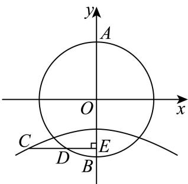
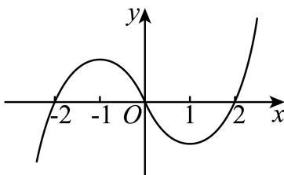

# 2025二模 函数与导数专题 · 教师版

> 本地预览：题目、答案及分类尚未全部审定。校对使用的PDF为高中工作台解析版，尚未逐区确认区级印刷原卷。

## 基本函数运算、定义域与分段求值

先确定定义域与函数类型，递归分段先归约到基本区间；换底与定点不依赖求导。

### 宝山 · 第4题

已知函数 $: f \left( x \right) = \left\{ \begin{array} { l l } { x ^ { 2 } + 2 \ , \ x < 1 , } \\ { f \left( x - 2 \right) \ , \ x \ge 1 } \end{array} \right.$ 则f (4)=

**考点：** 递归函数代入求值

**难度依据：** 递归分段函数求值；直接运用定义或基础公式，推理链短

**核查说明：** 已人工阅读完整底稿题干及原解，未逐页对照正式PDF，分类不等于数学终审。

【答案】2.

【解析】

由分段函数的解析式，代入已知值，可得答案.

由题意可得 $f \left( 4 \right) = f \left( 2 \right) = f \left( 0 \right) = 0 ^ { 2 } + 2 = 2$

故答案为：2.

### 宝山 · 第7题

已知函数 $\mathbf { \xi } : y = a ^ { x + 1 } - \log _ { a } { ( x + 2 ) } + 1 ( a > 0$ 且 $. a \neq 1 )$ )的图像经过定点A，则点A的坐标为

> 本题资料或解析有待核事项，预览不可作为已审定成品。

**考点：** 指数对数定点

**难度依据：** 指数对数混合函数定点；需一次转化并结合定义域或几何条件计算

**核查说明：** 解析将-log_a(1)+1排为-log_a(1+1)，括号位置错误，答案定点不据此改动。；已人工阅读完整底稿题干及原解，未逐页对照正式PDF，分类不等于数学终审。；历史分类审查记录（不把旧记录直接判为当前未解决）：解析将-log_a(1)+1排为-log_a(1+1)，括号位置错误，答案定点不据此改动。 本次只归组，未修改题干、答案或专题归属；上述具体疑点仍交回源/数学复核处理。

【答案】(−1, 2).

【解析】

根据指数函数和对数函数的图象与性质求解即可

$\widehat { \vec { \bf { v } } } x = - 1$ ，可得 $y = a ^ { - 1 + 1 } - \log _ { a } { ( - 1 + 2 ) } + 1 = a ^ { 0 } - \log _ { a } { 1 + 1 } = 2 .$

所以定点A的坐标为(−1,2).

故答案为：(−1, 2).

### 徐汇 · 第4题

已知幂函数y = f(x)的图像过点 $\left( 3 , { \frac { \sqrt { 3 } } { 3 } } \right)$ ，则该幂函数的值域是

**考点：** 幂函数由点求式与值域

**难度依据：** 幂函数解析式及值域；直接运用定义或基础公式，推理链短

**核查说明：** 已人工阅读完整底稿题干及原解，未逐页对照正式PDF，分类不等于数学终审。

【答案】(0,+∞).

【解析】

根据幂函数定义代入点可得 $f \left( x \right) = { \frac { 1 } { \sqrt { x } } }$ ，即可得函数值域.

设幂函数 $f \left( x \right) = x ^ { \alpha } , \alpha \in \mathbf { R }$

代入点 $\left( 3 , { \frac { \sqrt { 3 } } { 3 } } \right)$ 可得 $3 ^ { \alpha } = { \frac { \sqrt { 3 } } { 3 } } = 3 ^ { - { \frac { 1 } { 2 } } }$ ，即 $\mathsf { I } _ { \alpha = - \frac 1 2 }$

可得 $f \left( x \right) = x ^ { - \frac { 1 } { 2 } } = \frac { 1 } { \sqrt { x } }$

因为 $\sqrt { x } > 0$ ，可得 $f \left( x \right) = \frac { 1 } { \sqrt { x } } > 0$ 所以该幂函数的值域是 $( 0 , + \infty )$

故答案为：(0,+∞).

### 松江 · 第1题

已知集合A = {−1, 0, 1, 2}, $B = \{ x \mid y = \log _ { 2 } x \}$ ，则A ∩ B = .

**考点：** 对数定义域与交集

**难度依据：** 集合交集与对数定义域；直接运用定义或基础公式，推理链短

**核查说明：** 已人工阅读完整底稿题干及原解，未逐页对照正式PDF，分类不等于数学终审。

【答案】{1, 2}.

【解析】

化简集合B，根据交集运算求解.

集合B是函数 $[ y = \log _ { 2 } ]$ x的定义域，对数函数中真数大于0，所以 $B = \{ x \mid x > 0 \}$ }

又 $A = \{ - 1 , 0 , 1 , 2 \}$ ，所以 $A \cap B = \{ 1 , 2 \}$

故答案为：{1, 2}.

### 金山 · 第8题

已知 $\left\{ a _ { n } \right\}$ 是等差数列，若 $\dot { a } _ { 3 } , a _ { 7 }$ 分别是函数 $y = x ^ { 2 } - 4 x +$ 2的两个零点，则 $\stackrel { } { a } _ { 5 } =$

**考点：** 对称项等差中项

**难度依据：** 等差中项与韦达关系；需一次转化并结合定义域或几何条件计算

**核查说明：** 已人工阅读完整底稿题干及原解，未逐页对照正式PDF，分类不等于数学终审。

【答案】2

【解析】

转化为 $| a _ { 3 } , a _ { 7 }$ 是 $x ^ { 2 } - 4 x + 2 = 0$ 0的两个根，由韦达定理和等差数列性质得到 $a _ { 5 } = { \frac { a _ { 3 } + a _ { 7 } } { 2 } } = 2 \qquad $ 由题意得 $a _ { 3 } , a _ { 7 }$ 是 $x ^ { 2 } - 4 x + 2 = 0$ 的两个根，

由韦达定理得 $a _ { 3 } + a _ { 7 } = 4$

因为 $\{ a _ { n } \}$ 是等差数列，所以 $a _ { 5 } = { \frac { a _ { 3 } + a _ { 7 } } { 2 } } = 2$

故答案为：2

### 金山 · 第10题

已知函数 $\cdot y = g \left( x \right)$ 的图象是折线段 $A B C$ ，且 $A \left( 0 , 0 \right) , B \left( \frac { 1 } { 2 } , \frac { 1 } { 2 } \right) , C \left( 1 , 0 \right)$ ，则函数$y = x \cdot g \left( x \right) \left( 0 \leq x \leq 1 \right)$ )的图象与x轴围成的图形面积为

> 本题资料或解析有待核事项，预览不可作为已审定成品。

**考点：** 分段二次函数与对称面积转化

**难度依据：** 分段函数曲边面积；需连接多个条件或多步模型转化

**核查说明：** 面积转化依赖题图标点，而图中A与题干A重名；需核图并清晰区分辅助点。；已人工阅读完整底稿题干及原解，未逐页对照正式PDF，分类不等于数学终审。；历史分类审查记录（不把旧记录直接判为当前未解决）：面积转化依赖题图标点，而图中A与题干A重名；需核图并清晰区分辅助点。 本次只归组，未修改题干、答案或专题归属；上述具体疑点仍交回源/数学复核处理。

【答案】$\frac 1 8$

【解析】

根据题意，求出 ${ \stackrel { \cdot } { \operatorname { J } } } g \left( x \right)$ 的表达式，进而得到 $y = x \cdot g \left( x \right)$ 的表达式，利用图象分割求解面积.

由题可得， $g \left( x \right) = \left\{ \begin{array} { l l } { { x , 0 \leq x \leq \frac 1 2 } } \\ { { \qquad \quad - x + 1 , \frac 1 2 < x \leq 1 } } \end{array} \right.$

$$
\therefore y = x \cdot g (x) = \left\{ \begin{array}{l} x ^ {2}, 0 \leq x \leq \frac {1}{2} \\ - x ^ {2} + x, \frac {1}{2} <   x \leq 1 \end{array} , \right.
$$

设函数 $y = x \cdot g ( x ) ( 0 \leq x \leq 1 )$ 的图象与x轴围成的图形面积为S，

如图，由二次函数 $\scriptstyle \cdot y = x ^ { 2 }$ 和 $| y = - x ^ { 2 } + x \overline { { \Theta } } ]$ 知，曲边三角形OEA的面积等于曲边三角形ACF的面积，

所以 $S = S _ { A C F E } = \frac { 1 } { 2 } \times \frac { 1 } { 4 } = \frac { 1 } { 8 }$

故答案为： $\frac 1 8$

### 长宁 · 第7题

已知 $\log_{18}9=a$，$18^b=5$，用 $a,b$ 表示 $\log_{36}45$ 为____。

> 本题资料或解析有待核事项，预览不可作为已审定成品。

**考点：** 对数换底和指数转对数

**难度依据：** 对数换底和指数转对数；需一次代换或条件转换后计算

**核查说明：** 题干已回源；原解析未全面数学审校，公式及其他问题仍需处理。；题干log18、指数条件及目标log36有严重TeX乱码，回源后方可发布。；已人工阅读底稿题干和原解；未逐页对照PDF，不作为数学终审。；历史分类审查记录（不把旧记录直接判为当前未解决）：题干log18、指数条件及目标log36有严重TeX乱码，回源后方可发布。；题干已回源；原解析未全面数学审校，公式及其他问题仍需处理。 当前底稿已有回源补丁，涉及question；具体修复范围以底稿patches和2025二模-题干回源补丁-首批.json为准。本题仍按可辨数学任务归组，不据分组宣称数学已审定。

【答案】$\frac { a + b } { 2 - a }$

【解析】

根据对数的运算性质和换底公式求解.

因为 $\log _ { 1 8 } 9 = a , b = \log _ { 1 8 } 5 ,$

所以 $a + b = \log _ { 1 8 } 9 + \log _ { 1 8 } 5 = \log _ { 1 8 } ( 9 \times 5 ) = \log _ { 1 8 } 4 5$

18 log18 36 = log18 (2 × 18) = 1 + log18 2 = 1 + log18 9 = 2 − log18 9 = 2 − a；

所以 $\log _ { 3 6 } 4 5 = { \frac { \log _ { 1 8 } 4 5 } { \log _ { 1 8 } 3 6 } } = { \frac { a + b } { 2 - a } }$

故答案为: $\frac { a + b } { 2 - a }$

### 闵行 · 第8题

已知函数 ${ \overline { { \cdot f \left( x \right) } } } = { \left\{ \begin{array} { l l } { ( 1 - 2 m ) x + 3 m , x < 1 } \\ { x ^ { 2 } , x \geq 1 } \end{array} \right. }$ 的值域为R，则m的取值范围是

**考点：** 分段函数值域拼接

**难度依据：** 分段函数值域拼接；需组合两类关系并检查区间或等号

**核查说明：** 已人工阅读底稿题干和原解；未逐页对照PDF，不作为数学终审。

【答案】$\left[ 0 , { \frac { 1 } { 2 } } \right)$

【解析】

要使得函数f(x)的值域为R，结合一次函数的性质，列出不等式组，即可求解.

由 $\operatorname { \mathbb { F } } f \left( x \right)$ 的值域为R，当 $x \ge .$ 1时， $x ^ { 2 } \geq 1$

所以 $\left\{ \begin{array} { l l } { 1 - 2 m > 0 } \\ { 1 - 2 m + 3 m \ge 1 } \end{array} \right. ,$ 解得 $) \leq m < \frac { 1 } { 2 }$

故m的范围是 $\left\lceil 0 , { \frac { 1 } { 2 } } \right\rceil$

故答案为： $\left[ 0 , { \frac { 1 } { 2 } } \right)$

### 静安 · 第5题

已知log3 2 = a，则log2 48 = ．（请用含a的代数式表达）

**考点：** 对数换底运算

**难度依据：** 对数换底运算；需一次代换或条件转换后计算

**核查说明：** 已人工阅读底稿题干和原解；未逐页对照PDF，不作为数学终审。

【答案】$4 + { \frac { 1 } { a } }$

【解析】

根据换底公式及对数的运算性质可得结果.

由题意得， $\log _ { 2 } 4 8 = { \frac { \log _ { 3 } 4 8 } { \log _ { 3 } 2 } } = { \frac { \log _ { 3 } 1 6 + \log _ { 3 } 3 } { \log _ { 3 } 2 } } = { \frac { 4 \log _ { 3 } 2 + 1 } { \log _ { 3 } 2 } } = { \frac { 4 a + 1 } { a } } = 4 + { \frac { 1 } { a } } .$

故答案为： $4 + { \frac { 1 } { a } }$

## 奇偶单调、函数方程与差分

用结构条件归约自变量范围，赋值、比较与差分须保持定义域一致。

### 宝山 · 第5题

若函数 $\mathbf { \dot { \mathcal { f } } } ( x ) = ( m - 1 ) x ^ { 2 } + 3 x + ( 2 - n )$ 是奇函数，则m+n=

**考点：** 奇函数偶次项系数为零

**难度依据：** 多项式奇偶性；直接运用定义或基础公式，推理链短

**核查说明：** 已人工阅读完整底稿题干及原解，未逐页对照正式PDF，分类不等于数学终审。

【答案】3

【解析】

由函数 $f ( x ) = ( m - 1 ) x ^ { 2 } + 3 x + ( 2 - n )$ 是奇函数可知其偶次项系数为0,计算求解即可.因为函数 $f ( x ) = ( m - 1 ) x ^ { 2 } + 3 x + ( 2 - n )$ 是奇函数且为多项式的形式,故偶次项系数均为0,即$m - 1 = 0 , 2 - n = 0$ ,即m = 1,n = 2故m + n = 3

故答案为3

形如多项式的函数f(x),若f(x)为偶函数,则其中所有奇次项系数为0,若f(x)为奇函数,则其中所有偶次项系数为0.属于基础题型.

### 宝山 · 第14题

“$a>b$”的一个必要非充分条件是（　）。

A. $\ln(a-b)>0$

B. $2^a>2^b$

C. $(\frac12)^{a-b}\le1$

D. $a^3>b^3$

**考点：** 不等式及函数单调性判断条件关系

**难度依据：** 必要非充分条件；需一次转化并结合定义域或几何条件计算

**核查说明：** 已人工阅读完整底稿题干及原解，未逐页对照正式PDF，分类不等于数学终审。

【答案】C

选项A错误，
对于选项B，由 $2 ^ { a } > 2 ^ { b }$ ，得到 $a > b ,$ ，所以 $2 ^ { a } > 2 ^ { b }$ 可得 $a > b ,$ ，故选项B错误，
对于选项C，由 $\left( { \frac { 1 } { 2 } } \right) ^ { a - b } \leq 1$ ，得到 $\left| a - b \geq 0 \right.$ ，即 $\iota \geq b$ ，所以 $\left( { \frac { 1 } { 2 } } \right) ^ { a - b }$ ≤ 1推不出 ${ \mathfrak { a } } > b ,$
但a > b可以得出 $\left( { \frac { 1 } { 2 } } \right) ^ { a - b } \leq 1$ ，故选项C正确，
对于选项D，由 $a ^ { 3 } > b ^ { 3 }$ ，得到
$$
a ^ {3} - b ^ {3} = (a - b) \left(a ^ {2} + a b + b ^ {2}\right) = (a - b) \left[ \left(a + \frac {1}{2} b\right) ^ {2} + \frac {3}{4} b ^ {2} \right] > 0,
$$
$\left( a + { \frac { 1 } { 2 } } b \right) ^ { 2 } + { \frac { 3 } { 4 } } b ^ { 2 } \geq 0 .$ 当且仅当 $a = b = 0$ 时取等号，显然 $\dot { \boldsymbol { a } } = \boldsymbol { b } = 0$ 不满足题意，$a - b > 0$ ，即 $\vert a > b$
故选：C.
又当 $a > b ,$ ，有 $a ^ { 3 } > b ^ { 3 }$ ，所以 $\mathbf { \Omega } _ { \cdot } a ^ { 3 } > b ^ { 3 }$ 是 $a > l$ b的充要条件，故选项D错误，

### 崇明 · 第18题

已知 $| f ( x ) = \log _ { 3 } ( x + a ) + \log _ { 3 } ( 6 - x )$
(1) (6分)是否存在实数a，使得函数 $y = f ( x )$ 是偶函数？若存在，求实数a的值，若不存在，请说明理由；
(2) (8分)若a > −3且 $. a \neq 0$ ，解关于x的不等式 $f ( x ) \leq f ( 6 - x )$

**考点：** (1)定义域对称与偶函数；(2)真数约束及参数符号分类

**难度依据：** 对数函数偶性及含参不等式；需连接多个条件或多步模型转化

**核查说明：** 已人工阅读完整底稿题干及原解，未逐页对照正式PDF，分类不等于数学终审。

【解析】

(1) 存在实数a = 6，使得函数y = f(x)是偶函数.

要使函数 $f ( x ) = \log _ { 3 } ( x + a ) + \log _ { 3 } ( 6 - x )$ 有意义，须满足 $\displaystyle { \int _ { 0 } ^ { x + a > 0 } }$ 即 $\left\{ { x > - a } \atop { x < 6 }  \right. ,$ 显然 $- a < 6$ ，即a > −6，函数 $\{ y = f ( x )$ 的定义域 $D = ( - a , 6 )$

当 $a \neq 6$ 时，函数定义域不关于原点对称，此时必然存在 $x \in D$ 且 $- x \notin D$ ，此时函数$y = f ( x )$ 不是偶函数.

当a = 6时， $f ( x ) = \log _ { 3 } ( x + 6 ) + \log _ { 3 } ( 6 - x )$

函数y = f(x)的定义域为(−6,6)，对于任意的 $x \in ( - 6 , 6 )$ )，都有 $- x \in \left( - 6 , 6 \right)$

并且 $f ( - x ) = \log _ { 3 } ( - x + 6 ) + \log _ { 3 } ( 6 + x ) = f ( x )$

因此函数y = f(x)是一个偶函数

综上所述，存在实数 $; a = 6 ,$ ，使得函数 $y = f ( x )$ 是偶函数

(2) 由 $f ( x ) \leq f ( 6 - x )$ ，得 $\log _ { 3 } ( x + a ) + \log _ { 3 } ( 6 - x ) \leq \log _ { 3 } ( 6 - x + a ) + \log _ { 3 } x$

所以 $\left\{ \begin{array} { l l } { x + a > 0 , } \\ { 6 - x > 0 , } \\ { 6 - x + a > 0 } \\ { x > 0 } \end{array} \right.$ 且 $( x + a ) ( 6 - x ) \leq ( 6 - x + a ) x \textcircled { 1 }$

由①得， $a x \geq 3 a .$

因为 $\vert a > - 3$ 且 $. a \neq 0 .$

所以当− $\cdot 3 < a <$ 0时，− $\cdot a < x \le 3$

当 $\mathsf { i } a >$ 0时， $3 \leq x < 6$

综上可得：当 $- 3 < a <$ < 0时，不等式 $f ( x ) \leq f ( 6 - x )$ )的解集为(−a,3]；当a > 0时，不等式$f ( x ) \leq f ( 6 - x )$ 的解集为[3, 6).

### 杨浦 · 第17题

已知函数 $y = f \left( x \right)$ 是定义在R上的偶函数.
(1) (6分)当 $x \in [ 0 , + \infty )$ 时， $f \left( x \right) = \log _ { 2 } \left( x + 1 \right)$ ，求 $x \in ( - \infty , 0 )$ 时， $y = f \left( x \right)$ 的表达式；
(2) (8分)当 $x \in [ 0 , + \infty )$ 时， $f \left( x \right) = x ^ { 3 } + 2 0 2 5 ^ { x }$ ，若实数t满足 $f \left( 3 t - 2 \right) < f \left( t - 1 \right)$ ，求t的取值范 围.

> 本题资料或解析有待核事项，预览不可作为已审定成品。

**考点：** (1)偶性补全解析式；(2)偶性单调性转绝对值不等式

**难度依据：** 偶函数与单调性；需连接多个条件或多步模型转化

**核查说明：** 第二问平方展开系数应为8t^2，底稿写18t^2，与解集不一致，须修复。；已人工阅读完整底稿题干及原解，未逐页对照正式PDF，分类不等于数学终审。；历史分类审查记录（不把旧记录直接判为当前未解决）：第二问平方展开系数应为8t^2，底稿写18t^2，与解集不一致，须修复。 本次只归组，未修改题干、答案或专题归属；上述具体疑点仍交回源/数学复核处理。

【解析】

(1) 因为函数 $y = f \left( x \right)$ 是定义在R上的偶函数，即 $f \left( - x \right) = f \left( x \right)$

当 $x \in ( - \infty , 0 )$ 时， $- x \in ( 0 , + \infty )$

所以 $f \left( - x \right) = \log _ { 2 } \left( - x + 1 \right)$

所以 $f \left( x \right) = \log _ { 2 } \left( - x + 1 \right)$

(2) 当 $x \in [ 0 , + \infty )$ 时， $f \left( x \right) = x ^ { 3 } + 2 0 2 5 ^ { x }$

由幂函数和指数函数的单调性可得f(x)为递增函数.

又函数为偶函数，

所以 $f \left( 3 t - 2 \right) < f \left( t - 1 \right) \Leftrightarrow \left| 3 t - 2 \right| < \left| t - 1 \right| ,$

两边平方后展开可得 $9 t ^ { 2 } - 1 2 t + 4 < t ^ { 2 } - 2 t + 1$ ，即 $1 8 t ^ { 2 } - 1 0 t + 3 < 0$

解得 $\frac { 1 } { 2 } < t < \frac { 3 } { 4 }$

### 松江 · 第14题

下列函数中，在区间(0, +∞)上为严格增函数的奇函数的是（ ）

A. $y = \ln \left| x \right|$

B. $y = | x - 1 |$

C. $y = { \frac { 1 } { 2 ^ { x } } }$

D. $y = - { \frac { 1 } { x } }$

**考点：** 基本函数的奇偶与单调

**难度依据：** 函数奇偶性和单调性；直接运用定义或基础公式，推理链短

**核查说明：** 已人工阅读完整底稿题干及原解，未逐页对照正式PDF，分类不等于数学终审。

【答案】D

【解析】

根据函数的奇偶性和单调性逐项验证.

对于A，y = ln|x|是偶函数，不符合奇函数要求，故A错误；

对于B， $y = | x - 1 |$ |既不是奇函数也不是偶函数，故B错误；

对于C， $y = { \frac { 1 } { 2 ^ { x } } }$ 是非奇非偶函数，故C错误；

对于D， $y = - { \frac { 1 } { x } }$ ，其定义域为 $( - \infty , 0 ) \cup ( 0 , + \infty )$ 关于原点对称，且 $- { \frac { 1 } { - x } } = { \frac { 1 } { x } } = - \left( - { \frac { 1 } { x } } \right)$ ，是奇函数，

同时在 $( 0 , + \infty ) \operatorname { \mathbb { E } } y = - { \frac { 1 } { x } }$ 是严格增函数，故D正确.

故选：D.

### 松江 · 第16题

定义在 $( 0 , + \infty )$ 上的函数 $\cdot y = f ( x )$ 满足 $f ( x + 1 ) = f ( x ) - x$ ，当 $0 < x \leq 1 \mathbb { H } ]$ ， $f \left( x \right) = \sqrt { x } - x + 1$ 有以下两个命题：
①当n为正整数时， $f \left( n \right) = { \frac { - n ^ { 2 } + n + 2 } { 2 } }$ ；
②若函数 $y = f ( x )$ 在区间(0,k]内有3个极大值点，则k的取值范围是 $\left[ { \frac { 7 3 } { 3 6 } } , 3 \right)$
则以下选项正确的是（ ）

A. ①是真命题，②是假命题

B. 两个都是真命题

C. ①是假命题，②是真命题

D. 两个都是假命题

> 本题资料或解析有待核事项，预览不可作为已审定成品。

**考点：** 递推函数各区间极值与整数值

**难度依据：** 递推函数分段表达与极值；需参数分类、构造递推或综合最值分析

**核查说明：** 函数可不连续，端点极大值定义和截断区间口径须注意；原解局部导数不等式有字母OCR错误。；已人工阅读完整底稿题干及原解，未逐页对照正式PDF，分类不等于数学终审。；历史分类审查记录（不把旧记录直接判为当前未解决）：函数可不连续，端点极大值定义和截断区间口径须注意；原解局部导数不等式有字母OCR错误。 本次只归组，未修改题干、答案或专题归属；上述具体疑点仍交回源/数学复核处理。

【答案】A

【解析】

对①，根据题意，可得 $f ( n ) - f ( n - 1 ) = - ( n - 1 )$ ，利用累加法求求答案；对②，分别求出$x \in ( 1 , 2 ]$ ，x ∈ (2,3]，x ∈ (3,4]的解析式，利用导数判断极大值情况，得解

对于①，当n为正整数时，已知f(x + 1) = f(x) − x，

则 $| f ( n ) - f ( n - 1 ) = - ( n - 1 )$

$$
f (n - 1) - f (n - 2) = - (n - 2), \dots , f (2) - f (1) = - 1, f (1) = \sqrt {1} - 1 + 1 = 1,
$$

将这些式子累加可得 $f ( n ) - f ( 1 ) = - ( 1 + 2 + \cdots + ( n - 1 ) )$ 1

由等差数列求和公式 $1 + 2 + \cdots + ( n - 1 ) = { \frac { ( n - 1 ) n } { 2 } }$ ，

所以 $f \left( n \right) = 1 - { \frac { ( n - 1 ) n } { 2 } } = { \frac { - n ^ { 2 } + n + 2 } { 2 } }$ ，故①正确，

对于②，当 $0 < x \le 1$ 时， $f \left( x + 1 \right) = f \left( x \right) - x = \sqrt { x } - 2 x + 1$ ，令 $t = x + 1 \in ( 1 , 2 ]$

$$
\therefore f (t) = \sqrt {t - 1} - 2 (t - 1) + 1 = \sqrt {t - 1} - 2 t + 3,
$$

即 $f \left( x \right) = \sqrt { x - 1 } - 2 x + 3 , x \in \left( 1 , 2 \right]$

同理，可得 $f \left( x \right) = { \sqrt { x - 2 } } - 3 x + 6 , x \in \left( 2 , 3 \right]$

$$
f (x) = \sqrt {x - 3} - 4 x + 1 0, x \in (3, 4 ],
$$

由0 $\mid < x \leq 1 , f \left( x \right) = \sqrt { x } - x + 1$ ，则 $f ^ { \prime } \left( x \right) = \frac { 1 } { 2 \sqrt { x } } - 1 = \frac { 1 - 2 \sqrt { x } } { 2 \sqrt { x } }$

令 $f ^ { \prime } \left( x \right) > 0$ ，得 $\displaystyle { c < \frac { 1 } { 4 } }$ ，令 $f ^ { \prime } \left( x \right) < 0$ ，得 $x > \frac { 1 } { 4 }$

所以f (x)在 $\left( 0 , { \frac { 1 } { 4 } } \right)$ 上单调递增，在 $\left( { \frac { 1 } { 4 } } , 1 \right]$ 上单调递减，

所以 $x = { \frac { 1 } { 4 } }$ 是极大值点，

当 $f \left( x \right) = \sqrt { x - 1 } - 2 x + 3 , x \in \left( 1 , 2 \right]$ ]时，则 $f ^ { \prime } \left( x \right) = { \frac { 1 } { 2 { \sqrt { x - 1 } } } } - 2 = { \frac { 1 - 4 { \sqrt { x - 1 } } } { 2 { \sqrt { x - 1 } } } }$ 同上易得 $x = { \frac { 1 7 } { 1 6 } }$ 是极大值点，

当 $f \left( x \right) = { \sqrt { x - 2 } } - 3 x + 6 , x \in \left( 2 , 3 \right]$ ]时，则 $f ^ { \prime } \left( x \right) = { \frac { 1 } { 2 { \sqrt { x - 2 } } } } - 3 = { \frac { 1 - 6 { \sqrt { x - 2 } } } { 2 { \sqrt { x - 2 } } } }$ 可得 $x = { \frac { 7 3 } { 3 6 } }$ 为极大值点，

当 $f \left( x \right) = \sqrt { x - 3 } - 4 x + 1 0 , x \in \left( 3 , \right.$ 4]时，则 $f ^ { \prime } \left( x \right) = { \frac { 1 } { 2 { \sqrt { x - 3 } } } } - 4 = { \frac { 1 - 8 { \sqrt { x - 3 } } } { 2 { \sqrt { x - 3 } } } }$ 易得 $x = \frac { 1 9 3 } { 6 4 }$ 为极大值点，

因为函数 $y = f \left( x \right)$ 在区间(0,k]内有3个极大值点，所以 $k \in \left[ \frac { 7 3 } { 3 6 } , \frac { 1 9 3 } { 6 4 } \right)$ ，故②错误.故选：A.

## 三、解答题

### 浦东 · 第14题

已知a、 $b \in \mathbf { R } ,$ ，则 $\mathbf { \hat { \rho } } a > b \mathbf { \hat { \rho } }$ 是 $\mathrm { ~ } ^ { \ast } \mathrm { l g } a > \mathrm { l g } b ^ { \prime }$ ”的（ ）条件

A. 充分非必要条件

B. 必要非充分条件

C. 充要条件

D. 既非充分也非必要条件

**考点：** 对数比较与定义域

**难度依据：** 充分必要条件；需一次转化并结合定义域或几何条件计算

**核查说明：** 已人工阅读完整底稿题干及原解，未逐页对照正式PDF，分类不等于数学终审。

【答案】B

【解析】

根据对数函数、充分和必要条件等知识确定正确答案.

lg a > lg b ⇔ a > b > 0，

所以 $\mathbf { \vec { \mathbf { \rho } } } ^ { * } a > b \mathbf { \vec { \mathbf { \rho } } }$ 是 $\mathrm { \mathrm { ~ } } ^ { \mathrm { \mathrm { ~ c } } } \mathrm { l g } a > \mathrm { l g } b \mathrm { \mathrm { ~ } } ^ { \mathrm { \mathrm { ~ } } }$ ”的必要非充分条件.

故选：B

### 浦东 · 第17题

已知函数 $y = f \left( x \right)$ 的表达式 $f \left( x \right) = { \frac { 1 } { \mathrm { e } ^ { x } + 1 } } - a .$
(1) (7分)若函数 $y = f \left( x \right)$ 是奇函数，求实数a的值；
(2) (7分)对任意实数 $\cdot x \in [ - 1 , 1 ]$ ，不等式 $f \left( x \right) \leq$ 0恒成立，求实数a的取值范围

**考点：** (1)函数奇偶性求参数；(2)单调性求区间恒成立参数

**难度依据：** 指数函数奇偶性与恒成立；需连接多个条件或多步模型转化

**核查说明：** 已人工阅读完整底稿题干及原解，未逐页对照正式PDF，分类不等于数学终审。

【解析】

(1) 因为函数 $y = f \left( x \right)$ 是奇函数， $y = f \left( x \right)$ 的定义域 $( - \infty , + \infty )$ 关于原点对称，

由 $f \left( - x \right) = { \frac { 1 } { \mathrm { e } ^ { - x } + 1 } } - a = { \frac { \mathrm { e } ^ { x } } { 1 + \mathrm { e } ^ { x } } } - a$

则

$$
f (- x) + f (x) = \frac {\mathrm{e} ^ {x}}{1 + \mathrm{e} ^ {x}} + \frac {1}{\mathrm{e} ^ {x} + 1} - 2 a = 1 - 2 a = 0,
$$

所以 $a = { \frac { 1 } { 2 } }$

(2) 对任意实数 $x \in [ - 1 , 1 ]$ ，不等式 $f \left( x \right) \leq 0 \nVDash { \vec { \mathrm { \Pi } } }$ 立，即 $a \geq \frac { 1 } { \mathrm { e } ^ { x } + 1 }$ 恒成立，

$$
\text {设} g (x) = \frac {1}{\mathrm{e} ^ {x} + 1},
$$

对任意实数 $\mathbf { \dot { \Phi } } _ { x _ { 1 } , x _ { 2 } } \in [ - 1 , 1 ] \mathrm { H } x _ { 1 } < x _ { 2 }$

$$
g \left(x _ {1}\right) - g \left(x _ {2}\right) = \frac {1}{\mathrm{e} ^ {x _ {1}} + 1} - \frac {1}{\mathrm{e} ^ {x _ {2}} + 1} = \frac {\mathrm{e} ^ {x _ {2}} - \mathrm{e} ^ {x _ {1}}}{\left(\mathrm{e} ^ {x _ {1}} + 1\right) \left(\mathrm{e} ^ {x _ {2}} + 1\right)},
$$

因为 $x _ { 1 } < x _ { 2 }$ ，所以 $\mathbf { e } ^ { x _ { 1 } } < \mathbf { e } ^ { x _ { 2 } }$ ，所以 $g \left( x _ { 1 } \right) - g \left( x _ { 2 } \right) > 0$

所以函数 $y = g ( x ) \# [ - 1 _ { : }$ ,1]上单调递减；

$g \left( x \right) \leq g \left( - 1 \right) = \frac { \mathrm { ~ e ~ } } { \mathrm { ~ e ~ } + 1 }$ ，所以 $a \geq \frac { \mathrm { ~ e ~ } } { \mathrm { ~ e ~ } + 1 }$

### 虹口 · 第14题

下列函数中为奇函数的是（ ）

A. $y = { \sqrt { x } }$

B. $y = x ^ { - 2 }$

C. $y = \sin \left( x + { \frac { \pi } { 2 } } \right)$

D. $y = \tan \left( x + \pi \right)$

**考点：** 定义域对称及三角恒等

**难度依据：** 基本函数奇偶性；直接运用定义或基础公式，推理链短

**核查说明：** 已人工阅读完整底稿题干及原解，未逐页对照正式PDF，分类不等于数学终审。

【答案】D

【解析】

利用基本初等函数的奇偶性逐项判断即可.

对于A选项，函数 $y = { \sqrt { x } }$ 的定义域为 $[ 0 , + \infty )$ ，该函数为非奇非偶函数，A不满足要求；对于B选项，函数 $\cdot y = x ^ { - 2 }$ 的定义域为 $\{ x | x \neq 0 \}$ ，且 $y = { \frac { 1 } { x ^ { 2 } } }$ 设 $f \left( x \right) = { \frac { 1 } { x ^ { 2 } } }$ ，则 $f \left( - x \right) = { \frac { 1 } { \left( - x \right) ^ { 2 } } } = { \frac { 1 } { x ^ { 2 } } } = f \left( x \right)$ ，故函数 $\{ y = x \}$ −2为偶函数，B不满足要求；对于C选项，函数 $y = \sin \left( x + { \frac { \pi } { 2 } } \right) = \cos x$ 为偶函数，C不满足要求；对于D选项，函数 $\langle y = \tan \left( x + \pi \right) = \tan x$ 为奇函数，D满足要求.故选：D.

### 金山 · 第15题

已知定义在R上的函数 $\mathbf { \boldsymbol { y } } = \mathbf { \boldsymbol { f } } \left( \boldsymbol { x } \right)$ ，满足以下两个条件：（1）f(x) > 0对任意x ∈ R恒成立，且$f \left( 1 \right) = 1 ; \ \left( 2 \right)$ 对任意 ${ \boldsymbol { x } } _ { 1 } , { \boldsymbol { x } } _ { 2 } \in \mathbf { R }$ 都有 $\dot { \boldsymbol f } \left( \boldsymbol x _ { 1 } + 2 \boldsymbol x _ { 2 } \right) = 4 \boldsymbol f \left( \boldsymbol x _ { 1 } \right) \cdot \boldsymbol f ^ { 2 } \left( \boldsymbol x _ { 2 } \right)$ ，则下列关于函数 $\cdot y = f \left( x \right)$ )的表述中正确的个数为（ ）① $f \left( 0 \right) = \frac { 1 } { 2 } ; \ \textcircled { 2 } f \left( x \right) \cdot f \left( - x \right) = \frac { 1 } { 4 }$ ；③函数y = f(x)有最小值.

A. 0

B. 1

C. 2

D. 3

**考点：** 函数方程赋值与构造反例

**难度依据：** 抽象函数赋值与最值反例；需连接多个条件或多步模型转化

**核查说明：** 已人工阅读完整底稿题干及原解，未逐页对照正式PDF，分类不等于数学终审。

【答案】C

【解析】

通过赋值法判断①②，举反例判断③.

由任意 $x _ { 1 } , x _ { 2 } \in \mathbf { R }$ ，都有 $f \left( x _ { 1 } + 2 x _ { 2 } \right) = 4 f \left( x _ { 1 } \right) \cdot f ^ { 2 } \left( x _ { 2 } \right)$

令 $\mathbf { \dot { x } } _ { 1 } = x _ { 2 } = 0$ ，可得 $f \left( 0 \right) = 4 f ^ { 3 } \left( 0 \right)$ ，因为 $f \left( 0 \right) > 0 .$ ，解得 $f \left( 0 \right) = { \frac { 1 } { 2 } }$ ，故①正确；

$\ \stackrel {  } { \vec { \asymp } } x _ { 1 } = - x , ~ x _ { 2 } = x$ ，可得 $f \left( - x + 2 x \right) = 4 f \left( - x \right) \cdot f ^ { 2 } \left( x \right)$

整理得 $f \left( x \right) = 4 f \left( - x \right) \cdot f ^ { 2 } \left( x \right)$ ，又 $f \left( x \right) > 0$ ，得 $f \left( x \right) \cdot f \left( - x \right) = { \frac { 1 } { 4 } }$ ，故②正确；

对于③举反例，如 $f \left( x \right) = 2 ^ { x - 1 }$

满足条件（1），又 $. f \left( x _ { 1 } + 2 x _ { 2 } \right) = 2 ^ { x _ { 1 } + 2 x _ { 2 } - 1 }$ $4 f \left( x _ { 1 } \right) \cdot f ^ { 2 } \left( x _ { 2 } \right) = 4 \times 2 ^ { x _ { 1 } - 1 } \times \left( 2 ^ { x _ { 2 } - 1 } \right) ^ { 2 }$

则 $f \left( x _ { 1 } + 2 x _ { 2 } \right)$ = 4 $f \left( x _ { 1 } \right) \cdot f ^ { 2 } \left( x _ { 2 } \right)$ ，满足条件（2），

而 $f \left( x \right) = 2 ^ { x - 1 } >$ 0没有最小值，故③错误.

所以正确的有2个.

故选：C.

### 金山 · 第17题

已知函数 $y = f \left( x \right)$ 是定义在R上的奇函数，当 $x > 0$ 时， $f \left( x \right) = \log _ { 2 } x$
(1) (6分)求 $f \left( - 2 \right) + f \left( 0 \right)$ 的值；
(2) (8分)若 ${ \mathrm { : } } g \left( x \right) = f \left( x \right) \cdot f \left( { \frac { x } { 4 } } \right) , x \in \left[ 1 , 8 \right]$ ，求函数 $\scriptstyle \left( y = g \left( x \right) \right.$ 的值域.

**考点：** (1)奇性与原点值；(2)对数换元为二次函数求值域

**难度依据：** 奇函数与对数换元最值；需连接多个条件或多步模型转化

**核查说明：** 已人工阅读完整底稿题干及原解，未逐页对照正式PDF，分类不等于数学终审。

【解析】

(1) 因为函数 $y = f \left( x \right)$ 是定义在R上的奇函数，

所以 $\mathcal { f } \left( - x \right) = - f \left( x \right) , f \left( 0 \right) = 0$

所以 $. f \left( - 2 \right) + f \left( 0 \right) = - f \left( 2 \right) + f \left( 0 \right) = - 1 + 0 = - 1 ;$

(2) $g \left( x \right) = \left( \log _ { 2 } x \right) \cdot \left( \log _ { 2 } \frac { x } { A } \right) = \left( \log _ { 2 } x \right) \cdot \left( \log _ { 2 } x - 2 \right) = \left( \log _ { 2 } x \right) ^ { 2 } - 2 \log _ { 2 } x , x \in \left[ 1 , 8 \right] ,$

令 $\log _ { 2 } x = t , t \in [ 0 , 3 ]$ ，问题等价于求h $( t ) = t ^ { 2 } - 2 t , t \in [ 0 , 3 ]$ ]的值域，

∵函数 $h \left( t \right) = t ^ { 2 } - 2 t$ 图象开口向上，对称轴为直线 $\mathbf { \boldsymbol { t } } = 1$

$$
\therefore h (t) _ {\min} = h (1) = - 1, h (t) _ {\max} = h (3) = 3,
$$

∴函数 ${ \bf \dot { \boldsymbol { g } } } \left( \boldsymbol { x } \right)$ 的值域为[−1, 3]

### 闵行 · 第10题

已知数列 $\left\{ a _ { n } \right\}$ 为等差数列，数列 $\left\{ b _ { n } \right\}$ 为等比数列，且 $a _ { 1 } = b _ { 1 } = 1$ $a _ { 2 } = b _ { 2 } = t$ ，若 $\dot { a } _ { 6 } + b _ { 6 } > 3 8$ 则实数t的取值范围为

**考点：** 等差等比通项；幂函数单调比较

**难度依据：** 等差等比通项；幂函数单调比较；需组合两类关系并检查区间或等号

**核查说明：** 已人工阅读底稿题干和原解；未逐页对照PDF，不作为数学终审。

【答案】$( 2 , + \infty )$

【解析】

先结合题意由等差和等比数列的基本量法求出两数列的通项进而求出 ${ \mathrm { I } a _ { 6 } , b _ { 6 } }$ ，再构成函数f(t)，分析单调性和根即可

由题意可得等差数列的公差为t−1，所以 $\left. a _ { n } = 1 + \left( n - 1 \right) \left( t - 1 \right) \right.$ ，所以 $. a _ { 6 } = 5 t - 4 .$ 等比数列的公比为t，则 $\lvert b _ { n } = b _ { 1 } q ^ { n - 1 } \Rightarrow b _ { 6 } = t ^ { 5 }$

因为 $ { \vert a _ { 6 } + b _ { 6 } > 3 8 }$ ，即 $t ^ { 5 } + 5 t - 4 > 3 8$ ，即 $\lvert t ^ { 5 } + 5 t - 4 2 > 0$

设 $f \left( t \right) = t ^ { 5 } + 5 t - 4 2$

由复合函数的单调性可得f(t)在R上单调递增，

再由二分法确定当t = 2时， $f \left( t \right) = 0$

所以实数t的取值范围为 $( 2 , + \infty )$

故答案为： $( 2 , + \infty )$

### 青浦 · 第14题

若正数 $m , n , a$ 均不为1，则下列不等式中与 $^ { * } m > n ^ { * }$ ”等价的是（ ）

A. $a ^ { m } > a ^ { n }$

B. $\log _ { a } m > \log _ { a } n$

C. $m ^ { a } > n ^ { a }$

D. $\log _ { m } a > \log _ { n } a$

**考点：** 指数、对数及幂函数单调性

**难度依据：** 指数对数幂函数单调性；需完成一次转化或结合基本条件后计算

**核查说明：** 已人工阅读底稿题干和解析；尚未逐页对照原PDF，不作为数学终审。

【答案】C

【解析】

根据指数函数、对数函数的单调性可逐一排除A，B项，通过举反例排除D项，利用幂函数的单调性可推理C项正确

对 $\operatorname { F A } ,$ 当0 $< a <$ 1时，函数 $\dot { \boldsymbol { y } } = a ^ { x }$ 单调递减，由 $m > n \bar { \mathsf { H } }$ 得 $\cdot a ^ { m } < a ^ { n }$ ，故A错误；

对 于 B ， 当 $0 < a < 1$ 时 ， 函 数 $y = \log _ { a } x$ 在 $( 0 , + \infty )$ 单 调 递 减 ， 由 $m > n > 0$ 可 得$\log _ { a } m < \log _ { a } n$ ，故B错误；

对于C，因 $m > 0 , n > 0 , \ a > 0$ ，函数 $y = x ^ { a }$ 在 $( 0 , + \infty )$ 上单调递增，由 $m > n > 0$ ，可得$m ^ { a } > n ^ { a }$ ，由 $m ^ { a } > n ^ { a }$ ，也可得 $m > n$ ，故C正确；

对于D，若取 $m = 4 , n = 2 , a = 8$ ，显然满足正数 ${ \mathrm { m } } , n , a .$ 均不为1，且 $m > n$

但 $\log _ { m } a = \log _ { 4 } 8 = { \frac { 3 } { 2 } } < \log _ { n } a = \log _ { 2 } 8 = 3$ ，即l $\log _ { m } a > \log _ { n } a \not \to m > n$ 不等价，故D错误.故选：C.

### 静安 · 第16题

设函数y = f (x)的定义域为R，若f (0) = 2025，且对任意 $x \in \mathrm { R }$ ，满足 $f \left( x + 1 \right) - f \left( x \right) \leq 2 ^ { x }$ $f \left( x + 2 \right) - f \left( x \right) \geq 3 \times 2 ^ { x }$ ，则f(2025)的值为（ ）

A. $2 ^ { 2 0 2 5 } + 2 0 2 4$

B. $2 ^ { 2 0 2 4 } + 2 0 2 5$

C. $2 ^ { 2 0 2 5 } + 2 0 2 5$

D. 以上答案均不对

**考点：** 函数差分不等式夹逼；累加与等比求和

**难度依据：** 函数差分不等式夹逼；累加与等比求和；需多步建模、分类或参数约束

**核查说明：** 已人工阅读底稿题干和原解；未逐页对照PDF，不作为数学终审。

【答案】A

【解析】

由题意可得 $f ( x + 1 ) - f ( x ) = - [ f ( x + 2 ) - f ( x + 1 ) ] + f ( x + 2 ) - f ( x ) \geq - 2 ^ { x + 1 } + 3 \times 2 ^ { x } = 2 ^ { x }$ ，从而可得出 $f ( x + 1 ) - f ( x ) = 2 ^ { x }$ ，再利用累加法即可得解

由 $f \left( x + 1 \right) - f \left( x \right) \leq 2 ^ { x } ,$ ，可得 $f \left( x + 2 \right) - f \left( x + 1 \right) \leq 2 ^ { x + 1 }$

因为 $\mid f \left( x + 2 \right) - f \left( x \right) \geq 3 \times 2 ^ { x } ,$

所以 $\left[ f ( x + 1 ) - f ( x ) = - [ f ( x + 2 ) - f ( x + 1 ) ] + f ( x + 2 ) - f ( x ) \geq - 2 ^ { x + 1 } + 3 \times 2 ^ { x } = 2 ^ { x } , f ( x + 1 ) \right] \in S o S .$

又因为 $f \left( x + 1 \right) - f \left( x \right) \leq 2 ^ { x } .$

所以 $f ( x + 1 ) - f ( x ) = 2 ^ { x } { \mathrm { , } }$

则f(2025) − f(0) = [f (2025) − f (2024)] + [f (2024) − f (2023)] + ⋯ + [f (1) − f (0)]

22024 + 22023 + ⋅ ⋅ ⋅ + 2 + 1 = 1 − 22025 = 22025 − 1， 1 − 2

所以 $f ( 2 0 2 5 ) = 2 ^ { 2 0 2 5 } + 2 0 2 4 .$

故选：A.

## 三、解答题

### 黄浦 · 第17题

已知f (x) = 2x
(1) (6分)若 $f \left( x \right) - f \left( 2 - x \right) = 3$ ，求x的值；
(2) (8分)是否存在实数a，使函数 $\left[ { y = f \left( x \right) + a f \left( - x \right) } \right]$ 是奇函数？请说明理由

> 本题资料或解析有待核事项，预览不可作为已审定成品。

**考点：** （1）指数方程换元；（2）奇函数必要条件和验证

**难度依据：** 指数方程与奇函数构造；需组合两类关系并检查区间或等号

**核查说明：** 题干f(x)=2x丢失指数，原解为2^x，实质影响题意，须回源。；已人工阅读底稿题干和原解；未逐页对照PDF，不作为数学终审。；历史分类审查记录（不把旧记录直接判为当前未解决）：题干f(x)=2x丢失指数，原解为2^x，实质影响题意，须回源。 本次只归组，未修改题干、答案或专题归属；上述具体疑点仍交回源/数学复核处理。

【解析】

(1) 由题意， $f \left( x \right) - f \left( 2 - x \right) = 2 ^ { x } - 2 ^ { 2 - x } = 2 ^ { x } - \frac { 4 } { 2 ^ { x } } = 3 ,$

令 $t = 2 ^ { x } , t > 0$ ，则有 $t - { \frac { 4 } { t } } = 3$ ，即 $t ^ { 2 } - 3 t - 4 = 0$ ，得 $\left( t - 4 \right) \left( t + 1 \right) = 0$ ，解得t = 4或t = −1（舍去），

所以t = 2x = 4，则x = 2.

(2) 假设存在实数a，使函数 $\langle y = f \left( x \right) + a f \left( - x \right) = 2 ^ { x } + a \cdot 2 ^ { - x }$ 是奇函数，

则x = 0时， $y = 1 + a = 0$ ，解得a = −1.

a = −1时，函数 $\left[ y = f \left( x \right) + a f \left( - x \right) = 2 ^ { x } - 2 ^ { - x } \right.$ ，定义域为R.

设函数 $\left[ g \left( x \right) = y = 2 ^ { x } - 2 ^ { - x } , x \in \mathbf { R } \right]$

对任意 $x \in \mathbf { R } , g \left( - x \right) = 2 ^ { - x } - 2 ^ { x } = - g \left( x \right)$ ，故函数 $\ [ g ( x ) = 2 ^ { x } - 2 ^ { - x }$ 为奇函数.

综上，存在实数a = −1，使函数 $\left[ { \boldsymbol { y } } = { \boldsymbol { f } } \left( { \boldsymbol { x } } \right) + a { \boldsymbol { f } } \left( - { \boldsymbol { x } } \right) \right.$ 是奇函数.

## 极值、零点与区间值域的参数讨论

按单调区间、分段接点及开闭端点讨论根与最值，任意存在转为值域包含。

### 宝山 · 第18题

已知函数 $f ( x ) = a ^ { x }$ ，（a > 0且 $. a \neq 1 )$
(1) (6分)若 $f \left( 2 \right) = 4 .$ ，求方程 $f ( x ) - f ( - x ) = 2$ 的解；
(2) (8分)已知0 $< a < 1$ ，若关于x的不等式 $[ f ( m x ) ] ^ { 2 } \geq f \left( x ^ { 2 } + 1 \right) \cdot f \left( x + 3 \right)$ 在区间[1, 2]上恒成立，求实数m的最大值.

**考点：** (1)指数代换解方程；(2)指数单调性及恒成立参数

**难度依据：** 指数方程与区间恒成立；需连接多个条件或多步模型转化

**核查说明：** 已人工阅读完整底稿题干及原解，未逐页对照正式PDF，分类不等于数学终审。

【解析】

(1) M即 $\mathrm { l } a ^ { 2 } = 4$ ,解得a = 2，于是 $f ( x ) = 2 ^ { x }$ ，

方程 $f ( x ) - f ( - x ) = { \mathfrak { s } }$ 2即为 ${ } ^ { 2 ^ { x } - 2 ^ { - x } = 2 }$ ，

令 $\cdot t = 2 ^ { x } > 0$ ，则有 $\dot { t } - \frac { 1 } { t } = 2$ 即 $t ^ { 2 } - 2 t - 1 = 0$

求得 $t = 1 \pm { \sqrt { 2 } }$ （舍负） ，

所以方程的解为 $x = \log _ { 2 } \left( 1 + { \sqrt { 2 } } \right)$

(2) 由已知 $\left[ f ( m x ) \right] ^ { 2 } \geq f \left( x ^ { 2 } + 1 \right) \cdot f \left( x + 3 \right)$ 得 $\left( a ^ { m x } \right) ^ { 2 } \geq a ^ { x ^ { 2 } + 1 } \cdot a ^ { x + 3 }$

整理得 $a ^ { 2 m x } \geq a ^ { x ^ { 2 } + x + 4 }$

因为 $0 < a < 1$ ，所以 $2 m x \leq x ^ { 2 } + x + 4$ ，

从而 $2 m \leq { \frac { x ^ { 2 } + x + 4 } { x } } = x + { \frac { 4 } { x } } +$ 1对任意 $x \in [ 1 , 2 ]$ 恒成立，

因为 $\displaystyle { | x + \frac { 4 } { x } + 1 \geq 2 \sqrt { 4 } + 1 = 5 }$ （当且仅当x = 2取等号），

所以 $2 m \leq 5$

即实数m的最大值为 $\frac { 5 } { 2 }$

### 崇明 · 第10题

已知 $f \left( x \right) = \left\{ { { - x ^ { 2 } } + a x , x \leq 1 } _ { a x - 1 , x > 1 } { \mathrm { ~ } } \right.$ ，若函数 $y = f ( x )$ 有两个极值点，则实数a的取值范围是

> 本题资料或解析有待核事项，预览不可作为已审定成品。

**考点：** 二次一次拼接处极值

**难度依据：** 分段函数极值参数；需连接多个条件或多步模型转化

**核查说明：** 分段函数TeX结构与约束不等式尾部破损，需要修复。；已人工阅读完整底稿题干及原解，未逐页对照正式PDF，分类不等于数学终审。；历史分类审查记录（不把旧记录直接判为当前未解决）：分段函数TeX结构与约束不等式尾部破损，需要修复。 本次只归组，未修改题干、答案或专题归属；上述具体疑点仍交回源/数学复核处理。

【答案】(0,2)

【解析】

分析分段函数的单调性，由题意得到对应结论，然后建立不等式组，求得实数a的取值范围.

∵二次函数 $\dot { \boldsymbol { g } } \left( \boldsymbol { x } \right) = - \boldsymbol { x } ^ { 2 } + a \boldsymbol { x }$ 开口向下， $x = - \frac { a } { 2 \times ( - 1 ) } = \frac { a } { 2 }$ 是g (x)极大值，

一次函数 $\mathbf { \dot { h } } \left( x \right) = a x - 1$ ，当a ≠ 0时，函数h(x)时单调函数，没有极值点，

要想函数 $\cdot y = f ( x )$ 有两个极值点，则这两个极值点为 $x = { \frac { a } { 2 } }$ 和x = 1，

又∵函数g (x)在 $\left( { \frac { a } { 2 } } , 1 \right)$ 上单调递减，∴h(x)在(1,+∞)上递增.

$\therefore \left\{ { \begin{array} { l } { { \frac { a } { 2 } } < 1 } \\ { { a } > 0 } \\ { { - 1 + a \leq a - } } \end{array} } \right.$ $\therefore a \in ( 0 , 2 )$

故答案为：(0,2)

### 徐汇 · 第16题

已知函数 $y = f ( x )$ 的定义域和值域都为R，且图像是一条连续不断的曲线，其导函数 $y = f ^ { \prime } ( x )$ 的值如下表：

| $x$ | $(-\infty,x_1)$ | $x_1$ | $(x_1,x_2)$ | $x_2$ | $(x_2,+\infty)$ |
|---|---|---|---|---|---|
| $f'(x)$ | $+$ | 0 | $-$ | 0 | $+$ |

设 $D\subseteq\mathbf R$，若集合 $\{y\mid y=f(x),x\in D\}=\{a,b,c\}$，其中 $a,b,c$ 为常数，则符合要求的集合 $D$ 的个数不可能是（　）。

A. 3

B. 27

C. 63

D. 343

> 本题资料或解析有待核事项，预览不可作为已审定成品。

**考点：** 导数表判断原像数与集合计数

**难度依据：** 导数符号表与方程根数；需参数分类、构造递推或综合最值分析

**核查说明：** 题干所指导数数值表未保留，无法独立判断反像个数限制；源解排除27的依据写得不全。；已人工阅读完整底稿题干及原解，未逐页对照正式PDF，分类不等于数学终审。；历史分类审查记录（不把旧记录直接判为当前未解决）：题干所指导数数值表未保留，无法独立判断反像个数限制；源解排除27的依据写得不全。 当前底稿已有回源补丁，涉及question；具体修复范围以底稿patches和2025二模-缺表回源补丁-第三批.json,2025二模-残余OCR回源补丁-第四批.json为准。本题仍按可辨数学任务归组，不据分组宣称数学已审定。

【答案】B

【解析】

根据若对应的 = 的 取值的情况可以有1个，2个或3个，且对应2个根的情况的时候即可判断A，根据若 $\dot { \boldsymbol { y } } = a , \boldsymbol { y } = b , \boldsymbol { y } = c$ c对应的根的个数为2，2，3即可判断C，根据若 $\scriptstyle y = a , y = b , y = c$ 对应的根的个数为3，3，3即可判断D.

由题意可得，若对应的y = t的x取值的情况可以有1个，2个或3个，且对应2个根的情况的时候，

t的取值只要2个，若 $y = a , y = b , y = c$ 对应的根的个数为1，1，2，

则符合要求的集合的个数为1 $\times 1 \times \left( 2 ^ { 2 } - 1 \right) = 3$ ，A有可能；

若 $\dot { \boldsymbol { y } } = a , \boldsymbol { y } = b , \boldsymbol { y } = c$ 对应的根的个数为2，2，3，

则符合要求的隹合的个数为 $\left( 2 ^ { 2 } - 1 \right) \times \left( 2 ^ { 2 } - 1 \right) \times \left( 2 ^ { 3 } - 1 \right) = 6 3$ ，C有可能；

若 $\dot { \boldsymbol { y } } = a , \boldsymbol { y } = b , \boldsymbol { y } = c ,$ 对应的根的个数为3，3，3，

则符合要求的集合的个数为 $( 2 ^ { 3 } - 1 ) \times ( 2 ^ { 3 } - 1 ) \times ( 2 ^ { 3 } - 1 ) = 3 4 3$ ，D有可能.故选：B.

## 三、解答题

### 徐汇 · 第18题

已知函数 $\cdot y = f ( x )$ ，其中 $f ( x ) = \log _ { 2 } x$
(1) (6分)解关于x的不等式 $f ( 3 x - 2 ) < f ( 2 x + 1 )$ ；
(2) (8分)若存在唯一的实数x0，使得 $f ( x _ { 0 } ) , f ( x _ { 0 } - a ) , f ( 2 )$ 依次成等差数列，求实数a的取值范围.

**考点：** (1)对数单调性解不等式；(2)等差中项转化方程唯一根

**难度依据：** 对数单调性与方程根数；需连接多个条件或多步模型转化

**核查说明：** 已人工阅读完整底稿题干及原解，未逐页对照正式PDF，分类不等于数学终审。

【解析】

(1) 由函数 $f \left( x \right) = \log _ { 2 } { x } \overleftarrow { \mathbb { E } } ( 0 \ , \ + \infty )$ 单调递增，

所以0 $< 3 x - 2 < 2 x + 1 \Rightarrow x \in \left( { \frac { 2 } { 3 } } , 3 \right)$

(2) 原问题等价于关于x的方程 $\log _ { 2 } x + 1 = 2 \log _ { 2 } ( x - a )$ 恰有一个实数解，求实数a的取值范围.

即 $\frac { 1 } { 2 } \mathrm { l o g } _ { 2 } \left( 2 x \right) = \mathrm { l o g } _ { 2 } \left( x - a \right) \ddagger x \in \left( 0 , + \infty \right)$ 上恰有一个实数解.

等价 $\mp { \sqrt { 2 x } } = x - a / \mp x \in ( 0 , + \infty )$ 上恰有一个实数解.

⇔ $a = x - { \sqrt { 2 x } }$ 在 $x \in ( 0 , + \infty )$ 上恰有一个实数解.

${ \widehat { \vec { \triangledown } } } { \sqrt { 2 x } } = t \left( t > 0 \right)$ ，则 $a = \frac { 1 } { 2 } t ^ { 2 } - t \mathcal { \sqrt { \pm } } t \in ( 0 , + \infty )$ 上恰有一个实数解.

画出关于t的二次函数在 $\mathrm { : } t \in ( 0 , + \infty )$ 上的图像可知， $a \in \left\{ - \frac { 1 } { 2 } \right\} \cup [ 0 , + \infty )$ 时只有一个交点；

$$
\therefore a \in \left\{- \frac {1}{2} \right\} \cup [ 0, + \infty).
$$

### 普陀 · 第12题

$\textstyle { \dot { \mathbb { E } } } a \in \mathbf { R }$ ，函数y = f(x)的表达式为 $f \left( x \right) = \left\{ \begin{array} { l l } { \displaystyle \mathrm { e } ^ { x } , x > 0 } \\ { \displaystyle \frac { 1 } { x + a } , x < 0 ^ { , } } \end{array} \right.$ 若函数 $\dot { \boldsymbol { \cdot } } \boldsymbol { g } ( \boldsymbol { x } ) = \boldsymbol { f } ( \boldsymbol { x } ) \boldsymbol { f } ( \boldsymbol { x } + 1 ) - 1$ 恰有三个零点，则a的取值范围是

**考点：** 分段函数零点个数

**难度依据：** 分段函数零点分类；需连接多个条件、建模或作分类讨论

**核查说明：** 已人工阅读底稿题干和解析；尚未逐页对照原PDF，不作为数学终审。

【答案】(2, e).

【解析】

根据x和x+1的符号，将x分为三个区间 $( - \infty , - 1 ) , ( - 1 , 0 ) , ( 0 , + \infty )$ ，并得到g(x)对应的不同的表达式，当x > 0时，g(x) = 0无解；当 $- 1 < x <$ 0时，g(x) = 0有唯一解，通过分离常数得到 $\mathbf { e } ^ { x + 1 } - x = a$ ，借助导数得到 $\mathrm { e } ^ { x + 1 } - x \ddag x \in ( - 1 , 0 )$ 上的值域，即可得到a的取值范围；当x < −1时，将g(x) = 0转化成关于x的二次函数 $x ^ { 2 } + ( 2 a + 1 ) x + a ^ { 2 } + a - 1 = 0 \not \equiv ( - \infty , - 1 )$ 上恰有两解的问题，即可求出a的取值范围.

①当x > 0时， $x + 1 > 0$

所以 $f ( x ) = \mathrm { e } ^ { x } , f ( x + 1 ) = \mathrm { e } ^ { x + 1 }$ ，

$$
g (x) = \mathrm{e} ^ {x} \mathrm{e} ^ {x + 1} - 1 = \mathrm{e} ^ {2 x + 1} - 1 > 0,
$$

解得 $x = - { \frac { 1 } { 2 } }$ ，不符合题意，所以g(x)在(0,+∞)上无解

②当 $- 1 < x <$ < 0时， $0 < x + 1 < 1$ ，

所以 $f \left( x \right) = \frac { 1 } { x + a } , f ( x + 1 ) = \mathrm { e } ^ { x + 1 } , g \left( x \right) = \frac { \mathrm { e } ^ { x + 1 } } { x + a } - 1 ,$

令 $\gamma g \left( x \right) = \frac { { { { \mathrm { e } } ^ { x + 1 } } } } { x + a } - 1 = 0$ ，所以 $\mathbf { e } ^ { x + 1 } = x + a$

即 $\mathsf { I e } ^ { x + 1 } - x = a , x \in ( - 1 , 0 )$

令 $h ( x ) = \mathrm { e } ^ { x + 1 } - x .$ ，所以 $\boldsymbol { h } ^ { \prime } ( \boldsymbol { x } ) = \mathrm { e } ^ { \boldsymbol { x } + 1 } - 1$ ，

所以 $h ^ { \prime } ( x ) = \mathrm { e } ^ { x + 1 } - 1 > 0$ ，所以h(x)在(−1,0)单调递增，

所以 $2 < h ( x ) < \mathrm { e }$ ，即2 $< a < \mathbf { e } .$

此时g(x)在(−1,0)上有唯一解；

③当 $\vert x < - 1$ 时， $x + 1 < 0$

$$
g (x) = \frac {1}{x + a} \cdot \frac {1}{x + a + 1} - 1 = 0
$$

因为函数 $\begin{array} { r } { \dot { \boldsymbol { g } } ( \boldsymbol { x } ) = f ( \boldsymbol { x } ) f ( \boldsymbol { x } + 1 ) - 1 } \end{array}$ 恰有三个零点，

所 $\lambda g \left( x \right) = \frac { 1 } { x + a } \cdot \frac { 1 } { x + a + 1 } - 1 = 0$ 在 $( - \infty , - 1 )$ 上有两解，

即 $( x + a ) ( x + 1 + a ) = 1 \not \downarrow \pm ( - \infty , - 1 )$ 上有两解，

即 $x ^ { 2 } + ( 2 a + 1 ) x + a ^ { 2 } + a - 1 = 0 \not \equiv ( - \infty , - 1 )$ 上有两解.

$$
\text {令} m (x) = x ^ {2} + (2 a + 1) x + a ^ {2} + a - 1
$$

所以 $\left\{ { \begin{array} { l } { m ( - 1 ) = a ^ { 2 } - a - 1 > 0 } \\ { \displaystyle - { \frac { 2 a + 1 } { 2 } } < - 1 } \\ { \Delta = \left( 2 a + 1 \right) ^ { 2 } - 4 \left( a ^ { 2 } + a - 1 \right) > 0 } \end{array} } \right. ,$ 即 $\left\{ \begin{array} { l l } { \displaystyle a > \frac { 1 + \sqrt { 5 } } { 2 } \ngeq \grave { \updownarrow } a < \frac { 1 - \sqrt { 5 } } { 2 } } \\ { \displaystyle a > \frac { 1 } { 2 } } \\ { \displaystyle a \in \mathrm { R } } \end{array} \right.$

解得 $\cdot a > { \frac { 1 + { \sqrt { 5 } } } { 2 } }$ ，

综上①②③，所以a的取值范围是(2,e).

故答案为：(2, e).

## 二、选择题

### 松江 · 第12题

设 $a\in\mathbb R$，若函数

$$
f(x)=\begin{cases}
\sin(2\pi x-2\pi a),&x<a,\\
x^2-2(a+1)x+a^2+5,&x\ge a
\end{cases}
$$

在区间 $(0,+\infty)$ 内恰好有6个零点，则 $a$ 的取值范围是________。

> 本题资料或解析有待核事项，预览不可作为已审定成品。

**考点：** 正弦与二次函数分段零点计数

**难度依据：** 含参分段函数零点计数；需参数分类、构造递推或综合最值分析

**核查说明：** 源解把二次分支只有一个零点仅等同于重根，漏考虑a>5/2时一根落于x<a；例如a=3时正弦分支5根、二次分支1根，共6根，与源答(2,5/2]冲突。需核正式题干后修解。；已人工阅读完整底稿题干及原解，未逐页对照正式PDF，分类不等于数学终审。；历史分类审查记录（不把旧记录直接判为当前未解决）：源解把二次分支只有一个零点仅等同于重根，漏考虑a>5/2时一根落于x<a；例如a=3时正弦分支5根、二次分支1根，共6根，与源答(2,5/2]冲突。需核正式题干后修解。 本次只归组，未修改题干、答案或专题归属；上述具体疑点仍交回源/数学复核处理。

【答案】$(2,3]$。

【校订说明】以下为按现有题设独立补写并经独立复核的解答。源解析给出的 $(2,\frac52]$ 漏掉了二次分支在 $x\ge a$ 上仅有一个零点的另一种情况，原解另行留存。

【解析】分段函数的零点应分别在各自区间内计数，不能只用二次方程的判别式判断二次分支的零点数。

当 $a\le0$ 时，正弦分支在正半轴上没有定义区间，二次分支也无实根，不满足题意。以下设 $a>0$。

正弦分支的正零点为 $x=a-\frac k2$，其中 $k$ 是满足 $1\le k<2a$ 的整数。因此其零点数为 $N_1=\lceil2a\rceil-1$。

二次方程可写为 $(x-a-1)^2=2a-4$，还需保留 $x\ge a$：

- 当 $a<2$ 时，无实根，$N_2=0$；
- 当 $a=2$ 时，只有重根 $x=3$，$N_2=1$；
- 当 $2<a\le\frac52$ 时，两个根 $a+1\pm\sqrt{2a-4}$ 均在 $[a,+\infty)$ 内，$N_2=2$；此时 $N_1=4$，合计6个；
- 当 $a>\frac52$ 时，较小根小于 $a$，只有较大根属于二次分支，$N_2=1$。要求 $N_1=5$，即 $5<2a\le6$，得 $\frac52<a\le3$。

前两种情况均不足6个零点。综上，$a\in(2,3]$。

端点核验：$a=\frac52$ 时为4个正弦零点加2个二次零点；$a=3$ 时为5个正弦零点加1个二次零点，均为6个。

### 虹口 · 第18题

已知函数 $\mathbf { \boldsymbol { y } } = \mathbf { \boldsymbol { f } } \left( \boldsymbol { x } \right)$ 的表达式为 $\left| f \left( x \right) \right. = 2 ^ { x } , \left. x \in \mathbf { R } \right.$
(1) (6分)解不等式： $\log _ { 2 } { [ f \left( x \right) - 1 ] } + \log _ { 2 } { [ f \left( x \right) ] } \leq 1$ ；
(2) (8分)若存在实数 $x _ { 0 } \in \left[ 0 , { \frac { \pi } { 2 } } \right]$ ，使得 $f ( m \sin x _ { 0 } ) , f ( 2 + \sin 2 x _ { 0 } ) , f ( m \cos x _ { 0 } )$ 成等比数列，求实数m的最小值.

> 本题资料或解析有待核事项，预览不可作为已审定成品。

**考点：** (1)指数换元与对数定义域；(2)等比中项、三角代换与参数最小

**难度依据：** 指数对数方程不等式；需连接多个条件或多步模型转化

**核查说明：** 原解第二问指数等式跨行截断，需修复，避免将sin2x丢失。；已人工阅读完整底稿题干及原解，未逐页对照正式PDF，分类不等于数学终审。；历史分类审查记录（不把旧记录直接判为当前未解决）：原解第二问指数等式跨行截断，需修复，避免将sin2x丢失。 本次只归组，未修改题干、答案或专题归属；上述具体疑点仍交回源/数学复核处理。

【解析】

（1）由题意，$2^x-1>0$，且

$$\log_2\bigl[(2^x-1)2^x\bigr]\leq\log_2 2.$$

由对数函数的单调性，得 $(2^x-1)2^x\leq2$。结合 $x>0$，解得 $0<x\leq1$。

（2）由等比中项关系，得

$$2^{m\sin x_0}\cdot2^{m\cos x_0}=\left(2^{2+\sin2x_0}\right)^2,$$

所以 $m(\sin x_0+\cos x_0)=4+2\sin2x_0$。令 $t=\sin x_0+\cos x_0$，则 $t\in[1,\sqrt2]$，且

$$m=2\left(t+\frac1t\right).$$

函数 $t+\dfrac1t$ 在 $[1,\sqrt2]$ 上单调递增，故 $m\in[4,3\sqrt2]$，最小值为 $4$。

### 长宁 · 第12题

已知函数 $\begin{array} { r } { { \bf \nabla } [ y = f ( x ) \mathcal { \bar { H } } ] y = g ( x ) } \end{array}$ ，其中 $f ( x ) = \log _ { 2 } x$ ，且 $y = g ( x )$ 是定义在R上的函数，其图像关于原点对称，当 $x \in ( 0 , 1 ]$ ]时， $g ( x ) = x ^ { 2 } - m x - m + 5$ ．若对任意的 $x _ { 1 } \in \left[ { \frac { 1 } { 2 } } , 2 \right]$ ，存在 $x _ { 2 } \in [ - 1 , 1 ]$ ，使得 $\pmb { f } \left( \pmb { x } _ { 1 } \right) = \pmb { g } \left( \pmb { x } _ { 2 } \right)$ ，则m的取值范围是

**考点：** 奇函数值域包含与参数分类；任意存在量词转值域包含

**难度依据：** 奇函数值域包含与参数分类；任意存在量词转值域包含；需多步建模、分类或参数约束

**核查说明：** 已人工阅读底稿题干和原解；未逐页对照PDF，不作为数学终审。

【答案】[3, 5].

【解析】

根据题意可知f(x)的值域是g(x)值域的子集，先求出f(x)的值域，再对g(x)分类讨论求值 域，从而求得m的取值范围.

∵对任意的 $\lceil x _ { 1 } \in \left[ { \frac { 1 } { 2 } } , 2 \right]$ ，存 $\ddagger x _ { 2 } \in [ - 1 , 1 ]$ ，使得 $f \left( x _ { 1 } \right) = g \left( x _ { 2 } \right)$

$\therefore f \left( x \right)$ 的值域是g (x)值域的子集，

当 $x _ { 1 } \in \left\lceil { \frac { 1 } { 2 } } , 2 \right\rceil$ 时，f(x)的值域为 $[ - 1 , 1 ]$

$\because y = g ( x )$ 是定义在R上的函数，其图像关于原点对称，

$\therefore g \left( x \right)$ 是奇函数，且 $g \left( 0 \right) = 0$

$\because \ Y \boldsymbol { x } \in ( 0 , 1 ]$ 时， $g ( x ) = x ^ { 2 } - m x - m + 5 , { \mathit { \Omega } } \cdot { \mathit { \Omega } } g ( x )$ 的对称轴方程为 $x = { \frac { m } { 2 } }$ ，

当 $| m \leq$ 0时，g (x)在(0, 1]上单调递增，

$\therefore g ( x ) \# x \in ( 0 , 1$ ]时的范围是 $( - m + 5 , 6 - 2 m ] , ~ - m + 5 > 0 , ~ 6 - 2 m > 0 ,$

$\therefore g \left( x \right)$ 在[−1, 1]上的值域为 $[ 2 m - 6 , m - 5 ) \cup ( - m + 5 , 6 - 2 m ] \cup \{ 0 \}$

此时f(x)的值域不可能为g(x)值域的子集，舍去；

当 $0 < \frac { m } { 2 } \leq \frac { 1 } { 2 }$ ，即 $0 < m \leq$ 1时，g (x)在 $\left( 0 , { \frac { m } { 2 } } \right]$ 上单调递减，在 $\left( { \frac { m } { 2 } } , 1 \right]$ 上单调递增，

$\therefore g ( x ) \# x \in ( 0 , 1 ]$ ]时的范围是 $\left[ - \frac { m ^ { 2 } } { 4 } - m + 5 , 6 - 2 m \right] , ~ - \frac { m ^ { 2 } } { 4 } - m + 5 > 0 , ~ 6 - 2 m > 0 ,$

$\therefore g \left( x \right)$ 在[−1,1]上的值域为 $\left[ 2 m - 6 , \frac { m ^ { 2 } } { 4 } + m - 5 , \right] \cup \left[ - \frac { m ^ { 2 } } { 4 } - m + 5 , 6 - 2 m \right] \cup \{ 0 \}$

此时f (x)的值域不可能为g (x)值域的子集，舍去；

当 $\frac { 1 } { 2 } < \frac { m } { 2 } \leq 1$ 1即1 $< m \le 2$ 时，g (x)在 $\left( 0 , { \frac { m } { 2 } } \right]$ 上单调递减，在 $\left( { \frac { m } { 2 } } , 1 \right]$ 上单调递增，

$\therefore g ( x ) \# x \in ( 0 , 1 ]$ ]时的范围是 $\left\lceil - { \frac { m ^ { 2 } } { 4 } } - m + 5 , - m + 5 \right\rceil$ $- { \frac { m ^ { 2 } } { 4 } } - m + 5 > 0 , - m + 5 > 0 ,$

$\therefore g ( x ) \# [ - 1 , 1 ]$ 上的值域为 $\left[ m ^ { - } 5 , \frac { m ^ { 2 } } { 4 } + m - 5 , \right] \cup \left[ - \frac { m ^ { 2 } } { 4 } - m + 5 , - m + 5 \right] \cup \left\{ 0 \right\}$

此时f(x)的值域不可能为g(x)值域的子集，舍去；

当 $\frac { m } { 2 } > 1$ ，即m > 2时，g(x)在(0,1]上单调递减，

$\therefore g ( x ) \# x \in ( 0 , 1 ]$ 时的范围是 $[ 6 - 2 m , - m + 5 )$ ，

若2 $< m < 3$ ，则6 $- 2 m > 0 , - m + 5 > 0 ,$

$\therefore g ( x ) \not \equiv [ - 1 , 1 ]$ 上的值域为 $( m - 5 , - 6 + 2 m ] \cup [ 6 - 2 m , - m + 5 ) \cup \{ 0 \}$ 1

此时f(x)的值域不可能为g(x)值域的子集，舍去；

若3 $\leq m \leq 5$ ，则6 $- 2 m \leq 0 , - m + 5 \geq 0 ,$

$\therefore \left\{ { \begin{array} { l } { 6 - 2 m \leq 0 } \\ { - m + 5 > 1 } \end{array} } , \right.$ 或 $\left\{ { \begin{array} { l } { 6 - 2 m \leq - 1 } \\ { - m + 5 \geq 0 } \end{array} } \right.$ 解得 $3 \leq m < 4$ ，或 ${ \frac { 7 } { 2 } } \leq m \leq 5 , \ \therefore 3 \leq m \leq 5 ;$

若 $\mathrm { i } _ { m } > 5 _ { \mathrm { i } }$ ，则 $6 - 2 m < 0 , - m + 5 < 0 \nonumber$

$\therefore g \left( x \right)$ 在[−1,1]上的值域为 $( m - 5 , - 6 + 2 m ] \cup [ 6 - 2 m , - m + 5 ) \cup \{ 0 \}$

此时f(x)的值域不可能为g(x)值域的子集，舍去；

综上，m的取值范围是[3,5].

故答案为：[3, 5].

## 二、选择题

### 闵行 · 第12题

定义 $D = [ a , b ]$ 的区间长度为b−a．若 $m < 0$ 且关于x的不等式 $| ( x - 1 ) ^ { 3 } + m ( x - 1 ) | \leq 1$ 6的解集的区间长度之和为T，则当T取最大值时，实数m的值为

> 本题资料或解析有待核事项，预览不可作为已审定成品。

**考点：** 三次函数水平截线与区间总长；绝对值三次不等式

**难度依据：** 三次函数水平截线与区间总长；绝对值三次不等式；需证明新定义命题或完成复杂参数分类

**核查说明：** 阈值16断裂为1和6；多处−12断裂；需核源。；已人工阅读底稿题干和原解；未逐页对照PDF，不作为数学终审。；历史分类审查记录（不把旧记录直接判为当前未解决）：阈值16断裂为1和6；多处−12断裂；需核源。 本次只归组，未修改题干、答案或专题归属；上述具体疑点仍交回源/数学复核处理。

【答案】−12.

【解析】

先由图象平移的性质得到 $| x ^ { 3 } + m x | \leq 1 6 |$ 区间长度与原题一致，再构造函数 $\cdot f \left( x \right)$ ，利用导数分析单调性，利用对称性仅考虑 $x > 0$ 即可，然后 $f \left( { \sqrt { \frac { - m } { 3 } } } \right)$ 等于，大于和小于−16三种情况讨论，结合三次韦达定理求解.

由题意， $( x - 1 ) ^ { 3 } + m ( x - 1 ) ^ { \sharp } \varkappa x ^ { 3 } + m x$ 向右平移得到，即 $| x ^ { 3 } + m x | \leq 1 6$ 区间长度与原题一致，

不妨设 $f \left( x \right) = x ^ { 3 } + m x$ ，易得 $f ^ { \prime } \left( x \right) = 3 x ^ { 2 } + m \geq 0 \Rightarrow x \geq \sqrt { \frac { - m } { 3 } } \Re \hat { \zeta } x x \leq - \sqrt { \frac { - m } { 3 } }$

即f (x)在 $( - \infty , - { \sqrt { \frac { - m } { 3 } } } ) \not \exists \not \in { \sqrt { \frac { - m } { 3 } } } , + \infty )$ 上单调递增， $\left. \sqrt { \pm } \left( - \sqrt { \frac { - m } { 3 } } , \sqrt { \frac { - m } { 3 } } \right) \right.$ 上单调递

减，

由 $f \left( x \right)$ 关于(0, 0)对称，仅考虑x > 0即可，当分类讨论：

当 $f \left( { \sqrt { \frac { - m } { 3 } } } \right) = { \frac { - m } { 3 } } { \sqrt { \frac { - m } { 3 } } } + m { \sqrt { \frac { - m } { 3 } } } = - 1 6 \Rightarrow m = - 1$ 2时，

易得 $f \left( x \right) = x ^ { 3 } - 1 2 x = 1 6 \Rightarrow x _ { 1 } = - 2 , x _ { 2 } = 4$ ，即 $T = 8$ ；

当f $\cdot \left( { \sqrt { \frac { - m } { 3 } } } \right) = { \frac { - m } { 3 } } { \sqrt { \frac { - m } { 3 } } } + m { \sqrt { \frac { - m } { 3 } } } > - 1 6 \Rightarrow m > - 1$ 12时，

$$
f (4) = 6 4 + 4 m > 1 6 \Rightarrow T <   8;
$$

当f $: \left( \sqrt { \frac { - m } { 3 } } \right) = { \frac { - m } { 3 } } \sqrt { \frac { - m } { 3 } } + m \sqrt { \frac { - m } { 3 } } < - 1 6 \Rightarrow m < - 1 ^ { \cdot }$ 2时，

如下图，

不妨设 $x ^ { 3 } + m x = 1$ 6的三个跟分别为 $\displaystyle x _ { 2 } , x _ { 3 } , x _ { 6 }$

不妨设 $\ x ^ { 3 } + m x = - 1$ 16的三个跟分别为 $x _ { 1 } , x _ { 4 } , x _ { 5 }$

由三次韦达定理可得 $x _ { 2 } + x _ { 3 } + x _ { 6 } = 0 , x _ { 1 } + x _ { 4 } + x _ { 5 } = 0$

$$
T = x _ {2} - x _ {1} + x _ {4} - x _ {3} + x _ {6} - x _ {5} = 2 \left(x _ {4} - x _ {3}\right) <   8,
$$

综上，当且仅当 $m = - 1$ 2时， $T = 8$

故答案为：−12.

## 二、选择题

### 青浦 · 第17题

对于函数 $\cdot y = f ( x )$ ，其中 $f ( x ) = \log _ { a } x ( a > 0 , a \neq 1 )$
(1) (6分)若函数 $y = f ( x )$ 的图像过点(4,2)，求 $f ( 2 x - 2 ) < f ( x )$ 的解集；
(2) (8分)求证：当 $a = { \sqrt { 2 } } \mathbb { H } { \bmod { } }$ ，存在x使得 $f ( x + 1 ) , f ( a x ) , f ( x + 2 )$ 成等差数列.

> 本题资料或解析有待核事项，预览不可作为已审定成品。

**考点：** (1)对数函数单调性解不等式；(2)等差中项转化为对数方程

**难度依据：** 对数函数性质与方程；需连接多个条件、建模或作分类讨论

**核查说明：** 第二问源解仅由判别式正推出存在，尚需验证所得根满足对数真数为正。；已人工阅读底稿题干和解析；尚未逐页对照原PDF，不作为数学终审。；历史分类审查记录（不把旧记录直接判为当前未解决）：第二问源解仅由判别式正推出存在，尚需验证所得根满足对数真数为正。 本次只归组，未修改题干、答案或专题归属；上述具体疑点仍交回源/数学复核处理。

【解析】

(1) 已知函数 $\ b { \operatorname { \mathrm { ? } } y } = \ b { f } ( \ b { x } ) = \log _ { a }$ x的图像过点(4, 2)，

所以 $\log _ { a } 4 = 2 .$ ，即 $a ^ { 2 } = 4$ ，因为 $\textstyle { a > 0 , a \neq 1 }$ ，所以 $\left\lceil a = 2 \right.$

则 $f ( x ) = \log _ { 2 } x$

函数 $f ( x ) = \log _ { 2 }$ x的定义域为 $( 0 , + \infty )$ ，且在定义域上单调递增

由 $f ( 2 x - 2 ) < f ( x )$ 可得 $\left\{ { \begin{array} { l } { 2 x - 2 > 0 } \\ { x > 0 } \\ { 2 x - 2 < x } \end{array} } \right. ,$

解得 $1 < x < 2$ ，所以不等式的解集为(1,2).

(2) 当 $\mathsf { \Pi } ^ { ' } i = \sqrt { 2 } \mathbb { H } \mathbb { \Sigma } , f \left( x \right) = \log _ { \sqrt { 2 } } x , f \left( x + 1 \right) = \log _ { \sqrt { 2 } } \left( x + 1 \right)$ ，

$$
f (a x) = \log_ {\sqrt {2}} (\sqrt {2} x) = \log_ {\sqrt {2}} \sqrt {2} + \log_ {\sqrt {2}} x = 1 + \log_ {\sqrt {2}} x, f (x + 2) = \log_ {\sqrt {2}} (x + 2).
$$

若f(x + 1)、f(ax)、f(x + 2)成等差数列，则2 $f ( a x ) = f ( x + 1 ) + f ( x + 2 )$ ，

即2 $\left( 1 + \log _ { \sqrt { 2 } } x \right) = \log _ { \sqrt { 2 } } \left( x + 1 \right) + \log _ { \sqrt { 2 } } \left( x + 2 \right) .$

所以 $2 + 2 \log _ { \sqrt { 2 } } x = \log _ { \sqrt { 2 } } \left[ \left( x + 1 \right) \left( x + 2 \right) \right] _ { }$ ，

$$
\log_ {\sqrt {2}} (\sqrt {2}) ^ {2} + \log_ {\sqrt {2}} x ^ {2} = \log_ {\sqrt {2}} (x ^ {2} + 3 x + 2),
$$

即l $\log _ { \sqrt { 2 } } \left( 2 x ^ { 2 } \right) = \log _ { \sqrt { 2 } } \left( x ^ { 2 } + 3 x + 2 \right)$ ，则 $2 x ^ { 2 } = x ^ { 2 } + 3 x + 2$ ，移项可得 $x ^ { 2 } - 3 x - 2 = 0$

对于一元二次方程 $x ^ { 2 } - 3 x - 2 = 0 , \Delta = ( - 3 ) ^ { 2 } - 4 \times ( - 2 ) = 9 + 8 = 1 7 > 0 ,$

所以方程有实数解，即存在x使得f(x+1)、f(ax)、f(x+2)成等差数列.

### 黄浦 · 第12题

设a、b为常数， $f \left( x \right) = \left| a + \sin x \right| + \left| a - \sin x \right|$ ，若对任意的 $| b \in ( 1 , 2 )$ ，函数 $\dot { \boldsymbol { y } } = \boldsymbol { f } \left( \boldsymbol { x } \right) - \boldsymbol { b }$ 在区间$[ 0 , 2 \pi ]$ 上恰有4个零点，则a的取值范围是

> 本题资料或解析有待核事项，预览不可作为已审定成品。

**考点：** 含绝对值正弦方程根数；参数零点分类

**难度依据：** 含绝对值正弦方程根数；参数零点分类；需多步建模、分类或参数约束

**核查说明：** 原解分段函数缺少2|sin x|分支，需补全。；已人工阅读底稿题干和原解；未逐页对照PDF，不作为数学终审。；历史分类审查记录（不把旧记录直接判为当前未解决）：原解分段函数缺少2|sin x|分支，需补全。 本次只归组，未修改题干、答案或专题归属；上述具体疑点仍交回源/数学复核处理。

【答案】$- \frac { 1 } { 2 } \leq a \leq \frac { 1 } { 2 }$

【解析】

根据已知讨论 $a \geq 1 , a \leq - 1 , 0 \leq | a | < 1$ ，结合对应f(x)的解析式求值域， $b \in ( 1 , 2 )$ 及零点个数求参数范围.

$\mathbb { H } x \in [ 0 , 2 \pi ]$ ，则 $\sin x \in [ - 1 , 1 ]$ ，又 $b \in ( 1 , 2 )$

当 $\mid a \geq 1 , f \left( x \right) = a + \sin x + a - \sin x = 2 a \geq 2$ ，此时 $y = 2 a - b$ 无零点，

当 $\mid a \leq - 1 , f \left( x \right) = - a - \sin x - a + \sin x = - 2 a \geq 2$ ，此时 $y = - 2 a - b \bar { \lambda }$ 无零点，

当 $| 0 \leq | a | < 1$ $f \left( x \right) = \left\{ 2 | a | , 0 \leq | \sin { x } | \leq | a | \right. \quad$ 如下图，此时 $f \left( x \right) \in [ 2 | a | , 2 ]$ ，而 $\mathrm { b } \in ( 1 , 2 )$

要使f(x) = b在区间[0,2π]上恰有4个根，则 $2 | a | \le 1$ ，则 $- \frac { 1 } { 2 } \leq a \leq \frac { 1 } { 2 }$

故答案为： $- \frac { 1 } { 2 } \leq a \leq \frac { 1 } { 2 }$

## 二、选择题

## 导数定义、切线与曲线几何

用差商或导数确定斜率，切点、割线和曲线距离关系须显式连接。

### 奉贤 · 第21题

函数 $y = f \left( x \right)$ ，其中 $f \left( x \right) = x ^ { 3 } - x ^ { 2 } + { \frac { 1 } { 2 } } x + { \frac { 1 } { 4 } }$ ，定义域是一切实数
(1) (4分)计算 $\mathrm { { . l i m } } _ { h  0 } \frac { f ( 2 + h ) - f ( 2 ) } { h }$ 的值并指出其几何意义；
(2) (6分)当 $\left| x \in \left( 0 , { \frac { 1 } { 2 } } \right) \right.$ 时，方程 $f \left( x \right) = a + x$ 只有一个解，求实数a的取值范围；
(3) (8分)设 $x _ { 1 } = 0 , x _ { n + 1 } = f ( x _ { n } ) , y _ { 1 } = { \frac { 1 } { 2 } } , y _ { n + 1 } = f ( y _ { n } ) , n \geq 1 , n \in \mathrm { N } , b _ { n } = y _ { n } - x _ { n }$ ．求证： $\sum _ { i = 1 } ^ { n } b _ { n } \in ( 0 , 1 )$

> 本题资料或解析有待核事项，预览不可作为已审定成品。

**考点：** (1)差商与导数；(2)方程根的唯一性；(3)递推数列夹逼与求和

**难度依据：** 差商与方程根；需构造新对象、综合多问并处理一般性或参数边界

**核查说明：** 源PDF第（3）问与解析写sum b_n但展开按sum b_i；两种理解均在新解析处理，题干保持原样。；第三问求和底稿写sum b_n，解析使用sum b_i，含义不同，须核原卷。；已人工阅读底稿题干和解析；尚未逐页对照原PDF，不作为数学终审。；历史分类审查记录（不把旧记录直接判为当前未解决）：第三问求和底稿写sum b_n，解析使用sum b_i，含义不同，须核原卷。 本次只归组，未修改题干、答案或专题归属；上述具体疑点仍交回源/数学复核处理。

【解析】

（1）$f(2)=\dfrac{21}{4}$，且

$$\lim_{h\to0}\frac{f(2+h)-f(2)}{h}=f'(2)=\frac{17}{2}.$$

其几何意义是曲线在点 $\left(2,\dfrac{21}{4}\right)$ 处切线的斜率为 $\dfrac{17}{2}$。

（2）令 $g(x)=f(x)-x=x^3-x^2-\dfrac12x+\dfrac14$。由于

$$g'(x)=3\left(x-\frac13\right)^2-\frac56<0\qquad\left(0<x<\frac12\right),$$

函数 $g$ 在该区间内严格递减；又 $g(0)=\dfrac14$，$g\left(\dfrac12\right)=-\dfrac18$，因此所求范围为 $\left(-\dfrac18,\dfrac14\right)$。

（3）由（2），$g$ 在 $\left(0,\dfrac12\right)$ 内有唯一零点 $c$，即 $f(c)=c$。由 $f'(x)=3x^2-2x+\dfrac12>0$ 知 $f$ 严格递增。结合 $f(x)-x$ 在 $c$ 两侧的符号，归纳得

$$0\leq x_n<x_{n+1}<c<y_{n+1}<y_n\leq\frac12.$$

因而 $0<x_n+y_n<1$，且

$$\begin{aligned}
0<\frac{b_{n+1}}{b_n}
&=x_n^2+x_ny_n+y_n^2-(x_n+y_n)+\frac12\\
&\leq\left(x_n+y_n-\frac12\right)^2+\frac14<\frac12.
\end{aligned}$$

于是 $0<b_n\leq2^{-n}$，对 $n\geq2$ 为严格不等式，故

$$0<\sum_{i=1}^{n}b_i\leq\sum_{i=1}^{n}2^{-i}=1-2^{-n}<1.$$

源卷第（3）问和源解析的求和符号写作 $\sum_{i=1}^{n}b_n$，但后续展开按 $\sum_{i=1}^{n}b_i$ 计算。若按原式字面理解，$\sum_{i=1}^{n}b_n=nb_n\leq n2^{-n}<1$，同样成立。

### 崇明 · 第21题

已知函数 $\scriptstyle ( y = f ( x )$ ，P为坐标平面上一点．若函数 $\cdot y = f ( x )$ 的图像上存在与P不同的一点Q，使得直线PQ是函数y = f(x)在点Q处的切线，则称点P具有性质 $M _ { f }$
(1) (4分)若 $f ( x ) = x ^ { 2 }$ ，判断点 $P ( 1 , 0 )$ 是否具有性质 $M _ { f }$ ，并说明理由；
(2) (6分)若 $f ( x ) = 2 x ^ { 3 } - 4 x ^ { 2 } + 2 x$ ，证明：线段 $x = \frac { 1 } { 2 } ( - 1 \leq y \leq 1 )$ 上的所有点均具有性质 $M _ { f }$ ；
(3) (8分)若 $f ( x ) = \mathbf { e } ^ { x }$ ，证明：“点 $P ( x , y )$ 具有性质 ${ M } _ { f } ^ { \prime }$ ”的充要条件是 $^ { 6 } y < \mathrm { e } ^ { x ^ { , } }$

> 本题资料或解析有待核事项，预览不可作为已审定成品。

**考点：** (1)二次曲线过点切线；(2)三次方程与切点存在；(3)指数函数切线及严格不等式

**难度依据：** 过点切线性质；需处理新定义或多对象联动，包含一般性证明及边界

**核查说明：** 第二问有长串Omega代替代入表达式；第三问切点坐标、性质M_f与指数上下标破损，需回核修复。；已人工阅读完整底稿题干及原解，未逐页对照正式PDF，分类不等于数学终审。；历史分类审查记录（不把旧记录直接判为当前未解决）：第二问有长串Omega代替代入表达式；第三问切点坐标、性质M_f与指数上下标破损，需回核修复。 本次只归组，未修改题干、答案或专题归属；上述具体疑点仍交回源/数学复核处理。

【解析】

(1) 点P(1, 0)具有性质 $M _ { f }$ ，理由如下：

设Q $\mathsf { \Omega } ( q , q ^ { 2 } )$ ，因为 $f ^ { \prime } ( x ) = 2 x ,$

所以曲线 ${ \dot { \bar { z } } } y = f ( x )$ 在点Q处的切线方程为： $y = 2 q x - q ^ { 2 }$

将点P(1,0)坐标代入，得： $2 q - q ^ { 2 } = 0$ ，所以q = 0或2

即函数 $\cdot y = f ( x )$ 的图像上存在与P不同的一点Q(0,0)，

使得直线PQ是函数 $\cdot y = f ( x )$ 图像在点Q处的切线，故点P(1,0)具有性质 $M _ { f }$ ；

(2) 证明： $f ^ { \prime } ( x ) = 6 x ^ { 2 } - 8 x + 2$

$$
P \left(\frac {1}{2}, y\right) (- 1 \leq y \leq 1), Q (q, 2 q ^ {3} - 4 q ^ {2} + 2 q)
$$

函 $\boldsymbol { \mathfrak { X } } \boldsymbol { y } = f ( \boldsymbol { x } )$ 的图像在Q处的切线方程为： $y = \left( 6 q ^ { 2 } - 8 q + 2 \right) \left( x - q \right) + 2 q ^ { 3 } - 4 q ^ { 2 } + 2 q \textcircled { 1 }$

当 $y = \frac 1 4$ 时，点P在函数 $\scriptstyle \left[ y = f ( x ) \right]$ 的图像上，

将 $\mathbf { \dot { \Omega } } \mathbf { \Omega } \cdot \mathbf { \Omega } \mathbf { \Omega } \cdot \mathbf { \Omega } \mathbf { \Omega } \cdot \mathbf { \Omega } \mathbf { \Omega } \cdot \mathbf { \Omega } \mathbf { \Omega } \cdot \mathbf { \Omega } \mathbf { \Omega } \cdot \mathbf { \Omega } \mathbf { \Omega } \cdot \mathbf { \Omega } \mathbf { \Omega } \cdot \mathbf { \Omega } \mathbf { \Omega } \cdot \mathbf { \Omega } \mathbf { \Omega } \cdot \mathbf { \Omega } \mathbf { \Omega } \cdot \mathbf { \Omega }$ ，得： $4 q ^ { 3 } - 7 q ^ { 2 } + 4 q - { \frac { 3 } { 4 } } = 0 \textcircled { 2 }$

$\stackrel { \wedge } { \vec { \prec } } g ( q ) = 4 q ^ { 3 } - 7 q ^ { 2 } + 4 q - \frac { 3 } { 4 }$ ，则 $g \left( 0 . 6 \right) = - \frac { 3 } { 5 0 0 } < 0 , g \left( 1 \right) = \frac { 1 } { 4 } > 0$

所以关于q的方程②必有实数解 $\langle x = q ,$ ，且 $. q \neq \frac { 1 } { 2 }$

故函数 $y = f ( x )$ 的图像上存在与P不同的一点Q，使得直线PQ是函数 $y = f ( x )$ 图像在点Q处的切线，即点 $\left( { \frac { 1 } { 2 } } , { \frac { 1 } { 4 } } \right)$ 具有性质 $M _ { f }$ ；

当 $y \neq { \frac { 1 } { 4 } }$ 时，点P不在函数 $y = f ( x )$ 的图像上，

将 $x = { \frac { 1 } { 2 } }$ 代入①式，得： $y = - 4 q ^ { 3 } + 7 q ^ { 2 } - 4 q + 1 \textcircled { 3 }$

令 $\mathbf { \partial } \cdot h ( q ) = - 4 q ^ { 3 } + 7 q ^ { 2 } - 4 q + 1$ ，则 $h ( 0 ) = 1 , h ( 2 ) = - 1 1 < - 1$

所以当−1 ≤ y ≤ 1时，关于q的方程③必有解，

故函数 $y = f ( x )$ 的图像上存在与P不同的一点Q，使得直线PQ是函数 $\cdot y = f ( x )$ 图像在点Q处的切线，即点 $P \left( { \frac { 1 } { 2 } } , y \right) \left( - 1 \leq y \leq 1 , y \neq { \frac { 1 } { 4 } } \right)$ 具有性质 $M _ { f }$

综上所述，线段 $x = \frac { 1 } { 2 } ( - 1 \leq y \leq 1 )$ 上的所有点均具有性质 $M _ { f }$

(3) 证明：设Q (q, eq)，

函数 $y = f ( x )$ 的图像在Q处的切线方程为： $y = \mathrm { e } ^ { q } x - \mathrm { e } ^ { q } \cdot q + \mathrm { e } ^ { q }$

必要性：若点 $P ( x , y )$ 具有性质 $M _ { f }$ ，则点 $P ( x , y )$ 应满足方程 $y = \mathrm { e } ^ { q } x - \mathrm { e } ^ { q } \cdot q + \mathrm { e } ^ { q }$

${ \mathfrak { H } } g ( x ) = \operatorname { e } ^ { x } - y = \operatorname { e } ^ { x } - \operatorname { e } ^ { q } x + \operatorname { e } ^ { q } \cdot q - \operatorname { e } ^ { q } ,$ ，则由 $g ^ { \prime } ( x ) = \mathrm { e } ^ { x } - \mathrm { e } ^ { q } = 0$ ，得： $x = q ,$

当 $\lceil x <$ q时， $g ^ { \prime } ( x ) < 0 ,$ ，当 $x >$ q时， $g ^ { \prime } ( x ) > 0$

故函数 $y = g ( x )$ 在 $x = q$ 时取得最小值 $g ( q ) = 0$

因为 $\mathfrak { s } _ { \varXi \mathrm { Q } }$ 是不相同的点，所以点P的横坐标 $\hat { \Gamma } x \neq q$ ，因此 $\mathrm { e } ^ { x } - y > 0$

即 $\boldsymbol { \mathrm { I } } _ { \boldsymbol { y } } < \boldsymbol { \mathrm { e } } ^ { x }$

充分性：当 $y < \mathrm { e } ^ { x }$ 时， ${ \widehat {  } } h ( q ) = x \mathrm { e } ^ { q } - q \mathrm { e } ^ { q } + \mathrm { e } ^ { q } - y = ( x - q + 1 ) \mathrm { e } ^ { q } - y$

对于函数 $\dot { \boldsymbol { \mathbf { \mathit { t } } } } = \boldsymbol { h } ( \boldsymbol { q } )$ ，当q趋向 $+ \infty$ 时， $h ( q )$ 趋向−∞，

又 $h ( x ) = \mathrm { e } ^ { x } - y > 0$ ，故关于q的方程 $\begin{array} { r } { { \bf \nabla } \cdot { h } ( { q } ) = 0 \cdot \bf \nabla \psi \psi } \end{array}$ 然有解，

即存在点 $Q \left( q , \mathrm { e } ^ { q } \right)$ 使得直线PQ是函数 $y = f ( x )$ 的图像的切线，

所以点 $P ( x , y )$ 具有性质 $M _ { f }$

综上所述，“点 $P ( x , y )$ 具有性质 $M _ { f }$ ”的充要条件是 $^ { \ast } y < \mathrm { e } ^ { x \prime \prime }$

### 徐汇 · 第21题

对于函数 $y=h(x)$，记 $h^{(0)}(x)=h(x)$，$h^{(1)}(x)=(h(x))'$，……，$h^{(n+1)}(x)=(h^{(n)}(x))'$（$n\in\mathbb N$）。如果 $n$ 是满足 $h^{(n)}(x)=h(x)$ 的最小正整数，则称 $n$ 是函数 $y=h(x)$ 的“最小导周期”。

(1)（4分）已知函数 $y=f(x)$，其中 $f(x)=a\sin(x+t)+b\cos(x+t)$，求证：对任意实数 $a,b,t$，都有 $f^{(4)}(x)=f(x)$；

(2)（6分）设 $m,n\in\mathbb R$，$g(x)=\mathrm e^{mx}+n\cos x$，若函数 $y=g(x)$ 的最小导周期为 2，记

$$M(a,b)=\sqrt{(a-b)^2+(a+1+g(b))^2},$$

当实数 $a,b$ 变化时，求 $M(a,b)$ 的最小值；

(3)（8分）设 $\omega>1$，$h(x)=\cos\omega x$，若函数 $y=h(x)$ 满足 $h^{(2)}(x)\le x$ 对 $x\in(0,+\infty)$ 恒成立，且存在 $x_0\in(0,+\infty)$ 使得 $h^{(2)}(x_0)=x_0$，试用 $\omega$ 表示 $x_0$，并证明 $\frac{\pi}{2\omega}<x_0<\frac{\pi}{\omega}$。

> 本题资料或解析有待核事项，预览不可作为已审定成品。

**考点：** (1)三角函数四阶导数；(2)导周期判定与曲线到直线最短距离；(3)恒成立取等与驻点定位

**难度依据：** 最小导周期；需处理新定义或多对象联动，包含一般性证明及边界

**核查说明：** 主agent已据PDF恢复题干；原解仍有下标与公式OCR残留，分类未进行完整数学终审。；已人工阅读完整底稿题干及原解，未逐页对照正式PDF，分类不等于数学终审。；历史分类审查记录（不把旧记录直接判为当前未解决）：主agent已据PDF恢复题干；原解仍有下标与公式OCR残留，分类未进行完整数学终审。 当前底稿已有回源补丁，涉及question；具体修复范围以底稿patches和2025两题题干回源补丁.json为准。本题仍按可辨数学任务归组，不据分组宣称数学已审定。

【解析】

(1) 证明：因为 $f ^ { ( 1 ) } ( x ) = a \cos ( x + t ) - b \sin ( x + t )$

$$
f ^ {(2)} (x) = - a \sin (x + t) - b \cos (x + t),
$$

$$
f ^ {(3)} (x) = - a \cos (x + t) + b \sin (x + t),
$$

$$
f ^ {(4)} (x) = a \sin (x + t) + b \cos (x + t) = f (x),
$$

所以，对任意实数 $[ a , b , t ,$ ，都有 $f ^ { ( 4 ) } ( x ) = f ( x )$

(2) g(x) = emx + n cos x，g(1)(x) = memx − n sin x, g(2)(x) = m2emx − n cos x，

由题意知， $\mathrm { e } ^ { m x } + n \cos x = m ^ { 2 } \mathrm { e } ^ { m x } - n \cos x$ 对任意实数x恒成立，

${ \stackrel { \wedge } { \sim } } x = 0 ,$ ，则1 $+ n = m ^ { 2 } - n$ ，即 $m ^ { 2 } = 1 + 2 n$ ，

令 $\mathbf { \dot { \alpha } } \mathbf { } \mathbf { = } \frac { \pi } { 2 }$ ，则 $\mathrm { e } ^ { \frac { m \pi } { 2 } } = m ^ { 2 } \mathrm { e } ^ { \frac { m \pi } { 2 } }$ ，则 $m ^ { 2 } = 1$

所 ${ \mathcal { X } } m = 1 , n = 0 { \not \equiv } { \overline { { \chi } } } m = - 1 , n = 0 .$

若 $m = 1 , n = 0$ ，则 $| g ( x ) = \mathrm { e } ^ { x } , ~ g ^ { ( 1 ) } ( x ) = \mathrm { e } ^ { x } = g ( x )$ ，最小导周期不是2，矛盾；

若 $\mathbf { \dot { \zeta } } m = - 1 , n = 0$ ，则 $| g ( x ) = \mathrm { e } ^ { - x } , g ^ { ( 1 ) } ( x ) = - \mathrm { e } ^ { - x } , g ^ { ( 2 ) } ( x ) = \mathrm { e } ^ { - x } = g ( x ) $ ，最小导周期为2，符合要求，所 $\begin{array} { r } { \mathbb { V } g ( x ) = \mathbf { e } ^ { - x } } \end{array}$

$M \left( a , b \right) = { \sqrt { \left( a - b \right) ^ { 2 } + \left( a + 1 + g ( b ) \right) ^ { 2 } } } = { \sqrt { \left( a - b \right) ^ { 2 } + \left( - a - 1 - \mathrm { e } ^ { - b } \right) ^ { 2 } } }$ 可视为点$P ( a , - a - 1 )$ 与点 $Q ( b , \mathrm { e } ^ { - b } )$

之间的距离，当实数a,b变化时，点 $P \left( a , - a - 1 \right)$ 在直线 $\dot { z } y = - x - 1$ 上运动，点 $Q ( b , \mathrm { e } ^ { - b } )$ 在曲线 $y = \mathrm { e } ^ { - x }$ 上运动，

因此所求最小值可转化为曲线 $y = \mathrm { e } ^ { - x }$ 上的点到直线y = −x−1距离的最小值，

而曲线 $\dot { \boldsymbol { { y } } } = \mathbf { e } ^ { - x }$ 在直线 $\dot { \boldsymbol { \mu } } ( y = - x - 1$ 上方，平移直线 $\dot { \boldsymbol { \mu } } ( y = - x - 1$ 使其与曲线 $\dot { \boldsymbol { y } } = \mathbf { e } ^ { - \boldsymbol { x } }$ 相切，

则切点到直线 $\dot { \boldsymbol { \mu } } ( y = - x - 1$ 的距离即为所求.

设切点 $M ( x _ { 0 } , \mathrm { e } ^ { - x _ { 0 } } ) , y ^ { \prime } = - \mathrm { e } ^ { - x }$ ，切线斜率 $- \mathrm { e } ^ { - x _ { 0 } } = - 1$ ，得 $x _ { 0 } = 0$ ，切点为(0,1)，

点(0, 1)到直线 $y = - x - 1$ 距离 $d = { \frac { \left| 1 + 0 + 1 \right| } { \sqrt { 1 ^ { 2 } + 1 ^ { 2 } } } } = { \sqrt { 2 } }$ . 即 $M ( a , b )$ 的最小值为 ${ \sqrt { 2 } } .$

(3) $h ^ { ( 1 ) } ( x ) = - \omega \sin ( \omega x ) , ~ h ^ { ( 2 ) } ( x ) = - \omega ^ { 2 } \cos ( \omega x ) ,$

记 ${ \bf \varphi } _ { \varphi } ( x ) = h ^ { ( 2 ) } ( x ) - x$ ，即 $\varphi ( x ) = - \omega ^ { 2 } \cos \omega x - x$

$\boxed { \dag } \varphi ( x ) = h ^ { ( 2 ) } ( x ) - x \leq 0 \ddagger ( 0 , + \infty )$ 上恒成立及存在 $. x _ { 0 } > 0$ 使 $\varphi ( x _ { 0 } ) = h ^ { ( 2 ) } ( x _ { 0 } ) - x _ { 0 } = 0$

可知 $\vert x = x _ { 0 }$ 是函数 $y = \varphi ( x )$ 的极大值点，于是 $\varphi ^ { \prime } ( x _ { 0 } ) = \omega ^ { 3 } \sin \omega x _ { 0 } - 1 = 0$

则 $\sin \omega x _ { 0 } = \frac { 1 } { \omega ^ { 3 } } \textcircled { 1 } .$

又 $\varphi ( x _ { 0 } ) = - \omega ^ { 2 } \cos \omega x _ { 0 } - x _ { 0 } = 0$ ，则 $\cos \omega x _ { 0 } = \frac { - x _ { 0 } } { \omega ^ { 2 } } \textcircled { 2 }$

由①②得 $\frac { 1 } { \omega ^ { 6 } } + \frac { x _ { 0 } ^ { 2 } } { \omega ^ { 4 } } = 1$ ，则 $x _ { 0 } = \frac { \sqrt { \omega ^ { 6 } - 1 } } { \omega }$

又因为 $\sin \omega x _ { 0 } = \frac { 1 } { \omega ^ { 3 } } > 0 , \cos \omega x _ { 0 } = \frac { - x _ { 0 } } { \omega ^ { 2 } } < 0 ,$

所以 $2 k \pi + { \frac { \pi } { 2 } } < \omega x _ { 0 } < 2 k \pi + \pi ( k \in { \bf Z } )$ ，由 $\omega x _ { 0 } > 0$ 0得k $\geq 0$

又因为 $\frac { \pi } { 2 \omega } < x _ { 0 } - \frac { 2 k \pi } { \omega } < \frac { \pi } { \omega } ( k \in { \bf Z } ) _ { \mathrm { : } }$

所以 $\varphi \left( x _ { 0 } - { \frac { 2 k \pi } { \omega } } \right) = - \omega ^ { 2 } \cos \left[ \omega \left( x _ { 0 } - { \frac { 2 k \pi } { \omega } } \right) \right] - \left( x _ { 0 } - { \frac { 2 k \pi } { \omega } } \right)$

$$
= - \omega^ {2} \cos \omega x _ {0} - x _ {0} + \frac {2 k \pi}{\omega} = \frac {2 k \pi}{\omega} \leq 0,
$$

有 $k \leq 0$ ，于是 $k = 0$

所以 $\frac { \pi } { 2 \omega } < x _ { 0 } < \frac { \pi } { \omega } ,$ .

### 松江 · 第21题

已知f ${ \overline { { \cdot ( x ) = \ln \left( x - 1 \right) + { \frac { 2 a } { x } } - { \frac { 4 } { 3 } } , a \in \mathrm { R } . } } }$
(1) (4分)若x = 4是函数 $y = f ( x )$ 的一个极值点，求曲线y = f(x)在点P (4, f (4))处的切线方程；
(2) (6分)讨论函数 $y = f ( x )$ 的单调性；
(3) (8分)已知实数 $[ a = 0 ,$ 若点A (x1, y1)、 $B \left( x _ { 2 } , y _ { 2 } \right) \left( x _ { 1 } < x _ { 2 } \right)$ )是曲线 $\dot { \boldsymbol { \mu } } y = f ( \boldsymbol { x } )$ 上两点，直线AB的斜率为k，求证： $x _ { 1 } < \frac { 1 + k } { k } < x _ { 2 }$

> 本题资料或解析有待核事项，预览不可作为已审定成品。

**考点：** (1)极值点与切线；(2)含参导数分类；(3)割线斜率与对数不等式

**难度依据：** 对数函数切线与含参单调；需参数分类、构造递推或综合最值分析

**核查说明：** 解析第一问导数分式、第三问割线分母及函数名有OCR损坏，需逐式修复。；已人工阅读完整底稿题干及原解，未逐页对照正式PDF，分类不等于数学终审。；历史分类审查记录（不把旧记录直接判为当前未解决）：解析第一问导数分式、第三问割线分母及函数名有OCR损坏，需逐式修复。 当前底稿已有回源补丁，涉及answer_and_solution；具体修复范围以底稿patches和2025二模-解析公式回源补丁-第二批.json为准。本题仍按可辨数学任务归组，不据分组宣称数学已审定。

【解析】

(1) f(x)的定义域为 $( 1 , + \infty )$ ，

由 $f \left( x \right) = \ln \left( x - 1 \right) + \frac { 2 a } { x } - \frac { 4 } { 3 }$ ，得 $f ^ { \prime } \left( x \right) = { \frac { 1 } { x - 1 } } - { \frac { 2 a } { x ^ { 2 } } }$

因为x = 4是函数 $y = f ( x )$ 的一个极值点，

所以 $f'(4)=\frac1{4-1}-\frac{2a}{4^2}=0$ ，即 $\frac { 1 } { 3 } - \frac { a } { 8 } = 0 .$ ，解得 $a = { \frac { 8 } { 3 } }$

则f (x) = ln (x − 1) + 16 43 ， f′ (x) = 1x − 1 162 (x − 4) (3x − 4)3 2 ( − 1) ，

则f′ (x) > 0得1 $< x < \frac { 4 } { 3 } \Re \backslash >$ 4；f′ (x) < 0得 $\frac { 4 } { 3 } < x < 4$

则 $f \left( x \right) \# \left( 1 , \frac { 4 } { 3 } \right)$ 和 $( 4 , + \infty )$ 上单调递增，在 $\left( { \frac { 4 } { 3 } } , 4 \right)$ 上单调递减，

则x = 4是f(x)的极小值点，

$$
f (4) = \ln 3 + \frac {4}{3} - \frac {4}{3} = \ln 3, f ^ {\prime} (4) = 0,
$$

则切线方程为 $y - \ln { 3 } = 0 \left( x - 4 \right)$ ，整理得 $y = \ln 3$

(2) f(x)的定义域为(1, +∞)， $f ^ { \prime } \left( x \right) = { \frac { 1 } { x - 1 } } - { \frac { 2 a } { x ^ { 2 } } } = { \frac { x ^ { 2 } - 2 a x + 2 a } { x ^ { 2 } ( x - 1 ) } }$

${ \mathfrak { P } } g \left( x \right) = x ^ { 2 } - 2 a x + 2 a$ ，其对称轴为 $x = a , \Delta = 4 a ^ { 2 } - 8 a = 4 a ( a - 2 )$

①当 $\Delta \le 0$ ，即 $0 \leq a \leq$ 2时， $g \left( x \right) \geq 0 , f ^ { \prime } \left( x \right) \geq 0$ ，则 $f \left( x \right) \overleftarrow { \mathbb { E } } ( 1 , + \infty )$ 上单调递增；②当 $\Delta > 0$ ，即 $\begin{array} { r } { \vert a < 0 \not \equiv \not \chi a > } \end{array}$ 2时，

（i）当a > 2时，g(x) = 0的两根为 $x _ { 1 } = a - { \sqrt { a ^ { 2 } - 2 a } } , x _ { 2 } = a + { \sqrt { a ^ { 2 } - 2 a } } ,$

且1 $< x _ { 1 } < x _ { 2 }$

则当 $1 < x < x _ { 1 }$ 或 $x > x _ { 2 }$ 时， $g \left( x \right) > 0 , f ^ { \prime } \left( x \right) > 0$ ；

当 $x _ { 1 } < x < x _ { 2 }$ 时， $g \left( x \right) < 0 , f ^ { \prime } \left( x \right) < 0$

（ii）当a < 0时，g(x)的对称轴 $x = a < 0$ ，且g (1) = 1，

则g(x) > 0在(1,+∞)上恒成立，即 $f ^ { \prime } \left( x \right) > 0 \overleftarrow { \pm } { } ( 1 , + \infty )$ 上恒成立.

综上，当a ≤ 2时，f(x)在(1,+∞)上单调递增；

当a > 2时，f (x)在 $\left( 1 , a - { \sqrt { a ^ { 2 } - 2 a } } \right)$ 和 $\left( a + { \sqrt { a ^ { 2 } - 2 a } } , + \infty \right)$ 上单调递增，在$\left( a - { \sqrt { a ^ { 2 } - 2 a } } , a + { \sqrt { a ^ { 2 } - 2 a } } \right)$ 上单调递减.

(3) 已知a = 0，则 $f \left( x \right) = \ln \left( x - 1 \right) - \frac { 4 } { 3 } .$

则 $| k = { \frac { f ( x _ { 2 } ) - f ( x _ { 1 } ) } { x \circ - x _ { 1 } } } = { \frac { \ln ( x _ { 2 } - 1 ) - \ln ( x _ { 1 } - 1 ) } { x \circ - x _ { 1 } } }$ $\frac { 1 + k } { k } = \frac { 1 } { k } + 1 = \frac { x _ { 2 } - x _ { 1 } } { \ln { ( x _ { 2 } - 1 ) } - \ln { ( x _ { 1 } - 1 ) } } + 1 ,$

要证 $x _ { 1 } < \frac { 1 + k } { k } < x _ { 2 }$ ，即证 $x _ { 1 } < \frac { x _ { 2 } - x _ { 1 } } { \ln { \left( x _ { 2 } - 1 \right) } - \ln { \left( x _ { 1 } - 1 \right) } } + 1 < x _ { 2 }$ ，

即证 $x _ { 1 } - 1 < \displaystyle \frac { x _ { 2 } - x _ { 1 } } { \ln \displaystyle \frac { x _ { 2 } - 1 } { x _ { 1 } - 1 } } < x _ { 2 } - 1$

令 $\dot { t } = \frac { x _ { 2 } - 1 } { x _ { 1 } - 1 } ( t > 1 )$ ，则只需证1 $< \frac { t - 1 } { \ln t } < t ,$

先证 $\frac { t - 1 } { \ln t } > 1 ( t > 1 )$ ，即证 $\vdots - 1 > \ln { t } ,$

令 $\begin{array} { r } { \ i ( t ) = t - 1 - \ln t \left( t > 1 \right) } \end{array}$ ，则 $h ^ { \prime } \left( t \right) = 1 - \frac { 1 } { t } = \frac { t - 1 } { t } > 0 _ { }$

所以h(t)在(1,+∞)上单调递增，则 $h ( t ) > h ( 1 ) = 0$ ，即 $t - 1 > \ln t$ ；

再证 $\frac { t - 1 } { \ln t } < t ( t > 1 )$ ，即证 $t - 1 < t \ln t$

令 $m ( t ) = t \ln t - ( t - 1 ) ( t > 1 )$ ，则 $\left| m ^ { \prime } ( t ) = \ln t + 1 - 1 = \ln t > 0 \right.$

综上， $x _ { 1 } < \frac { 1 + k } { k } < x _ { 2 }$ 得证.

所以m(t)在 $( 1 , + \infty )$ 上单调递增，则 $m ( t ) > m ( 1 ) = 0$ ，即 $t - 1 < t \ln t .$

### 浦东 · 第21题

定义域为 $\mathbb R$ 的可导函数 $y=f(x)$ 满足：在曲线 $y=f(x)$ 上存在三个不同的点 $A(x_1,y_1)$、$B(x_2,y_2)$、$C(x_3,y_3)$，其中 $x_1<x_2<x_3$，使得直线 $AC$ 与曲线 $y=f(x)$ 在点 $B$ 处的切线平行（或重合）。若 $x_1,x_2,x_3$ 成等差数列，则称 $f(x)$ 为“等差函数”；若 $x_1,x_2,x_3$ 成等差数列且均为整数，则称 $f(x)$ 为“整数等差函数”。

(1)（4分）设 $f(x)=x^2+x$、$g(x)=\sin x$，分别判断 $f(x)$ 和 $g(x)$ 是否为“整数等差函数”，直接写出结论；

(2)（6分）若 $f(x)=\dfrac1{x^2+m}$ 为“整数等差函数”，求实数 $m$ 的最小值；

(3)（8分）已知 $y=f(x)$ 的导函数 $y=f'(x)$ 在 $\mathbb R$ 上为增函数，且存在一个正常数 $T$，使得对任意 $x\in\mathbb R$，$f(x+T)=f'(x)$ 成立。证明：$f(x)$ 为“等差函数”的充要条件是 $f(x)$ 为常值函数。

> 第(2)问现有条件与“求最小值”的问法存在冲突；仅作审题与勘误讨论，不作为正常求最小值练习。

**考点：** (1)新定义判断；(2)整数等差横坐标与切割线；(3)导数单调及平移关系证明等价

**难度依据：** 等差函数与整数等差函数；需处理新定义或多对象联动，包含一般性证明及边界

**核查说明：** 第(2)问按现有题设所有m>0均成立，无最小值；原问法及源答案存在冲突。已独立补写反例证明，不作为正常求最小值练习。第(1)(3)问保留源解，未作本次全面审定。；第(2)问现有题设没有最小值，仍需正式勘误或额外限制；第(3)问按源解将增函数理解为非减，不擅称已确认正式题面。；第二问源解约去x2而未讨论x2=0：按现有题干取整数横坐标-1,0,1，对任意m>0割线及中点切线斜率均为0，因此m无最小值，与源答1/2冲突；必须核原卷是否遗漏条件。第三问原解多处x2下标丢失。；已人工阅读完整底稿题干及原解，未逐页对照正式PDF，分类不等于数学终审。；历史分类审查记录（不把旧记录直接判为当前未解决）：第二问源解约去x2而未讨论x2=0：按现有题干取整数横坐标-1,0,1，对任意m>0割线及中点切线斜率均为0，因此m无最小值，与源答1/2冲突；必须核原卷是否遗漏条件。第三问原解多处x2下标丢失。 本次只归组，未修改题干、答案或专题归属；上述具体疑点仍交回源/数学复核处理。

【答案】(1) $f(x)$ 是，$g(x)$ 不是。(2) 按现有题设可行范围为 $(0,+\infty)$，无最小值。(3) 证明见下。

【校订说明】题干已按同名解析版PDF第16页及题目版第8页核对净化。以下第(1)(3)问沿原解路线清理错符号、遗漏下标并补足理由；第(2)问保留经独立复核的纠错。原OCR解析另存。第(3)问沿源解把“增函数”解释为非减，若解释为严格增则与常值结论相冲突，须另核正式用语。

【小问(1)】

设等差三点的中点横坐标为 $u$，公差为 $d>0$。对 $f(x)=x^2+x$，有

$$
\frac{f(u+d)-f(u-d)}{2d}=2u+1=f'(u).
$$

取整数 $u=0,d=1$ 即满足定义，故 $f$ 是“整数等差函数”。

对 $g(x)=\sin x$，等斜率条件为 $\cos u\,\frac{\sin d}{d}=\cos u$。若三点横坐标都是整数，则 $u$、$d$ 都是整数，$\cos u\ne0$；而 $\sin d<d$ 对一切 $d>0$ 成立。因此等式不成立，$g$ 不是“整数等差函数”。

【小问(2)校订：现有题设下不存在最小值】

函数定义在整个 $\mathbb R$ 上且可导，故 $m>0$。对任意 $m>0$，取整数横坐标 $x_1=-1$、$x_2=0$、$x_3=1$，三者成等差数列。

由于 $f(-1)=f(1)=\frac1{1+m}$，直线 $AC$ 的斜率为0；又 $f'(x)=-\frac{2x}{(x^2+m)^2}$，故 $f'(0)=0$。因此直线 $AC$ 与点 $B$ 处切线平行，满足“整数等差函数”的定义。

所以全部 $m>0$ 均符合条件，可行范围为 $(0,+\infty)$，没有最小值，下确界为0。

源解由等斜率条件约去 $2x_2$，遗漏了 $x_2=0$，故得出的“最小值为 $\frac12$”不成立。此处不擅自向题干补充 $x_2\ne0$；若需作为正常求最小值练习，须取得含完整限制或正式勘误的可靠题面。

【小问(3)】

先由 $f'$ 非减及 $f(x+T)=f'(x)$ 得 $f$ 非减，进而 $f'(x)\ge0$、$f(x)\ge0$。

充分性：若 $f$ 是常值函数，由函数方程知该常值只能为0，任取三个等差横坐标即可满足等斜率条件。

必要性：若 $f$ 是“等差函数”，设对应中点横坐标为 $u$、公差为 $d>0$。由定义，

$$
f(u+d)-f(u-d)=2df'(u).
$$

令 $G(x)=f(u+x)-f(u-x)-2xf'(u)$，则 $G(0)=G(d)=0$。为利用函数方程及 $f'$ 的单调性，记 $c=u+T$，并令

$$
H(x)=f(c+x)+f(c-x)-2f(c).
$$

有 $G'(x)=H(x)$；当 $x>0$ 时，$H'(x)=f'(c+x)-f'(c-x)\ge0$。又 $H(0)=0$，故 $H(x)\ge0$，于是 $G$ 在 $[0,+\infty)$ 上非减。由 $G(0)=G(d)=0$ 得 $G(x)=0$ 对 $0\le x\le d$ 恒成立，继而 $H(x)=H'(x)=0$ 对 $0<x<d$ 恒成立。

所以 $f'(c+x)=f'(c-x)$。由于 $f'$ 非减，任取 $0<x<d$，$f'$ 在 $[c-x,c+x]$ 上为常值；这些区间均含 $c$，取它们的并集，得 $f'\equiv C$ 于 $(c-d,c+d)$。

由函数方程，$f\equiv C$ 于 $(c-d+T,c+d+T)$，因此该区间上 $f'\equiv0$，再用一次函数方程，得 $f\equiv0$ 于 $(c-d+2T,c+d+2T)$。

记 $L=c+d+2T$。因 $f$ 非减且非负，上述零区间推出 $f(x)=0$ 对一切 $x<L$ 成立。此时 $f'(x)=0$ 对 $x<L$ 成立，再由 $f(x+T)=f'(x)$ 得 $f(x)=0$ 对 $x<L+T$ 成立。重复此步骤，由 $T>0$，零函数区间覆盖整个 $\mathbb R$，故 $f\equiv0$，为常值函数。必要性成立。

综上，在源解所用的非减解释下，命题成立。

### 金山 · 第6题

若直线l是曲线 $\lfloor y = { \frac { 2 } { x - 1 } }$ 在x = 3处的切线，则l的斜率为

**考点：** 切线斜率

**难度依据：** 导数几何意义；直接运用定义或基础公式，推理链短

**核查说明：** 已人工阅读完整底稿题干及原解，未逐页对照正式PDF，分类不等于数学终审。

【答案】$- { \frac { 1 } { 2 } }$

【解析】

求出函数的导数，再利用导数的几何意义求出斜率.

函数 $\ [ y = { \frac { 2 } { x - 1 } }$ ，求导得 $y ^ { \prime } = - \frac { 2 } { ( x - 1 ) ^ { 2 } }$ ，则 $y ^ { \prime } | _ { x = 3 } = - \frac { 2 } { ( 3 - 1 ) ^ { 2 } } = - \frac { 1 } { 2 }$

所以l的斜率为 $- \frac 1 2$

故答案为： $- { \frac { 1 } { 2 } }$

### 长宁 · 第16题

椭圆具有如下光学性质：如图， $F _ { 1 } \left( - c , 0 \right) , F _ { 2 } \left( c , 0 \right)$ 分别是椭圆 ${ \frac { x ^ { 2 } } { a ^ { 2 } } } + { \frac { y ^ { 2 } } { b ^ { 2 } } } = 1$ 1的左、右焦点，从点 $F _ { 1 }$ 发出的光线在到达椭圆上的点P后，经过到达点的切线反射后经过点 $F _ { 2 }$ ，有以下两个命题：

①若P是椭圆上除长轴端点外的一点，设法线与x轴的交点为M(t,0)，则 $t \in \left( - \frac { c ^ { 2 } } { a } , \frac { c ^ { 2 } } { a } \right)$
②若从 $F _ { 1 }$ 发出的光线，经椭圆两次反射后，第一次回到 $F _ { 1 }$ 所经过的路程为8c，则该椭圆的离心率为$\frac { 1 } { 2 }$ ；
则以下说法正确的是（ ）

A. ①是真命题，②是真命题

B. ①是真命题，②是假命题

C. ①是假命题，②是真命题

D. ①是假命题，②是假命题

> 本题资料或解析有待核事项，预览不可作为已审定成品。

**考点：** 椭圆切线法线与光学性质；椭圆函数求导

**难度依据：** 椭圆切线法线与光学性质；椭圆函数求导；需多步建模、分类或参数约束

**核查说明：** 原解法线斜率法除以x₀，x₀=0（短轴端点）情形须另验；结论t=0成立。；已人工阅读底稿题干和原解；未逐页对照PDF，不作为数学终审。；历史分类审查记录（不把旧记录直接判为当前未解决）：原解法线斜率法除以x₀，x₀=0（短轴端点）情形须另验；结论t=0成立。 本次只归组，未修改题干、答案或专题归属；上述具体疑点仍交回源/数学复核处理。

【答案】A

【解析】

设 $P \left( x _ { 0 } , y _ { 0 } \right)$ 通过求导可得椭圆 ${ \frac { x ^ { 2 } } { a ^ { 2 } } } + { \frac { y ^ { 2 } } { b ^ { 2 } } } = 1$ 在点 $P \left( x _ { 0 } , y _ { 0 } \right)$ 处的切线的斜率为 $k = - { \frac { b ^ { 2 } x _ { 0 } } { a ^ { 2 } y _ { 0 } } }$ 由法线和切线垂直可得 $t = { \frac { c ^ { 2 } x _ { 0 } } { a ^ { 2 } } }$ 即可判断①；由已知结合椭圆的定义可得 $4 a = 8 c$ 即可判断②.设 $P \left( x _ { 0 } , y _ { 0 } \right)$ ，因为 ${ \frac { x ^ { 2 } } { a ^ { 2 } } } + { \frac { y ^ { 2 } } { b ^ { 2 } } } = 1$ ，所以 $\cdot y = \pm b { \sqrt { 1 - { \frac { x ^ { 2 } } { a ^ { 2 } } } } }$ 当 $y = b { \sqrt { 1 - { \frac { x ^ { 2 } } { a ^ { 2 } } } } }$ 时， $y ^ { \prime } = { \frac { - { \frac { b } { a } } x } { \sqrt { a ^ { 2 } - x ^ { 2 } } } }$ 所以在点 $P \left( x _ { 0 } , y _ { 0 } \right)$ 处的切线的斜率为 $k = { \frac { - { \frac { b } { a } } x _ { 0 } } { \sqrt { a ^ { 2 } - x _ { 0 } ^ { 2 } } } } = { \frac { - { \frac { b } { a } } x _ { 0 } } { \sqrt { \frac { a ^ { 2 } y _ { 0 } ^ { 2 } } { b ^ { 2 } } } } } = - { \frac { b ^ { 2 } x _ { 0 } } { a ^ { 2 } y _ { 0 } } } ,$ 同理可得当 $y = - b { \sqrt { 1 - { \frac { x ^ { 2 } } { a ^ { 2 } } } } }$ 时，在点 $P \left( x _ { 0 } , y _ { 0 } \right)$ 处的切线的斜率为 $k = - { \frac { b ^ { 2 } x _ { 0 } } { a ^ { 2 } y _ { 0 } } }$ 所以椭圆 ${ \frac { x ^ { 2 } } { a ^ { 2 } } } + { \frac { y ^ { 2 } } { b ^ { 2 } } }$ = 1在点 $P \left( x _ { 0 } , y _ { 0 } \right)$ 处的切线的斜率为 $k = - \frac { b ^ { 2 } x _ { 0 } } { a ^ { 2 } y _ { 0 } } ;$ 因为 $M \left( t , 0 \right)$ ，所以k ${ \mathrm { \Delta } } _ { P M } = { \frac { y _ { 0 } } { x _ { 0 } - t } }$ 因为 $k _ { P M } \cdot k = - 1$ ，所以 ${ \frac { y _ { 0 } } { x _ { 0 } - t } } \cdot \left( - { \frac { b ^ { 2 } x _ { 0 } } { a ^ { 2 } y _ { 0 } } } \right) = - 1$ 所以 $t = x _ { 0 } - { \frac { b ^ { 2 } x _ { 0 } } { a ^ { 2 } } } = { \frac { a ^ { 2 } x _ { 0 } - b ^ { 2 } x _ { 0 } } { a ^ { 2 } } } = { \frac { c ^ { 2 } x _ { 0 } } { a ^ { 2 } } }$

因为 $x _ { 0 } \in ( - a , a )$ ，所以 $t \in \left( - \frac { c ^ { 2 } } { a } , \frac { c ^ { 2 } } { a } \right)$ ，故①是真命题；

因为 $F _ { 1 }$ 发出的光线在到达椭圆上的点P后，经过到达点的切线反射后经过点 $F _ { 2 }$

所以两次反射后，第一次回到 $F _ { 1 }$ 所经过的路程为 $4 a ,$ ，

所以 $4 a = 8 c ,$ ，所以 $e = { \frac { c } { a } } = { \frac { 1 } { 2 } }$ ，故②是真命题.

故选：A.

## 三、解答题

## 建模、几何量与最值

将利润、面积、长度、容积或增长率写成单变量模型，再核实可行域及最值。

### 嘉定 · 第11题

某建筑公司欲设计一个正四棱锥形纪念碑，要求其顶点位于容积为36π立方米的球形景观灯所在球面上．考虑到抗风、抗震等结构安全需求，侧棱长度l需满足 $\pm 2 { \sqrt { 3 } } \leq l \leq 3 { \sqrt { 3 } } .$ ．当纪念碑体积取得最大值时，正四棱锥的侧棱长约为 米（精确到0.01米）

> 本题资料或解析有待核事项，预览不可作为已审定成品。

**考点：** 棱锥外接球与几何最值

**难度依据：** 棱锥外接球与最值；需综合转化、参数分析或完整证明，推理链较长

**核查说明：** 侧棱范围、球面条件与参数公式OCR破损，需原卷复核。；已人工阅读底稿题干和解析；尚未逐页对照原PDF，不作为数学终审。；历史分类审查记录（不把旧记录直接判为当前未解决）：侧棱范围、球面条件与参数公式OCR破损，需原卷复核。 本次只归组，未修改题干、答案或专题归属；上述具体疑点仍交回源/数学复核处理。

【解析】

由题设可得球的半径为 $\scriptstyle \mathbf { r } = 3$ ，结合正四棱锥的结构特征及其外接球半径与棱长、底面边长的关系得 $6 h = l ^ { 2 }$ ，进而得到纪念碑体积关于l的表达式，应用导数求其最大值，并确定对应的侧棱长.

若球的半径为r，则 ${ \frac { 4 } { 3 } } \pi r ^ { 3 } = 3 6 \pi$ ，可得 $r = 3 , \ Z 2 \sqrt { 3 } \le l \le 3 \sqrt { 3 } .$

对于正四棱锥，设底面边长为 $^ { \cdot } a ,$ ，高为h，

则 $h ^ { 2 } = l ^ { 2 } - \left( \frac { \sqrt { 2 } } { 2 } a \right) ^ { 2 } = l ^ { 2 } - \frac { a ^ { 2 } } { 2 }$ ，所以 $\frac { a ^ { 2 } } { 2 } = l ^ { 2 } - h ^ { 2 }$ ，即 $a ^ { 2 } = 2 ( l ^ { 2 } - h ^ { 2 } )$

又 $( h - r ) ^ { 2 } + { \frac { a ^ { 2 } } { 2 } } = r ^ { 2 }$ ，则 ${ \frac { a ^ { 2 } } { 2 } } = 6 h - h ^ { 2 }$ ，故 $5 6 h = l ^ { 2 }$ ，即 ${ \mathfrak { h } } = { \frac { l ^ { 2 } } { 6 } }$

纪念碑体积 $| V = { \frac { 1 } { 3 } } a ^ { 2 } h = { \frac { 2 } { 3 } } \times \left( l ^ { 2 } - { \frac { l ^ { 4 } } { 3 6 } } \right) \cdot { \frac { l ^ { 2 } } { 6 } } = { \frac { 1 } { 9 } } \times \left( l ^ { 4 } - { \frac { l ^ { 6 } } { 3 6 } } \right)$ 令 $\cdot t = l ^ { 2 } \in [ 1 2 , 2 7 ]$

对 $\mp y = t ^ { 2 } - \frac { t ^ { 3 } } { 3 6 }$ ，则 $| y ^ { \prime } = 2 t - { \frac { t ^ { 2 } } { 1 2 } } = { \frac { 2 4 t - t ^ { 2 } } { 1 2 } }$ 在 $t \in [ 1 2 , 2 7 ]$ ]上单调递减，

当 $1 2 \leq t < 2$ 24时 $\dot { \boldsymbol { y } } ^ { \prime } > 0 \mathrm { ; }$ ，即 $y = t ^ { 2 } - { \frac { t ^ { 3 } } { 3 6 } }$ 在[12, 24)上单调递增，

当 $2 4 < t \leq$ 27时 $\dot { \boldsymbol y } ^ { \prime } < 0$ ，即 $y = t ^ { 2 } - { \frac { t ^ { 3 } } { 3 6 } }$ 在(24,27]上单调递减，

所以 $y _ { \mathrm { { m a x } } } = 2 4 ^ { 2 } - { \frac { 2 4 ^ { 3 } } { 3 6 } } = 1 9 2$ ，故 $V _ { \mathrm { m a x } } = \frac { 1 } { 9 } \times 1 9 2 = \frac { 6 4 } { 3 }$ ，此时 $l = 2 \sqrt { 6 } \approx 4 . 9 0$ 米.故答案为：4.90

### 奉贤 · 第19题

将一块边长为10cm的正方形铁片制作一个正四棱锥的容器罩．同学们设计了甲、乙、丙三个不同的方案，各自裁下阴影部分，用余下的制作成正四棱锥容器罩，形如最右边的图．甲和丙是去制作有盖的容器罩，乙是去制作无盖的容器罩．假设加工过程中铁片损失忽略不计．设甲、乙、丙中白色的四个等腰三角形的底边分别是x、m、n

甲

乙

丙

(1) (10分)请你选择其中的某一个方案，而且只需选一个方案（选择超过一个方案的，按第一个方案处理）．你选择的方案是______，求解以下2个问题：
①求出所选方案相对应的棱锥的侧面积 $S \left( x \right) , S \left( m \right) , S \left( n \right)$ ；
②求出所选方案相对应棱锥的体积V(x)、 $V \left( m \right) , \ V \left( n \right)$ 的最大值
(2) (4分)假设三个方案中相应的体积最大值分别记作 $V ( x ) _ { \mathrm { m a x } } \ { \cal V } ( m ) _ { \mathrm { m a x } } \ { \cal V } ( n ) _ { \mathrm { m a x } }$ ，请直接写出三者的大小关系．（不写判断理由与过程）

> 本题资料或解析有待核事项，预览不可作为已审定成品。

**考点：** (1)①展开图与棱锥侧面积；(1)②体积函数与最大值；(2)三方案最大体积比较

**难度依据：** 棱锥展开与体积最值；需综合转化、参数分析或完整证明，推理链较长

**核查说明：** 甲方案h=根号(25-5x)与所写定义域(0,10)不一致；侧面积及丙方案公式有OCR疑点，须核图和原解。；已人工阅读底稿题干和解析；尚未逐页对照原PDF，不作为数学终审。；历史分类审查记录（不把旧记录直接判为当前未解决）：甲方案h=根号(25-5x)与所写定义域(0,10)不一致；侧面积及丙方案公式有OCR疑点，须核图和原解。 本次只归组，未修改题干、答案或专题归属；上述具体疑点仍交回源/数学复核处理。

【解析】

(1) 选择甲方案： $\mathbb { O } S \left( x \right) = \frac { 1 } { 2 } x \cdot \left( 5 - \frac { x } { 2 } \right) \cdot 4 = 1 0 x - x ^ { 2 } \left( 0 < x < 1 0 \right)$

②该正四棱锥的高 $h \left( x \right) = \sqrt { \left( 5 - \frac { x } { 2 } \right) ^ { 2 } - \left( \frac { x } { 2 } \right) ^ { 2 } = \sqrt { 2 5 - 5 x } \left( 0 < x < 1 0 \right) } ,$

$$
\therefore V (x) = \frac {1}{3} x ^ {2} \cdot h (x) = \frac {1}{3} x ^ {2} \sqrt {2 5 - 5 x} = \frac {1}{6} \sqrt {2 5 x ^ {4} - 5 x ^ {5}} (0 <   x <   1 0),
$$

设 $z g \left( x \right) = 2 5 x ^ { 4 } - 5 x ^ { 5 } \left( 0 < x < 1 0 \right)$

$$
\left| g ^ {\prime} (x) = 1 0 0 x ^ {3} - 2 5 x ^ {4} = 2 5 x ^ {3} (4 - x) (0 <   x <   1 0) \right.
$$

当 $0 < x <$ < 4时， $g ^ { \prime } \left( x \right) > 0 ;$ ；当 $4 < x < 1$ 0时， $g ^ { \prime } \left( x \right) < 0$

∴函数 $. y = g \left( x \right)$ 在区间(0,4)上严格增，在区间(4,10)上严格减，

∴当x = 4时， $V ( x ) _ { \mathrm { m a x } } = { \frac { 1 6 { \sqrt { 5 } } } { 3 } }$

选择乙方案： $\textcircled { 1 } S \left( m \right) = \frac { 1 } { 2 } m \cdot 5 \cdot 4 = 1 0 m \left( 0 < m < 1 0 \right)$

②该正四棱锥的高h $( m ) = { \sqrt { 5 ^ { 2 } - \left( { \frac { m } { 2 } } \right) ^ { 2 } } } = { \sqrt { 2 5 - { \frac { m ^ { 2 } } { 4 } } } } \left( 0 < m < 1 0 \right)$

$$
\therefore V (m) = \frac {1}{3} m ^ {2} \cdot h (m) = \frac {1}{3} m ^ {2} \sqrt {5 ^ {2} - \left(\frac {m}{2}\right) ^ {2}} = \frac {1}{6} \sqrt {1 0 0 m ^ {4} - m ^ {6}} (0 <   m <   1 0),
$$

设 $z g \left( m \right) = 1 0 0 m ^ { 4 } - m ^ { 6 } \left( 0 < m < 1 0 \right)$

$$
\left. \right| g ^ {\prime} (m) = 4 0 0 m ^ {3} - 6 m ^ {5} = 2 m ^ {3} (2 0 0 - 3 m ^ {2}) (0 <   m <   1 0)
$$

当0 $< m < \frac { 1 0 \sqrt { 6 } } { 3 }$ 时， $g ^ { \prime } \left( m \right) > 0 ;$ 当 $\frac { 1 0 \sqrt { 6 } } { 3 } < m <$ < 10时， $g ^ { \prime } \left( m \right) < 0$ ∴函数 $y = g \left( m \right)$ 在区间 $\left( 0 , { \frac { 1 0 } { 3 } } { \sqrt { 6 } } \right)$ 上严格增，在区间 $\left( \frac { 1 0 } { 3 } \sqrt { 6 } , 1 0 \right)$ 上严格减∴当 $m = \frac { 1 0 \sqrt { 6 } } { 3 }$ 时， $V ( m ) _ { \mathrm { m a x } } = \frac { 1 0 0 0 \sqrt { 3 } } { 2 7 }$

选择丙方案： $\mathbb { O } S \left( n \right) = \frac { 1 } { 2 } n \left( 5 \sqrt { 2 } - \frac { n } { 2 } \right) = - n ^ { 2 } + 1 0 \sqrt { 2 } \left( 0 < n < 5 \sqrt { 2 } \right)$

②该正四棱锥的高h $\cdot ( n ) = { \sqrt { \left( 5 { \sqrt { 2 } } - { \frac { n } { 2 } } \right) ^ { 2 } - \left( { \frac { 1 } { 2 } } n \right) ^ { 2 } = { \sqrt { 5 0 - 5 { \sqrt { 2 } } n } } \left( 0 < n < 5 { \sqrt { 2 } } \right) } }$

$$
V (n) = \frac {1}{3} n ^ {2} \sqrt {5 0 - 5 \sqrt {2} n} = \frac {1}{3} \sqrt {5 0 n ^ {4} - 5 \sqrt {2} n ^ {5}} (0 <   n <   5 \sqrt {2}),
$$

令 $f \left( n \right) = 5 0 n ^ { 4 } - 5 \sqrt { 2 } n ^ { 5 }$ ，则 $f ^ { \prime } \left( n \right) = 2 0 0 n ^ { 3 } - 2 5 \sqrt { 2 } n ^ { 4 } = 2 5 \sqrt { 2 } n ^ { 3 } \left( 4 \sqrt { 2 } - n \right)$

当 $0 < n < 4 { \sqrt { 2 } } |$ 时， $f ^ { \prime } \left( n \right) > 0$ ；当 $4 { \sqrt { 2 } } < n < 5 { \sqrt { 2 } }$ 时， $f ^ { \prime } \left( n \right) < 0$

所以函数 $y = f \left( n \right)$ 在区间 $( 0 , 4 \sqrt { 2 } )  { \mathrm { \perp } } \vec { \mathnormal { \mathnormal { \imath } } }$ 格增，在区间 $\left( 4 { \sqrt { 2 } } , 5 { \sqrt { 2 } } \right)$ 上严格减，所以当 $n = 4 \sqrt { 2 }$ 时， $V ( n ) _ { \mathrm { m a x } } = { \frac { 3 2 { \sqrt { 1 0 } } } { 3 } }$

(2) 甲乙丙中总面积一样，由于乙的方案是不需要盖，所以相应的侧面积多了，因此凭直觉猜想乙的体积最大，可以猜想： $V ( m ) _ { \mathrm { m a x } } > V ( n ) _ { \mathrm { m a x } } > V ( x ) _ { \mathrm { m a x } }$

### 宝山 · 第11题

某分公司经销一产品，每件产品的成本为5元，且每件产品需向总公司交2元的管理费，预计每件产品的售价为x元 $( 8 \leq x \leq 1 1 )$ 时，一年的销售量为（12−x）2万件，则每件产品售价为 元时，该分公司一年的利润达到最大值.（结果精确到1元）

> 本题资料或解析有待核事项，预览不可作为已审定成品。

**考点：** 利润建模及闭区间最值

**难度依据：** 利润模型导数最值；需连接多个条件或多步模型转化

**核查说明：** 销售量平方上标脱落；按实数售价最优26/3后按要求取整，须避免把整数决策与四舍五入混淆。；已人工阅读完整底稿题干及原解，未逐页对照正式PDF，分类不等于数学终审。；历史分类审查记录（不把旧记录直接判为当前未解决）：销售量平方上标脱落；按实数售价最优26/3后按要求取整，须避免把整数决策与四舍五入混淆。 本次只归组，未修改题干、答案或专题归属；上述具体疑点仍交回源/数学复核处理。

【解析】

根据条件确定函数关系式，由函数的最值与函数的导数的关系，求出该函数的最大值即可.

分公司一年的利润y(万元)与售价x的函数关系式为

y = (x − 5 − 2)(12 − x)2 = (x − 7)(12 − x)2, x ∈ [8, 11]，

所以y′ = (12 − x)2 − 2(x − 7)(12 − x) = (12 − x)(26 − 3x)，

令 $y ^ { \prime } = 0 ,$ ，即 $( 1 2 - x ) ( 2 6 - 3 x ) = 0$ ，解得 $x = { \frac { 2 6 } { 3 } }$ 或x = 12（舍），

当 $x \in \left\lceil 8 , { \frac { 2 6 } { 3 } } \right\rceil$ 时， $y ^ { \prime } > 0$ ，此时 $\mathbf { \hat { y } } = ( x - 5 - 2 ) ( 1 2 - x ) ^ { 2 }$ 在 $\left\lceil 8 , { \frac { 2 6 } { 3 } } \right\rceil$ 上单调递增，

当 $x \in \left( { \frac { 2 6 } { 3 } } , 1 1 \right]$ 时， $y ^ { \prime } < 0$ ，此时 $y = ( x - 5 - 2 ) ( 1 2 - x ) ^ { 2 } \overleftarrow { \mathbb { \chi } } \left( \frac { 2 6 } { 3 } , 1 1 \right]$ ]单调递减，

又因为结果精确到1元，且当x = 8时， $y = 1 6 ,$ ，且当x = 9时， $y = 1 8$

于是：当每件产品的售价为9元时，该分公司一年的利润最大.

### 宝山 · 第12题

空间中有相互垂直的两条异面直线 $l _ { 1 } , \ l _ { 2 }$ ，点A、 $B \in l _ { 1 } , C , \ D \in l _ { 2 }$ ，且 $A B = 4 , C D = 1$ ，若 $D A \bot D B$ ，且 $A C = B C + 2$ ，则二面角 $D - A B - C$ 平面角的余弦值最小为

> 本题资料或解析有待核事项，预览不可作为已审定成品。

**考点：** 双曲线与球面约束下二面角最值

**难度依据：** 异面直线与二面角最值；需参数分类、构造递推或综合最值分析

**核查说明：** 双曲面、球面与三角形可行参数范围论证较简，需回核原图并检验最值可取。；已人工阅读完整底稿题干及原解，未逐页对照正式PDF，分类不等于数学终审。；历史分类审查记录（不把旧记录直接判为当前未解决）：双曲面、球面与三角形可行参数范围论证较简，需回核原图并检验最值可取。 本次只归组，未修改题干、答案或专题归属；上述具体疑点仍交回源/数学复核处理。

【答案】$\frac { 4 { \sqrt { 3 } } } { 9 }$

【解析】

先确定点C、D的轨迹及相关线段长度表达式，再利用余弦定理得 $\cos \angle C E D$ 的表达式，最后通过换元求最值.

根据双曲线的定义，平面内到两个定点A、B（焦点）的距离之差的绝对值为定值（小于|AB）的点的轨迹为双曲线.由 $A C = B C + 2$ ，可知 $A C - B C | = 2$

所以点C在以A、B为焦点的双曲线上.在空间中，是此双曲线绕AB旋转得到的曲面.

因为 $D A \bot D B$ ，根据直径所对的圆周角是直角，所以点D同时在以AB为直径的球面上.

由 $\mathbb { F } l _ { 1 } \bot l _ { 2 }$ ，所以C、D在与AB垂直的面上.

不妨令C固定在一支双曲线上，设双曲线方程为 $y ^ { 2 } - { \frac { x ^ { 2 } } { 3 } } = 1$

过C作CE⊥AB于E，在双曲线 $y ^ { 2 } - { \frac { x ^ { 2 } } { 3 } } = \pmb { \cdot }$ 1中，变形可得 $x ^ { 2 } = 3 ( y ^ { 2 } - 1 )$

在Rt △ CEB（因为 $\scriptstyle { \mathrm { C E \bot A B } } )$ 中，CE的长度可根据坐标关系得到， $C E = \sqrt { 3 y ^ { 2 } - 3 }$

因为D在过C与AB垂直的面与球的交线上，设球心为O（AB中点），

由 $D E ^ { 2 } + O E ^ { 2 } = 4$ （球的半径的平方为4，根据勾股定理得到此关系），OE的长度与y有关（E点坐标与C点纵坐标y有关），且OE在y轴上的投影长度就是y，所以 $D E = { \sqrt { 4 - y ^ { 2 } } }$

在 $\triangle C E D \sharp$ ，根据余弦定理 $\cos \angle C E D = { \frac { C E ^ { 2 } + D E ^ { 2 } - C D ^ { 2 } } { 2 \cdot C E \cdot D E } }$ ，

通过 $C E ^ { 2 } = 3 y ^ { 2 } - 3 , ~ D E ^ { 2 } = 4 - y ^ { 2 }$ 代入余弦定理公式化简得到,

$$
\cos \angle C E D = \frac {3 y ^ {2} - 3 + 4 - y ^ {2} - 1}{2 \sqrt {(3 y ^ {2} - 3) (4 - y ^ {2})}} = \frac {\sqrt {3}}{3} \cdot \sqrt {\frac {y ^ {4}}{- y ^ {4} + 5 y ^ {2} - 4}} = \frac {\sqrt {3}}{3} \cdot \sqrt {\frac {1}{- 1 - \frac {4}{y ^ {4}} + \frac {5}{y ^ {2}}}}.
$$

令 $\mathbf { \nabla } \cdot t = \frac { 1 } { y ^ { 2 } } ( t > 0 )$ ，则 $\cos \angle C E D = { \frac { \sqrt { 3 } } { 3 } } \cdot { \sqrt { \frac { 1 } { - 4 t ^ { 2 } + 5 t - 1 } } }$ 对于二次函数 $f ( t ) = - 4 t ^ { 2 } + 5 t - 1$ ，其对称轴为 $t = - { \frac { 5 } { 2 \times ( - 4 ) } } = { \frac { 5 } { 8 } }$ 当 $t = \frac { 5 } { 8 }$ 时，f(t)取得最大值 $f \left( { \frac { 5 } { 8 } } \right) = - 4 \times \left( { \frac { 5 } { 8 } } \right) ^ { 2 } + 5 \times { \frac { 5 } { 8 } } - 1 = { \frac { 9 } { 1 6 } }$

$$
\cos \angle C E D = \frac {\sqrt {3}}{3} \cdot \sqrt {\frac {1}{- 4 t ^ {2} + 5 t - 1}} \geq \frac {\sqrt {3}}{3} \cdot \sqrt {\frac {1}{\frac {9}{1 6}}} = \frac {4 \sqrt {3}}{9}.
$$

故答案为： $\frac { 4 { \sqrt { 3 } } } { 9 }$

### 徐汇 · 第11题

如图，某处有一块圆心角为 $\frac { 2 } { 3 } \pi \sharp$ 的扇形绿地AOB，扇形的半径为20米，AB是一条原有的人行直路，由于工程建设需要，现要在绿地中建一条直路 ，以便在图中阴影部分区域分类堆放物料.为了尽量减少对绿地的破坏（不计路宽），则原直路AB与新直路OC的交叉点D到O的距离为米.

> 本题资料或解析有待核事项，预览不可作为已审定成品。

**考点：** 扇形面积建模与导数最值

**难度依据：** 扇形面积与正弦定理；需参数分类、构造递推或综合最值分析

**核查说明：** 题干新直路OC名称丢失，导数展开行及角参数范围有OCR损坏，需核图与原解。；已人工阅读完整底稿题干及原解，未逐页对照正式PDF，分类不等于数学终审。；历史分类审查记录（不把旧记录直接判为当前未解决）：题干新直路OC名称丢失，导数展开行及角参数范围有OCR损坏，需核图与原解。 本次只归组，未修改题干、答案或专题归属；上述具体疑点仍交回源/数学复核处理。

【答案】$: ~ 1 0 \sqrt { 2 }$

【解析】

过点O作 ${ \tt O H \bot A B }$ ，设 $\angle B O D = \alpha , B D = m$ 根据正弦定理求得 $\begin{array} { c c c } { \displaystyle { m = \frac { 2 0 \sin \alpha } { \sin \left( \alpha + \frac { \pi } { 6 } \right) } } } \end{array}$ ，求得阴

影的面积为 $S = 2 0 0 \left( \alpha - { \frac { \sin \alpha } { \sin \left( \alpha + { \frac { \pi } { 6 } } \right) } } \right) + 1 0 0 { \sqrt { 3 } } ,$ 令 $f \left( \alpha \right) = \alpha - \frac { \sin \alpha } { \sin \left( \alpha + \displaystyle \frac { \pi } { 6 } \right) }$ ，求得

$f ^ { \prime } \left( \alpha \right) = 1 - \frac { \frac { 1 } { 2 } } { \sin ^ { 2 } \left( \alpha + \displaystyle \frac { \pi } { 6 } \right) }$ ，得出函数的单调性，得到 $\alpha = \frac { \pi } { 1 2 }$ 时，f(α)取得最小值，结合

$\triangle O D H$ 为等腰直角三角形，即可求解.

过点O作 $: O H \bot A B$ 垂足为H，可得 $O H = 1 0$ ， $A B = 2 0 { \sqrt { 3 } } .$

设 $\angle B O D = \alpha , B D = m$ ，在 $: \triangle B O D \ntrianglelefteq$ ，由正弦定理得 ${ \frac { m } { \sin \alpha } } = { \frac { O B } { \sin \angle O D B } }$

因为 $\sin \angle O D B = \sin \left( \alpha + \angle O B D \right) = \sin \left( \alpha + { \frac { \pi } { 6 } } \right)$ ，所以 $m = \frac { 2 0 \sin \alpha } { \sin \left( \alpha + \displaystyle \frac { \pi } { 6 } \right) } ;$

又由阴影部分的面积： $S = S _ { \hat { \mathbb { H } } \times \hat { \mathbb { H } } \times O B C } - S _ { \triangle O B D } + S _ { \triangle O A D }$

$$
= \frac {1}{2} \alpha \times (2 0) ^ {2} - \frac {1}{2} m \times 1 0 + \frac {1}{2} (2 0 \sqrt {3} - m) \times 1 0 = 2 0 0 \alpha + 1 0 0 \sqrt {3} - 1 0 m
$$

$= 2 0 0 \alpha + 1 0 0 \sqrt { 3 } - \frac { 2 0 0 \sin \alpha } { \sin \left( \alpha + \frac { \pi } { 6 } \right) } = 2 0 0 \left( \alpha - \frac { \sin \alpha } { \sin \left( \alpha + \frac { \pi } { 6 } \right) } \right) + 1 0 0 \sqrt { 3 } ,$ 其中 $) < \alpha \leq \frac { \pi } { 2 }$

$$
f (\alpha) = \alpha - \frac {\sin \alpha}{\sin \left(\alpha + \frac {\pi}{6}\right)}, 0 <   \alpha \leq \frac {\pi}{2},
$$

可得f′ (α) = 1 − cos α sin (α + π − sin x cos (α + 6 12 = 1 − sin2 (α + π 6 sin2 (α + π 6

令 $: f ^ { \prime } \left( \alpha \right) = 0 ;$ ，可得 $\sin \left( \alpha + { \frac { \pi } { 6 } } \right) = { \frac { \sqrt { 2 } } { 2 } }$ ，解得 $\alpha = \frac { \pi } { 1 2 }$

当 $) < \alpha < \frac { \pi } { 1 2 }$ 时， $f ^ { \prime } \left( \alpha \right) < 0 ;$ 当 $\frac { \pi ^ { - } } { 1 2 } < \alpha < \frac { \pi } { 2 }$ 时， $f ^ { \prime } \left( \alpha \right) > 0$

所以f (α)在 $\left( 0 , { \frac { \pi } { 1 2 } } \right)$ 上单调递减，在 $\left( { \frac { \pi } { 1 2 } } , { \frac { \pi } { 2 } } \right)$ 上单调递增，当 $\alpha = \frac { \pi } { 1 2 }$ 时，函数 ${ \bf \nabla } \cdot \ f \left( \alpha \right)$ 取得最小值，则 $\angle \bar { D O H } = \frac { \pi } { 4 }$ ，所以 $\triangle O D H$ 为等腰直角三角形，因为 $| O H | = 1 0 $ ，所以 $| O D | = 1 0 { \sqrt { 2 } }$

故答案为 $: ~ 1 0 \sqrt { 2 }$

### 松江 · 第20题

已知椭圆Γ: ${ \frac { x ^ { 2 } } { a ^ { 2 } } } + { \frac { y ^ { 2 } } { b ^ { 2 } } } = 1 ( a > b > 0 )$ 的左右焦点分别为 $F _ { 1 } , \ F _ { 2 } ,$ ，上下顶点分别为 $B _ { 1 } .$ 、
$B _ { 2 } , \triangle B _ { 1 } F _ { 1 } F _ { 2 }$ 是面积为 $\sqrt { 3 }$ 的正三角形，过焦点的直线交椭圆Γ于P、Q两点（P、Q分别在第一、四象限）.
(1) (4分)求椭圆Γ的离心率；
(2) (6分)已知点 $M ( 0 , m ) , ~ m > 0$ ，求椭圆Γ上的动点R到点M的最大距离；
(3) (8分)求四边形 $B _ { 1 } B _ { 2 } Q I$ P面积的取值范围.

> 本题资料或解析有待核事项，预览不可作为已审定成品。

**考点：** (1)等边三角形求离心率；(2)动点到定点最大距离；(3)焦点弦四边形面积范围

**难度依据：** 椭圆焦点弦与面积范围；需处理新定义或多对象联动，包含一般性证明及边界

**核查说明：** 题干四边形名称混入I，解析三角形面积sqrt3/2与题设sqrt3不符但后续参数按sqrt3计算；距离平方负号与韦达负号丢失，须逐式校核。；已人工阅读完整底稿题干及原解，未逐页对照正式PDF，分类不等于数学终审。；历史分类审查记录（不把旧记录直接判为当前未解决）：题干四边形名称混入I，解析三角形面积sqrt3/2与题设sqrt3不符但后续参数按sqrt3计算；距离平方负号与韦达负号丢失，须逐式校核。 本次只归组，未修改题干、答案或专题归属；上述具体疑点仍交回源/数学复核处理。

【解析】

(1) 如图，设椭圆C的焦距为 $| F _ { 1 } F _ { 2 } | = 2 c ( c > 0 )$ ，则 $| O F _ { 2 } | = c$

因为 $| O B _ { 1 } | = b ,$ ，所以Rt $\triangle B _ { 1 } O F _ { 2 } \sharp | B _ { 1 } F _ { 2 } | = a$

又因为 $\triangle B _ { 1 } F _ { 1 } F _ { 2 }$ 为正三角形，所以 $\left| B _ { 1 } F _ { 2 } \right| = 2 | O F _ { 2 } |$ ，即 $a = 2 c$

所以椭圆的离心率 $e = { \frac { c } { a } } = { \frac { 1 } { 2 } }$

(2) (2)

由于正三角形 $F _ { 1 } F _ { 2 } B _ { 1 }$ 的面积为 ${ \sqrt { 3 } } ,$ ，得到 $\left\{ \begin{array} { l l } { \displaystyle \frac { \sqrt { 3 } } { 2 } = \frac { 1 } { 2 } | F _ { 1 } F _ { 2 } | b = b c } \\ { { b = \displaystyle \frac { \sqrt { 3 } } { 2 } \times 2 c = \sqrt { 3 } c } } \end{array} \right.$

解得 $\mathsf { i } c = 1$ 9 $b = { \sqrt { 3 } } .$ ，又 $a ^ { 2 } = c ^ { 2 } + b ^ { 2 }$ ，得到 $\left[ a = 2 \right.$ ，故椭圆方程为 ${ \frac { x ^ { 2 } } { 4 } } + { \frac { y ^ { 2 } } { 3 } } = 1$

设 $R ( x , y )$ ，且 ${ \frac { x ^ { 2 } } { 4 } } + { \frac { y ^ { 2 } } { 3 } } = 1$ ，即 $x ^ { 2 } = 4 - { \frac { 4 y ^ { 2 } } { 3 } }$

|RM|2 = x2 + (y − m)2 = 4 − 4y2 + y2 − 2my + m2 = 1 y2 − 2my + m2 + 4， 3 3

其对称轴为 $y = - 3 m < 0$ ，而 $- { \sqrt { 3 } } \leq y \leq { \sqrt { 3 } } .$ ，当 $- 3 m \leq - { \sqrt { 3 } }$ ，即 $m \geq \frac { \sqrt { 3 } } { 3 }$ 时，

$\left| R M \right| ^ { 2 } \ddagger y = - \sqrt { 3 } |$ 时取得最大值， $| R M | _ { \mathrm { { m a x } } } = m + \sqrt { 3 }$

当0 $> - 3 m > - \sqrt { 3 }$ ，即 $0 < m < \frac { \sqrt { 3 } } { 3 }$ 时，

$\vert R M \vert ^ { 2 } \ddagger y = - 3 m$ 时取得最大值， $| R M | _ { \mathrm { m a x } } = 2 \sqrt { m ^ { 2 } + 1 }$

综上，当 $0 < m < \frac { \sqrt { 3 } } { 3 }$ 时，最大距离为 $2 \sqrt { m ^ { 2 } + 1 }$ ；当 $m \geq \frac { \sqrt { 3 } } { 3 }$ 时，最大距离为 $m + { \sqrt { 3 } } .$

(3) 设直线PQ的方程为 $x = m y + 1 , P \left( x _ { 1 } , y _ { 1 } \right) , Q \left( x _ { 2 } , y _ { 2 } \right)$

联立 $\left\{ { \begin{array} { l } { x = m y + 1 } \\ { { \frac { x ^ { 2 } } { 4 } } + { \frac { y ^ { 2 } } { 3 } } = 1 } \end{array} } \right.$ 消去x整理得 $( 3 m ^ { 2 } + 4 ) y ^ { 2 } + 6 m y - 9 = 0 \nonumber$

6m 9 则Δ > 0，y1 + y2 = 3m2 + 4 , y1y2 = 3m2 + 4 因为点 $P , Q$ 分别在第一、四象限，

所以 $\left\{ { \begin{array} { l } { x _ { 1 } + x _ { 2 } > 0 } \\ { x _ { 1 } \cdot x _ { 2 } > 0 } \end{array} } \right.$ ，即 $\left\{ { \begin{array} { l } { m \left( y _ { 1 } + y _ { 2 } \right) + 2 > 0 } \\ { m ^ { 2 } y _ { 1 } y _ { 2 } + m \left( y _ { 1 } + y _ { 2 } \right) + 1 > 0 } \end{array} } \right.$

$\left\{ \begin{array} { l } { { \frac { - 6 m ^ { 2 } } { 3 m ^ { 2 } + 4 } + 2 > 0 } } \\ { { \frac { - 9 m ^ { 2 } } { 3 m ^ { 2 } + 4 } - \frac { 6 m ^ { 2 } } { 3 m ^ { 2 } + 4 } + 1 > 0 } } \end{array} \right.$ 解得 $- { \frac { \sqrt { 3 } } { 3 } } < m < { \frac { \sqrt { 3 } } { 3 } }$

得到四边形 $B _ { 1 } B _ { 2 } Q P$ 的面积为 $S = S _ { \triangle O B _ { 1 } P } + S _ { \triangle O B _ { 2 } Q } + S _ { \triangle O P Q }$

$$
= \frac {1}{2} | O B _ {1} | \cdot x _ {1} + \frac {1}{2} | O B _ {2} | \cdot x _ {2} + \frac {1}{2} | O F _ {2} | \cdot | y _ {1} - y _ {2} |,
$$

因为 $| B _ { 1 } B _ { 2 } | = 2 \sqrt { 3 } , x _ { 1 } = m y _ { 1 } + 1 , x _ { 2 } = m y _ { 2 } + 1 ,$

$$
S = \frac {\sqrt {3}}{2} m (y _ {1} + y _ {2}) + \sqrt {3} + \frac {1}{2} \sqrt {(y _ {1} + y _ {2}) ^ {2} - 4 y _ {1} y _ {2}} = \frac {4 \sqrt {3} + 6 \sqrt {m ^ {2} + 1}}{3 m ^ {2} + 4},
$$

令 $\cdot t = 4 \sqrt { \overline { { 3 } } } + 6 \sqrt { m ^ { 2 } + 1 } , 4 \sqrt { \overline { { 3 } } } + 6 \leq t < 8 \sqrt { \overline { { 3 } } } ,$ ，则

$$
S = \frac {t}{\frac {1}{1 2} t ^ {2} - \frac {2 \sqrt {3}}{3} t + 5} = \frac {1}{\frac {t}{1 2} + \frac {5}{t} - \frac {2 \sqrt {3}}{3}},
$$

因为 $4 \sqrt { 3 } + 6 > 2 \sqrt { 1 5 }$ ，所 $\lambda y = \frac { t } { 1 2 } + \frac { 5 } { t }$ 在 $\left\lceil 4 { \sqrt { 3 } } + 6 , 8 { \sqrt { 3 } } \right.$ 上单调递增，

故 $S \in \left( { \frac { 8 { \sqrt { 3 } } } { 5 } } , { \frac { 3 } { 2 } } + { \sqrt { 3 } } \right]$ 即四边形 $B _ { 1 } B _ { 2 } Q P$ 面积的取值范围为 $\left( { \frac { 8 { \sqrt { 3 } } } { 5 } } , { \frac { 3 } { 2 } } + { \sqrt { 3 } } \right]$

### 浦东 · 第8题

设M(x,y)为抛物线 $\dot { y } ^ { 2 } = 4 x$ 上任意一点，若x+2y+m的最小值为1，则m的值为

**考点：** 抛物线代换与配方

**难度依据：** 抛物线上线性式最值；需一次转化并结合定义域或几何条件计算

**核查说明：** 已人工阅读完整底稿题干及原解，未逐页对照正式PDF，分类不等于数学终审。

【解析】

依题意可得 $x = { \frac { y ^ { 2 } } { 4 } }$ ，则 $x + 2 y + m = \frac { 1 } { 4 } ( y + 4 ) ^ { 2 } + m - 4$ 结合二次函数的性质计算可得

因为 $M \left( x , y \right)$ 为抛物线 $y ^ { 2 } = 4 x$ 上任意一点，所以 $x = { \frac { y ^ { 2 } } { 4 } } , \ y \in \mathrm { R } .$

所以 $x + 2 y + m = \frac { y ^ { 2 } } { 4 } + 2 y + m = \frac { 1 } { 4 } { ( y + 4 ) } ^ { 2 } + m - 4 ,$

所以当y = −4时 $x + 2 y + m .$ 取得最小值 $\mathrm { m } - 4$ ，依题意可得m−4 = 1，所以 $m = 5$ 故答案为：5

### 虹口 · 第11题

1798年，人口学家马尔萨斯假设：①人口数x(t)是随着时间t连续变化的函数；②人口增长率r为常数，且单位时间内的人口增长量x′ (t)与x(t)成正比，进而建立了人口增长模型.19世纪中叶的生物学家们发现由于人类生存条件的限制，r不是常数，因此改进了马尔萨斯的假设②，并添加了1条假设：②r是随着时间t连续变化的函数，存在人口最大瞬时增长率r ，使 $r = r _ { 0 } - k \cdot x \left( t \right) \left( k > 0 \right)$ ，且$x ^ { \prime } \left( t \right)$ 仅与r和x(t)有关；③存在最大人口数N，当人口数达到N时， $r = 0$ .那么在这些假设下建立的人口增长模型 $x ^ { \prime } \left( t \right) = \underline { { \underline { { \mathbf { \sigma } } } } }$ .（用含有 $\mathit { x } \left( t \right) , \mathit { r } _ { 0 } .$ 、N的式子表示）

**考点：** 增长率与逻辑斯蒂模型

**难度依据：** 人口增长率建模；需连接多个条件或多步模型转化

**核查说明：** 已人工阅读完整底稿题干及原解，未逐页对照正式PDF，分类不等于数学终审。

【解析】

根据题意，当 $x \left( t \right) = N \mathbb { H } ]$ ，得到 $\lvert 0 = r _ { 0 } - k \cdot N$ ，求得 $k = \frac { r _ { 0 } } { N }$ ，结合 $\mathbf { \dot { \boldsymbol { x } } } ^ { \prime } \left( t \right) = r \mathbf { \boldsymbol { x } } \left( t \right)$ ，代入化简得到 $x ^ { \prime } \left( t \right) = r _ { 0 } \cdot x \left( t \right) \left( 1 - \frac { x ( t ) } { N } \right)$ 即可得到答案.

根据假设，可得 ${ \boldsymbol { r } } = { \boldsymbol { r } } _ { 0 } - { \boldsymbol { k } } \cdot { \boldsymbol { x } } \left( t \right) \left( { \boldsymbol { k } } > 0 \right)$ .

当 $x \left( t \right) = N$ 时，r = 0，代入可得 $0 = r _ { 0 } - k \cdot N$ ，解得 $k = \frac { r _ { 0 } } { N }$

由单位时间内的人口增长量 $x ^ { \prime } \left( t \right) \varXi { x } \left( t \right)$ 成正比，可得 $x ^ { \prime } \left( t \right) = r x \left( t \right)$ ，将 $\dot { \boldsymbol { r } } = \boldsymbol { r } _ { 0 } - \boldsymbol { k } \cdot \boldsymbol { x } \left( t \right)$ ，代入可得 $x ^ { \prime } \left( t \right) = \left[ r _ { 0 } - { \frac { r _ { 0 } } { N } } x \left( t \right) \right] \cdot x \left( t \right) = r _ { 0 } \cdot x \left( t \right) \left( 1 - { \frac { x ( t ) } { N } } \right)$ 所以假设下建立的人口增长模型 $x ^ { \prime } \left( t \right) = r _ { 0 } \cdot x \left( t \right) \left( 1 - \frac { x ( t ) } { N } \right)$

故答案： $r _ { 0 } \cdot x \left( t \right) \left( 1 - \frac { x ( t ) } { N } \right)$

### 金山 · 第11题

如图，现对某景区一长 $A B = 6 0 0 \mathrm { m }$ ，宽 $A D = 3 6 0 \mathrm { m }$ 的矩形空地进行建设.规划在边AB,AD上分别取点M,N修建人行步道（不考虑宽度），且满足点A关于步道MN的对称点E在边DC上.在△AMN内种植花卉，在△EMN内搭建娱乐设施，其余区域规划为露营区，则人行步道MN的最短距离为m.（结果精确到1m）

**考点：** 折叠对称与三角换元导数最值

**难度依据：** 对称步道几何建模；需参数分类、构造递推或综合最值分析

**核查说明：** 已人工阅读完整底稿题干及原解，未逐页对照正式PDF，分类不等于数学终审。

【答案】468.

【解析】

由题设有Rt $\triangle M A N \triangle \mathrm { R t } \triangle M E N$ ，设 $\angle A M N = \theta \left( 0 < \theta < \frac { \pi } { 2 } \right)$ 根据图形中边角关系，结合三角函数可得 $M N = \frac { 1 8 0 } { \sin \theta \left( 1 - \sin ^ { 2 } \theta \right) }$ 注意sinθ的范围，进而应用换元法并构造函数，利用导数求最值.

由题意， $\mathrm { R t } \triangle M A N \triangle \mathrm { R t } \triangle M E N$

设 $\angle A M N = \theta \left( 0 < \theta < \frac { \pi } { 2 } \right)$ ，则 $\angle D N E = \pi - 2 \left( { \frac { \pi } { 2 } } - \theta \right) = 2 \theta \mathrm { { , } }$

在R $; \triangle D E N \forall \deg { \cos { 2 \theta } } = \frac { \bar { D } N } { N E } = \frac { 3 6 0 - A N } { A N }$ ，得 $\overset { \overline { { } } } { A N } = \frac { 3 6 0 } { \cos 2 \theta + 1 } = \frac { 1 8 0 } { \cos ^ { 2 } \theta }$

$$
M N = \frac {A N}{\sin \theta} = \frac {1 8 0}{\sin \theta \cos^ {2} \theta} = \frac {1 8 0}{\sin \theta (1 - \sin^ {2} \theta)}
$$

由于 $\left\{ \begin{array} { l } { \displaystyle A N = \frac { 1 8 0 } { \cos ^ { 2 } \theta } = 1 8 0 \left( 1 + \tan ^ { 2 } \theta \right) \leq 3 6 0 } \\ { \displaystyle A M = \frac { A N } { \tan \theta } = 1 8 0 \left( \tan \theta + \frac { 1 } { \tan \theta } \right) \leq 6 0 0 } \end{array} , \right.$ 解得 $\frac 1 3 \leq \tan \theta \leq 1$

则 $| \tan ^ { 2 } \theta = { \frac { \sin ^ { 2 } \theta } { \cos ^ { 2 } \theta } } = { \frac { \sin ^ { 2 } \theta } { 1 - \sin ^ { 2 } \theta } } \in [ { \frac { 1 } { 9 } } , 1 ]$ ，解得 ${ \frac { \sqrt { 1 0 } } { 1 0 } } \leq \sin \theta \leq { \frac { \sqrt { 2 } } { 2 } }$

$\mathfrak { P s i n } \theta = t , \ t \in \left\lceil \frac { \sqrt { 1 0 } } { 1 0 } , \frac { \sqrt { 2 } } { 2 } \right\rceil$ ，则 $M N = \frac { 1 8 0 } { t - t ^ { 3 } }$

令 $\cdot f ( t ) = t - t ^ { 3 }$ ，则 $f ^ { \prime } ( t ) = 1 - 3 t ^ { 2 }$

令 $\cdot f ^ { \prime } ( t ) > 0 ;$ ，则t $\in \left\lceil { \frac { \sqrt { 1 0 } } { 1 0 } } , { \frac { \sqrt { 3 } } { 3 } } \right\rceil$ ，函数f(t)单调递增；

$\widehat { \asymp } f ^ { \prime } ( t ) < 0$ ，则 $: \in \left( \frac { \sqrt { 3 } } { 3 } , \frac { \sqrt { 2 } } { 2 } \right]$ 函数f(t)单调递减；

所以 $f ( t ) _ { \mathrm { m a x } } = f \left( { \frac { \sqrt { 3 } } { 3 } } \right) = { \frac { 2 { \sqrt { 3 } } } { 9 } }$

所以 $M N _ { \mathrm { m i n } } = 2 7 0 \sqrt { 3 } \approx 4 6 8$

即人行步道MN的最短距离为468m.

故答案为：468.

### 青浦 · 第10题

已知点P是抛物线 $y ^ { 2 } = 8 x$ 上一动点，点Q在圆 $( x - 5 ) ^ { 2 } + y ^ { 2 } = 1$ 上运动，则P与Q两点间最短距离为

**考点：** 点到圆心距离及二次函数最值

**难度依据：** 抛物线与圆距离最值；需连接多个条件、建模或作分类讨论

**核查说明：** 已人工阅读底稿题干和解析；尚未逐页对照原PDF，不作为数学终审。

【答案】$2 \sqrt { 6 } - 1$

【解析】

因为点P在圆外，P与Q两点间最短距离是抛物线上的点到圆心距离减去圆的半径，设出点P坐标，写出距离，再根据二次函数性质即可求解.

设抛物线 $\operatorname { i } _ { \mathit { y } ^ { 2 } } = 8 x$ 上的点P坐标为 $\left( { \frac { y ^ { 2 } } { 8 } } , y \right)$

圆 $( x - 5 ) ^ { 2 } + y ^ { 2 } = 1$ 的圆心为C(5,0)，半径r = 1.

点P到圆心C的距离 $d = { \sqrt { \left( { \frac { y ^ { 2 } } { 8 } } - 5 \right) ^ { 2 } + y ^ { 2 } } } = { \sqrt { { \frac { y ^ { 4 } } { 6 4 } } - { \frac { 5 } { 4 } } y ^ { 2 } + 2 5 + y ^ { 2 } } } = { \sqrt { { \frac { y ^ { 4 } } { 6 4 } } - { \frac { 1 } { 4 } } y ^ { 2 } + 2 5 } } .$

令 $\cdot t = y ^ { 2 } ( t \geq 0 )$ ，则 $d = \sqrt { \frac { t ^ { 2 } } { 6 4 } - \frac { 1 } { 4 } t + 2 5 } = \sqrt { \frac { 1 } { 6 4 } ( t - 8 ) ^ { 2 } + 2 4 }$ ，对其求最小值，

根据二次函数性质，当t = 8时，d最小为2√6.

则 $P { \stackrel { E } { \neg } } Q { \dot { | } }$ 两点间最短距离为 $\vert d _ { \mathrm { m i n } \sim } - r = 2 \sqrt { 6 } - 1$

故答案为： $2 \sqrt { 6 } - 1$

### 青浦 · 第11题

道路通行能力指单位时间（ 小时）内通过道路上指定断面的最大车辆数，是度量道路疏导交通能力的指标.同时为了行驶安全，车辆之间必须保持一定的安全距离.为了研究某城市道路通行能力，现给出如下假设：
假设1：车身长度均为4.8米；
假设2：所有车辆以相同的速度v（单位：千米／小时）匀速行驶；
假设3：安全距离d（单位：米）与车辆速度v近似满足 $d = 3 . 2 + 0 . 6 5 2 2 v + 0 . 0 1 v ^ { 2 }$
该城市道路通行能力的最大值约为 .（结果保留整数）

**考点：** 实际问题建模与基本不等式

**难度依据：** 道路通行能力建模；需连接多个条件、建模或作分类讨论

**核查说明：** 已人工阅读底稿题干和解析；尚未逐页对照原PDF，不作为数学终审。

【答案】821.

【解析】

由题意，先进行单位换算统一单位，整理函数解析式，利用基本不等式，可得答案.1小时= 3600秒，车辆速度v（千米／小时）换算为米／秒是 $\frac { v } { 3 . 6 }$ 米／秒.

1小时内通过的车辆数

$$
n = \frac {3 6 0 0 \times \frac {v}{3 . 6}}{4 . 8 + 3 . 2 + 0 . 6 5 2 2 v + 0 . 0 1 v ^ {2}} = \frac {1 0 0 0 v}{8 + 0 . 6 5 2 2 v + 0 . 0 1 v ^ {2}} = \frac {1 0 0 0}{0 . 0 1 v + \frac {8}{v} + 0 . 6 5 2 2}.
$$

根据基本不等 $\overrightarrow { \mathrm { x } } \mathrm { \xi } a + b \geq 2 \sqrt { a b } \left( a , b > 0 \right)$ $0 . 0 1 v + \frac { 8 } { v } \geq 2 \sqrt { 0 . 0 1 v \times \frac { 8 } { v } } = \frac { 2 \sqrt { 2 } } { 5 }$

当且仅当 $0 . 0 1 v = { \frac { 8 } { v } }$ 时等号成立.所 $\tan \leq { \frac { 1 0 0 0 } { \frac { 2 { \sqrt { 2 } } } { 5 } + 0 . 6 5 2 2 } } \approx 8 2 1$

即该城市道路通行能力的最大值约为821.

故答案为：821.

### 静安 · 第9题

用总长为14.8m的钢条制作一个长方体容器的框架，且容器底面的长边比短边长0.5m（不计损耗）若要使该容器的容积最大，则容器的高为 m

**考点：** 长方体框架体积；三次函数导数求最值

**难度依据：** 长方体框架体积；三次函数导数求最值；需组合两类关系并检查区间或等号

**核查说明：** 已人工阅读底稿题干和原解；未逐页对照PDF，不作为数学终审。

【答案】1.2.

【解析】

设底面短边长为 m，求出容器的容积的表达式，再利用导数求出最大值即可

设底面短边长为xm，

则长边长为 $( x + 0 . 5 ) \mathrm { m } .$ ，高为 ${ \frac { 1 4 . 8 - 4 x - 4 ( x + 0 . 5 ) } { 4 } } = ( 3 . 2 - 2 x ) \mathrm { m } ,$

则 $\displaystyle { \int _ { 3 . 2 - 2 x > 0 } ^ { x > 0 } }$ 解得 $0 < x < 1 . 6$

则容器的容积 $^ { 1 } V \left( x \right) = x \left( x + 0 . 5 \right) \left( 3 . 2 - 2 x \right) = - 2 x ^ { 3 } + 2 . 2 x ^ { 2 } + 1 . 6 x , 0 < x < 1 . 6 ,$

则 $\begin{array} { r } { V ^ { \prime } \left( x \right) = - 6 x ^ { 2 } + 4 . 4 x + 1 . 6 = - \left( 6 x + 1 . 6 \right) \left( x - 1 \right) } \end{array}$

令 $V ^ { \prime } \left( x \right) > 0 ,$ ，得 $0 < x < 1$ ，令 $V ^ { \prime } \left( x \right) < 0 ,$ ，得 $1 < x < 1 . 6$

所以函数V(x)在(0,1)上单调递增，在(1,1.6)上单调递减，

所以当x = 1时，V(x)取得最大值，

所以要使该容器的容积最大，则容器的高为 $3 . 2 - 2 = 1 . 2 \mathrm { m }$

故答案为：1.2.

## 含参不等式与全局支撑线

以最值、上界或切线支撑控制全局不等式，注意相切的必要条件未必充分。

### 嘉定 · 第18题

已知函数 $\mathbf { \boldsymbol { y } } = \mathbf { \boldsymbol { f } } \left( \boldsymbol { x } \right)$ ，其中 $f \left( x \right) = a \cdot \mathbf { e } ^ { x } + b \cdot \mathbf { e } ^ { - x }$ ，a，b为实常数且 $\boldsymbol a \boldsymbol b \neq 0$
(1) (6分)若 $y = f \left( x \right)$ 为偶函数，且其最小值为4，求实数a与b的值；
(2) (8分)若a = 1， $g \left( x \right) = \mathbf { e } ^ { x } - x$ ，对任意实数x均满足 $f \left( x \right) \geq g \left( x \right)$ ，求实数b的取值范围

**考点：** (1)指数函数偶性与最值；(2)导数与不等式恒成立

**难度依据：** 指数函数性质与导数恒成立；需综合转化、参数分析或完整证明，推理链较长

**核查说明：** 已人工阅读底稿题干和解析；尚未逐页对照原PDF，不作为数学终审。

【解析】

(1) 由题设 $f \left( - x \right) = f ( x ) \Rightarrow a \cdot \mathrm { e } ^ { - x } + b \cdot \mathrm { e } ^ { x } = a \cdot \mathrm { e } ^ { x } + b \cdot \mathrm { e } ^ { - x }$

所以 $( a - b ) \cdot \mathrm e ^ { - x } = ( a - b ) \cdot \mathrm e ^ { x }$ 恒成立，则 $a = b , ~ \mathbb { Z } a b \neq 0$

所以 $f \left( x \right) = a ( \mathrm { e } ^ { x } + \mathrm { e } ^ { - x } )$ 的最小值为4，显然 ${ \mathrm { : } } a > 0$ ，

又 $\mathrm { e } ^ { x } + \mathrm { e } ^ { - x } \geq 2$ ，当且仅当x = 0时取等号，则 $f \left( x \right) \geq 2 a = 4$ ，即 $\quad \mathrm { I } _ { a } = 2$

所以 $\overset { \vartriangle } { \boldsymbol { a } } = \boldsymbol { b } = \boldsymbol { 2 }$ ，经检验满足题设，故 $\dot { \boldsymbol { a } } = \boldsymbol { b } = 2$ ；

(2) 由题设 $\mathrm { e } ^ { x } + b \mathrm { e } ^ { - x } \geq \mathrm { e } ^ { x } - x$ ，即在R上 $. b \geq - x \mathrm { e } ^ { x }$ x恒成立，

令 $\cdot h ( x ) = - x \mathrm { e } ^ { x }$ ，则 $h ^ { \prime } ( x ) = - ( x + 1 ) \mathrm { e } ^ { x }$

当 $x < - 1 \sharp \dag h ^ { \prime } ( x ) > 0 , h ( x ) \dag \pounds ( - \infty , - 1 )$ 上单调递增，

当x > −1时h′(x) < 0，h(x)在 $( - 1 , + \infty )$ 上单调递减，

所以 $h \left( x \right) \leq h \left( - 1 \right) = \frac { 1 } { \mathrm { e } }$ ，故 $b \geq \frac { 1 } { \mathrm { e } }$

### 嘉定 · 第21题

已知函数 $\mathbf { \boldsymbol { y } } = \mathbf { \boldsymbol { f } } \left( \boldsymbol { x } \right)$ ，其中 $f \left( x \right) = x ^ { 2 } + a x + b , \left( a , b \in \mathbf { R } \right)$ ，定义集合
$S \left( f \right) = \left\{ ( x , y ) | y = f ( x ) , x \in \mathbf { R } \right\}$ ．对于点 $P ( p , q )$ ，定义集合
$D ( P ) = \{ ( x , y ) | | x - p | \leq 1 , ( x , y ) \in S ( f ) \}$ ．若对任意 $( x , y ) \in D ( P )$ ，均有 $| y - q | \leq 1$ ，则称点P为平衡点
(1) (4分)当a = b = 0时，判断点P(0,0)是否为平衡点；
(2) (6分)当a = 0时，求实数b的取值范围，使得点P(0,0)是平衡点；
(3) (8分)求所有实数a和b，使得点P (0, 0)是平衡点

**考点：** (1)平衡点定义；(2)二次函数区间性质；(3)参数恒成立

**难度依据：** 平衡点与二次函数；需构造新对象、综合多问并处理一般性或参数边界

**核查说明：** 已人工阅读底稿题干和解析；尚未逐页对照原PDF，不作为数学终审。

【解析】

(1) 由题设 $f \left( x \right) = x ^ { 2 }$ ，而 $| x - 0 | \leq 1 \Rightarrow - 1 \leq x \leq 1$ ，当 $x \in [ - 1 , 1 ]$ ，则 $f \left( x \right) \in \left[ 0 , 1 \right]$ ，即 $\mathsf { I } _ { \boldsymbol { y } } \in [ 0 , 1 ]$ ，故 $| y - 0 | \leq 1$ 所以点P(0,0)是平衡点；

(2) 由题设 $\mathbf { \dot { \boldsymbol { { r } } } } \left( \mathbf { \boldsymbol { { x } } } \right) = \mathbf { \boldsymbol { { x } } } ^ { 2 } + \boldsymbol { { b } } ,$ 若P(0,0)是平衡点，则 $x \in [ - 1 , 1 ]$ ，即 $\textstyle | x ^ { 2 } \in [ 0 , 1 ]$ 此时 $| x ^ { 2 } + b - 0 | \leq 1 \Rightarrow - 1 - x ^ { 2 } \leq b \leq 1 - x ^ { 2 }$ 2恒成立，则 $b \in [ - 1 , 0 ]$ ]；

(3) 由题意，对于 $\forall x \in [ - 1 , 1 ]$ ，都有 $\left| x ^ { 2 } + a x + b - 0 \right| \leq 1 \Rightarrow - 1 \leq x ^ { 2 } + a x + b \leq 1$ 4 当 $- \frac { a } { 2 } \leq - 1$ 即a ≥ 2时，f(x)在 $[ - 1 , 1 ]$ 上单调递增，则 $\left\{ { \begin{array} { l l } { f ( - 1 ) = 1 - a + b \geq - 1 } \\ { f ( 1 ) = 1 + a + b \leq 1 } \end{array} } \right.$

所以 $ a - 2 \leq b \leq - a$ ，易知 $| a \leq 1$ ，显然不满足前提；

$- 1 < - \frac { a } { 2 } \leq 0 .$ ，即0 $\leq a <$ < 2时，f(x)在 $[ - 1 , - \frac { a } { 2 } ]$ 上单调递减，在 $\left[ - { \frac { a } { 2 } } , 1 \right]$ 上单调递增，$\left\{ f \left( - { \frac { a } { 2 } } \right) = b - { \frac { a ^ { 2 } } { 4 } } \geq - 1 \right.$ ，故 ${ \frac { a ^ { 2 } } { 4 } } - 1 \leq b \leq - a ,$ 则 $- 2 { \sqrt { 2 } } - 2 \leq a \leq 2 { \sqrt { 2 } } - 2$ 所以 $0 \leq a \leq 2 { \sqrt { 2 } } -$ 2时， $\frac { a ^ { 2 } } { 4 } - 1 \leq b \leq - a ;$

$< - \frac { a } { 2 } \leq 1$ ，即 $- 2 \leq a <$ < 0时，f(x)在 $[ - 1 , - \frac { a } { 2 } ]$ 上单调递减，在 $\left[ - { \frac { a } { 2 } } , 1 \right]$ 上单调递增，$\left\{ f \left( - { \frac { a } { 2 } } \right) = b - { \frac { a ^ { 2 } } { 4 } } \geq - 1 \right. \qquad $ ，故 $\frac { a ^ { 2 } } { 4 } - 1 \leq b \leq a ,$ ，则2 $- 2 { \sqrt { 2 } } \leq a \leq 2 + 2 { \sqrt { 2 } }$

所以2 $- \ 2 { \sqrt { 2 } } \leq a <$ 0时， ${ \frac { a ^ { 2 } } { 4 } } - 1 \leq b \leq a ;$

当 $- \frac { a } { 2 } > 1$ ，即 $a < - { \mathrm { . } }$ 2时，f(x)在[−1,1]上单调递减，则 $\begin{array} { r } { \left\{ f ( - 1 ) = 1 - a + b \leq 1 \atop { f ( 1 ) = 1 + a + b \geq - 1 } , \right. } \end{array}$ 所以− $- a - 2 \leq b \leq a _ { \mathrm { { i } } }$ ，易知 $| a \geq - 1$ ，显然不满足前提；

综上， $0 \leq a \leq 2 { \sqrt { 2 } } - 2$ 2时， $\frac { a ^ { 2 } } { 4 } - 1 \leq b \leq - a ; 2 - 2 \sqrt { 2 } \leq a <$ < 0时， ${ \frac { a ^ { 2 } } { 4 } } - 1 \leq b \leq a$

### 奉贤 · 第18题

函数 $y = f \left( x \right)$ ，其中 $\mathfrak { 1 } f \left( x \right) = \mathbf { e } ^ { - \frac { \left( x - \mu \right) ^ { 2 } } { 2 } }$
(1) (6分)若函数 $\boldsymbol { \cdot } \boldsymbol { y } = \boldsymbol { f } \left( \boldsymbol { x } \right)$ 是偶函数，当 $f \left( t \right) = \frac { 1 } { \sqrt { \mathrm { e } } }$ 时，求t的值；
(2) (8分)求函数 $\boldsymbol { \{ y = f \left( x \right) } $ 的值域并证明对任意的正实数k和实数x，不等式 $\mathfrak { z } + \frac { 1 } { k } \geq 2 f \left( x \right)$ 恒成立

> 本题资料或解析有待核事项，预览不可作为已审定成品。

**考点：** (1)指数函数偶性与方程；(2)指数范围与基本不等式

**难度依据：** 指数函数性质与范围；需连接多个条件、建模或作分类讨论

**核查说明：** 第二问不等式左端OCR为z加1/k，需核是否为k加1/k。；已人工阅读底稿题干和解析；尚未逐页对照原PDF，不作为数学终审。；历史分类审查记录（不把旧记录直接判为当前未解决）：第二问不等式左端OCR为z加1/k，需核是否为k加1/k。 本次只归组，未修改题干、答案或专题归属；上述具体疑点仍交回源/数学复核处理。

【解析】

(1) 由已知，函数 $y = f \left( x \right)$ 的定义域为R

∵函数 $y = f \left( x \right)$ 是偶函数，∴对任意的 $x \in \mathrm { R }$ ，都有 $f \left( - x \right) = f \left( x \right)$ ，

$$
\therefore \mathrm{e} ^ {- \frac {(x - \mu) ^ {2}}{2}} = \mathrm{e} ^ {- \frac {(- x - \mu) ^ {2}}{2}}, \therefore (x + u) ^ {2} = (x - u) ^ {2}, \therefore u = 0,
$$

$$
\therefore y = f (x) = \mathrm{e} ^ {- \frac {x ^ {2}}{2}}, \because f (t) = \frac {1}{\sqrt {\mathrm{e}}}, \therefore \mathrm{e} ^ {- \frac {t ^ {2}}{2}} = \mathrm{e} ^ {- \frac {1}{2}},
$$

$\therefore y = \mathrm { e } ^ { x }$ 是R上的严格增函数， $\therefore - \frac { t ^ { 2 } } { 2 } = - \frac { 1 } { 2 }$

$$
\therefore t ^ {2} = 1, \therefore t = \pm 1;
$$

(2) $\because - \frac { ( x - u ) ^ { 2 } } { 2 } \leq 0$ 又∵ $y = \mathrm { e } ^ { x }$ 是R上的严格增函数， $\therefore f \left( x \right) = \mathrm { e } ^ { - \frac { ( x - u ) ^ { 2 } } { 2 } } \in \left( 0 , 1 \right]$ $\because k > 0 , \therefore k + { \frac { 1 } { k } } \geq 2$ 当且仅当k = 1时等号成立， $k + { \frac { 1 } { k } }$ 的最小值为2，$\because 2 f \left( x \right) \leq 2 ,$ ∴对任意的正实数k和实数x， $k + \frac { 1 } { k } \geq 2 f \left( x \right)$ 恒成立.

### 普陀 · 第21题

已知 $\textstyle | a , b \in \mathbb { R }$ ，对于函数 $\left[ { \mathcal { y } } = f \left( x \right) , \ x \in D \right]$ ，设集合 $A = \{ ( x , y ) | y = f ( x ) \}$ }$B = \Big \{ ( x , y ) | ( x - a ) ^ { 2 } + ( y - b ) ^ { 2 } \leq 1 \Big \} , \forall \mathrm { \large ~ \overrightarrow ~ { a } ~ } , { b } \mathrm { \large ~ = ~ } A \cap B .$
(1) (4分)若函数 $f \left( x \right) = { \frac { 1 } { x } } - { \frac { 3 x } { 4 } }$ ，请判断 $M _ { f } \left( 0 , 0 \right)$ 中元素的个数，并说明理由；
(2) (6分)设k > 0，函数 $f \left( x \right) = { \sqrt { x + k } }$ ，若 $M _ { f } \left( { \frac { 1 } { 2 } } , 0 \right) = \{ { ( x _ { 0 } , y _ { 0 } ) } \}$ ，求k的值以及曲线 $y = f \left( x \right)$ 在点 $P ( x _ { 0 } , y _ { 0 } )$ 处的切线方程；
(3) (8分)设 ${ \bf { \dot { m } } } \in \bf { R } .$ ，函数 $f \left( x \right) = \mathrm { e } ^ { x } - \frac { \ln x } { x } - \frac { 1 } { x } + m .$ ，若对于任意的a，皆有 $M _ { f } \left( a , 0 \right) = \emptyset$ 成立，求m的取值范围.

> 本题资料或解析有待核事项，预览不可作为已审定成品。

**考点：** (1)新定义与交点个数；(2)切线；(3)恒成立参数

**难度依据：** 函数图像与圆盘交集；需构造新对象、综合多问并处理一般性或参数边界

**核查说明：** M_f定义OCR破损；第三问源解从g(x)<g(1)推g(x)>1存在逻辑缺口，参数答案须复核。；已人工阅读底稿题干和解析；尚未逐页对照原PDF，不作为数学终审。；历史分类审查记录（不把旧记录直接判为当前未解决）：M_f定义OCR破损；第三问源解从g(x)<g(1)推g(x)>1存在逻辑缺口，参数答案须复核。 本次只归组，未修改题干、答案或专题归属；上述具体疑点仍交回源/数学复核处理。

【解析】

$$
\left\{ \begin{array}{l} x ^ {2} + y ^ {2} \leq 1 \\ y = \frac {1}{x} - \frac {3 x}{4} \Rightarrow x ^ {2} + \left(\frac {1}{x} - \frac {3 x}{4}\right) ^ {2} \leq 1 \Rightarrow \left(\frac {5 x}{4} - \frac {1}{x}\right) ^ {2} \leq 0 \Rightarrow \frac {5 x}{4} - \frac {1}{x} = 0 \Rightarrow x = \pm \frac {2 \sqrt {5}}{5} \end{array} \right.
$$

当 $\lvert x = \frac { 2 \sqrt { 5 } } { 5 }$ 时， $y = { \frac { \sqrt { 5 } } { 2 } } - { \frac { 3 } { 4 } } \times { \frac { 2 { \sqrt { 5 } } } { 5 } } = { \frac { \sqrt { 5 } } { 5 } }$

当 $\mathbf { \bar { \Psi } } = - { \frac { 2 { \sqrt { 5 } } } { 5 } }$ 时， $y = - { \frac { \sqrt { 5 } } { 2 } } + { \frac { 3 } { 4 } } \times { \frac { 2 { \sqrt { 5 } } } { 5 } } = - { \frac { \sqrt { 5 } } { 5 } } .$

所以 $M _ { f } \left( 0 , 0 \right) = \left\{ \left( \frac { 2 \sqrt { 5 } } { 5 } , \frac { \sqrt { 5 } } { 5 } \right) , \left( - \frac { 2 \sqrt { 5 } } { 5 } , - \frac { \sqrt { 5 } } { 5 } \right) \right\}$ 有2个元素.

(2) 将 $y = { \sqrt { x + } }$ k代入圆 $\left( x - { \frac { 1 } { 2 } } \right) ^ { 2 } + y ^ { 2 } = 1 { \Rightarrow } x ^ { 2 } + k - { \frac { 3 } { 4 } } = 0 ,$

由相切 $\Delta = 0 { \Rightarrow } 4 \left( k - \frac { 3 } { 4 } \right) = 0 { \Rightarrow } k = \frac { 3 } { 4 } .$

此时 $x _ { 0 } = 0 , \ y _ { 0 } = { \frac { \sqrt { 3 } } { 2 } } ,$

又 $f \left( x \right) = { \sqrt { x + { \frac { 3 } { 4 } } } }$ ，所以 $f ^ { \prime } \left( x \right) = { \frac { 1 } { 2 { \sqrt { x + { \frac { 3 } { 4 } } } } } }$ ，所以 $f ^ { \prime } \left( 0 \right) = \frac { 1 } { \sqrt { 3 } }$

切线方程 $y - { \frac { \sqrt { 3 } } { 2 } } = { \frac { 1 } { \sqrt { 3 } } } x$ ，即 $? x - 2 { \sqrt { 3 } } y + 3 = 0$

(3) 对于任意的a，皆有 $M _ { f } \left( a , 0 \right) = \alpha$ 成立，即函数f(x)的图象与圆系： $\left( x - a \right) ^ { 2 } + y ^ { 2 } = 1$ 1无交点，所以f(x) > 1恒成立.

因为 $\mathrm { \Delta } f \left( x \right) = { \mathrm { e } } ^ { x } - \frac { \ln { x } } { x } - \frac { 1 } { x } + m , \mathrm { \Delta } x > 0$ ，所以 $f ^ { \prime } \left( x \right) = \mathrm { e } ^ { x } + { \frac { \ln x } { x ^ { 2 } } } , x > 0 ,$

当x ≥ 1时， $f ^ { \prime } \left( x \right) >$ 0恒成立，所以函数在 $[ 1 , + \infty )$ 上单调递增，且 $f \left( 1 \right) = { \bf e } - 1 + m$

由 $| \mathrm { e } - 1 + m > 1 \Rightarrow m > 2 - \mathrm { e } .$

$\left[ 0 < x < 1 \right]$ 1时，设h $\mathbf { \boldsymbol { \mathbf { \rho } } } ( x ) = \mathbf { e } ^ { x } - x - 1$ ，则 $h ^ { \prime } \left( x \right) = \mathrm { e } ^ { x } - 1 > 0$ ，所以 $\iota \left( x \right) \# ( 0 , 1 )$ )上单调递

所以h $( x ) > h ( 0 ) = 0$

即当 $) < x <$ 1时， $\mathrm { e } ^ { x } > x + 1$ ；

又ln $\iota x < 0 ,$ ，所以 ${ \frac { \ln x + 1 } { x } } < { \frac { 1 } { x } }$

所以 $f \left( x \right) = \mathrm { e } ^ { x } - { \frac { \ln x + 1 } { x } } + m \geq x + 1 - { \frac { 1 } { x } } + m .$

设 $\because g \left( x \right) = x + 1 - { \frac { 1 } { x } } + m , \ 0 < x < 1$ ，则 $g ^ { \prime } \left( x \right) = 1 + \frac { 1 } { x ^ { 2 } } > 0 .$ ，

所以g(x)在(0,1)上单调递增，所以 $g \left( x \right) < g \left( 1 \right) = 1 + m$

由1 $. + m > 1 { \Rightarrow } m > 0 .$

综上，实数m的取值范围为： $( 0 , + \infty )$

### 金山 · 第21题

若函数y = f (x)和y = g (x)同时满足下列条件：①对任意x ∈ R，都有 $f \left( x \right) \leq g \left( x \right)$ 成立；②存在$\boldsymbol { x } _ { 0 } \in \mathbf { R }$ ，使得 $\left. f \left( x _ { 0 } \right) = g \left( x _ { 0 } \right) \right.$ ，则称函数 $\boldsymbol { \mathfrak { y } } = \boldsymbol { \mathfrak { g } } \left( \boldsymbol { \mathfrak { x } } \right)$ 为y = f(x)的“W函数”，其中 $\scriptstyle { \mathrm { ~ } } x _ { 0 }$ 称为“W点”.
(1) (4分)已知图像为一条直线的函数 $y = g \left( x \right)$ 是y = sinx的“W函数”，请求出所有的“W点”；
(2) (6分)设函数y = g(x)为y = f(x)的“W函数”，其“W点”组成集合M；函数 $\mathbf { \dot { \boldsymbol { y } } } = h \left( \mathbf { \boldsymbol { x } } \right) \mathbf { \dot { \boldsymbol { y } } } y = g \left( \mathbf { \boldsymbol { x } } \right)$ 的“W函数”，其“W点”组成集合N.试证明：“函数y = h(x)为y = f(x)的‘W函数’”的一个充分必要条件是 $\mathbf { \partial } ^ { \cdot } M \cap N \neq \emptyset ^ { \cdot \prime }$ ；
(3) (8分)记 $\left\{ f \left( x \right) = \frac { x } { \mathrm { e } ^ { x } } \right.$ （e为自然对数的底数）， $g \left( x \right) = k x + m \left( k , m \in \mathbf { R } \right)$ )，若 $y = g \left( x \right)$ 为$y = f \left( x \right)$ )的“W函数”，且 $^ { \ast } W _ { \ast \ast } ^ { \ast } x _ { 0 } > 0$ ，求实数m的最大值.

> 本题资料或解析有待核事项，预览不可作为已审定成品。

**考点：** (1)正弦函数全局线性上界；(2)接触点集合与充要条件；(3)指数函数上切线及截距最大值

**难度依据：** W函数及接触点；需处理新定义或多对象联动，包含一般性证明及边界

**核查说明：** 第二问将接触点集写成有限列表并非普遍成立，应改用任意元素论证；第三问“W点x0>0”附近OCR破损，需核清原限制。；已人工阅读完整底稿题干及原解，未逐页对照正式PDF，分类不等于数学终审。；历史分类审查记录（不把旧记录直接判为当前未解决）：第二问将接触点集写成有限列表并非普遍成立，应改用任意元素论证；第三问“W点x0>0”附近OCR破损，需核清原限制。 本次只归组，未修改题干、答案或专题归属；上述具体疑点仍交回源/数学复核处理。

【解析】

(1) 取 $x _ { 0 } = \frac { \pi } { 2 } + 2 k \pi , k \in \mathrm { Z } , ~ g ( x ) = 1$

此时 $\sin x _ { 0 } = \sin \left( { \frac { \pi } { 2 } } + 2 k \pi \right) = 1 , k \in \mathrm { Z } , ~ g \left( x _ { 0 } \right) = 1 ,$

故函数g(x) = 1是y = sinx的“W函数”，“W点”为 $x _ { 0 } = { \frac { \pi } { 2 } } + 2 k \pi , k \in \mathbf { Z }$

(2) y = g(x)为y = f(x)的“W函数”，其“W点”组成集合M，

故f (x) ≤ g (x)，设 $\cdot M = \{ x _ { 1 } , x _ { 2 } , x _ { 3 } , \cdot \cdot \cdot , x _ { n } \}$ ，

函数y = h(x)为y = g(x)的“W函数”，其“W点”组成集合N，

故g (x) ≤ h (x)，设N = {x′1, x′2, x′3, ⋯ , x′k}，

显然对任意x ∈ R，f(x) ≤ g(x) ≤ h(x)成立，①成立，

充分性，若M∩N ≠ ∅，

不妨设 $x _ { i } = x _ { j } ^ { ' } ,$ ，此时 $f \left( x _ { i } \right) = g \left( x _ { i } \right) = g \left( x _ { j } ^ { ' } \right) = h \left( x _ { j } ^ { ' } \right)$ ，②成立，

故②成立，所以函数y = h(x)为y = f(x)的‘W函数’，充分性成立；

必要性，若函数y = h(x)为y = f(x)的‘W函数’，

则存在xt，使得f (xt) = h (xt)，

由于对任意x ∈ R，f (x) ≤ g (x) ≤ h (x)成立，故f (xt) = g (xt) = h (xt)，

故 $\mathbf { \Psi } _ { \cdot } { x } _ { t } \in M , { x } _ { t } \in N$ ，所以M∩N ≠ ∅，充分性成立；

故“函数y = h(x)为y = f(x)的‘W函数’”的一个充分必要条件是 $M \cap N \neq \emptyset ^ { * }$

(3) $f \left( x \right) = \frac { x } { \mathrm { e } ^ { x } }$ 定义域为R，

$f ^ { \prime } \left( x \right) = { \frac { 1 - x } { \mathrm { e } ^ { x } } }$ ，当x < 1时， $f ^ { \prime } \left( x \right) > 0 .$ ，当x > 1时， $f ^ { \prime } \left( x \right) < 0 .$

所以 $f \left( x \right) = \frac { x } { \mathrm { e } ^ { x } } \overleftarrow { \mathrm { i } \pm } ( - \infty , 1 )$ 上单调递增，在(1,+∞)上单调递减，

且当x > 0时， $f \left( x \right) = \frac { x } { \mathrm { e } ^ { x } } >$ 0恒成立，

又 $f \left( 1 \right) = \frac { 1 } { \mathrm { e } }$ ，取 $\mathrm {  ~ \xi ~ } _ { x _ { 0 } } = 1 , g \left( x \right) = \frac { 1 } { \mathrm {  ~ e ~ } }$

满足 $f \left( x \right) \leq g \left( x \right)$ 且 $f \left( x _ { 0 } \right) = g \left( x _ { 0 } \right)$ ，

y = g (x)为y = f (x)的“W函数”，此时 $m = \frac { 1 } { \mathrm { e } }$

当x ∈ (0, 1)时，取 $x = x _ { a }$ a

故当 $y = g \left( x \right)$ 为 $f \left( x \right) = { \frac { x } { \mathrm { e } ^ { x } } } { \overleftarrow { \mathrm { 1 } \mathrm { \pm } x } } = x _ { a }$ 处的切线方程时，才满足要求，

$f ^ { \prime } \left( x _ { a } \right) = \frac { 1 - x _ { a } } { \mathrm { e } ^ { x _ { a } } } ,$ 故切线方程为 $y - { \frac { x _ { a } } { \mathrm { e } ^ { x _ { a } } } } = { \frac { 1 - x _ { a } } { \mathrm { e } ^ { x _ { a } } } } ( x - x _ { a } )$ ，

令x = 0得 $m = { \frac { x _ { a } ^ { 2 } } { \mathrm { e } ^ { x _ { a } } } }$ ，

由于 $x _ { a } \in ( 0 , 1 )$ ，设h $( x ) = { \frac { x ^ { 2 } } { \rho ^ { x } } } , ~ x \in ( 0 , 1 )$ ，

所以 $h ^ { \prime } \left( x \right) = { \frac { 2 x - x ^ { 2 } } { \mathrm { e } ^ { x } } } = { \frac { x \left( 2 - x \right) } { \mathrm { e } ^ { x } } } >$ 0在 $x \in ( 0 , 1 )$ 上恒成立，

故 $h \left( x \right) = \frac { x ^ { 2 } } { \mathrm { e } ^ { x } } \ddag \pmb { x } \in \left( 0 , 1 \right)$ 上单调递增，

所以 $\ m = { \frac { x _ { a } ^ { 2 } } { \mathrm { e } ^ { x _ { a } } } } < { \frac { 1 ^ { 2 } } { \mathrm { e } ^ { 1 } } } = { \frac { 1 } { \mathrm { e } } }$

当 $x \in ( 1 , + \infty )$ 时，结合图象，可知 $f \left( x \right) = \frac { x } { \mathrm { e } ^ { x } }$ 单调递减且下凸，

对任意的 $\displaystyle | g \left( x \right) = k x + m \left( k , m \in \mathbf { R } \right)$ ，无法做到 $f \left( x \right) \leq g \left( x \right)$ 恒成立，

综上，实数m的最大值为 $\frac { 1 } { \mathrm { e } }$

### 长宁 · 第21题

已知函数 $\cdot y = f ( x )$ 的定义域 $D \subseteq \mathbf { R }$ ，对任意实数a，定义集合 $Q _ { f } ( a ) = \{ x \mid f ( x ) \leq a , x \in D \}$
(1) (4分)已知 $f \left( x \right) = { \frac { 1 + x } { 1 - x } }$ ，求 $Q _ { f } ( 2 )$
(2) (6分)已知 $f ( x ) = \mathbf { e } ^ { x } - a x$ ，若集合 $Q _ { f } ( a )$ 只有一个元素，求a的值；
(3) (8分)已知 $f \left( x \right) = - \frac a 4 x ^ { 2 } + \frac { a + 2 } { 2 } x - \ln x + \frac 1 2$ ，其中 $\iota _ { a } \in \mathrm { R }$ 且 $a > 0$ ，求证：集合 $Q _ { f } ( a )$ 是一个区间

> 本题资料或解析有待核事项，预览不可作为已审定成品。

**考点：** （1）下水平集转分式不等式；（2）下水平集单元素转极小值；（3）分类讨论导数零点和解集连通性

**难度依据：** 函数下水平集；参数极值及不等式解集区间；需证明新定义命题或完成复杂参数分类

**核查说明：** 第（2）问a≤0时原解声称单调递增即g(x)>g(0)对全R成立，错误；第（3）问导数相邻等式符号及a=2时单调、极限叙述矛盾，需数学修订。；已人工阅读底稿题干和原解；未逐页对照PDF，不作为数学终审。；历史分类审查记录（不把旧记录直接判为当前未解决）：第（2）问a≤0时原解声称单调递增即g(x)>g(0)对全R成立，错误；第（3）问导数相邻等式符号及a=2时单调、极限叙述矛盾，需数学修订。 本次只归组，未修改题干、答案或专题归属；上述具体疑点仍交回源/数学复核处理。

【解析】

(1) 函数 $f \left( x \right) = { \frac { 1 + x } { 1 - x } }$ 的定义域为 $\left( - \infty , 1 \right) \cup \left( 1 , + \infty \right)$

由题意可知 $| Q _ { f } ( 2 )$ 即不等式 $\frac { 1 + x } { 1 - x } \leq$ 2的解集，

${ \frac { 1 + x } { 1 - x } } \leq 2 \exists ]$ 化为 ${ \frac { 1 + x } { 1 - x } } - 2 \leq 0 .$ ，整理可得 ${ \frac { 3 x - 1 } { x - 1 } } \geq 0 .$

$\left\{ { \begin{array} { l } { \left( 3 x - 1 \right) \left( x - 1 \right) \geq 0 } \\ { x - 1 \neq 0 } \end{array} } \right.$ ，解得 $x \leq \frac 1 3$ 或 $x > 1$

所以 $Q _ { f } \left( 2 \right) = \left( - \infty , \frac { 1 } { 3 } \right] \cup \left( 1 , + \infty \right)$

(2) 函数 $f ( x ) = \mathrm { e } ^ { x } - a x$ 的定义域为R，

由题意可知 $| Q _ { f } ( a )$ 即不等式 $\mathrm { e } ^ { x } - a x \leq a \sharp { \overset { \cdot } { \cdot } } \ G ^ { x } \ G ^ { x }$ 解集，

令 $\mathbf { \dot { \boldsymbol { z } } } _ { g } ( \mathbf { \boldsymbol { x } } ) = \mathbf { e } ^ { x } - a x - a ,$ ，所以 $Q _ { f } ( a )$ 即g(x) ≤ 0的解集，

若集合 $\cdot Q _ { f } ( a )$ 只有一个元素，即方程g(x) = 0有唯一解，

且函数g(x)在该点处与x轴相切.

因为 $\begin{array} { r } { g ^ { \prime } ( x ) = \mathrm { e } ^ { x } - a , } \end{array}$

（i）当a ≤ 0时， $g ^ { \prime } ( x ) > 1$ 0恒成立，g(x)在R上单调递增，

所以g(x) > g(0) = 1 − a > 0，g(x) = 0无解，故不成立；

（ii）当a > 0时，令g′(x) = 0，解得x = ln a，

当x > lna时， $g ^ { \prime } ( x ) > 0 , g ( x )$ 单调递增，

当 $\scriptstyle { \mathcal { x } } < \ln a \mid$ 时， $g ^ { \prime } ( x ) < 0 , g ( x )$ 单调递减，

所 $\therefore g ( x ) \geq g ( \ln a ) = 0$ ，即 $\mathrm { e } ^ { \ln a } - a \ln a - a = 0$

即ln a = 0，解得a = 1.

经检验，当a = 1时， $g ( x ) \geq g ( \ln a ) = g ( 0 ) = 0 ,$

所以 $\begin{array} { r } { l g ( x ) \le 0 \mathfrak { F } } \end{array}$ 只有一个解，且 $Q _ { f } ( a ) = Q _ { f } ( 1 ) = \{ 0 \}$ ，

符合题意，故a的值为1；

(3) 函数 $f \left( x \right) = - \frac a 4 x ^ { 2 } + \frac { a + 2 } { 2 } x - \ln x + \frac 1 2$ 的定义域为 $( 0 , + \infty )$

由题意可知 $| Q _ { f } ( a )$ 即不等式 $- { \frac { a } { 4 } } x ^ { 2 } + { \frac { a + 2 } { 2 } } x - \ln x + { \frac { 1 } { 2 } } \leq a \ \left( a \in \mathrm { R H } a > 0 \right)$ 的解集，

即 $- { \frac { a } { 4 } } x ^ { 2 } + { \frac { a + 2 } { 2 } } x - \ln x + { \frac { 1 } { 2 } } - a \leq 0 ( a \in \mathrm { R H } a > 0 )$ 的解集

$$
h (x) = - \frac {a}{4} x ^ {2} + \frac {a + 2}{2} x - \ln x + \frac {1}{2} - a,
$$

$$
h ^ {\prime} (x) = - \frac {a}{2} x + \frac {a + 2}{2} - \frac {1}{x} = \frac {(a x - 2) (x - 1)}{2 x} = - \frac {a \left(x - \frac {2}{a}\right) (x - 1)}{2 x},
$$

①当a = 2时， $h ^ { \prime } ( x ) \leq$ 0恒成立， $h ( x )$ 单调递增，当 $x  + \infty , h ( x )  + \infty$

所以 $h ( x ) \leq$ 0的解集，即集合 $Q _ { f } ( a )$ 必是一个区间；

②当 $a >$ 2时，令 $\mathbf { \partial } \cdot h ^ { \prime } ( x ) > 0$ ，解得 $x \in \left( { \frac { 2 } { a } } , 1 \right)$

所以h(x)在 $\left( { \frac { 2 } { a } } , 1 \right)$ 上单调递增，在 $\left( 0 , { \frac { 2 } { a } } \right)$ 和 $( 1 , + \infty )$ 单调递减，

且 $h \left( 1 \right) = \frac { 3 } { 2 } - \frac { 3 a } { 4 } < 0$ ，所以 $h ( x ) \leq 0$ 的解集，即集合 $Q _ { f } ( a )$ 必是一个区间；

③当 $a <$ 2时， ${ \widehat { \vec { \times } } } h ^ { \prime } ( x ) > 0$ ，解得 $x \in \left( 1 , \frac { 2 } { a } \right)$

所以h(x)在 $\left( 1 , { \frac { 2 } { a } } \right)$ 上单调递增，在(0,1)和 $\left( { \frac { 2 } { a } } , + \infty \right)$ 单调递减，

且 $h \left( 1 \right) = \frac { 3 } { 2 } - \frac { 3 a } { 4 } > 0 _ { \because }$ ，所以 $h ( x ) \leq 0$ 0的解集，即集合 $Q _ { f } ( a )$ 必是一个区间；

### 静安 · 第21题

若存在实数常数 $k$，$m$，对任意 $x\in D$，不等式 $f(x)\geq kx+m\geq g(x)$ 恒成立，则称直线 $y=kx+m$ 是函数 $y=f(x)$ 和函数 $y=g(x)$ 在 $D$ 上的分界线。
(1) (4分) 请写出函数 $y=\frac12x^2$ 和函数 $y=\ln x$ 在 $(0,+\infty)$ 上的一条斜率为1的分界线；（不必证明）
(2) (6分) 求证：函数 $y=x+\frac1x$ 和函数 $y=2-\frac1x$ 在 $(0,+\infty)$ 上过坐标原点的分界线有且只有一条；
(3) (8分) 试探究函数 $y=\mathrm e^x(x+1)$（$\mathrm e$ 为自然对数的底数）和函数 $y=-x^2+2x+1$ 在 $\mathbb R$ 上是否存在分界线。若存在，求出分界线方程；若不存在，请说明理由。

> 本题资料或解析有待核事项，预览不可作为已审定成品。

**考点：** （1）给定斜率分界线截距范围；（2）过原点分界线唯一性；（3）代特殊点与导数证明分界线存在

**难度依据：** 上下函数分界线；切线支撑与恒成立；需证明新定义命题或完成复杂参数分类

**核查说明：** 题干已回源；原解析未全面数学审校，公式及其他问题仍需处理。；题干多处函数和区间连接处严重乱码，需PDF核符号。；已人工阅读底稿题干和原解；未逐页对照PDF，不作为数学终审。；历史分类审查记录（不把旧记录直接判为当前未解决）：题干多处函数和区间连接处严重乱码，需PDF核符号。；题干已回源；原解析未全面数学审校，公式及其他问题仍需处理。 当前底稿已有回源补丁，涉及question；具体修复范围以底稿patches和2025二模-题干回源补丁-首批.json为准。本题仍按可辨数学任务归组，不据分组宣称数学已审定。

【解析】

(1) 由题意直线 $y = x + b$ 是函数 $y = { \frac { 1 } { 2 } } x$ 2和函数 $\mathbf { \chi } ^ { } \cdot \mathbf { \mathcal { Y } } = \ln x ^ { } \overleftarrow { \mathbb { \pm } } ( 0 , + \infty )$ 上的一条分界线，

则 ${ \frac { 1 } { 2 } } x ^ { 2 } \geq x + b \geq \ln x$ 在 $( 0 , + \infty )$ 上恒成立，

即 ${ \frac { 1 } { 2 } } x ^ { 2 } - x \geq b \geq \ln x - x { \mathrm { / } } \pmb { \mathscr { E } } ( 0 , + \infty )$ 上恒成立，

因为 ${ \frac { 1 } { 2 } } x ^ { 2 } - x = { \frac { 1 } { 2 } } ( x - 1 ) ^ { 2 } - { \frac { 1 } { 2 } } \geq - { \frac { 1 } { 2 } }$ ，所 $\textcircled { \times } \lambda b \leq - \frac { 1 } { 2 }$

令h $( x ) = \ln x - x$ ，则 $h ^ { \prime } \left( x \right) = \frac { 1 } { x } - 1 = \frac { 1 - x } { x }$

令 $h ^ { \prime } \left( x \right) > 0 ,$ ，则0 $< x < 1$ ，令 $h ^ { \prime } \left( x \right) < 0$ ，则 $x > 1$

所以函数h(x)在(0,1)上单调递增，在(1,+∞)上单调递减，

所以 $h ( x ) _ { \mathrm { m a x } } = h \left( 1 \right) = - 1$ ，所以b ≥ −1，

综上所述， $b \in \left[ - 1 , - \frac { 1 } { 2 } \right]$

所以满足题意的直线可以是 $y = x - 1$ ；（答案不唯一，满足 $y = x + b , b \in \left[ - 1 , - \frac { 1 } { 2 } \right]$ 的均可）

(2) 由题意，设y = kx是函数 $y = x + { \frac { 1 } { x } }$ 和函数 $\left[ y = 2 - { \frac { 1 } { x } } \right.$ 在 $( 0 , + \infty )$ 上过坐标原点的分界线，则 $x + \frac { 1 } { x } \geq k x \geq 2 - \frac { 1 } { x } \overleftarrow { \mathbb { E } } ( 0 , + \infty )$ 上恒成立，即1 $+ \frac { 1 } { x ^ { 2 } } \geq k \geq \frac { 2 } { x } - \frac { 1 } { x ^ { 2 } }$ 在 $( 0 , + \infty )$ 上恒成立，因为 $1 + { \frac { 1 } { x ^ { 2 } } } > 1$ ，所以 $k \leq 1$ •

因为 ${ \frac { 2 } { x } } - { \frac { 1 } { x ^ { 2 } } } = - \biggl ( { \frac { 1 } { x } } - 1 \biggr ) ^ { 2 } + 1 \leq 1$ ，所以k ≥ 1，

综上所述k = 1，

所以函数 $y = x + { \frac { 1 } { x } }$ 和函数 $\overset { \cdot } { y } = 2 - \frac { 1 } { x } \overset { \cdot } { \underset { x } { \mathbb { E } } } ( 0 , + \infty )$ 上过坐标原点的分界线有且只有一条；

(3) 若存在，则 $\mathrm { e } ^ { x } ( x + 1 ) \geq k x + m \geq - x ^ { 2 } + 2 x + 1$ 恒成立，

$\stackrel { \wedge } { \prec } x = 0$ ，则1 $\ge m \ge 1$ ，所以m = 1，

因此， $k x + m \geq - x ^ { 2 } + 2 x + 1$ 恒成立，即 $x ^ { 2 } + ( k - 2 ) x \geq$ 0恒成立，

由 $\Delta \le$ 0得，k = 2，

现在只要判断 $\mathrm { e } ^ { x } ( x + 1 ) \geq 2 x + 1$ 是否恒成立，

设 $\begin{array} { r } { \varphi ( x ) = \mathrm { e } ^ { x } ( x + 1 ) - ( 2 x + 1 ) } \end{array}$ ，则 $\varphi ^ { \prime } ( x ) = \operatorname { e } ^ { x } ( x + 2 ) - 2$

当 $\mid x >$ 0时， $\mathrm { e } ^ { x } > 1 , x + 2 > 2 , \varphi ^ { \prime } ( x ) > 0$ ，

当 $x <$ 0 0时， $\mathrm { e } ^ { x } ( x + 2 ) < 2 \mathrm { e } ^ { x } < 2 , \varphi ^ { \prime } ( x ) < 0 ,$

所以 $\varphi ( x ) \geq \varphi ( 0 ) = 0 .$ ，即 $\mathrm { e } ^ { x } ( x + 1 ) \geq 2 x + 1$ 恒成立

所以函数 $y = \mathrm { e } ^ { x } ( x + 1 )$ 和函数 $y = - x ^ { 2 } + 2 x + 1$ 在R上存在分界线，

其方程为 $y = 2 x + 1$

### 黄浦 · 第21题

设D是R的一个非空子集，函数y = f(x)的定义域为D，若y = f(x)在D上不是单调函数，且存在常数b，使得f(x) ≥ b对任意的 $x \in D$ 成立，则称函数 $\scriptstyle \left\{ y = f ( x ) \right.$ 具有性质H，称b为该函数的一个下界
(1) (4分)设 $f \left( x \right) = x + \frac { 1 } { x } , D = \left( - \infty , 0 \right)$ ，判断函数y = f(x)，x ∈ D是否具有性质H；
(2) (6分)设m为常数， $f \left( x \right) = \frac { 1 } { 3 } x ^ { 3 } - x + 1 , \ D = \left( m , 2 \right)$ ，当且仅当m满足什么条件时，函数$y = f ( x ) , x \in D$ 具有性质H，且 $b = \frac 1 3$ 是该函数的一个下界；
(3) (8分)设 $0 < a \leq 1 , f ( x ) = \ln ( x + 1 ) + a x ( x - 2 ) , D = ( 0 , 1 )$ ，若函数y = f(x)，x ∈ D具有性质H，求a的取值范围：当a在上述范围内变化时，若b总是该函数的下界，求b的取值范围

**考点：** （1）单调性及无下界判断H性质；（2）非单调区间及给定下界；（3）参数非单调条件与统一下界

**难度依据：** 非单调有下界的H性质；导数单调与参数统一下界；需证明新定义命题或完成复杂参数分类

**核查说明：** 已人工阅读底稿题干和原解；未逐页对照PDF，不作为数学终审。

【解析】

(1) 函数 $f \left( x \right) = x + \frac { 1 } { x } , \ x \in \left( - \infty , 0 \right)$ ，求导得 $f ^ { \prime } \left( x \right) = 1 - { \frac { 1 } { x ^ { 2 } } } = { \frac { x ^ { 2 } - 1 } { x ^ { 2 } } } ,$

当 $x \in ( - \infty , - 1 )$ 时， $f ^ { \prime } ( x ) > 0 ;$ ；当 $x \in ( - 1 , 0 )$ 时， $f ^ { \prime } ( x ) < 0$

函数f(x)在(−∞,−1)上单调递增，(−1,0)上单调递减，

于是函数y = f(x)在(−∞,0)上不是单调函数， $\forall x \in ( - \infty , 0 ) , f ( x ) \leq f ( - 1 ) = - 2 .$

函数f(x)在(−∞,0)上的值域为(−∞,−2]，

不存在常数b，使得f(x) ≥ b对任意的x ∈ (−∞,0)成立，

所以函数y = f(x)，x ∈ D不具有性质H.

(2) 函数 $f \left( x \right) = \frac { 1 } { 3 } x ^ { 3 } - x + 1$ ，求导得 $f ^ { \prime } ( x ) = x ^ { 2 } - 1 = ( x + 1 ) ( x - 1 )$

当x < −1或x > 1时，f′(x) > 0；当−1 < x < 1时，f′(x) < 0，

函数f(x)在(−∞,−1),(1,+∞)上单调递增，在(−1,1)上单调递减，

由函数 $y = f ( x ) , x \in ( m , 2 )$ 具有性质H，且 $b = \frac 1 3$ 是该函数的一个下界，得 $f ( x ) _ { \mathrm { m i n } } \geq \frac { 1 } { 3 }$ 当m < 1时，函数y = f(x)在(m,2)上不单调， $f \left( - 1 \right) = \frac { 5 } { 3 } , f \left( 1 \right) = \frac { 1 } { 3 }$

由 $f \left( x \right) = \frac { 1 } { 3 }$ ，即 $x ^ { 3 } - 3 x + 2 = 0$ ，整理得 $( x + 2 ) ( x - 1 ) ^ { 2 } = 0$ ，解得x = −2或x = 1，

当x < −2时， $f \left( x \right) < f \left( - 2 \right) = \frac { 1 } { 3 }$ ，当−2 ≤ x < 1时， $f \left( x \right) \geq f \left( - 2 \right) = \frac { 1 } { 3 } .$

因此∀x ∈ [−2, 1)， $f \left( x \right) \geq { \frac { 1 } { 3 } }$ ，则−2 ≤ m < 1，

所以当且仅当m ∈ [−2,1)时，函数y = f(x)，x ∈ D具有性质H，且 $b = \frac 1 3$ 是该函数的一个下界.

(3) 当 $a \in ( 0 , 1 ] , x \in ( 0 , 1 )$ 时，函数 $f ( x ) = \ln ( x + 1 ) + a x ^ { 2 } - 2 a x$

求导得 $f ^ { \prime } \left( x \right) = { \frac { 1 } { x + 1 } } + 2 a x - 2 a = { \frac { 2 a x ^ { 2 } - ( 2 a - 1 ) } { x + 1 } }$

当0 $< a \leq \frac { 1 } { 2 }$ 时， $2 a - 1 \leq 0 , f ^ { \prime } ( x ) > 0$ ，函数f(x)在(0,1)上单调递增，不符合题意；

当 $\frac { 1 } { 2 } < a \leq$ 1时， $0 < 2 a - 1 \leq 1$ ，由 $f ^ { \prime } ( x ) < 0 .$ ，得0 $< x < { \sqrt { 1 - { \frac { 1 } { 2 a } } } }$ ；由 $f ^ { \prime } ( x ) > 0$ ，得$\sqrt { 1 - \frac { 1 } { 2 a } } < x < 1$

函数f(x)在 $\left( 0 , { \sqrt { 1 - { \frac { 1 } { 2 a } } } } \right)$ 上单调递减，在 $\left( { \sqrt { 1 - { \frac { 1 } { 2 a } } } } , 1 \right)$ 上单调递增，f(x)在(0,1)上不是

单调函数，

f(x)min = f √1 − 12a = ln 1 − 12a + 1) + a − 12 − 2a√ 1 − 12a ，b ≤ f(x)min，因

此 $\frac { 1 } { 2 } < a \leq 1$

令 ${ \sqrt { 1 - { \frac { 1 } { 2 a } } } } = t \in \left( 0 , { \frac { \sqrt { 2 } } { 2 } } \right]$ ，则 $\nonumber | 2 a = { \frac { 1 } { 1 - t ^ { 2 } } } ;$ ，令

$$
g (t) = f \left(\sqrt {1 - \frac {1}{2 a}}\right) = \ln (t + 1) + \frac {1 - 2 t}{2 \left(1 - t ^ {2}\right)} - \frac {1}{2},
$$

求导得 $\cdot g ^ { \prime } ( t ) = { \frac { 1 } { 1 + t } } + { \frac { - 2 ( 1 - t ^ { 2 } ) - ( 1 - 2 t ) ( - 2 t ) } { 2 ( 1 - t ^ { 2 } ) ^ { 2 } } } = { \frac { t ^ { 3 } - 2 t ^ { 2 } } { ( 1 - t ^ { 2 } ) ^ { 2 } } } < 0 ,$

函数g(t)在 $\left( 0 , { \frac { \sqrt { 2 } } { 2 } } \right]$ 上单调递减， $g ( t ) _ { \mathrm { m i n } } = g \left( { \frac { \sqrt { 2 } } { 2 } } \right) = \ln { \frac { 2 + \sqrt { 2 } } { 2 } } - \sqrt { 2 } + { \frac { 1 } { 2 } }$ V 7

由当 $a$ 变化时，b总是该函数的下界，得 $b \leq g ( t ) _ { \mathrm { m i n } } = \ln { \frac { 2 + { \sqrt { 2 } } } { 2 } } - { \sqrt { 2 } } + { \frac { 1 } { 2 } } \mathrm { . }$

所以a的取值范围是 $\frac { 1 } { 2 } < a \leq 1$ 的取值范围是 $b \leq \ln { \frac { 2 + { \sqrt { 2 } } } { 2 } } - { \sqrt { 2 } } + { \frac { 1 } { 2 } } .$

## 导数结构、性质定义与证明

将自和、自导、超导等定义化为可运算关系，通过单调性或恒等量完成证明。

### 奉贤 · 第15题

函数y = f (x)的导函数为 $\boldsymbol { \mathscr { y } } = \boldsymbol { \mathscr { g } } \left( \boldsymbol { \mathscr { x } } \right)$ ，若存在实数x0，使得 $g \left( x _ { 0 } \right) f \left( - x _ { 0 } \right) = 1$ 成立，则称函数$y = f \left( x \right)$ 具有x 性质，下列函数 $y = f \left( x \right)$ 具有 $\scriptstyle { \dot { \boldsymbol { x } } } _ { 0 }$ 性质的函数是（ ）

A. $y = \mathbf { e } ^ { - x }$

B. $y = \sin x$

C. $y = \mathbf { e } ^ { x } + \mathbf { e } ^ { - x }$

D. $y = { \frac { 1 } { 2 } } \mathrm { l n } \left( x ^ { 2 } + 1 \right)$

**考点：** 新定义转化及函数零点

**难度依据：** 新定义函数零点；需综合转化、参数分析或完整证明，推理链较长

**核查说明：** 已人工阅读底稿题干和解析；尚未逐页对照原PDF，不作为数学终审。

【答案】C

【解析】

先求出函数的导函数，然后逐个选项验证 $g \left( x _ { 0 } \right) f \left( - x _ { 0 } \right) = 1$ 是否成立即可得出结果.根据指数的运算法则计算可判断选项A；根据二倍角正弦公式和三角函数的有界性可判断选项B；解出方程 $\mathrm { e } ^ { 2 x _ { 0 } } - { \frac { 1 } { \mathrm { e } ^ { 2 x _ { 0 } } } } =$ 1的根可判断选项C；根据题意令 $\frac { x _ { 0 } } { 2 \left( x _ { 0 } ^ { 2 } + 1 \right) } \cdot \ln \left( x _ { 0 } ^ { 2 } + 1 \right) = 1$ 整理得$\ln \left( x _ { 0 } ^ { 2 } + 1 \right) = 2 \left( x _ { 0 } + { \frac { 1 } { x _ { 0 } } } \right)$ ，分正负分析，并结合放缩法可知此方程无解，从而否定D.

对于选项A：因为函数 $f \left( x \right) = \mathrm { e } ^ { - x }$ 的导函数为 $g \left( x \right) = - \mathrm { e } ^ { - x }$ ，所以

$g \left( x _ { 0 } \right) f \left( - x _ { 0 } \right) = - \mathrm { e } ^ { - x _ { 0 } } \cdot \mathrm { e } ^ { x _ { 0 } } = - 1 \neq 1$ ，故选项A错误；

对于选项B：因为函数 $f \left( x \right) = \sin { x }$ 的导函数为 $y \left( x \right) = \cos x$

所 $\lfloor \lambda \rfloor g \left( x _ { 0 } \right) f \left( - x _ { 0 } \right) = \cos x _ { 0 } \cdot \sin \left( - x _ { 0 } \right) = \cos x _ { 0 } \cdot \left( - \sin x _ { 0 } \right) = - { \frac { 1 } { 2 } } \sin 2 x _ { 0 } .$

$$
\mathrm{j} \sin 2 x _ {0} \in [ - 1, 1 ]
$$

所以 $g \left( x _ { 0 } \right) f \left( - x _ { 0 } \right) \in \left\lceil - \frac { 1 } { 2 } , \frac { 1 } { 2 } \right\rceil$ $1 \notin \left\lceil { - \frac { 1 } { 2 } , \frac { 1 } { 2 } } \right\rceil$ ，故选项B错误；

对于选项C：因为函数 $f \left( x \right) = \mathrm { e } ^ { x } + \mathrm { e } ^ { - x }$ 的导函数为 $\boldsymbol { g } \left( \boldsymbol { x } \right) = \mathrm { e } ^ { \boldsymbol { x } } - \mathrm { e } ^ { - \boldsymbol { x } }$

$$
g \left(x _ {0}\right) f (- x _ {0}) = \left(\mathrm{e} ^ {x _ {0}} - \mathrm{e} ^ {- x _ {0}}\right) \left(\mathrm{e} ^ {- x _ {0}} + \mathrm{e} ^ {x _ {0}}\right) = \mathrm{e} ^ {2 x _ {0}} - \mathrm{e} ^ {- 2 x _ {0}} = \mathrm{e} ^ {2 x _ {0}} - \frac {1}{\mathrm{e} ^ {2 x _ {0}}}.
$$

令 $\mathrm { e } ^ { 2 x _ { 0 } } - { \frac { 1 } { \mathrm { e } ^ { 2 x _ { 0 } } } } = 1$ ，解得： $\mathrm { e } ^ { 2 x _ { 0 } } = { \frac { 1 + { \sqrt { 5 } } } { 2 } }$ $x _ { 0 } = { \frac { 1 } { 2 } } \mathrm { l n } \left( { \frac { 1 + { \sqrt { 5 } } } { 2 } } \right)$

即存在实数 $\mathrm { { } } \mathrm { { : } } x _ { 0 } = { \frac { 1 } { 2 } } \mathrm { { l n } } \left( { \frac { 1 + { \sqrt { 5 } } } { 2 } } \right)$ ，使得 $g \left( x _ { 0 } \right) f \left( - x _ { 0 } \right) = 1 ,$ 成立，

所以函数 $y = f \left( x \right)$ 具有 $x _ { 0 }$ 性质，故选项C正确；

对于选项D：因为函数 $f \left( x \right) = \frac { 1 } { 2 } \mathrm { l n } \left( x ^ { 2 } + 1 \right)$ 的导函数为 $g \left( x \right) = \frac { x } { x ^ { 2 } + 1 } .$

所以 $g \left( x _ { 0 } \right) f \left( - x _ { 0 } \right) = { \frac { x _ { 0 } } { x _ { 0 } ^ { 2 } + 1 } } \cdot { \frac { 1 } { 2 } } \mathrm { l n } \left[ \left( - x _ { 0 } \right) ^ { 2 } + 1 \right] = { \frac { x _ { 0 } } { 2 \left( x _ { 0 } ^ { 2 } + 1 \right) } } \cdot \mathrm { l n } \left( x _ { 0 } ^ { 2 } + 1 \right)$

令 $\frac { x _ { 0 } } { 2 \left( x _ { 0 } ^ { 2 } + 1 \right) } \cdot \ln \left( x _ { 0 } ^ { 2 } + 1 \right) = 1$ ，显然 $\mathbf { \dot { \boldsymbol { x } } } _ { 0 } \neq \mathbf { \boldsymbol { 0 } }$ ，化简得： $\ln \left( x _ { 0 } ^ { 2 } + 1 \right) = 2 \left( x _ { 0 } + { \frac { 1 } { x _ { 0 } } } \right)$

下面证明方程 $\ln \left( x ^ { 2 } + 1 \right) = 2 \left( x + { \frac { 1 } { x } } \right) { \mathrm { ~ } } ( * )$ 无解.

当 $x <$ 0时ln $\left( x ^ { 2 } + 1 \right) > \ln { 1 } = 0 , 2 \left( x + \frac { 1 } { x } \right) < 0 ,$ 方程（\*）无解

当 $x >$ 0时， $2 \left( x + { \frac { 1 } { x } } \right) > 2 x$

而ln $( x ^ { 2 } + 1 ) < 2 x \colon$

令h $\begin{array} { r } { \left( x \right) = \ln \left( x ^ { 2 } + 1 \right) - 2 x , x > 0 , } \end{array}$

$$
h ^ {\prime} (x) = \frac {2 x}{x ^ {2} + 1} - 2 \leq \frac {2 x}{2 \sqrt {x ^ {2} \times 1}} - 2 = 1 - 2 = - 1 <   0,
$$

所以h(x)单调递减.

又因为 $h ( 0 ) = 0$ ，所以 $h ( x ) < h ( 0 ) = 0$ ，即 $h ( 0 ) < 0$

所以 $\ln \left( x ^ { 2 } + 1 \right) < 2 x < 2 \left( x + { \frac { 1 } { x } } \right)$

综上，方程(\*)无解.

所以不存在实数 $\scriptstyle \cdot { \boldsymbol { x } } _ { 0 }$ ，使得 $g \left( x _ { 0 } \right) f \left( - x _ { 0 } \right) = 1$ 成立，故选项D错误.

故选：C.

### 宝山 · 第21题

定义在D上的可导函数y = f(x)，集合 $A _ { ( k , m ) } = \{ f ( x ) | F \left( x _ { i } \right) = k , x _ { i } \in D , i = 1 , 2 , \cdot \cdot \cdot , m , m $ 为正整数 } ， 其 中 $F \left( x \right) = f \left( x \right) + f ^ { \prime } \left( x \right)$ 称为f(x)的 自 和函数， $x _ { i }$ 称为 $y = f \left( x \right)$ 的固着点. 已知$f \left( x \right) = a \mathbf { e } ^ { x } + b x + c \sin x \ \left( a , b , c \in \mathrm { R } \right)$
(1) (4分)若a = c = 0, b = 2, D = R， $f \left( x \right) \in A _ { \left( 1 , m \right) }$ ，求m的值及 $y = f ( x )$ 的固着点；
(2) (6分)若a = 0, b = 1, c = 1, D = [s, t](s > 0)，F(x)是f(x)的 自 和函数，且F(x)在D上是严格增函数，求t−s的最大值；
(3) (8分)若b = −1, c = 0, D = (0, +∞)， $f ( x ) \in A _ { ( 0 , 1 ) }$ ，且t是y = f(x)的固着点，求a的取值范 围，并证明： $\frac { 1 } { 2 a } < \mathbf { e } ^ { t } < \frac { 1 } { a ^ { 2 } }$

> 本题资料或解析有待核事项，预览不可作为已审定成品。

**考点：** (1)定义转化求固着点；(2)三角导数确定最长单调区间；(3)唯一根参数及指数根界

**难度依据：** 自和函数与固着点；需处理新定义或多对象联动，包含一般性证明及边界

**核查说明：** 新定义集合记号不规范，f(x)与f(x_i)需原卷核清；第三问方法一m(x)导数应为-4x ln x-2，源解漏常数且单调性结论疑错；方法二2a-1>=1也不成立（应>=0）。；已人工阅读完整底稿题干及原解，未逐页对照正式PDF，分类不等于数学终审。；历史分类审查记录（不把旧记录直接判为当前未解决）：新定义集合记号不规范，f(x)与f(x_i)需原卷核清；第三问方法一m(x)导数应为-4x ln x-2，源解漏常数且单调性结论疑错；方法二2a-1>=1也不成立（应>=0）。 本次只归组，未修改题干、答案或专题归属；上述具体疑点仍交回源/数学复核处理。

【解析】

(1) 由题得 $f ( x ) = 2 x , \ f ^ { \prime } ( x ) = 2$ ，所以 $F ( x ) = 2 x + 2$

因为 $f ( x ) \in A _ { ( 1 , m ) }$ ，所以 $2 x + 2 = 1$ ，解得 $x = - { \frac { 1 } { 2 } }$

所以m = 1，固着点 $x = - { \frac { 1 } { 2 } }$

(2) 由题得 $f ( x ) = x + \sin x .$ ，则 $f ^ { \prime } \left( x \right) = 1 + \cos x$

所以 $F \left( x \right) = x + 1 + \sqrt { 2 } \sin \left( x + \frac { \pi } { 4 } \right)$ ，因为F(x)是D上的严格增函数，

所以 $F ^ { \prime } \left( x \right) = 1 + \sqrt { 2 } \cos \left( x + \frac { \pi } { 4 } \right) \bar { \geq } 0$ 0在区间[s,t]上恒成立，

${ \mathrm { f f } } \cos \left( x + { \frac { \pi } { 4 } } \right) \geq - { \frac { \sqrt { 2 } } { 2 } }$ ，得到 $2 k \pi + \pi \leq x \leq 2 k \pi + { \frac { 5 \pi } { 2 } } ( k \in \mathbf { Z } )$ ，所以[s, t]

$$
\subseteq \left[ 2 k \pi + \pi , 2 k \pi + \frac {5 \pi}{2} \right] (k \in \mathbf {Z}),
$$

所以t $- s \leq { \bigg ( } 2 k \pi + { \frac { 5 \pi } { 2 } } { \bigg ) } - ( 2 k \pi + \pi ) = { \frac { 3 \pi } { 2 } }$ ，因此t−s的最大值是 $\frac { 3 \pi } { 2 }$

(3) （方法一）由题得 $f ( x ) = a \mathrm { e } ^ { x } - x , f ^ { \prime } \left( x \right) = a \mathrm { e } ^ { x } - 1$ ，

所以 $F ( x ) = 2 a \mathrm { e } ^ { x } - x - 1$

因为 $f ( x ) \in A _ { ( 0 , 1 ) }$ ，且t是f(x)的固着点，所以 $2 a = { \frac { x + 1 } { \mathrm { e } ^ { x } } } \ ( * )$ 在 $( 0 , + \infty )$ 上有唯一的解t，记 $\overset { \cdot } { \boldsymbol { g } } \left( \boldsymbol { x } \right) = \frac { \boldsymbol { x } + 1 } { \mathrm { e } ^ { \boldsymbol { x } } } ( \boldsymbol { x } > 0 )$ ，则 $| g ^ { \prime } ( x ) = - \frac { x } { \mathrm { e } ^ { x } } < 0 .$ ，所以g(x)在(0,+∞)是严格减函数，

从 $\widehat { \Pi } g ( x ) < g ( 0 ) = 1$ ，又当x → +∞时，g(x) → 0，故g(x)的值域是(0,1)，

所以 $0 < 2 a < 1$ ，即 $a \in \left( 0 , \frac { 1 } { 2 } \right)$

记 $\ i \left( x \right) = \frac { x + 1 } { \mathrm { e } ^ { x } } - 2 a$ 则由上述可知h(x)是(0,+∞)的严格减函数且h(t) = 0，

$$
h \left(\ln \frac {1}{2 a}\right) = \frac {\ln \frac {1}{2 a} + 1}{\mathrm{e} ^ {\ln \frac {1}{2 a}}} - 2 a = - 2 a \ln (2 a),
$$

因为 $\displaystyle { 0 < a < \frac { 1 } { 2 } }$ ，所以 $\langle \ln ( 2 a ) < 0$ ，所以 $h \left( \ln { \frac { 1 } { 2 a } } \right) > 0$ ①

$$
\left(\ln \frac {1}{a ^ {2}}\right) = \frac {\ln \frac {1}{a ^ {2}} + 1}{\mathrm{e} ^ {\ln \frac {1}{a ^ {2}}}} - 2 a = a ^ {2} - 2 a ^ {2} \ln a - 2 a,
$$

记 $m \left( x \right) = x ^ { 2 } - 2 x ^ { 2 } \ln x - 2 x \left( 0 < x < \frac { 1 } { 2 } \right)$ ，则 $m ^ { \prime } ( x ) = - 2 x ( 2 \ln x + 1 )$

因为 $\quad \ j 0 < x < { \frac { 1 } { 2 } }$ ，所以2 $\ln x + 1 < 2 \ln { \frac { 1 } { 2 } } + 1 < 0$ ，所以 $m ^ { \prime } ( x ) > 0$

所以m(x)是 $\left( 0 , { \frac { 1 } { 2 } } \right)$ 上的严格增函数，

故 $m \left( x \right) < m \left( \frac { 1 } { 2 } \right) = \left( \frac { 1 } { 2 } \right) ^ { 2 } - 2 \cdot \left( \frac { 1 } { 2 } \right) ^ { 2 }$ $\ln { \frac { 1 } { 2 } } - 2 \cdot { \frac { 1 } { 2 } } < 0 .$ ，从而h $\left( \ln { \frac { 1 } { a ^ { 2 } } } \right) < 0$ ②

由①②可知， $h \left( \ln { \frac { 1 } { a ^ { 2 } } } \right) < 0 < h \left( \ln { \frac { 1 } { 2 a } } \right)$ ，即h $\left( \ln { \frac { 1 } { a ^ { 2 } } } \right) < h \left( t \right) < h \left( \ln { \frac { \dot { 1 } } { 2 a } } \right)$

又h(x)是 $( 0 , + \infty )$ 的严格减函数，所以l $\mathrm { n } { \frac { 1 } { 2 a } } < t < \ln { \frac { 1 } { a ^ { 2 } } }$ ，故 ${ \frac { 1 } { 2 a } } < \mathbf { e } ^ { t } < { \frac { 1 } { a ^ { 2 } } }$ （方法二）

由题得 $f ( x ) = a \mathrm { e } ^ { x } - x , f ^ { \prime } \left( x \right) = a \mathrm { e } ^ { x } - 1$ ，所以 $F ( x ) = 2 a \mathrm { e } ^ { x } - x - 1$

因为 $f ( x ) \in A _ { ( 0 , 1 ) }$ 且t是f(x)的固着点，所以 $F ( x ) = 0 ( * )$ 在 $( 0 , + \infty )$ 上有唯一的解t求导得 $F ^ { \prime } \left( x \right) = 2 a \mathrm { e } ^ { x } - 1$

当a ≤ 0时， $F ^ { \prime } \left( x \right) < 0 , F ( x )$ 是 $( 0 , + \infty )$ 上的严格减函数，

所以 $F ( x ) < F ( 0 ) = 2 a - 1 \leq - 1$ ，所以方程（\*）无解；

当a > 0时，

（ⅰ）当 $a \geq \frac 1 2$ 时， $F ^ { \prime } \left( x \right) > 2 a - 1 \geq$ 0在 $( 0 , + \infty )$ 恒成立，故F(x)是 $( 0 , + \infty )$ 上的严格增函数，

所以 $F ( x ) > F ( 0 ) = 2 a - 1 \geq 1 > 0$ ，所以方程（\*）无解；

（ⅱ）当0 $\mathbf { \Sigma } < a < \frac { 1 } { 2 }$ 时，如下表

可知 $F ( x ) \mathcal { \ K } \bigg ( 0 , \ln { \frac { 1 } { 2 a } } \bigg )$ 严格减，在 $\left( \ln { \frac { 1 } { 2 a } } , + \infty \right)$ 严格增，

又F(0) = 2a − 1 < 0， $F \left( \ln { \frac { 1 } { 2 a } } \right) = \ln ( 2 a ) < 0$ ，当 $x \to + \infty$ 时， $F ( x ) \to + \infty$

所以方程（\*）在 $\left( 0 , \ln { \frac { 1 } { 2 a } } \right)$ 无解，在 $\left( \ln { \frac { 1 } { 2 a } } , + \infty \right)$ 有唯一解，满足题意的 的取值范围$0 < a < \frac { 1 } { 2 }$

因为t是 $\left( \ln { \frac { 1 } { 2 a } } , + \infty \right)$ 的唯一解，所以t $> \ln { \frac { 1 } { 2 a } }$

又 $F \left( \ln { \frac { 1 } { a ^ { 2 } } } \right) = { \frac { 2 } { a } } + 2 \ln a - 1$ ，令 $h \left( x \right) = \frac { 2 } { x } + 2 \ln x - 1 , 0 < x < \frac { 1 } { 2 }$

则 $h ^ { \prime } \left( x \right) = - \frac { 2 } { x ^ { 2 } } + \frac { 2 } { x } = - 2 { \left( \frac { 1 } { x } - \frac { 1 } { 2 } \right) } ^ { 2 } + \frac { 1 } { 2 } < - 4$ ，所以h(x)是 $\left( 0 , { \frac { 1 } { 2 } } \right)$ 上的严格减函数，所以 $\mathfrak { i } \left( x \right) > h \left( \frac { 1 } { 2 } \right) = 4 + 2 \ln \frac { 1 } { 2 } - 1 \approx 1 . 6 1 4 > 0$ ，即 $F \left( \ln { \frac { 1 } { a ^ { 2 } } } \right) ^ { \cdot } > 0$ 又当 $0 < a < \frac { 1 } { 2 }$ 时， $\ln { \frac { 1 } { 2 a } } - \ln { \frac { 1 } { a ^ { 2 } } } = \ln { \frac { a } { 2 } } < 0 ,$ 所以 $\ln { \frac { 1 } { 2 a } } < \ln { \frac { 1 } { a ^ { 2 } } }$ 又F(x)在 $\left( \ln { \frac { 1 } { 2 a } } , \ln { \frac { 1 } { a ^ { 2 } } } \right)$ 上有唯一的零点，则ln ${ \frac { 1 } { 2 a } } < t < \ln { \frac { 1 } { a ^ { 2 } } }$

综上， $a \in \left( 0 , \frac { 1 } { 2 } \right)$ ，此时 ${ \frac { 1 } { 2 a } } < \mathbf { e } ^ { t } < { \frac { 1 } { a ^ { 2 } } }$

### 杨浦 · 第21题

已知函数y = f(x)的导函数为 $y = f ^ { \prime } ( x )$ ，若函数 $\cdot y = f ( x )$ 的定义域为R，且不等式 $f ( x ) > f ^ { \prime } ( x )$ )对任意 ${ \bf { \dot { x } } } \in { \bf R } ,$ 成立，则称函数 $\cdot y = f ( x )$ 是“超导函数”.
(1) (4分)判断 $f ( x ) = \mathbf { e } ^ { x } + 1$ 是否为“超导函数”，并说明理由；
(2) (6分)若函数 $[ { \mathfrak { y } } = { \mathfrak { g } } ( { \mathfrak { x } } ) { \overset { } { \div } } { \mathfrak { y } } = h ( { \mathfrak { x } } )$ 都是“超导函数”，且对任意 ${ \bf { \dot { x } } } \in { \bf { R } }$ ，都有 $h ^ { \prime } ( x ) > 0 , g ^ { \prime } ( x ) < 0$ ， $\exists F ( x ) = g ( x ) h ( x )$ ，求证：函数 $y = F ( x )$ 是“超导函数”；
(3) (8分)已知函数 $y = \varphi ( x )$ 是“超导函数”且 $\varphi ( 1 ) = \mathbf { e } _ { \mathrm { : } }$ ，若有且仅有一个实数t满足
$\varphi ( \ln t + 1 - a t ) = { \mathrm { e } } ^ { \ln t + 1 - a t }$ ，求a的取值范围.

> 本题资料或解析有待核事项，预览不可作为已审定成品。

**考点：** (1)定义判断；(2)乘积求导及恒等变形；(3)构造比值单调与参数方程根数

**难度依据：** 超导函数；需处理新定义或多对象联动，包含一般性证明及边界

**核查说明：** 第三问u=phi/e^x的导数应为(phi-prime减phi)/e^x<0，源解写反并判递增；唯一性转化仍可由严格递减得到，必须修正理由。末行a范围有OCR残留。；已人工阅读完整底稿题干及原解，未逐页对照正式PDF，分类不等于数学终审。；历史分类审查记录（不把旧记录直接判为当前未解决）：第三问u=phi/e^x的导数应为(phi-prime减phi)/e^x<0，源解写反并判递增；唯一性转化仍可由严格递减得到，必须修正理由。末行a范围有OCR残留。 本次只归组，未修改题干、答案或专题归属；上述具体疑点仍交回源/数学复核处理。

【解析】

(1) 函数 $f ( x ) = \mathrm { e } ^ { x } + 1$ ，求导得 $f ^ { \prime } ( x ) = \mathrm { e } ^ { x }$ ，则 $f ( x ) = \mathrm { e } ^ { x } + 1 > \mathrm { e } ^ { x } = f ^ { \prime } ( x )$ 所以f(x)是“超导函数”.

(2) 函数 $F ( x ) = g ( x ) h ( x )$ ，求导得 $F ^ { \prime } ( x ) = g ^ { \prime } ( x ) h ( x ) + g ( x ) h ^ { \prime } ( x )$

$$
F (x) - F ^ {\prime} (x) = g (x) h (x) - g ^ {\prime} (x) h (x) - g (x) h ^ {\prime} (x) = [ g (x) - g ^ {\prime} (x) ] [ h (x) - h ^ {\prime} (x) ] - g ^ {\prime} (x) h ^ {\prime} (x)
$$

由函数 $y = g ( x )$ 与y = h(x)都是“超导函数”，得 $g ( x ) - g ^ { \prime } ( x ) > 0 , h ( x ) - h ^ { \prime } ( x ) > 0$

由对任意 ${ \bf { \dot { x } } } \in { \bf { R } }$ ，都有 $h ^ { \prime } ( x ) > 0 , g ^ { \prime } ( x ) < 0$ ，得 $g ^ { \prime } ( x ) h ^ { \prime } ( x ) < 0$

因此 $F ( x ) - F ^ { \prime } ( x ) > 0$ ，即 $F ( x ) > F ^ { \prime } ( x )$

所以函数 $y = F ( x )$ 是“超导函数”.

(3) 由函数 $y = \varphi ( x )$ 是“超导函数”，得对任意 $x \in \mathbf { R } , \varphi ( x ) > \varphi ^ { \prime } ( x )$

${ \mathfrak { P } } u \left( x \right) = { \frac { \varphi ( x ) } { \mathrm { e } ^ { x } } }$ ，求导得 $u ^ { \prime } \left( x \right) = \frac { \varphi ( x ) - \varphi ^ { \prime } ( x ) } { \mathrm { e } ^ { x } } > 0$ 函数u(x)在R上单调递增，且 $u ( 1 ) = 1$ ，

由 $\textstyle | \varphi ( \ln t + 1 - a t ) = \mathrm { e } ^ { \ln t + 1 - a t }$ ，得 ${ \frac { \varphi ( \ln t + 1 - a t ) } { \mathrm { e } ^ { \ln t + 1 - a t } } } = 1$ 1，即 $u ( \ln t + 1 - a t ) = u ( 1 )$

因此 $\ln t + 1 - a t = 1$ ，即 $\mathbf { \alpha } _ { } \mathbf { | } _ { a \mathrm { ~ = ~ } } \frac { \ln t } { t }$ ，令 $\mathbf { \nabla } \cdot G \left( t \right) = \frac { \ln { t } } { t }$

由有且仅有一个实数t满足 $\varphi ( \ln t + 1 - a t ) = \mathrm { e } ^ { \ln t + 1 - a t }$ ，得直线 $\dot { \boldsymbol { \mathfrak { z } } } \boldsymbol { y } = a ^ { \underline { \boldsymbol { E } } }$ 函数 $y = G ( t )$ 的图象有且只有1个交点，

$G ^ { \prime } \left( t \right) = \frac { 1 - \ln t } { t ^ { 2 } }$ ，当 $0 < t < \mathrm { e } \mathbb { H } \bar { \cdot }$ ， $G ^ { \prime } ( t ) > 0 ;$ ；当t > e时， $G ^ { \prime } ( t ) < 0 ;$

函数G(t)在 $( 0 , \mathrm { e } ]$ 上单调递增，函数值的集合为 $\left( - \infty , { \frac { 1 } { \mathrm { e } } } \right]$ ，在 $[ \mathrm { e } , + \infty )$ 上单调递减，函数值的集合为 $\left( 0 , \frac { 1 } { \mathrm { { e } } } \right)$

因此当 $| a \leq$ 0或 $a = \frac { 1 } { \mathrm { e } }$ 时，直线 $y = a .$ 与函数 $\cdot y = G ( t )$ 的图象有且只有1个交点，

所以a的取值范围 $\mathrm { ~  ~ \omega ~ } _ { a } \leq 0 . 5 \mathrm { { \dot { \chi } } } a = \frac { 1 } { \mathrm { { e } } }$ .

### 虹口 · 第21题

对于定义在 $\mathbf R$ 上的函数 $y=f(x)$ 和 $y=g(x)$，$a\in\mathbf R$，设 $M_a=\{t\mid t=f(x)-g(a),\ x\ge a\}$。

（1）（4分）若 $f(x)=2^x-1$，$g(x)=\cos x$，求 $M_0$；

（2）（6分）若 $f(x)=x^3-3x^2$，$g(x)=-x$，$M_a\subseteq[0,+\infty)$，求实数 $a$ 的取值范围；

（3）（8分）已知对任意 $a\in\mathbf R$，均有 $M_a=[0,+\infty)$，记 $h(x)=g(x)-a$，求证：“对任意 $a\in\mathbf R$，函数 $y=h(x)$ 零点个数均有限”的充要条件是“$y=f(x)$ 在 $\mathbf R$ 上是严格增函数”。

> 本题资料或解析有待核事项，预览不可作为已审定成品。

**考点：** (1)指数尾区间值域；(2)三次函数区间最小值；(3)有限水平集与严格单调等价

**难度依据：** 尾区间值域集合；需处理新定义或多对象联动，包含一般性证明及边界

**核查说明：** 本次仅核此字段，不代表全卷数学与视觉终审。；第三问h(x)=g(x)-a混入多余符号，原解默认W点集合为有限列表且出现x2等乱码，需整理为任意集合论证。；已人工阅读完整底稿题干及原解，未逐页对照正式PDF，分类不等于数学终审。；历史分类审查记录（不把旧记录直接判为当前未解决）：第三问h(x)=g(x)-a混入多余符号，原解默认W点集合为有限列表且出现x2等乱码，需整理为任意集合论证。 当前底稿已有回源补丁，涉及answer_and_solution,question；具体修复范围以底稿patches和2025二模-解析公式回源补丁-第二批.json,2025二模-残余OCR回源补丁-第四批.json,第四批独立复核-题干及量词补丁.json为准。本题仍按可辨数学任务归组，不据分组宣称数学已审定。

【解析】

（1）记 $F(x)=f(x)-g(0)=2^x-1-\cos0=2^x-2$。

函数 $y=F(x),x\ge0$ 的值域为 $[-1,+\infty)$，即 $M_0=[-1,+\infty)$。

（2）设 $G(x)=f(x)-g(a)=x^3-3x^2+a$，其在 $x\in[a,+\infty)$ 上的最小值 $G_{\min}\ge0$。

$G'(x)=3x^2-6x=3x(x-2)$。

当 $x\in(-\infty,0)$ 时，$G'(x)>0$，$G(x)$ 严格增；当 $x\in(0,2)$ 时，$G'(x)<0$，$G(x)$ 严格减；当 $x\in(2,+\infty)$ 时，$G'(x)>0$，$G(x)$ 严格增。当 $x=2$ 时 $G(x)$ 取得极小值。

当 $a\le2$ 时，$\begin{cases}G(a)\ge0\\G(2)\ge0\end{cases}\Rightarrow\begin{cases}a^3-3a^2+a\ge0\\-4+a\ge0\end{cases}\Rightarrow\begin{cases}a(a^2-3a+1)\ge0\\a\ge4\end{cases}$，舍去。

当 $a>2$ 时，$G(a)\ge0\Rightarrow a(a^2-3a+1)\ge0$，解得 $a\ge\frac{3+\sqrt5}{2}$。

综上，$a\ge\frac{3+\sqrt5}{2}$。

（3）（充分性）若 $y=f(x)$ 是严格增函数，则 $y=f(x)-g(a),x\ge a$ 的最小值为 $f(a)-g(a)$，而 $M_a=[0,+\infty)$，故对任意 $a\in\mathbf R$，都有 $f(a)=g(a)$，即 $y=g(x)$ 与 $y=f(x)$ 是相同函数。

故 $y=g(x)$ 是严格增函数，所以 $y=h(x)$ 严格增，故对任意 $a\in\mathbf R$，$h(x)=g(x)-a$ 的零点个数有限。

（必要性）对任意 $a\in\mathbf R$，都有 $M_a=[0,+\infty)$，故 $y=f(x),x\ge a$ 的值域为 $[g(a),+\infty)$，即 $y=f(x)$ 在 $x\in[a,+\infty)$ 上的最小值为 $g(a)$。

先证 $y=g(x)$ 是严格增函数。

对任意 $a_1<a_2$，函数 $y=f(x),x\ge a_1$ 和 $y=f(x),x\ge a_2$ 的最小值分别为 $g(a_1)$ 和 $g(a_2)$。

由最小值的定义，$g(a_1)\le g(a_2)$，故函数 $y=g(x)$ 是增函数。

假设存在 $a_1<a_2$，使得 $g(a_1)=g(a_2)$，则对任意 $x\in[a_1,a_2]$，均有 $g(a_1)\le g(x)\le g(a_2)$，从而方程 $g(x)=g(a_2)$ 的解有无限多个，与条件“对任意 $a\in\mathbf R$，函数 $y=h(x)$ 零点个数均有限”矛盾。

故假设不成立，从而 $y=g(x)$ 是严格增函数。

再证对任意 $a\in\mathbf R$，函数 $y=f(x),x\ge a$ 的最小值为 $f(a)$。

假设存在 $x_0>a$ 使得 $f(x_0)=g(a)$，取 $c\in(a,x_0)$，则 $y=f(x),x\ge c$ 的最小值为 $g(c)$。

由于 $y=g(x)$ 严格增，知 $g(c)>g(a)$。而 $x_0\in[c,+\infty)$，故 $f(x_0)\ge g(c)>g(a)$，矛盾。

所以假设不成立，对任意 $a\in\mathbf R$，函数 $y=f(x),x\ge a$ 的最小值为 $f(a)$。

另证：再证对任意 $a\in\mathbf R$，函数 $y=f(x),x\ge a$ 的最小值为 $f(a)$。

$f(a)\ge g(a)$。假设 $f(a)>g(a)$，则由 $y=f(x)$ 在 $x\in[a,+\infty)$ 上的最小值为 $g(a)$，存在 $x_0>a$ 使得 $f(x_0)=g(a)$，故 $y=f(x)$ 在 $x\in[x_0,+\infty)$ 上的最小值为 $g(a)$。

取 $c\in(a,x_0)$，则 $y=f(x)$ 在 $x\in[c,+\infty)$ 上的最小值为 $g(c)$，故 $g(a)=g(c)$。但由 $y=g(x)$ 为严格增函数，知 $g(c)>g(a)$，矛盾。

所以假设不成立，$f(a)=g(a)$。即对任意 $a\in\mathbf R$，函数 $y=f(x),x\ge a$ 的最小值为 $f(a)$。

而对任意 $a\in\mathbf R$，$y=f(x),x\ge a$ 的值域为 $[g(a),+\infty)$，故 $f(a)=g(a)$。

于是 $y=g(x)$ 与 $y=f(x)$ 是相同函数，所以 $y=f(x)$ 是严格增函数。

### 闵行 · 第21题

已知函数y = f (x)在定义域D上存在导函数f′ (x)．对于给定的一个有序实数对(k, m)，若存在$x _ { 1 } , x _ { 2 } \in D$ ，使得 $\left[ k x _ { 1 } - f \left( x _ { 1 } \right) + m \right] \cdot \left[ k x _ { 2 } - f \left( x _ { 2 } \right) + m \right] < 0$ ，则称(k, m)为y = f (x)在定义域D上的一个“分割数对”
(1) (4分)已知 $f \left( x \right) = x ^ { 2 } , D = { \bf R }$ ，判断数对(1,0)是否为y = f(x)在D上的“分割数对”，并说明理由；
(2) (6分)已知f (x) = ln x, D = (1, 2)，若(ln 2, m)为y = f (x)在区间D上的“分割数对”，求实数m 的取值范围；
(3) (8分)已知 $f \left( x \right) = \left( x ^ { 2 } + a x + b \right) \cdot \mathrm { e } ^ { x } , D = \mathbf { R }$ ，若有且仅有一个实数a满足对任意 $t \in \mathbf { R }$
$\left( f ^ { \prime } \left( t \right) , f \left( t \right) - t f ^ { \prime } \left( t \right) \right)$ )都不是y = f (x)在D上的“分割数对”，求实数b的值

**考点：** （1）分割数对取点验证；（2）对数函数差的正负值；（3）全部切线不分割与二阶导数约束唯一参数

**难度依据：** 分割数对与切线支撑；函数正负值和导函数单调；需证明新定义命题或完成复杂参数分类

**核查说明：** 已人工阅读底稿题干和原解；未逐页对照PDF，不作为数学终审。

【解析】

(1) 是，

存在 $x _ { 1 } = { \frac { 1 } { 2 } } , x _ { 2 } = 2 .$

由函数新定义有 $\left( 1 \times { \frac { 1 } { 2 } } - { \frac { 1 } { 4 } } + 0 \right) \cdot ( 1 \times 2 - 4 + 0 ) = { \frac { 1 } { 4 } } \times ( - 2 ) < 0 ;$ 满足.

(2) 令d (x) = x ln 2 − ln x + m，

令d′ (x) = 0，得 $x = { \frac { 1 } { \ln 2 } }$

所以当1 $\cdot < x < { \frac { 1 } { \ln 2 } }$ 时， $d ^ { \prime } \left( x \right) < 0$ 函数d(x)为递减函数；当 $\frac { 1 } { \ln 2 } < x <$ < 2时， $d ^ { \prime } \left( x \right) > 0$ 函数d(x)为递增函数，

所 $\lambda y = d \left( x \right) \overleftarrow { \mathrm { t } } x = \frac { 1 } { \ln { 2 } }$ 处取得极小值，也是最小值，

所以y = d(x)在区间(1,2)上的值域为 $[ 1 + m + \ln { ( \ln { 2 } ) } , m + \ln { 2 } )$

若(ln2,m)为y = f(x)在区间D上的“分割数对”，既要满足y = d(x)在区间(1,2)上的函数值 有正有负，

所以 $\begin{array} { r } { { \left\{ \begin{array} { l l } { m + \ln 2 > 0 } \\ { 1 + m + \ln { ( \ln { 2 } ) } < 0 } \end{array} \right. } \Rightarrow - \ln 2 < m < - 1 - \ln { ( \ln { 2 } ) } } \end{array}$

即实数m的取值范围为(− ln 2, −1 − ln (ln 2)).

(3) 对任意t ∈ R，考虑 $d \left( x \right) = f ^ { \prime } \left( t \right) x - f \left( x \right) + f \left( t \right) - t f ^ { \prime } \left( t \right)$

$\left( f ^ { \prime } \left( t \right) , f \left( t \right) - t f ^ { \prime } \left( t \right) \right)$ 不是y = f(x)在D上的“分割数对”等价于d(x) ≥ 0或d(x) ≤ 0恒成

显然， $d \left( t \right) = t f ^ { \prime } \left( t \right) - f \left( t \right) + f \left( t \right) - t f ^ { \prime } \left( t \right) = 0 ,$

由于d′ (x) = f′ (t) − f′ (x)，显然 $d ^ { \prime } \left( t \right) = f ^ { \prime } \left( t \right) - f ^ { \prime } \left( t \right) = 0$ 9

令h (x) = d′ (x) = f′ (t) − f′ (x)，

因为 $f ^ { \prime } \left( x \right) = \left\lceil x ^ { 2 } + ( a + 2 ) x + a + b \right\rceil \mathrm { e } ^ { x }$ ，则 $h \left( x \right) = f ^ { \prime } \left( t \right) - \left[ x ^ { 2 } + ( a + 2 ) x + a + b \right] \mathrm { e } ^ { x }$

所以 $, h ^ { \prime } ( x ) = - \left\lceil x ^ { 2 } + ( a + 4 ) x + 2 a + b + 2 \right\rceil \mathrm { e } ^ { x }$ ，结合函数 $y = h ^ { \prime } \left( x \right)$ 的性质可知 ${ } ^ { \cdot \cdot } h ^ { \prime } \left( x \right) \leq 0 ^ { \prime }$ 恒成立”等价于“对任意t ∈ R，d(x) ≤ 0恒成立”，

即 $\begin{array} { r } { \mathrm { l } x ^ { 2 } + ( a + 4 ) x + 2 a + b + 2 \geq 0 } \end{array}$ 在R上恒成立，

即 $\Delta = a ^ { 2 } - 4 b + 8 \leq 0$

由题意，满足 $a ^ { 2 } - 4 b + 8 \leq$ 0的实数a有且仅有一个，则 $b = 2$

### 青浦 · 第21题

函数的导函数有很多有趣的性质，例如：函数y = c（实数c为常数）的导函数为y = 0；反之，若函数 $\langle y = \Phi ( x )$ 的导函数为Φ′(x) = 0，则Φ(x) = c（实数c为常数）.已知函数 $y = f ( x )$ 与 $y = g ( x )$ 定义域都是R，导函数分别为y = f′(x)和 $\begin{array} { r } { | y = g ^ { \prime } ( x ) } \end{array}$ .若 $f ^ { \prime } ( x ) = f ( x )$ ，则称 $\operatorname { \mathrm { ? } } y = f ( x )$ 是“自导函数”；落$f ^ { \prime } ( x ) = g ( x )$ 且g′(x) = −f(x)，则称y = f(x)与y = g(x)是“共轭互导函数”.
(1) (4分)请判断函数 ${ \bf \dot { \boldsymbol { y } } } = \mathrm { e } ^ { a x + b } ( a , b \in { \bf R } , a \neq 0 )$ 是否是“自导函数”，并说明理由；
(2) (6分)若函数 $\{ y = f ( x )$ 是“自导函数”，且满足f(0) = 1，求证： $f ( x ) f ( - x ) = 1$
(3) (8分)若函数 $\begin{array} { r } { { \mathbf { \dot { y } } } = f ( x ) \boxed { \div } y = g ( x ) } \end{array}$ 是“共轭互导函数”，满足f(0) = 0, g(0) = 1，求证：
$f ^ { 2 } ( x ) + g ^ { 2 } ( x ) = 1$ .进而证明f(x) = sin x且g(x) = cos x.

> 本题资料或解析有待核事项，预览不可作为已审定成品。

**考点：** (1)自导函数判断；(2)乘积求导证恒等式；(3)平方和及三角函数唯一性

**难度依据：** 自导与共轭互导函数；需构造新对象、综合多问并处理一般性或参数边界

**核查说明：** 原解导数式有下标、变量缺漏等OCR问题，须校对；分类不等于完整数学终审。；已人工阅读底稿题干和解析；尚未逐页对照原PDF，不作为数学终审。；历史分类审查记录（不把旧记录直接判为当前未解决）：原解导数式有下标、变量缺漏等OCR问题，须校对；分类不等于完整数学终审。 本次只归组，未修改题干、答案或专题归属；上述具体疑点仍交回源/数学复核处理。

【解析】

(1) 对 $y =  { \mathrm { e } } ^ { a x + b }$ 求导，根据复合函数求导公式 $\left( \mathrm { e } ^ { u } \right) ^ { \prime } = \mathrm { e } ^ { u } \cdot u ^ { \prime } .$ ，

令u = ax + b，则 $| y ^ { \prime } = ( a x + b ) ^ { \prime } \mathrm { e } ^ { a x + b } = a \mathrm { e } ^ { a x + b }$

若 $\dot { \boldsymbol y } = \mathrm { e } ^ { a x + b }$ 是“自导函数”，则y′ = y，即 $a \mathbf { e } ^ { a x + b } = \mathbf { e } ^ { a x + b }$ ，

因为 $\mathrm { e } ^ { a x + b } \neq 0$ ，所以a = 1.

故当a = 1时，y = eax+b是“ 自导函数”；当a ≠ 1时， $y =  { \mathrm { e } } ^ { a x + b }$ 不是“自导函数”.

(2) 因为函数y = f(x)是“ 自 导函数”，所以f′(x) = f(x)，同时f′ (−x) = f (−x)，

记F (x) = f (x)f (−x)，求导得

F′ (x) = f′(x)f (−x) − f (x)f′(−x) = f (x)f (−x) − f (x)f (−x) = 0，

由题干条件可知F(x) = c（实数c为常数），又f(0) = 1，

所以F (0) = f (0)f (−0) = 1，故c = 1，于是f(x)f(−x) = 1.

(3) 设G (x) = f2(x) + g2(x)，

由复合函数求导公式 $\left( u ^ { 2 } \right) ^ { \prime } = 2 u \cdot u ^ { \prime }$ 可得 $G ^ { \prime } \left( x \right) = \left[ f ^ { 2 } ( x ) + g ^ { 2 } ( x ) \right] ^ { \prime } = 2 f ( x ) f ^ { \prime } ( x ) + 2 g ( x ) g ^ { \prime } ( x )$

因为函数 $y = f ( x )  y = g ( x )$ 是“共轭互导函数”，所以f′(x) = g(x)且g′(x) = −f(x)，

于是G′ (x) = 2f (x)g (x) − 2g (x)f (x) = 0，故G(x) = c（实数c为常数），

而G (0) = f2(0) + g2(0) = 1，所以f2(x) + g2(x) = 1.

下证f(x) = sin x且g(x) = cos x：

首先容易验证f(x) = sinx和g(x) = cosx是一对满足条件的“共轭互导函数”，

接着证明满足条件的函数只有f(x) = sinx和g(x) = cosx，采用反证法，

假设除了 $f ( x ) = \sin { x } \Re { \mathbb { I } } g ( x ) = \cos x \Re$ 外，还存在满足条件的一对“共轭互导函数 $\mathbf { \bar { \boldsymbol { y } } } = f _ { 1 } \left( \boldsymbol { x } \right)$ 和y = g1 (x)，

即 $f _ { 1 } ^ { ' } ( x ) = g _ { 1 } ( x ) \mathrm { H } g _ { 1 } ^ { ' } ( x ) = - f _ { 1 } ( x )$ ，同时满足 $f _ { 1 } \left( 0 \right) = 0 , g _ { 1 } \left( 0 \right) = 1$ ，

令u (x) = f1 (x) sin x + g1 (x) cos x，

则

u′ (x) = f′ (x) sin x + f1 (x) cos x + g′ (x) cos x − g1 (x) sin x = g1 (x) sin x + f1 (x) cos x − f1 (x) cos x − g1 (x) sin x = 0

于是u(x) = c（实数c为常数），又u(0) = 1，所以u(x) = 1，即

$$
f _ {1} (x) \sin x + g _ {1} (x) \cos x = 1 \qquad(1),
$$

同理可令t $\begin{array} { r } { \left( x \right) = f _ { 1 } \left( x \right) \cos x - g _ { 1 } \left( x \right) \sin x , } \end{array}$ ，则

$$
t ^ {\prime} (x) = f _ {1} ^ {\prime} (x) \cos - f _ {1} (x) \sin x - g _ {1} ^ {\prime} (x) \sin x - g _ {1} (x) \cos x = 0,
$$

于是于是t(x) = c（实数c为常数），又t(0) = 0，所以t(x) = 0，即

$$
f _ {1} (x) \cos x - g _ {1} (x) \sin x = 0 \qquad(2),
$$

由公式(1)、(2)可得 $f _ { 1 } \left( x \right) = \sin x , g _ { 1 } \left( x \right) = \cos x$ ，由此，满足条件的“共轭互导函数”只有一对，

所以 $\begin{array} { r } { f ( x ) = \sin x \mathbb { H } g ( x ) = \cos x . } \end{array}$

## 离散覆盖、多项式与图像信息

从二次函数交点上限、多项式根及导数图像提取限制，区分离散与连续论证。

### 杨浦 · 第16题

设A是由k个二次函数组成的集合，对于连续的正整数1,2,3,⋯,2025，存在二次函数
$y = f _ { i } ( x ) \in A ( 1 \leq i \leq 2 0 2 5 , i \in \mathbf { Z } , y = f _ { i } ( x )$ 可重复)，使得f1 (1), f2 (2), f3 (3), ⋯ , f2025 (2025)是等差数列，则k的最小可能值是（ ）.

A. 507

B. 1013

C. 1519

D. 2025

> 本题资料或解析有待核事项，预览不可作为已审定成品。

**考点：** 每个二次函数最多覆盖两个整数点

**难度依据：** 二次函数与直线交点数；需参数分类、构造递推或综合最值分析

**核查说明：** 源解只证明至少1013个，未给能以1013个二次函数实现的构造，证明尚缺充分性。；已人工阅读完整底稿题干及原解，未逐页对照正式PDF，分类不等于数学终审。；历史分类审查记录（不把旧记录直接判为当前未解决）：源解只证明至少1013个，未给能以1013个二次函数实现的构造，证明尚缺充分性。 本次只归组，未修改题干、答案或专题归属；上述具体疑点仍交回源/数学复核处理。

【答案】B

【解析】

由等差数列的基本量法求出通项，结合题意与二次函数 ${ f } _ { i } \left( x \right)$ 的表达式合并后由二次方程解的个数求解.

设等差数列的首项为a，公差为d，则第i项满足 $a _ { i } = a + ( i - 1 ) d .$ ，

每个二次函数 $f _ { i } \left( x \right) = a _ { i } x ^ { 2 } + b _ { i } x + c _ { i }$ 满足 $f _ { i } \left( i \right) = a _ { i } i ^ { 2 } + b _ { i } i + c _ { i } = a _ { 1 } + ( i - 1 ) d ,$

变形为 $a _ { i } i ^ { 2 } + ( b _ { i } - d ) i + ( c _ { i } - a + d ) = 0$

对于固定的 $a _ { i } , b _ { i } , c _ { i } , d ,$ ，这是一个关于i的二次方程，最多有两个整数解，因此，每个二次函数最多能覆盖两个不同的i值.

所以总共2025个i值需要覆盖，因此需要 ${ \frac { 2 0 2 5 } { 2 } } = 1 0 1 2 . 5$ 个，但i为整数，所以需要1013个故选：B

## 三、解答题

### 虹口 · 第12题

记|A|为有限集合A中的元素个数.设 $\omega > 0 , ~ S _ { \omega } = \left\{ \theta \ : | \ : 2 ^ { 2 0 2 5 } + \omega \right.$ ⋅θ能被7整除}，若对于任意实数a和任意正整数 ${ \mathrm { . } } n ,$ ，恒有 $\left| S _ { \omega } \cap \left( a , a + n \mathrm { e } ^ { - 0 . 5 n } \right) \right| \leq 3$ ，则实数ω的取值范围是

> 本题资料或解析有待核事项，预览不可作为已审定成品。

**考点：** 模7余数、点列间距与区间覆盖

**难度依据：** 等间隔点集与区间交集；需参数分类、构造递推或综合最值分析

**核查说明：** S_omega集合定义及区间长度多处TeX损坏；f(x)指数误漏x，必须核对以保持ne^(-n/2)。；已人工阅读完整底稿题干及原解，未逐页对照正式PDF，分类不等于数学终审。；历史分类审查记录（不把旧记录直接判为当前未解决）：S_omega集合定义及区间长度多处TeX损坏；f(x)指数误漏x，必须核对以保持ne^(-n/2)。 本次只归组，未修改题干、答案或专题归属；上述具体疑点仍交回源/数学复核处理。

【解析】

分析可知，集合 $S _ { \omega }$ 中的元素θ只需满足 $\omega \theta + 1$ 能被7整除即可，设 $\displaystyle \langle \omega \theta + 1 = 7 k \left( k \in \mathbf { Z } \right)$ ，则θ需取以 $\frac { 7 } { \omega }$ 为间隔的等间隔分布的实数，可知区间 $\left( a , a + n ^ { - { \frac { 1 } { 2 } } n } \right)$ 中最多只能找到三个θ值，即求$n \mathrm { e } ^ { - { \frac { 1 } { 2 } } n }$ 的最大值，利用导数求出函数 $f \left( x \right) = x \mathrm { e } ^ { - \frac { 1 } { 2 } }$ 的最大值为 $\frac { 2 } { \mathrm { e } }$ ，则任意一段长度不超过 $\frac { 2 } { \mathrm { e } }$ 的区间里最多只能找到三个θ值，由此可得出关于ω的不等式，解之即可.

$$
2 ^ {2 0 2 5} = 8 ^ {\frac {2 0 2 5}{3}} = (1 + 7) ^ {6 7 5} = 1 + \mathrm{C} _ {6 7 5} ^ {1} \cdot 7 + \mathrm{C} _ {6 7 5} ^ {2} \cdot 7 ^ {2} + \dots + \mathrm{C} _ {6 7 5} ^ {6 7 4} \cdot 7 ^ {6 7 4} + 7 ^ {6 7 5},
$$

所以， $2 ^ { 2 0 2 5 }$ 被7除余数为1，

因此，集合 $S _ { \omega }$ 中的元素θ只需满 $\mathbb { E } \omega \theta + 1$ 能被7整除即可，

设 $\omega \theta + 1 = 7 k \left( k \in { \bf Z } \right)$ ，从而可得 $\theta = \frac { 7 k - 1 } { \omega }$ ,

即θ需取以 $\frac { 7 } { \omega }$ 为间隔的等间隔分布的实数，

不论实数a和正整数n如何选取，区间 $\left( a , a + n ^ { - { \frac { 1 } { 2 } } n } \right)$ 中最多只能找到三个θ值，

考虑到任意性，考虑区间长度最长的情况，即求 $n \mathrm { e } ^ { - { \frac { 1 } { 2 } } n }$ 的最大值，

设 $\cdot f \left( x \right) = x \mathrm { e } ^ { - \frac { 1 } { 2 } }$ ，其中 $\boldsymbol { x } \in \mathbf { R }$ ，则 $f ^ { \prime } \left( x \right) = { \bigg ( } 1 - { \frac { 1 } { 2 } } x { \bigg ) } \mathrm { e } ^ { - { \frac { 1 } { 2 } } x }$ ，

由 $f ^ { \prime } \left( x \right) > 0 \bar { }$ 可得 $x < 2$ ，由 $f ^ { \prime } \left( x \right) < 0$ 可得 $x > 2$

所以，函数f(x)的增区间为 $( - \infty , 2 )$ ，减区间为 $( 2 , + \infty )$

所以， $f ( x ) _ { \mathrm { m a x } } = f \left( 2 \right) = \frac { 2 } { \mathrm { e } }$

因此，问题的要求是在任意一段长度不超过 $\frac { 2 } { \mathrm { e } }$ 的区间里最多只能找到三个θ值而θ的取值是以 $\frac { 7 } { \omega }$ 为间隔的，故临界情况是：长度为 $\frac { 2 } { \mathrm { e } }$ 的区间刚好对应3个间隔，$\xrightarrow { \cdots - 1 } \phi ^ { 1 } \xrightarrow { 1 } \phi ^ { 1 } \phi ^ { 2 }$

因此，只需 ${ \frac { 3 \times 7 } { \omega } } \geq { \frac { 2 } { \mathrm { e } } }$ 解得 $0 < \omega \leq { \frac { 2 1 \mathrm { e } } { 2 } }$

## 二、选择题

### 青浦 · 第16题

数学上用符号 $\operatorname { I } _ { i = 1 } ^ { n } a _ { i }$ 表示n个实数 $\mathbf { \dot { \omega } } _ { a _ { 1 } , a _ { 2 } , \ldots , a _ { n } }$ 的积.设 $x _ { 1 } , x _ { 2 } , \cdot \cdot \cdot , x _ { 2 0 0 } , y _ { 1 } , y _ { 2 } , . . . ,$ y200为互不相同的实数，已知∏ $[ _ { j = 1 } ^ { 2 0 0 } \left( x _ { i } + y _ { j } \right) = 2 0 2 5 \left( i = 1 , 2 , \cdot \cdot \cdot , 2 0 0 \right)$ ，则∏ $\binom { 2 0 0 } { i = 1 } \left( x _ { i } + y _ { j } \right) = \left( \begin{array} { l l } { } & { } \end{array} \right)$

A. −2025

B. 2025

C. −2026

D. 2026

> 本题资料或解析有待核事项，预览不可作为已审定成品。

**考点：** 构造多项式、根与因式分解

**难度依据：** 乘积符号与多项式构造；需构造新对象、综合多问并处理一般性或参数边界

**核查说明：** 乘积符号与上下标破损，需回核原卷并修复数学渲染。；已人工阅读底稿题干和解析；尚未逐页对照原PDF，不作为数学终审。；历史分类审查记录（不把旧记录直接判为当前未解决）：乘积符号与上下标破损，需回核原卷并修复数学渲染。 本次只归组，未修改题干、答案或专题归属；上述具体疑点仍交回源/数学复核处理。

【答案】A

【解析】

定义多项式 $\begin{array} { r } { P \left( t \right) = \prod _ { j = 1 } ^ { 2 0 0 } \left( t + y _ { j } \right) } \end{array}$ ， 每 个 $x _ { i }$ 都 是 方 程 $P ( t ) - 2 0 2 5 = 0$ 的 根 ， 可 分 解 为$\begin{array} { r } { P \left( t \right) - 2 0 2 5 = k \cdot \prod _ { i = 1 } ^ { 2 0 0 } \left( t - x _ { i } \right) } \end{array}$ ，求出k联立即可求解.

定义多项式 $\begin{array} { r } { P \left( t \right) = \prod _ { j = 1 } ^ { 2 0 0 } \left( t + y _ { j } \right) } \end{array}$ ，

当 $\dot { \mathbf { \tau } } _ { t } = \boldsymbol { x } _ { i } \mathbb { H } \mathbf { \updownarrow }$ $P \left( x _ { i } \right) = 2 0 2 5 .$

即每个 $\setminus x _ { i }$ 都是方程 $P ( t ) - 2 0 2 5 = 0 \sharp \sharp \sharp$

多项式P(t) − 2025有200个根 $x _ { 1 } , x _ { 2 } , \ldots , x _ { 2 0 0 }$

因此可分解为 $\begin{array} { r } { P \left( t \right) - 2 0 2 5 = k \cdot \prod _ { i = 1 } ^ { 2 0 0 } \left( t - x _ { i } \right) } \end{array}$ ，

由于P(t)的最高次项系数为1，

比较两边最高次项系数可得k = 1，

故 $\begin{array} { r } { { \cal P } \left( t \right) - 2 0 2 5 = \prod _ { i = 1 } ^ { 2 0 0 } \big ( t - x _ { i } \big ) , } \end{array}$

当 $\dot { \iota } = - y _ { j }$ 时，左边为 $\begin{array} { r } { P \left( - y _ { j } \right) - 2 0 2 5 = \prod _ { j ^ { \prime } = 1 } ^ { 2 0 0 } \left( - y _ { i } + y _ { j ^ { \prime } } \right) - 2 0 2 5 , } \end{array}$

当j′ = j时， $- y _ { j } + y _ { j } = 0 ,$

因此 $\begin{array} { r } { \prod _ { j ^ { \prime } = 1 } ^ { 2 0 0 } \left( - y _ { i } + y _ { j ^ { \prime } } \right) = 0 } \end{array}$

代入得左边值为−2025，

右边此时为∏ $\begin{array} { r } { \mathrm { [ } _ { i = 1 } ^ { 2 0 0 } \left( - y _ { j } - x _ { i } \right) = ( - 1 ) ^ { 2 0 0 } \prod _ { i = 1 } ^ { 2 0 0 } \left( x _ { i } + y _ { j } \right) = \prod _ { i = 1 } ^ { 2 0 0 } \left( x _ { i } + y _ { j } \right) , } \end{array}$

联立左右两边得 $\textstyle \prod _ { i = 1 } ^ { 2 0 0 } ( x _ { i } + y _ { j } ) = - 2 0 2 5 .$ .

故选：A.

## 三、解答题

### 静安 · 第15题

设f(x)是一个三次函数，f′(x)为其导函数.图中所示的是 ${ \boldsymbol { \cdot } } { \boldsymbol { y } } = { \boldsymbol { x } } { \boldsymbol { f } } ^ { \prime } \left( { \boldsymbol { x } } \right)$ )的图像的一部分.则f (x)的极大值与极小值分别是（ ）.

A. f (1)与f (−1)

B. f (−1)与f (1)

C. f (−2)与f (2)

D. f (2)与f (−2)

**考点：** 导函数乘x图像与极值

**难度依据：** 导函数乘x图像与极值；需组合两类关系并检查区间或等号

**核查说明：** 已人工阅读底稿题干和原解；未逐页对照PDF，不作为数学终审。

【答案】C

【解析】

易知， $y = x f ^ { \prime } \left( x \right)$ 有三个零点 $x = 0 , \pm 2$

因为f′ (x)为二次函数，所以，它有两个零点 $x = \pm 2$

由图像易知，当 $0 < x <$ 2时， $f ^ { \prime } \left( x \right) < 0$ ；

当x > 2时， $f ^ { \prime } \left( x \right) > 0$ ，故f(2)是极小值

类似地可知，f(−2)是极大值.

故答案为C

