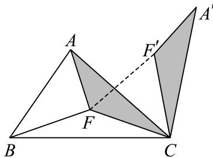
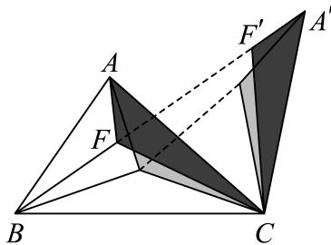
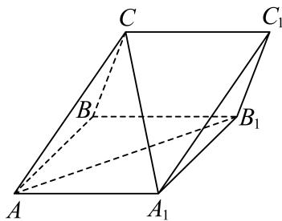
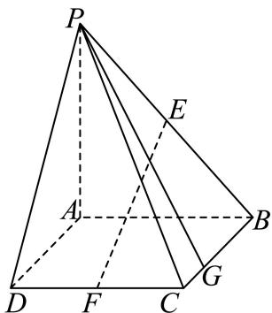
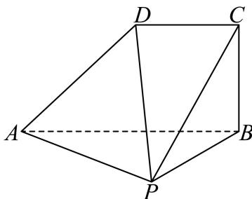
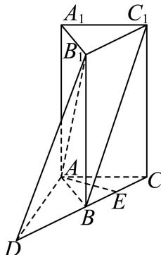
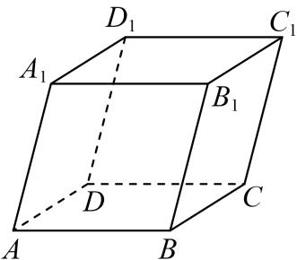
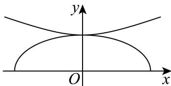
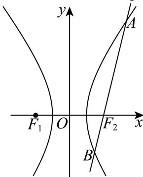

# 2025二模 向量专题 · 学生版

> 本地预览：题目、答案及分类尚未全部审定。校对使用的PDF为高中工作台解析版，尚未逐区确认区级印刷原卷。

## 坐标运算、共线垂直与投影

用坐标条件求参数，数量投影须除以投影方向向量的模。

### 嘉定 · 第3题

已知向量 $\vec { m } = ( 1 , - 2 ) , \vec { n } = ( k , 4 )$ ，若 $\cdot \overrightarrow { m } \perp \overrightarrow { n } ,$ ，则k =

### 宝山 · 第13题

已知向量 $\overrightarrow { a } = ( 1 , x ) , \overrightarrow { b } = ( 3 , 1 )$ ，若 $\overrightarrow { \vert a \vert } / \overrightarrow { \vert b }$ ，则x的值为（ ）

A. −3

B. 3

C. $- { \frac { 1 } { 3 } }$

D. $\frac 1 3$

> 本题资料或解析有待核事项，预览不可作为已审定成品。

### 崇明 · 第5题

已知 $\vec { | a } = ( 1 , 0 ) , \vec { b } = ( 2 , 1 )$ ，则 $| { \vec { a } } + 2 { \vec { b } } | =$

### 徐汇 · 第3题

在空间直角坐标系中，向 $\overrightarrow { \Xi a } = ( - m , 6 , 3 ) , \overrightarrow { b } = ( 2 , n , 1 )$ ,若 $\overrightarrow { a } / / \overrightarrow { b }$ ，则 $\left| m + n = \right.$

> 本题资料或解析有待核事项，预览不可作为已审定成品。

### 松江 · 第4题

已知空间向量 $\vec { \imath } = ( 2 , m , 3 ) , \vec { b } = ( - 4 , 2 , 2 )$ ，若 $\overrightarrow { \cdot a } \bot \overrightarrow { b }$ ，则m =

### 浦东 · 第2题

已知向量→a $\mathbf { \vec { \tau } } = ( 1 , 2 ) , \vec { b } = ( m , 1 )$ ，若→a $\perp \vec { b }$ ，则m =

### 金山 · 第3题

已知向 $\overrightarrow { \mathbb { E } } \overrightarrow { a } = ( x , 1 ) , \overrightarrow { b } = ( 1 , 2 - x )$ ， $\overrightarrow { \Pi } \overrightarrow { a } / \overrightarrow { / b }$ ，则实数x =

### 闵行 · 第6题

已知向量 $\vec { \mathbf { a } } ^ { + } = ( \mathbf { 3 } , 4 ) , \vec { b } ^ { - } = ( \cos \theta , \sin \theta )$ ，若 $\overrightarrow { \mathrm { a } } / / \overrightarrow { \mathrm { b } }$ ， 则tanθ=

### 青浦 · 第5题

向 $\overrightarrow { \mathbb { E } } \overrightarrow { a } = ( 3 1 0 , 1 1 8 )$ 在向 $\stackrel { \Xi } { \scriptscriptstyle \Xi } \vec { b } = ( 0 , 2 0 2 5 )$ 方向上的数量投影是

> 本题资料或解析有待核事项，预览不可作为已审定成品。

## 平面几何中的分点、夹角与模最值

选基底或坐标表达分点与中线，再用数量积、旋转或距离意义处理夹角和最值。

### 奉贤 · 第12题

$\triangle ABC$ 内一点 $F$（见图1），式子 $FA+FC+FB$ 可以写成 $1\times FA+1\times FC+1\times FB$。这个式子中 $FA$、$FC$、$FB$ 的系数均为1，以三个系数1作为边长可构造一个等边三角形，因此我们尝试把 $\triangle AFC$ 绕点 $C$ 顺时针旋转 $\dfrac\pi3$，得到 $\triangle A'F'C$（见图2），所以 $FA+FC+FB$ 等于 $F'A'+F'F+FB$。显然 $F'A'+F'F+FB\geq A'B$，当 $A'$、$F'$、$F$、$B$ 四点共线时（见图3），$FA+FC+FB$ 最小。

| 图1 | 图2 | 图3 |
|:---:|:---:|:---:|
|  |  |  |

试用类似的方法解决下面这道题目：

已知 $\vec a$ 是平面内的任意一个向量，向量 $\vec b$、$\vec c$ 满足 $\vec b\cdot\vec c=0$，且 $|\vec b|=4$、$|\vec c|=4$，则 $\sqrt2|\vec a-\vec b|+|\vec a-\vec c|+|\vec a+\vec c|$ 的最小值为________。

> 本题资料或解析有待核事项，预览不可作为已审定成品。

### 宝山 · 第9题

已知 $\triangle A B C$ 中， $A B = A C = 4 , \angle B A C = \frac { 2 } { 3 } \pi$ ，点D在线段BC上，且 $S _ { \triangle A C D } = 2 S _ { \triangle A B D }$ ，则$\overrightarrow { A B } \cdot \overrightarrow { A D }$ 的值为

### 徐汇 · 第8题

已知ABCD是正方形，点M是AB的中点，点E在对角线AC上，且 $\stackrel { \longrightarrow } { A E } = \stackrel { \longrightarrow } { 3 E C }$ ,则∠MED的大小为

> 本题资料或解析有待核事项，预览不可作为已审定成品。

### 杨浦 · 第15题

已知 、 、 是单位圆上的三个点，若 ${ \overrightarrow { A B } } \vert = { \sqrt { 2 } }$ ，则 $\overrightarrow { A B } \cdot \overrightarrow { B C }$ 的最大值为（ ）.

A. $\sqrt { 2 }$

B. $1 + { \frac { \sqrt { 2 } } { 2 } }$

C. ${ \sqrt { 2 } } + 1$

D. ${ \sqrt { 2 } } - 1$

> 本题资料或解析有待核事项，预览不可作为已审定成品。

### 长宁 · 第10题

已知点D、E分别是三角形ABC的边AC、BC的中点，且 $A E = 2 , B D = 3$ ，则三角形ABC的面积的取值范围是

## 向量表达式生成三角函数

展开数量积后用倍角和辅助角归一，考察周期、单调及平移奇偶。

### 长宁 · 第17题

已知向量 ${ \vec { m } } = ( \sin x + \cos x , 2 \sin x ) , { \vec { n } } = \left( \sin x - \cos x , { \sqrt { 3 } } \cos x \right) , f ( x ) = { \vec { m } } \cdot { \vec { n } } .$
(1) (6分)求函数y = f(x)的单调递减区间；
(2) (8分)若函数 $\boldsymbol { \mathfrak { y } } = \boldsymbol { f } ( \boldsymbol { x } ) - \boldsymbol { a }$ 在区间 $\left( 0 , { \frac { \pi } { 2 } } \right)$ 上恰有2个零点，求实数a的取值范围

### 静安 · 第17题

已知向 $\begin{array} { l } { \displaystyle { \frac { \overrightarrow { \sf E q . } } { \overrightarrow { \sf E q . } } } = \left( \cos \left( x + \frac { \pi } { 6 } \right) , \sin \left( x + \frac { \pi } { 6 } \right) \right) , \overrightarrow { \sf b } } = \left( \cos \left( x + \frac { \pi } { 6 } \right) , - \sin \left( x + \frac { \pi } { 6 } \right) \right)  \end{array}$ ，记 $f ( x ) = \stackrel {  } { a } \cdot \stackrel {  } { b }$
(1) (6分)求函数 $y = f \left( x \right)$ 的最小正周期；
(2) (8分)若函数 $\left[ { { y } } = { { f } \left( { x + \theta } \right) } \right.$ （其中常数 $\theta \in \left( 0 , \frac { \pi } { 2 } \right) )$ ）为奇函数，求θ的值

> 本题资料或解析有待核事项，预览不可作为已审定成品。

## 空间基底、线性关系与法向量

先建立可用空间基底，再由法向量求角距或用线性关系确定位置；保留完整几何大题。

### 奉贤 · 第14题

如图，在平行六面体 $ABCD-A_1B_1C_1D_1$ 中，点 $N$ 在对角线 $A_1C$ 上，点 $M$ 在对角线 $A_1B$ 上，$\overrightarrow{A_1N}=\frac13\overrightarrow{NC}$，$\overrightarrow{A_1M}=\frac12\overrightarrow{MB}$，以下命题正确的是（　）。

A. $\overrightarrow{MN}\parallel\overrightarrow{BC}$

B. $D_1,N,M$ 三点共线

C. $D_1M$ 与 $A_1C$ 是异面直线

D. $\overrightarrow{D_1N}=\frac12\overrightarrow{NM}$

> 本题资料或解析有待核事项，预览不可作为已审定成品。

### 普陀 · 第17题

如图，在三棱柱 $A B C - A _ { 1 } B _ { 1 } C _ { 1 }$ 中， $A C = A A _ { 1 } = A B = 2 , \angle B A A _ { 1 } = { \frac { \pi } { 3 } }$ ，且
$$
C A _ {1} = C B, C A _ {1} \bot A B _ {1}
$$

(1) (6分)求证：平面 $C A B _ { 1 } \bot$ 平面 $A A _ { 1 } B _ { 1 } B _ { \cdot }$
(2) (8分)求直线 $C A _ { 1 }$ 与平面 $B B _ { 1 } C _ { 1 }$ C所成的角的正弦值.

### 松江 · 第15题

在正三棱柱 $A B C - A _ { 1 } B _ { 1 } C _ { 1 }$ 中， $A B = A A _ { 1 } = 1$ ，动点P满足 $\overrightarrow { B P } = \lambda \overrightarrow { B C } + \overrightarrow { B B _ { 1 } } , \lambda \in ( 0 \mathrm { ~ , ~ } 1 )$ ，则下列几何体体积为定值的是（ ）

A. 四棱锥 $P - A _ { 1 } A B B _ { 1 }$

B. 四棱锥 $P - A _ { 1 } A C C _ { 1 }$

C. 三棱锥 $P - A _ { 1 } B _ { 1 } C _ { 1 }$

D. 三棱锥 $P - A _ { 1 } B C$

### 浦东 · 第18题

如图，四边形ABCD为长方形，PA⊥平面ABCD， $A B = A P = 2$ ，AD = 3

(1) (7分)若E、F分别是PB、CD的中点，求证：EF∥平面PAD；
(2) (7分)边BC上是否存在点G，使得直线 $P G .$ 与平面PAD所成的角的大小为 $3 0 ^ { \circ } ?$ 若存在，求BG长；若不存在，说明理由

> 本题资料或解析有待核事项，预览不可作为已审定成品。

### 金山 · 第18题

如图，在四棱锥 $P - A B C D$ 中，PA⊥平面 $P B C , A B = 2 D C = 4 , B C = 2 \sqrt { 2 } , A B \bot B C , D C / / A B$
(1) (6分)证明：平面 $A B C D \bot$ 平面 $P A B$
(2) (8分)若 $\angle A B P = { \frac { \pi } { 3 } }$ ，求点C到平面PAD的距离.

### 闵行 · 第17题

如图，在四棱锥P − ABCD中，底面ABCD为长方形，PA⊥底面ABCD，E是 $P C ^ { \mathsf { \Pi } }$ 中点，已知$A B = 2 , A D = 2 { \sqrt { 2 } } , P A = 2$

(1) (6分)证明： $A D \bot B P ;$
(2) (8分)求二面角E − AD − B的大小

### 静安 · 第19题

如图，在正三棱柱 $A B C - A _ { 1 } B _ { 1 } C _ { 1 }$ 中， $A A _ { 1 } = 2 A C = 4$ ，延长CB至D，使 $C B = B D$ ，E是线段BC的中点

(1) (8分)求证：
①直线 $C _ { 1 } B / /$ 平面 $A B _ { 1 } D$ ；
② $A E \bot D B _ { 1 }$
(2) (6分)求二面角 $B _ { 1 } - A D -$ C的正弦值

### 黄浦 · 第14题

如图，在平行六面体 $A B C D - A _ { 1 } B _ { 1 } C _ { 1 } D _ { 1 }$ 1中， $\mathrm { i } \overrightarrow { \times a } = \overrightarrow { A A _ { 1 } } , \overrightarrow { b } = \overrightarrow { D B _ { 1 } }$ ，若→a、 $\vec { b } .$ 、→c组成空间向量的一个基底，则→c 可以是（ ）

A.  − $\overrightarrow { B B _ { 1 } }$ 

B. − $\overrightarrow { B C _ { 1 } }$ 

C. − $\xrightarrow [ B D ] { }$ 

D.  − $\xrightarrow { }$

> 本题资料或解析有待核事项，预览不可作为已审定成品。

## 圆锥曲线中的向量约束

把共线、分点、数量积及投影转为坐标关系，与曲线方程联立研究范围或定值。

### 奉贤 · 第20题

如图1，曲线 $\Gamma$ 是 $\dfrac{x^2}{4}+\dfrac{y^2}{b^2}=1\ (y\ge0)$ 与 $\dfrac{y^2}{b^2}-\dfrac{x^2}{4}=1\ (y\ge0)$ 组合的。

| 图1 | 图2 |
|:---:|:---:|
|  |  |

(1)（4分）$\dfrac{x^2}{4}+\dfrac{y^2}{b^2}=1\ (y\ge0)$ 过点 $\left(-1,\dfrac32\right)$，求 $\dfrac{y^2}{b^2}-\dfrac{x^2}{4}=1\ (y\ge0)$ 的渐近线方程；

(2)（6分）$b=\sqrt2$，设 $T(0,t)$，$t\in\left[-\dfrac{\sqrt2}{2},3\sqrt2\right]$，曲线 $\Gamma$ 上找一个点 $Q$，使得 $|\overrightarrow{TQ}|$ 达到最小；

(3)（8分）若 $b=1$，如图2，存在过点 $P(0,1)$ 的两条直线 $l_1$、$l_2$ 与曲线 $\Gamma$ 的交点分别是点 $A$、点 $M$、点 $B$、点 $N$，点 $A$ 在第二象限，点 $M$ 在第一象限。是否存在非零实数 $\lambda$ 使得 $\overrightarrow{MN}=\lambda\overrightarrow{AB}$ 成立，请说明理由。

> 本题资料或解析有待核事项，预览不可作为已审定成品。

### 宝山 · 第20题

已知双曲线 $C { : } x ^ { 2 } - \frac { y ^ { 2 } } { 3 } = 1 , F _ { 1 }$ 、 $F _ { 2 }$ 分别是其左、右焦点，直线l与双曲线C的右支交于A、B两点.
(1) (4分)当直线l过点 $F _ { 2 }$ ，且 $| A B | = 6 \mathbb { H }$ ，求 $\triangle A B F _ { 1 }$ 的周长；
(2) (6分)已知点N (−2, 3)，若直线AN、BN的斜率之和为0，且 $\tan \angle A N B = \frac { 4 } { 3 }$ ，当AN、BN分别与y轴交于点R、S时，求 $\triangle R S N$ 的面积；
(3) (8分)已知直线l过点F2，P是双曲线C上一点且位于第一象限，且满足− $F _ { 2 }$ $\overrightarrow { O Q } = 2 \overrightarrow { O P }$ 的点Q在线段AB上，若 $\overrightarrow { A B } = 2 \overrightarrow { Q F _ { 2 } }$ ，求点P的坐标.

> 本题资料或解析有待核事项，预览不可作为已审定成品。

### 崇明 · 第20题

已知抛物线Γ: $x ^ { 2 } = 4 y ,$ ，过点 $P \left( a , b \right)$ 的直线l与抛物线Γ交于点A、B，与y轴交于点C

(1) (4分)若点A位于第一象限，且点A到抛物线Γ的焦点的距离等于3，求点A的坐标；
(2) (6分)若点A坐标为(4,4)，且点B恰为线段AC的中点，求原点O到直线l的距离；
(3) (8分)若抛物线Γ上存在定点D使得满足题意的点A、B都有 $D A \bot D B$ ，求a、b满足的关系式

> 本题资料或解析有待核事项，预览不可作为已审定成品。

### 普陀 · 第20题

设 $a > b > 0 , m > 0$ ，点A、F分别是椭圆Γ: ${ \frac { x ^ { 2 } } { a ^ { 2 } } } + { \frac { y ^ { 2 } } { b ^ { 2 } } } = 1$ 的上顶点与右焦点，且 $\left| A F \right| = 2 { \mathrm { . } }$ ，直线 $l { : } x - m y - 1 = 0$ 经过点F与Γ交于P、Q两点，O是坐标原点.
(1) (4分)求椭圆Γ的方程；
(2) (6分)若 $m = { \sqrt { 3 } } .$ ，点M是x轴上的一点，且 $\triangle M P Q$ 的面积为 $\frac { 6 } { 1 3 }$ ，求点M的坐标；
(3) (8分)若点G在直线x = 5上，向量 $\vec { P G }$ 在直线l上的投影为向量 $\vec { P F }$ ，证明 $\angle P G Q < \frac { \pi } { 4 }$

### 杨浦 · 第20题

已知双曲线Γ的标准方程为 $x ^ { 2 } - { \frac { y ^ { 2 } } { 2 } } = 1$ ，点P是双曲线Γ右支上的一个动点.

(1) (4分)求双曲线Γ的焦点坐标和渐近线方程；
(2) (6分)过点P分别向两条渐近线作垂线，垂足为点 $P _ { 1 } , P _ { 2 }$ ，求− $\overrightarrow { P P _ { 1 } } \cdot \overrightarrow { P P _ { 2 } }$ 的值；
(3) (8分)若 $| O P | > { \sqrt { 2 } } ,$ ，如图，过P作圆 $O \colon x ^ { 2 } + y ^ { 2 } =$ 2的切线l，切点为M，交双曲线Γ的左支于 点Q，分别交两条渐近线于点A､B.设 $| P Q | = \lambda | A B |$ ，求实数λ的取值范围

> 本题资料或解析有待核事项，预览不可作为已审定成品。

### 浦东 · 第20题

已知椭圆 $C_1$ 的方程为 $\frac{x^2}{3}+y^2=1$，右顶点为 $A$，上顶点为 $B$，椭圆 $C_2$ 的中心位于坐标原点，两个椭圆的离心率相等。
(1) (4分) 若椭圆 $C_2$ 的方程是 $\frac{x^2}{a^2}+\frac{y^2}{2a}=1\ (a>0)$，焦点在 $x$ 轴上，求 $a$ 的值；
(2) (6分) 设椭圆 $C_2$ 的焦点在 $x$ 轴上，直线 $AB$ 与 $C_2$ 相交于点 $C$、$D$，若 $|CD|=3|AB|$，求 $C_2$ 的标准方程；
(3) (8分) 设椭圆 $C_2$ 的焦点在 $y$ 轴上，点 $P$ 在 $C_1$ 上，点 $Q$ 在 $C_2$ 上。若存在 $\triangle APQ$ 是等腰直角三角形，且 $|AP|=|AQ|$，求 $C_2$ 的长轴的取值范围。

> 本题资料或解析有待核事项，预览不可作为已审定成品。

### 虹口 · 第20题

已知点 $F _ { 1 }$ 和 $F _ { 2 }$ 是双曲线 $C \colon \frac { x ^ { 2 } } { a ^ { 2 } } - y ^ { 2 } = 1 \left( a > 0 \right)$ 的左、右焦点.
(1) (4分)若 $y = x$ 是双曲线C的一条渐近线，求C的离心率；
(2) (6分)当 $a = { \sqrt { 2 } } \mathbb { H } { \bmod { } }$ ，若双曲线C上存在一点P满足 $| P F _ { 1 } | + | P F _ { 2 } | = 4 .$ ，求 $\triangle P F _ { 1 } F _ { 2 }$ 的面积；
(3) (8分)若在双曲线C上分别存在两点A和B，点A在第一象限，点B在第二象限，使得四边形$F _ { 1 } B A F _ { 2 }$ 的面积为 $2 \sqrt { a ^ { 2 } + 1 }$ ，且存在实数λ使 ${ \overline { { F _ { 2 } A } } } = \lambda { \overline { { F _ { 1 } B } } }$ ，求实数a的取值范围.

> 本题资料或解析有待核事项，预览不可作为已审定成品。

### 金山 · 第16题

已知点A $( x _ { 1 } , y _ { 1 } )$ 在圆 $x ^ { 2 } + y ^ { 2 } = 9 .$ 上，点 $B \left( x _ { 2 } , y _ { 2 } \right)$ 在圆 $x ^ { 2 } + y ^ { 2 } = 1 2$ 上，且
$x _ { 1 } x _ { 2 } + y _ { 1 } y _ { 2 } = x _ { 1 } + x _ { 2 } - 1$ ,O为坐标原点.对于以下两个命题，判断正确的是（ ）
①在坐标平面内存在点P，使得 $A P \bot B P$ 恒成立；
②三角形OAB面积的最小值为 ${ \sqrt { 2 2 } }$

A. ①是真命题，②是真命题

B. ①是假命题，②是真命题

C. ①是真命题，②是假命题

D. ①是假命题，②是假命题

> 本题资料或解析有待核事项，预览不可作为已审定成品。

### 金山 · 第20题

已知椭圆Γ: ${ \frac { x ^ { 2 } } { 4 } } + { \frac { y ^ { 2 } } { 3 } } = 1$ ，左右焦点分别为 $F _ { 1 } , F _ { 2 }$ ，上下顶点分别为A,B，左右顶点分别为 $C , D ,$ P,Q是Γ上异于椭圆顶点的两点.
(1) (4分)求 $\triangle A F _ { 1 } F _ { 2 }$ 的周长；
(2) (6分)若点Q在第一象限且满足 $. \triangle A B Q$ 的面积比 $\triangle F _ { 1 } F _ { 2 } Q$ 的面积大，求点Q的横坐标的取值范围；
(3) (8分)记点A在直线PQ上的投影为H，且直线CP的斜率是直线DQ的斜率的3倍，试判断：过点A,H,O(O为坐标原点)三点的圆是否为定圆？若是，求出该圆的方程；若不是，请说明理由.

> 本题资料或解析有待核事项，预览不可作为已审定成品。

### 长宁 · 第20题

已知双曲线Γ: ${ \frac { x ^ { 2 } } { a ^ { 2 } } } - { \frac { y ^ { 2 } } { b ^ { 2 } } } = 1$ 的左、右焦点分别为 $F _ { 1 } , F _ { 2 }$ ，点A是其左顶点，点P是双曲线上一点，且位于第一象限，若双曲线Γ的离心率 $\displaystyle { e = 2 , b = 2 \sqrt { 3 } } .$
(1) (4分)求双曲线Γ的方程；
(2) (6分)若三角形 $A P F _ { 2 }$ 是等腰三角形，求点P的坐标；
(3) (8分)直线 $P F _ { 2 }$ 不垂直于x轴，且与曲线Γ的另一个交点为Q，若 $\angle P F _ { 1 } Q$ 是锐角，求直线 $P F _ { 2 }$ 的斜率的取值范围

> 本题资料或解析有待核事项，预览不可作为已审定成品。

### 青浦 · 第20题

如图，椭圆 $C _ { 1 } \colon \frac { x ^ { 2 } } { 8 } + \frac { y ^ { 2 } } { b ^ { 2 } } = 1 \left( 0 < b < 2 \sqrt { 2 } \right)$ 与双曲线 $C _ { 2 } \colon \frac { x ^ { 2 } } { b ^ { 2 } } - y ^ { 2 } = 1$ 在第一象限的公共点为$A \left( x _ { A } , y _ { A } \right) \left( x _ { A } > 0 \right)$ .曲线Γ由两段曲线组成：当 $x \leq x _ { A }$ 时，曲线Γ与椭圆 $C _ { 1 }$ 重合，当 $x > x _ { A }$ 时，曲线Γ与双曲线 $C _ { 2 }$ 重合.

(1) (4分)当 $x _ { A } = 2$ 时，求b的值；
(2) (6分)已知 $| b = { \sqrt { 2 } } ,$ ，直线l过点 $D ( 2 , 0 )$ 与曲线Γ交于E、F两点，若 $\overrightarrow { \cdot } \overrightarrow { A D } \cdot \overrightarrow { E F } = 2$ ，求直线l的方程；
(3) (8分)已知A(2, 1)，斜率为 $k ( k \geq 1 )$ 的直线m过点 $P ( 0 , 1 )$ 与曲线Γ交于M、N两点，若$S _ { \triangle A M N } = \lambda \tan \angle M A N$ ，求实数λ的最大值.

> 本题资料或解析有待核事项，预览不可作为已审定成品。

### 黄浦 · 第20题

椭圆Γ: ${ \frac { x ^ { 2 } } { a ^ { 2 } } } + { \frac { y ^ { 2 } } { b ^ { 2 } } } = 1 ( a > b > 0 )$ 的左、右焦点分别为 $F _ { 1 } ( - c , 0 ) , F _ { 2 } ( c , 0 ) ( c > 0 )$ ，过点 $F _ { 1 }$ 的直线l与Γ 交于点P
(1) (4分)若c = 2，点P的坐标为 $\left( 2 , { \sqrt { 2 } } \right)$ ，求点 $F _ { 2 }$ 到直线l的距离；
(2) (6分)当b ≤ c时，求满足 $P F _ { 1 } \bot P F _ { 2 }$ 的点P的个数；
(3) (8分)设直线l与Γ的另一个交点为Q，− $\overrightarrow { F _ { 1 } Q } = \lambda \overrightarrow { Q P } \left( \lambda \in \bf R \right)$ ，点P的横坐标为 $\frac { c } { 2 }$ ，若Γ的离心率 $e > \frac 1 2$ ，求λ的取值范围

## 空间单位向量与球面可行域

将模或数量积限制转为球体、交线及等角点组，讨论角度最值或凸组合。

### 浦东 · 第11题

已知→a、 $\vec { b } , \vec { c }$ 为空间中三个单位向量， $\overrightarrow { \sf z } \overrightarrow { a } \cdot \overrightarrow { b } = \overrightarrow { b } \cdot \overrightarrow { c } = \overrightarrow { c } \cdot \overrightarrow { a } = 0$ ，若向量 $\vec { \cdot } \vec  p \}$ 满足 $| { \overrightarrow { p } } - 2 { \overrightarrow { a } } | = { \frac { 3 } { 2 } }$ $| { \vec { p } } - { \vec { 2 b } } | = { \frac { 3 } { 2 } }$ ，则向量 $\overrightarrow { p }$ 与向量 $\overrightarrow { : c }$ 夹角的最小值为 ．（用反三角表示）

> 本题资料或解析有待核事项，预览不可作为已审定成品。

### 虹口 · 第16题

在空间中，点O为定点，设集合 $S = \left\{ P \bigg | \bigg | \overrightarrow { O P } \bigg | ^ { 2 } - 2 \overrightarrow { O A } \cdot \overrightarrow { O P } \leq 1 , \bigg | \overrightarrow { O A } \bigg | = 1 \right\}$ ，则以下说法正确的是（ ）.①若 $\overrightarrow { \cdot O P } \overleftrightarrow { \pm O A }$ 上的数量投影为 $- { \frac { 1 } { 5 } }$ ，则线段OP在运动过程中所形成的几何体体积为 ${ \frac { 1 4 } { 3 7 5 } } \pi ;$ ②对于任意的 $P _ { i } \in S |$ 以及任意的正实数 ${ \bf \dot { \alpha } } _ { a _ { i } }$ ，设 $\overrightarrow { O Q } = \sum _ { i = 1 } ^ { 4 } a _ { i } \overrightarrow { O P _ { i } }$ ，若 $\sum _ { i = 1 } ^ { 4 } a _ { i } = 1$ ，则 $| Q \in S$

A. ①是真命题，②是真命题

B. ①是真命题，②是假命题

C. ①是假命题，②是真命题

D. ①是假命题，②是假命题

> 本题资料或解析有待核事项，预览不可作为已审定成品。

### 闵行 · 第16题

设n为正整数，空间中n个单位向量构成集合 $A _ { n } = \left\{ { \vec { a } } _ { 1 } , { \vec { a } } _ { 2 } , \cdot \cdot \cdot , { \vec { a } } _ { n } \right\}$ ，若存在实数t，满足对任意$\vec { a } _ { i } \in A _ { n } , \vec { a } _ { j } \in A _ { n } , \vec { a } _ { i } \neq \vec { a } _ { j }$ ，都有 ${ \vec { a } } _ { i } \cdot { \vec { a } } _ { j } = t$ ，则当 $_ n$ 取得最大值时，t的值为（ ）

A. $- { \frac { 1 } { 2 } }$

B. $\frac { 1 } { 2 }$

C. $- { \frac { 1 } { 3 } }$

D. $\frac 1 3$

> 本题资料或解析有待核事项，预览不可作为已审定成品。

## 周期位移与坐标新运算

先读清位移累加或新运算规则，再借周期分组、坐标变换处理范围。

### 嘉定 · 第12题

在平面直角坐标系中，一质点 $P$ 从原点 $O$ 出发，第一次从点 $O$ 移动到点 $P_1$，第二次从点 $P_1$ 移动到点 $P_2$，……，第 $k$ 次从点 $P_{k-1}$（规定 $P_0=O$）移动到点 $P_k$。记向量 $\vec v_k=\overrightarrow{P_{k-1}P_k}$，其模长为 $k$，方向与 $x$ 轴正方向成 $(90k)^\circ$ 角。设 $\vec S_n$ 为经过 $n$ 次移动的位移向量，即 $\vec S_n=\overrightarrow{OP_n}$，则当 $|\vec S_n|=\sqrt{85}$ 时，$n$ 的值为________。

> 本题资料或解析有待核事项，预览不可作为已审定成品。

### 松江 · 第11题

设向量 $\vec { \cdot a } = ( x _ { 1 } , y _ { 1 } ) , \vec { b } = ( x _ { 2 } , y _ { 2 } )$ ，记 $\displaystyle { \mathop { \ ? } { \vec { a } } } \star { \vec { b } } = x _ { 1 } x _ { 2 } - y _ { 1 } y _ { 2 }$ .若点 $A _ { 1 } , ~ A _ { 2 } , ~ A _ { 3 }$ 为圆C：
$x ^ { 2 } + y ^ { 2 } + 4 x - 2 y = 0 .$ 上任意三点，且满足 $A _ { 1 } A _ { 2 } \bot A _ { 2 } A _ { 3 }$ ，则 $\Bigl | \overrightarrow { O A _ { 1 } } \star \overrightarrow { O A _ { 2 } } + \overrightarrow { O A _ { 2 } } \star \overrightarrow { O A _ { 3 } } \Bigr |$ 的取值范围是

