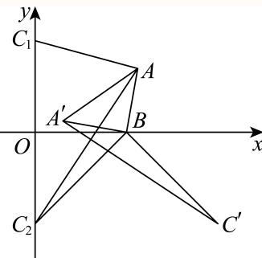
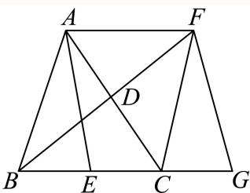
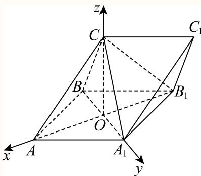
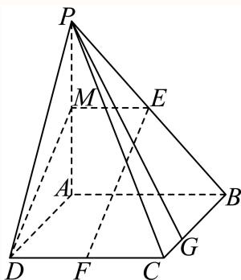
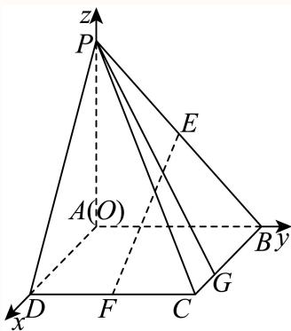
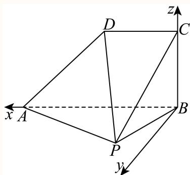
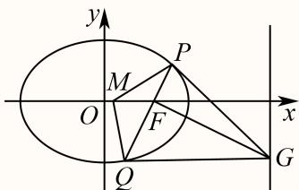
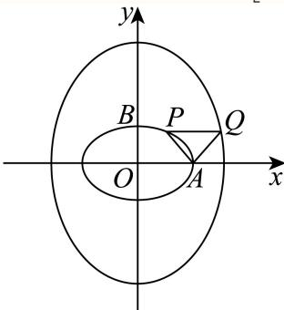
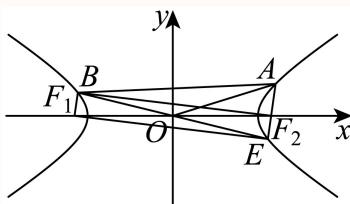

# 2025二模 向量专题 · 教师版

> 本地预览：题目、答案及分类尚未全部审定。校对使用的PDF为高中工作台解析版，尚未逐区确认区级印刷原卷。

## 坐标运算、共线垂直与投影

用坐标条件求参数，数量投影须除以投影方向向量的模。

### 嘉定 · 第3题

已知向量 $\vec { m } = ( 1 , - 2 ) , \vec { n } = ( k , 4 )$ ，若 $\cdot \overrightarrow { m } \perp \overrightarrow { n } ,$ ，则k =

**考点：** 向量数量积与垂直条件

**难度依据：** 坐标运算与垂直；直接调用定义或基本公式，运算路径短

**核查说明：** 已人工阅读底稿题干和解析；尚未逐页对照原PDF，不作为数学终审。

【答案】8

【解析】

由向量垂直的坐标表示，列方程求参数值.

由题设 ${ \vec { m } } \cdot { \vec { n } } = 1 \times k + ( - 2 ) \times 4 = k - 8 = 0 \Rightarrow k = 8$

故答案为：8

### 宝山 · 第13题

已知向量 $\overrightarrow { a } = ( 1 , x ) , \overrightarrow { b } = ( 3 , 1 )$ ，若 $\overrightarrow { \vert a \vert } / \overrightarrow { \vert b }$ ，则x的值为（ ）

A. −3

B. 3

C. $- { \frac { 1 } { 3 } }$

D. $\frac 1 3$

> 本题资料或解析有待核事项，预览不可作为已审定成品。

**考点：** 共线行列式为零

**难度依据：** 平面向量共线坐标条件；直接运用定义或基础公式，推理链短

**核查说明：** 题干向量平行符号严重破损，应核清原条件。；已人工阅读完整底稿题干及原解，未逐页对照正式PDF，分类不等于数学终审。；历史分类审查记录（不把旧记录直接判为当前未解决）：题干向量平行符号严重破损，应核清原条件。 本次只归组，未修改题干、答案或专题归属；上述具体疑点仍交回源/数学复核处理。

【答案】D

【解析】

由共线向量的坐标表示，建立方程，可得答案.由题意可得 $1 \times 1 - 3 x = 0$ ，解得 $x = \frac { 1 } { 3 }$ 故选：D.

## 二、选择题

### 崇明 · 第5题

已知 $\vec { | a } = ( 1 , 0 ) , \vec { b } = ( 2 , 1 )$ ，则 $| { \vec { a } } + 2 { \vec { b } } | =$

**考点：** 坐标加法、数乘及模

**难度依据：** 向量坐标运算与模；直接运用定义或基础公式，推理链短

**核查说明：** 已人工阅读完整底稿题干及原解，未逐页对照正式PDF，分类不等于数学终审。

【答案】$\sqrt { 2 9 }$

【解析】

写 $\overrightarrow { 4 a } + \overrightarrow { 2 b }$ 坐标，由坐标得到 $| { \vec { a } } + 2 { \vec { b } } |$

$$
\overrightarrow {a} + \overrightarrow {2 b} = (5, 2), \therefore | \overrightarrow {a} + \overrightarrow {2 b} | = \sqrt {5 ^ {2} + 2 ^ {2}} = \sqrt {2 9}.
$$

故答案为： $\sqrt { 2 9 }$

### 徐汇 · 第3题

在空间直角坐标系中，向 $\overrightarrow { \Xi a } = ( - m , 6 , 3 ) , \overrightarrow { b } = ( 2 , n , 1 )$ ,若 $\overrightarrow { a } / / \overrightarrow { b }$ ，则 $\left| m + n = \right.$

> 本题资料或解析有待核事项，预览不可作为已审定成品。

**考点：** 空间向量平行与参数

**难度依据：** 空间向量共线的坐标条件；直接运用定义或基础公式，推理链短

**核查说明：** 空间向量和所求m+n周围有OCR噪声，需校原式。；已人工阅读完整底稿题干及原解，未逐页对照正式PDF，分类不等于数学终审。；历史分类审查记录（不把旧记录直接判为当前未解决）：空间向量和所求m+n周围有OCR噪声，需校原式。 本次只归组，未修改题干、答案或专题归属；上述具体疑点仍交回源/数学复核处理。

【答案】$-4$。

【解析】

由 $\vec a\parallel\vec b$，可设 $\vec a=\lambda\vec b$，即

$$(-m,6,3)=\lambda(2,n,1).$$

比较第三个坐标，得 $\lambda=3$；再比较其余坐标，得 $-m=6$，$6=3n$，所以 $m=-6$，$n=2$，故 $m+n=-4$。

### 松江 · 第4题

已知空间向量 $\vec { \imath } = ( 2 , m , 3 ) , \vec { b } = ( - 4 , 2 , 2 )$ ，若 $\overrightarrow { \cdot a } \bot \overrightarrow { b }$ ，则m =

**考点：** 数量积为零求参数

**难度依据：** 空间向量垂直的坐标条件；直接运用定义或基础公式，推理链短

**核查说明：** 已人工阅读完整底稿题干及原解，未逐页对照正式PDF，分类不等于数学终审。

【答案】1

【解析】

利用向量垂直数量积等于0即可得到结果.

因为 $\vec { \vert a \perp b }$ ，所以 ${ \vec { a } } \cdot { \vec { b } } = - 8 + 2 m + 6 = 0$ ，解得 $m = 1$

故答案为：1

### 浦东 · 第2题

已知向量→a $\mathbf { \vec { \tau } } = ( 1 , 2 ) , \vec { b } = ( m , 1 )$ ，若→a $\perp \vec { b }$ ，则m =

**考点：** 数量积求参数

**难度依据：** 平面向量垂直坐标条件；直接运用定义或基础公式，推理链短

**核查说明：** 已人工阅读完整底稿题干及原解，未逐页对照正式PDF，分类不等于数学终审。

【答案】-2

【解析】

由平面向量垂直的坐标表示求解

解：因 $\times \vec { a } \perp \vec { b }$ ，所以→a ${ \vec { b } } = 0$

得1 $\times m + 2 \times 1 = 0 ,$

解得 $m = - 2 ,$

故答案为：-2

### 金山 · 第3题

已知向 $\overrightarrow { \mathbb { E } } \overrightarrow { a } = ( x , 1 ) , \overrightarrow { b } = ( 1 , 2 - x )$ ， $\overrightarrow { \Pi } \overrightarrow { a } / \overrightarrow { / b }$ ，则实数x =

**考点：** 向量共线求参数

**难度依据：** 共线坐标条件；直接运用定义或基础公式，推理链短

**核查说明：** 已人工阅读完整底稿题干及原解，未逐页对照正式PDF，分类不等于数学终审。

【答案】1.

【解析】

根据平面向量共线的坐标公式计算即可.

因为 $\vec { \jmath _ { a } } = ( x , 1 ) , \vec { b } = ( 1 , 2 - x ) , \vec { a } / \vec { / b } ,$

所以 $x \left( 2 - x \right) - 1 = 0$ ，解得x = 1.

故答案为：1.

### 闵行 · 第6题

已知向量 $\vec { \mathbf { a } } ^ { + } = ( \mathbf { 3 } , 4 ) , \vec { b } ^ { - } = ( \cos \theta , \sin \theta )$ ，若 $\overrightarrow { \mathrm { a } } / / \overrightarrow { \mathrm { b } }$ ， 则tanθ=

**考点：** 平行坐标与三角比；同角商数关系

**难度依据：** 平行坐标与三角比；同角商数关系；需一次代换或条件转换后计算

**核查说明：** 已人工阅读底稿题干和原解；未逐页对照PDF，不作为数学终审。

【答案】${ \frac { 4 } { 3 } } .$

【解析】

根据向量平行的坐标运算得到 $4 \cos \theta = 3 \sin \theta ,$ ，进而结合同角的商数关系即可求出结果因为 $\overrightarrow { \mathrm { a } } / / \overrightarrow { \mathrm { b } }$ ，且 $\vec { [ \mathfrak { a } } = ( 3 , 4 ) , \vec { b } = ( \cos \theta , \sin \theta )$ ，所以4 $\cos \theta = 3 \sin \theta$ ，显然 $\cos \theta \neq 0$ ，所以${ \frac { 4 } { 3 } } = { \frac { \sin \theta } { \cos \theta } }$ ，即 $\tan \theta = \frac { 4 } { 3 }$ ；

故答案为： ${ \frac { 4 } { 3 } } .$

### 青浦 · 第5题

向 $\overrightarrow { \mathbb { E } } \overrightarrow { a } = ( 3 1 0 , 1 1 8 )$ 在向 $\stackrel { \Xi } { \scriptscriptstyle \Xi } \vec { b } = ( 0 , 2 0 2 5 )$ 方向上的数量投影是

> 本题资料或解析有待核事项，预览不可作为已审定成品。

**考点：** 数量积与数量投影

**难度依据：** 坐标向量的数量投影；直接调用定义或基本公式，运算路径短

**核查说明：** 向量符号与坐标附近严重OCR噪声，需核原卷。；已人工阅读底稿题干和解析；尚未逐页对照原PDF，不作为数学终审。；历史分类审查记录（不把旧记录直接判为当前未解决）：向量符号与坐标附近严重OCR噪声，需核原卷。 当前底稿已有回源补丁，涉及answer_and_solution；具体修复范围以底稿patches和2025二模-解析公式回源补丁-第二批.json为准。本题仍按可辨数学任务归组，不据分组宣称数学已审定。

【答案】118

【解析】

根据题意，由数量投影的定义代入计算，即可得到结果.

因为 $|\vec b|=2025$

向量 $\vec { \cdot a }$ 在向量 $\vec { \mathfrak { z } } \vec { b }$ 方向上的数量投影公式为 ${ \frac { { \stackrel {  } { a } } \cdot { \stackrel {  } { b } } } { { \stackrel {  } { | b | } } } } = { \frac { 3 1 0 \times 0 + 1 1 8 \times 2 0 2 5 } { 2 0 2 5 } } = 1 1 8 .$

故答案为：118

## 平面几何中的分点、夹角与模最值

选基底或坐标表达分点与中线，再用数量积、旋转或距离意义处理夹角和最值。

### 奉贤 · 第12题

$\triangle ABC$ 内一点 $F$（见图1），式子 $FA+FC+FB$ 可以写成 $1\times FA+1\times FC+1\times FB$。这个式子中 $FA$、$FC$、$FB$ 的系数均为1，以三个系数1作为边长可构造一个等边三角形，因此我们尝试把 $\triangle AFC$ 绕点 $C$ 顺时针旋转 $\dfrac\pi3$，得到 $\triangle A'F'C$（见图2），所以 $FA+FC+FB$ 等于 $F'A'+F'F+FB$。显然 $F'A'+F'F+FB\geq A'B$，当 $A'$、$F'$、$F$、$B$ 四点共线时（见图3），$FA+FC+FB$ 最小。

| 图1 | 图2 | 图3 |
|:---:|:---:|:---:|
|  |  |  |

试用类似的方法解决下面这道题目：

已知 $\vec a$ 是平面内的任意一个向量，向量 $\vec b$、$\vec c$ 满足 $\vec b\cdot\vec c=0$，且 $|\vec b|=4$、$|\vec c|=4$，则 $\sqrt2|\vec a-\vec b|+|\vec a-\vec c|+|\vec a+\vec c|$ 的最小值为________。

> 本题资料或解析有待核事项，预览不可作为已审定成品。

**考点：** 加权向量与旋转最值

**难度依据：** 向量和的长度与旋转最值；需综合转化、参数分析或完整证明，推理链较长

**核查说明：** 旋转条件OCR破损；解析出现3根号2与最终8根号2不一致，需核图及解答。；已人工阅读底稿题干和解析；尚未逐页对照原PDF，不作为数学终审。；历史分类审查记录（不把旧记录直接判为当前未解决）：旋转条件OCR破损；解析出现3根号2与最终8根号2不一致，需核图及解答。 本次只归组，未修改题干、答案或专题归属；上述具体疑点仍交回源/数学复核处理。

【答案】$8\sqrt2$。

【解析】

建立平面直角坐标系，令 $B(4,0)$、$C_1(0,4)$、$C_2(0,-4)$，并令 $\vec a=\overrightarrow{OA}$、$\vec b=\overrightarrow{OB}$、$\vec c=\overrightarrow{OC_1}$，则所求式为 $\sqrt2|AB|+|AC_1|+|AC_2|$。

将 $\triangle ABC_2$ 绕点 $B$ 逆时针旋转 $\dfrac\pi2$，得到 $\triangle A'BC'$。由旋转关系，$|AA'|=\sqrt2|AB|$，$|A'C'|=|AC_2|$，且 $C'(8,-4)$。因此

$$\begin{aligned}
\sqrt2|AB|+|AC_1|+|AC_2|
&=|C_1A|+|AA'|+|A'C'|\\
&\geq|C_1C'|=\sqrt{8^2+(-8)^2}=8\sqrt2.
\end{aligned}$$

当 $A$ 与 $B$ 重合时，$A'$ 也与 $B$ 重合，且 $C_1,B,C'$ 共线，等号成立，故最小值为 $8\sqrt2$。

原转录解析末段的 $3\sqrt2$ 与源PDF不符；源PDF第7页的结论为 $8\sqrt2$，本次据图与独立计算修复。

### 宝山 · 第9题

已知 $\triangle A B C$ 中， $A B = A C = 4 , \angle B A C = \frac { 2 } { 3 } \pi$ ，点D在线段BC上，且 $S _ { \triangle A C D } = 2 S _ { \triangle A B D }$ ，则$\overrightarrow { A B } \cdot \overrightarrow { A D }$ 的值为

**考点：** 面积比确定分点及数量积

**难度依据：** 分点向量与数量积；需一次转化并结合定义域或几何条件计算

**核查说明：** 已人工阅读完整底稿题干及原解，未逐页对照正式PDF，分类不等于数学终审。

【答案】8.

【解析】

根据 $S _ { \triangle A C D } = 2 S _ { \triangle A B D }$ 确定 $C D = 2 B D$ ，从而可得 $\overrightarrow { A D } = \frac { 2 } { 3 } \overrightarrow { A B } + \frac { 1 } { 3 } \overrightarrow { A C }$ ，从而用向量数量积的运算律即可求解.

设等腰 $\triangle A B C$ 在BC边上的高为h，

因为 $S _ { \triangle A C D } = 2 S _ { \triangle A B D }$ ，所以 $\frac { 1 } { 2 } \times C D \times h = 2 \times \frac { 1 } { 2 } \times B D \times h$

所以 $C D = 2 B D$

$$
\overrightarrow {A D} = \overrightarrow {A B} + \overrightarrow {B D} = \overrightarrow {A B} + \frac {1}{3} \overrightarrow {B C} = \overrightarrow {A B} + \frac {1}{3} \left(\overrightarrow {A C} - \overrightarrow {A B}\right) = \frac {2}{3} \overrightarrow {A B} + \frac {1}{3} \overrightarrow {A C},
$$

$$
\overrightarrow {A B} \cdot \overrightarrow {A D} = \overrightarrow {A B} \cdot \left(\frac {2}{3} \overrightarrow {A B} + \frac {1}{3} \overrightarrow {A C}\right) = \frac {2}{3} \overrightarrow {A B} ^ {2} + \frac {1}{3} \overrightarrow {A B} \cdot \overrightarrow {A C}
$$

$$
= \frac {2}{3} \left| \overrightarrow {A B} \right| ^ {2} + \frac {1}{3} \left| \overrightarrow {A B} \right| \cdot \left| \overrightarrow {A C} \right| \cos \angle B A C
$$

$$
= \frac {2}{3} \times 4 ^ {2} + \frac {1}{3} \times 4 \times 4 \times \left(- \frac {1}{2}\right) = 8.
$$

故答案为：8.

### 徐汇 · 第8题

已知ABCD是正方形，点M是AB的中点，点E在对角线AC上，且 $\stackrel { \longrightarrow } { A E } = \stackrel { \longrightarrow } { 3 E C }$ ,则∠MED的大小为

> 本题资料或解析有待核事项，预览不可作为已审定成品。

**考点：** 正方形中的向量垂直与夹角

**难度依据：** 坐标数量积与几何夹角；需一次转化并结合定义域或几何条件计算

**核查说明：** 缺独立答案字段，但解析末尾给出pi/2；题干多余sub标签需修复。；已人工阅读完整底稿题干及原解，未逐页对照正式PDF，分类不等于数学终审。；历史分类审查记录（不把旧记录直接判为当前未解决）：缺独立答案字段，但解析末尾给出pi/2；题干多余sub标签需修复。 本次只归组，未修改题干、答案或专题归属；上述具体疑点仍交回源/数学复核处理。

【解析】

建立平面直角坐标系，求出点的坐标，利用数量积即可求解.

以点A为坐标原点，AB为x轴，AD为y轴建立平面直角坐标系，设 $A B = 4$ 则有 $A ( 0 , 0 ) , M ( 2 , 0 ) , D ( 0 , 4 ) , C ( 4 , 4 )$ ，由 $\stackrel { \longrightarrow } { A E } = \stackrel { \longrightarrow } { 3 E C }$ 有 $\stackrel { \longrightarrow } { A E } = \frac { 3 } { 4 } \stackrel { \longrightarrow } { A C } = ( 3 , 3 )$ ，所以 $E \left( 3 , 3 \right)$ 所以 $\overrightarrow { E M } = ( - 1 , - 3 ) , \overrightarrow { E D } = ( - 3 , 1 )$ ，所以 $\overrightarrow { E M } \cdot \overrightarrow { E D } = - 1 \times ( - 3 ) + ( - 3 ) \times 1 = 0$ 即 $E D \bot E M$ ，所以 $\angle M E D = { \frac { \pi } { 2 } }$ 故答案为： $\frac { \pi } { 2 }$

### 杨浦 · 第15题

已知 、 、 是单位圆上的三个点，若 ${ \overrightarrow { A B } } \vert = { \sqrt { 2 } }$ ，则 $\overrightarrow { A B } \cdot \overrightarrow { B C }$ 的最大值为（ ）.

A. $\sqrt { 2 }$

B. $1 + { \frac { \sqrt { 2 } } { 2 } }$

C. ${ \sqrt { 2 } } + 1$

D. ${ \sqrt { 2 } } - 1$

> 本题资料或解析有待核事项，预览不可作为已审定成品。

**考点：** 坐标化数量积与辅助角最值

**难度依据：** 单位圆上的数量积最值；需连接多个条件或多步模型转化

**核查说明：** 题干A、B、C名称与向量模符号有缺损，须回核。；已人工阅读完整底稿题干及原解，未逐页对照正式PDF，分类不等于数学终审。；历史分类审查记录（不把旧记录直接判为当前未解决）：题干A、B、C名称与向量模符号有缺损，须回核。 本次只归组，未修改题干、答案或专题归属；上述具体疑点仍交回源/数学复核处理。

【答案】D

【解析】

建立平面直角 坐标系，根据数量积的运算律得到 $\stackrel {  } { O B } . \stackrel { \longrightarrow } { O A } = 0$ ， 设 A (1, 0) ， B (0, 1)$C \left( \cos \alpha , \sin \alpha \right)$ ，再由数量积的坐标表示及两角差的正弦公式计算可得.

因为A、B、C是单位圆上的三个点，如图建立平面直角坐标系，

因为 $\left| { \overrightarrow { A B } } \right| = { \sqrt { 2 } } ,$ ，即 $\left| { \overrightarrow { O B } } - { \overrightarrow { O A } } \right| = { \sqrt { 2 } } ,$ ，所以 $\overrightarrow { O B } ^ { 2 } - 2 \overrightarrow { O B } \cdot \overrightarrow { O A } + \overrightarrow { O A } ^ { 2 } = 2 ,$

所以 $\stackrel { \longrightarrow } { O B } . \stackrel { \longrightarrow } { O A } = 0 .$ ，即 $\overrightarrow { 1 O B } \bot \overrightarrow { O A }$

不妨设A (1, 0)，B (0, 1)，设 $C \left( \cos \alpha , \sin \alpha \right)$ ，所以 $\overrightarrow { A B } = ( - 1 , 1 ) , \overrightarrow { B C } = ( \cos \alpha , \sin \alpha - 1 )$ 所以 $\overrightarrow { A B } \cdot \overrightarrow { B C } = - \cos \alpha + \sin \alpha - 1 = \sqrt { 2 } \sin \left( \alpha - \frac { \pi } { 4 } \right) - 1 ,$

所以当 $\sin \left( \alpha - { \frac { \pi } { 4 } } \right) = 1$ ，即 $\alpha - \frac { \pi } { 4 } = \frac { \pi } { 2 } + 2 k \pi$ , k ∈ Z时 $\overrightarrow { A B } \cdot \overrightarrow { B C }$ 取得最大值，且$\left( { \overrightarrow { A B } } \cdot { \overrightarrow { B C } } \right) _ { \mathrm { { m a x } } } = { \sqrt { 2 } } - 1$

故选：D

### 长宁 · 第10题

已知点D、E分别是三角形ABC的边AC、BC的中点，且 $A E = 2 , B D = 3$ ，则三角形ABC的面积的取值范围是

**考点：** 三角形中线与补形面积；两边夹角面积范围

**难度依据：** 三角形中线与补形面积；两边夹角面积范围；需组合两类关系并检查区间或等号

**核查说明：** 已人工阅读底稿题干和原解；未逐页对照PDF，不作为数学终审。

【答案】(0,4]

【解析】

如图，利用补形可得 $S _ { \triangle B F G } = \frac { 3 } { 2 } S _ { \triangle A B C }$ 结合面积公式可求范围

如图，过A作 $A F / / B C , A F = B C$ ，过F作 $F G / / A$ E交BC的延长线于G，

则四边形AFGE、四边形 $A B C F$ 为平行四边形，连接BF，

则 $A C , B F \bot$ 相平分，故B,D,F共线且D为BF的中点，

而 $A F = B C = E G ,$ ，故 $B G = { \frac { 3 } { 2 } } B C$ ，故 $S _ { \triangle B F G } = \frac { 3 } { 2 } S _ { \triangle A B C }$

$\triangle B F G$ 中， $B F = 2 B D = 6 , G F = A E = 2 , \angle B F G \in ( 0 , \pi )$

故S△BFG = 1 BF × FG sin ∠BFG = 6 sin ∠BFG ∈ (0, 6]，

故 $S _ { \triangle A B C } \in ( 0 , 4 ]$

故答案为：(0,4]

## 向量表达式生成三角函数

展开数量积后用倍角和辅助角归一，考察周期、单调及平移奇偶。

### 长宁 · 第17题

已知向量 ${ \vec { m } } = ( \sin x + \cos x , 2 \sin x ) , { \vec { n } } = \left( \sin x - \cos x , { \sqrt { 3 } } \cos x \right) , f ( x ) = { \vec { m } } \cdot { \vec { n } } .$
(1) (6分)求函数y = f(x)的单调递减区间；
(2) (8分)若函数 $\boldsymbol { \mathfrak { y } } = \boldsymbol { f } ( \boldsymbol { x } ) - \boldsymbol { a }$ 在区间 $\left( 0 , { \frac { \pi } { 2 } } \right)$ 上恰有2个零点，求实数a的取值范围

**考点：** （1）数量积化三角函数并求递减区间；（2）开区间水平截线交点个数

**难度依据：** 数量积生成三角函数；辅助角与零点个数；需组合两类关系并检查区间或等号

**核查说明：** 已人工阅读底稿题干和原解；未逐页对照PDF，不作为数学终审。

【解析】

$$
f (x) = \sin^ {2} x - \cos^ {2} x + 2 \sqrt {3} \sin x \cos x = \sqrt {3} \sin 2 x - \cos 2 x = 2 \sin \left(2 x - \frac {\pi}{6}\right)
$$

C令 $2 k \pi + { \frac { \pi } { 2 } } \leq 2 x - { \frac { \pi } { 6 } } \leq 2 k \pi + { \frac { 3 \pi } { 2 } }$ ，则 $k \pi + \frac { \pi } { 3 } \leq x \leq k \pi + \frac { 5 \pi } { 6 }$ ，其中 $k \in \mathbf { Z }$ 故函数 $y = f ( x )$ 的单调递减区间为 $\left\lceil k \pi + { \frac { \pi } { 3 } } , k \pi + { \frac { 5 \pi } { 6 } } \right\rceil , k \in \mathrm { Z } .$

(2) 由题设有 $a = f \left( x \right) = 2 \sin \left( 2 x - \frac { \pi } { 6 } \right)$ 在 $\left( 0 , { \frac { \pi } { 2 } } \right)$ 有两个不同的零点，

而 $2 x - { \frac { \pi } { 6 } } \in \left( - { \frac { \pi } { 6 } } , { \frac { 5 \pi } { 6 } } \right)$ ，故 ${ \frac { a } { 2 } } = \sin$ t在 $\left( - \frac { \pi } { 6 } , \frac { 5 \pi } { 6 } \right)$ 有两个不同的解，

故 $\dot { y } = \frac { a } { 2 } \xi s \left( t \right) = \sin$ t的图象在 $\left( - \frac { \pi } { 6 } , \frac { 5 \pi } { 6 } \right)$ 上有两个不同的交点，

而 $s \left( t \right) = \sin \cdot$ t在 $\left( - \frac { \pi } { 6 } , \frac { \pi } { 2 } \right]$ 为增函数，在 $\left\lceil { \frac { \pi } { 2 } } , { \frac { 5 \pi } { 6 } } \right\rceil$ 为减函数，

且 $s \left( - { \frac { \pi } { 6 } } \right) = - { \frac { 1 } { 2 } } , s \left( { \frac { \pi } { 2 } } \right) = 1 , s \left( { \frac { 5 \pi } { 6 } } \right) = { \frac { 1 } { 2 } }$ ，故 $\frac { 1 } { 2 } < \frac { a } { 2 } < 1$

故1 $. < a < 2$

### 静安 · 第17题

已知向 $\begin{array} { l } { \displaystyle { \frac { \overrightarrow { \sf E q . } } { \overrightarrow { \sf E q . } } } = \left( \cos \left( x + \frac { \pi } { 6 } \right) , \sin \left( x + \frac { \pi } { 6 } \right) \right) , \overrightarrow { \sf b } } = \left( \cos \left( x + \frac { \pi } { 6 } \right) , - \sin \left( x + \frac { \pi } { 6 } \right) \right)  \end{array}$ ，记 $f ( x ) = \stackrel {  } { a } \cdot \stackrel {  } { b }$
(1) (6分)求函数 $y = f \left( x \right)$ 的最小正周期；
(2) (8分)若函数 $\left[ { { y } } = { { f } \left( { x + \theta } \right) } \right.$ （其中常数 $\theta \in \left( 0 , \frac { \pi } { 2 } \right) )$ ）为奇函数，求θ的值

> 本题资料或解析有待核事项，预览不可作为已审定成品。

**考点：** （1）向量数量积与二倍角周期；（2）平移后奇函数相位

**难度依据：** 数量积化二倍角；周期与平移奇偶；需组合两类关系并检查区间或等号

**核查说明：** 向量名称被分式和sf Eq覆盖，虽然坐标可辨，题干需回源。；已人工阅读底稿题干和原解；未逐页对照PDF，不作为数学终审。；历史分类审查记录（不把旧记录直接判为当前未解决）：向量名称被分式和sf Eq覆盖，虽然坐标可辨，题干需回源。 本次只归组，未修改题干、答案或专题归属；上述具体疑点仍交回源/数学复核处理。

【解析】

(1) $f \left( x \right) = \overrightarrow { a } \cdot \overrightarrow { b } = \cos ^ { 2 } \left( x + \frac { \pi } { 6 } \right) - \sin ^ { 2 } \left( x + \frac { \pi } { 6 } \right) = \cos \left( 2 x + \frac { \pi } { 3 } \right)$

所以函数 $y = f \left( x \right)$ 的最小正周期 $T = { \frac { 2 \pi } { 2 } } = \pi ;$ ；

(2) $y = f \left( x + \theta \right) = \cos \left( 2 x + 2 \theta + { \frac { \pi } { 3 } } \right)$ ，

因为函数 $\boldsymbol { \cdot } \boldsymbol { y } = \boldsymbol { f } \left( \boldsymbol { x } + \boldsymbol { \theta } \right)$ 为奇函数，

所以 $2 \theta + \frac { \pi } { 3 } = \frac { \pi } { 2 } + k \pi$ ，解得 $\theta = { \frac { \pi } { 1 2 } } + { \frac { 1 } { 2 } } k \pi , k \in \mathbf { Z } .$

又因为 $\theta \in \left( 0 , \frac { \pi } { 2 } \right)$ ，所以 $\wp = { \frac { \pi } { 1 2 } }$

## 空间基底、线性关系与法向量

先建立可用空间基底，再由法向量求角距或用线性关系确定位置；保留完整几何大题。

### 奉贤 · 第14题

如图，在平行六面体 $ABCD-A_1B_1C_1D_1$ 中，点 $N$ 在对角线 $A_1C$ 上，点 $M$ 在对角线 $A_1B$ 上，$\overrightarrow{A_1N}=\frac13\overrightarrow{NC}$，$\overrightarrow{A_1M}=\frac12\overrightarrow{MB}$，以下命题正确的是（　）。

A. $\overrightarrow{MN}\parallel\overrightarrow{BC}$

B. $D_1,N,M$ 三点共线

C. $D_1M$ 与 $A_1C$ 是异面直线

D. $\overrightarrow{D_1N}=\frac12\overrightarrow{NM}$

> 本题资料或解析有待核事项，预览不可作为已审定成品。

**考点：** 空间向量共线关系

**难度依据：** 空间向量共线；需完成一次转化或结合基本条件后计算

**核查说明：** 本次仅核此字段，不代表全卷数学与视觉终审。；已人工阅读底稿题干和解析；尚未逐页对照原PDF，不作为数学终审。

【答案】B

【解析】

以 $\{\overrightarrow{AB},\overrightarrow{AD},\overrightarrow{AA_1}\}$ 为基底结合图形，利用空间向量的线性运算推理作答。

在平行六面体 $ABCD-A_1B_1C_1D_1$ 中，令 $\overrightarrow{AB}=\vec a,\overrightarrow{AD}=\vec b,\overrightarrow{AA_1}=\vec c$，

则 $\overrightarrow{A_1B}=\overrightarrow{A_1A}+\overrightarrow{AB}=\vec a-\vec c$，

$\overrightarrow{A_1C}=\overrightarrow{A_1A}+\overrightarrow{AB}+\overrightarrow{BC}=\vec a+\vec b-\vec c$。

$$\overrightarrow{MN}=\overrightarrow{MA_1}+\overrightarrow{A_1N}=-\frac13\overrightarrow{A_1B}+\frac14\overrightarrow{A_1C}=-\frac1{12}\vec a+\frac14\vec b+\frac1{12}\vec c.$$

$\overrightarrow{BC}=\overrightarrow{AD}=\vec b$，因为 $\vec a,\vec b,\vec c$ 不共线，所以 $\overrightarrow{MN}$ 与 $\overrightarrow{BC}$ 不平行，故A错误。

$$\overrightarrow{D_1N}=\overrightarrow{D_1A_1}+\overrightarrow{A_1N}=-\vec b+\frac14(\vec a+\vec b-\vec c)=\frac14\vec a-\frac34\vec b-\frac14\vec c.$$

$\overrightarrow{MN}=-\frac13\overrightarrow{D_1N}$，即 $\overrightarrow{MN}\parallel\overrightarrow{D_1N}$，且有公共点 $N$，所以 $D_1,N,M$ 三点共线，B正确。

因为点 $N$ 在直线 $D_1M$ 上，也在直线 $A_1C$ 上，所以 $D_1M$ 与 $A_1C$ 是相交直线，故C错误。

因为 $\overrightarrow{MN}=-\frac13\overrightarrow{D_1N}$，所以 $\overrightarrow{D_1N}=3\overrightarrow{NM}$，故D错误。

故选：B。

### 普陀 · 第17题

如图，在三棱柱 $A B C - A _ { 1 } B _ { 1 } C _ { 1 }$ 中， $A C = A A _ { 1 } = A B = 2 , \angle B A A _ { 1 } = { \frac { \pi } { 3 } }$ ，且
$$
C A _ {1} = C B, C A _ {1} \bot A B _ {1}
$$

(1) (6分)求证：平面 $C A B _ { 1 } \bot$ 平面 $A A _ { 1 } B _ { 1 } B _ { \cdot }$
(2) (8分)求直线 $C A _ { 1 }$ 与平面 $B B _ { 1 } C _ { 1 }$ C所成的角的正弦值.

**考点：** (1)面面垂直证明；(2)空间向量求线面角

**难度依据：** 面面垂直与线面角；需连接多个条件、建模或作分类讨论

**核查说明：** 已人工阅读底稿题干和解析；尚未逐页对照原PDF，不作为数学终审。

【解析】

(1) 连结 $A _ { 1 } B \cap A B _ { 1 } = O$ ，连结CO

在 $: \triangle A B A _ { 1 }$ 1中， $A A _ { 1 } = A B = 2 , \angle B A A _ { 1 } = { \frac { \pi } { 3 } }$

故 $\triangle A B A _ { 1 }$ 是等边三角形，所以 $\square A _ { 1 } A B B _ { 1 }$ 为菱形，

所以 $A B _ { 1 } \bot A _ { 1 } B _ { \cdot }$ ，且O是 $A _ { 1 } B , A B _ { 1 }$ 的中点.

因为 $C A _ { 1 } = C B$

所以 $C O \bot A _ { 1 } B _ { \cdot }$

因为 ${ \cal C } { \cal O } \cap { \cal C } A _ { 1 } = C ,$

所以 $A _ { 1 } B \bot$ 平面 $\ C A B _ { 1 }$

又 $A _ { 1 } B \subset \bar { 2 }$ 平面 $A A _ { 1 } B _ { 1 } B _ { 2 }$

所以平面 $C A B _ { 1 } \bot$ 平面 $A A _ { 1 } B _ { 1 } B$

(2)

以O为原点，OA为x轴， $O A _ { 1 }$ 为y轴，OC为z轴建立空间直角坐标系，

则O (0, 0, 0), A $\left( \sqrt { 3 } , 0 , 0 \right) , A _ { 1 } \left( 0 , 1 , 0 \right) , C \left( 0 , 0 , 1 \right) , B \left( 0 , - 1 , 0 \right) , B _ { 1 } \left( - \sqrt { 3 } , 0 , 0 \right)$

所以， $\overrightarrow { B C } = ( 0 , 1 , 1 ) , \overrightarrow { B B _ { 1 } } = \left( - \sqrt { 3 } , 1 , 0 \right) , \overrightarrow { C A _ { 1 } } = ( 0 , 1 , - 1 )$

设平面 $B B _ { 1 } C _ { 1 } C$ 的一个法向 $\vec n=(x,y,z)$ ，

则有 $\left\{ { \begin{array} { l } { { \vec { n } } \cdot { \overrightarrow { B C } } = 0 } \\ { { \vec { n } } \cdot { \overrightarrow { B B _ { 1 } } } = 0 } \end{array} } \right.$ ，即 $\left\{ { \begin{array} { l l } { y + z = 0 } \\ { - { \sqrt { 3 } } x + y = 0 } \end{array} } \right. .$

令 $\mathbf { \bar { \rho } } y = \mathbf { \sqrt { 3 } }$ ，可得平面 $B B _ { 1 } C _ { 1 }$ C的一个法向量为 ${ \vec { n } } = \left( 1 , { \sqrt { 3 } } , - { \sqrt { 3 } } \right)$ 所以，直线 $C A _ { 1 } \mathrm { { - } }$ 与平面 $B B _ { 1 } C _ { 1 } C$ 所成的角θ的正弦值为

$$
\sin \theta = \frac {\left| \overrightarrow {C A _ {1}} \cdot \overrightarrow {n} \right|}{\left| \overrightarrow {C A _ {1}} \right| | \overrightarrow {n} |} = \frac {| 0 + \sqrt {3} + \sqrt {3} |}{\sqrt {1 + 1} \times \sqrt {7}} = \frac {2 \sqrt {3}}{\sqrt {2} \times \sqrt {7}} = \frac {\sqrt {4 2}}{7}.
$$

### 松江 · 第15题

在正三棱柱 $A B C - A _ { 1 } B _ { 1 } C _ { 1 }$ 中， $A B = A A _ { 1 } = 1$ ，动点P满足 $\overrightarrow { B P } = \lambda \overrightarrow { B C } + \overrightarrow { B B _ { 1 } } , \lambda \in ( 0 \mathrm { ~ , ~ } 1 )$ ，则下列几何体体积为定值的是（ ）

A. 四棱锥 $P - A _ { 1 } A B B _ { 1 }$

B. 四棱锥 $P - A _ { 1 } A C C _ { 1 }$

C. 三棱锥 $P - A _ { 1 } B _ { 1 } C _ { 1 }$

D. 三棱锥 $P - A _ { 1 } B C$

**考点：** 动点轨迹与线面平行定高

**难度依据：** 棱柱中动点与定体积；需连接多个条件或多步模型转化

**核查说明：** 已人工阅读完整底稿题干及原解，未逐页对照正式PDF，分类不等于数学终审。

【答案】D

【解析】

根据题设P在 $B _ { 1 } C _ { 1 }$ 上运动，结合棱柱的结构特征及线面平行的性质判断各棱锥的体积是否为定值即可.

对于正三棱柱 $A B C - A _ { 1 } B _ { 1 } C _ { 1 }$ ，且 $\overrightarrow { B P } = \lambda \overrightarrow { B C } + \overrightarrow { B B _ { 1 } } , ~ \lambda \in ( 0 , 1 )$ ，

则P在 $B _ { 1 } C _ { 1 }$ 上运动，

所以P到平面 $A _ { 1 } A B B _ { 1 }$ 、平面 $A _ { 1 } A C C _ { 1 }$ 的距离均是变化的，棱锥底面积都是定值，故A、B不符合条件，

P在平面 $A _ { 1 } B _ { 1 } C _ { 1 }$ 内， $P - A _ { 1 } B _ { 1 } C _ { 1 }$ 不是三棱锥，故C不符条件，

由 $B _ { 1 } C _ { 1 } / / B C _ { ; }$ $B C \subset$ 平面 $A _ { 1 } B C$ $B _ { 1 } C _ { 1 } \notin$ 平面 $A _ { 1 } B C$ ，则 $B _ { 1 } C _ { 1 } / / .$ 平面 $A _ { 1 } B C$

所以P到平面A BC的距离为定值，且底面A BC的面积是定值，

所以三棱锥 $P - A _ { 1 } B C$ 的体积为定值，D符合，

故选：D

### 浦东 · 第18题

如图，四边形ABCD为长方形，PA⊥平面ABCD， $A B = A P = 2$ ，AD = 3

(1) (7分)若E、F分别是PB、CD的中点，求证：EF∥平面PAD；
(2) (7分)边BC上是否存在点G，使得直线 $P G .$ 与平面PAD所成的角的大小为 $3 0 ^ { \circ } ?$ 若存在，求BG长；若不存在，说明理由

> 本题资料或解析有待核事项，预览不可作为已审定成品。

**考点：** (1)线面平行证明；(2)线面角与边上动点

**难度依据：** 线面平行及线面角；需连接多个条件或多步模型转化

**核查说明：** 原解结论30度误识为130度；法一比例式分行破损，须校对。；已人工阅读完整底稿题干及原解，未逐页对照正式PDF，分类不等于数学终审。；历史分类审查记录（不把旧记录直接判为当前未解决）：原解结论30度误识为130度；法一比例式分行破损，须校对。 本次只归组，未修改题干、答案或专题归属；上述具体疑点仍交回源/数学复核处理。

【解析】

(1)

法一：取AP中点M，连接EM、DM，

∵ME//AB，DF//AB，

∴ME//DF ，

$\because M E = { \frac { 1 } { 2 } } A B ,$ $D F = { \frac { 1 } { 2 } } A B ,$

∴ME = DF，

∴四边形DFEM为平行四边形，

∴ $E F / / D M$ ，

$\because D M \subset$ 平面PDA，EF在平面PDA外，

∴EF//平面PDA

法二：如图建立空间直角坐标，

则 $D ( 3 , 0 , 0 ) , B ( 0 , 2 , 0 ) , P ( 0 , 0 , 2 )$

$$
F (3, 1, 0), E (0, 1, 1), C (3, 2, 0),
$$

$$
\therefore \overrightarrow {E F} = (3, 0, - 1),
$$

易知平面PAD的一个法向量 $\vec { \cdot n } = ( 0 , 1 , 0 )$

$$
\because \overrightarrow {E F} \cdot \overrightarrow {n} = 0,
$$

且 $E F ^ { \prime }$ 在平面PDA外

$. . E F / / .$ 平面 $P D A$

(2)

法一：作 $G H \bot A D$ ，垂足为H，连接 $P H$ ，

$\because P A \bot$ 平面 $A B C D$ ，GH在平面 $A B C D |$ 内，

$\cdot { \cal P } A \bot { \cal G } { \cal H }$ ，又 $A D , P A$ 为平面 $P A D |$ 内两条相交直线，

$\therefore G H \bot$ 平面 $P A D$

$\therefore$ 直线PG与平面 $P A D$ 所成的角为 $\angle G P H = 3 0 ^ { \circ }$

HG 1 = tan 30∘ = PH √3

$$
\therefore P H = 2 \sqrt {3},
$$

∴BG = AH = √PH2 − PA2 = 2√2 ，

∴边 $B C .$ 上存在点 $^ { \mathrm { ~ ~ G ~ } , }$ 使得直线PG与平面 $P A D$ 所成的角为 $1 3 0 ^ { \circ }$ $B G = 2 \sqrt { 2 }$

法 $\boldsymbol { \underline { { \mathbf { \Pi } } } } :$ ：设 $B G = t ( 0 \leq t \leq 3 )$ ，则 $G ( t , 2 , 0 )$

$$
\overrightarrow {\therefore P G} = (t, 2, - 2),
$$

易知平面PAD的一个法向 $\stackrel { \vartriangle } { \mathbf { E } } \vec { n } = ( 0 , 1 , 0 )$

设 $\xrightarrow [ P G ] { }$ 与→n的夹角为 $\varphi _ { : }$ ，

则 $\sin 30^{\circ}=| \cos \varphi | =\dfrac{2}{\sqrt{t^{2}+8}}$，

解得： $t = 2 { \sqrt { 2 } } .$

∴边 $B C .$ 上存在点G，使得直线PG与平面PAD所成的角为 $1 3 0 ^ { \circ }$ ， $B G = 2 { \sqrt { 2 } } .$

### 金山 · 第18题

如图，在四棱锥 $P - A B C D$ 中，PA⊥平面 $P B C , A B = 2 D C = 4 , B C = 2 \sqrt { 2 } , A B \bot B C , D C / / A B$
(1) (6分)证明：平面 $A B C D \bot$ 平面 $P A B$
(2) (8分)若 $\angle A B P = { \frac { \pi } { 3 } }$ ，求点C到平面PAD的距离.

**考点：** (1)线面垂直推面面垂直；(2)空间坐标与法向量点面距离

**难度依据：** 面面垂直与点面距离；需连接多个条件或多步模型转化

**核查说明：** 已人工阅读完整底稿题干及原解，未逐页对照正式PDF，分类不等于数学终审。

【解析】

(1) 因为PA⊥平面PBC，BC ⊂平面PBC，

所以 $P A \bot B C$

又 $A B \bot B C , A B \cap P A = A , A B , P A \subset { \widehat { \mathbb { F } } } { \widehat { \mathbb { H } } } P A B ,$

所以 $B C \bot$ 平面 $P A B ,$

又 $B C \subset$ 平面 $A B C D$

所以平面ABCD⊥平面PAB；

(2) 因为PA⊥平面PBC，PB ⊂平面PBC，

所以 $P A \bot P B ,$

在Rt $\triangle P A B ^ { \rvert }$ 中， $A B = 4 , \angle A B P = \frac { \pi } { 3 }$ ，则 $P B = 2$

如图，以点B为原点建立空间直角坐标系，

$$
A (4, 0, 0), C (0, 0, 2 \sqrt {2}), D (2, 0, 2 \sqrt {2}), P (1, \sqrt {3}, 0)
$$

故 $\overrightarrow { A D } = \left( - 2 , 0 , 2 \sqrt { 2 } \right) , \overrightarrow { A P } = \left( - 3 , \sqrt { 3 } , 0 \right) , \overrightarrow { D C } = ( - 2 , 0 , 0 ) ,$

设平面PAD的法向量为 $\vec { n } = ( x , y , z )$

则有 $\left\{ { \begin{array} { l } { { \vec { n } } \cdot { \overrightarrow { A D } } = - 2 x + 2 { \sqrt { 2 } } z = 0 } \\ { { \overrightarrow { n } } \cdot { \overrightarrow { A P } } = - 3 x + { \sqrt { 3 } } y = 0 } \end{array} } \right.$ ${ \mathfrak { H } } x = { \sqrt { 2 } } ,$ 则 $y = \sqrt { 6 } , z = 1$ ，所以→n $= \left( { \sqrt { 2 } } , { \sqrt { 6 } } , 1 \right)$

所以点C到平面PAD的距离为 $\frac { \left| { \vec { n } } \cdot { \overrightarrow { D C } } \right| } { \left| { \vec { n } } \right| } = { \frac { 2 { \sqrt { 2 } } } { 3 } }$

### 闵行 · 第17题

如图，在四棱锥P − ABCD中，底面ABCD为长方形，PA⊥底面ABCD，E是 $P C ^ { \mathsf { \Pi } }$ 中点，已知$A B = 2 , A D = 2 { \sqrt { 2 } } , P A = 2$

(1) (6分)证明： $A D \bot B P ;$
(2) (8分)求二面角E − AD − B的大小

**考点：** （1）线面垂直证明线线垂直；（2）法向量求二面角

**难度依据：** 线面垂直与二面角；空间法向量；需组合两类关系并检查区间或等号

**核查说明：** 已人工阅读底稿题干和原解；未逐页对照PDF，不作为数学终审。

【解析】

(1) 因为PA⊥底面ABCD，AD ⊂底面ABCD，所以 $P A \bot A D$ 又底面 $A B C D$ 为长方形，所以 $A B \bot A D$ $P A \cap A B = A , P A , A B \subset$ 平面 $P A B$ 所以 $A D \perp$ 平面PAB， $B P \subset$ 平面 $P A B ,$ ，所以 $A D \bot B P$

(2) 以A为原点，射线AB,AD,AP分别为 $x , y ,$ z轴建立如图所示空间直角坐标系，

易知底面ABCD的一个法向量为(0,0,1)，设为 $\vec { \mathbf { \nabla } m }$

A (0, 0, 0), D (0, 2√2, 0), E (1, √2, 1)，

设平面EAD的法向量为 $\vec { n } = ( x , y , z )$ ，则 $\begin{cases}2\sqrt2 y=0\\x+\sqrt2y+z=0\end{cases}$

取 $\iota x = 1$ ，可得 $\vec { n } = ( 1 , 0 , - 1 )$

设二面角E − AD − B的大小为θ，

→m ⋅ →n 1 √2 则cos θ = cos ⟨→m,→n = →m →n √2 2

所以二面角E−AD−B的大小为 $\frac { \pi } { 4 }$

### 静安 · 第19题

如图，在正三棱柱 $A B C - A _ { 1 } B _ { 1 } C _ { 1 }$ 中， $A A _ { 1 } = 2 A C = 4$ ，延长CB至D，使 $C B = B D$ ，E是线段BC的中点

(1) (8分)求证：
①直线 $C _ { 1 } B / /$ 平面 $A B _ { 1 } D$ ；
② $A E \bot D B _ { 1 }$
(2) (6分)求二面角 $B _ { 1 } - A D -$ C的正弦值

**考点：** （1）①线面平行；②线线垂直；（2）空间法向量求二面角正弦

**难度依据：** 棱柱平行垂直与二面角；空间法向量求二面角；需多步建模、分类或参数约束

**核查说明：** 已人工阅读底稿题干和原解；未逐页对照PDF，不作为数学终审。

【解析】

(1) ①在正三棱柱 $A B C - A _ { 1 } B _ { 1 } C _ { 1 }$ 中， $B C = B _ { 1 } C _ { 1 } , B C / / B _ { 1 } C _ { 1 }$

因为 $\begin{array} { r } { { \cal C } { \cal B } = B D } \end{array}$ ，所以 $B D = B _ { 1 } C _ { 1 } , B D / / B _ { 1 } C _ { 1 }$

所以四边形 $B D B _ { 1 } C _ { 1 }$ 为平行四边形，所以 ${ C _ { 1 } B / } / { B _ { 1 } D }$

又 $C _ { 1 } B \subset \supset \overrightarrow { \mathrm { I f } } \overrightarrow { \mathrm { I f } } A B _ { 1 } D , B _ { 1 } D \subset \overrightarrow { \mathrm { I f } } A B _ { 1 } D ,$

所以 $C _ { 1 } B / / .$ 平面 $A B _ { 1 } D _ { 1 } ^ { \prime }$ ；

②因为 $A B = A C$ ，E是线段BC的中点，所以 $A E \bot B C$

因为 $B B _ { 1 } \bot$ 平面ABC， $A E \subset$ 平面 $A B C$

所以 $B B _ { 1 } \bot A E _ { \cdot }$

又 $B B _ { 1 } \cap B C = B , B B _ { 1 } , B C \subset$ 平面 $B C C _ { 1 } B _ { 1 }$ ，所以 $A E \bot$ 平面 $B C C _ { 1 } B _ { 1 }$

又 $D B _ { 1 } \subset$ 平面 $B C C _ { 1 } B _ { 1 }$

所以 $A E \bot D B _ { 1 }$ ；

(2) 在 $\triangle A C D \#$ ，由 $\mp C B = B D = B A$ ，所以 $\angle C A D = 9 0 ^ { \circ }$

则 $A D = 2 { \sqrt { 3 } } .$

如图，以点A为原点建立空间直角坐标系，

则 $A ( 0 , 0 , 0 ) , D \left( 2 { \sqrt { 3 } } , 0 , 0 \right) , B _ { 1 } \left( { \sqrt { 3 } } , 1 , 4 \right)$

故 $\overrightarrow { A B _ { 1 } } = \left( \sqrt { 3 } , 1 , 4 \right) , \overrightarrow { A D } = \left( 2 \sqrt { 3 } , 0 , 0 \right)$ ,，

设平面 $B _ { 1 } A D$ 的法向量为 $\vec { \vert m } = ( x , y , z )$ ，

则有 $\left\{ \begin{array} { l l } { { \overrightarrow { m } } \cdot { \overrightarrow { A D } } = { \sqrt { 3 } } x = 0 } \\ { { \overrightarrow { m } } \cdot { \overrightarrow { A B _ { 1 } } } = { \sqrt { 3 } } x + y + 4 z = 0 } \end{array} \right.$ 令 $y = - 4$ 则 $z = 1 , x = 0$

所 $\downarrow \downarrow \vec { m } = ( 0 , - 4 , 1 )$

因为z轴垂直平面 $A C D$

则可取平面ACD的法向量为 $\vec { \vert n \rangle } = ( 0 , 0 , 1 )$ ，

则cos ⟨m, n m ⋅ n→m →n 1√ √17

所以二面角 $B _ { 1 } - A D -$ C的正弦值为 ${ \sqrt { 1 - \left( { \frac { \sqrt { 1 7 } } { 1 7 } } \right) ^ { 2 } } } = { \frac { 4 { \sqrt { 1 7 } } } { 1 7 } }$

### 黄浦 · 第14题

如图，在平行六面体 $A B C D - A _ { 1 } B _ { 1 } C _ { 1 } D _ { 1 }$ 1中， $\mathrm { i } \overrightarrow { \times a } = \overrightarrow { A A _ { 1 } } , \overrightarrow { b } = \overrightarrow { D B _ { 1 } }$ ，若→a、 $\vec { b } .$ 、→c组成空间向量的一个基底，则→c 可以是（ ）

A.  − $\overrightarrow { B B _ { 1 } }$ 

B. − $\overrightarrow { B C _ { 1 } }$ 

C. − $\xrightarrow [ B D ] { }$ 

D.  − $\xrightarrow { }$

> 本题资料或解析有待核事项，预览不可作为已审定成品。

**考点：** 空间向量基底与共面判断

**难度依据：** 空间向量基底与共面判断；需组合两类关系并检查区间或等号

**核查说明：** D选项向量端点完全丢失，A/B/C含游离负号，须核原卷。；已人工阅读底稿题干和原解；未逐页对照PDF，不作为数学终审。；历史分类审查记录（不把旧记录直接判为当前未解决）：D选项向量端点完全丢失，A/B/C含游离负号，须核原卷。 本次只归组，未修改题干、答案或专题归属；上述具体疑点仍交回源/数学复核处理。

【答案】B

【解析】

利用平行六面体的结构特征，结合空间共面向量定理爱空间向量基本定理逐项判断.

由→a $= \overrightarrow { A A _ { 1 } } , \overrightarrow { b } = \overrightarrow { D B _ { 1 } } , \overrightarrow { a } , \overrightarrow { b }$ 、→c组成空间向量的一个基，得向量→a、 $\vec { b }$ 、→c不共面，

对于A，在平行六面体 $A B C D - A _ { 1 } B _ { 1 } C _ { 1 } D _ { 1 }$ 1中， $\xrightarrow { } { B B _ { 1 } } = \overline { { A A _ { 1 } } }$ ，则 $\overrightarrow { B B _ { 1 } }$ 与→a、 $\vec { b }$ 共面，A不是；

对于C， $\overrightarrow { B D } = \overrightarrow { B B _ { 1 } } + \overrightarrow { B _ { 1 } D } = \overrightarrow { A A _ { 1 } } - \overrightarrow { D B _ { 1 } } = \overrightarrow { a } - \overrightarrow { b } , \overrightarrow { B D }  \overrightarrow { a } , \overrightarrow { b }$ 共面，C不是；

对于D， $\overrightarrow { B D _ { 1 } } = \overrightarrow { B D } + \overrightarrow { D D _ { 1 } } = \overrightarrow { a } - \overrightarrow { b } + \overrightarrow { a } = 2 \overrightarrow { a } - \overrightarrow { b } , \overrightarrow { B D _ { 1 } } \bot  \overrightarrow { b }$ 共面，D不是；

对于B，由 $\overrightarrow { D B _ { 1 } } = \overrightarrow { D A } + \overrightarrow { D C } + \overrightarrow { D D _ { 1 } }$ ，得 $\stackrel {  } { b } = \overrightarrow { D A } + \overrightarrow { D C } + \overrightarrow { a } , \overrightarrow { D A } , \overrightarrow { D C } , \overrightarrow { a }$ 不共面，

假设 $\overrightarrow { B C _ { 1 } }$ 与→a、 $\stackrel {  } { b } \mathrm { : }$ 共面，则存在x, $y \in \mathrm { R }$ ，使得 $\overrightarrow { B C _ { 1 } } = \overrightarrow { x a } + \overrightarrow { y b }$

而 $\overrightarrow { B C _ { 1 } } = \overrightarrow { C C _ { 1 } } - \overrightarrow { C B } = \overrightarrow { a } - \overrightarrow { D A }$ ，则 ${ \overrightarrow { a } } - { \overrightarrow { D A } } = x { \overrightarrow { a } } + y \left( { \overrightarrow { D A } } + { \overrightarrow { D C } } + { \overrightarrow { a } } \right)$

整理得 $\cdot ( x + y - 1 ) \overrightarrow { a } + ( y + 1 ) \overrightarrow { D A } + y \overrightarrow { D C } = \overrightarrow { 0 }$ ，从而 $\left\{ { \begin{array} { l l } { x + y - 1 = 0 } \\ { y + 1 = 0 } \\ { y = 0 } \end{array} } \right.$ ，此方程组无解，假设不成立，因此 $\overrightarrow { B C _ { 1 } }  \overrightarrow { a } , \overrightarrow { b }$ 不共面，→c可以是 $\overrightarrow { B C _ { 1 } }$

故选：B

## 圆锥曲线中的向量约束

把共线、分点、数量积及投影转为坐标关系，与曲线方程联立研究范围或定值。

### 奉贤 · 第20题

如图1，曲线 $\Gamma$ 是 $\dfrac{x^2}{4}+\dfrac{y^2}{b^2}=1\ (y\ge0)$ 与 $\dfrac{y^2}{b^2}-\dfrac{x^2}{4}=1\ (y\ge0)$ 组合的。

| 图1 | 图2 |
|:---:|:---:|
|  |  |

(1)（4分）$\dfrac{x^2}{4}+\dfrac{y^2}{b^2}=1\ (y\ge0)$ 过点 $\left(-1,\dfrac32\right)$，求 $\dfrac{y^2}{b^2}-\dfrac{x^2}{4}=1\ (y\ge0)$ 的渐近线方程；

(2)（6分）$b=\sqrt2$，设 $T(0,t)$，$t\in\left[-\dfrac{\sqrt2}{2},3\sqrt2\right]$，曲线 $\Gamma$ 上找一个点 $Q$，使得 $|\overrightarrow{TQ}|$ 达到最小；

(3)（8分）若 $b=1$，如图2，存在过点 $P(0,1)$ 的两条直线 $l_1$、$l_2$ 与曲线 $\Gamma$ 的交点分别是点 $A$、点 $M$、点 $B$、点 $N$，点 $A$ 在第二象限，点 $M$ 在第一象限。是否存在非零实数 $\lambda$ 使得 $\overrightarrow{MN}=\lambda\overrightarrow{AB}$ 成立，请说明理由。

> 本题资料或解析有待核事项，预览不可作为已审定成品。

**考点：** (1)双曲线渐近线；(2)动点距离；(3)弦与向量条件

**难度依据：** 椭圆双曲线拼接曲线；需构造新对象、综合多问并处理一般性或参数边界

**核查说明：** 本次为同名整理版PDF忠实转录，非整题数学终审；第(3)问沿用源解对图2位置与斜率范围的约定，不以转录完成宣称题设所有构型均已终审。；第三问题干MN=lambda MB与解析MN=lambda AB冲突，必须核原题及图，不能猜改。；已人工阅读底稿题干和解析；尚未逐页对照原PDF，不作为数学终审。；本地重编题目版PDF文本提取为MN=lambda AB；仍需视觉及正式原卷确认。；历史分类审查记录（不把旧记录直接判为当前未解决）：第三问题干MN=lambda MB与解析MN=lambda AB冲突，必须核原题及图，不能猜改。；本地重编题目版PDF文本提取为MN=lambda AB；仍需视觉及正式原卷确认。 本次只归组，未修改题干、答案或专题归属；上述具体疑点仍交回源/数学复核处理。

【解析】

(1) 将点 $\left(-1,\dfrac32\right)$ 代入 $\dfrac{x^2}{4}+\dfrac{y^2}{b^2}=1$，得

$$
\frac14+\frac9{4b^2}=1,
$$

得 $b^2=3$。

所以 $\dfrac{y^2}{3}-\dfrac{x^2}{4}=1\ (y\ge0)$，渐近线方程为 $y=\pm\dfrac{\sqrt3}{2}x$。

(2) 因 $b=\sqrt2$，则 $\dfrac{x^2}{4}+\dfrac{y^2}{2}=1\ (y\ge0)$，$\dfrac{y^2}{2}-\dfrac{x^2}{4}=1\ (y\ge0)$。

① 当 $t\in\left[-\dfrac{\sqrt2}{2},\sqrt2\right]$ 时，$|\overrightarrow{QT}|$ 取到最小值时，点 $Q$ 一定在 $\dfrac{x^2}{4}+\dfrac{y^2}{2}=1\ (y\ge0)$ 上。

设点 $Q(x,y)$，则 $x^2=4\left(1-\dfrac{y^2}{2}\right)$，$0\le y\le\sqrt2$，则

$$
\begin{aligned}
|\overrightarrow{TQ}|&=\sqrt{x^2+(y-t)^2}\\
&=\sqrt{4-2y^2+y^2-2ty+t^2}\\
&=\sqrt{-(y+t)^2+4+2t^2},\qquad 0\le y\le\sqrt2.
\end{aligned}
$$

当 $t=-\dfrac{\sqrt2}{2}$ 时，则 $y=0$ 或 $\sqrt2$ 时，$|\overrightarrow{QT}|$ 取最小值 $\dfrac{3\sqrt2}{2}$，此时 $Q(\pm2,0)$ 或 $Q(0,\sqrt2)$。

当 $-\dfrac{\sqrt2}{2}<t\le\sqrt2$ 时，当 $y=\sqrt2$ 时，$|\overrightarrow{QT}|$ 取最小值 $\sqrt2-t$，此时 $Q(0,\sqrt2)$。

② 当 $t\in(\sqrt2,3\sqrt2]$ 时，$|\overrightarrow{QT}|$ 取到最小值时，点 $Q$ 一定在 $\dfrac{y^2}{2}-\dfrac{x^2}{4}=1\ (y\ge0)$ 上。

设点 $Q(x,y)$，则 $x^2=4\left(\dfrac{y^2}{2}-1\right)$，$y\ge\sqrt2$，则

$$
\begin{aligned}
|TQ|&=\sqrt{2y^2-4+y^2-2ty+t^2}\\
&=\sqrt{3\left(y-\frac t3\right)^2+\frac23t^2-4},\qquad y\ge\sqrt2.
\end{aligned}
$$

因 $\sqrt2<t\le3\sqrt2$，则 $\dfrac{\sqrt2}{3}<\dfrac t3\le\sqrt2$，故当 $y=\sqrt2$ 时，$|\overrightarrow{QT}|$ 取最小值 $t-\sqrt2$，此时 $Q(0,\sqrt2)$。

综上可知，曲线 $\Gamma$ 上存在点 $Q(0,\sqrt2)$，使得 $|\overrightarrow{TQ}|$ 达到最小。

(3) 设 $l_1:y=k_1x+1$，$l_2:y=k_2x+1$，设 $A(x_1,y_1)$、$B(x_2,y_2)$、$M(x_3,y_3)$、$N(x_4,y_4)$。

由

$$
\begin{cases}y=k_1x+1,\\\dfrac{x^2}{4}+y^2=1,\end{cases}
$$

得 $x_1=\dfrac{-8k_1}{4k_1^2+1}$，$0<k_1<\dfrac12$，则

$$
A\left(\frac{-8k_1}{4k_1^2+1},\frac{-4k_1^2+1}{4k_1^2+1}\right).
$$

由

$$
\begin{cases}y=k_2x+1,\\\dfrac{x^2}{4}+y^2=1,\end{cases}
$$

得 $x_2=\dfrac{-8k_2}{4k_2^2+1}$，$-\dfrac12<k_2<0$，则

$$
B\left(\frac{-8k_2}{4k_2^2+1},\frac{-4k_2^2+1}{4k_2^2+1}\right).
$$

由

$$
\begin{cases}y=k_1x+1,\\y^2-\dfrac{x^2}{4}=1,\end{cases}
$$

得 $x_3=\dfrac{-8k_1}{4k_1^2-1}$，$0<k_1<\dfrac12$，则

$$
M\left(\frac{-8k_1}{4k_1^2-1},\frac{-4k_1^2-1}{4k_1^2-1}\right).
$$

由

$$
\begin{cases}y=k_2x+1,\\y^2-\dfrac{x^2}{4}=1,\end{cases}
$$

得 $x_4=\dfrac{-8k_2}{4k_2^2-1}$，$-\dfrac12<k_2<0$，则

$$
N\left(\frac{-8k_2}{4k_2^2-1},\frac{-4k_2^2-1}{4k_2^2-1}\right).
$$

则

$$
\begin{aligned}
k_{AB}&=\frac{\dfrac{-4k_1^2+1}{4k_1^2+1}-\dfrac{-4k_2^2+1}{4k_2^2+1}}{\dfrac{-8k_1}{4k_1^2+1}-\dfrac{-8k_2}{4k_2^2+1}}\\
&=\frac{(-4k_1^2+1)(4k_2^2+1)-(-4k_2^2+1)(4k_1^2+1)}{(-8k_1)(4k_2^2+1)-(-8k_2)(4k_1^2+1)}\\
&=\frac{k_2^2-k_1^2}{(k_2-k_1)(1-4k_1k_2)}\\
&=\frac{k_1+k_2}{1-4k_1k_2}.
\end{aligned}
$$

同理可得 $k_{MN}=\dfrac{k_1+k_2}{1+4k_1k_2}$。

若存在非零实数 $\lambda$ 使得 $\overrightarrow{MN}=\lambda\overrightarrow{AB}$ 成立，则 $k_{AB}=k_{MN}$，即

$$
\frac{k_1+k_2}{1-4k_1k_2}=\frac{k_1+k_2}{1+4k_1k_2},
$$

即 $k_1k_2(k_1+k_2)=0$，则 $k_1+k_2=0$ 或 $k_1k_2=0$。

若 $k_1k_2=0$，则 $k_1=0$ 或 $k_2=0$，此时直线 $l_1$ 或 $l_2$ 的方程为 $y=1$，不符合题意。

故当 $k_1+k_2=0$ 且 $k_1$、$k_2$ 均不为零时，存在非零实数 $\lambda$ 使得 $\overrightarrow{MN}=\lambda\overrightarrow{AB}$ 成立。

### 宝山 · 第20题

已知双曲线 $C { : } x ^ { 2 } - \frac { y ^ { 2 } } { 3 } = 1 , F _ { 1 }$ 、 $F _ { 2 }$ 分别是其左、右焦点，直线l与双曲线C的右支交于A、B两点.
(1) (4分)当直线l过点 $F _ { 2 }$ ，且 $| A B | = 6 \mathbb { H }$ ，求 $\triangle A B F _ { 1 }$ 的周长；
(2) (6分)已知点N (−2, 3)，若直线AN、BN的斜率之和为0，且 $\tan \angle A N B = \frac { 4 } { 3 }$ ，当AN、BN分别与y轴交于点R、S时，求 $\triangle R S N$ 的面积；
(3) (8分)已知直线l过点F2，P是双曲线C上一点且位于第一象限，且满足− $F _ { 2 }$ $\overrightarrow { O Q } = 2 \overrightarrow { O P }$ 的点Q在线段AB上，若 $\overrightarrow { A B } = 2 \overrightarrow { Q F _ { 2 } }$ ，求点P的坐标.

> 本题资料或解析有待核事项，预览不可作为已审定成品。

**考点：** (1)双曲线定义与周长；(2)斜率和、夹角及截距面积；(3)焦点弦与向量条件

**难度依据：** 双曲线焦点弦与向量点；需参数分类、构造递推或综合最值分析

**核查说明：** 第三问题干向量关系附近混入F2与异常上下标，需回核原题；韦达公式末尾杂入2。；已人工阅读完整底稿题干及原解，未逐页对照正式PDF，分类不等于数学终审。；历史分类审查记录（不把旧记录直接判为当前未解决）：第三问题干向量关系附近混入F2与异常上下标，需回核原题；韦达公式末尾杂入2。 当前底稿已有回源补丁，涉及answer_and_solution；具体修复范围以底稿patches和2025二模-解析公式回源补丁-第二批.json为准。本题仍按可辨数学任务归组，不据分组宣称数学已审定。

【解析】

(1)

根据双曲线定义得： $| A F _ { 1 } | - | A F _ { 2 } | = 2 , | B F _ { 1 } | - | B F _ { 2 } | = 2$

两式相加得 $| A F _ { 1 } | + | B F _ { 1 } | - \left( | A F _ { 2 } | + | B F _ { 2 } | \right) = 4$ ，即 $A F _ { 1 } | + | B F _ { 1 } | - | A B | = 4$

由已知 $A B | = 6$ 得 $| A F _ { 1 } | + | B F _ { 1 } | = 1 0$ ，所以 $\triangle A B F _ { 1 }$ 的周长为16，

(2)

设直线AN、BN的倾斜角分别为α、 $\beta ,$

由已知 $k _ { A N } + k _ { B N } = 0 / \sharp \alpha + \beta = \pi$ ，不妨设 $0 < \alpha < \frac { \pi } { 2 } < \beta < \pi$ ，则 $\angle A N B = 2 \alpha$

则 $\tan \angle A N B = \tan 2 \alpha = \frac { 4 } { 3 }$ 可求得 $\tan \alpha = \frac { 1 } { 2 } \overrightarrow { \sf z } - 2$ （舍）， $\tan \beta = - \frac 1 2$

所以直线 $A N \colon y - 3 = { \frac { 1 } { 2 } } ( x + 2 )$ 解得 $R ( 0 , 4 )$

直线 $B N ; y - 3 = - \frac 1 2 ( x + 2 )$ 解得S(0, 2)，

所以 $\triangle R S N$ 的面积为 $\frac 1 2 | R S | \cdot | x _ { N } | = \frac 1 2 \times 2 \times 2 = 2$

(3) 设 $P \left( x _ { 0 } , y _ { 0 } \right) , \left( x _ { 0 } > 0 , y _ { 0 } > 0 \right)$ ，由 $\overrightarrow { O Q } = 2 \overrightarrow { O P } \dot { \ast } \mathbb { I } Q \left( 2 x _ { 0 } , 2 y _ { 0 } \right)$

若直线l斜率不存在，则 $l \colon x = 2$ ，此时 $P \left( 1 , 0 \right) , Q \left( 2 , 0 \right)$ 与点 $F _ { 2 } \left( 2 , 0 \right)$ 重合，不符题意，舍去；设直线l方程为： $y = k \left( x - 2 \right)$

与双曲线 $C { : } x ^ { 2 } - { \frac { y ^ { 2 } } { 3 } } = 1$ 联立化简得 $\left( k ^ { 2 } - 3 \right) x ^ { 2 } - 4 k ^ { 2 } x + 4 k ^ { 2 } + 3 = 0 \nonumber$

$k ^ { 2 } - 3 \neq 0 , \Delta >$ 0显然成立，设交点 $A \left( x _ { 1 } , y _ { 1 } \right) , B \left( x _ { 2 } , y _ { 2 } \right)$

由韦达定理： $x _ { 1 } + x _ { 2 } = { \frac { 4 k ^ { 2 } } { k ^ { 2 } - 3 } } , x _ { 1 } x _ { 2 } = { \frac { 4 k ^ { 2 } + 3 } { k ^ { 2 } - 3 } }$ 2

由 $\overrightarrow { A B } = 2 \overrightarrow { Q F _ { 2 } }$ 得 $\left( x _ { 2 } - x _ { 1 } , y _ { 2 } - y _ { 1 } \right) = 2 \left( 2 - 2 x _ { 0 } , - 2 y _ { 0 } \right)$

从而 $x _ { 2 } - x _ { 1 } = 2 \left( 2 - 2 x _ { 0 } \right)$ ，即 $( x _ { 1 } - x _ { 2 } ) ^ { 2 } = 1 6 ( x _ { 0 } - 1 ) ^ { 2 }$

将韦达定理代入 $\left( \frac { 4 k ^ { 2 } } { k ^ { 2 } - 3 } \right) ^ { 2 } - 4 \times \frac { 4 k ^ { 2 } + 3 } { k ^ { 2 } - 3 } = 1 6 ( x _ { 0 } - 1 ) ^ { 2 }$

化简得 $9 ( k ^ { 2 } + 1 ) = 4 ( x _ { 0 } - 1 ) ^ { 2 } ( k ^ { 2 } - 3 ) ^ { 2 } ( \ast \ast )$ ），

因为 $k = k _ { Q F _ { 2 } } = \frac { 2 y _ { 0 } } { 2 x _ { 0 } - 2 } = \frac { y _ { 0 } } { x _ { 0 } - 1 }$ ，即 $y _ { 0 } = k ( x _ { 0 } - 1 )$

由已知 $P \left( x _ { 0 } , y _ { 0 } \right)$ 在双曲线上， $3x_0^2-y_0^2=3$

从而 $3 x _ { 0 } ^ { 2 } - ( k ( x _ { 0 } - 1 ) ) ^ { 2 } = :$ 3得 $k ^ { 2 } = { \frac { 3 x _ { 0 } ^ { 2 } - 3 } { ( x _ { 0 } - 1 ) ^ { 2 } } } = { \frac { 3 ( x _ { 0 } + 1 ) } { x _ { 0 } - 1 } }$ 代入（※）式，

$$
9 \left(\frac {3 x _ {0} + 3}{x _ {0} - 1} + 1\right) = 4 (x _ {0} - 1) ^ {2} \left(\frac {3 x _ {0} + 3}{x _ {0} - 1} - 3\right) ^ {2}
$$

化简得 $9 \frac { 4 x _ { 0 } + 2 } { x _ { 0 } - 1 } = 4 ( x _ { 0 } - 1 ) ^ { 2 } \bigg ( \frac { 6 } { x _ { 0 } - 1 } \bigg ) ^ { 2 }$ ，即9 ${ \frac { 4 x _ { 0 } + 2 } { x _ { 0 } - 1 } } = 4 \times 3 6$

解得 $x _ { 0 } = \frac { 3 } { 2 }$ 则点P的坐标为 $\left( { \frac { 3 } { 2 } } , { \frac { \sqrt { 1 5 } } { 2 } } \right)$

### 崇明 · 第20题

已知抛物线Γ: $x ^ { 2 } = 4 y ,$ ，过点 $P \left( a , b \right)$ 的直线l与抛物线Γ交于点A、B，与y轴交于点C

(1) (4分)若点A位于第一象限，且点A到抛物线Γ的焦点的距离等于3，求点A的坐标；
(2) (6分)若点A坐标为(4,4)，且点B恰为线段AC的中点，求原点O到直线l的距离；
(3) (8分)若抛物线Γ上存在定点D使得满足题意的点A、B都有 $D A \bot D B$ ，求a、b满足的关系式

> 本题资料或解析有待核事项，预览不可作为已审定成品。

**考点：** (1)焦点距离求点；(2)中点条件与点线距离；(3)数量积、韦达与定点条件

**难度依据：** 抛物线中点弦与定点垂直；需参数分类、构造递推或综合最值分析

**核查说明：** 第三问数量积长式分母等TeX破损，需校对；固定点与弦端点不重合的可行性需保留。；已人工阅读完整底稿题干及原解，未逐页对照正式PDF，分类不等于数学终审。；历史分类审查记录（不把旧记录直接判为当前未解决）：第三问数量积长式分母等TeX破损，需校对；固定点与弦端点不重合的可行性需保留。 当前底稿已有回源补丁，涉及answer_and_solution；具体修复范围以底稿patches和2025二模-解析公式回源补丁-第二批.json为准。本题仍按可辨数学任务归组，不据分组宣称数学已审定。

【解析】

(1) 设A $\mid ( x , y ) ( x > 0 , y > 0 )$ ，因为点A在抛物线上，

所以点A到抛物线Γ的焦点的距离等于它到抛物线Γ的准线 $y = - 1$ 的距离，

所 $\mathbb { V } y + 1 = 3$ ，则y = 2，所以 $x = 2 { \sqrt { y } } = 2 { \sqrt { 2 } }$ ，故点A的坐标是 $\left( 2 { \sqrt { 2 } } , 2 \right)$

(2) 设 $B \left( b , { \frac { b ^ { 2 } } { 4 } } \right)$ ，则 $\left| C \left( 2 b - 4 , { \frac { b ^ { 2 } } { 2 } } - 4 \right) \right.$ ，由题意 $2 b - 4 = 0$ ，所以b = 2，

所以点B的坐标为(2,1)，则 $k _ { A B } = \frac { \dot { 4 } - 1 } { 4 - 2 } = \frac { 3 } { 2 }$

所以，直线l的方程为 $y - 1 = { \frac { 3 } { 2 } } ( x - 2 )$ ，即直线l的方程为 $3 x - 2 y - 4 = 0$

所以原点 到直线 的距离为 $t d = { \frac { 4 } { \sqrt { 3 ^ { 2 } + \left( - 2 \right) ^ { 2 } } } } = { \frac { 4 { \sqrt { 1 3 } } } { 1 3 } } .$

(3) 设 $D \left( x _ { 0 } , { \frac { x _ { 0 } ^ { 2 } } { 4 } } \right)$ ，若直线l的斜率不存在时，则直线l与抛物线Γ只有一个交点，不合乎题意

所以，直线l斜率必然存在，设其方程为 $\left| y - b = k \left( x - a \right) \right.$

代入 $x ^ { 2 } = 4 y \mathsf { H }$ 中，得 $x ^ { 2 } - 4 k x + 4 k a - 4 b = 0$ ，

设A $\left( x _ { 1 } , { \frac { x _ { 1 } ^ { 2 } } { 4 } } \right)$ 1 $B \left( x _ { 2 } , \frac { x _ { 2 } ^ { 2 } } { 4 } \right)$ ，则 $x _ { 1 } + x _ { 2 } = 4 k , x _ { 1 } x _ { 2 } = 4 k a - 4 b ,$

因为 $D A \bot D B ,$ ，且 $\overrightarrow { D A } = \left( x _ { 1 } - x _ { 0 } , \frac { x _ { 1 } ^ { 2 } - x _ { 0 } ^ { 2 } } { 4 } \right) , \overrightarrow { D B } = \left( x _ { 2 } - x _ { 0 } , \frac { x _ { 2 } ^ { 2 } - x _ { 0 } ^ { 2 } } { 4 } \right)$

所以DA ⋅ DB = (x1 − x0) (x2 − x0) + (x1 − x0) (x1 + x0) (x2 − x0) (x2 + x0) = 0，−−→ →

显然 $\dot { \mathbf { \xi } } x _ { 1 } - x _ { 0 } \neq 0 , x _ { 2 } - x _ { 0 } \neq 0 ,$ ，则 $1 + { \frac { \left( x _ { 1 } + x _ { 0 } \right) \left( x _ { 2 } + x _ { 0 } \right) } { 1 6 } } = 0 ,$

所以 $x _ { 1 } x _ { 2 } + ( x _ { 1 } + x _ { 2 } ) x _ { 0 } + x _ { 0 } ^ { 2 } + 1 6 = 0$

故4ka − 4b + 4 $k x _ { 0 } + x _ { 0 } ^ { 2 } + 1 6 = 0$ ，即4 $( a + x _ { 0 } ) k + x _ { 0 } ^ { 2 } + 1 6 - 4 b = 0$

由题意，得 $\begin{cases}x_0=-a\\x_0^2=4b-16\end{cases}$ 因此 $\acute { z } a ^ { 2 } = 4 b - 1 6 .$

### 普陀 · 第20题

设 $a > b > 0 , m > 0$ ，点A、F分别是椭圆Γ: ${ \frac { x ^ { 2 } } { a ^ { 2 } } } + { \frac { y ^ { 2 } } { b ^ { 2 } } } = 1$ 的上顶点与右焦点，且 $\left| A F \right| = 2 { \mathrm { . } }$ ，直线 $l { : } x - m y - 1 = 0$ 经过点F与Γ交于P、Q两点，O是坐标原点.
(1) (4分)求椭圆Γ的方程；
(2) (6分)若 $m = { \sqrt { 3 } } .$ ，点M是x轴上的一点，且 $\triangle M P Q$ 的面积为 $\frac { 6 } { 1 3 }$ ，求点M的坐标；
(3) (8分)若点G在直线x = 5上，向量 $\vec { P G }$ 在直线l上的投影为向量 $\vec { P F }$ ，证明 $\angle P G Q < \frac { \pi } { 4 }$

**考点：** (1)焦点弦；(2)三角形面积；(3)向量投影与角

**难度依据：** 椭圆焦点弦与面积；需综合转化、参数分析或完整证明，推理链较长

**核查说明：** 已人工阅读底稿题干和解析；尚未逐页对照原PDF，不作为数学终审。

【解析】

(1) $| A F | = { \sqrt { b ^ { 2 } + c ^ { 2 } } } = a = 2$

直线l: $x - m y - 1 = 0 \nVdash ( 1 , 0 )$ 所以右焦点 $F ( 1 , 0 )$ ，即 $| c = 1$

所以 $b ^ { 2 } = a ^ { 2 } - c ^ { 2 } = 4 - 1 = 3$ ，椭圆方程为 ${ \frac { x ^ { 2 } } { 4 } } + { \frac { y ^ { 2 } } { 3 } } = 1$ .

(2) $x = { \sqrt { 3 } } y + 1 , \left\{ { \begin{array} { l } { x = { \sqrt { 3 } } y + 1 } \\ { { \frac { x ^ { 2 } } { 4 } } + { \frac { y ^ { 2 } } { 3 } } = 1 } \end{array} } \right. \Rightarrow 1 3 y ^ { 2 } + 6 { \sqrt { 3 } } y - 9 = 0 ,$ 当 $m = { \sqrt { 3 } } ,$ 直线l:

$$
y _ {1} = \frac {- 6 \sqrt {3} + 2 4}{2 6} = \frac {- 3 \sqrt {3} + 1 2}{1 3}, y _ {2} = \frac {- 6 \sqrt {3} - 2 4}{2 6} = \frac {- 3 \sqrt {3} - 1 2}{1 3},
$$

$$
\therefore \left| y _ {1} - y _ {2} \right| = \frac {2 4}{1 3} \Rightarrow | P Q | = \sqrt {1 + (\sqrt {3}) ^ {2}} \left| y _ {1} - y _ {2} \right| = \frac {4 8}{1 3},
$$

设 $M \left( x _ { 0 } , 0 \right)$ 到直线距离 $ d = { \frac { | x _ { 0 } - 1 | } { \sqrt { 1 + ( { \sqrt { 3 } } ) ^ { 2 } } } } = { \frac { | x _ { 0 } - 1 | } { 2 } }$

由面积 $S _ { \triangle A B C } = \frac { 1 } { 2 } \times \frac { 4 8 } { 1 3 } \times \frac { | x _ { 0 } - 1 | } { 2 } = \frac { 6 } { 1 3 }$ ，得 $| x _ { 0 } - 1 | = \frac { 1 } { 2 } , x _ { 0 } = \frac { 3 } { 2 } \mathbb { H } \frac { 1 } { 2 }$ 即 $I M \left( { \frac { 3 } { 2 } } , 0 \right) { \overrightarrow { \sf u } } { \widehat { \sf x } } \left( { \frac { 1 } { 2 } } , 0 \right)$

(3)

设 $P \left( x _ { P } , y _ { P } \right) , Q \left( x _ { Q } , y _ { Q } \right) , G ( 5 , k )$

因为向量 $\xrightarrow [ P G ] { }$ 在直线l上的投影为向量 $\xrightarrow [ P F ] { }$ ，故 $F G \bot P Q$

故直线FG的斜率为−m，故直线FG的方程为 $y = - m \left( x - 1 \right)$ ，故 $G ( 5 , - 4 m )$

故 $| P F | = \sqrt { 1 + m ^ { 2 } } | y _ { P } | , | Q F | = \sqrt { 1 + m ^ { 2 } } | y _ { Q } | , | F G | = \sqrt { 1 + m ^ { 2 } } | 5 - 1 | = 4 \sqrt { 1 + m ^ { 2 } } | y _ { P } | ^ { 2 } .$

$$
\tan \angle P G Q = \frac {\tan \angle P G F + \tan \angle Q G F}{1 - \tan \angle P G F \tan \angle Q G F} = \frac {\frac {| y _ {P} |}{4} + \frac {| y _ {Q} |}{4}}{1 - \frac {| y _ {P} y _ {Q} |}{1 6}} = \frac {\frac {| y _ {P} |}{4} + \frac {| y _ {Q} |}{4}}{1 - \frac {| y _ {P} y _ {Q} |}{1 6}} = \frac {4 | y _ {P} - y _ {Q} |}{1 6 - | y _ {P} y _ {Q} |}
$$

$$
\text {联立} \left\{ \begin{array}{l l} x = m y + 1 \\ \frac {x ^ {2}}{4} + \frac {y ^ {2}}{3} = 1 \end{array} \right. \Rightarrow (3 m ^ {2} + 4) y ^ {2} + 6 m y - 9 = 0,
$$

$$
y _ {P} + y _ {Q} = - \frac {6 m}{3 m ^ {2} + 4}, y _ {P} y _ {Q} = - \frac {9}{3 m ^ {2} + 4}, \Delta = 1 4 4 (m ^ {2} + 1) > 0,
$$

$$
\text {故} \tan \angle P G Q = \frac {4 8 \sqrt {m ^ {2} + 1}}{1 6 (3 m ^ {2} + 4) - 9} = \frac {4 8 \sqrt {m ^ {2} + 1}}{4 8 (m ^ {2} + 1) + 7} = \frac {4 8}{4 8 \sqrt {m ^ {2} + 1} + \frac {7}{\sqrt {m ^ {2} + 1}}},
$$

$$
\text { 设 } t = \sqrt {m ^ {2} + 1} > 1, \text { 设 } y = 4 8 t + \frac {7}{t}, t > 1,
$$

由双勾函数的性质可得 $\mathbf { \nabla } \cdot y = 4 8 t + \frac { 7 } { t } \mathcal { \overleftarrow { 1 } } ( 1 , + \infty )$ 为增函数，

故 $\cdot 4 8 t + \frac { 7 } { t } > 5 5$ ，故 $\tan \angle P G Q < \frac { 4 8 } { 5 5 } < 1$ ，

$$
\therefore \angle P G Q <   \frac {\pi}{4}.
$$

### 杨浦 · 第20题

已知双曲线Γ的标准方程为 $x ^ { 2 } - { \frac { y ^ { 2 } } { 2 } } = 1$ ，点P是双曲线Γ右支上的一个动点.

(1) (4分)求双曲线Γ的焦点坐标和渐近线方程；
(2) (6分)过点P分别向两条渐近线作垂线，垂足为点 $P _ { 1 } , P _ { 2 }$ ，求− $\overrightarrow { P P _ { 1 } } \cdot \overrightarrow { P P _ { 2 } }$ 的值；
(3) (8分)若 $| O P | > { \sqrt { 2 } } ,$ ，如图，过P作圆 $O \colon x ^ { 2 } + y ^ { 2 } =$ 2的切线l，切点为M，交双曲线Γ的左支于 点Q，分别交两条渐近线于点A､B.设 $| P Q | = \lambda | A B |$ ，求实数λ的取值范围

> 本题资料或解析有待核事项，预览不可作为已审定成品。

**考点：** (1)焦点与渐近线；(2)垂足向量数量积；(3)圆切线与双曲线截弦比范围

**难度依据：** 双曲线渐近线与切线弦长；需处理新定义或多对象联动，包含一般性证明及边界

**核查说明：** 第三问联立渐近线的方程缺右端与0等符号，根号范围破损，需要逐式校对。；已人工阅读完整底稿题干及原解，未逐页对照正式PDF，分类不等于数学终审。；历史分类审查记录（不把旧记录直接判为当前未解决）：第三问联立渐近线的方程缺右端与0等符号，根号范围破损，需要逐式校对。 本次只归组，未修改题干、答案或专题归属；上述具体疑点仍交回源/数学复核处理。

【解析】

(1) 双曲线Γ的标准方程为 $x ^ { 2 } - { \frac { y ^ { 2 } } { 2 } } = 1$ ，则 $c = { \sqrt { 3 } }$ 所以双曲线Γ的焦点坐标为 $\left( \pm { \sqrt { 3 } } , 0 \right)$ ，渐近线方程为 $y = \pm \sqrt { 2 } x$ ；

(2) 设 $P \left( m , n \right)$ ，则 $2 m ^ { 2 } - n ^ { 2 } = 2$

由 $\left\{ \begin{array} { l } { { y = \sqrt { 2 } x } } \\ { { } } \\ { { y - n = - { \frac { \sqrt { 2 } } { 2 } } ( x - m ) } } \end{array} \right. ,$ 解得 $\left\{ { \begin{array} { l } { x = { \frac { m + { \sqrt { 2 } } n } { 3 } } } \\ { y = { \frac { { \sqrt { 2 } } m + 2 n } { 3 } } } \end{array} } \right.$ ，所以 $P _ { 1 } \left( { \frac { m + { \sqrt { 2 } } n } { 3 } } , { \frac { { \sqrt { 2 } } m + 2 n } { 3 } } \right)$

由 $\left\{ \begin{array} { l } { { y = - \sqrt { 2 } x } } \\ { { \displaystyle y - n = \frac { \sqrt { 2 } } { 2 } ( x - m ) ^ { , } } } \end{array} \right.$ 解得 $\left\{ { \begin{array} { l } { \displaystyle \leq x = { \frac { m - { \sqrt { 2 } } n } { 3 } } } \\ { \displaystyle y = { \frac { - { \sqrt { 2 } } m + 2 n } { 3 } } } \end{array} } \right.$ ，所以 $P _ { 2 } \left( { \frac { m - { \sqrt { 2 } } n } { 3 } } , { \frac { - { \sqrt { 2 } } m + 2 n } { 3 } } \right)$

所以 $\overrightarrow { P P _ { 1 } } = \left( \frac { - 2 m + \sqrt { 2 } n } { 3 } , \frac { \sqrt { 2 } m - n } { 3 } \right) , \overrightarrow { P P _ { 2 } } = \left( \frac { - 2 m - \sqrt { 2 } n } { 3 } , \frac { - \sqrt { 2 } m - n } { 3 } \right)$

$$
\overrightarrow {P P _ {1}} \cdot \overrightarrow {P P _ {2}} = \frac {\left(\sqrt {2} n - 2 m\right) (- 2 m - \sqrt {2} n)}{9} + \frac {\left(\sqrt {2} m - n\right) (- \sqrt {2} m - n)}{9}
$$

$$
= \frac {4 m ^ {2} - 2 n ^ {2} + n ^ {2} - 2 m ^ {2}}{9} = \frac {2 m ^ {2} - n ^ {2}}{9} = \frac {2}{9},
$$

$$
\overrightarrow {P P _ {1}} \cdot \overrightarrow {P P _ {2}} = \frac {2}{9}.
$$

(3) 设切点 $M \left( s , t \right)$ ，则切线l的方程为 $ s x + t y = 2$ ，且 $s ^ { 2 } + t ^ { 2 } = 2$

由 $\left\{ { x ^ { 2 } + y ^ { 2 } = 2 \atop { x ^ { 2 } - { \frac { y ^ { 2 } } { 2 } } = 1 } } \right.$ ，解得 $\left\{ { \begin{array} { l } { y ^ { 2 } = { \frac { 2 } { 3 } } } \\ { x ^ { 2 } = { \frac { 4 } { 3 } } } \end{array} } \right. \mathrm { ~ }$ 所以 $\left\{ \begin{array} { l l } { \displaystyle | s | < \frac { 2 \sqrt { 3 } } { 3 } } \\ { \displaystyle \frac { \sqrt { 6 } } { 3 } < | t | \leq \sqrt { 2 } } \end{array} , \right.$

设P (x1, y1)，Q (x2, y2)，A (x3, y3)，B (x4, y4)，

由 $\left\{ { { s x + t y } = 2 \atop { { x ^ { 2 } } - { \frac { { y ^ { 2 } } } { 2 } } } } \right.$ ，消去y得 $\ { \big ( } 2 t ^ { 2 } - s ^ { 2 } { \big ) } x ^ { 2 } + 4 s x - 4 - 2 t ^ { 2 } = 0$ ，所以 $\left\{ { \begin{array} { l } { \displaystyle x _ { 1 } + x _ { 2 } = - { \frac { 4 s } { 2 t ^ { 2 } - s ^ { 2 } } } } \\ { \displaystyle x _ { 1 } x _ { 2 } = { \frac { - 4 - 2 t ^ { 2 } } { 2 t ^ { 2 } - s ^ { 2 } } } } \end{array} } \right.$

由 $\left\{ { { s x + t y } = 2 \atop { { x ^ { 2 } } - \frac { { y ^ { 2 } } } { 2 } } } \right.$ 消去y得 $ \big ( 2 t ^ { 2 } - s ^ { 2 } \big ) x ^ { 2 } + 4 s x - 4 = 0$ 所以 $\left\{ { \begin{array} { l } { \displaystyle x _ { 3 } + x _ { 4 } = - { \frac { 4 s } { 2 t ^ { 2 } - s ^ { 2 } } } } \\ { \displaystyle x _ { 3 } x _ { 4 } = { \frac { - 4 } { 2 t ^ { 2 } - s ^ { 2 } } } } \end{array} } \right.$

所以 $| P Q | = \sqrt { 1 ^ { 2 } + \left( - \frac { s } { t } \right) ^ { 2 } } | x _ { 1 } - x _ { 2 } | , | A B | = \sqrt { 1 ^ { 2 } + \left( - \frac { s } { t } \right) ^ { 2 } } | x _ { 3 } - x _ { 4 } | ,$

所以λ $= { \frac { | P Q | } { | A B | } } = { \frac { | x _ { 1 } - x _ { 2 } | } { | x _ { 3 } - x _ { 4 } | } } = { \frac { \sqrt { ( x _ { 1 } + x _ { 2 } ) ^ { 2 } - 4 x _ { 1 } x _ { 2 } } } { \sqrt { ( x _ { 3 } + x _ { 4 } ) ^ { 2 } - 4 x _ { 3 } x _ { 4 } } } }$

$$
\begin{array}{l} = \frac {\sqrt {\left(- \frac {4 s}{2 t ^ {2} - s ^ {2}}\right) ^ {2} + \frac {1 6 + 8 t ^ {2}}{2 t ^ {2} - s ^ {2}}}}{\sqrt {\left(- \frac {4 s}{2 t ^ {2} - s ^ {2}}\right) ^ {2} + \frac {1 6}{2 t ^ {2} - s ^ {2}}}} = \frac {\sqrt {1 6 s ^ {2} + (1 6 + 8 t ^ {2}) (2 t ^ {2} - s ^ {2})}}{\sqrt {1 6 s ^ {2} + 1 6 (2 t ^ {2} - s ^ {2})}} = \frac {\sqrt {3 2 t ^ {2} + 1 6 t ^ {4} - 8 t ^ {2} s ^ {2}}}{\sqrt {3 2 t ^ {2}}} \\ = \sqrt {1 + \frac {1}{2} t ^ {2} - \frac {1}{4} s ^ {2}}, \end{array}
$$

又 $s ^ { 2 } = 2 - t ^ { 2 }$ ，所以 ${ \sqrt { 1 + { \frac { 1 } { 2 } } t ^ { 2 } - { \frac { 1 } { 4 } } s ^ { 2 } } } = { \sqrt { 1 + { \frac { 1 } { 2 } } t ^ { 2 } - { \frac { 1 } { 4 } } ( 2 - t ^ { 2 } ) } } = { \sqrt { { \frac { 1 } { 2 } } + { \frac { 3 } { 4 } } t ^ { 2 } } }$ 因为 ${ \frac { { \sqrt { 6 } } } { 3 } } < | t | \leq { \sqrt { 2 } } .$ ，所以 $\frac { 2 } { 3 } < t ^ { 2 } \leq 2 .$ ，所以 $1 < \frac { 1 } { 2 } + \frac { 3 } { 4 } t ^ { 2 } \le 2 .$ ，所以 ${ \sf l } < \sqrt { \frac { 1 } { 2 } + \frac { 3 } { 4 } t ^ { 2 } } \le \sqrt { 2 }$ ，即 $\lambda = \sqrt { 1 + \frac { 1 } { 2 } t ^ { 2 } - \frac { 1 } { 4 } s ^ { 2 } } \in \left( 1 , \sqrt { 2 } \right]$

### 浦东 · 第20题

已知椭圆 $C_1$ 的方程为 $\frac{x^2}{3}+y^2=1$，右顶点为 $A$，上顶点为 $B$，椭圆 $C_2$ 的中心位于坐标原点，两个椭圆的离心率相等。
(1) (4分) 若椭圆 $C_2$ 的方程是 $\frac{x^2}{a^2}+\frac{y^2}{2a}=1\ (a>0)$，焦点在 $x$ 轴上，求 $a$ 的值；
(2) (6分) 设椭圆 $C_2$ 的焦点在 $x$ 轴上，直线 $AB$ 与 $C_2$ 相交于点 $C$、$D$，若 $|CD|=3|AB|$，求 $C_2$ 的标准方程；
(3) (8分) 设椭圆 $C_2$ 的焦点在 $y$ 轴上，点 $P$ 在 $C_1$ 上，点 $Q$ 在 $C_2$ 上。若存在 $\triangle APQ$ 是等腰直角三角形，且 $|AP|=|AQ|$，求 $C_2$ 的长轴的取值范围。

> 本题资料或解析有待核事项，预览不可作为已审定成品。

**考点：** (1)同离心率求参数；(2)直线与椭圆弦长；(3)等腰直角旋转与椭圆参数范围

**难度依据：** 同离心率椭圆与旋转轨迹；需处理新定义或多对象联动，包含一般性证明及边界

**核查说明：** 题干已回源；原解析未全面数学审校，公式及其他问题仍需处理。；第三问点在曲线上条件OCR严重破损；第二问Delta>0推出lambda>12有误，实际为lambda>3/2，根号和方程组排版需修复。；已人工阅读完整底稿题干及原解，未逐页对照正式PDF，分类不等于数学终审。；历史分类审查记录（不把旧记录直接判为当前未解决）：第三问点在曲线上条件OCR严重破损；第二问Delta>0推出lambda>12有误，实际为lambda>3/2，根号和方程组排版需修复。；题干已回源；原解析未全面数学审校，公式及其他问题仍需处理。 当前底稿已有回源补丁，涉及question；具体修复范围以底稿patches和2025二模-题干回源补丁-首批.json为准。本题仍按可辨数学任务归组，不据分组宣称数学已审定。

【解析】

(1) 由题，椭圆 $C _ { 1 }$ 的离心率为 $\frac { \sqrt { 6 } } { 3 }$ ，椭圆 $C _ { 2 }$ 的离心率为 $\frac { \sqrt { a ^ { 2 } - 2 a } } { a }$ $\frac { \sqrt { 6 } } { 3 } = \frac { \sqrt { a ^ { 2 } - 2 a } } { a }$ 解得 ${ a = 6 }$

(2) 由题， $A \left( { \sqrt { 3 } } , 0 \right)$ ，B (0, 1)，所以 $| A B | = 2 $ ，直线AB的方程为 $y = - { \frac { \sqrt { 3 } } { 3 } } x + 1$ 设 $C _ { 2 }$ 的方程为 $x ^ { 2 } + 3 y ^ { 2 } = \lambda ( \lambda > 0 ) , C ( x _ { 1 } , y _ { 1 } ) , D ( x _ { 2 } , y _ { 2 } )$

联立直线 $A B \cdot$ 与椭圆 $C _ { 2 }$ 的方程 $\left\{ { y = - { \frac { \sqrt { 3 } } { 3 } } x + 1 } \right.  \\ { \left. { x ^ { 2 } + 3 y ^ { 2 } = \lambda } \right. }$ ，代入整理得 $2 x ^ { 2 } - 2 { \sqrt { 3 } } x + 3 - \lambda = 0$

$\Delta = 1 2 - 8 ( 3 - \lambda ) = 8 \lambda - 1 2 > 0$ ，可得 $\lambda > 1 2$

由韦达定理可得 $x _ { 1 } + x _ { 2 } = { \sqrt { 3 } } , x _ { 1 } x _ { 2 } = { \frac { 3 - \lambda } { 2 } }$

$$
| C D | = \sqrt [ 1 ]{1 + \left(- \frac {\sqrt {3}}{3}\right) ^ {2} \left| x _ {1} - x _ {2} \right| = \frac {2}{\sqrt {3}} \sqrt {\left(x _ {1} + x _ {2}\right) ^ {2} - 4 x _ {1} x _ {2}}} = \frac {2}{\sqrt {3}} \sqrt {3 - 2 (3 - \lambda)}
$$

$= { \frac { 2 } { \sqrt { 3 } } } { \sqrt { 2 \lambda - 3 } } = 3 \left| A B \right| = 6$ ，解得 $\lambda = 1 5$

所以 $C _ { 2 }$ 的标准方程为 ${ \frac { x ^ { 2 } } { 1 5 } } + { \frac { y ^ { 2 } } { 5 } } = 1$

(3) 由题，设 $C _ { 2 }$ 的方程为 $3 x ^ { 2 } + y ^ { 2 } = \lambda ( \lambda > 0 )$ ，

由题意， $A P \bot A Q$ 且 $| A P | ^ { 2 } = | A Q | ^ { 2 }$

任取 $C _ { 1 }$ 上一点 $P \left( x _ { 0 } , y _ { 0 } \right)$ （不与点A重合），则 $| A P | ^ { 2 } = \Big ( x _ { 0 } - \sqrt { 3 } \Big ) ^ { 2 } + y _ { 0 } ^ { 2 } , ~ k _ { A P } = \frac { y _ { 0 } } { x _ { 0 } - \sqrt { 3 } } .$ 设 $Q \left( x _ { Q } , y _ { Q } \right)$ ，则 $A Q | ^ { 2 } = \left( x _ { Q } - \sqrt { 3 } \right) ^ { 2 } + y _ { Q } ^ { 2 }$

直线 $A Q$ 的方程为 $x = \frac { 1 } { k _ { A Q } } y + \sqrt { 3 } = - k _ { A P } y + \sqrt { 3 }$ ，故 $x _ { Q } - \sqrt { 3 } = - k _ { A P } y _ { Q }$

$$
\left| A Q \right| ^ {2} = \left(x _ {Q} - \sqrt {3}\right) ^ {2} + y _ {Q} ^ {2} = \left(k _ {A P} ^ {2} + 1\right) y _ {Q} ^ {2} = \frac {\left(x _ {0} - \sqrt {3}\right) ^ {2} + y _ {0} ^ {2}}{\left(x _ {0} - \sqrt {3}\right) ^ {2}} y _ {Q} ^ {2} = \frac {| A P | ^ {2}}{\left(x _ {0} - \sqrt {3}\right) ^ {2}} y _ {Q} ^ {2}
$$

因为 $| A P | ^ { 2 } = | A Q | ^ { 2 }$ ，解得 $y _ { Q } ^ { 2 } = { \Big ( } x _ { 0 } - { \sqrt { 3 } } { \Big ) } ^ { 2 }$

由对称性，不妨设 $y _ { Q } = x _ { 0 } - { \sqrt { 3 } }$ ，代回直线 $A Q$ 方程可解得 $Q \left( { \sqrt { 3 } } - y _ { 0 } , x _ { 0 } - { \sqrt { 3 } } \right)$

而点Q位 $\mathrm { F } C _ { \mathrm { 2 } } \mathrm { \perp }$ ，所以

$$
\begin{array}{l} \lambda = 3 \left(\sqrt {3} - y _ {0}\right) ^ {2} + \left(x _ {0} - \sqrt {3}\right) ^ {2} = 3 \left(y _ {0} ^ {2} - 2 \sqrt {3} y _ {0} + 3\right) + x _ {0} ^ {2} - 2 \sqrt {3} x _ {0} + 3 \\ = \left(x _ {0} ^ {2} + 3 y _ {0} ^ {2}\right) + 1 2 - 2 \sqrt {3} \left(x _ {0} + 3 y _ {0}\right), \end{array}
$$

$P \left( x _ { 0 } , y _ { 0 } \right)$ 为 $C _ { 1 }$ 上任一点，所以 $\boldsymbol { x } _ { 0 } ^ { 2 } + 3 y _ { 0 } ^ { 2 } = 3$ 为定值，化简得 $\lambda = 1 5 - 2 \sqrt { 3 } \left( x _ { 0 } + 3 y _ { 0 } \right)$

设 $x _ { 0 } + 3 y _ { 0 } = b , P \left( x _ { 0 } , y _ { 0 } \right)$ 为 $C _ { 1 }$ 上任一点，即 $\left\{ { \frac { x _ { 0 } ^ { 2 } } { 3 } } + y _ { 0 } ^ { 2 } = 1 \right\}$ 有解.

整理得 $1 2 y _ { 0 } ^ { 2 } - 6 b y _ { 0 } + b ^ { 2 } - 3 = 0 , \Delta = 3 6 b ^ { 2 } - 4 8 \left( b ^ { 2 } - 3 \right) = 1 2 \left( 1 2 - b ^ { 2 } \right) \ge 0 ,$

解得 $b \in \left\lceil - 2 \sqrt { 3 } \ , \ 2 \sqrt { 3 } \right\rceil$ ，所以 $\lambda = 1 5 - 2 \sqrt { 3 } b \in [ 3 , 2 7 ]$

故 $C _ { 2 }$ 的长轴长 $2 \sqrt { \lambda } \in \left\lceil 2 \sqrt { 3 } , 6 \sqrt { 3 } \right\rceil$

### 虹口 · 第20题

已知点 $F _ { 1 }$ 和 $F _ { 2 }$ 是双曲线 $C \colon \frac { x ^ { 2 } } { a ^ { 2 } } - y ^ { 2 } = 1 \left( a > 0 \right)$ 的左、右焦点.
(1) (4分)若 $y = x$ 是双曲线C的一条渐近线，求C的离心率；
(2) (6分)当 $a = { \sqrt { 2 } } \mathbb { H } { \bmod { } }$ ，若双曲线C上存在一点P满足 $| P F _ { 1 } | + | P F _ { 2 } | = 4 .$ ，求 $\triangle P F _ { 1 } F _ { 2 }$ 的面积；
(3) (8分)若在双曲线C上分别存在两点A和B，点A在第一象限，点B在第二象限，使得四边形$F _ { 1 } B A F _ { 2 }$ 的面积为 $2 \sqrt { a ^ { 2 } + 1 }$ ，且存在实数λ使 ${ \overline { { F _ { 2 } A } } } = \lambda { \overline { { F _ { 1 } B } } }$ ，求实数a的取值范围.

> 本题资料或解析有待核事项，预览不可作为已审定成品。

**考点：** (1)渐近线及离心率；(2)焦点距离和与面积；(3)对称点、焦点弦和二次方程根范围

**难度依据：** 双曲线焦点三角形与面积参数；需参数分类、构造递推或综合最值分析

**核查说明：** 第三问F2A=lambda F1B被转为上横线而非向量，需核正式符号；换元t=m²的语句乱码。；已人工阅读完整底稿题干及原解，未逐页对照正式PDF，分类不等于数学终审。；历史分类审查记录（不把旧记录直接判为当前未解决）：第三问F2A=lambda F1B被转为上横线而非向量，需核正式符号；换元t=m²的语句乱码。 本次只归组，未修改题干、答案或专题归属；上述具体疑点仍交回源/数学复核处理。

【解析】

(1) 若y = x是双曲线C的一条渐近线，则 ${ \frac { 1 } { a } } = 1$ ，可得 $a = 1$ 此时，双曲线C的离心率为 $\vert e = { \frac { c } { a } } = { \frac { \sqrt { a ^ { 2 } + b ^ { 2 } } } { a } } = { \sqrt { 2 } } .$

(2) 若 $\dot { a } = \sqrt { 2 } ,$ ，不妨设点P位于第一象限，且 $. c = { \sqrt { a ^ { 2 } + b ^ { 2 } } } = { \sqrt { 3 } }$ ，则 $F _ { 1 } F _ { 2 } | = 2 c = 2 { \sqrt { 3 } } ,$ 由双曲线的定义可得 $| P F _ { 1 } | - | P F _ { 2 } | = 2 \sqrt { 2 } ,$

又因为 $| P F _ { 1 } | + | P F _ { 2 } | = 4$ ，则 $| P F _ { 1 } | = 2 + \sqrt { 2 } , | P F _ { 2 } | = 2 - \sqrt { 2 } ,$

所以， $| P F _ { 1 } | ^ { 2 } + | P F _ { 2 } | ^ { 2 } = \left( 2 + { \sqrt { 2 } } \right) ^ { 2 } + \left( 2 - { \sqrt { 2 } } \right) ^ { 2 } = 1 2 = | F _ { 1 } F _ { 2 } | ^ { 2 } ,$

所以， $\angle F _ { 1 } P F _ { 2 } = 9 0 ^ { \circ }$

故S△PF1F2 = 1 |PF1| ⋅ |PF2| = 1 × (2 + √2) × (2 − √2) = 1.

(3) 取点B关于原点O的对称点E，由双曲线的对称性可知，点E在双曲线上，

连接 $B F _ { 1 } , \ E F _ { 2 }$

则O为BE、 $F _ { 1 } F _ { 2 }$ 的中点，所以，四边形 $B F _ { 1 } E F _ { 2 }$ 为平行四边形，所以， $\overrightarrow { F _ { 1 } B } = \overrightarrow { E F _ { 2 } }$

又因为 ${ \overline { { F _ { 2 } A } } } = \lambda { \overline { { F _ { 1 } B } } }$ ，则 $\overrightarrow { F _ { 2 } A } = \lambda \overrightarrow { E F _ { 2 } }$ ，即A、 $F _ { 2 }$ 、E三点共线，

易知，直线AE不与x轴重合，设直线AE的方程为 $x = m y + c$

设点 $A \left( x _ { 1 } , y _ { 1 } \right) , ~ E \left( x _ { 2 } , y _ { 2 } \right)$

因为

$$
\begin{array}{l} {S _ {\text {四边形} A B F _ {1} F _ {2}} = S _ {\triangle B O F _ {1}} + S _ {\text {四边形} A B O F _ {2}} = S _ {\triangle O E F _ {2}} + S _ {\text {四边形} A B O F _ {2}} = S _ {\triangle A B E} = 2 S _ {\triangle A O E} = 2} \\ {\sqrt {a ^ {2} + 1} = 2 c} \end{array}
$$

所以， $S _ { \triangle A O E } = c = { \frac { 1 } { 2 } } | O F _ { 2 } | \cdot | y _ { 1 } - y _ { 2 } | = { \frac { 1 } { 2 } } c \cdot | y _ { 1 } - y _ { 2 } |$ ，则 $| y _ { 1 } - y _ { 2 } | = 2$

联立 $\left\{ { \begin{array} { l } { x = m y + c } \\ { { \frac { x ^ { 2 } } { a ^ { 2 } } } - y ^ { 2 } = 1 } \end{array} } \right.$ 可得 $\left( m ^ { 2 } - a ^ { 2 } \right) y ^ { 2 } + 2 m c y + 1 = 0$

由题意可得 $\left\{ \begin{array} { l } { { m ^ { 2 } - a ^ { 2 } \neq 0 } } \\ { { \Delta = 4 m ^ { 2 } c ^ { 2 } - 4 \left( m ^ { 2 } - a ^ { 2 } \right) > 0 } } \\ { { \qquad \frac { 1 } { m ^ { 2 } - a ^ { 2 } } < 0 } } \end{array} \right.$ 可得 $- a < m < a$

由韦达定理可得 $y _ { 1 } + y _ { 2 } = - { \frac { 2 m c } { m ^ { 2 } - a ^ { 2 } } } , y _ { 1 } y _ { 2 } = { \frac { 1 } { m ^ { 2 } - a ^ { 2 } } } ,$

$$
\left| y _ {1} - y _ {2} \right| ^ {2} = \left(y _ {1} + y _ {2}\right) ^ {2} - 4 y _ {1} y _ {2} = \left(- \frac {2 m c}{m ^ {2} - a ^ {2}}\right) ^ {2} - \frac {4}{m ^ {2} - a ^ {2}} = \frac {4 m ^ {2} c ^ {2} - 4 (m ^ {2} - a ^ {2})}{(m ^ {2} - a ^ {2}) ^ {2}} = 4
$$

整理可得 $m ^ { 4 } - 3 a ^ { 2 } m ^ { 2 } + a ^ { 4 } - a ^ { 2 } = 0$ ，

$\textstyle { \hat { \vec { \mathbf { \tau } } } } { \hat { \vec { \mathbf { \tau } } } } + { \bar { \mathbf { \tau } } } = m ^ { 2 }$ ，则 $0 \leq t < a ^ { 2 }$ ，则关于t的二次方程 $t ^ { 2 } - 3 a ^ { 2 } t + a ^ { 4 } - a ^ { 2 } = 0 \not \equiv \bigl [ 0 , a ^ { 2 } \bigr )$ 上有解，设 $f \left( t \right) = t ^ { 2 } - 3 a ^ { 2 } t + a ^ { 4 } - a ^ { 2 }$ ，则二次函数 $f \left( t \right) \overleftarrow { 1 } \mathbf {  { \mathbb { E } } } \left[ 0 , a ^ { 2 } \right)$ 上单调递减，

所以， $\left\{ \begin{array} { l l } { f \left( 0 \right) = a ^ { 4 } - a ^ { 2 } \geq 0 } \\ { f \left( a ^ { 2 } \right) = - a ^ { 4 } - a ^ { 2 } < 0 } \\ { a > 0 } \end{array} \right.$ ，解得 $a \geq 1$

因此，a的取值范围是 $[ 1 , + \infty )$ .

### 金山 · 第16题

已知点A $( x _ { 1 } , y _ { 1 } )$ 在圆 $x ^ { 2 } + y ^ { 2 } = 9 .$ 上，点 $B \left( x _ { 2 } , y _ { 2 } \right)$ 在圆 $x ^ { 2 } + y ^ { 2 } = 1 2$ 上，且
$x _ { 1 } x _ { 2 } + y _ { 1 } y _ { 2 } = x _ { 1 } + x _ { 2 } - 1$ ,O为坐标原点.对于以下两个命题，判断正确的是（ ）
①在坐标平面内存在点P，使得 $A P \bot B P$ 恒成立；
②三角形OAB面积的最小值为 ${ \sqrt { 2 2 } }$

A. ①是真命题，②是真命题

B. ①是假命题，②是真命题

C. ①是真命题，②是假命题

D. ①是假命题，②是假命题

> 本题资料或解析有待核事项，预览不可作为已审定成品。

**考点：** 数量积转定点、三角参数化面积最值

**难度依据：** 坐标数量积与定点垂直；需参数分类、构造递推或综合最值分析

**核查说明：** 原解只给面积下界，尚未显式验证取等条件可达；辅助角gamma区间需处理系数为负情况。；已人工阅读完整底稿题干及原解，未逐页对照正式PDF，分类不等于数学终审。；历史分类审查记录（不把旧记录直接判为当前未解决）：原解只给面积下界，尚未显式验证取等条件可达；辅助角gamma区间需处理系数为负情况。 本次只归组，未修改题干、答案或专题归属；上述具体疑点仍交回源/数学复核处理。

【答案】A

【解析】

对于①，注意到 $x _ { 1 } x _ { 2 } + y _ { 1 } y _ { 2 } = x _ { 1 } + x _ { 2 } - 1 \Rightarrow \left( x _ { 1 } - 1 \right) \left( x _ { 2 } - 1 \right) + y _ { 1 } y _ { 2 } = 0 ,$

则可想到当P(1,0)时满足题意；对于②，设 $4 \left( 3 \cos \theta , 3 \sin \theta \right) , B \left( 2 { \sqrt { 3 } } \cos \beta , 2 { \sqrt { 3 } } \sin \beta \right)$

则 $S _ { \triangle A O B } = 3 \sqrt { 3 } \left| \sin \left( \theta - \beta \right) \right|$ ， 后 由 $x _ { 1 } x _ { 2 } + y _ { 1 } y _ { 2 } = x _ { 1 } + x _ { 2 } - 1$ 可 得$6 \sqrt { 3 } \cos \left( \theta - \beta \right) = 3 \cos \theta + 2 \sqrt { 3 } \cos \beta - 1$ ，利用三角函数知识可得 $| \sin \alpha | \geq { \frac { \sqrt { 2 2 } } { 3 { \sqrt { 3 } } } }$ ，据此可判断命题正误.

$$
x _ {1} x _ {2} + y _ {1} y _ {2} = x _ {1} + x _ {2} - 1 \Rightarrow x _ {1} x _ {2} - x _ {1} - x _ {2} + 1 + y _ {1} y _ {2} = 0 \Rightarrow
$$

$( x _ { 1 } - 1 ) ( x _ { 2 } - 1 ) + y _ { 1 } y _ { 2 } = 0$ ，则当 $P \left( 1 , 0 \right)$ 时， $\stackrel {  } { A P } = ( 1 - x _ { 1 } , - y _ { 1 } ) , \stackrel {  } { B P } = ( 1 - x _ { 2 } , - y _ { 2 } )$

AP ⋅ BP = (1 − x1) (1 − x2) + y1y2 = 0，

即当 $P \left( 1 , 0 \right)$ 时，AP⊥BP恒成立，则①是真命题；

设 $. A \left( 3 \cos \theta , 3 \sin \theta \right) , B \left( 2 \sqrt { 3 } \cos \beta , 2 \sqrt { 3 } \sin \beta \right)$ ，

则OA = (3 cos θ, 3 sin θ), OB = (2√3 cos β, 2√3 sin β)，

$$
\text {又} \cos \angle A O B = \frac {\vec {O A} \cdot \vec {O B}}{\left| \vec {O A} \right| \cdot \left| \vec {O B} \right|} = \frac {6 \sqrt {3} \cos \theta \cos \beta + 6 \sqrt {3} \sin \theta \sin \beta}{3 \cdot 2 \sqrt {3}} = \cos (\theta - \beta),
$$

则 $| S _ { \triangle A O B } = \frac { 1 } { 2 } | O A | | O B | \sin \angle A O B = 3 \sqrt { 3 } | \sin ( \theta - \beta ) | .$

因 $| x _ { 1 } x _ { 2 } + y _ { 1 } y _ { 2 } = x _ { 1 } + x _ { 2 } - 1$ ，

则6√3 cos θ cos β + 6√3 sin θ sin β = 3 cos θ + 2√3 cos β − 1，

$$
\text { 则 } 6 \sqrt {3} \cos (\theta - \beta) = 3 \cos \theta + 2 \sqrt {3} \cos \beta - 1, \text { 令 } \theta - \beta = \alpha ,
$$

$$
\text { 则 } 6 \sqrt {3} \cos \alpha = 3 \cos \theta + 2 \sqrt {3} \cos (\theta - \alpha) - 1,
$$

即6√3 cos α = 3 cos θ + 2√3 cos θ cos α + 2√3 sin θ sin α − 1，

则6√3 cos α + 1 = (3 + 2√3 cos α) cos θ + 2√3 sin α sin θ

$$
= \sqrt {\left(3 + 2 \sqrt {3} \cos \alpha\right) ^ {2} + \left(2 \sqrt {3} \sin \alpha\right) ^ {2}} \cos (\theta - \gamma), \text {其中} \tan \gamma = \frac {2 \sqrt {3} \sin \alpha}{3 + 2 \sqrt {3} \cos \alpha},
$$

$$
\gamma \in \left(- {\frac {\pi}{2}}, {\frac {\pi}{2}}\right), \text {则} \cos (\theta - \gamma) = {\frac {6 {\sqrt {3}} \cos \alpha + 1}{\sqrt {\left(3 + 2 {\sqrt {3}} \cos \alpha\right) ^ {2} + \left(2 {\sqrt {3}} \sin \alpha\right) ^ {2}}}},
$$

$$
\text {因} \cos (\theta - \gamma) \in [ - 1, 1 ], \text {则} {\frac {6 \sqrt {3} \cos \alpha + 1}{\sqrt {(3 + 2 \sqrt {3} \cos \alpha) ^ {2} + (2 \sqrt {3} \sin \alpha) ^ {2}}}} \in [ - 1, 1 ] \Rightarrow
$$

$$
\frac {\left(6 \sqrt {3} \cos \alpha + 1\right) ^ {2}}{\left(3 + 2 \sqrt {3} \cos \alpha\right) ^ {2} + \left(2 \sqrt {3} \sin \alpha\right) ^ {2}} \in [ 0, 1 ] \Rightarrow \left(6 \sqrt {3} \cos \alpha + 1\right) ^ {2} \leq \left(3 + 2 \sqrt {3} \cos \alpha\right) ^ {2} +   \left(2 \sqrt {3} \sin \alpha\right) ^ {2}
$$

$$
\text {则} 1 0 8 \cos^ {2} \alpha \leq 2 0 \Rightarrow 1 0 8 \left(1 - \sin^ {2} \alpha\right) \leq 2 0 \Rightarrow \sin^ {2} \alpha \geq {\frac {2 2}{2 7}} \Rightarrow | \sin \alpha | \geq {\frac {\sqrt {2 2}}{3 \sqrt {3}}},
$$

则 $S _ { \triangle A O B } = 3 \sqrt { 3 } \left| \sin \left( \theta - \beta \right) \right| = 3 \sqrt { 3 } \left| \sin \alpha \right| \geq \sqrt { 2 2 }$ ，故②是真命题.

故选：A.

关键点睛：对于命题①，关键为注意到 $x _ { 1 } x _ { 2 } - x _ { 1 } - x _ { 2 } + 1 = \left( x _ { 1 } - 1 \right) \left( x _ { 2 } - 1 \right)$ ；

对于命题②，难点在于确定 $| \sin \left( \theta - \beta \right)$ |的范围，为此首先将 $\left[ \theta - \beta \right]$ 看作整体，随后将 $\mathbf { \partial } \cdot \theta - \beta ,$ 从相关等式中分离出来，最后利用三角函数的值域确定范围.

## 三、解答题

### 金山 · 第20题

已知椭圆Γ: ${ \frac { x ^ { 2 } } { 4 } } + { \frac { y ^ { 2 } } { 3 } } = 1$ ，左右焦点分别为 $F _ { 1 } , F _ { 2 }$ ，上下顶点分别为A,B，左右顶点分别为 $C , D ,$ P,Q是Γ上异于椭圆顶点的两点.
(1) (4分)求 $\triangle A F _ { 1 } F _ { 2 }$ 的周长；
(2) (6分)若点Q在第一象限且满足 $. \triangle A B Q$ 的面积比 $\triangle F _ { 1 } F _ { 2 } Q$ 的面积大，求点Q的横坐标的取值范围；
(3) (8分)记点A在直线PQ上的投影为H，且直线CP的斜率是直线DQ的斜率的3倍，试判断：过点A,H,O(O为坐标原点)三点的圆是否为定圆？若是，求出该圆的方程；若不是，请说明理由.

> 本题资料或解析有待核事项，预览不可作为已审定成品。

**考点：** (1)焦点三角形周长；(2)面积比较与横坐标范围；(3)斜率比导出定点弦及垂足定圆

**难度依据：** 椭圆面积范围与定圆；需处理新定义或多对象联动，包含一般性证明及边界

**核查说明：** 第三问联立直线条件缺失，y_P曾误写分母4k²+3，后文改为12k²+1；PQ方程点斜式正负号有OCR错误，须逐式复核。；已人工阅读完整底稿题干及原解，未逐页对照正式PDF，分类不等于数学终审。；历史分类审查记录（不把旧记录直接判为当前未解决）：第三问联立直线条件缺失，y_P曾误写分母4k²+3，后文改为12k²+1；PQ方程点斜式正负号有OCR错误，须逐式复核。 本次只归组，未修改题干、答案或专题归属；上述具体疑点仍交回源/数学复核处理。

【解析】

(1) 由椭圆Γ: ${ \frac { x ^ { 2 } } { 4 } } + { \frac { y ^ { 2 } } { 3 } } = 1$

得 $\displaystyle { \dot { \cdot } a ^ { 2 } = 4 , b ^ { 2 } = 3 , c ^ { 2 } = 1 }$ ，所以 $\cdot a = 2 , c = 1$ ，

所以 $\triangle A F _ { 1 } F _ { 2 }$ 的周长为 $2 a + 2 c = 6 ;$ ；

(2) 设 $Q \left( x _ { 0 } , y \right) \left( x _ { 0 } > 0 , y _ { 0 } > 0 \right)$

由 $S _ { \triangle A B Q } > S _ { \triangle F _ { 1 } F _ { 2 } Q }$ ，得 $\frac { 1 } { 2 } | A B | | x _ { 0 } | > \frac { 1 } { 2 } | F _ { 1 } F _ { 2 } | | y _ { 0 } | .$

所以 ${ \sqrt { 3 } } \left. x _ { 0 } \right. > \left. y _ { 0 } \right.$ ，即 $3 x _ { 0 } ^ { 2 } > y _ { 0 } ^ { 2 }$ ，

又因为 $\frac { x _ { 0 } ^ { 2 } } { 4 } + \frac { y _ { 0 } ^ { 2 } } { 3 } = 1$ ，所以 $0 < y _ { 0 } ^ { 2 } = 3 - \frac { 3 x _ { 0 } ^ { 2 } } { 4 } < 3 x _ { 0 } ^ { 2 } .$

解得 $\frac { 2 \sqrt { 5 } } { 5 } < x _ { 0 } < 2 .$

即点Q的横坐标的取值范围为 $\left( { \frac { 2 { \sqrt { 5 } } } { 5 } } , 2 \right)$

(3) C (−2, 0), D (2, 0)，

设直线CP的方程为 $\mathinner { | { y = 3 k \left( x + 2 \right) } }$ ，直线DQ的方程为 $y = k ( x - 2 ) , k \neq 0$

联立 $\left\{ { \frac { x ^ { 2 } } { 4 } } + { \frac { y ^ { 2 } } { 3 } } = 1 \right.$ ，消y得 $\big ( 4 k ^ { 2 } + 3 \big ) x ^ { 2 } - 1 6 k ^ { 2 } x + 1 6 k ^ { 2 } - 1 2 = 0 \mathrm { { } } _ { \mathrm { { ; } } }$

则2 $x _ { Q } = \frac { 1 6 k ^ { 2 } - 1 2 } { 4 k ^ { 2 } + 3 }$ ，所以 $x _ { Q } = \frac { 8 k ^ { 2 } - 6 } { 4 k ^ { 2 } + 3 }$ ，所以 $y _ { Q } = k \left( \frac { 8 k ^ { 2 } - 6 } { 4 k ^ { 2 } + 3 } - 2 \right) = \frac { - 1 2 k } { 4 k ^ { 2 } + 3 } ,$

故Q $\left( { \frac { 8 k ^ { 2 } - 6 } { 4 k ^ { 2 } + 3 } } , { \frac { - 1 2 k } { 4 k ^ { 2 } + 3 } } \right)$

联立 $\left\{ { \frac { x ^ { 2 } } { 4 } } + { \frac { y ^ { 2 } } { 3 } } = 1 \right.$ ，消y得 $\big ( 1 2 k ^ { 2 } + 1 \big ) x ^ { 2 } + 4 8 k ^ { 2 } x + 4 8 k ^ { 2 } - 4 = 0 ,$ y = 3k (x + 2)

则 $- 2 x _ { P } = \frac { 4 8 k ^ { 2 } - 4 } { 1 2 k ^ { 2 } + 1 }$ ，所以 $x _ { P } = { \frac { - 2 4 k ^ { 2 } + 2 } { 1 2 k ^ { 2 } + 1 } }$ ，所以 $y _ { P } = 3 k \left( { \frac { - 2 4 k ^ { 2 } + 2 } { 1 2 k ^ { 2 } + 1 } } + 2 \right) = { \frac { 1 2 k } { 4 k ^ { 2 } + 3 } }$

故 $P \left( { \frac { - 2 4 k ^ { 2 } + 2 } { 1 2 k ^ { 2 } + 1 } } , { \frac { 1 2 k } { 1 2 k ^ { 2 } + 1 } } \right)$ ，

当 $; _ { P } \ne x _ { Q }$ ，即 $k ^ { 2 } \neq \frac { 1 } { 4 }$ 时，

$$
k _ {P Q} = \frac {\frac {- 1 2 k}{4 k ^ {2} + 3} - \frac {1 2 k}{1 2 k ^ {2} + 1}}{\frac {8 k ^ {2} - 6}{4 k ^ {2} + 3} - \frac {- 2 4 k ^ {2} + 2}{1 2 k ^ {2} + 1}} = \frac {4 k}{1 - 4 k ^ {2}},
$$

则直线PQ的方程为 $\quad y + { \frac { - 1 2 k } { 4 k ^ { 2 } + 3 } } = { \frac { 4 k } { 1 - 4 k ^ { 2 } } } \left( x - { \frac { 8 k ^ { 2 } - 6 } { 4 k ^ { 2 } + 3 } } \right)$

即 $\operatorname { J } y = { \frac { 4 k } { 1 - 4 k ^ { 2 } } } ( x + 1 )$ ，过定点 $F _ { 1 } \left( - 1 , 0 \right)$

当x $\mathbf { \boldsymbol { P } } = \mathbf { \boldsymbol { x } } _ { Q }$ ，即 $k ^ { 2 } = \frac { 1 } { 4 }$ 时，

此时 $x _ { P } = x _ { Q } = - 1$ ，直线 $P Q \dot { \iota } \dot { \mathsf { J } }$ 定点 $F _ { 1 } \left( - 1 , 0 \right)$

设 $H \left( x , y \right)$ ，因为 $A H \bot P Q , A O \bot O F _ { 1 }$ ，

所以过点 $A , H , O ( O$ 为坐标原点)三点的圆即为过点 $A , F _ { 1 } , O ( O$ 为坐标原点)三点的圆，因为 $( x + 1 ) x + y \left( y - { \sqrt { 3 } } \right) = 0 { \mathrm { : } }$ 过原点，点 $F _ { 1 } \left( - 1 , 0 \right)$ ，点A $\left( 0 , { \sqrt { 3 } } \right)$

所以过点 $A , H , O ( O$ 为坐标原点)三点的圆是定圆 $\left( x + { \frac { 1 } { 2 } } \right) ^ { 2 } + \left( y - { \frac { \sqrt { 3 } } { 2 } } \right) ^ { 2 } = 1$

### 长宁 · 第20题

已知双曲线Γ: ${ \frac { x ^ { 2 } } { a ^ { 2 } } } - { \frac { y ^ { 2 } } { b ^ { 2 } } } = 1$ 的左、右焦点分别为 $F _ { 1 } , F _ { 2 }$ ，点A是其左顶点，点P是双曲线上一点，且位于第一象限，若双曲线Γ的离心率 $\displaystyle { e = 2 , b = 2 \sqrt { 3 } } .$
(1) (4分)求双曲线Γ的方程；
(2) (6分)若三角形 $A P F _ { 2 }$ 是等腰三角形，求点P的坐标；
(3) (8分)直线 $P F _ { 2 }$ 不垂直于x轴，且与曲线Γ的另一个交点为Q，若 $\angle P F _ { 1 } Q$ 是锐角，求直线 $P F _ { 2 }$ 的斜率的取值范围

> 本题资料或解析有待核事项，预览不可作为已审定成品。

**考点：** （1）离心率求双曲线方程；（2）等腰三角形三种情况；（3）联立韦达及锐角数量积

**难度依据：** 双曲线等腰三角形与角度斜率；锐角数量积条件；需证明新定义命题或完成复杂参数分类

**核查说明：** 第（3）问推导出的(9−7k²)/(3−k²)<0与随后区间解相反；需核原卷。还应排除k=0对应P不在第一象限的情况，不能照抄区间。；已人工阅读底稿题干和原解；未逐页对照PDF，不作为数学终审。；历史分类审查记录（不把旧记录直接判为当前未解决）：第（3）问推导出的(9−7k²)/(3−k²)<0与随后区间解相反；需核原卷。还应排除k=0对应P不在第一象限的情况，不能照抄区间。 本次只归组，未修改题干、答案或专题归属；上述具体疑点仍交回源/数学复核处理。

【解析】

(1) 设半焦距为c，则 ${ \frac { c } { a } } = { }$ 1即 $\boldsymbol { \mathrm { \Pi } } \boldsymbol { \mathrm { \Pi } } | \boldsymbol { c } = 2 a$ ，而 $\dot { \vert } b = 2 \sqrt { 3 }$ ，故 $c ^ { 2 } - a ^ { 2 } = 1 2$ $^ { \ddagger } { \ x| } { \chi } a = 2 , ~ c = 4 .$ ，故双曲线Γ的方程为： ${ \frac { x ^ { 2 } } { 4 } } - { \frac { y ^ { 2 } } { 1 2 } } = 1$

(2) 由（1）得 $F _ { 2 } \left( 4 , 0 \right)$ ，A (−2, 0)，

因为P在第一象限，故设 $P \left( m , n \right)$ ，其中 $m > 2 , n > 0$

因为三角形 $A P F _ { 2 }$ 是等腰三角形，故 $| A P | = | P F _ { 2 } | \overrightarrow { \sf z } \overrightarrow { \sf z } | A F _ { 2 } | = | P F _ { 2 } |$ |或 $| A F _ { 2 } | = | P A |$

若 $A P | = | P F _ { 2 } |$ ，则P在 $A F _ { 2 }$ 的中垂线上，则 $m = { \frac { - 2 + 4 } { 2 } } = 1 < 2$ ，舍；

若 $A F _ { 2 } | = | P F _ { 2 } |$ ，则 $| A F _ { 2 } | = a + c = 6$ ，故 $| P F _ { 2 } | = 6$

$\left\{ { \frac { m ^ { 2 } } { 4 } } - { \frac { n ^ { 2 } } { 1 2 } } = 1 \right. \qquad \quad \quad \quad \quad \quad \quad \quad \quad \quad \quad \quad \quad \quad \quad \left. ( m - 4 ) ^ { 2 } + n ^ { 2 } = 3 6 \right. \qquad \quad \quad$ ，解得 $\begin{array} { c } { { m = 4 } } \\ { { n = 6 } } \end{array}$ ，故 $P \left( 4 , 6 \right)$

若 $A F _ { 2 } | = | P A |$ ，同理有 $\left\{ { \begin{array} { l } { { \displaystyle { \frac { m ^ { 2 } } { 4 } } } - { \frac { n ^ { 2 } } { 1 2 } } = 1 } \\ { { \displaystyle ( m + 2 ) ^ { 2 } } + n ^ { 2 } = 3 6 ^ { , } } \\ { { \displaystyle m > 2 } } \end{array} } \right. \left\{ m = { \frac { 3 \sqrt { 5 } - 1 } { 2 } } \right.$

故 $P \left( { \frac { 3 { \sqrt { 5 } } - 1 } { 2 } } , { \frac { 3 { \sqrt { 1 0 - 2 { \sqrt { 5 } } } } } { 2 } } \right)$

综上， $P \left( 4 , 6 \right)$ 或 $P \left( { \frac { 3 { \sqrt { 5 } } - 1 } { 2 } } , { \frac { 3 { \sqrt { 1 0 - 2 { \sqrt { 5 } } } } } { 2 } } \right)$

(3)

设直线 $P F _ { 2 } { : } y = k ( x - 4 )$ ，设 $P ( x _ { 1 } , y _ { 1 } ) , Q \left( x _ { 2 } , y _ { 2 } \right)$ ，

而 $F _ { 1 } \left( - 4 , 0 \right)$ ，故 $\overrightarrow { . P F _ { 1 } } = ( - 4 - x _ { 1 } , - y _ { 1 } ) , \overrightarrow { Q F _ { 1 } } = ( - 4 - x _ { 2 } , - y _ { 2 } )$

因为 $\angle P F _ { 1 } Q$ 是锐角，故 $( x _ { 1 } + 4 ) ( x _ { 2 } + 4 ) + y _ { 1 } y _ { 2 } > 0$

所以 $( x _ { 1 } + 4 ) ( x _ { 2 } + 4 ) + k ^ { 2 } ( x _ { 1 } - 4 ) ( x _ { 2 } - 4 ) > 0 ,$

整理得到 $\left( 1 + k ^ { 2 } \right) x _ { 1 } x _ { 2 } + \left( 4 - 4 k ^ { 2 } \right) \left( x _ { 1 } + x _ { 2 } \right) + 1 6 + 1 6 k ^ { 2 } > 0$

由 $\left\{ \begin{array} { l l } { y = k ( x - 4 ) } \\ { 3 x ^ { 2 } - y ^ { 2 } = 1 2 } \end{array} \right.$ 可得 $\left( 3 - k ^ { 2 } \right) x ^ { 2 } + 8 k ^ { 2 } x - 1 6 k ^ { 2 } - 1 2 = 0 ,$

$$
3 - k ^ {2} \neq 0 \text {且} \Delta = 6 4 k ^ {4} + 4 (3 - k ^ {2}) (1 6 k ^ {2} + 1 2) = 1 4 4 k ^ {2} + 1 4 4 > 0,
$$

且 $x _ { 1 } + x _ { 2 } = { \frac { - 8 k ^ { 2 } } { 3 - k ^ { 2 } } } , x _ { 1 } x _ { 2 } = { \frac { - 1 6 k ^ { 2 } - 1 2 } { 3 - k ^ { 2 } } }$ ，所以k $\neq \pm { \sqrt { 3 } } .$

$$
\text { 又 } \left(1 + k ^ {2}\right) \times \frac {- 1 6 k ^ {2} - 1 2}{3 - k ^ {2}} + \left(4 - 4 k ^ {2}\right) \times \frac {- 8 k ^ {2}}{3 - k ^ {2}} + 1 6 + 1 6 k ^ {2} > 0,
$$

整理得： $\frac { 9 - 7 k ^ { 2 } } { 3 - k ^ { 2 } } < 0 .$ ，故 $- { \frac { 3 { \sqrt { 7 } } } { 7 } } < k < { \frac { 3 { \sqrt { 7 } } } { 7 } }$ 或k $< - \sqrt { 3 }$ 或k $> \sqrt { 3 } .$

### 青浦 · 第20题

如图，椭圆 $C _ { 1 } \colon \frac { x ^ { 2 } } { 8 } + \frac { y ^ { 2 } } { b ^ { 2 } } = 1 \left( 0 < b < 2 \sqrt { 2 } \right)$ 与双曲线 $C _ { 2 } \colon \frac { x ^ { 2 } } { b ^ { 2 } } - y ^ { 2 } = 1$ 在第一象限的公共点为$A \left( x _ { A } , y _ { A } \right) \left( x _ { A } > 0 \right)$ .曲线Γ由两段曲线组成：当 $x \leq x _ { A }$ 时，曲线Γ与椭圆 $C _ { 1 }$ 重合，当 $x > x _ { A }$ 时，曲线Γ与双曲线 $C _ { 2 }$ 重合.

(1) (4分)当 $x _ { A } = 2$ 时，求b的值；
(2) (6分)已知 $| b = { \sqrt { 2 } } ,$ ，直线l过点 $D ( 2 , 0 )$ 与曲线Γ交于E、F两点，若 $\overrightarrow { \cdot } \overrightarrow { A D } \cdot \overrightarrow { E F } = 2$ ，求直线l的方程；
(3) (8分)已知A(2, 1)，斜率为 $k ( k \geq 1 )$ 的直线m过点 $P ( 0 , 1 )$ 与曲线Γ交于M、N两点，若$S _ { \triangle A M N } = \lambda \tan \angle M A N$ ，求实数λ的最大值.

> 本题资料或解析有待核事项，预览不可作为已审定成品。

**考点：** (1)公共点求参数；(2)直线交点与数量积；(3)面积角关系及最值

**难度依据：** 椭圆双曲线拼接与直线；需构造新对象、综合多问并处理一般性或参数边界

**核查说明：** 源解析第（2）问的排除论证不完整；新解析补足，并纠正源文代数笔误。；原解多处式子OCR损坏（如4/b^4、参数代换与最终有理式），需逐式核对原卷。；已人工阅读底稿题干和解析；尚未逐页对照原PDF，不作为数学终审。；历史分类审查记录（不把旧记录直接判为当前未解决）：原解多处式子OCR损坏（如4/b^4、参数代换与最终有理式），需逐式核对原卷。 本次只归组，未修改题干、答案或专题归属；上述具体疑点仍交回源/数学复核处理。

【解析】

（1）

$x_A=2$ 代入椭圆方程，得 $y_A^2=\dfrac{b^2}{2}$。再代入双曲线方程，得

$$\frac4{b^2}-\frac{b^2}{2}=1.$$

令 $t=b^2>0$，则 $t^2+2t-8=0$，得 $t=2$，故 $b=\sqrt2$。

（2）

此时两曲线的第一象限公共点为 $A(2,1)$，$D(2,0)$，所以 $\overrightarrow{AD}=(0,-1)$。当直线 $l$ 为 $x=2$ 时，取 $E(2,1)$，$F(2,-1)$，满足 $\overrightarrow{AD}\cdot\overrightarrow{EF}=2$。

设 $l$ 的斜率为 $k$。先考虑两个交点均在椭圆部分：当 $k=0$ 时，两点纵坐标差为0；当 $k\ne0$ 时，令 $t=1/k^2>0$，由 $x=2+y/k$ 代入椭圆方程得

$$(4+t)y^2+\frac4k y-4=0.$$

该方程两根的差的平方为

$$\frac{16(2t+4)}{(t+4)^2}=4-\frac{4t^2}{(t+4)^2}<4.$$

因此纵坐标差的绝对值小于2，不符合条件。

再考虑有交点在双曲线右支 $x>2$ 上。令 $K=|k|$，则必须有 $K>1/\sqrt2$，因为右支上 $|y|=\sqrt{x^2/2-1}>(x-2)/\sqrt2$。令 $v=x-2>0$，联立直线与双曲线得到

$$\left(K^2-\frac12\right)v^2-2v-1=0.$$

当 $K>1/\sqrt2$ 时，此方程两根异号，所以右支上恰有一个交点；当 $K\leq1/\sqrt2$ 时无正根。故另一交点在椭圆的 $x<2$ 部分，设为 $(x_E,y_E)$。若 $|y_E|\leq1$，由椭圆方程与 $x_E<2$ 可得 $x_E\leq-2$，从而 $|y_E|=K(2-x_E)\geq4K>1$，矛盾。因此 $|y_E|>1$；右支交点的纵坐标绝对值也大于1，且两交点位于 $x$ 轴两侧，故其纵坐标差的绝对值大于2，不满足条件。

综上，所求直线为 $x=2$。

（3）

直线 $m$ 的方程为 $y=kx+1$。由于 $k\geq1$，直线在 $x>2$ 时位于双曲线右支上方，所以交点 $M,N$ 均在椭圆部分。设其横坐标分别为 $x_1,x_2$，联立直线与椭圆方程，得

$$ (4k^2+1)x^2+8kx-4=0,$$

故 $x_1+x_2=-\dfrac{8k}{4k^2+1}$，$x_1x_2=-\dfrac4{4k^2+1}$。由面积公式及题设，得

$$\lambda=\frac12\overrightarrow{AM}\cdot\overrightarrow{AN}
=\frac12\cdot\frac{12k^2+16k}{4k^2+1}.$$

记 $F(k)=\dfrac{12k^2+16k}{4k^2+1}$，则

$$F'(k)=\frac{-64k^2+24k+16}{(4k^2+1)^2}<0\qquad(k\geq1).$$

因此 $F(k)$ 的最大值为 $F(1)=\dfrac{28}{5}$，故 $\lambda$ 的最大值为 $\dfrac{14}{5}$。

### 黄浦 · 第20题

椭圆Γ: ${ \frac { x ^ { 2 } } { a ^ { 2 } } } + { \frac { y ^ { 2 } } { b ^ { 2 } } } = 1 ( a > b > 0 )$ 的左、右焦点分别为 $F _ { 1 } ( - c , 0 ) , F _ { 2 } ( c , 0 ) ( c > 0 )$ ，过点 $F _ { 1 }$ 的直线l与Γ 交于点P
(1) (4分)若c = 2，点P的坐标为 $\left( 2 , { \sqrt { 2 } } \right)$ ，求点 $F _ { 2 }$ 到直线l的距离；
(2) (6分)当b ≤ c时，求满足 $P F _ { 1 } \bot P F _ { 2 }$ 的点P的个数；
(3) (8分)设直线l与Γ的另一个交点为Q，− $\overrightarrow { F _ { 1 } Q } = \lambda \overrightarrow { Q P } \left( \lambda \in \bf R \right)$ ，点P的横坐标为 $\frac { c } { 2 }$ ，若Γ的离心率 $e > \frac 1 2$ ，求λ的取值范围

**考点：** （1）点到直线距离；（2）直径圆与椭圆交点个数；（3）焦点分点向量与离心率范围

**难度依据：** 椭圆焦点弦与圆交点；分点向量与离心率；需多步建模、分类或参数约束

**核查说明：** 已人工阅读底稿题干和原解；未逐页对照PDF，不作为数学终审。

【解析】

(1) 依题意， $F _ { 1 } ( - 2 , 0 ) , F _ { 2 } ( 2 , 0 )$ ，而 $P \left( 2 , { \sqrt { 2 } } \right)$ 则直线l的方程为 $y = { \frac { \sqrt { 2 } } { 4 } } ( x + 2 )$ 即 $\ : | x - 2 \sqrt { 2 } y + 2 = 0 \ :$ ，所以点 $F _ { 2 }$ 到直线l的距离 $: d = { \frac { | 2 - 2 { \sqrt { 2 } } \times 0 + 2 | } { \sqrt { 1 ^ { 2 } + \left( - 2 { \sqrt { 2 } } \right) ^ { 2 } } } } = { \frac { 4 } { 3 } }$

(2) 由 $P F _ { 1 } \bot P F _ { 2 }$ ，得点P在以线段 $F _ { 1 } F _ { 2 }$ 为直径的圆 $x^2+y^2=c^2,\quad c^2=a^2-b^2$ 由 $\left\{ { x ^ { 2 } + y ^ { 2 } = c ^ { 2 } \qquad } \right. \qquad \mathrm { { } }$ 消去y得 $( a ^ { 2 } - b ^ { 2 } ) x ^ { 2 } = a ^ { 2 } ( c ^ { 2 } - b ^ { 2 } )$ ，即 $\displaystyle { \lvert c ^ { 2 } x ^ { 2 } = a ^ { 2 } ( c ^ { 2 } - b ^ { 2 } ) }$ 当b = c时， $x = 0 , \ y = \pm b$ ，因此点 $P ( 0 , \pm b )$ ，共2个；当b < c时， $c ^ { 2 } x ^ { 2 } = a ^ { 2 } ( c ^ { 2 } - b ^ { 2 } )$ ，解得 $x ^ { 2 } = { \frac { a ^ { 2 } ( c ^ { 2 } - b ^ { 2 } ) } { c ^ { 2 } } } , y ^ { 2 } = { \frac { b ^ { 4 } } { c ^ { 2 } } }$ 因此点 $P \left( \pm { \frac { a { \sqrt { c ^ { 2 } - b ^ { 2 } } } } { c } } , \pm { \frac { b ^ { 2 } } { c } } \right)$ ，共4个，

所以当b = c时，点P的个数为2；当b < c时，点P的个数为4.

(3) 设 $P \left( { \frac { c } { 2 } } , y _ { P } \right) , Q \left( x _ { Q } , y _ { Q } \right)$ ，由 $\overrightarrow { F _ { 1 } Q } = \lambda \overrightarrow { Q P }$ ，且 $F _ { 1 }$ 在线段PQ上，得 $- 1 < \lambda < 0$ 则 $( x _ { Q } + c , y _ { Q } ) = \lambda \left( \frac { c } { 2 } - x _ { Q } , y _ { P } - y _ { Q } \right)$ ，解得 $\left\{ \begin{array} { l l } { x _ { Q } = { \frac { c } { 2 } } \cdot { \frac { \lambda - 2 } { \lambda + 1 } } } \\ { y _ { Q } = { \frac { \lambda } { \lambda + 1 } } y _ { P } } \end{array} \right.$ ，而 $k = { \frac { c } { a } }$ 由点P,Q在Γ上，得 $\left\{ \begin{array} { l l } { \displaystyle \frac { c ^ { 2 } } { 4 a ^ { 2 } } + \frac { y _ { P } ^ { 2 } } { b ^ { 2 } } = 1 } \\ { \displaystyle \frac { c ^ { 2 } ( \lambda - 2 ) ^ { 2 } } { 4 a ^ { 2 } ( \lambda + 1 ) ^ { 2 } } + \frac { \lambda ^ { 2 } } { ( \lambda + 1 ) ^ { 2 } } \cdot \frac { y _ { P } ^ { 2 } } { b ^ { 2 } } = 1 } \end{array} \right. ,$ 即$\left\{ \begin{array} { l l } { \displaystyle \frac { e ^ { 2 } } { 4 } + \frac { y _ { P } ^ { 2 } } { b ^ { 2 } } = 1 } \\ { \displaystyle \frac { e ^ { 2 } ( \lambda - 2 ) ^ { 2 } } { 4 \lambda ^ { 2 } } + \frac { y _ { P } ^ { 2 } } { b ^ { 2 } } = \frac { ( \lambda + 1 ) ^ { 2 } } { \lambda ^ { 2 } } } \end{array} \right. ,$ 整理得 $e ^ { 2 } ( - \lambda + 1 ) = 2 \lambda + 1$ ，即 $| e ^ { 2 } = \frac { 2 \lambda + 1 } { - \lambda + 1 }$ ，由 $e > \frac 1 2$ ，得 $\frac { 1 } { 4 } < \frac { 2 \lambda + 1 } { - \lambda + 1 } < 1$ ，解得$- \frac { 1 } { 3 } < \lambda < 0 .$ 所以λ的取值范围是 $- \frac { 1 } { 3 } < \lambda < 0$

## 空间单位向量与球面可行域

将模或数量积限制转为球体、交线及等角点组，讨论角度最值或凸组合。

### 浦东 · 第11题

已知→a、 $\vec { b } , \vec { c }$ 为空间中三个单位向量， $\overrightarrow { \sf z } \overrightarrow { a } \cdot \overrightarrow { b } = \overrightarrow { b } \cdot \overrightarrow { c } = \overrightarrow { c } \cdot \overrightarrow { a } = 0$ ，若向量 $\vec { \cdot } \vec  p \}$ 满足 $| { \overrightarrow { p } } - 2 { \overrightarrow { a } } | = { \frac { 3 } { 2 } }$ $| { \vec { p } } - { \vec { 2 b } } | = { \frac { 3 } { 2 } }$ ，则向量 $\overrightarrow { p }$ 与向量 $\overrightarrow { : c }$ 夹角的最小值为 ．（用反三角表示）

> 本题资料或解析有待核事项，预览不可作为已审定成品。

**考点：** 正交坐标、双球交线与夹角

**难度依据：** 正交空间向量与夹角最值；需参数分类、构造递推或综合最值分析

**核查说明：** 求夹角的关键余弦分式与极值步骤严重乱码；需核清平方根及取等参数，不能直接发布。；已人工阅读完整底稿题干及原解，未逐页对照正式PDF，分类不等于数学终审。；历史分类审查记录（不把旧记录直接判为当前未解决）：求夹角的关键余弦分式与极值步骤严重乱码；需核清平方根及取等参数，不能直接发布。 当前底稿已有回源补丁，涉及answer_and_solution；具体修复范围以底稿patches和2025二模-解析公式回源补丁-第二批.json为准。本题仍按可辨数学任务归组，不据分组宣称数学已审定。

【答案】$\operatorname { a r c c o s } { \frac { \sqrt { 2 } } { 4 } }$

【解析】

由题意可设 $\vec a=(1,0,0),\vec b=(0,1,0),\vec c=(0,0,1),\vec p=(x,y,z)$ ，结合 $| { \vec { p } } - 2 { \vec { a } } | = { \frac { 3 } { 2 } }$ $| { \vec { p ^ { \prime } } } - { \vec { 2 b ^ { \prime } } } | = { \frac { 3 } { 2 } }$ ，求得 $x = y \mathbb { \hat { H } } \mathbb { I } 2 x ^ { 2 } + z ^ { 2 } = 4 x - \frac { 7 } { 4 }$ 再结合向量夹角得坐标表示即可求解可设 $\overleftrightarrow { \boldsymbol { \ z a } } ^ { + } = ( 1 , 0 , 0 ) , \overrightarrow { \boldsymbol { b } } ^ { - } = ( 0 , 1 , 0 ) , \overrightarrow { \boldsymbol { c } } ^ { - } = ( 0 , 0 , 1 ) , \overrightarrow { \mathbb { K } } \overrightarrow { \boldsymbol { p } } ^ { - } = ( x , y , z )$ 则 $| \overrightarrow { | p ^ { \prime } } - 2 \overrightarrow { a } = ( x - 2 , y , z ) , \overrightarrow { p } - 2 \overrightarrow { b } = ( x , y - 2 , z )$

所以 $\left\{ { \begin{array} { l } { \left( x - 2 \right) ^ { 2 } + y ^ { 2 } + z ^ { 2 } = { \frac { 9 } { 4 } } , } \\ { x ^ { 2 } + \left( y - 2 \right) ^ { 2 } + z ^ { 2 } = { \frac { 9 } { 4 } } } \end{array} } \right.$

两式相减可得： $x = y ;$ ，再代入第一个式子，

可得： $2 x ^ { 2 } + z ^ { 2 } = 4 x - { \frac { 7 } { 4 } }$

设向量 与向量→c夹角为θ，

7 4x 2x2 则cos θ = z 4 = 2x2 = 1 − 2 x2 + y2 + z2 4x 7 4x − 7 ⎷ 4 72

易知对 $\exists \ : y = - \frac { 7 } { 4 x ^ { 2 } } + \frac { 4 } { x } \frac { \underline { { { \upsilon } } } } {  } \frac { 1 } { x } = \frac { 8 } { 7 } \sharp \ : \mathbb { x } = \frac { 7 } { 8 }$ 取得最大值 $\frac { 1 6 } { 7 }$

此时 $\bigvee ^ { \lceil } \frac { 2 } { \frac { 4 } { x } - \frac { 7 } { 4 x ^ { 2 } } }$ 取得最大值 $\frac { \sqrt { 2 } } { 4 }$

即cosθ的最大值为 $\frac { \sqrt { 2 } } { 4 }$ ， $x = \frac { 7 } { 8 }$ 时取得，

再由余弦函数的单调性可知 的最小值为 $\operatorname { I a r c c o s } { \frac { \sqrt { 2 } } { 4 } }$

故答案为： $\operatorname { a r c c o s } { \frac { \sqrt { 2 } } { 4 } }$

### 虹口 · 第16题

在空间中，点O为定点，设集合 $S = \left\{ P \bigg | \bigg | \overrightarrow { O P } \bigg | ^ { 2 } - 2 \overrightarrow { O A } \cdot \overrightarrow { O P } \leq 1 , \bigg | \overrightarrow { O A } \bigg | = 1 \right\}$ ，则以下说法正确的是（ ）.①若 $\overrightarrow { \cdot O P } \overleftrightarrow { \pm O A }$ 上的数量投影为 $- { \frac { 1 } { 5 } }$ ，则线段OP在运动过程中所形成的几何体体积为 ${ \frac { 1 4 } { 3 7 5 } } \pi ;$ ②对于任意的 $P _ { i } \in S |$ 以及任意的正实数 ${ \bf \dot { \alpha } } _ { a _ { i } }$ ，设 $\overrightarrow { O Q } = \sum _ { i = 1 } ^ { 4 } a _ { i } \overrightarrow { O P _ { i } }$ ，若 $\sum _ { i = 1 } ^ { 4 } a _ { i } = 1$ ，则 $| Q \in S$

A. ①是真命题，②是真命题

B. ①是真命题，②是假命题

C. ①是假命题，②是真命题

D. ①是假命题，②是假命题

> 本题资料或解析有待核事项，预览不可作为已审定成品。

**考点：** 球体轨迹、数量投影与凸组合

**难度依据：** 空间向量不等式与凸组合；需参数分类、构造递推或综合最值分析

**核查说明：** 题干数量投影方向关系符号破损，需核清为OP在OA方向；球体定义中A为定点的文字口径应核。；已人工阅读完整底稿题干及原解，未逐页对照正式PDF，分类不等于数学终审。；历史分类审查记录（不把旧记录直接判为当前未解决）：题干数量投影方向关系符号破损，需核清为OP在OA方向；球体定义中A为定点的文字口径应核。 当前底稿已有回源补丁，涉及answer_and_solution；具体修复范围以底稿patches和2025二模-解析公式回源补丁-第二批.json为准。本题仍按可辨数学任务归组，不据分组宣称数学已审定。

【答案】A

【解析】

由 $\left| \overrightarrow { O P } \right| ^ { 2 } - 2 \overrightarrow { O A } \cdot \overrightarrow { O P } = \left| \overrightarrow { O P } - \overrightarrow { O A } \right| ^ { 2 } - \left| \overrightarrow { O A } \right| ^ { 2 }$ ，求得 $\left| { \overrightarrow { O P } } - { \overrightarrow { O A } } \right| ^ { 2 } \leq 2$ ，得到 $\left| { \overrightarrow { A P } } \right| ^ { 2 } \leq 2$ ，得出S是以A为球心，半径为√2的球体内部及其表面，①根据题意得到 ${ \overrightarrow { O P } } \cdot { \overrightarrow { O A } } = - { \frac { 1 } { 5 } }$ ，设$\overrightarrow { O A }$ 是x轴上的单位向量，点P的坐标为 $( x , y , z )$ ，求得 $y ^ { 2 } + z ^ { 2 } \leq { \frac { 1 4 } { 2 5 } }$ ，得到线段OP在运动中所形成的几何体为圆锥，结合圆锥的体积公式，可判定①是真命题；由集合S是球体内部及其表面，得到集合S是凸集，结合球体中的任意两点的连线段上的点均在球体内，以及凸集的性质，可判定②正确.

2 2 2由 OP 2OA ⋅ OP =→ → OP OA OA因为 $\left| { \overrightarrow { O P } } \right| ^ { 2 } - 2 { \overrightarrow { O A } } \cdot { \overrightarrow { O P } } \leq 1$ 1且 $\left| { \overrightarrow { O A } } \right| = 1$ ，可得 $\left| { \overrightarrow { O P } } - { \overrightarrow { O A } } \right| ^ { 2 } - 1 \leq 1$ 即 $\left| { \overrightarrow { O P } } - { \overrightarrow { O A } } \right| ^ { 2 } \leq 2 ;$ 即 $\left| { \overrightarrow { A P } } \right| ^ { 2 } \leq 2$ 所以S是以A为球心，半径为 $\sqrt { 2 }$ 的球体内部及其表面，①若 $\overrightarrow{OP}$ 在 $\overrightarrow{OA}$ 上的数量投影为 $- { \frac { 1 } { 5 } } .$ ，即 ${ \overrightarrow { O P } } \cdot { \overrightarrow { O A } } = - { \frac { 1 } { 5 } }$ 2

设 $\xrightarrow { }$ 是x轴上的单位向量，点P的坐标为 $( x , y , z )$

则满足 $\mathbf { \mathcal { x } = - \frac { 1 } { 5 } }$ ，且 $( x - 1 ) ^ { 2 } + y ^ { 2 } + z ^ { 2 } \leq 2$

将 $x = - { \frac { 1 } { 5 } }$ 代入可得 $\left( - { \frac { 1 } { 5 } } - 1 \right) ^ { 2 } + y ^ { 2 } + z ^ { 2 } \leq 2$ ，解得 $y ^ { 2 } + z ^ { 2 } \leq { \frac { 1 4 } { 2 5 } }$

所以轨迹为半径为 $r = { \frac { \sqrt { 1 4 } } { 5 } }$ ，位于平面 $x = - { \frac { 1 } { 5 } }$ 上，

所以线段 $O P$ 在运动中所形成的几何体为圆锥，其中底面半径为 $r = { \frac { \sqrt { 1 4 } } { 5 } }$ ，高为 $h = \frac { 1 } { 5 }$

则圆锥的体积为 $V = { \frac { 1 } { 3 } } \pi r ^ { 2 } \cdot h = { \frac { 1 } { 3 } } \pi \times { \bigg ( } { \frac { \sqrt { 1 4 } } { 5 } } { \bigg ) } ^ { 2 } \cdot { \frac { 1 } { 5 } } = { \frac { 1 4 } { 3 7 5 } } \pi$ 所以①是真命题；

由集合S是以A为球心，半径为 $\bar { \sqrt { 2 } }$ 的球体内部及其表面，

对于任意的 $P _ { i } \in S _ { \mathrm { : } }$ ，以及任意的正实数 $[ a _ { i }$ ，且 $\sum _ { i = 1 } ^ { 4 } a _ { i } = 1$

即 $P _ { 1 } , P _ { 2 } , P _ { 3 } , P _ { 4 } \in S$ ，且 $a _ { 1 } + a _ { 2 } + a _ { 3 } + a _ { 4 } = 1$ ，且 $0 < a _ { 1 } , a _ { 2 } , a _ { 3 } , a _ { 4 } < 1$

$$
\overrightarrow {O Q} = \sum_ {i = 1} ^ {4} a _ {i} \overrightarrow {O P _ {i}} = a _ {1} \overrightarrow {O P _ {1}} + a _ {2} \overrightarrow {O P _ {2}} + a _ {3} \overrightarrow {O P _ {3}} + a _ {4} \overrightarrow {O P _ {4}},
$$

因为球体中的任意两点的连线段上的点均在球体内，

根据S是凸集，结合凸集的性质，可得 $\left| { \overrightarrow { O Q } } - { \overrightarrow { O A } } \right| ^ { 2 } \leq 2 \cdot$ ，即 $\left| { \overrightarrow { O Q } } \right| ^ { 2 } - 2 { \overrightarrow { O A } } \cdot { \overrightarrow { O Q } } \leq 1$

$$
Q \in S
$$

故选：A.

## 三、解答题

### 闵行 · 第16题

设n为正整数，空间中n个单位向量构成集合 $A _ { n } = \left\{ { \vec { a } } _ { 1 } , { \vec { a } } _ { 2 } , \cdot \cdot \cdot , { \vec { a } } _ { n } \right\}$ ，若存在实数t，满足对任意$\vec { a } _ { i } \in A _ { n } , \vec { a } _ { j } \in A _ { n } , \vec { a } _ { i } \neq \vec { a } _ { j }$ ，都有 ${ \vec { a } } _ { i } \cdot { \vec { a } } _ { j } = t$ ，则当 $_ n$ 取得最大值时，t的值为（ ）

A. $- { \frac { 1 } { 2 } }$

B. $\frac { 1 } { 2 }$

C. $- { \frac { 1 } { 3 } }$

D. $\frac 1 3$

> 本题资料或解析有待核事项，预览不可作为已审定成品。

**考点：** 空间等角单位向量与正四面体；球面等距点组

**难度依据：** 空间等角单位向量与正四面体；球面等距点组；需证明新定义命题或完成复杂参数分类

**核查说明：** 原解析多段只有公式无连接文字，需核PDF；不能把现稿当完整证明。；已人工阅读底稿题干和原解；未逐页对照PDF，不作为数学终审。；历史分类审查记录（不把旧记录直接判为当前未解决）：原解析多段只有公式无连接文字，需核PDF；不能把现稿当完整证明。 本次只归组，未修改题干、答案或专题归属；上述具体疑点仍交回源/数学复核处理。

【答案】C

【解析】

根据给定条件可得集合 $A _ { n } { } ^ { \mathfrak { k } }$ 中所有向量共起点时，终点在球面上，再利用数量积的运算律求出n的最大值，进而求出t值.

$$
A _ {n} = \left\{\vec {a} _ {1}, \vec {a} _ {2}, \dots , \vec {a} _ {n} \right\}
$$

$$
A _ {1}, A _ {2}, \dots , A _ {n}
$$

$$
\overrightarrow {a _ {i}} (i \in \mathrm{N} ^ {*}, i \leq n)
$$

$$
A _ {1}, A _ {2}, \dots , A _ {n}
$$

$$
\exists \vec {a} _ {i} \in A _ {n}, \vec {a} _ {j} \in A _ {n}, \vec {a} _ {i} \neq \vec {a} _ {j}
$$

$$
A _ {1}, A _ {2}, \dots , A _ {n} \text {中}
$$

$$
t = \vec {a} _ {1} \cdot \vec {a} _ {2} = \vec {a} _ {2} \cdot \vec {a} _ {3}
$$

$$
\overrightarrow {O A _ {2}} \cdot \left(\overrightarrow {O A _ {1}} - \overrightarrow {O A _ {3}}\right) = \overrightarrow {O A _ {2}} \cdot \overrightarrow {A _ {3} A _ {1}} = 0
$$

$$
O A _ {2} \bot A _ {1} A _ {3}
$$

$$
t = \vec {a} _ {4} \cdot \vec {a} _ {2} = \vec {a} _ {2} \cdot \vec {a} _ {3}
$$

$$
O A _ {2} \bot A _ {4} A _ {3}
$$

$$
A _ {1}, A _ {3}, A _ {4}
$$

$$
A _ {1}, A _ {2}, A _ {3}, A _ {4}
$$

$$
A _ {1}, A _ {2}, A _ {3}, A _ {4}
$$

$$
n \geq 5.
$$

$$
n = 5
$$

$$
O A _ {5} \perp A _ {1} A _ {3}, O A _ {5} \perp A _ {4} A _ {3}, O A _ {5 -}
$$

$$
A _ {1} A _ {3} A _ {4}
$$

又 $O A _ { 5 } \bot A _ { 2 } A _ { 3 }$ ，由过一点有且只有一个平面垂直于已知直线，得点 $A _ { 2 } \in$ 平面 $A _ { 1 } A _ { 3 } A _ { 4 }$ 与点 $A _ { 1 } , A _ { 2 } , A _ { 3 } , A _ { 4 }$ 不共面矛盾，因此 $n _ { \mathrm { m a x } } = 4$ ，设正四面体 $A _ { 1 } A _ { 2 } A _ { 3 } A _ { 4 }$ 的棱长为 $m$ ，

$$
\triangle A _ {1} A _ {2} A _ {3}
$$

$$
\frac {\sqrt {3}}{2} m \cdot \frac {2}{3} = \frac {\sqrt {3}}{3} m
$$

$$
\sqrt {m ^ {2} - \left(\frac {\sqrt {3}}{3} m\right) ^ {2}} = \frac {\sqrt {6}}{3} m
$$

球心到平面 $A _ { 1 } A _ { 2 } A _ { 3 }$ 的距离为 $\frac { \sqrt { 6 } } { 3 } m - 1$ ，因此 $\left( { \frac { \sqrt { 6 } } { 3 } } m - 1 \right) ^ { 2 } + \left( { \frac { \sqrt { 3 } } { 3 } } m \right) ^ { 2 } = 1 ^ { 2 }$ ，解得$m = { \frac { 2 { \sqrt { 6 } } } { 3 } }$

所以 $\quad : = \cos \angle A _ { 1 } O A _ { 2 } = { \frac { 1 ^ { 2 } + 1 ^ { 2 } - \left( { \frac { 2 { \sqrt { 6 } } } { 3 } } \right) ^ { 2 } } { 2 \times 1 \times 1 } } = - { \frac { 1 } { 3 } } .$

故选：C

## 三、解答题

## 周期位移与坐标新运算

先读清位移累加或新运算规则，再借周期分组、坐标变换处理范围。

### 嘉定 · 第12题

在平面直角坐标系中，一质点 $P$ 从原点 $O$ 出发，第一次从点 $O$ 移动到点 $P_1$，第二次从点 $P_1$ 移动到点 $P_2$，……，第 $k$ 次从点 $P_{k-1}$（规定 $P_0=O$）移动到点 $P_k$。记向量 $\vec v_k=\overrightarrow{P_{k-1}P_k}$，其模长为 $k$，方向与 $x$ 轴正方向成 $(90k)^\circ$ 角。设 $\vec S_n$ 为经过 $n$ 次移动的位移向量，即 $\vec S_n=\overrightarrow{OP_n}$，则当 $|\vec S_n|=\sqrt{85}$ 时，$n$ 的值为________。

> 本题资料或解析有待核事项，预览不可作为已审定成品。

**考点：** 周期位移、向量与数列

**难度依据：** 周期位移与向量运算；需连接多个条件、建模或作分类讨论

**核查说明：** 位移向量及等于根号85的条件严重乱码，不能凭解析猜补。；已人工阅读底稿题干和解析；尚未逐页对照原PDF，不作为数学终审。；历史分类审查记录（不把旧记录直接判为当前未解决）：位移向量及等于根号85的条件严重乱码，不能凭解析猜补。 本次只归组，未修改题干、答案或专题归属；上述具体疑点仍交回源/数学复核处理。

【答案】13.

【解析】

根据题意，求出向量 $\overrightarrow { v _ { k } }$ 的坐标，再求出向量 $\overrightarrow { S _ { n } }$ 的坐标，根据模长求解 即可

$$
\therefore \overrightarrow {v _ {k}} = \overrightarrow {P _ {k - 1} P _ {k}} = (k \cos (9 0 k) ^ {\circ}, k \sin (9 0 k) ^ {\circ}),
$$

$$
\begin{array}{l} \overrightarrow {S _ {n}} = \overrightarrow {O P _ {n}} = \\ \left(1 \times \cos 9 0 ^ {\circ} + 2 \cos 1 8 0 ^ {\circ} + 3 \cos 2 7 0 ^ {\circ} + \dots + n \cos (9 0 n) ^ {\circ}, 1 \times \sin 9 0 ^ {\circ} + 2 \sin 1 8 0 ^ {\circ} + 3 \sin 2 7 0 ^ {\circ} \right. \\ \left. + \dots + n \sin (9 0 n) ^ {\circ}\right) \end{array}
$$

$$
\therefore \overrightarrow {S _ {4}} = \overrightarrow {O P _ {4}} = (- 2 + 4, 1 - 3) = (2, - 2), \quad \left| \overrightarrow {S _ {4}} \right| = 2 \sqrt {2};
$$

$$
\overrightarrow {S _ {8}} = \overrightarrow {O P _ {8}} = (- 2 + 4 - 6 + 8, 1 - 3 + 5 - 7) = (4, - 4), \quad \left| \overrightarrow {S _ {8}} \right| = 4 \sqrt {2};
$$

$$
\overrightarrow {S _ {1 2}} = \overrightarrow {O P _ {1 2}} = (- 2 + 4 - 6 + 8 - 1 0 + 1 2, 1 - 3 + 5 - 7 + 9 - 1 1) = (6, - 6), \quad \left| \overrightarrow {S _ {1 2}} \right| = 6 \sqrt {2};
$$

$$
\overrightarrow {S _ {1 3}} = \overrightarrow {O P _ {1 3}} = (- 2 + 4 - 6 + 8 - 1 0 + 1 2, 1 - 3 + 5 - 7 + 9 - 1 1 + 1 3) = (6, 7), \quad \left| \overrightarrow {S _ {1 3}} \right| = \sqrt {8 5}
$$

故 $n = 1 3 .$

故答案为：13.

## 二、选择题

### 松江 · 第11题

设向量 $\vec { \cdot a } = ( x _ { 1 } , y _ { 1 } ) , \vec { b } = ( x _ { 2 } , y _ { 2 } )$ ，记 $\displaystyle { \mathop { \ ? } { \vec { a } } } \star { \vec { b } } = x _ { 1 } x _ { 2 } - y _ { 1 } y _ { 2 }$ .若点 $A _ { 1 } , ~ A _ { 2 } , ~ A _ { 3 }$ 为圆C：
$x ^ { 2 } + y ^ { 2 } + 4 x - 2 y = 0 .$ 上任意三点，且满足 $A _ { 1 } A _ { 2 } \bot A _ { 2 } A _ { 3 }$ ，则 $\Bigl | \overrightarrow { O A _ { 1 } } \star \overrightarrow { O A _ { 2 } } + \overrightarrow { O A _ { 2 } } \star \overrightarrow { O A _ { 3 } } \Bigr |$ 的取值范围是

**考点：** 新运算化简、圆上线性函数范围

**难度依据：** 向量新运算；需参数分类、构造递推或综合最值分析

**核查说明：** 已人工阅读完整底稿题干及原解，未逐页对照正式PDF，分类不等于数学终审。

【答案】[0, 16].

【解析】

设 $A _ { 1 } ( x _ { 1 } , y _ { 1 } ) , A _ { 2 } ( x _ { 2 } , y _ { 2 } ) , A _ { 3 } ( x _ { 3 } , y _ { 3 } )$ ，根据题意可得 $A _ { 1 } A _ { 3 }$ 为圆的直径，得$\overrightarrow { O A _ { 1 } } * \overrightarrow { O A _ { 2 } } + \overrightarrow { O A _ { 2 } } * \overrightarrow { O A _ { 3 } } = - 4 x _ { 2 } - 2 y _ { 2 }$ ，将求 $\boxed { \overrightarrow { O A _ { 1 } } * \overrightarrow { O A _ { 2 } } + \overrightarrow { O A _ { 2 } } * \overrightarrow { O A _ { 3 } } }$ 范围问题转化为直线与圆相切的问题.

将圆 $C { : } x ^ { 2 } + y ^ { 2 } + 4 x - 2 y = 0$ 化为标准方程 $( x + 2 ) ^ { 2 } + ( y - 1 ) ^ { 2 } = 5$ ，圆 $\iota \mathsf { L C } ( - 2 , 1 )$ ，半径$r = { \sqrt { 5 } } .$

因为 $A _ { 1 } A _ { 2 } \bot A _ { 2 } A _ { 3 }$ ，所以 $A _ { 1 } A _ { 3 }$ 为圆的直径.

设 $\cdot A _ { 1 } \left( x _ { 1 } , y _ { 1 } \right) , A _ { 2 } \left( x _ { 2 } , y _ { 2 } \right) , A _ { 3 } \left( x _ { 3 } , y _ { 3 } \right) , \overrightarrow { O A _ { 1 } } = \left( x _ { 1 } , y _ { 1 } \right) , \overrightarrow { O A _ { 2 } } = \left( x _ { 2 } , y _ { 2 } \right) , \overrightarrow { O A _ { 3 } } = \left( x _ { 3 } , y _ { 3 } \right) .$ $\mathrm { E i } \overrightarrow { O A _ { 1 } } * \overrightarrow { O A _ { 2 } } + \overrightarrow { O A _ { 2 } } * \overrightarrow { O A _ { 3 } } = x _ { 1 } x _ { 2 } - y _ { 1 } y _ { 2 } + x _ { 2 } x _ { 3 } - y _ { 2 } y _ { 3 } = x _ { 2 } \left( x _ { 1 } + x _ { 3 } \right) - y _ { 2 } \left( y _ { 1 } + y _ { 3 } \right) .$

因为 $A _ { 1 } A _ { 3 }$ 为直径，所以 $x _ { 1 } + x _ { 3 } = - 4 , y _ { 1 } + y _ { 3 } = 2$

$$
\overrightarrow {O A _ {1}} * \overrightarrow {O A _ {2}} + \overrightarrow {O A _ {2}} * \overrightarrow {O A _ {3}} = - 4 x _ {2} - 2 y _ {2}
$$

$\stackrel { \wedge } { \prec } z = - 4 x - 2 y ,$ ，即 $y = - 2 x - \frac { z } { 2 }$ ，且 $( x + 2 ) ^ { 2 } + ( y - 1 ) ^ { 2 } = 5$

当直线 $y = - 2 x - \frac { z } { 2 }$ 与圆相切时，z取得最值.

根据圆心到直线的距离等于半径，可得 ${ \frac { | 4 \times ( - 2 ) + 2 \times 1 + z | } { { \sqrt { 4 ^ { 2 } + 2 ^ { 2 } } } } } = { \sqrt { 5 } }$ 解得 $z = 1 6 \not \equiv \not \{ z = - 4$ 所以 $| z | \in [ 0 , 1 6 ]$ ，则 $\left| \overrightarrow { O A _ { 1 } } * \overrightarrow { O A _ { 2 } } + \overrightarrow { O A _ { 2 } } * \overrightarrow { O A _ { 3 } } \right|$ 的取值范围是[0, 16].

故答案为：[0, 16].

