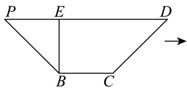
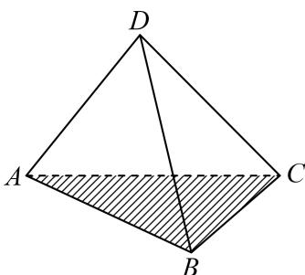

# 2025二模 数列专题 · 教师版

> 本地预览：题目、答案及分类尚未全部审定。校对使用的PDF为高中工作台解析版，尚未逐区确认区级印刷原卷。

## 等差等比通项、前项和与符号

以通项和前项和公式连接已知项，严格单调和变号约束须检验。

### 嘉定 · 第4题

已知等比数列 $\left\{ a _ { n } \right\}$ 的首项为1，公比为q，其前n项和为 $S _ { n }$ ．若 $S _ { 3 } > S _ { 4 }$ ，则q的取值范围为

**考点：** 等比数列前n项和与符号

**难度依据：** 等比数列前n项和符号；需完成一次转化或结合基本条件后计算

**核查说明：** 已人工阅读底稿题干和解析；尚未逐页对照原PDF，不作为数学终审。

【答案】$( - \infty , 0 )$

【解析】

根据等比数列的知识化简已知条件，从而求得正确答案.

依题意， $S _ { 3 } > S _ { 4 }$ ，即 $S _ { 4 } - S _ { 3 } = a _ { 4 } = a _ { 1 } q ^ { 3 } = q ^ { 3 } < 0$

所以 $. q < 0$

故答案为： $( - \infty , 0 )$

### 奉贤 · 第1题

等差数列首项为1，公差是3，则第5项等于

**考点：** 等差数列通项

**难度依据：** 等差数列通项；直接调用定义或基本公式，运算路径短

**核查说明：** 已人工阅读底稿题干和解析；尚未逐页对照原PDF，不作为数学终审。

【答案】13

【解析】

利用等差数列的通项公式求解即可.

设首项为1，公差是3的等差数列为 $\{ a _ { n } \}$

则 $\lvert a _ { n } = a _ { 1 } + ( n - 1 ) d = 3 n - 2 ,$

故 $\stackrel { \prime } { a } _ { 5 } = 3 \times 5 - 2 = 1 3 .$

故答案为：13

### 普陀 · 第4题

设n ≥ 1， $n \in  { \mathrm { N } } , S _ { n }$ 是等差数列 $\left\{ a _ { n } \right\}$ 的前n项和，若 $a _ { 3 n } = 3 a _ { n } \neq 0$ ，则 $\frac { S _ { 5 } } { a _ { 1 0 } }$ 的值为

**考点：** 等差数列通项和前n项和

**难度依据：** 等差数列通项与求和；直接调用定义或基本公式，运算路径短

**核查说明：** 已人工阅读底稿题干和解析；尚未逐页对照原PDF，不作为数学终审。

【答案】$: \ \frac { 3 } { 2 }$

【解析】

根据等差数列数列的性质结合通项公式、求和公式，可直接求解.

设等差数列 $\{ a _ { n } \}$ 的首项为 $[ a _ { 1 }$ ，公差为 $^ { \dag { d , } }$

$$
a _ {1} + (3 n - 1) d = 3 \left[ a _ {1} + (n - 1) d \right] \Rightarrow a _ {1} + (3 n - 1) d = 3 a _ {1} + (3 n - 3) d \Rightarrow a _ {1} = d.
$$

所以 $S _ { 5 } = \frac { 5 \left( a _ { 1 } + a _ { 5 } \right) } { 2 } = 5 a _ { 3 } = 5 \left( a _ { 1 } + 2 d \right) = 1 5 d , a _ { 1 0 } = a _ { 1 } + 9 d = 1 0 d ,$

所以： ${ \frac { S _ { 5 } } { a _ { 1 0 } } } = { \frac { 1 { \bar { 5 } } d } { 1 0 d } } = { \frac { 3 } { 2 } }$

故答案为 $: \ \frac { 3 } { 2 }$

### 浦东 · 第6题

设数列 $\left\{ a _ { n } \right\}$ 为等差数列，其前n项和为 $S _ { n }$ ，已知 $\lvert a _ { 3 } + a _ { 1 5 } = 2$ ，则 $S _ { 1 7 }$

**考点：** 等差对称项与前n项和

**难度依据：** 等差数列对称项与求和；直接运用定义或基础公式，推理链短

**核查说明：** 已人工阅读完整底稿题干及原解，未逐页对照正式PDF，分类不等于数学终审。

【答案】17

【解析】

根据下标和性质及等差数列求和公式计算可得.

因为 $\stackrel { \cdot } { a } _ { 3 } + a _ { 1 5 } = 2$ ，所以 $S _ { 1 7 } = \frac { 1 7 \left( a _ { 1 } + a _ { 1 7 } \right) } { 2 } = \frac { 1 7 \left( a _ { 3 } + a _ { 1 5 } \right) } { 2 } = 1 7 .$

故答案为：17

### 金山 · 第8题

已知 $\left\{ a _ { n } \right\}$ 是等差数列，若 $\dot { a } _ { 3 } , a _ { 7 }$ 分别是函数 $y = x ^ { 2 } - 4 x +$ 2的两个零点，则 $\stackrel { } { a } _ { 5 } =$

**考点：** 对称项等差中项

**难度依据：** 等差中项与韦达关系；需一次转化并结合定义域或几何条件计算

**核查说明：** 已人工阅读完整底稿题干及原解，未逐页对照正式PDF，分类不等于数学终审。

【答案】2

【解析】

转化为 $| a _ { 3 } , a _ { 7 }$ 是 $x ^ { 2 } - 4 x + 2 = 0$ 0的两个根，由韦达定理和等差数列性质得到 $a _ { 5 } = { \frac { a _ { 3 } + a _ { 7 } } { 2 } } = 2 \qquad $ 由题意得 $a _ { 3 } , a _ { 7 }$ 是 $x ^ { 2 } - 4 x + 2 = 0$ 的两个根，

由韦达定理得 $a _ { 3 } + a _ { 7 } = 4$

因为 $\{ a _ { n } \}$ 是等差数列，所以 $a _ { 5 } = { \frac { a _ { 3 } + a _ { 7 } } { 2 } } = 2$

故答案为：2

### 长宁 · 第3题

已知数列 $\left\{ a _ { n } \right\}$ 是等差数列，且 $a _ { 1 } = 2 , a _ { 6 } = 1 7$ ，则其前7项和 $S _ { 7 } =$

**考点：** 等差通项与前项和

**难度依据：** 等差通项与前项和；直接调用定义或基本公式，路径短

**核查说明：** 已人工阅读底稿题干和原解；未逐页对照PDF，不作为数学终审。

【答案】77

【解析】

利用公式法可求S .

设等差数列的公差为d，则 $d = \frac { a _ { 6 } - a _ { 1 } } { 5 } = 3$

故 $; a _ { 7 } = a _ { 6 } + d = 1 7 + 3 = 2 0 ,$

故 $S _ { 7 } = \frac { 7 \left( 2 + 2 0 \right) } { 2 } = 7 7 ,$

故答案为：77

### 闵行 · 第10题

已知数列 $\left\{ a _ { n } \right\}$ 为等差数列，数列 $\left\{ b _ { n } \right\}$ 为等比数列，且 $a _ { 1 } = b _ { 1 } = 1$ $a _ { 2 } = b _ { 2 } = t$ ，若 $\dot { a } _ { 6 } + b _ { 6 } > 3 8$ 则实数t的取值范围为

**考点：** 等差等比通项；幂函数单调比较

**难度依据：** 等差等比通项；幂函数单调比较；需组合两类关系并检查区间或等号

**核查说明：** 已人工阅读底稿题干和原解；未逐页对照PDF，不作为数学终审。

【答案】$( 2 , + \infty )$

【解析】

先结合题意由等差和等比数列的基本量法求出两数列的通项进而求出 ${ \mathrm { I } a _ { 6 } , b _ { 6 } }$ ，再构成函数f(t)，分析单调性和根即可

由题意可得等差数列的公差为t−1，所以 $\left. a _ { n } = 1 + \left( n - 1 \right) \left( t - 1 \right) \right.$ ，所以 $. a _ { 6 } = 5 t - 4 .$ 等比数列的公比为t，则 $\lvert b _ { n } = b _ { 1 } q ^ { n - 1 } \Rightarrow b _ { 6 } = t ^ { 5 }$

因为 $ { \vert a _ { 6 } + b _ { 6 } > 3 8 }$ ，即 $t ^ { 5 } + 5 t - 4 > 3 8$ ，即 $\lvert t ^ { 5 } + 5 t - 4 2 > 0$

设 $f \left( t \right) = t ^ { 5 } + 5 t - 4 2$

由复合函数的单调性可得f(t)在R上单调递增，

再由二分法确定当t = 2时， $f \left( t \right) = 0$

所以实数t的取值范围为 $( 2 , + \infty )$

故答案为： $( 2 , + \infty )$

### 青浦 · 第7题

已知无穷数列 $\left\{ a _ { n } \right\}$ 满足 $\boldsymbol { a } _ { n + 1 } = \frac { 1 } { 2 } \boldsymbol { a } _ { n }$ （n为正整数），且 $a _ { 1 } = 2 $ ，则 $\sum _ { i = 1 } ^ { + \infty } a _ { i } =$

**考点：** 无穷等比级数求和

**难度依据：** 无穷等比数列求和；直接调用定义或基本公式，运算路径短

**核查说明：** 已人工阅读底稿题干和解析；尚未逐页对照原PDF，不作为数学终审。

【答案】4

【解析】

由题意可知数列 $\{ a _ { n } \}$ 为等比数列，公比为 $\frac { 1 } { 2 }$ ，首项为2，再根据等比数列的求和公式计算即可

因为穷数列 $\{ a _ { n } \}$ 满足 $a _ { n + 1 } = { \frac { 1 } { 2 } } a _ { n }$ （n为正整数），且 $. a _ { 1 } = 2$

所以数列 $\{ a _ { n } \}$ 为等比数列，公比为 $\frac { 1 } { 2 }$ ，首项为2，

所以 $\sum _ { i = 1 } ^ { + \infty } a _ { i } = \frac { 2 } { 1 - \displaystyle \frac { 1 } { 2 } } = 4 .$

故答案为：4

### 黄浦 · 第7题

已知等比数列 $\left\{ a _ { n } \right\}$ 为严格增数列，其前n项和为 $S _ { n }$ ,若 $a _ { 1 } a _ { 1 0 } = a _ { 8 } , S _ { 4 } - S _ { 1 } = { \frac { 2 1 } { 4 } }$ ，则该数列的公比为

**考点：** 等比通项求和与严格单调

**难度依据：** 等比通项求和与严格单调；需组合两类关系并检查区间或等号

**核查说明：** 已人工阅读底稿题干和原解；未逐页对照PDF，不作为数学终审。

【解析】

设出等比数列公比，由题意建立方程，解方程并验根，可得答案.

设等比数列 $\{ a _ { n } \}$ 的公比为q，由 $\{ a _ { 1 } a _ { 1 0 } = a _ { 8 }$ ，则 $a _ { 1 } a _ { 1 } q ^ { 9 } = a _ { 1 } q ^ { 7 }$ ，解得 $a _ { 1 } = q ^ { - 2 }$

由 $S _ { 4 } - S _ { 1 } = \frac { 2 1 } { 4 }$ ，则 $\frac { a _ { 1 } \left( 1 - q ^ { 4 } \right) } { 1 - q } - a _ { 1 } = \frac { 2 1 } { 4 }$ ，代入上式可得 ${ \frac { 1 - q ^ { 4 } } { ( 1 - q ) q ^ { 2 } } } - { \frac { 1 } { q ^ { 2 } } } = { \frac { 2 1 } { 4 } }$

去分母可得 $4 q ^ { 4 } - 2 1 q ^ { 3 } + 2 1 q ^ { 2 } - 4 q = 0$ ，易知 $\vert q \ne 0$

可得 $4 q ^ { 3 } - 2 1 q ^ { 2 } + 2 1 q - 4 = 0$ ，分解因式可得 $\left( q - 1 \right) \left( 4 q - 1 \right) \left( q - 4 \right) = 0$

易知 $q \neq 1$ ，解得 $q = \frac { 1 } { 4 }$ 或4，

当 $q = \frac 1 4$ 时， $a _ { 1 } = 1 6$ ，则 $a _ { n } = 1 6 \times \left( { \frac { 1 } { 4 } } \right) ^ { n - 1 } = 4 ^ { 3 - n }$ ，单调递减，不合题意故答案为：4.

### 黄浦 · 第11题

设 $\left\{ a _ { n } \right\}$ 为等差数列，其前n项和为 $S _ { n }$ ，若 $\left( S _ { 8 } - S _ { 7 } \right) \left( S _ { 9 } - S _ { 7 } \right) < 0$ ，则满足 $S _ { m } S _ { m + 1 } <$ 0的正整数 m =

> 本题资料或解析有待核事项，预览不可作为已审定成品。

**考点：** 等差中项与前项和变号

**难度依据：** 等差中项与前项和变号；需组合两类关系并检查区间或等号

**核查说明：** 原解第二种情况误称数列递增，S16公式系数也错为15，须回源并修订。；已人工阅读底稿题干和原解；未逐页对照PDF，不作为数学终审。；历史分类审查记录（不把旧记录直接判为当前未解决）：原解第二种情况误称数列递增，S16公式系数也错为15，须回源并修订。 本次只归组，未修改题干、答案或专题归属；上述具体疑点仍交回源/数学复核处理。

【答案】15.

【解析】

由题意可得 $\left\{ { \begin{array} { l } { S _ { 8 } - S _ { 7 } < 0 } \\ { S _ { 9 } - S _ { 7 } > 0 } \end{array} } \right.$ 或 $\left\{ { \begin{array} { l l } { S _ { 8 } - S _ { 7 } > 0 } \\ { S _ { 9 } - S _ { 7 } < 0 } \end{array} } \right.$ 分类讨论可求得m的值.

由 $\left( S _ { 8 } - S _ { 7 } \right) \left( S _ { 9 } - S _ { 7 } \right) < 0$ ，可得 $\left\{ { S } _ { 8 } - { S } _ { 7 } < 0 \atop { S } _ { 9 } - { S } _ { 7 } > 0 \right\} { S } _ { 8 } - { S } _ { 7 } > 0$

当 $\left\{ { \begin{array} { l } { S _ { 8 } - S _ { 7 } < 0 } \\ { S _ { 9 } - S _ { 7 } > 0 } \end{array} } \right.$ 可得 $\left\{ { a _ { 8 } < 0 \atop a _ { 8 } + a _ { 9 } > 0 } \right\} _ { }$ 所以 $\left\{ { a _ { 8 } < 0 \atop a _ { 9 } > - a _ { 8 } > 0 } \right\} \nonumber$

所以 $\left\{ a _ { n } \right\}$ 为单调递增数列，且前8项为负，从第9项开始为正，

$$
S _ {1 5} = \frac {1 5 \left(a _ {1} + a _ {1 5}\right)}{2} = 1 5 a _ {8} <   0, S _ {1 6} = \frac {1 5 \left(a _ {1} + a _ {1 6}\right)}{2} = \frac {1 5 \left(a _ {8} + a _ {9}\right)}{2} > 0,
$$

所以 $S _ { 1 5 } S _ { 1 6 } < 0 ,$ ，所以 $. m = 1 5 ;$ ；

当 $\left\{ { \begin{array} { l l } { S _ { 8 } - S _ { 7 } > 0 } \\ { S _ { 9 } - S _ { 7 } < 0 } \end{array} } \right.$ 可得 $\begin{array} { r } { \left\{ { a } _ { 8 } > 0 \atop { a } _ { 8 } + { a } _ { 9 } < 0 ^ { , } \right. } \end{array}$ ，所以 $\left\{ { a _ { 8 } > 0 } \atop { a _ { 9 } < - a _ { 8 } < 0 }  , \right.$

所以 $\{ a _ { n } \}$ 为单调递增数列，且前8项为正，从第9项开始为负，

$$
S _ {1 5} = \frac {1 5 \left(a _ {1} + a _ {1 5}\right)}{2} = 1 5 a _ {8} > 0, S _ {1 6} = \frac {1 5 \left(a _ {1} + a _ {1 6}\right)}{2} = \frac {1 5 \left(a _ {8} + a _ {9}\right)}{2} <   0,
$$

所以 $S _ { 1 5 } S _ { 1 6 } < 0 _ { ; }$ ，所以 $m = 1 5$ ；

综上所述： $m = 1 5$

故答案为：15.

## 等差等比条件的函数转译

把中项条件改写为函数值关系，保留定义域、唯一性及三角形角的限制。

### 奉贤 · 第7题

已知 $\Delta A B C , ~  A , ~ B , ~ C \}$ 成等差数列且sinA、sinB、sinC成等比数列”是 $^ { * } \Delta A B C$ 是正三角形”的条件

**考点：** 充分必要条件与三角形边角关系

**难度依据：** 充分必要条件；需连接多个条件、建模或作分类讨论

**核查说明：** 已人工阅读底稿题干和解析；尚未逐页对照原PDF，不作为数学终审。

【答案】充要.

【解析】

根据给定条件，利用等差、等比数列的定义，结合正余弦定理及充分条件、必要条件的定义判断即得.

在 $\Delta A B C ^ { \prime }$ 中，由A、B、C成等差数列，得 $2 B = A + C$ ，而 $A + B + C = \pi$ ，则 $B = \frac { \pi } { 3 }$

由sinA、sinB、sinC成等比数列，得 $\sin ^ { 2 } B = \sin A \sin C$ ，由正弦定理得 $b ^ { 2 } = a c$

由余弦定理得 $b ^ { 2 } = a ^ { 2 } + c ^ { 2 } - 2 a c \cos B$ ，即 $\ l a c = a ^ { 2 } + c ^ { 2 } - a c$ ，解得 $a = c ,$ ，因此 $\Delta A B C$ 是正三角形；

若 $\Delta A B C$ 是正三角形，则 $A = B = C = { \frac { \pi } { 3 } } , \ \sin B = \sin A = \sin C = { \frac { \sqrt { 3 } } { 2 } }$

因此A、B、C成等差数列且sinA、sinB、sinC成等比数列，

所以“A、B、C成等差数列且sinA、sinB、sinC成等比数列”是 $^ { * } \Delta A B C$ 是正三角形”的充要条件.

故答案为：充要.

### 徐汇 · 第18题

已知函数 $\cdot y = f ( x )$ ，其中 $f ( x ) = \log _ { 2 } x$
(1) (6分)解关于x的不等式 $f ( 3 x - 2 ) < f ( 2 x + 1 )$ ；
(2) (8分)若存在唯一的实数x0，使得 $f ( x _ { 0 } ) , f ( x _ { 0 } - a ) , f ( 2 )$ 依次成等差数列，求实数a的取值范围.

**考点：** (1)对数单调性解不等式；(2)等差中项转化方程唯一根

**难度依据：** 对数单调性与方程根数；需连接多个条件或多步模型转化

**核查说明：** 已人工阅读完整底稿题干及原解，未逐页对照正式PDF，分类不等于数学终审。

【解析】

(1) 由函数 $f \left( x \right) = \log _ { 2 } { x } \overleftarrow { \mathbb { E } } ( 0 \ , \ + \infty )$ 单调递增，

所以0 $< 3 x - 2 < 2 x + 1 \Rightarrow x \in \left( { \frac { 2 } { 3 } } , 3 \right)$

(2) 原问题等价于关于x的方程 $\log _ { 2 } x + 1 = 2 \log _ { 2 } ( x - a )$ 恰有一个实数解，求实数a的取值范围.

即 $\frac { 1 } { 2 } \mathrm { l o g } _ { 2 } \left( 2 x \right) = \mathrm { l o g } _ { 2 } \left( x - a \right) \ddagger x \in \left( 0 , + \infty \right)$ 上恰有一个实数解.

等价 $\mp { \sqrt { 2 x } } = x - a / \mp x \in ( 0 , + \infty )$ 上恰有一个实数解.

⇔ $a = x - { \sqrt { 2 x } }$ 在 $x \in ( 0 , + \infty )$ 上恰有一个实数解.

${ \widehat { \vec { \triangledown } } } { \sqrt { 2 x } } = t \left( t > 0 \right)$ ，则 $a = \frac { 1 } { 2 } t ^ { 2 } - t \mathcal { \sqrt { \pm } } t \in ( 0 , + \infty )$ 上恰有一个实数解.

画出关于t的二次函数在 $\mathrm { : } t \in ( 0 , + \infty )$ 上的图像可知， $a \in \left\{ - \frac { 1 } { 2 } \right\} \cup [ 0 , + \infty )$ 时只有一个交点；

$$
\therefore a \in \left\{- \frac {1}{2} \right\} \cup [ 0, + \infty).
$$

### 杨浦 · 第16题

设A是由k个二次函数组成的集合，对于连续的正整数1,2,3,⋯,2025，存在二次函数
$y = f _ { i } ( x ) \in A ( 1 \leq i \leq 2 0 2 5 , i \in \mathbf { Z } , y = f _ { i } ( x )$ 可重复)，使得f1 (1), f2 (2), f3 (3), ⋯ , f2025 (2025)是等差数列，则k的最小可能值是（ ）.

A. 507

B. 1013

C. 1519

D. 2025

> 本题资料或解析有待核事项，预览不可作为已审定成品。

**考点：** 每个二次函数最多覆盖两个整数点

**难度依据：** 二次函数与直线交点数；需参数分类、构造递推或综合最值分析

**核查说明：** 源解只证明至少1013个，未给能以1013个二次函数实现的构造，证明尚缺充分性。；已人工阅读完整底稿题干及原解，未逐页对照正式PDF，分类不等于数学终审。；历史分类审查记录（不把旧记录直接判为当前未解决）：源解只证明至少1013个，未给能以1013个二次函数实现的构造，证明尚缺充分性。 本次只归组，未修改题干、答案或专题归属；上述具体疑点仍交回源/数学复核处理。

【答案】B

【解析】

由等差数列的基本量法求出通项，结合题意与二次函数 ${ f } _ { i } \left( x \right)$ 的表达式合并后由二次方程解的个数求解.

设等差数列的首项为a，公差为d，则第i项满足 $a _ { i } = a + ( i - 1 ) d .$ ，

每个二次函数 $f _ { i } \left( x \right) = a _ { i } x ^ { 2 } + b _ { i } x + c _ { i }$ 满足 $f _ { i } \left( i \right) = a _ { i } i ^ { 2 } + b _ { i } i + c _ { i } = a _ { 1 } + ( i - 1 ) d ,$

变形为 $a _ { i } i ^ { 2 } + ( b _ { i } - d ) i + ( c _ { i } - a + d ) = 0$

对于固定的 $a _ { i } , b _ { i } , c _ { i } , d ,$ ，这是一个关于i的二次方程，最多有两个整数解，因此，每个二次函数最多能覆盖两个不同的i值.

所以总共2025个i值需要覆盖，因此需要 ${ \frac { 2 0 2 5 } { 2 } } = 1 0 1 2 . 5$ 个，但i为整数，所以需要1013个故选：B

## 三、解答题

### 松江 · 第17题

已知函数 $\begin{array} { r } { \mathopen { } : y = A \sin ( 2 x + \varphi ) , A > 0 , 0 < \varphi < \pi _ { : } } \end{array}$ ，当 $x = \frac { \pi } { 6 }$ 时函数取得最大值4， ${ \mathrm { i } } \exists y = f ( x )$
(1) (6分)求函数 $\cdot y = f ( x )$ 的表达式；
(2) (8分)若数列 $\left\{ a _ { n } \right\}$ 为等差数列， $a _ { 2 } = f ( 0 ) , a _ { 4 } = f \left( { \frac { \pi } { 6 } } \right)$ $\mathbb { E } b _ { n } = 2 ^ { a _ { n } }$ ，求数列 $\left\{ b _ { n } \right\}$ 的前n项和 $S _ { n }$

> 本题资料或解析有待核事项，预览不可作为已审定成品。

**考点：** (1)最大值确定振幅初相；(2)等差数列转等比数列并求和

**难度依据：** 正弦函数解析式；需连接多个条件或多步模型转化

**核查说明：** 题干f(x)标记位置与符号OCR损坏，需整理原式。；已人工阅读完整底稿题干及原解，未逐页对照正式PDF，分类不等于数学终审。；历史分类审查记录（不把旧记录直接判为当前未解决）：题干f(x)标记位置与符号OCR损坏，需整理原式。 本次只归组，未修改题干、答案或专题归属；上述具体疑点仍交回源/数学复核处理。

【解析】

(1) 已知当 $x = \frac { \pi } { 6 }$ 时函数 $\langle y = A \sin ( 2 x + \varphi )$ 取得最大值4，

因为 $A > 0 ,$ ，所以 $A = 4 .$ .此时2 $\times \ { \frac { \pi } { 6 } } + \varphi = { \frac { \pi } { 2 } } + 2 k \pi , k \in \mathbf { Z }$

又 $) < \varphi < \pi _ { : }$ ，解得 $\varphi = \frac { \pi } { 6 }$

所以函数 $y = f ( x )$ 的表达式为 $y = 4 \sin \left( 2 x + { \frac { \pi } { 6 } } \right)$

(2) 由（1）知 $f \left( x \right) = 4 \sin \left( 2 x + \frac { \pi } { 6 } \right)$ ，则 $a _ { 2 } = f ( 0 ) = 4 \sin { \frac { \pi } { 6 } } = 2$

$$
a _ {4} = f \left(\frac {\pi}{6}\right) = 4 \sin \left(\frac {\pi}{2}\right) = 4.
$$

因为 $\left\{ a _ { n } \right\}$ 是等差数列，设公差为d，则 $\displaystyle a _ { 4 } - a _ { 2 } = 2 d = 4 - 2 = 2$ ，解得 $d = 1$

$$
a _ {1} = a _ {2} - d = 2 - 1 = 1,
$$

所以 $\displaystyle { a _ { n } = 1 + ( n - 1 ) \times 1 = n . }$

可得 $S _ { n } = { \frac { 2 \left( 1 - 2 ^ { n } \right) } { 1 - 2 } } = 2 ^ { n + 1 } - 2$

又 $b _ { n } = 2 ^ { a _ { n } } = 2 ^ { n }$ ，数列 $\left\{ b _ { n } \right\}$ 是以 $b _ { 1 } = 2$ 为首项， $q = 2$ 为公比的等比数列，

### 虹口 · 第18题

已知函数 $\mathbf { \boldsymbol { y } } = \mathbf { \boldsymbol { f } } \left( \boldsymbol { x } \right)$ 的表达式为 $\left| f \left( x \right) \right. = 2 ^ { x } , \left. x \in \mathbf { R } \right.$
(1) (6分)解不等式： $\log _ { 2 } { [ f \left( x \right) - 1 ] } + \log _ { 2 } { [ f \left( x \right) ] } \leq 1$ ；
(2) (8分)若存在实数 $x _ { 0 } \in \left[ 0 , { \frac { \pi } { 2 } } \right]$ ，使得 $f ( m \sin x _ { 0 } ) , f ( 2 + \sin 2 x _ { 0 } ) , f ( m \cos x _ { 0 } )$ 成等比数列，求实数m的最小值.

> 本题资料或解析有待核事项，预览不可作为已审定成品。

**考点：** (1)指数换元与对数定义域；(2)等比中项、三角代换与参数最小

**难度依据：** 指数对数方程不等式；需连接多个条件或多步模型转化

**核查说明：** 原解第二问指数等式跨行截断，需修复，避免将sin2x丢失。；已人工阅读完整底稿题干及原解，未逐页对照正式PDF，分类不等于数学终审。；历史分类审查记录（不把旧记录直接判为当前未解决）：原解第二问指数等式跨行截断，需修复，避免将sin2x丢失。 本次只归组，未修改题干、答案或专题归属；上述具体疑点仍交回源/数学复核处理。

【解析】

（1）由题意，$2^x-1>0$，且

$$\log_2\bigl[(2^x-1)2^x\bigr]\leq\log_2 2.$$

由对数函数的单调性，得 $(2^x-1)2^x\leq2$。结合 $x>0$，解得 $0<x\leq1$。

（2）由等比中项关系，得

$$2^{m\sin x_0}\cdot2^{m\cos x_0}=\left(2^{2+\sin2x_0}\right)^2,$$

所以 $m(\sin x_0+\cos x_0)=4+2\sin2x_0$。令 $t=\sin x_0+\cos x_0$，则 $t\in[1,\sqrt2]$，且

$$m=2\left(t+\frac1t\right).$$

函数 $t+\dfrac1t$ 在 $[1,\sqrt2]$ 上单调递增，故 $m\in[4,3\sqrt2]$，最小值为 $4$。

### 青浦 · 第17题

对于函数 $\cdot y = f ( x )$ ，其中 $f ( x ) = \log _ { a } x ( a > 0 , a \neq 1 )$
(1) (6分)若函数 $y = f ( x )$ 的图像过点(4,2)，求 $f ( 2 x - 2 ) < f ( x )$ 的解集；
(2) (8分)求证：当 $a = { \sqrt { 2 } } \mathbb { H } { \bmod { } }$ ，存在x使得 $f ( x + 1 ) , f ( a x ) , f ( x + 2 )$ 成等差数列.

> 本题资料或解析有待核事项，预览不可作为已审定成品。

**考点：** (1)对数函数单调性解不等式；(2)等差中项转化为对数方程

**难度依据：** 对数函数性质与方程；需连接多个条件、建模或作分类讨论

**核查说明：** 第二问源解仅由判别式正推出存在，尚需验证所得根满足对数真数为正。；已人工阅读底稿题干和解析；尚未逐页对照原PDF，不作为数学终审。；历史分类审查记录（不把旧记录直接判为当前未解决）：第二问源解仅由判别式正推出存在，尚需验证所得根满足对数真数为正。 本次只归组，未修改题干、答案或专题归属；上述具体疑点仍交回源/数学复核处理。

【解析】

(1) 已知函数 $\ b { \operatorname { \mathrm { ? } } y } = \ b { f } ( \ b { x } ) = \log _ { a }$ x的图像过点(4, 2)，

所以 $\log _ { a } 4 = 2 .$ ，即 $a ^ { 2 } = 4$ ，因为 $\textstyle { a > 0 , a \neq 1 }$ ，所以 $\left\lceil a = 2 \right.$

则 $f ( x ) = \log _ { 2 } x$

函数 $f ( x ) = \log _ { 2 }$ x的定义域为 $( 0 , + \infty )$ ，且在定义域上单调递增

由 $f ( 2 x - 2 ) < f ( x )$ 可得 $\left\{ { \begin{array} { l } { 2 x - 2 > 0 } \\ { x > 0 } \\ { 2 x - 2 < x } \end{array} } \right. ,$

解得 $1 < x < 2$ ，所以不等式的解集为(1,2).

(2) 当 $\mathsf { \Pi } ^ { ' } i = \sqrt { 2 } \mathbb { H } \mathbb { \Sigma } , f \left( x \right) = \log _ { \sqrt { 2 } } x , f \left( x + 1 \right) = \log _ { \sqrt { 2 } } \left( x + 1 \right)$ ，

$$
f (a x) = \log_ {\sqrt {2}} (\sqrt {2} x) = \log_ {\sqrt {2}} \sqrt {2} + \log_ {\sqrt {2}} x = 1 + \log_ {\sqrt {2}} x, f (x + 2) = \log_ {\sqrt {2}} (x + 2).
$$

若f(x + 1)、f(ax)、f(x + 2)成等差数列，则2 $f ( a x ) = f ( x + 1 ) + f ( x + 2 )$ ，

即2 $\left( 1 + \log _ { \sqrt { 2 } } x \right) = \log _ { \sqrt { 2 } } \left( x + 1 \right) + \log _ { \sqrt { 2 } } \left( x + 2 \right) .$

所以 $2 + 2 \log _ { \sqrt { 2 } } x = \log _ { \sqrt { 2 } } \left[ \left( x + 1 \right) \left( x + 2 \right) \right] _ { }$ ，

$$
\log_ {\sqrt {2}} (\sqrt {2}) ^ {2} + \log_ {\sqrt {2}} x ^ {2} = \log_ {\sqrt {2}} (x ^ {2} + 3 x + 2),
$$

即l $\log _ { \sqrt { 2 } } \left( 2 x ^ { 2 } \right) = \log _ { \sqrt { 2 } } \left( x ^ { 2 } + 3 x + 2 \right)$ ，则 $2 x ^ { 2 } = x ^ { 2 } + 3 x + 2$ ，移项可得 $x ^ { 2 } - 3 x - 2 = 0$

对于一元二次方程 $x ^ { 2 } - 3 x - 2 = 0 , \Delta = ( - 3 ) ^ { 2 } - 4 \times ( - 2 ) = 9 + 8 = 1 7 > 0 ,$

所以方程有实数解，即存在x使得f(x+1)、f(ax)、f(x+2)成等差数列.

## 周期分组与离散计数

按位移方向、三角周期或等差点列分组，计数时核实周期重复和端点。

### 嘉定 · 第12题

在平面直角坐标系中，一质点 $P$ 从原点 $O$ 出发，第一次从点 $O$ 移动到点 $P_1$，第二次从点 $P_1$ 移动到点 $P_2$，……，第 $k$ 次从点 $P_{k-1}$（规定 $P_0=O$）移动到点 $P_k$。记向量 $\vec v_k=\overrightarrow{P_{k-1}P_k}$，其模长为 $k$，方向与 $x$ 轴正方向成 $(90k)^\circ$ 角。设 $\vec S_n$ 为经过 $n$ 次移动的位移向量，即 $\vec S_n=\overrightarrow{OP_n}$，则当 $|\vec S_n|=\sqrt{85}$ 时，$n$ 的值为________。

> 本题资料或解析有待核事项，预览不可作为已审定成品。

**考点：** 周期位移、向量与数列

**难度依据：** 周期位移与向量运算；需连接多个条件、建模或作分类讨论

**核查说明：** 位移向量及等于根号85的条件严重乱码，不能凭解析猜补。；已人工阅读底稿题干和解析；尚未逐页对照原PDF，不作为数学终审。；历史分类审查记录（不把旧记录直接判为当前未解决）：位移向量及等于根号85的条件严重乱码，不能凭解析猜补。 本次只归组，未修改题干、答案或专题归属；上述具体疑点仍交回源/数学复核处理。

【答案】13.

【解析】

根据题意，求出向量 $\overrightarrow { v _ { k } }$ 的坐标，再求出向量 $\overrightarrow { S _ { n } }$ 的坐标，根据模长求解 即可

$$
\therefore \overrightarrow {v _ {k}} = \overrightarrow {P _ {k - 1} P _ {k}} = (k \cos (9 0 k) ^ {\circ}, k \sin (9 0 k) ^ {\circ}),
$$

$$
\begin{array}{l} \overrightarrow {S _ {n}} = \overrightarrow {O P _ {n}} = \\ \left(1 \times \cos 9 0 ^ {\circ} + 2 \cos 1 8 0 ^ {\circ} + 3 \cos 2 7 0 ^ {\circ} + \dots + n \cos (9 0 n) ^ {\circ}, 1 \times \sin 9 0 ^ {\circ} + 2 \sin 1 8 0 ^ {\circ} + 3 \sin 2 7 0 ^ {\circ} \right. \\ \left. + \dots + n \sin (9 0 n) ^ {\circ}\right) \end{array}
$$

$$
\therefore \overrightarrow {S _ {4}} = \overrightarrow {O P _ {4}} = (- 2 + 4, 1 - 3) = (2, - 2), \quad \left| \overrightarrow {S _ {4}} \right| = 2 \sqrt {2};
$$

$$
\overrightarrow {S _ {8}} = \overrightarrow {O P _ {8}} = (- 2 + 4 - 6 + 8, 1 - 3 + 5 - 7) = (4, - 4), \quad \left| \overrightarrow {S _ {8}} \right| = 4 \sqrt {2};
$$

$$
\overrightarrow {S _ {1 2}} = \overrightarrow {O P _ {1 2}} = (- 2 + 4 - 6 + 8 - 1 0 + 1 2, 1 - 3 + 5 - 7 + 9 - 1 1) = (6, - 6), \quad \left| \overrightarrow {S _ {1 2}} \right| = 6 \sqrt {2};
$$

$$
\overrightarrow {S _ {1 3}} = \overrightarrow {O P _ {1 3}} = (- 2 + 4 - 6 + 8 - 1 0 + 1 2, 1 - 3 + 5 - 7 + 9 - 1 1 + 1 3) = (6, 7), \quad \left| \overrightarrow {S _ {1 3}} \right| = \sqrt {8 5}
$$

故 $n = 1 3 .$

故答案为：13.

## 二、选择题

### 嘉定 · 第16题

设数列 $\left\{ a _ { n } \right\}$ 满足 $a _ { n } = \sin \left( { \frac { n \pi } { 3 } } \right) + ( - 1 ) ^ { n } \cos \left( { \frac { n \pi } { 4 } } \right)$ ，记其前n项和为 $S _ { n }$ ，前n项积为 $T _ { n }$ ．则下列结论正确的是（ ）

A. 数列 $\{ S _ { n } \}$ 和数列 $\left\{ T _ { n } \right\}$ 均不是周期数列

B. 数列 $\{ S _ { n } \}$ 是周期数列，数列 $\left\{ T _ { n } \right\}$ 不是周期数列

C. 数列 $\{ S _ { n } \}$ 不是周期数列，数列 $\left\{ T _ { n } \right\}$ 是周期数列

D. 数列 $\{ S _ { n } \}$ 和数列 $\left\{ T _ { n } \right\}$ 均为周期数列

**考点：** 周期规律及数列和、积

**难度依据：** 三角函数周期性；需综合转化、参数分析或完整证明，推理链较长

**核查说明：** 已人工阅读底稿题干和解析；尚未逐页对照原PDF，不作为数学终审。

【答案】B

【解析】

$\widehat { \check { \mathbf { \asymp } } } b _ { n } = \sin \left( \frac { n \pi } { 3 } \right)$ 可得数列 $\left\{ b _ { n } \right\}$ }的周期为6， ${ \mathfrak { H } } c _ { n } = ( - 1 ) ^ { n } \cos \left( { \frac { n \pi } { 4 } } \right)$ 可得数列 $\left\{ c _ { n } \right\}$ 的周期为8，进而依次得数列 $\{ a _ { n } \}$ 和数列 $\{ S _ { n } \}$ 的周期， $\nabla T _ { 1 } = \frac { \sqrt { 3 } } { 2 } - \frac { \sqrt { 2 } } { 2 }$ 和 $\lvert T _ { n } = 0 \left( n \geq 6 , n \in \mathrm { N } ^ { * } \right)$ 判断数列 $\{ T _ { n } \}$ 的周期性.$\cdot b _ { n } = \sin \left( { \frac { n \pi } { 3 } } \right)$ ，则数列 $\left\{ b _ { n } \right\}$ 的一个周期为 $^ { 1 6 , }$ ，$\therefore b _ { 1 } = { \frac { \sqrt { 3 } } { 2 } } , b _ { 2 } = { \frac { \sqrt { 3 } } { 2 } } , b _ { 3 } = 0 , b _ { 4 } = - { \frac { \sqrt { 3 } } { 2 } } , b _ { 5 } = - { \frac { \sqrt { 3 } } { 2 } } , b _ { 6 } = 0 ,$ $| b _ { 1 } + b _ { 2 } + b _ { 3 } + b _ { 4 } + b _ { 5 } + b _ { 6 } = 0 _ { }$ $c _ { n } = ( - 1 ) ^ { n } \cos \left( { \frac { n \pi } { 4 } } \right)$ ，则数列 $\left\{ c _ { n } \right\}$ 的一个周期为8，$c _ { 1 } = - \frac { \sqrt { 2 } } { 2 } , c _ { 2 } = 0 , c _ { 3 } = \frac { \sqrt { 2 } } { 2 } , c _ { 4 } = - 1 , c _ { 5 } = \frac { \sqrt { 2 } } { 2 } , c _ { 6 } = 0 , c _ { 7 } = - \frac { \sqrt { 2 } } { 2 } , c _ { 8 } = 1 ,$ $\begin{array} { r } { | c _ { 1 } + c _ { 2 } + c _ { 3 } + c _ { 4 } + c _ { 5 } + c _ { 6 } + c _ { 7 } + c _ { 8 } = 0 , } \end{array}$

所以数列 $\{ a _ { n } \}$ 的一个周期为24，且 $S _ { 2 4 } = 0$ ，所以 $S _ { n } = S _ { n + 2 4 }$ ，则 $\{ S _ { n } \}$ 的一个周期为24，

√3 √2 又a1 = b1 + c1 = 2 2 ≠ 0，a6 = 0，

所以 $T _ { 1 } = \frac { \sqrt { 3 } } { 2 } - \frac { \sqrt { 2 } } { 2 } , T _ { 6 } = 0$ ，故 $T _ { n } = 0 ( n \geq 6 , n \in \mathrm { N } ^ { * } )$ ，所以 $\left\{ T _ { n } \right\}$ 不是周期数列.故选：B.

## 三、解答题

### 崇明 · 第16题

数列 $\{a_n\}$ 是等差数列，周期数列 $\{b_n\}$ 满足 $b_n=\cos(a_n)$。若集合 $X=\{x\mid x=b_n,\ n\text{ 是正整数}\}$ 中恰有三个元素，则数列 $\{b_n\}$ 的周期 $T$ 的取值不可能是（　）。

A. $4$

B. $5$

C. $6$

D. $7$

> 本题资料或解析有待核事项，预览不可作为已审定成品。

**考点：** 等差数列与余弦取值个数

**难度依据：** 等差角数列的周期余弦；需参数分类、构造递推或综合最值分析

**核查说明：** 原PDF仍只称“周期T”，未明确最小正周期；原解取公差2π/T的充分必要性另待数学复核。；选择题D选项缺失；源解将一般周期直接取d=2pi/T未论充分必要；T是否指最小正周期须核正式原题。；已人工阅读完整底稿题干及原解，未逐页对照正式PDF，分类不等于数学终审。；历史分类审查记录（不把旧记录直接判为当前未解决）：选择题D选项缺失；源解将一般周期直接取d=2pi/T未论充分必要；T是否指最小正周期须核正式原题。 本次只归组，未修改题干、答案或专题归属；上述具体疑点仍交回源/数学复核处理。

【答案】D。

【解析】设等差数列的公差为 $d$。先构造符合条件的三个例子：

- $T=4$：取 $a_1=0$、$d=\frac\pi2$，依次得到 $1,0,-1,0$，恰有3个不同值。
- $T=5$：取 $a_1=0$、$d=\frac{2\pi}5$。五个角中，除 $0$ 外其余角两两互为相反角，恰有3个不同余弦值。
- $T=6$：取 $a_1=\frac\pi6$、$d=\frac\pi3$，依次得到 $\frac{\sqrt3}2,0,-\frac{\sqrt3}2,-\frac{\sqrt3}2,0,\frac{\sqrt3}2$，恰有3个不同值。

再说明7不可能。若 $d\in\pi\mathbb Z$，余弦序列至多有2个不同值，与题设矛盾，因此 $\sin d\ne0$。

假设7是一个周期，则对所有正整数 $n$，有 $\cos(a_n+7d)=\cos a_n$，即

$$
-2\sin\left(a_n+\frac{7d}2\right)\sin\frac{7d}2=0.
$$

若 $\sin\frac{7d}2\ne0$，由上式对连续两个 $n$ 均成立可得 $d\in\pi\mathbb Z$，与前述矛盾。故 $7d\in2\pi\mathbb Z$。若 $d\in2\pi\mathbb Z$，序列为常数，也矛盾；因此前7个角模 $2\pi$ 互不相同。一个余弦值在 $[0,2\pi)$ 中至多对应2个角，这7个角至少产生4个不同的值，与恰有3个元素矛盾。

故 $T=7$ 不可能，选D。这里不需要额外假定 $T$ 是最小正周期。证明为针对源解缺口的独立补写，原解析另存。

### 虹口 · 第10题

已知9个小球的编号为1、 $2 , \cdots 9 ,$ ，从中有放回地摸取小球三次，并依次记录其编号，若这三个编号成等差数列，则共有 种不同的摸取方法.

**考点：** 等差中项与奇偶计数

**难度依据：** 三项等差条件；需连接多个条件或多步模型转化

**核查说明：** 已人工阅读完整底稿题干及原解，未逐页对照正式PDF，分类不等于数学终审。

【答案】41.

【解析】

设这三个编号分别为a、b、c，对三个编号是否相同进行分类讨论，利用分类加法计数原理可得结果.

若三个编号成等差数列，若三个编号相同，共有9种，

若三个编号彼此都不相同，设这三个编号为a、b、c，则 $2 b = a + c .$

则a、c同为奇数或同为偶数，则b可由 $2 b = a +$ c来确定，

奇数编号的小球共5个，偶数编号的小球共4个，

若a、c同为奇数，则a、c的选择方法种数为2C2 = 20种；

若a、c同为偶数，则a、c的选择方法种数为 $\mathrm { 2 C _ { 4 } ^ { 2 } = 1 2 }$ 种.

当三个编号彼此不同时，不同的摸法种数为 $2 0 + 1 2 = 3 2$ 种.

综上所述，不同的摸法种数为 $9 + 3 2 = 4 1$ 种.

故答案为：41.

### 虹口 · 第12题

记|A|为有限集合A中的元素个数.设 $\omega > 0 , ~ S _ { \omega } = \left\{ \theta \ : | \ : 2 ^ { 2 0 2 5 } + \omega \right.$ ⋅θ能被7整除}，若对于任意实数a和任意正整数 ${ \mathrm { . } } n ,$ ，恒有 $\left| S _ { \omega } \cap \left( a , a + n \mathrm { e } ^ { - 0 . 5 n } \right) \right| \leq 3$ ，则实数ω的取值范围是

> 本题资料或解析有待核事项，预览不可作为已审定成品。

**考点：** 模7余数、点列间距与区间覆盖

**难度依据：** 等间隔点集与区间交集；需参数分类、构造递推或综合最值分析

**核查说明：** S_omega集合定义及区间长度多处TeX损坏；f(x)指数误漏x，必须核对以保持ne^(-n/2)。；已人工阅读完整底稿题干及原解，未逐页对照正式PDF，分类不等于数学终审。；历史分类审查记录（不把旧记录直接判为当前未解决）：S_omega集合定义及区间长度多处TeX损坏；f(x)指数误漏x，必须核对以保持ne^(-n/2)。 本次只归组，未修改题干、答案或专题归属；上述具体疑点仍交回源/数学复核处理。

【解析】

分析可知，集合 $S _ { \omega }$ 中的元素θ只需满足 $\omega \theta + 1$ 能被7整除即可，设 $\displaystyle \langle \omega \theta + 1 = 7 k \left( k \in \mathbf { Z } \right)$ ，则θ需取以 $\frac { 7 } { \omega }$ 为间隔的等间隔分布的实数，可知区间 $\left( a , a + n ^ { - { \frac { 1 } { 2 } } n } \right)$ 中最多只能找到三个θ值，即求$n \mathrm { e } ^ { - { \frac { 1 } { 2 } } n }$ 的最大值，利用导数求出函数 $f \left( x \right) = x \mathrm { e } ^ { - \frac { 1 } { 2 } }$ 的最大值为 $\frac { 2 } { \mathrm { e } }$ ，则任意一段长度不超过 $\frac { 2 } { \mathrm { e } }$ 的区间里最多只能找到三个θ值，由此可得出关于ω的不等式，解之即可.

$$
2 ^ {2 0 2 5} = 8 ^ {\frac {2 0 2 5}{3}} = (1 + 7) ^ {6 7 5} = 1 + \mathrm{C} _ {6 7 5} ^ {1} \cdot 7 + \mathrm{C} _ {6 7 5} ^ {2} \cdot 7 ^ {2} + \dots + \mathrm{C} _ {6 7 5} ^ {6 7 4} \cdot 7 ^ {6 7 4} + 7 ^ {6 7 5},
$$

所以， $2 ^ { 2 0 2 5 }$ 被7除余数为1，

因此，集合 $S _ { \omega }$ 中的元素θ只需满 $\mathbb { E } \omega \theta + 1$ 能被7整除即可，

设 $\omega \theta + 1 = 7 k \left( k \in { \bf Z } \right)$ ，从而可得 $\theta = \frac { 7 k - 1 } { \omega }$ ,

即θ需取以 $\frac { 7 } { \omega }$ 为间隔的等间隔分布的实数，

不论实数a和正整数n如何选取，区间 $\left( a , a + n ^ { - { \frac { 1 } { 2 } } n } \right)$ 中最多只能找到三个θ值，

考虑到任意性，考虑区间长度最长的情况，即求 $n \mathrm { e } ^ { - { \frac { 1 } { 2 } } n }$ 的最大值，

设 $\cdot f \left( x \right) = x \mathrm { e } ^ { - \frac { 1 } { 2 } }$ ，其中 $\boldsymbol { x } \in \mathbf { R }$ ，则 $f ^ { \prime } \left( x \right) = { \bigg ( } 1 - { \frac { 1 } { 2 } } x { \bigg ) } \mathrm { e } ^ { - { \frac { 1 } { 2 } } x }$ ，

由 $f ^ { \prime } \left( x \right) > 0 \bar { }$ 可得 $x < 2$ ，由 $f ^ { \prime } \left( x \right) < 0$ 可得 $x > 2$

所以，函数f(x)的增区间为 $( - \infty , 2 )$ ，减区间为 $( 2 , + \infty )$

所以， $f ( x ) _ { \mathrm { m a x } } = f \left( 2 \right) = \frac { 2 } { \mathrm { e } }$

因此，问题的要求是在任意一段长度不超过 $\frac { 2 } { \mathrm { e } }$ 的区间里最多只能找到三个θ值而θ的取值是以 $\frac { 7 } { \omega }$ 为间隔的，故临界情况是：长度为 $\frac { 2 } { \mathrm { e } }$ 的区间刚好对应3个间隔，$\xrightarrow { \cdots - 1 } \phi ^ { 1 } \xrightarrow { 1 } \phi ^ { 1 } \phi ^ { 2 }$

因此，只需 ${ \frac { 3 \times 7 } { \omega } } \geq { \frac { 2 } { \mathrm { e } } }$ 解得 $0 < \omega \leq { \frac { 2 1 \mathrm { e } } { 2 } }$

## 二、选择题

## 前项和性质、递推与概率状态

从前项和作差研究平方性质，或按一次操作建状态递推；初值与索引不可省略。

### 宝山 · 第16题

若对任意正整数n，数列 $\left\{ a _ { n } \right\}$ 的前n项和 $S _ { n }$ 都是完全平方数，则称数列 $\left\{ a _ { n } \right\}$ 为“完全平方数列”.有如下两个命题：①若数列 $\left\{ b _ { n } \right\}$ 的前n项和 $T _ { n } = \left( n - t \right) ^ { 2 }$ ，（ 为正整数），则使得数列 $\{ | b _ { n } | \}$ 为“完全平方数列”的t值有且仅有一个；②存在无穷多个“完全平方数列”的等差数列. 则下列选项中正确的是
（ ）

A. ①是真命题， ②是真命题；

B. ①是真命题， ②是假命题；

C. ①是假命题， ②是真命题；

D. ①是假命题， ②是假命题.

> 本题资料或解析有待核事项，预览不可作为已审定成品。

**考点：** 平方和约束、绝对值项及构造

**难度依据：** 完全平方数列；需参数分类、构造递推或综合最值分析

**核查说明：** 源解|b_n|分段式漏绝对值；关于公差的必要性论证含缺项和跳步。证明存在无穷构造可直接验证，但原解不能视为已数学审定。；已人工阅读完整底稿题干及原解，未逐页对照正式PDF，分类不等于数学终审。；历史分类审查记录（不把旧记录直接判为当前未解决）：源解|b_n|分段式漏绝对值；关于公差的必要性论证含缺项和跳步。证明存在无穷构造可直接验证，但原解不能视为已数学审定。 当前底稿已有回源补丁，涉及answer_and_solution；具体修复范围以底稿patches和2025二模-解析公式回源补丁-第二批.json为准。本题仍按可辨数学任务归组，不据分组宣称数学已审定。

【答案】A

【解析】

对于①，根据数列 $\{ b _ { n } \}$ 的前n项和得到 $| b _ { n } | = { \left\{ \begin{array} { l l } { \left( 1 - t \right) ^ { 2 } , n = 1 } \\ { 2 n - 2 t - 1 , n \geq 2 ^ { \prime } } \end{array} \right. }$ 对t = 1， $n \geq 2$ 和t ≥ 2两种情况分类讨论求解可判断；对于②设等差数列的首项为 $\mathbf { \dot { a } } _ { 1 }$ ，公差为d，对d分类讨论求解判断

对于①，数列 $\left\{ b _ { n } \right\}$ 的前n项和 $T _ { n } = \left( n - t \right) ^ { 2 }$ （t为正整数），

当 $n \geq$ 2时， $b _ { n } = T _ { n } - T _ { n - 1 } = \left( n - t \right) ^ { 2 } - \left( n - 1 - t \right) ^ { 2 } = 2 n - 2 t - 1$ ，

当n = 1时， $b _ { 1 } = T _ { 1 } = \left( 1 - t \right) ^ { 2 }$ 不满足上式，所以 $| b _ { n } | = { \left\{ \begin{array} { l l } { ( 1 - t ) ^ { 2 } , n = 1 } \\ { 2 n - 2 t - 1 , n \geq 2 ^ { \prime } } \end{array} \right. }$

当t = 1， $n \geq$ 2时， $2 n - 2 t - 1 = 2 n - 3 > 0 ,$

所以数列 $\{ | b _ { n } | \}$ 与原数列相同，所以 $T _ { n } = ( n - 1 ) ^ { 2 }$ ，

所以当t = 1时，数列 $\{ | b _ { n } | \}$ 为完全平方数列，

当t ≥ 2时， $\left| b _ { 1 } \right| + \left| b _ { 2 } \right| = ( t - 1 ) ^ { 2 } + \left| 3 - 2 t \right| = t ^ { 2 } - 2 t + 1 + 2 t - 3 = t ^ { 2 }$ −2不是“完全平方数，所以当t ≥ 2时，数列 $\{ | b _ { n } | \}$ 不是完全平方数列，

综上所述：数列 $\{ | b _ { n } | \}$ 为“完全平方数列”，故①是真命题；

对于②，因为 $S _ { n }$ 为完全平方数，故 $\tau d \geq 0 , a _ { 1 } \geq 0 , d , a _ { 1 } \in \mathrm { N }$

若 $\dot { \boldsymbol { d } } = 0$ ，则 $S _ { n } = n a _ { 1 }$ ，若对任意的 $| n \in \mathrm { N } ^ { * } , n a _ { 1 }$ 均为完全平方数，

则 $| a _ { 1 } = 0$ ，否则假设p为a 的素因数，且pa恰好整除a ，a为正整数，

若a为奇数，则 $| a _ { 1 }$ 不是完全平方数，矛盾，

若a为偶数，取 $n = p ^ { a + 1 }$ ，则 $n a _ { 1 }$ 不是完全平方数，矛盾，

若 $d > 1$ ， 则 $S _ { n } = { \frac { n \left( a _ { 1 } + a _ { n } \right) } { 2 } } = { \frac { n \left( 2 a _ { 1 } - d + n d \right) } { 2 } }$

若 $2 a _ { 1 } - d \neq 0$ ，取 $\begin{array} { r } { n = | 2 a _ { 1 } - d | } \end{array}$ ，则 $S _ { n } = { \overline { { \left| 2 a _ { 1 } - d \right| ^ { 2 } \left( d + 1 \right) } } }$ 或 $S _ { n } = { \frac { \left| 2 a _ { 1 } - d \right| ^ { 2 } \left( d - 1 \right) } { 2 } }$

当d为偶数时，此时 $\frac { \left| 2 a _ { 1 } - d \right| ^ { 2 } \left( d + 1 \right) } { 2 }$ $\frac{|2a_1-d|^2(d-1)}{2}$ 均不是完全平方数，

当d为奇数时，取 $n = 4 , S _ { n } = 2 ( 2 a _ { 1 } + 3 d ) , 2 a _ { 1 } + 3 d$ 为奇数，

故此时 $S _ { n }$ 不是完全平方数，

故 $2 a _ { 1 } - d = 0$ ，即 $2 a _ { 1 } = d ,$ ，故 $S _ { n } = a _ { 1 } n ^ { 2 }$ ，设 $\mathrm { \dot { \varepsilon } } a _ { 1 } = k ^ { 2 }$ ，故 $S _ { n } = k ^ { 2 } n ^ { 2 }$

当 $n \geq$ 2时， $a _ { n } = S _ { n } - S _ { n - 1 } = k ^ { 2 } n ^ { 2 } - k ^ { 2 } ( n - 1 ) ^ { 2 } = k ^ { 2 } ( 2 n - 1 )$

又 $\textstyle . a _ { 1 } = k ^ { 2 }$ 适合上式，即 $\mathfrak { I } a _ { n } = k ^ { 2 } ( 2 n - 1 ) , k \in \mathtt { Z }$

故存在无穷多个“完全平方数列”的等差数列，故②是真命题.

故选：A.

## 三、解答题

### 徐汇 · 第15题

在桌面上有一个质地均匀的正四面体D—ABC．从该正四面体与桌面贴合的面上的三条棱中等可能地选取一条棱，沿其翻转正四面体至正四面体的另一个面与桌面贴合，如此翻转称为一次操作．如图，开始时，正四面体与桌面贴合的面为ABC，操作 ${ \mathrm { i } n ( n = 1 , 2 , 3 , \cdots ) }$ 次后，正四面体与桌面贴合的面是ABC的概率记为 $P _ { n } .$ . 现有下列两个结论： $\odot P _ { 2 } = { \frac { 1 } { 3 } } ; \odot P _ { 2 5 } < P _ { 2 4 }$ . 则下列说法正确的是（ ）

A. ①正确，②错误

B. ①错误，②正确

C. ①、②都正确

D. ①、②都错误

> 本题资料或解析有待核事项，预览不可作为已审定成品。

**考点：** 翻转概率递推、奇偶比较

**难度依据：** 正四面体翻转递推概率；需连接多个条件或多步模型转化

**核查说明：** 源解P24所列幂指数25与通式应得23不一致，虽不影响奇偶比较仍须核改；缺独立答案字段。；已人工阅读完整底稿题干及原解，未逐页对照正式PDF，分类不等于数学终审。；历史分类审查记录（不把旧记录直接判为当前未解决）：源解P24所列幂指数25与通式应得23不一致，虽不影响奇偶比较仍须核改；缺独立答案字段。 本次只归组，未修改题干、答案或专题归属；上述具体疑点仍交回源/数学复核处理。

【解析】

首先通过分析正四面体的翻转操作，找出操作n次后正四面体与桌面贴合的面是 的概率$P _ { n }$ 的递推关系，再根据递推关系计算 $P _ { 2 }$ ，并分析 $P _ { n }$ 的性质判断 $P _ { 2 4 } { \stackrel { \cal L } {  } } P _ { 2 5 }$ 的大小关系开始时正四面体与桌面贴合的面为ABC，进行一次操作后，正四面体与桌面贴合的面不可能再是 $A B C$ ，所以 $P _ { 1 } = 0$

要得到操作2次后正四面体与桌面贴合的面是ABC，那么第一次操作后正四面体与桌面贴合的面不是ABC，且第二次操作能回到ABC.

第一次操作后正四面体与桌面贴合的面不是ABC，有3种情况（正四面体共4个面，除去ABC面），从这3个面中的任意一个面进行第二次操作回到ABC面的概率为 $\frac 1 3$

根据分步乘法计数原理， $P _ { 2 } = ( 1 - P _ { 1 } ) \times \frac { 1 } { 3 }$ ，因为 $P _ { 1 } = 0$ ，所以 $P _ { 2 } = ( 1 - 0 ) \times \frac { 1 } { 3 } = \frac { 1 } { 3 }$ ，故①正确,

当n ≥ 2时，操作n次后正四面体与桌面贴合的面是 $A B C ,$ ，则操作n−1次后正四面体与桌面贴合的面不是 $A B C$ ，且第n次操作能回到ABC,

操作n−1次后正四面体与桌面贴合的面不是ABC的概率为 $1 - P _ { n - 1 }$ ，

从不是ABC的面进行一次操作回到ABC面的概率为 $\frac 1 3$

所以可得递推关系 $P _ { n } = ( 1 - P _ { n - 1 } ) \times \frac { 1 } { 3 } = - \frac { 1 } { 3 } P _ { n - 1 } + \frac { 1 } { 3 }$

将上式变形为 $P _ { n } - { \frac { 1 } { 4 } } = - { \frac { 1 } { 3 } } \biggl ( P _ { n - 1 } - { \frac { 1 } { 4 } } \biggr )$

所以数列 $\left\{ P _ { n } - { \frac { 1 } { 4 } } \right\}$ 是以 $P _ { 1 } - { \frac { 1 } { 4 } } = 0 - { \frac { 1 } { 4 } } = - { \frac { 1 } { 4 } }$ 为首项, $, - { \frac { 1 } { 3 } }$ 为公比的等比数列,

$P _ { n } - { \frac { 1 } { 4 } } = \left( - { \frac { 1 } { 4 } } \right) \times \left( - { \frac { 1 } { 3 } } \right) ^ { n - 1 }$ $P _ { n } = { \frac { 1 } { 4 } } + \left( - { \frac { 1 } { 4 } } \right) \times \left( - { \frac { 1 } { 3 } } \right) ^ { n - 1 }$

$P _ { 2 5 } = { \frac { 1 } { 4 } } - { \frac { 1 } { 4 } } \times { \bigg ( } { \frac { 1 } { 3 } } { \bigg ) } ^ { 2 4 } , P _ { 2 4 } = { \frac { 1 } { 4 } } + { \frac { 1 } { 4 } } \times { \bigg ( } { \frac { 1 } { 3 } } { \bigg ) } ^ { 2 5 }$ ，显然 $P _ { 2 5 } < P _ { 2 4 }$ ，故②正确.

### 普陀 · 第16题

设 $k\geq2$，$n\geq1$，$k,n\in\mathbf N$，$S_n$ 是数列 $\{a_n\}$ 的前 $n$ 项和，且满足 $2S_n=3a_n-1$。数列 $\{b_n\}$ 是由 $k$ 个大于 $-2$ 的整数组成的有穷数列，若 $b_1\ne0$，且

$$\sum_{i=1}^{k}b_i a_{k-i+1}=0,$$

则称数列 $\{b_n\}$ 是数列 $\{a_n\}$ 的“T数列”。对于数列 $\{b_n\}$ 有如下两个命题：

① 若 $b_1>0$，则数列 $\{b_n\}$ 不是数列 $\{a_n\}$ 的“T数列”；

② 若 $k\geq3$，则数列 $\{a_n\}$ 的“T数列”至少有5个。

则下列结论中正确的是（　）。

A. ①为真，②为真

B. ①为真，②为假

C. ①为假，②为真

D. ①为假，②为假

> 本题资料或解析有待核事项，预览不可作为已审定成品。

**考点：** T数列构造与一般性证明

**难度依据：** T数列定义；需综合转化、参数分析或完整证明，推理链较长

**核查说明：** 源解由k=2等个案推一般结论，论证不充分，需一般性证明。；已人工阅读底稿题干和解析；尚未逐页对照原PDF，不作为数学终审。；历史分类审查记录（不把旧记录直接判为当前未解决）：源解由k=2等个案推一般结论，论证不充分，需一般性证明。 本次只归组，未修改题干、答案或专题归属；上述具体疑点仍交回源/数学复核处理。

【答案】A。

【解析】

当 $n=1$ 时，$2a_1=3a_1-1$，得 $a_1=1$。当 $n\geq2$ 时，由

$$2S_n=3a_n-1,\qquad 2S_{n-1}=3a_{n-1}-1,$$

两式相减得 $a_n=3a_{n-1}$，故 $a_n=3^{n-1}$。

对于命题①，若整数 $b_1>0$，则 $b_1\geq1$，其余各项 $b_i\geq-1$。因此

$$\begin{aligned}
\sum_{i=1}^{k}b_i a_{k-i+1}
&=\sum_{i=1}^{k}b_i3^{k-i}\\
&\geq3^{k-1}-\sum_{j=0}^{k-2}3^j
=\frac{3^{k-1}+1}{2}>0.
\end{aligned}$$

加权和不为0，故不能成为“T数列”，命题①为真。

对于命题②，当 $k=3$ 时，取以下五组三元组：

$$(-1,-1,12),\quad(-1,0,9),\quad(-1,1,6),\quad(-1,2,3),\quad(-1,3,0).$$

每组均满足 $9b_1+3b_2+b_3=0$，各项均为大于 $-2$ 的整数，且 $b_1\ne0$。

对任意 $k\geq3$，在上述每组三元组后补上 $k-3$ 个0，则

$$\sum_{i=1}^{k}b_i3^{k-i}=3^{k-3}(9b_1+3b_2+b_3)=0.$$

由此得到五个不同的“T数列”，所以命题②为真，故选A。

源解析仅举 $k=2$ 判断命题①，并由 $k=3,4$ 的例子推及一般情况；本解析分别补充一般下界与补零构造。

### 松江 · 第16题

定义在 $( 0 , + \infty )$ 上的函数 $\cdot y = f ( x )$ 满足 $f ( x + 1 ) = f ( x ) - x$ ，当 $0 < x \leq 1 \mathbb { H } ]$ ， $f \left( x \right) = \sqrt { x } - x + 1$ 有以下两个命题：
①当n为正整数时， $f \left( n \right) = { \frac { - n ^ { 2 } + n + 2 } { 2 } }$ ；
②若函数 $y = f ( x )$ 在区间(0,k]内有3个极大值点，则k的取值范围是 $\left[ { \frac { 7 3 } { 3 6 } } , 3 \right)$
则以下选项正确的是（ ）

A. ①是真命题，②是假命题

B. 两个都是真命题

C. ①是假命题，②是真命题

D. 两个都是假命题

> 本题资料或解析有待核事项，预览不可作为已审定成品。

**考点：** 递推函数各区间极值与整数值

**难度依据：** 递推函数分段表达与极值；需参数分类、构造递推或综合最值分析

**核查说明：** 函数可不连续，端点极大值定义和截断区间口径须注意；原解局部导数不等式有字母OCR错误。；已人工阅读完整底稿题干及原解，未逐页对照正式PDF，分类不等于数学终审。；历史分类审查记录（不把旧记录直接判为当前未解决）：函数可不连续，端点极大值定义和截断区间口径须注意；原解局部导数不等式有字母OCR错误。 本次只归组，未修改题干、答案或专题归属；上述具体疑点仍交回源/数学复核处理。

【答案】A

【解析】

对①，根据题意，可得 $f ( n ) - f ( n - 1 ) = - ( n - 1 )$ ，利用累加法求求答案；对②，分别求出$x \in ( 1 , 2 ]$ ，x ∈ (2,3]，x ∈ (3,4]的解析式，利用导数判断极大值情况，得解

对于①，当n为正整数时，已知f(x + 1) = f(x) − x，

则 $| f ( n ) - f ( n - 1 ) = - ( n - 1 )$

$$
f (n - 1) - f (n - 2) = - (n - 2), \dots , f (2) - f (1) = - 1, f (1) = \sqrt {1} - 1 + 1 = 1,
$$

将这些式子累加可得 $f ( n ) - f ( 1 ) = - ( 1 + 2 + \cdots + ( n - 1 ) )$ 1

由等差数列求和公式 $1 + 2 + \cdots + ( n - 1 ) = { \frac { ( n - 1 ) n } { 2 } }$ ，

所以 $f \left( n \right) = 1 - { \frac { ( n - 1 ) n } { 2 } } = { \frac { - n ^ { 2 } + n + 2 } { 2 } }$ ，故①正确，

对于②，当 $0 < x \le 1$ 时， $f \left( x + 1 \right) = f \left( x \right) - x = \sqrt { x } - 2 x + 1$ ，令 $t = x + 1 \in ( 1 , 2 ]$

$$
\therefore f (t) = \sqrt {t - 1} - 2 (t - 1) + 1 = \sqrt {t - 1} - 2 t + 3,
$$

即 $f \left( x \right) = \sqrt { x - 1 } - 2 x + 3 , x \in \left( 1 , 2 \right]$

同理，可得 $f \left( x \right) = { \sqrt { x - 2 } } - 3 x + 6 , x \in \left( 2 , 3 \right]$

$$
f (x) = \sqrt {x - 3} - 4 x + 1 0, x \in (3, 4 ],
$$

由0 $\mid < x \leq 1 , f \left( x \right) = \sqrt { x } - x + 1$ ，则 $f ^ { \prime } \left( x \right) = \frac { 1 } { 2 \sqrt { x } } - 1 = \frac { 1 - 2 \sqrt { x } } { 2 \sqrt { x } }$

令 $f ^ { \prime } \left( x \right) > 0$ ，得 $\displaystyle { c < \frac { 1 } { 4 } }$ ，令 $f ^ { \prime } \left( x \right) < 0$ ，得 $x > \frac { 1 } { 4 }$

所以f (x)在 $\left( 0 , { \frac { 1 } { 4 } } \right)$ 上单调递增，在 $\left( { \frac { 1 } { 4 } } , 1 \right]$ 上单调递减，

所以 $x = { \frac { 1 } { 4 } }$ 是极大值点，

当 $f \left( x \right) = \sqrt { x - 1 } - 2 x + 3 , x \in \left( 1 , 2 \right]$ ]时，则 $f ^ { \prime } \left( x \right) = { \frac { 1 } { 2 { \sqrt { x - 1 } } } } - 2 = { \frac { 1 - 4 { \sqrt { x - 1 } } } { 2 { \sqrt { x - 1 } } } }$ 同上易得 $x = { \frac { 1 7 } { 1 6 } }$ 是极大值点，

当 $f \left( x \right) = { \sqrt { x - 2 } } - 3 x + 6 , x \in \left( 2 , 3 \right]$ ]时，则 $f ^ { \prime } \left( x \right) = { \frac { 1 } { 2 { \sqrt { x - 2 } } } } - 3 = { \frac { 1 - 6 { \sqrt { x - 2 } } } { 2 { \sqrt { x - 2 } } } }$ 可得 $x = { \frac { 7 3 } { 3 6 } }$ 为极大值点，

当 $f \left( x \right) = \sqrt { x - 3 } - 4 x + 1 0 , x \in \left( 3 , \right.$ 4]时，则 $f ^ { \prime } \left( x \right) = { \frac { 1 } { 2 { \sqrt { x - 3 } } } } - 4 = { \frac { 1 - 8 { \sqrt { x - 3 } } } { 2 { \sqrt { x - 3 } } } }$ 易得 $x = \frac { 1 9 3 } { 6 4 }$ 为极大值点，

因为函数 $y = f \left( x \right)$ 在区间(0,k]内有3个极大值点，所以 $k \in \left[ \frac { 7 3 } { 3 6 } , \frac { 1 9 3 } { 6 4 } \right)$ ，故②错误.故选：A.

## 三、解答题

### 浦东 · 第12题

已知数列 $\{ a _ { n } \} , ~ a _ { 1 } = 1 , a _ { n } \in \{ 1 , - 1 \} , ( n \geq 2 )$ ，并且前n项的和 $\mid S _ { n }$ 满足：
①存在小于1013的正整数t，使得 $S _ { 2 t + 1 } = - 1$ ；
②对任意的正整数k和m，都有 $| S _ { 2 m } - S _ { 2 k - 1 } | \leq 1$
则满足以上条件的数列 $\left\{ S _ { n } \right\} ( 1 \leq n \leq 2 0 2 5 )$ 共有 个

> 本题资料或解析有待核事项，预览不可作为已审定成品。

**考点：** 奇偶前缀和约束与构造计数

**难度依据：** 正负一数列前缀和限制；需参数分类、构造递推或综合最值分析

**核查说明：** 本次仅核此字段，不代表全卷数学与视觉终审。；已人工阅读完整底稿题干及原解，未逐页对照正式PDF，分类不等于数学终审。

【答案】$2^{1012}-1$

【解析】

根据 $S_n$ 的奇偶性，结合 $S_{2t+1}=-1,S_1=1$ 分析可知 $S_{2m}=0$，进而可得 $a_2=-1$，$a_{2k+1}+a_{2k+2}=0\ (k\in\mathbf N^*)$，求数列个数，并排除不满足条件①的情况。

因为 $a_1=1,a_n\in\{1,-1\}\ (n\ge2)$，可知 $S_n$ 的奇偶性与 $n$ 一致。

对于①，存在小于1013的正整数 $t$，使得 $S_{2t+1}=-1$。

对于②，对任意正整数 $k,m$，都有 $|S_{2m}-S_{2k-1}|\le1$。因为该绝对值为奇数，所以 $|S_{2m}-S_{2k-1}|=1$。

令 $k=t+1$，则 $|S_{2m}-S_{2t+1}|=|S_{2m}+1|=1$，可得 $S_{2m}=0$ 或 $S_{2m}=-2$。

令 $k=1$，则 $|S_{2m}-S_1|=|S_{2m}-1|=1$，可得 $S_{2m}=0$ 或 $S_{2m}=2$。

综上，对任意正整数 $m$，$S_{2m}=0$。且 $a_1=1$，可得 $a_2=-1$，$a_{2k+1}+a_{2k+2}=0\ (k\in\mathbf N^*)$。

即 $a_1,a_2$ 确定，$a_{2k+1},a_{2k+2}$ 不相等，有2种可能。此时 $S_{2n}=0,S_{2n-1}=\pm1$，条件②满足。

对于数列 $\{S_n\}\ (1\le n\le2025)$，$(a_3,a_4),(a_5,a_6),\ldots,(a_{2023},a_{2024}),a_{2025}$ 均有2种可能，故数列共有 $2^{\frac{2024-2}{2}+1}=2^{1012}$ 个。

又因为存在小于1013的正整数 $t$，使得 $S_{2t+1}=-1$，所以不能对所有 $k\in\mathbf N^*,k\le1012$ 都有 $a_{2k+1}=1$。即 $a_3=a_5=\cdots=a_{2025}=1$ 这一种情况不符合题意。

综上，符合题意的数列共有 $2^{1012}-1$ 个。

【复核说明】上述量词表述经独立计数复核作规范化澄清，并非PDF逐字转录。因 $S_{2k}=0$，故 $S_{2k+1}=a_{2k+1}$；条件①等价于在 $a_3,a_5,\ldots,a_{2025}$ 中至少有一项为 $-1$，只须排除所有这些项均为1的一种情形。

### 虹口 · 第15题

春节期间，小明和弟弟玩起了一种自定义游戏，规定先由弟弟掷一颗质量均匀的骰子，若弟弟掷出的点数为6，则吃1颗花生；若掷出其他点数，则记下这个点数，然后由小明开始两个人轮流掷这颗骰子，直至任意一方掷出这个记下的点数或者6，一次游戏结束.若掷出的是这个记下的点数，则弟弟吃1颗花生；若是6，则小明吃3颗花生.任意一次游戏中弟弟能吃到1颗花生的概率为（ ）.

A. $\frac { 5 } { 2 4 }$

B. $\frac { 5 } { 1 2 }$

C. $\frac { 3 } { 8 }$

D. $\frac { 7 } { 1 2 }$

**考点：** 吸收式游戏概率与全概率

**难度依据：** 重复掷骰与递推概率；需连接多个条件或多步模型转化

**核查说明：** 已人工阅读完整底稿题干及原解，未逐页对照正式PDF，分类不等于数学终审。

【答案】D

【解析】

先求出第一步掷骰子弟弟能吃到花生的概率为 $\frac { 1 } { 6 }$ ，再通过分类讨论求出第一次掷出非6，后续阶段弟弟能吃到花生的概率，二者相加即为任意一次游戏中弟弟能吃到1颗花生的概率

第一步：第一次掷骰子的概率

（1）掷出6点：概率为 $\frac { 1 } { 6 }$ ，弟弟直接吃1颗花生；

（2）非6点：概率为 ${ \frac { 5 } { 6 } } ;$ ，记下点数k (k = 1, 2, 3, 4, 5)，进入后续阶段.

第二步：后续阶段的概率分析

设小明掷骰子时弟弟吃到花生的概率为P，弟弟掷骰子时弟弟吃到花生的概率为Q，

若小明掷骰子：

（1）掷出k：概率为 $\frac { 1 } { 6 }$ ，弟弟吃1颗花生；

（2）掷出6：概率为 $\frac { 1 } { 6 }$ ，小明吃3颗花生；

（3）其他点数：概率为 $\frac { 4 } { 6 }$ ，轮到弟弟掷骰子，此时概率为 $Q$

故有 $P = \frac { 1 } { 6 } \times 1 + \frac { 1 } { 6 } \times 0 + \frac { 4 } { 6 } \times Q \textcircled { 1 }$

若弟弟掷骰子：

（1）掷出k：概率为 $\frac { 1 } { 6 }$ ，弟弟吃1颗花生；

（2）掷出6：概率为 $\frac { 1 } { 6 } { : }$ ，小明吃3颗花生；

（3）其他点数：概率为 $\frac { 4 } { 6 }$ ，轮到小明掷骰子，此时概率为 $P _ { \cdot }$

故有 $Q = { \frac { 1 } { 6 } } \times 1 + { \frac { 1 } { 6 } } \times 0 + { \frac { 4 } { 6 } } \times P { \widehat { \textmd { 2 } } }$

联立①②两式，可得 $P = Q = { \frac { 1 } { 2 } }$ ，即后续阶段弟弟吃到花生的概率为 ${ \frac { 5 } { 6 } } \times { \frac { 1 } { 2 } } = { \frac { 5 } { 1 2 } }$

故任意一次游戏中弟弟能吃到1颗花生的概率为 ${ \frac { 1 } { 6 } } + { \frac { 5 } { 1 2 } } = { \frac { 7 } { 1 2 } }$

故选：D

## 累加求和与递推估计

识别差分、几何面积累加及收缩关系，再求和或夹逼，避免把大题只拆末问。

### 奉贤 · 第21题

函数 $y = f \left( x \right)$ ，其中 $f \left( x \right) = x ^ { 3 } - x ^ { 2 } + { \frac { 1 } { 2 } } x + { \frac { 1 } { 4 } }$ ，定义域是一切实数
(1) (4分)计算 $\mathrm { { . l i m } } _ { h  0 } \frac { f ( 2 + h ) - f ( 2 ) } { h }$ 的值并指出其几何意义；
(2) (6分)当 $\left| x \in \left( 0 , { \frac { 1 } { 2 } } \right) \right.$ 时，方程 $f \left( x \right) = a + x$ 只有一个解，求实数a的取值范围；
(3) (8分)设 $x _ { 1 } = 0 , x _ { n + 1 } = f ( x _ { n } ) , y _ { 1 } = { \frac { 1 } { 2 } } , y _ { n + 1 } = f ( y _ { n } ) , n \geq 1 , n \in \mathrm { N } , b _ { n } = y _ { n } - x _ { n }$ ．求证： $\sum _ { i = 1 } ^ { n } b _ { n } \in ( 0 , 1 )$

> 本题资料或解析有待核事项，预览不可作为已审定成品。

**考点：** (1)差商与导数；(2)方程根的唯一性；(3)递推数列夹逼与求和

**难度依据：** 差商与方程根；需构造新对象、综合多问并处理一般性或参数边界

**核查说明：** 源PDF第（3）问与解析写sum b_n但展开按sum b_i；两种理解均在新解析处理，题干保持原样。；第三问求和底稿写sum b_n，解析使用sum b_i，含义不同，须核原卷。；已人工阅读底稿题干和解析；尚未逐页对照原PDF，不作为数学终审。；历史分类审查记录（不把旧记录直接判为当前未解决）：第三问求和底稿写sum b_n，解析使用sum b_i，含义不同，须核原卷。 本次只归组，未修改题干、答案或专题归属；上述具体疑点仍交回源/数学复核处理。

【解析】

（1）$f(2)=\dfrac{21}{4}$，且

$$\lim_{h\to0}\frac{f(2+h)-f(2)}{h}=f'(2)=\frac{17}{2}.$$

其几何意义是曲线在点 $\left(2,\dfrac{21}{4}\right)$ 处切线的斜率为 $\dfrac{17}{2}$。

（2）令 $g(x)=f(x)-x=x^3-x^2-\dfrac12x+\dfrac14$。由于

$$g'(x)=3\left(x-\frac13\right)^2-\frac56<0\qquad\left(0<x<\frac12\right),$$

函数 $g$ 在该区间内严格递减；又 $g(0)=\dfrac14$，$g\left(\dfrac12\right)=-\dfrac18$，因此所求范围为 $\left(-\dfrac18,\dfrac14\right)$。

（3）由（2），$g$ 在 $\left(0,\dfrac12\right)$ 内有唯一零点 $c$，即 $f(c)=c$。由 $f'(x)=3x^2-2x+\dfrac12>0$ 知 $f$ 严格递增。结合 $f(x)-x$ 在 $c$ 两侧的符号，归纳得

$$0\leq x_n<x_{n+1}<c<y_{n+1}<y_n\leq\frac12.$$

因而 $0<x_n+y_n<1$，且

$$\begin{aligned}
0<\frac{b_{n+1}}{b_n}
&=x_n^2+x_ny_n+y_n^2-(x_n+y_n)+\frac12\\
&\leq\left(x_n+y_n-\frac12\right)^2+\frac14<\frac12.
\end{aligned}$$

于是 $0<b_n\leq2^{-n}$，对 $n\geq2$ 为严格不等式，故

$$0<\sum_{i=1}^{n}b_i\leq\sum_{i=1}^{n}2^{-i}=1-2^{-n}<1.$$

源卷第（3）问和源解析的求和符号写作 $\sum_{i=1}^{n}b_n$，但后续展开按 $\sum_{i=1}^{n}b_i$ 计算。若按原式字面理解，$\sum_{i=1}^{n}b_n=nb_n\leq n2^{-n}<1$，同样成立。

### 杨浦 · 第12题

由若干个多边形所覆盖的区域，称为这些多边形的并集，例如图中，梯形ACDE是 $\triangle A C E$ 与矩形BCDE的并集.已知n是正整数，在平面直角坐标系 $x O y \boxed { \mathsf { H } }$ ，直线 $\therefore \boldsymbol { l } _ { n }$ 的方程为 $y = - 2 ^ { n } x + n ,$ ，若直线$l _ { n }$ 交x轴于点 $A _ { n }$ ，交y轴于点 $B _ { n }$ ，则 $\triangle A _ { 1 } O B _ { 1 } , \triangle A _ { 2 } O B _ { 2 } , \cdot \cdot \cdot , \triangle A _ { 1 0 } O B _ { 1 0 }$ 的并集，其面积为

**考点：** 截距三角形增量与数列求和

**难度依据：** 直线截距三角形并集；需参数分类、构造递推或综合最值分析

**核查说明：** 已人工阅读完整底稿题干及原解，未逐页对照正式PDF，分类不等于数学终审。

【答案】$\frac { 7 6 7 } { 1 0 2 4 }$

【解析】

先计算点 $A _ { n } , B _ { n }$ ，再通过数列的增减性检验点列 $A _ { n }$ 的变化趋势，则图形每次增加一个小三角形，设直线 $\mathrm { : } l _ { n }$ 与直线 $l _ { n + 1 }$ 的交点为 $C _ { n }$ ，计算 $S _ { \triangle C _ { n } B _ { n } B _ { n + 1 } }$ ，此为增加的面积，再得出前n个三角形的面积之和构成的数列 $\{ S _ { n } \}$ 的递推关系，即可利用累加法求出 $S _ { n }$ ，再计算 $S _ { 1 0 }$ 即可.

由题意可得 $A _ { n } \left( { \frac { n } { 2 ^ { n } } } , 0 \right) , B _ { n } \left( 0 , n \right)$ ，

令 $a _ { n } = { \frac { n } { 2 ^ { n } } }$ ，则 $\bar  | a _ { n + 1 } - a _ { n } = \frac { n + 1 } { 2 ^ { n + 1 } } - \frac { n } { 2 ^ { n } } = \frac { 1 - n } { 2 ^ { n + 1 } }$

当 $n = 1$ 时， $a _ { n + 1 } - a _ { n } = 0$ ；当 $n \geq$ 2时， $a _ { n + 1 } - a _ { n } < 0$ ，即 $a _ { 1 } = a _ { 2 } > a _ { 3 } > a _ { 4 } > \cdots$

则随着三角形的个数增加，所有三角形围成的图形每次增加一个小三角形，

设直线 $\displaystyle { l _ { n } } \Theta$ 直线 $l _ { n + 1 }$ 的交点为 $C _ { n }$ ，

联立 $\left\{ \begin{array} { l l } { y = - 2 ^ { n } x + n } \\ { y = - 2 ^ { n + 1 } x + n + 1 } \end{array} \right. ,$ 解得 $x = { \frac { 1 } { 2 ^ { n } } } , y = n - 1$ ，即 $\displaystyle | C _ { n } \left( { \frac { 1 } { 2 ^ { n } } } , n - 1 \right)$

$$
S _ {\triangle C _ {n} B _ {n} B _ {n + 1}} = \frac {1}{2} \left| B _ {n} B _ {n + 1} \right| \cdot x _ {C _ {n}} = \frac {1}{2} \times (n + 1 - n) \times \frac {1}{2 ^ {n}} = \frac {1}{2 ^ {n + 1}},
$$

设前 $\dot { n }$ 个三角形围成图形的面积为 $S _ { n }$ ，则 $S _ { n + 1 } - S _ { n } = S _ { \triangle C _ { n } B _ { n } B _ { n + 1 } } = { \frac { 1 } { 2 ^ { n + 1 } } }$

$$
S _ {1} = S _ {\triangle O A _ {1} B _ {1}} = \frac {1}{2} \times \frac {1}{2} \times 1 = \frac {1}{4},
$$

$$
S _ {2} - S _ {1} = \frac {1}{2 ^ {2}}, \quad S _ {3} - S _ {2} = \frac {1}{2 ^ {3}}, \dots , \quad S _ {n} - S _ {n - 1} = \frac {1}{2 ^ {n}}, \quad n \geq 2,
$$

由累加法可得， $S _ { n } - S _ { 1 } = { \frac { 1 } { 2 ^ { 2 } } } + { \frac { 1 } { 2 ^ { 3 } } } + \cdots + { \frac { 1 } { 2 ^ { n } } } = { \frac { { \frac { 1 } { 2 ^ { 2 } } } - { \frac { 1 } { 2 ^ { n + 1 } } } } { 1 - { \frac { 1 } { \lnot _ { \ l } } } } } = { \frac { 1 } { 2 } } - { \frac { 1 } { 2 ^ { n } } } , n \geq 2 ,$

2 $S _ { n } = { \frac { 3 } { 4 } } - { \frac { 1 } { 2 ^ { n } } } , n \geq 2 ,$ ，而 $S _ { 1 } = \frac { 1 } { 4 }$ 符合上式，则 $S _ { n } = \frac { 3 } { 4 } - \frac { 1 } { 2 ^ { n } } , n \in \mathbb { N } ^ { * }$ $S _ { 1 0 } = \frac { 3 } { 4 } - \frac { 1 } { 2 ^ { 1 0 } } = \frac { 7 6 7 } { 1 0 2 4 }$

则 $\triangle A _ { 1 } O B _ { 1 } , \triangle A _ { 2 } O B _ { 2 } , \cdot \cdot \cdot , \triangle A _ { 1 0 } O B _ { 1 0 }$ 的并集，其面积为 $\frac { 7 6 7 } { 1 0 2 4 }$

故答案为： $\frac { 7 6 7 } { 1 0 2 4 }$

## 二、选择题

### 静安 · 第16题

设函数y = f (x)的定义域为R，若f (0) = 2025，且对任意 $x \in \mathrm { R }$ ，满足 $f \left( x + 1 \right) - f \left( x \right) \leq 2 ^ { x }$ $f \left( x + 2 \right) - f \left( x \right) \geq 3 \times 2 ^ { x }$ ，则f(2025)的值为（ ）

A. $2 ^ { 2 0 2 5 } + 2 0 2 4$

B. $2 ^ { 2 0 2 4 } + 2 0 2 5$

C. $2 ^ { 2 0 2 5 } + 2 0 2 5$

D. 以上答案均不对

**考点：** 函数差分不等式夹逼；累加与等比求和

**难度依据：** 函数差分不等式夹逼；累加与等比求和；需多步建模、分类或参数约束

**核查说明：** 已人工阅读底稿题干和原解；未逐页对照PDF，不作为数学终审。

【答案】A

【解析】

由题意可得 $f ( x + 1 ) - f ( x ) = - [ f ( x + 2 ) - f ( x + 1 ) ] + f ( x + 2 ) - f ( x ) \geq - 2 ^ { x + 1 } + 3 \times 2 ^ { x } = 2 ^ { x }$ ，从而可得出 $f ( x + 1 ) - f ( x ) = 2 ^ { x }$ ，再利用累加法即可得解

由 $f \left( x + 1 \right) - f \left( x \right) \leq 2 ^ { x } ,$ ，可得 $f \left( x + 2 \right) - f \left( x + 1 \right) \leq 2 ^ { x + 1 }$

因为 $\mid f \left( x + 2 \right) - f \left( x \right) \geq 3 \times 2 ^ { x } ,$

所以 $\left[ f ( x + 1 ) - f ( x ) = - [ f ( x + 2 ) - f ( x + 1 ) ] + f ( x + 2 ) - f ( x ) \geq - 2 ^ { x + 1 } + 3 \times 2 ^ { x } = 2 ^ { x } , f ( x + 1 ) \right] \in S o S .$

又因为 $f \left( x + 1 \right) - f \left( x \right) \leq 2 ^ { x } .$

所以 $f ( x + 1 ) - f ( x ) = 2 ^ { x } { \mathrm { , } }$

则f(2025) − f(0) = [f (2025) − f (2024)] + [f (2024) − f (2023)] + ⋯ + [f (1) − f (0)]

22024 + 22023 + ⋅ ⋅ ⋅ + 2 + 1 = 1 − 22025 = 22025 − 1， 1 − 2

所以 $f ( 2 0 2 5 ) = 2 ^ { 2 0 2 5 } + 2 0 2 4 .$

故选：A.

## 三、解答题

### 静安 · 第20题

如图，在直角坐标平面 $\mathrm { \bf x O y }$ 中， $\triangle A _ { i } B _ { i } A _ { i + 1 }$ 中 $( i = 1 , 2 , \cdot \cdot \cdot , n , \cdot \cdot \cdot )$ 为正三角形，且满足$\overrightarrow { O A _ { 1 } } = \left( - \frac { 1 } { 4 } , 0 \right) , \overrightarrow { A _ { i } A _ { i + 1 } } = ( 2 i - 1 , 0 )$

(1) (4分)求点 $A _ { n }$ 的横坐标 $X _ { n }$ 关于正整数n的表达式；
(2) (6分)求证：点 $B _ { 1 } , \ B _ { 2 } , . . . , \ B _ { n } . .$ 在抛物线Γ： $y ^ { 2 } = 3 x .$ 上；
(3) (8分)过（2）中抛物线Γ： $y ^ { 2 } = 3 x$ 的焦点F作两条互相垂直的弦AC和BD，求四边形ABCD面积的最小值

> 本题资料或解析有待核事项，预览不可作为已审定成品。

**考点：** （1）等差求和得顶点横坐标；（2）正三角形顶点代入抛物线；（3）垂直焦点弦与四边形面积最小值

**难度依据：** 奇数项累加及点坐标；抛物线焦点垂直弦面积；需多步建模、分类或参数约束

**核查说明：** 第（1）问和式尾部多出log(2n−1)；第（2）问误把n写成x；第（3）问韦达乘积错标为和，需回源校净。；已人工阅读底稿题干和原解；未逐页对照PDF，不作为数学终审。；历史分类审查记录（不把旧记录直接判为当前未解决）：第（1）问和式尾部多出log(2n−1)；第（2）问误把n写成x；第（3）问韦达乘积错标为和，需回源校净。 本次只归组，未修改题干、答案或专题归属；上述具体疑点仍交回源/数学复核处理。

【解析】

(1) − $\overrightarrow { \mathrm { E H } O A _ { n } } = \overrightarrow { O A _ { 1 } } + \overrightarrow { A _ { 1 } A _ { 2 } } + \cdot \cdot \cdot + \overrightarrow { A _ { n - 1 } A _ { n } } ,$

可得 $X _ { n } = - { \frac { 1 } { 4 } } + \sum _ { i = 1 } ^ { n - 1 } \left( 2 i - 1 \right) = - { \frac { 1 } { 4 } } + { \frac { \left( 1 + 2 n - 3 \right) \left( n - 1 \right) } { 2 } } = - { \frac { 1 } { 4 } } + ( n - 1 ) ^ { 2 } \log ( 2 n - 1 )$

(2) 设点 $B _ { n }$ 的坐标为(x,y)，

则 $\left\{ \begin{array} { l l } { \displaystyle x = X _ { n } + \frac { 2 n - 1 } { 2 } = - \frac { 1 } { 4 } + \left( n - 1 \right) ^ { 2 } + \frac { 2 n - 1 } { 2 } } \\ { \displaystyle | y | = \frac { \sqrt { 3 } } { 2 } ( 2 n - 1 ) } \end{array} \right.$ 即 $\left\{ \begin{array} { l l } { \displaystyle x = \left( n - \frac 1 2 \right) ^ { 2 } } \\ { \displaystyle | y | = \sqrt { 3 } \left( n - \frac 1 2 \right) ^ { , } } \end{array} \right.$

所以 $\cdot y ^ { 2 } = 3 { \Bigg ( } x - { \frac { 1 } { 2 } } { \Bigg ) } ^ { 2 } = 3 x$

所以点 $B _ { 1 } , ~ B _ { 2 } , ~ \cdot \cdot \cdot , ~ B _ { n } \cdot \cdot$ ⋅在抛物线Γ： $y ^ { 2 } = 3 x .$ 上；

(3) 抛物线Γ： $y ^ { 2 } = 3 x$ 的焦点为 $F \left( { \frac { 3 } { 4 } } , 0 \right)$

互相垂直的弦AC和BD显然都不垂直坐标轴，

设直线AC的方程为 $\qquad x = m y + { \frac { 3 } { 4 } } , m \neq 0$ ，

代入Γ： $: y ^ { 2 } = 3 x$ ，得 $y ^ { 2 } - 3 m y - { \frac { 9 } { 4 } } = 0$

则有 $y _ { A } + y _ { C } = 3 m , y _ { A } + y _ { C } = - { \frac { 9 } { 4 } }$ ，

所以 $| A C | = \sqrt { 1 + m ^ { 2 } } | y _ { A } - y _ { C } | = 3 ( 1 + m ^ { 2 } )$

将上式中的m用 $- \frac { 1 } { m }$ 代换，得 $| B D | = 3 \left( 1 + { \frac { 1 } { m ^ { 2 } } } \right)$

$$
S _ {A B C D} = \frac {1}{2} | A C | \cdot | B D | = \frac {9}{2} (1 + m ^ {2}) \left(1 + \frac {1}{m ^ {2}}\right) = \frac {9}{2} \left(2 + m ^ {2} + \frac {1}{m ^ {2}}\right) \geq 1 8.
$$

当且仅当 $m ^ { 2 } = { \frac { 1 } { m ^ { 2 } } }$ ，即 $\mid m = \pm 1$ 时，取等号，

所以四边形 $A B C D$ 面积的最小值为18

## 等差结构与最优化综合

等差横坐标联系切线割线；离散概率最值用相邻项比值判断。

### 浦东 · 第21题

定义域为 $\mathbb R$ 的可导函数 $y=f(x)$ 满足：在曲线 $y=f(x)$ 上存在三个不同的点 $A(x_1,y_1)$、$B(x_2,y_2)$、$C(x_3,y_3)$，其中 $x_1<x_2<x_3$，使得直线 $AC$ 与曲线 $y=f(x)$ 在点 $B$ 处的切线平行（或重合）。若 $x_1,x_2,x_3$ 成等差数列，则称 $f(x)$ 为“等差函数”；若 $x_1,x_2,x_3$ 成等差数列且均为整数，则称 $f(x)$ 为“整数等差函数”。

(1)（4分）设 $f(x)=x^2+x$、$g(x)=\sin x$，分别判断 $f(x)$ 和 $g(x)$ 是否为“整数等差函数”，直接写出结论；

(2)（6分）若 $f(x)=\dfrac1{x^2+m}$ 为“整数等差函数”，求实数 $m$ 的最小值；

(3)（8分）已知 $y=f(x)$ 的导函数 $y=f'(x)$ 在 $\mathbb R$ 上为增函数，且存在一个正常数 $T$，使得对任意 $x\in\mathbb R$，$f(x+T)=f'(x)$ 成立。证明：$f(x)$ 为“等差函数”的充要条件是 $f(x)$ 为常值函数。

> 第(2)问现有条件与“求最小值”的问法存在冲突；仅作审题与勘误讨论，不作为正常求最小值练习。

**考点：** (1)新定义判断；(2)整数等差横坐标与切割线；(3)导数单调及平移关系证明等价

**难度依据：** 等差函数与整数等差函数；需处理新定义或多对象联动，包含一般性证明及边界

**核查说明：** 第(2)问按现有题设所有m>0均成立，无最小值；原问法及源答案存在冲突。已独立补写反例证明，不作为正常求最小值练习。第(1)(3)问保留源解，未作本次全面审定。；第(2)问现有题设没有最小值，仍需正式勘误或额外限制；第(3)问按源解将增函数理解为非减，不擅称已确认正式题面。；第二问源解约去x2而未讨论x2=0：按现有题干取整数横坐标-1,0,1，对任意m>0割线及中点切线斜率均为0，因此m无最小值，与源答1/2冲突；必须核原卷是否遗漏条件。第三问原解多处x2下标丢失。；已人工阅读完整底稿题干及原解，未逐页对照正式PDF，分类不等于数学终审。；历史分类审查记录（不把旧记录直接判为当前未解决）：第二问源解约去x2而未讨论x2=0：按现有题干取整数横坐标-1,0,1，对任意m>0割线及中点切线斜率均为0，因此m无最小值，与源答1/2冲突；必须核原卷是否遗漏条件。第三问原解多处x2下标丢失。 本次只归组，未修改题干、答案或专题归属；上述具体疑点仍交回源/数学复核处理。

【答案】(1) $f(x)$ 是，$g(x)$ 不是。(2) 按现有题设可行范围为 $(0,+\infty)$，无最小值。(3) 证明见下。

【校订说明】题干已按同名解析版PDF第16页及题目版第8页核对净化。以下第(1)(3)问沿原解路线清理错符号、遗漏下标并补足理由；第(2)问保留经独立复核的纠错。原OCR解析另存。第(3)问沿源解把“增函数”解释为非减，若解释为严格增则与常值结论相冲突，须另核正式用语。

【小问(1)】

设等差三点的中点横坐标为 $u$，公差为 $d>0$。对 $f(x)=x^2+x$，有

$$
\frac{f(u+d)-f(u-d)}{2d}=2u+1=f'(u).
$$

取整数 $u=0,d=1$ 即满足定义，故 $f$ 是“整数等差函数”。

对 $g(x)=\sin x$，等斜率条件为 $\cos u\,\frac{\sin d}{d}=\cos u$。若三点横坐标都是整数，则 $u$、$d$ 都是整数，$\cos u\ne0$；而 $\sin d<d$ 对一切 $d>0$ 成立。因此等式不成立，$g$ 不是“整数等差函数”。

【小问(2)校订：现有题设下不存在最小值】

函数定义在整个 $\mathbb R$ 上且可导，故 $m>0$。对任意 $m>0$，取整数横坐标 $x_1=-1$、$x_2=0$、$x_3=1$，三者成等差数列。

由于 $f(-1)=f(1)=\frac1{1+m}$，直线 $AC$ 的斜率为0；又 $f'(x)=-\frac{2x}{(x^2+m)^2}$，故 $f'(0)=0$。因此直线 $AC$ 与点 $B$ 处切线平行，满足“整数等差函数”的定义。

所以全部 $m>0$ 均符合条件，可行范围为 $(0,+\infty)$，没有最小值，下确界为0。

源解由等斜率条件约去 $2x_2$，遗漏了 $x_2=0$，故得出的“最小值为 $\frac12$”不成立。此处不擅自向题干补充 $x_2\ne0$；若需作为正常求最小值练习，须取得含完整限制或正式勘误的可靠题面。

【小问(3)】

先由 $f'$ 非减及 $f(x+T)=f'(x)$ 得 $f$ 非减，进而 $f'(x)\ge0$、$f(x)\ge0$。

充分性：若 $f$ 是常值函数，由函数方程知该常值只能为0，任取三个等差横坐标即可满足等斜率条件。

必要性：若 $f$ 是“等差函数”，设对应中点横坐标为 $u$、公差为 $d>0$。由定义，

$$
f(u+d)-f(u-d)=2df'(u).
$$

令 $G(x)=f(u+x)-f(u-x)-2xf'(u)$，则 $G(0)=G(d)=0$。为利用函数方程及 $f'$ 的单调性，记 $c=u+T$，并令

$$
H(x)=f(c+x)+f(c-x)-2f(c).
$$

有 $G'(x)=H(x)$；当 $x>0$ 时，$H'(x)=f'(c+x)-f'(c-x)\ge0$。又 $H(0)=0$，故 $H(x)\ge0$，于是 $G$ 在 $[0,+\infty)$ 上非减。由 $G(0)=G(d)=0$ 得 $G(x)=0$ 对 $0\le x\le d$ 恒成立，继而 $H(x)=H'(x)=0$ 对 $0<x<d$ 恒成立。

所以 $f'(c+x)=f'(c-x)$。由于 $f'$ 非减，任取 $0<x<d$，$f'$ 在 $[c-x,c+x]$ 上为常值；这些区间均含 $c$，取它们的并集，得 $f'\equiv C$ 于 $(c-d,c+d)$。

由函数方程，$f\equiv C$ 于 $(c-d+T,c+d+T)$，因此该区间上 $f'\equiv0$，再用一次函数方程，得 $f\equiv0$ 于 $(c-d+2T,c+d+2T)$。

记 $L=c+d+2T$。因 $f$ 非减且非负，上述零区间推出 $f(x)=0$ 对一切 $x<L$ 成立。此时 $f'(x)=0$ 对 $x<L$ 成立，再由 $f(x+T)=f'(x)$ 得 $f(x)=0$ 对 $x<L+T$ 成立。重复此步骤，由 $T>0$，零函数区间覆盖整个 $\mathbb R$，故 $f\equiv0$，为常值函数。必要性成立。

综上，在源解所用的非减解释下，命题成立。

### 黄浦 · 第19题

一盒子中有大小与质地均相同的20个小球，其中白球 $n ( 3 \leq n \leq 1 3 )$ 个，其余为黑球
(1) (6分)当盒中的白球数n = 6时，从盒中不放回地随机取两次，每次取一个球，用A表示事件“第一次取到白球”，用B表示事件“第二次取到白球”，求 $P ( B | A )$ 和 $P ( B )$ ，并判断事件A与B是否相互独立；
(2) (8分)某同学要策划一个抽奖活动，参与者从盒中一次性随机取10个球，若其中恰有3个白球，则获奖，否则不获奖，要使参与者获奖的可能性最大、最小，该同学应该分别如何放置白球的数量n？

**考点：** （1）不放回条件概率与独立性；（2）组合数函数相邻比求最值

**难度依据：** 条件概率独立性与超几何最值；组合数相邻比值；需多步建模、分类或参数约束

**核查说明：** 已人工阅读底稿题干和原解；未逐页对照PDF，不作为数学终审。

【解析】

(1) 当n = 6时，盒中有6个白球，14个黑球， $P \left( A \right) = \frac { 6 } { 2 0 } = \frac { 3 } { 1 0 } , \ P \left( B | A \right) = \frac { 5 } { 1 9 }$ $P \left( B | { \overline { { A } } } \right) = { \frac { 6 } { 1 9 } } , P \left( B \right) = P \left( A B \right) + P \left( { \overline { { A } } } B \right) = P \left( A \right) P \left( B | A \right) + P \left( { \overline { { A } } } \right) P \left( B | { \overline { { A } } } \right)$ $= { \frac { 3 } { 1 0 } } \times { \frac { 5 } { 1 9 } } + { \frac { 7 } { 1 0 } } \times { \frac { 6 } { 1 9 } } = { \frac { 3 } { 1 0 } }$ ，则 $P ( B | A ) \neq P ( B )$ ，所以事件A与B相互不独立(2) 从20个球中取10个球，恰有3个白球的概率 $P = { \frac { \mathrm { C } _ { n } ^ { 3 } \mathrm { C } _ { 2 0 - n } ^ { 7 } } { \mathrm { C } _ { 2 0 } ^ { 1 0 } } }$

设 ${ \bf \ddot { \it f } } ( n ) = { \bf C } _ { n } ^ { 3 } { \bf C } _ { 2 0 - n } ^ { 7 } ,$ 当 $3 \leq n \leq 1 2 \mathbb { H } { \mathrm { . } } { \mathrm { ] } }$ ，

$$
\frac {f (n + 1)}{f (n)} = \frac {\mathrm{C} _ {n + 1} ^ {3} \mathrm{C} _ {1 9 - n} ^ {7}}{\mathrm{C} _ {n} ^ {3} \mathrm{C} _ {2 0 - n} ^ {7}} = \frac {\frac {(n + 1) !}{3 ! (n - 2) !} \cdot \frac {(1 9 - n) !}{7 ! (1 2 - n) !}}{\frac {n !}{3 ! (n - 3) !} \cdot \frac {(2 0 - n) !}{7 ! (1 3 - n) !}} = \frac {- n ^ {2} + 1 2 n + 1 3}{- n ^ {2} + 2 2 n - 4 0},
$$

$$
- n ^ {2} + 1 2 n + 1 3 - \left(- n ^ {2} + 2 2 n - 4 0\right) = 5 3 - 1 0 n, \text {当} 3 \leq n \leq 5 \text {时，} f (n + 1) > f (n),
$$

$6 \leq n \leq 1$ 2时， $f ( n + 1 ) < f ( n )$ ，因此 $f ( 3 ) < f ( 4 ) < f ( 5 ) < f ( 6 ) > f ( 7 ) > \cdots > f ( 1 3 )$ $f ( 3 ) = \mathbf { C } _ { 1 7 } ^ { 7 } > \mathbf { C } _ { 1 3 } ^ { 3 } = f ( 1 3 )$ ，则 $f ( n ) _ { \mathrm { m a x } } = f ( 6 ) , f ( n ) _ { \mathrm { m i n } } = f ( 1 3 )$

所以当 $n = 6 \mathbb { H }$ 时，参与者获奖的可能性最大；当 ${ \mathrm { i } n = 1 }$ 3时，参与者获奖的可能性最小.

