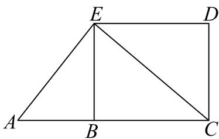
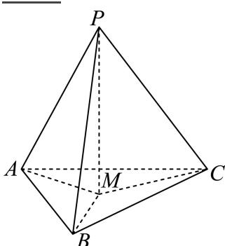

# 2025二模 新定义与综合专题 · 学生版

> 本地预览：题目、答案及分类尚未全部审定。校对使用的PDF为高中工作台解析版，尚未逐区确认区级印刷原卷。

## 定义转译与数列、有限结构

将间断、平方前缀和、T数列及乘积集合逐条转为约束，再枚举或构造。

### 宝山 · 第16题

若对任意正整数n，数列 $\left\{ a _ { n } \right\}$ 的前n项和 $S _ { n }$ 都是完全平方数，则称数列 $\left\{ a _ { n } \right\}$ 为“完全平方数列”.有如下两个命题：①若数列 $\left\{ b _ { n } \right\}$ 的前n项和 $T _ { n } = \left( n - t \right) ^ { 2 }$ ，（ 为正整数），则使得数列 $\{ | b _ { n } | \}$ 为“完全平方数列”的t值有且仅有一个；②存在无穷多个“完全平方数列”的等差数列. 则下列选项中正确的是
（ ）

A. ①是真命题， ②是真命题；

B. ①是真命题， ②是假命题；

C. ①是假命题， ②是真命题；

D. ①是假命题， ②是假命题.

> 本题资料或解析有待核事项，预览不可作为已审定成品。

### 崇明 · 第12题

已知集合M中的任一个元素都是整数，当存在整数 $a , c \in M , b \notin M$ 且 $a < b <$ c时，称M为“间断整数集”．集合 $\{ x \mid 1 \leq x \leq 1 0 , x \in \mathbf { Z } \}$ 的所有子集中，是“间断整数集”的个数为

> 本题资料或解析有待核事项，预览不可作为已审定成品。

### 普陀 · 第16题

设 $k\geq2$，$n\geq1$，$k,n\in\mathbf N$，$S_n$ 是数列 $\{a_n\}$ 的前 $n$ 项和，且满足 $2S_n=3a_n-1$。数列 $\{b_n\}$ 是由 $k$ 个大于 $-2$ 的整数组成的有穷数列，若 $b_1\ne0$，且

$$\sum_{i=1}^{k}b_i a_{k-i+1}=0,$$

则称数列 $\{b_n\}$ 是数列 $\{a_n\}$ 的“T数列”。对于数列 $\{b_n\}$ 有如下两个命题：

① 若 $b_1>0$，则数列 $\{b_n\}$ 不是数列 $\{a_n\}$ 的“T数列”；

② 若 $k\geq3$，则数列 $\{a_n\}$ 的“T数列”至少有5个。

则下列结论中正确的是（　）。

A. ①为真，②为真

B. ①为真，②为假

C. ①为假，②为真

D. ①为假，②为假

> 本题资料或解析有待核事项，预览不可作为已审定成品。

### 金山 · 第12题

$\mathrm { i } \frac { \pi } { \times } x _ { 1 } , x _ { 2 } , x _ { 3 } , x _ { 4 } , x _ { 5 }$ 均是正整数，且
$\{ x \mid x \mid x = x _ { m } x _ { n } x _ { p } x _ { q } , 1 \leq m < n < p < q \leq 5 \} = \{ 1 0 8 , 1 4 4 , 2 8 8 , 4 3 2 \} , \ : \ : \ : \forall \| x _ { 1 } + x _ { 2 } + x _ { 3 } + x _ { 4 } + x _ { 5 }$ 的值为

> 本题资料或解析有待核事项，预览不可作为已审定成品。

### 青浦 · 第16题

数学上用符号 $\operatorname { I } _ { i = 1 } ^ { n } a _ { i }$ 表示n个实数 $\mathbf { \dot { \omega } } _ { a _ { 1 } , a _ { 2 } , \ldots , a _ { n } }$ 的积.设 $x _ { 1 } , x _ { 2 } , \cdot \cdot \cdot , x _ { 2 0 0 } , y _ { 1 } , y _ { 2 } , . . . ,$ y200为互不相同的实数，已知∏ $[ _ { j = 1 } ^ { 2 0 0 } \left( x _ { i } + y _ { j } \right) = 2 0 2 5 \left( i = 1 , 2 , \cdot \cdot \cdot , 2 0 0 \right)$ ，则∏ $\binom { 2 0 0 } { i = 1 } \left( x _ { i } + y _ { j } \right) = \left( \begin{array} { l l } { } & { } \end{array} \right)$

A. −2025

B. 2025

C. −2026

D. 2026

> 本题资料或解析有待核事项，预览不可作为已审定成品。

## 几何对象、运算与可行域

新运算或对象定义须完整转译；借体积分割、轨迹及凸组合处理范围。

### 杨浦 · 第12题

由若干个多边形所覆盖的区域，称为这些多边形的并集，例如图中，梯形ACDE是 $\triangle A C E$ 与矩形BCDE的并集.已知n是正整数，在平面直角坐标系 $x O y \boxed { \mathsf { H } }$ ，直线 $\therefore \boldsymbol { l } _ { n }$ 的方程为 $y = - 2 ^ { n } x + n ,$ ，若直线$l _ { n }$ 交x轴于点 $A _ { n }$ ，交y轴于点 $B _ { n }$ ，则 $\triangle A _ { 1 } O B _ { 1 } , \triangle A _ { 2 } O B _ { 2 } , \cdot \cdot \cdot , \triangle A _ { 1 0 } O B _ { 1 0 }$ 的并集，其面积为

### 松江 · 第10题

如图在三棱锥 $P - A B C$ 中，PA、PB、PC两两垂直，且 $P A = 3 , P B = 2 , P C = 1$ ，设M是底面ABC内一点，定义 $f ( M ) = ( m , n , p )$ ，其中 $^ { \mathfrak { m } , n , p }$ 分别表示三棱锥 $M - P A B .$ ，三棱锥 $M - P B C$ 三棱锥 $M - P C A$ 的体积.若 $f \left( M \right) = \left( { \frac { 2 } { 3 } } , x , y \right)$ ，且 ${ \frac { a } { x } } + { \frac { 1 } { y } } \geq$ 12恒成立，则正实数 $\scriptstyle  \{ a$ 的最小值为

> 本题资料或解析有待核事项，预览不可作为已审定成品。

### 松江 · 第11题

设向量 $\vec { \cdot a } = ( x _ { 1 } , y _ { 1 } ) , \vec { b } = ( x _ { 2 } , y _ { 2 } )$ ，记 $\displaystyle { \mathop { \ ? } { \vec { a } } } \star { \vec { b } } = x _ { 1 } x _ { 2 } - y _ { 1 } y _ { 2 }$ .若点 $A _ { 1 } , ~ A _ { 2 } , ~ A _ { 3 }$ 为圆C：
$x ^ { 2 } + y ^ { 2 } + 4 x - 2 y = 0 .$ 上任意三点，且满足 $A _ { 1 } A _ { 2 } \bot A _ { 2 } A _ { 3 }$ ，则 $\Bigl | \overrightarrow { O A _ { 1 } } \star \overrightarrow { O A _ { 2 } } + \overrightarrow { O A _ { 2 } } \star \overrightarrow { O A _ { 3 } } \Bigr |$ 的取值范围是

### 浦东 · 第16题

已知圆锥曲线Γ的对称中心为原点O，若对于Γ上的任意一点A，均存在Γ上两点B，C，使得原点O到直线AB，AC和BC的距离都相等，则称曲线Γ为“完美曲线”．现有如下两个命题：
①任意椭圆都是“完美曲线”；②存在双曲线是“完美曲线”
下列判断正确的是（ ）

A. ①是真命题，②是假命题

B. ①是假命题，②是真命题

C. ①②都是真命题

D. ①②都是假命题

> 本题资料或解析有待核事项，预览不可作为已审定成品。

### 虹口 · 第16题

在空间中，点O为定点，设集合 $S = \left\{ P \bigg | \bigg | \overrightarrow { O P } \bigg | ^ { 2 } - 2 \overrightarrow { O A } \cdot \overrightarrow { O P } \leq 1 , \bigg | \overrightarrow { O A } \bigg | = 1 \right\}$ ，则以下说法正确的是（ ）.①若 $\overrightarrow { \cdot O P } \overleftrightarrow { \pm O A }$ 上的数量投影为 $- { \frac { 1 } { 5 } }$ ，则线段OP在运动过程中所形成的几何体体积为 ${ \frac { 1 4 } { 3 7 5 } } \pi ;$ ②对于任意的 $P _ { i } \in S |$ 以及任意的正实数 ${ \bf \dot { \alpha } } _ { a _ { i } }$ ，设 $\overrightarrow { O Q } = \sum _ { i = 1 } ^ { 4 } a _ { i } \overrightarrow { O P _ { i } }$ ，若 $\sum _ { i = 1 } ^ { 4 } a _ { i } = 1$ ，则 $| Q \in S$

A. ①是真命题，②是真命题

B. ①是真命题，②是假命题

C. ①是假命题，②是真命题

D. ①是假命题，②是假命题

> 本题资料或解析有待核事项，预览不可作为已审定成品。

## 函数集合与量词参数

把平衡点、圆盘交集、尾区间值域及下水平集转为最值、交点和区间结构。

### 嘉定 · 第21题

已知函数 $\mathbf { \boldsymbol { y } } = \mathbf { \boldsymbol { f } } \left( \boldsymbol { x } \right)$ ，其中 $f \left( x \right) = x ^ { 2 } + a x + b , \left( a , b \in \mathbf { R } \right)$ ，定义集合
$S \left( f \right) = \left\{ ( x , y ) | y = f ( x ) , x \in \mathbf { R } \right\}$ ．对于点 $P ( p , q )$ ，定义集合
$D ( P ) = \{ ( x , y ) | | x - p | \leq 1 , ( x , y ) \in S ( f ) \}$ ．若对任意 $( x , y ) \in D ( P )$ ，均有 $| y - q | \leq 1$ ，则称点P为平衡点
(1) (4分)当a = b = 0时，判断点P(0,0)是否为平衡点；
(2) (6分)当a = 0时，求实数b的取值范围，使得点P(0,0)是平衡点；
(3) (8分)求所有实数a和b，使得点P (0, 0)是平衡点

### 普陀 · 第21题

已知 $\textstyle | a , b \in \mathbb { R }$ ，对于函数 $\left[ { \mathcal { y } } = f \left( x \right) , \ x \in D \right]$ ，设集合 $A = \{ ( x , y ) | y = f ( x ) \}$ }$B = \Big \{ ( x , y ) | ( x - a ) ^ { 2 } + ( y - b ) ^ { 2 } \leq 1 \Big \} , \forall \mathrm { \large ~ \overrightarrow ~ { a } ~ } , { b } \mathrm { \large ~ = ~ } A \cap B .$
(1) (4分)若函数 $f \left( x \right) = { \frac { 1 } { x } } - { \frac { 3 x } { 4 } }$ ，请判断 $M _ { f } \left( 0 , 0 \right)$ 中元素的个数，并说明理由；
(2) (6分)设k > 0，函数 $f \left( x \right) = { \sqrt { x + k } }$ ，若 $M _ { f } \left( { \frac { 1 } { 2 } } , 0 \right) = \{ { ( x _ { 0 } , y _ { 0 } ) } \}$ ，求k的值以及曲线 $y = f \left( x \right)$ 在点 $P ( x _ { 0 } , y _ { 0 } )$ 处的切线方程；
(3) (8分)设 ${ \bf { \dot { m } } } \in \bf { R } .$ ，函数 $f \left( x \right) = \mathrm { e } ^ { x } - \frac { \ln x } { x } - \frac { 1 } { x } + m .$ ，若对于任意的a，皆有 $M _ { f } \left( a , 0 \right) = \emptyset$ 成立，求m的取值范围.

> 本题资料或解析有待核事项，预览不可作为已审定成品。

### 虹口 · 第21题

对于定义在 $\mathbf R$ 上的函数 $y=f(x)$ 和 $y=g(x)$，$a\in\mathbf R$，设 $M_a=\{t\mid t=f(x)-g(a),\ x\ge a\}$。

（1）（4分）若 $f(x)=2^x-1$，$g(x)=\cos x$，求 $M_0$；

（2）（6分）若 $f(x)=x^3-3x^2$，$g(x)=-x$，$M_a\subseteq[0,+\infty)$，求实数 $a$ 的取值范围；

（3）（8分）已知对任意 $a\in\mathbf R$，均有 $M_a=[0,+\infty)$，记 $h(x)=g(x)-a$，求证：“对任意 $a\in\mathbf R$，函数 $y=h(x)$ 零点个数均有限”的充要条件是“$y=f(x)$ 在 $\mathbf R$ 上是严格增函数”。

> 本题资料或解析有待核事项，预览不可作为已审定成品。

### 长宁 · 第21题

已知函数 $\cdot y = f ( x )$ 的定义域 $D \subseteq \mathbf { R }$ ，对任意实数a，定义集合 $Q _ { f } ( a ) = \{ x \mid f ( x ) \leq a , x \in D \}$
(1) (4分)已知 $f \left( x \right) = { \frac { 1 + x } { 1 - x } }$ ，求 $Q _ { f } ( 2 )$
(2) (6分)已知 $f ( x ) = \mathbf { e } ^ { x } - a x$ ，若集合 $Q _ { f } ( a )$ 只有一个元素，求a的值；
(3) (8分)已知 $f \left( x \right) = - \frac a 4 x ^ { 2 } + \frac { a + 2 } { 2 } x - \ln x + \frac 1 2$ ，其中 $\iota _ { a } \in \mathrm { R }$ 且 $a > 0$ ，求证：集合 $Q _ { f } ( a )$ 是一个区间

> 本题资料或解析有待核事项，预览不可作为已审定成品。

### 黄浦 · 第21题

设D是R的一个非空子集，函数y = f(x)的定义域为D，若y = f(x)在D上不是单调函数，且存在常数b，使得f(x) ≥ b对任意的 $x \in D$ 成立，则称函数 $\scriptstyle \left\{ y = f ( x ) \right.$ 具有性质H，称b为该函数的一个下界
(1) (4分)设 $f \left( x \right) = x + \frac { 1 } { x } , D = \left( - \infty , 0 \right)$ ，判断函数y = f(x)，x ∈ D是否具有性质H；
(2) (6分)设m为常数， $f \left( x \right) = \frac { 1 } { 3 } x ^ { 3 } - x + 1 , \ D = \left( m , 2 \right)$ ，当且仅当m满足什么条件时，函数$y = f ( x ) , x \in D$ 具有性质H，且 $b = \frac 1 3$ 是该函数的一个下界；
(3) (8分)设 $0 < a \leq 1 , f ( x ) = \ln ( x + 1 ) + a x ( x - 2 ) , D = ( 0 , 1 )$ ，若函数y = f(x)，x ∈ D具有性质H，求a的取值范围：当a在上述范围内变化时，若b总是该函数的下界，求b的取值范围

## 切线、割线与全局支撑

新性质落在切线存在、等差横坐标或上下支撑上，证明必须兼顾必要和充分。

### 崇明 · 第21题

已知函数 $\scriptstyle ( y = f ( x )$ ，P为坐标平面上一点．若函数 $\cdot y = f ( x )$ 的图像上存在与P不同的一点Q，使得直线PQ是函数y = f(x)在点Q处的切线，则称点P具有性质 $M _ { f }$
(1) (4分)若 $f ( x ) = x ^ { 2 }$ ，判断点 $P ( 1 , 0 )$ 是否具有性质 $M _ { f }$ ，并说明理由；
(2) (6分)若 $f ( x ) = 2 x ^ { 3 } - 4 x ^ { 2 } + 2 x$ ，证明：线段 $x = \frac { 1 } { 2 } ( - 1 \leq y \leq 1 )$ 上的所有点均具有性质 $M _ { f }$ ；
(3) (8分)若 $f ( x ) = \mathbf { e } ^ { x }$ ，证明：“点 $P ( x , y )$ 具有性质 ${ M } _ { f } ^ { \prime }$ ”的充要条件是 $^ { 6 } y < \mathrm { e } ^ { x ^ { , } }$

> 本题资料或解析有待核事项，预览不可作为已审定成品。

### 浦东 · 第21题

定义域为 $\mathbb R$ 的可导函数 $y=f(x)$ 满足：在曲线 $y=f(x)$ 上存在三个不同的点 $A(x_1,y_1)$、$B(x_2,y_2)$、$C(x_3,y_3)$，其中 $x_1<x_2<x_3$，使得直线 $AC$ 与曲线 $y=f(x)$ 在点 $B$ 处的切线平行（或重合）。若 $x_1,x_2,x_3$ 成等差数列，则称 $f(x)$ 为“等差函数”；若 $x_1,x_2,x_3$ 成等差数列且均为整数，则称 $f(x)$ 为“整数等差函数”。

(1)（4分）设 $f(x)=x^2+x$、$g(x)=\sin x$，分别判断 $f(x)$ 和 $g(x)$ 是否为“整数等差函数”，直接写出结论；

(2)（6分）若 $f(x)=\dfrac1{x^2+m}$ 为“整数等差函数”，求实数 $m$ 的最小值；

(3)（8分）已知 $y=f(x)$ 的导函数 $y=f'(x)$ 在 $\mathbb R$ 上为增函数，且存在一个正常数 $T$，使得对任意 $x\in\mathbb R$，$f(x+T)=f'(x)$ 成立。证明：$f(x)$ 为“等差函数”的充要条件是 $f(x)$ 为常值函数。

> 第(2)问现有条件与“求最小值”的问法存在冲突；仅作审题与勘误讨论，不作为正常求最小值练习。

### 金山 · 第21题

若函数y = f (x)和y = g (x)同时满足下列条件：①对任意x ∈ R，都有 $f \left( x \right) \leq g \left( x \right)$ 成立；②存在$\boldsymbol { x } _ { 0 } \in \mathbf { R }$ ，使得 $\left. f \left( x _ { 0 } \right) = g \left( x _ { 0 } \right) \right.$ ，则称函数 $\boldsymbol { \mathfrak { y } } = \boldsymbol { \mathfrak { g } } \left( \boldsymbol { \mathfrak { x } } \right)$ 为y = f(x)的“W函数”，其中 $\scriptstyle { \mathrm { ~ } } x _ { 0 }$ 称为“W点”.
(1) (4分)已知图像为一条直线的函数 $y = g \left( x \right)$ 是y = sinx的“W函数”，请求出所有的“W点”；
(2) (6分)设函数y = g(x)为y = f(x)的“W函数”，其“W点”组成集合M；函数 $\mathbf { \dot { \boldsymbol { y } } } = h \left( \mathbf { \boldsymbol { x } } \right) \mathbf { \dot { \boldsymbol { y } } } y = g \left( \mathbf { \boldsymbol { x } } \right)$ 的“W函数”，其“W点”组成集合N.试证明：“函数y = h(x)为y = f(x)的‘W函数’”的一个充分必要条件是 $\mathbf { \partial } ^ { \cdot } M \cap N \neq \emptyset ^ { \cdot \prime }$ ；
(3) (8分)记 $\left\{ f \left( x \right) = \frac { x } { \mathrm { e } ^ { x } } \right.$ （e为自然对数的底数）， $g \left( x \right) = k x + m \left( k , m \in \mathbf { R } \right)$ )，若 $y = g \left( x \right)$ 为$y = f \left( x \right)$ )的“W函数”，且 $^ { \ast } W _ { \ast \ast } ^ { \ast } x _ { 0 } > 0$ ，求实数m的最大值.

> 本题资料或解析有待核事项，预览不可作为已审定成品。

### 闵行 · 第21题

已知函数y = f (x)在定义域D上存在导函数f′ (x)．对于给定的一个有序实数对(k, m)，若存在$x _ { 1 } , x _ { 2 } \in D$ ，使得 $\left[ k x _ { 1 } - f \left( x _ { 1 } \right) + m \right] \cdot \left[ k x _ { 2 } - f \left( x _ { 2 } \right) + m \right] < 0$ ，则称(k, m)为y = f (x)在定义域D上的一个“分割数对”
(1) (4分)已知 $f \left( x \right) = x ^ { 2 } , D = { \bf R }$ ，判断数对(1,0)是否为y = f(x)在D上的“分割数对”，并说明理由；
(2) (6分)已知f (x) = ln x, D = (1, 2)，若(ln 2, m)为y = f (x)在区间D上的“分割数对”，求实数m 的取值范围；
(3) (8分)已知 $f \left( x \right) = \left( x ^ { 2 } + a x + b \right) \cdot \mathrm { e } ^ { x } , D = \mathbf { R }$ ，若有且仅有一个实数a满足对任意 $t \in \mathbf { R }$
$\left( f ^ { \prime } \left( t \right) , f \left( t \right) - t f ^ { \prime } \left( t \right) \right)$ )都不是y = f (x)在D上的“分割数对”，求实数b的值

### 静安 · 第21题

若存在实数常数 $k$，$m$，对任意 $x\in D$，不等式 $f(x)\geq kx+m\geq g(x)$ 恒成立，则称直线 $y=kx+m$ 是函数 $y=f(x)$ 和函数 $y=g(x)$ 在 $D$ 上的分界线。
(1) (4分) 请写出函数 $y=\frac12x^2$ 和函数 $y=\ln x$ 在 $(0,+\infty)$ 上的一条斜率为1的分界线；（不必证明）
(2) (6分) 求证：函数 $y=x+\frac1x$ 和函数 $y=2-\frac1x$ 在 $(0,+\infty)$ 上过坐标原点的分界线有且只有一条；
(3) (8分) 试探究函数 $y=\mathrm e^x(x+1)$（$\mathrm e$ 为自然对数的底数）和函数 $y=-x^2+2x+1$ 在 $\mathbb R$ 上是否存在分界线。若存在，求出分界线方程；若不存在，请说明理由。

> 本题资料或解析有待核事项，预览不可作为已审定成品。

## 导数恒等式与结构性质

按自和、导周期、超导及互导等定义运算，将性质检验还原为具体导数与函数值关系，构造单调或恒等关系完成结论。

### 奉贤 · 第15题

函数y = f (x)的导函数为 $\boldsymbol { \mathscr { y } } = \boldsymbol { \mathscr { g } } \left( \boldsymbol { \mathscr { x } } \right)$ ，若存在实数x0，使得 $g \left( x _ { 0 } \right) f \left( - x _ { 0 } \right) = 1$ 成立，则称函数$y = f \left( x \right)$ 具有x 性质，下列函数 $y = f \left( x \right)$ 具有 $\scriptstyle { \dot { \boldsymbol { x } } } _ { 0 }$ 性质的函数是（ ）

A. $y = \mathbf { e } ^ { - x }$

B. $y = \sin x$

C. $y = \mathbf { e } ^ { x } + \mathbf { e } ^ { - x }$

D. $y = { \frac { 1 } { 2 } } \mathrm { l n } \left( x ^ { 2 } + 1 \right)$

### 宝山 · 第21题

定义在D上的可导函数y = f(x)，集合 $A _ { ( k , m ) } = \{ f ( x ) | F \left( x _ { i } \right) = k , x _ { i } \in D , i = 1 , 2 , \cdot \cdot \cdot , m , m $ 为正整数 } ， 其 中 $F \left( x \right) = f \left( x \right) + f ^ { \prime } \left( x \right)$ 称为f(x)的 自 和函数， $x _ { i }$ 称为 $y = f \left( x \right)$ 的固着点. 已知$f \left( x \right) = a \mathbf { e } ^ { x } + b x + c \sin x \ \left( a , b , c \in \mathrm { R } \right)$
(1) (4分)若a = c = 0, b = 2, D = R， $f \left( x \right) \in A _ { \left( 1 , m \right) }$ ，求m的值及 $y = f ( x )$ 的固着点；
(2) (6分)若a = 0, b = 1, c = 1, D = [s, t](s > 0)，F(x)是f(x)的 自 和函数，且F(x)在D上是严格增函数，求t−s的最大值；
(3) (8分)若b = −1, c = 0, D = (0, +∞)， $f ( x ) \in A _ { ( 0 , 1 ) }$ ，且t是y = f(x)的固着点，求a的取值范 围，并证明： $\frac { 1 } { 2 a } < \mathbf { e } ^ { t } < \frac { 1 } { a ^ { 2 } }$

> 本题资料或解析有待核事项，预览不可作为已审定成品。

### 徐汇 · 第21题

对于函数 $y=h(x)$，记 $h^{(0)}(x)=h(x)$，$h^{(1)}(x)=(h(x))'$，……，$h^{(n+1)}(x)=(h^{(n)}(x))'$（$n\in\mathbb N$）。如果 $n$ 是满足 $h^{(n)}(x)=h(x)$ 的最小正整数，则称 $n$ 是函数 $y=h(x)$ 的“最小导周期”。

(1)（4分）已知函数 $y=f(x)$，其中 $f(x)=a\sin(x+t)+b\cos(x+t)$，求证：对任意实数 $a,b,t$，都有 $f^{(4)}(x)=f(x)$；

(2)（6分）设 $m,n\in\mathbb R$，$g(x)=\mathrm e^{mx}+n\cos x$，若函数 $y=g(x)$ 的最小导周期为 2，记

$$M(a,b)=\sqrt{(a-b)^2+(a+1+g(b))^2},$$

当实数 $a,b$ 变化时，求 $M(a,b)$ 的最小值；

(3)（8分）设 $\omega>1$，$h(x)=\cos\omega x$，若函数 $y=h(x)$ 满足 $h^{(2)}(x)\le x$ 对 $x\in(0,+\infty)$ 恒成立，且存在 $x_0\in(0,+\infty)$ 使得 $h^{(2)}(x_0)=x_0$，试用 $\omega$ 表示 $x_0$，并证明 $\frac{\pi}{2\omega}<x_0<\frac{\pi}{\omega}$。

> 本题资料或解析有待核事项，预览不可作为已审定成品。

### 杨浦 · 第21题

已知函数y = f(x)的导函数为 $y = f ^ { \prime } ( x )$ ，若函数 $\cdot y = f ( x )$ 的定义域为R，且不等式 $f ( x ) > f ^ { \prime } ( x )$ )对任意 ${ \bf { \dot { x } } } \in { \bf R } ,$ 成立，则称函数 $\cdot y = f ( x )$ 是“超导函数”.
(1) (4分)判断 $f ( x ) = \mathbf { e } ^ { x } + 1$ 是否为“超导函数”，并说明理由；
(2) (6分)若函数 $[ { \mathfrak { y } } = { \mathfrak { g } } ( { \mathfrak { x } } ) { \overset { } { \div } } { \mathfrak { y } } = h ( { \mathfrak { x } } )$ 都是“超导函数”，且对任意 ${ \bf { \dot { x } } } \in { \bf { R } }$ ，都有 $h ^ { \prime } ( x ) > 0 , g ^ { \prime } ( x ) < 0$ ， $\exists F ( x ) = g ( x ) h ( x )$ ，求证：函数 $y = F ( x )$ 是“超导函数”；
(3) (8分)已知函数 $y = \varphi ( x )$ 是“超导函数”且 $\varphi ( 1 ) = \mathbf { e } _ { \mathrm { : } }$ ，若有且仅有一个实数t满足
$\varphi ( \ln t + 1 - a t ) = { \mathrm { e } } ^ { \ln t + 1 - a t }$ ，求a的取值范围.

> 本题资料或解析有待核事项，预览不可作为已审定成品。

### 青浦 · 第21题

函数的导函数有很多有趣的性质，例如：函数y = c（实数c为常数）的导函数为y = 0；反之，若函数 $\langle y = \Phi ( x )$ 的导函数为Φ′(x) = 0，则Φ(x) = c（实数c为常数）.已知函数 $y = f ( x )$ 与 $y = g ( x )$ 定义域都是R，导函数分别为y = f′(x)和 $\begin{array} { r } { | y = g ^ { \prime } ( x ) } \end{array}$ .若 $f ^ { \prime } ( x ) = f ( x )$ ，则称 $\operatorname { \mathrm { ? } } y = f ( x )$ 是“自导函数”；落$f ^ { \prime } ( x ) = g ( x )$ 且g′(x) = −f(x)，则称y = f(x)与y = g(x)是“共轭互导函数”.
(1) (4分)请判断函数 ${ \bf \dot { \boldsymbol { y } } } = \mathrm { e } ^ { a x + b } ( a , b \in { \bf R } , a \neq 0 )$ 是否是“自导函数”，并说明理由；
(2) (6分)若函数 $\{ y = f ( x )$ 是“自导函数”，且满足f(0) = 1，求证： $f ( x ) f ( - x ) = 1$
(3) (8分)若函数 $\begin{array} { r } { { \mathbf { \dot { y } } } = f ( x ) \boxed { \div } y = g ( x ) } \end{array}$ 是“共轭互导函数”，满足f(0) = 0, g(0) = 1，求证：
$f ^ { 2 } ( x ) + g ^ { 2 } ( x ) = 1$ .进而证明f(x) = sin x且g(x) = cos x.

> 本题资料或解析有待核事项，预览不可作为已审定成品。

