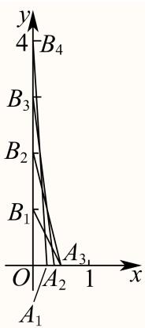
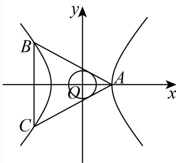
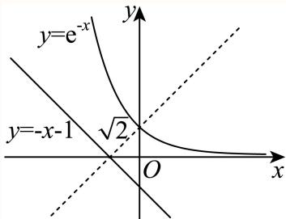

# 2025二模 新定义与综合专题 · 教师版

> 本地预览：题目、答案及分类尚未全部审定。校对使用的PDF为高中工作台解析版，尚未逐区确认区级印刷原卷。

## 定义转译与数列、有限结构

将间断、平方前缀和、T数列及乘积集合逐条转为约束，再枚举或构造。

### 宝山 · 第16题

若对任意正整数n，数列 $\left\{ a _ { n } \right\}$ 的前n项和 $S _ { n }$ 都是完全平方数，则称数列 $\left\{ a _ { n } \right\}$ 为“完全平方数列”.有如下两个命题：①若数列 $\left\{ b _ { n } \right\}$ 的前n项和 $T _ { n } = \left( n - t \right) ^ { 2 }$ ，（ 为正整数），则使得数列 $\{ | b _ { n } | \}$ 为“完全平方数列”的t值有且仅有一个；②存在无穷多个“完全平方数列”的等差数列. 则下列选项中正确的是
（ ）

A. ①是真命题， ②是真命题；

B. ①是真命题， ②是假命题；

C. ①是假命题， ②是真命题；

D. ①是假命题， ②是假命题.

> 本题资料或解析有待核事项，预览不可作为已审定成品。

**考点：** 平方和约束、绝对值项及构造

**难度依据：** 完全平方数列；需参数分类、构造递推或综合最值分析

**核查说明：** 源解|b_n|分段式漏绝对值；关于公差的必要性论证含缺项和跳步。证明存在无穷构造可直接验证，但原解不能视为已数学审定。；已人工阅读完整底稿题干及原解，未逐页对照正式PDF，分类不等于数学终审。；历史分类审查记录（不把旧记录直接判为当前未解决）：源解|b_n|分段式漏绝对值；关于公差的必要性论证含缺项和跳步。证明存在无穷构造可直接验证，但原解不能视为已数学审定。 当前底稿已有回源补丁，涉及answer_and_solution；具体修复范围以底稿patches和2025二模-解析公式回源补丁-第二批.json为准。本题仍按可辨数学任务归组，不据分组宣称数学已审定。

【答案】A

【解析】

对于①，根据数列 $\{ b _ { n } \}$ 的前n项和得到 $| b _ { n } | = { \left\{ \begin{array} { l l } { \left( 1 - t \right) ^ { 2 } , n = 1 } \\ { 2 n - 2 t - 1 , n \geq 2 ^ { \prime } } \end{array} \right. }$ 对t = 1， $n \geq 2$ 和t ≥ 2两种情况分类讨论求解可判断；对于②设等差数列的首项为 $\mathbf { \dot { a } } _ { 1 }$ ，公差为d，对d分类讨论求解判断

对于①，数列 $\left\{ b _ { n } \right\}$ 的前n项和 $T _ { n } = \left( n - t \right) ^ { 2 }$ （t为正整数），

当 $n \geq$ 2时， $b _ { n } = T _ { n } - T _ { n - 1 } = \left( n - t \right) ^ { 2 } - \left( n - 1 - t \right) ^ { 2 } = 2 n - 2 t - 1$ ，

当n = 1时， $b _ { 1 } = T _ { 1 } = \left( 1 - t \right) ^ { 2 }$ 不满足上式，所以 $| b _ { n } | = { \left\{ \begin{array} { l l } { ( 1 - t ) ^ { 2 } , n = 1 } \\ { 2 n - 2 t - 1 , n \geq 2 ^ { \prime } } \end{array} \right. }$

当t = 1， $n \geq$ 2时， $2 n - 2 t - 1 = 2 n - 3 > 0 ,$

所以数列 $\{ | b _ { n } | \}$ 与原数列相同，所以 $T _ { n } = ( n - 1 ) ^ { 2 }$ ，

所以当t = 1时，数列 $\{ | b _ { n } | \}$ 为完全平方数列，

当t ≥ 2时， $\left| b _ { 1 } \right| + \left| b _ { 2 } \right| = ( t - 1 ) ^ { 2 } + \left| 3 - 2 t \right| = t ^ { 2 } - 2 t + 1 + 2 t - 3 = t ^ { 2 }$ −2不是“完全平方数，所以当t ≥ 2时，数列 $\{ | b _ { n } | \}$ 不是完全平方数列，

综上所述：数列 $\{ | b _ { n } | \}$ 为“完全平方数列”，故①是真命题；

对于②，因为 $S _ { n }$ 为完全平方数，故 $\tau d \geq 0 , a _ { 1 } \geq 0 , d , a _ { 1 } \in \mathrm { N }$

若 $\dot { \boldsymbol { d } } = 0$ ，则 $S _ { n } = n a _ { 1 }$ ，若对任意的 $| n \in \mathrm { N } ^ { * } , n a _ { 1 }$ 均为完全平方数，

则 $| a _ { 1 } = 0$ ，否则假设p为a 的素因数，且pa恰好整除a ，a为正整数，

若a为奇数，则 $| a _ { 1 }$ 不是完全平方数，矛盾，

若a为偶数，取 $n = p ^ { a + 1 }$ ，则 $n a _ { 1 }$ 不是完全平方数，矛盾，

若 $d > 1$ ， 则 $S _ { n } = { \frac { n \left( a _ { 1 } + a _ { n } \right) } { 2 } } = { \frac { n \left( 2 a _ { 1 } - d + n d \right) } { 2 } }$

若 $2 a _ { 1 } - d \neq 0$ ，取 $\begin{array} { r } { n = | 2 a _ { 1 } - d | } \end{array}$ ，则 $S _ { n } = { \overline { { \left| 2 a _ { 1 } - d \right| ^ { 2 } \left( d + 1 \right) } } }$ 或 $S _ { n } = { \frac { \left| 2 a _ { 1 } - d \right| ^ { 2 } \left( d - 1 \right) } { 2 } }$

当d为偶数时，此时 $\frac { \left| 2 a _ { 1 } - d \right| ^ { 2 } \left( d + 1 \right) } { 2 }$ $\frac{|2a_1-d|^2(d-1)}{2}$ 均不是完全平方数，

当d为奇数时，取 $n = 4 , S _ { n } = 2 ( 2 a _ { 1 } + 3 d ) , 2 a _ { 1 } + 3 d$ 为奇数，

故此时 $S _ { n }$ 不是完全平方数，

故 $2 a _ { 1 } - d = 0$ ，即 $2 a _ { 1 } = d ,$ ，故 $S _ { n } = a _ { 1 } n ^ { 2 }$ ，设 $\mathrm { \dot { \varepsilon } } a _ { 1 } = k ^ { 2 }$ ，故 $S _ { n } = k ^ { 2 } n ^ { 2 }$

当 $n \geq$ 2时， $a _ { n } = S _ { n } - S _ { n - 1 } = k ^ { 2 } n ^ { 2 } - k ^ { 2 } ( n - 1 ) ^ { 2 } = k ^ { 2 } ( 2 n - 1 )$

又 $\textstyle . a _ { 1 } = k ^ { 2 }$ 适合上式，即 $\mathfrak { I } a _ { n } = k ^ { 2 } ( 2 n - 1 ) , k \in \mathtt { Z }$

故存在无穷多个“完全平方数列”的等差数列，故②是真命题.

故选：A.

## 三、解答题

### 崇明 · 第12题

已知集合M中的任一个元素都是整数，当存在整数 $a , c \in M , b \notin M$ 且 $a < b <$ c时，称M为“间断整数集”．集合 $\{ x \mid 1 \leq x \leq 1 0 , x \in \mathbf { Z } \}$ 的所有子集中，是“间断整数集”的个数为

> 本题资料或解析有待核事项，预览不可作为已审定成品。

**考点：** 连续整数段的补集计数

**难度依据：** 间断整数集；需连接多个条件或多步模型转化

**核查说明：** 两元素的不满足集合列表丢失，虽可计数，交付时需核原卷。；已人工阅读完整底稿题干及原解，未逐页对照正式PDF，分类不等于数学终审。；历史分类审查记录（不把旧记录直接判为当前未解决）：两元素的不满足集合列表丢失，虽可计数，交付时需核原卷。 本次只归组，未修改题干、答案或专题归属；上述具体疑点仍交回源/数学复核处理。

【解析】

根据子集中元素的个数分类，每一类都利用组合数计数，再剔除不满足定义的子集，最后根据分类加法计数原理求值即可.

由题意，满足“间断整数集”定义的子集至少有2个元素，至多有9个元素，

按子集中元素的个数分类，

①当元素个数为2时，不满足定义的子集有：

此时满足定义的子集有 $\mathrm { \dot { C } _ { 1 0 } ^ { 2 } - 9 }$ 个，

②当元素个数为3时，不满足定义的子集有：

{1, 2, 3}, {2, 3, 4}, {3, 4, 5}, {4, 5, 6}, {5, 6, 7}, {6, 7, 8}, {7, 8, 9}, {8, 9, 10}，共8个；

此时满足定义的子集有 $\mathrm { C } _ { 1 0 } ^ { 3 } - 8 ^ { \prime }$ 个，

③当元素个数为4时，不满足定义的子集有：

{1, 2, 3, 4}, {2, 3, 4, 5}, {3, 4, 5, 6}, {4, 5, 6, 7}, {5, 6, 7, 8}, {6, 7, 8, 9}, {7, 8, 9, 10}，共7个； 此时满足定义的子集有 $\mathrm { C } _ { 1 0 } ^ { 4 } - 7 ^ { \prime }$ 个，

④当元素个数为5时，不满足定义的子集有：

{1, 2, 3, 4, 5}, {2, 3, 4, 5, 6}, {3, 4, 5, 6, 7}, {4, 5, 6, 7, 8}, {5, 6, 7, 8, 9}, {6, 7, 8, 9, 10}，共6个； 此时满足定义的子集有 $\mathrm { C } _ { 1 0 } ^ { 5 } - 6$ 个，

⑤当元素个数为6时，不满足定义的子集有：

{1, 2, 3, 4, 5, 6}, {2, 3, 4, 5, 6, 7}, {3, 4, 5, 6, 7, 8}, {4, 5, 6, 7, 8, 9}, {5, 6, 7, 8, 9, 10}，共5个；

$$
\mathrm{C} _ {1 0} ^ {6} - 5 ^ {\prime}
$$

⑥当元素个数为7时，不满足定义的子集有：

{1, 2, 3, 4, 5, 6, 7}, {2, 3, 4, 5, 6, 7, 8}, {3, 4, 5, 6, 7, 8, 9}, {4, 5, 6, 7, 8, 9, 10}，共4个；

此时满足定义的子集有 $\mathrm { C } _ { 1 0 } ^ { 7 } - 4 ^ { \prime }$ 个，

⑦当元素个数为8时，不满足定义的子集有：

{1, 2, 3, 4, 5, 6, 7, 8}, {2, 3, 4, 5, 6, 7, 8, 9}, {3, 4, 5, 6, 7, 8, 9, 10}，共3个；

此时满足定义的子集有 $\mathrm { C } _ { 1 0 } ^ { 8 } - 3 ^ { \prime }$ 个，

⑧当元素个数为9时，不满足定义的子集有：

{1, 2, 3, 4, 5, 6, 7, 8, 9}, {2, 3, 4, 5, 6, 7, 8, 9, 10}，共2个；

此时满足定义的子集有 $\mathrm { C } _ { 1 0 } ^ { 9 } - 2$ 个，

综上所述，满足题意的子集共有 $\left( \mathrm { C } _ { 1 0 } ^ { 2 } + \mathrm { C } _ { 1 0 } ^ { 3 } + \cdot \cdot \cdot + \mathrm { C } _ { 1 0 } ^ { 9 } \right) - \left( 2 + 3 + 4 + \cdot \cdot \cdot + 9 \right) = 9 6 8 \cdot$ 个. 故答案为：968.

## 二、选择题

### 普陀 · 第16题

设 $k\geq2$，$n\geq1$，$k,n\in\mathbf N$，$S_n$ 是数列 $\{a_n\}$ 的前 $n$ 项和，且满足 $2S_n=3a_n-1$。数列 $\{b_n\}$ 是由 $k$ 个大于 $-2$ 的整数组成的有穷数列，若 $b_1\ne0$，且

$$\sum_{i=1}^{k}b_i a_{k-i+1}=0,$$

则称数列 $\{b_n\}$ 是数列 $\{a_n\}$ 的“T数列”。对于数列 $\{b_n\}$ 有如下两个命题：

① 若 $b_1>0$，则数列 $\{b_n\}$ 不是数列 $\{a_n\}$ 的“T数列”；

② 若 $k\geq3$，则数列 $\{a_n\}$ 的“T数列”至少有5个。

则下列结论中正确的是（　）。

A. ①为真，②为真

B. ①为真，②为假

C. ①为假，②为真

D. ①为假，②为假

> 本题资料或解析有待核事项，预览不可作为已审定成品。

**考点：** T数列构造与一般性证明

**难度依据：** T数列定义；需综合转化、参数分析或完整证明，推理链较长

**核查说明：** 源解由k=2等个案推一般结论，论证不充分，需一般性证明。；已人工阅读底稿题干和解析；尚未逐页对照原PDF，不作为数学终审。；历史分类审查记录（不把旧记录直接判为当前未解决）：源解由k=2等个案推一般结论，论证不充分，需一般性证明。 本次只归组，未修改题干、答案或专题归属；上述具体疑点仍交回源/数学复核处理。

【答案】A。

【解析】

当 $n=1$ 时，$2a_1=3a_1-1$，得 $a_1=1$。当 $n\geq2$ 时，由

$$2S_n=3a_n-1,\qquad 2S_{n-1}=3a_{n-1}-1,$$

两式相减得 $a_n=3a_{n-1}$，故 $a_n=3^{n-1}$。

对于命题①，若整数 $b_1>0$，则 $b_1\geq1$，其余各项 $b_i\geq-1$。因此

$$\begin{aligned}
\sum_{i=1}^{k}b_i a_{k-i+1}
&=\sum_{i=1}^{k}b_i3^{k-i}\\
&\geq3^{k-1}-\sum_{j=0}^{k-2}3^j
=\frac{3^{k-1}+1}{2}>0.
\end{aligned}$$

加权和不为0，故不能成为“T数列”，命题①为真。

对于命题②，当 $k=3$ 时，取以下五组三元组：

$$(-1,-1,12),\quad(-1,0,9),\quad(-1,1,6),\quad(-1,2,3),\quad(-1,3,0).$$

每组均满足 $9b_1+3b_2+b_3=0$，各项均为大于 $-2$ 的整数，且 $b_1\ne0$。

对任意 $k\geq3$，在上述每组三元组后补上 $k-3$ 个0，则

$$\sum_{i=1}^{k}b_i3^{k-i}=3^{k-3}(9b_1+3b_2+b_3)=0.$$

由此得到五个不同的“T数列”，所以命题②为真，故选A。

源解析仅举 $k=2$ 判断命题①，并由 $k=3,4$ 的例子推及一般情况；本解析分别补充一般下界与补零构造。

### 金山 · 第12题

$\mathrm { i } \frac { \pi } { \times } x _ { 1 } , x _ { 2 } , x _ { 3 } , x _ { 4 } , x _ { 5 }$ 均是正整数，且
$\{ x \mid x \mid x = x _ { m } x _ { n } x _ { p } x _ { q } , 1 \leq m < n < p < q \leq 5 \} = \{ 1 0 8 , 1 4 4 , 2 8 8 , 4 3 2 \} , \ : \ : \ : \forall \| x _ { 1 } + x _ { 2 } + x _ { 3 } + x _ { 4 } + x _ { 5 }$ 的值为

> 本题资料或解析有待核事项，预览不可作为已审定成品。

**考点：** 质因数分解与多重集合反推

**难度依据：** 四数积集合反推整数；需参数分类、构造递推或综合最值分析

**核查说明：** 题干集合花括号和量词有乱码；源解将108分解只列两类但未证明穷尽所有整数分解，需补唯一性论证。；已人工阅读完整底稿题干及原解，未逐页对照正式PDF，分类不等于数学终审。；历史分类审查记录（不把旧记录直接判为当前未解决）：题干集合花括号和量词有乱码；源解将108分解只列两类但未证明穷尽所有整数分解，需补唯一性论证。 本次只归组，未修改题干、答案或专题归属；上述具体疑点仍交回源/数学复核处理。

【答案】22.

【解析】

先将108,144,288,432四个数都写成2的指数幂和3的指数幂的积的形式，再根据$1 0 8 = 2 \times 3 \times 3 \times 6 = 3 \times 3 \times 3 \times 4$ ，分 $1 0 8 = 2 \times 3 \times 3 \times$ 6和 $1 0 8 = 3 \times 3 \times 3 \times 4$ 两种情况讨论，即可得解.

108 = 22 × 33 = 2 × 3 × 3 × 6 = 3 × 3 × 3 × 4，

144 = 24 × 32, 288 = 25 × 32, 432 = 24 × 33，

当 $\lvert 1 0 8 = 2 \times 3 \times 3 \times 6 \rvert \tilde { \lvert }$ ，

不妨取 $x _ { 1 } = 2 , x _ { 2 } = 3 , x _ { 3 } = 3 , x _ { 4 } = 6 ,$

则 $| 4 3 2 = 2 ^ { 4 } \times 3 ^ { 3 } = 3 \times 3 \times 6 \times 8 = 8 x _ { 2 } x _ { 3 } x _ { 4 }$ ，此时 $x _ { 5 } = 8$

而144 = 24 × 32 = 2 × 3 × 3 × 8, 288 = 25 × 32 = 2 × 3 × 6 × 8，

所以 $\mathbf { \langle } x _ { 1 } = 2 , x _ { 2 } = 3 , x _ { 3 } = 3 , x _ { 4 } = 6 , x _ { 5 } = 8$ 满足题目条件；

当 $1 0 8 = 3 \times 3 \times 3 \times 4 \boxed { \div }$

不妨取 $x _ { 1 } = 3 , x _ { 2 } = 3 , x _ { 3 } = 3 , x _ { 4 } = 4 ,$

则 $( 4 3 2 = 2 ^ { 4 } \times 3 ^ { 3 } = 3 \times 3 \times 3 \times 1 6 = 1 6 x _ { 1 } x _ { 2 } x _ { 3 }$ ，此时 $x _ { 5 } = 1 6$

而从 $\begin{array} { r } { , x _ { 1 } = 3 , x _ { 2 } = 3 , x _ { 3 } = 3 , x _ { 4 } = 4 , x _ { 5 } = 1 6 ^ { \textnormal { \scriptsize { F } } } } \end{array}$ 中任取4个数相乘不能得出144，

所以 $\lvert { , x _ { 1 } = 3 , x _ { 2 } = 3 , x _ { 3 } = 3 , x _ { 4 } = 4 , x _ { 5 } = 1 6 }$ 不满足条件，

综上所述， $x _ { 1 } = 2 , x _ { 2 } = 3 , x _ { 3 } = 3 , x _ { 4 } = 6 , x _ { 5 } = 8 ,$

所以 $x _ { 1 } + x _ { 2 } + x _ { 3 } + x _ { 4 } + x _ { 5 } = 2 2 .$

故答案为：22.

## 二、选择题

### 青浦 · 第16题

数学上用符号 $\operatorname { I } _ { i = 1 } ^ { n } a _ { i }$ 表示n个实数 $\mathbf { \dot { \omega } } _ { a _ { 1 } , a _ { 2 } , \ldots , a _ { n } }$ 的积.设 $x _ { 1 } , x _ { 2 } , \cdot \cdot \cdot , x _ { 2 0 0 } , y _ { 1 } , y _ { 2 } , . . . ,$ y200为互不相同的实数，已知∏ $[ _ { j = 1 } ^ { 2 0 0 } \left( x _ { i } + y _ { j } \right) = 2 0 2 5 \left( i = 1 , 2 , \cdot \cdot \cdot , 2 0 0 \right)$ ，则∏ $\binom { 2 0 0 } { i = 1 } \left( x _ { i } + y _ { j } \right) = \left( \begin{array} { l l } { } & { } \end{array} \right)$

A. −2025

B. 2025

C. −2026

D. 2026

> 本题资料或解析有待核事项，预览不可作为已审定成品。

**考点：** 构造多项式、根与因式分解

**难度依据：** 乘积符号与多项式构造；需构造新对象、综合多问并处理一般性或参数边界

**核查说明：** 乘积符号与上下标破损，需回核原卷并修复数学渲染。；已人工阅读底稿题干和解析；尚未逐页对照原PDF，不作为数学终审。；历史分类审查记录（不把旧记录直接判为当前未解决）：乘积符号与上下标破损，需回核原卷并修复数学渲染。 本次只归组，未修改题干、答案或专题归属；上述具体疑点仍交回源/数学复核处理。

【答案】A

【解析】

定义多项式 $\begin{array} { r } { P \left( t \right) = \prod _ { j = 1 } ^ { 2 0 0 } \left( t + y _ { j } \right) } \end{array}$ ， 每 个 $x _ { i }$ 都 是 方 程 $P ( t ) - 2 0 2 5 = 0$ 的 根 ， 可 分 解 为$\begin{array} { r } { P \left( t \right) - 2 0 2 5 = k \cdot \prod _ { i = 1 } ^ { 2 0 0 } \left( t - x _ { i } \right) } \end{array}$ ，求出k联立即可求解.

定义多项式 $\begin{array} { r } { P \left( t \right) = \prod _ { j = 1 } ^ { 2 0 0 } \left( t + y _ { j } \right) } \end{array}$ ，

当 $\dot { \mathbf { \tau } } _ { t } = \boldsymbol { x } _ { i } \mathbb { H } \mathbf { \updownarrow }$ $P \left( x _ { i } \right) = 2 0 2 5 .$

即每个 $\setminus x _ { i }$ 都是方程 $P ( t ) - 2 0 2 5 = 0 \sharp \sharp \sharp$

多项式P(t) − 2025有200个根 $x _ { 1 } , x _ { 2 } , \ldots , x _ { 2 0 0 }$

因此可分解为 $\begin{array} { r } { P \left( t \right) - 2 0 2 5 = k \cdot \prod _ { i = 1 } ^ { 2 0 0 } \left( t - x _ { i } \right) } \end{array}$ ，

由于P(t)的最高次项系数为1，

比较两边最高次项系数可得k = 1，

故 $\begin{array} { r } { { \cal P } \left( t \right) - 2 0 2 5 = \prod _ { i = 1 } ^ { 2 0 0 } \big ( t - x _ { i } \big ) , } \end{array}$

当 $\dot { \iota } = - y _ { j }$ 时，左边为 $\begin{array} { r } { P \left( - y _ { j } \right) - 2 0 2 5 = \prod _ { j ^ { \prime } = 1 } ^ { 2 0 0 } \left( - y _ { i } + y _ { j ^ { \prime } } \right) - 2 0 2 5 , } \end{array}$

当j′ = j时， $- y _ { j } + y _ { j } = 0 ,$

因此 $\begin{array} { r } { \prod _ { j ^ { \prime } = 1 } ^ { 2 0 0 } \left( - y _ { i } + y _ { j ^ { \prime } } \right) = 0 } \end{array}$

代入得左边值为−2025，

右边此时为∏ $\begin{array} { r } { \mathrm { [ } _ { i = 1 } ^ { 2 0 0 } \left( - y _ { j } - x _ { i } \right) = ( - 1 ) ^ { 2 0 0 } \prod _ { i = 1 } ^ { 2 0 0 } \left( x _ { i } + y _ { j } \right) = \prod _ { i = 1 } ^ { 2 0 0 } \left( x _ { i } + y _ { j } \right) , } \end{array}$

联立左右两边得 $\textstyle \prod _ { i = 1 } ^ { 2 0 0 } ( x _ { i } + y _ { j } ) = - 2 0 2 5 .$ .

故选：A.

## 三、解答题

## 几何对象、运算与可行域

新运算或对象定义须完整转译；借体积分割、轨迹及凸组合处理范围。

### 杨浦 · 第12题

由若干个多边形所覆盖的区域，称为这些多边形的并集，例如图中，梯形ACDE是 $\triangle A C E$ 与矩形BCDE的并集.已知n是正整数，在平面直角坐标系 $x O y \boxed { \mathsf { H } }$ ，直线 $\therefore \boldsymbol { l } _ { n }$ 的方程为 $y = - 2 ^ { n } x + n ,$ ，若直线$l _ { n }$ 交x轴于点 $A _ { n }$ ，交y轴于点 $B _ { n }$ ，则 $\triangle A _ { 1 } O B _ { 1 } , \triangle A _ { 2 } O B _ { 2 } , \cdot \cdot \cdot , \triangle A _ { 1 0 } O B _ { 1 0 }$ 的并集，其面积为

**考点：** 截距三角形增量与数列求和

**难度依据：** 直线截距三角形并集；需参数分类、构造递推或综合最值分析

**核查说明：** 已人工阅读完整底稿题干及原解，未逐页对照正式PDF，分类不等于数学终审。

【答案】$\frac { 7 6 7 } { 1 0 2 4 }$

【解析】

先计算点 $A _ { n } , B _ { n }$ ，再通过数列的增减性检验点列 $A _ { n }$ 的变化趋势，则图形每次增加一个小三角形，设直线 $\mathrm { : } l _ { n }$ 与直线 $l _ { n + 1 }$ 的交点为 $C _ { n }$ ，计算 $S _ { \triangle C _ { n } B _ { n } B _ { n + 1 } }$ ，此为增加的面积，再得出前n个三角形的面积之和构成的数列 $\{ S _ { n } \}$ 的递推关系，即可利用累加法求出 $S _ { n }$ ，再计算 $S _ { 1 0 }$ 即可.

由题意可得 $A _ { n } \left( { \frac { n } { 2 ^ { n } } } , 0 \right) , B _ { n } \left( 0 , n \right)$ ，

令 $a _ { n } = { \frac { n } { 2 ^ { n } } }$ ，则 $\bar  | a _ { n + 1 } - a _ { n } = \frac { n + 1 } { 2 ^ { n + 1 } } - \frac { n } { 2 ^ { n } } = \frac { 1 - n } { 2 ^ { n + 1 } }$

当 $n = 1$ 时， $a _ { n + 1 } - a _ { n } = 0$ ；当 $n \geq$ 2时， $a _ { n + 1 } - a _ { n } < 0$ ，即 $a _ { 1 } = a _ { 2 } > a _ { 3 } > a _ { 4 } > \cdots$

则随着三角形的个数增加，所有三角形围成的图形每次增加一个小三角形，

设直线 $\displaystyle { l _ { n } } \Theta$ 直线 $l _ { n + 1 }$ 的交点为 $C _ { n }$ ，

联立 $\left\{ \begin{array} { l l } { y = - 2 ^ { n } x + n } \\ { y = - 2 ^ { n + 1 } x + n + 1 } \end{array} \right. ,$ 解得 $x = { \frac { 1 } { 2 ^ { n } } } , y = n - 1$ ，即 $\displaystyle | C _ { n } \left( { \frac { 1 } { 2 ^ { n } } } , n - 1 \right)$

$$
S _ {\triangle C _ {n} B _ {n} B _ {n + 1}} = \frac {1}{2} \left| B _ {n} B _ {n + 1} \right| \cdot x _ {C _ {n}} = \frac {1}{2} \times (n + 1 - n) \times \frac {1}{2 ^ {n}} = \frac {1}{2 ^ {n + 1}},
$$

设前 $\dot { n }$ 个三角形围成图形的面积为 $S _ { n }$ ，则 $S _ { n + 1 } - S _ { n } = S _ { \triangle C _ { n } B _ { n } B _ { n + 1 } } = { \frac { 1 } { 2 ^ { n + 1 } } }$

$$
S _ {1} = S _ {\triangle O A _ {1} B _ {1}} = \frac {1}{2} \times \frac {1}{2} \times 1 = \frac {1}{4},
$$

$$
S _ {2} - S _ {1} = \frac {1}{2 ^ {2}}, \quad S _ {3} - S _ {2} = \frac {1}{2 ^ {3}}, \dots , \quad S _ {n} - S _ {n - 1} = \frac {1}{2 ^ {n}}, \quad n \geq 2,
$$

由累加法可得， $S _ { n } - S _ { 1 } = { \frac { 1 } { 2 ^ { 2 } } } + { \frac { 1 } { 2 ^ { 3 } } } + \cdots + { \frac { 1 } { 2 ^ { n } } } = { \frac { { \frac { 1 } { 2 ^ { 2 } } } - { \frac { 1 } { 2 ^ { n + 1 } } } } { 1 - { \frac { 1 } { \lnot _ { \ l } } } } } = { \frac { 1 } { 2 } } - { \frac { 1 } { 2 ^ { n } } } , n \geq 2 ,$

2 $S _ { n } = { \frac { 3 } { 4 } } - { \frac { 1 } { 2 ^ { n } } } , n \geq 2 ,$ ，而 $S _ { 1 } = \frac { 1 } { 4 }$ 符合上式，则 $S _ { n } = \frac { 3 } { 4 } - \frac { 1 } { 2 ^ { n } } , n \in \mathbb { N } ^ { * }$ $S _ { 1 0 } = \frac { 3 } { 4 } - \frac { 1 } { 2 ^ { 1 0 } } = \frac { 7 6 7 } { 1 0 2 4 }$

则 $\triangle A _ { 1 } O B _ { 1 } , \triangle A _ { 2 } O B _ { 2 } , \cdot \cdot \cdot , \triangle A _ { 1 0 } O B _ { 1 0 }$ 的并集，其面积为 $\frac { 7 6 7 } { 1 0 2 4 }$

故答案为： $\frac { 7 6 7 } { 1 0 2 4 }$

## 二、选择题

### 松江 · 第10题

如图在三棱锥 $P - A B C$ 中，PA、PB、PC两两垂直，且 $P A = 3 , P B = 2 , P C = 1$ ，设M是底面ABC内一点，定义 $f ( M ) = ( m , n , p )$ ，其中 $^ { \mathfrak { m } , n , p }$ 分别表示三棱锥 $M - P A B .$ ，三棱锥 $M - P B C$ 三棱锥 $M - P C A$ 的体积.若 $f \left( M \right) = \left( { \frac { 2 } { 3 } } , x , y \right)$ ，且 ${ \frac { a } { x } } + { \frac { 1 } { y } } \geq$ 12恒成立，则正实数 $\scriptstyle  \{ a$ 的最小值为

> 本题资料或解析有待核事项，预览不可作为已审定成品。

**考点：** 体积和约束与基本不等式

**难度依据：** 棱锥分割体积定义；需参数分类、构造递推或综合最值分析

**核查说明：** 底面内点是否排除边界及分母非零应回核原卷，解析按x,y>0处理。；已人工阅读完整底稿题干及原解，未逐页对照正式PDF，分类不等于数学终审。；历史分类审查记录（不把旧记录直接判为当前未解决）：底面内点是否排除边界及分母非零应回核原卷，解析按x,y>0处理。 本次只归组，未修改题干、答案或专题归属；上述具体疑点仍交回源/数学复核处理。

【答案】1

【解析】

根据给定的信息求出三棱锥 $P - A B C$ 的体积，进而求出 $x + y ,$ ，再利用基本不等式“1”的妙用求出最小值，并建立不等式求解.

在三棱锥 $P - A B C$ 中，PA、PB、PC两两垂直，且 $P A = 3 , P B = 2 , P C = 1$ 1

则 $x + y + { \frac { 2 } { 3 } } = V _ { P - A B C } = { \frac { 1 } { 6 } } P A \cdot P B \cdot P C = 1$ ，解得 $x + y = { \frac { 1 } { 3 } }$ ，又 $x > 0 , y > 0 , a > 0$

$$
\frac {a}{x} + \frac {1}{y} = 3 \left(\frac {a}{x} + \frac {1}{y}\right) (x + y) = 3 \left(a + 1 + \frac {a y}{x} + \frac {x}{y}\right) \geq 3 (a + 1 + 2 \sqrt {a})
$$

当且仅当 ${ \frac { a y } { x } } = { \frac { x } { y } }$ 时取等号，由 $\frac { a } { x } + \frac { 1 } { y } \geq 1$ 2恒成立，得3 $\left( a + 1 + 2 { \sqrt { a } } \right) \geq 1 2$

于是 $\left( { \sqrt { a } } + 1 \right) ^ { 2 } \geq 4$ ，解得 $a \geq 1$ ，所以正实数a的最小值为1.

故答案为：1

### 松江 · 第11题

设向量 $\vec { \cdot a } = ( x _ { 1 } , y _ { 1 } ) , \vec { b } = ( x _ { 2 } , y _ { 2 } )$ ，记 $\displaystyle { \mathop { \ ? } { \vec { a } } } \star { \vec { b } } = x _ { 1 } x _ { 2 } - y _ { 1 } y _ { 2 }$ .若点 $A _ { 1 } , ~ A _ { 2 } , ~ A _ { 3 }$ 为圆C：
$x ^ { 2 } + y ^ { 2 } + 4 x - 2 y = 0 .$ 上任意三点，且满足 $A _ { 1 } A _ { 2 } \bot A _ { 2 } A _ { 3 }$ ，则 $\Bigl | \overrightarrow { O A _ { 1 } } \star \overrightarrow { O A _ { 2 } } + \overrightarrow { O A _ { 2 } } \star \overrightarrow { O A _ { 3 } } \Bigr |$ 的取值范围是

**考点：** 新运算化简、圆上线性函数范围

**难度依据：** 向量新运算；需参数分类、构造递推或综合最值分析

**核查说明：** 已人工阅读完整底稿题干及原解，未逐页对照正式PDF，分类不等于数学终审。

【答案】[0, 16].

【解析】

设 $A _ { 1 } ( x _ { 1 } , y _ { 1 } ) , A _ { 2 } ( x _ { 2 } , y _ { 2 } ) , A _ { 3 } ( x _ { 3 } , y _ { 3 } )$ ，根据题意可得 $A _ { 1 } A _ { 3 }$ 为圆的直径，得$\overrightarrow { O A _ { 1 } } * \overrightarrow { O A _ { 2 } } + \overrightarrow { O A _ { 2 } } * \overrightarrow { O A _ { 3 } } = - 4 x _ { 2 } - 2 y _ { 2 }$ ，将求 $\boxed { \overrightarrow { O A _ { 1 } } * \overrightarrow { O A _ { 2 } } + \overrightarrow { O A _ { 2 } } * \overrightarrow { O A _ { 3 } } }$ 范围问题转化为直线与圆相切的问题.

将圆 $C { : } x ^ { 2 } + y ^ { 2 } + 4 x - 2 y = 0$ 化为标准方程 $( x + 2 ) ^ { 2 } + ( y - 1 ) ^ { 2 } = 5$ ，圆 $\iota \mathsf { L C } ( - 2 , 1 )$ ，半径$r = { \sqrt { 5 } } .$

因为 $A _ { 1 } A _ { 2 } \bot A _ { 2 } A _ { 3 }$ ，所以 $A _ { 1 } A _ { 3 }$ 为圆的直径.

设 $\cdot A _ { 1 } \left( x _ { 1 } , y _ { 1 } \right) , A _ { 2 } \left( x _ { 2 } , y _ { 2 } \right) , A _ { 3 } \left( x _ { 3 } , y _ { 3 } \right) , \overrightarrow { O A _ { 1 } } = \left( x _ { 1 } , y _ { 1 } \right) , \overrightarrow { O A _ { 2 } } = \left( x _ { 2 } , y _ { 2 } \right) , \overrightarrow { O A _ { 3 } } = \left( x _ { 3 } , y _ { 3 } \right) .$ $\mathrm { E i } \overrightarrow { O A _ { 1 } } * \overrightarrow { O A _ { 2 } } + \overrightarrow { O A _ { 2 } } * \overrightarrow { O A _ { 3 } } = x _ { 1 } x _ { 2 } - y _ { 1 } y _ { 2 } + x _ { 2 } x _ { 3 } - y _ { 2 } y _ { 3 } = x _ { 2 } \left( x _ { 1 } + x _ { 3 } \right) - y _ { 2 } \left( y _ { 1 } + y _ { 3 } \right) .$

因为 $A _ { 1 } A _ { 3 }$ 为直径，所以 $x _ { 1 } + x _ { 3 } = - 4 , y _ { 1 } + y _ { 3 } = 2$

$$
\overrightarrow {O A _ {1}} * \overrightarrow {O A _ {2}} + \overrightarrow {O A _ {2}} * \overrightarrow {O A _ {3}} = - 4 x _ {2} - 2 y _ {2}
$$

$\stackrel { \wedge } { \prec } z = - 4 x - 2 y ,$ ，即 $y = - 2 x - \frac { z } { 2 }$ ，且 $( x + 2 ) ^ { 2 } + ( y - 1 ) ^ { 2 } = 5$

当直线 $y = - 2 x - \frac { z } { 2 }$ 与圆相切时，z取得最值.

根据圆心到直线的距离等于半径，可得 ${ \frac { | 4 \times ( - 2 ) + 2 \times 1 + z | } { { \sqrt { 4 ^ { 2 } + 2 ^ { 2 } } } } } = { \sqrt { 5 } }$ 解得 $z = 1 6 \not \equiv \not \{ z = - 4$ 所以 $| z | \in [ 0 , 1 6 ]$ ，则 $\left| \overrightarrow { O A _ { 1 } } * \overrightarrow { O A _ { 2 } } + \overrightarrow { O A _ { 2 } } * \overrightarrow { O A _ { 3 } } \right|$ 的取值范围是[0, 16].

故答案为：[0, 16].

### 浦东 · 第16题

已知圆锥曲线Γ的对称中心为原点O，若对于Γ上的任意一点A，均存在Γ上两点B，C，使得原点O到直线AB，AC和BC的距离都相等，则称曲线Γ为“完美曲线”．现有如下两个命题：
①任意椭圆都是“完美曲线”；②存在双曲线是“完美曲线”
下列判断正确的是（ ）

A. ①是真命题，②是假命题

B. ①是假命题，②是真命题

C. ①②都是真命题

D. ①②都是假命题

> 本题资料或解析有待核事项，预览不可作为已审定成品。

**考点：** 圆锥曲线、内切圆构造与反例

**难度依据：** 完美曲线定义；需处理新定义或多对象联动，包含一般性证明及边界

**核查说明：** 源解椭圆存在性“动态调半径”与双曲线否定均缺严密论证，分类不视为证明已完成。；已人工阅读完整底稿题干及原解，未逐页对照正式PDF，分类不等于数学终审。；历史分类审查记录（不把旧记录直接判为当前未解决）：源解椭圆存在性“动态调半径”与双曲线否定均缺严密论证，分类不视为证明已完成。 本次只归组，未修改题干、答案或专题归属；上述具体疑点仍交回源/数学复核处理。

【答案】A

【解析】

对于命题①，通过考虑以原点为圆心的圆与椭圆上直线的位置关系来判断；

对于命题②，通过取双曲线顶点，分析以原点为圆心的圆与双曲线相关直线的位置关系来判断.

判断命题①：

已知过椭圆上任意一点A作以原点为圆心的圆的切线，分别交椭圆于B，C两点，连接BC.根据直线与圆的位置关系，当BC与圆相切时，满足给定条件

当BC与圆相交时，因为圆的圆心是固定的原点，我们可以通过缩小圆的半径，使得圆逐渐靠近BC，直到BC与圆相切；同理，当BC与圆相离时，扩大圆的半径，也能使圆靠近BC直至相切.所以从直线与圆位置关系的动态调整角度可知，一定能找到合适的圆半径使得BC与圆相切，故①正确.

判断命题②：

当A在双曲线顶点时，过A作圆的切线，交双曲线于另外两点B，C.

由双曲线的性质可知，双曲线在顶点附近的形状特点决定了，过顶点作圆的切线与双曲线相交得到的线段BC，其整体位置与以原点为圆心的圆是相离的.这是因为双曲线的渐近线性质以及顶点处的曲线走向，使得从顶点出发的切线与双曲线相交形成的线段不会与圆相切，所以②不正确.

故选：A.

## 三、解答题

### 虹口 · 第16题

在空间中，点O为定点，设集合 $S = \left\{ P \bigg | \bigg | \overrightarrow { O P } \bigg | ^ { 2 } - 2 \overrightarrow { O A } \cdot \overrightarrow { O P } \leq 1 , \bigg | \overrightarrow { O A } \bigg | = 1 \right\}$ ，则以下说法正确的是（ ）.①若 $\overrightarrow { \cdot O P } \overleftrightarrow { \pm O A }$ 上的数量投影为 $- { \frac { 1 } { 5 } }$ ，则线段OP在运动过程中所形成的几何体体积为 ${ \frac { 1 4 } { 3 7 5 } } \pi ;$ ②对于任意的 $P _ { i } \in S |$ 以及任意的正实数 ${ \bf \dot { \alpha } } _ { a _ { i } }$ ，设 $\overrightarrow { O Q } = \sum _ { i = 1 } ^ { 4 } a _ { i } \overrightarrow { O P _ { i } }$ ，若 $\sum _ { i = 1 } ^ { 4 } a _ { i } = 1$ ，则 $| Q \in S$

A. ①是真命题，②是真命题

B. ①是真命题，②是假命题

C. ①是假命题，②是真命题

D. ①是假命题，②是假命题

> 本题资料或解析有待核事项，预览不可作为已审定成品。

**考点：** 球体轨迹、数量投影与凸组合

**难度依据：** 空间向量不等式与凸组合；需参数分类、构造递推或综合最值分析

**核查说明：** 题干数量投影方向关系符号破损，需核清为OP在OA方向；球体定义中A为定点的文字口径应核。；已人工阅读完整底稿题干及原解，未逐页对照正式PDF，分类不等于数学终审。；历史分类审查记录（不把旧记录直接判为当前未解决）：题干数量投影方向关系符号破损，需核清为OP在OA方向；球体定义中A为定点的文字口径应核。 当前底稿已有回源补丁，涉及answer_and_solution；具体修复范围以底稿patches和2025二模-解析公式回源补丁-第二批.json为准。本题仍按可辨数学任务归组，不据分组宣称数学已审定。

【答案】A

【解析】

由 $\left| \overrightarrow { O P } \right| ^ { 2 } - 2 \overrightarrow { O A } \cdot \overrightarrow { O P } = \left| \overrightarrow { O P } - \overrightarrow { O A } \right| ^ { 2 } - \left| \overrightarrow { O A } \right| ^ { 2 }$ ，求得 $\left| { \overrightarrow { O P } } - { \overrightarrow { O A } } \right| ^ { 2 } \leq 2$ ，得到 $\left| { \overrightarrow { A P } } \right| ^ { 2 } \leq 2$ ，得出S是以A为球心，半径为√2的球体内部及其表面，①根据题意得到 ${ \overrightarrow { O P } } \cdot { \overrightarrow { O A } } = - { \frac { 1 } { 5 } }$ ，设$\overrightarrow { O A }$ 是x轴上的单位向量，点P的坐标为 $( x , y , z )$ ，求得 $y ^ { 2 } + z ^ { 2 } \leq { \frac { 1 4 } { 2 5 } }$ ，得到线段OP在运动中所形成的几何体为圆锥，结合圆锥的体积公式，可判定①是真命题；由集合S是球体内部及其表面，得到集合S是凸集，结合球体中的任意两点的连线段上的点均在球体内，以及凸集的性质，可判定②正确.

2 2 2由 OP 2OA ⋅ OP =→ → OP OA OA因为 $\left| { \overrightarrow { O P } } \right| ^ { 2 } - 2 { \overrightarrow { O A } } \cdot { \overrightarrow { O P } } \leq 1$ 1且 $\left| { \overrightarrow { O A } } \right| = 1$ ，可得 $\left| { \overrightarrow { O P } } - { \overrightarrow { O A } } \right| ^ { 2 } - 1 \leq 1$ 即 $\left| { \overrightarrow { O P } } - { \overrightarrow { O A } } \right| ^ { 2 } \leq 2 ;$ 即 $\left| { \overrightarrow { A P } } \right| ^ { 2 } \leq 2$ 所以S是以A为球心，半径为 $\sqrt { 2 }$ 的球体内部及其表面，①若 $\overrightarrow{OP}$ 在 $\overrightarrow{OA}$ 上的数量投影为 $- { \frac { 1 } { 5 } } .$ ，即 ${ \overrightarrow { O P } } \cdot { \overrightarrow { O A } } = - { \frac { 1 } { 5 } }$ 2

设 $\xrightarrow { }$ 是x轴上的单位向量，点P的坐标为 $( x , y , z )$

则满足 $\mathbf { \mathcal { x } = - \frac { 1 } { 5 } }$ ，且 $( x - 1 ) ^ { 2 } + y ^ { 2 } + z ^ { 2 } \leq 2$

将 $x = - { \frac { 1 } { 5 } }$ 代入可得 $\left( - { \frac { 1 } { 5 } } - 1 \right) ^ { 2 } + y ^ { 2 } + z ^ { 2 } \leq 2$ ，解得 $y ^ { 2 } + z ^ { 2 } \leq { \frac { 1 4 } { 2 5 } }$

所以轨迹为半径为 $r = { \frac { \sqrt { 1 4 } } { 5 } }$ ，位于平面 $x = - { \frac { 1 } { 5 } }$ 上，

所以线段 $O P$ 在运动中所形成的几何体为圆锥，其中底面半径为 $r = { \frac { \sqrt { 1 4 } } { 5 } }$ ，高为 $h = \frac { 1 } { 5 }$

则圆锥的体积为 $V = { \frac { 1 } { 3 } } \pi r ^ { 2 } \cdot h = { \frac { 1 } { 3 } } \pi \times { \bigg ( } { \frac { \sqrt { 1 4 } } { 5 } } { \bigg ) } ^ { 2 } \cdot { \frac { 1 } { 5 } } = { \frac { 1 4 } { 3 7 5 } } \pi$ 所以①是真命题；

由集合S是以A为球心，半径为 $\bar { \sqrt { 2 } }$ 的球体内部及其表面，

对于任意的 $P _ { i } \in S _ { \mathrm { : } }$ ，以及任意的正实数 $[ a _ { i }$ ，且 $\sum _ { i = 1 } ^ { 4 } a _ { i } = 1$

即 $P _ { 1 } , P _ { 2 } , P _ { 3 } , P _ { 4 } \in S$ ，且 $a _ { 1 } + a _ { 2 } + a _ { 3 } + a _ { 4 } = 1$ ，且 $0 < a _ { 1 } , a _ { 2 } , a _ { 3 } , a _ { 4 } < 1$

$$
\overrightarrow {O Q} = \sum_ {i = 1} ^ {4} a _ {i} \overrightarrow {O P _ {i}} = a _ {1} \overrightarrow {O P _ {1}} + a _ {2} \overrightarrow {O P _ {2}} + a _ {3} \overrightarrow {O P _ {3}} + a _ {4} \overrightarrow {O P _ {4}},
$$

因为球体中的任意两点的连线段上的点均在球体内，

根据S是凸集，结合凸集的性质，可得 $\left| { \overrightarrow { O Q } } - { \overrightarrow { O A } } \right| ^ { 2 } \leq 2 \cdot$ ，即 $\left| { \overrightarrow { O Q } } \right| ^ { 2 } - 2 { \overrightarrow { O A } } \cdot { \overrightarrow { O Q } } \leq 1$

$$
Q \in S
$$

故选：A.

## 三、解答题

## 函数集合与量词参数

把平衡点、圆盘交集、尾区间值域及下水平集转为最值、交点和区间结构。

### 嘉定 · 第21题

已知函数 $\mathbf { \boldsymbol { y } } = \mathbf { \boldsymbol { f } } \left( \boldsymbol { x } \right)$ ，其中 $f \left( x \right) = x ^ { 2 } + a x + b , \left( a , b \in \mathbf { R } \right)$ ，定义集合
$S \left( f \right) = \left\{ ( x , y ) | y = f ( x ) , x \in \mathbf { R } \right\}$ ．对于点 $P ( p , q )$ ，定义集合
$D ( P ) = \{ ( x , y ) | | x - p | \leq 1 , ( x , y ) \in S ( f ) \}$ ．若对任意 $( x , y ) \in D ( P )$ ，均有 $| y - q | \leq 1$ ，则称点P为平衡点
(1) (4分)当a = b = 0时，判断点P(0,0)是否为平衡点；
(2) (6分)当a = 0时，求实数b的取值范围，使得点P(0,0)是平衡点；
(3) (8分)求所有实数a和b，使得点P (0, 0)是平衡点

**考点：** (1)平衡点定义；(2)二次函数区间性质；(3)参数恒成立

**难度依据：** 平衡点与二次函数；需构造新对象、综合多问并处理一般性或参数边界

**核查说明：** 已人工阅读底稿题干和解析；尚未逐页对照原PDF，不作为数学终审。

【解析】

(1) 由题设 $f \left( x \right) = x ^ { 2 }$ ，而 $| x - 0 | \leq 1 \Rightarrow - 1 \leq x \leq 1$ ，当 $x \in [ - 1 , 1 ]$ ，则 $f \left( x \right) \in \left[ 0 , 1 \right]$ ，即 $\mathsf { I } _ { \boldsymbol { y } } \in [ 0 , 1 ]$ ，故 $| y - 0 | \leq 1$ 所以点P(0,0)是平衡点；

(2) 由题设 $\mathbf { \dot { \boldsymbol { { r } } } } \left( \mathbf { \boldsymbol { { x } } } \right) = \mathbf { \boldsymbol { { x } } } ^ { 2 } + \boldsymbol { { b } } ,$ 若P(0,0)是平衡点，则 $x \in [ - 1 , 1 ]$ ，即 $\textstyle | x ^ { 2 } \in [ 0 , 1 ]$ 此时 $| x ^ { 2 } + b - 0 | \leq 1 \Rightarrow - 1 - x ^ { 2 } \leq b \leq 1 - x ^ { 2 }$ 2恒成立，则 $b \in [ - 1 , 0 ]$ ]；

(3) 由题意，对于 $\forall x \in [ - 1 , 1 ]$ ，都有 $\left| x ^ { 2 } + a x + b - 0 \right| \leq 1 \Rightarrow - 1 \leq x ^ { 2 } + a x + b \leq 1$ 4 当 $- \frac { a } { 2 } \leq - 1$ 即a ≥ 2时，f(x)在 $[ - 1 , 1 ]$ 上单调递增，则 $\left\{ { \begin{array} { l l } { f ( - 1 ) = 1 - a + b \geq - 1 } \\ { f ( 1 ) = 1 + a + b \leq 1 } \end{array} } \right.$

所以 $ a - 2 \leq b \leq - a$ ，易知 $| a \leq 1$ ，显然不满足前提；

$- 1 < - \frac { a } { 2 } \leq 0 .$ ，即0 $\leq a <$ < 2时，f(x)在 $[ - 1 , - \frac { a } { 2 } ]$ 上单调递减，在 $\left[ - { \frac { a } { 2 } } , 1 \right]$ 上单调递增，$\left\{ f \left( - { \frac { a } { 2 } } \right) = b - { \frac { a ^ { 2 } } { 4 } } \geq - 1 \right.$ ，故 ${ \frac { a ^ { 2 } } { 4 } } - 1 \leq b \leq - a ,$ 则 $- 2 { \sqrt { 2 } } - 2 \leq a \leq 2 { \sqrt { 2 } } - 2$ 所以 $0 \leq a \leq 2 { \sqrt { 2 } } -$ 2时， $\frac { a ^ { 2 } } { 4 } - 1 \leq b \leq - a ;$

$< - \frac { a } { 2 } \leq 1$ ，即 $- 2 \leq a <$ < 0时，f(x)在 $[ - 1 , - \frac { a } { 2 } ]$ 上单调递减，在 $\left[ - { \frac { a } { 2 } } , 1 \right]$ 上单调递增，$\left\{ f \left( - { \frac { a } { 2 } } \right) = b - { \frac { a ^ { 2 } } { 4 } } \geq - 1 \right. \qquad $ ，故 $\frac { a ^ { 2 } } { 4 } - 1 \leq b \leq a ,$ ，则2 $- 2 { \sqrt { 2 } } \leq a \leq 2 + 2 { \sqrt { 2 } }$

所以2 $- \ 2 { \sqrt { 2 } } \leq a <$ 0时， ${ \frac { a ^ { 2 } } { 4 } } - 1 \leq b \leq a ;$

当 $- \frac { a } { 2 } > 1$ ，即 $a < - { \mathrm { . } }$ 2时，f(x)在[−1,1]上单调递减，则 $\begin{array} { r } { \left\{ f ( - 1 ) = 1 - a + b \leq 1 \atop { f ( 1 ) = 1 + a + b \geq - 1 } , \right. } \end{array}$ 所以− $- a - 2 \leq b \leq a _ { \mathrm { { i } } }$ ，易知 $| a \geq - 1$ ，显然不满足前提；

综上， $0 \leq a \leq 2 { \sqrt { 2 } } - 2$ 2时， $\frac { a ^ { 2 } } { 4 } - 1 \leq b \leq - a ; 2 - 2 \sqrt { 2 } \leq a <$ < 0时， ${ \frac { a ^ { 2 } } { 4 } } - 1 \leq b \leq a$

### 普陀 · 第21题

已知 $\textstyle | a , b \in \mathbb { R }$ ，对于函数 $\left[ { \mathcal { y } } = f \left( x \right) , \ x \in D \right]$ ，设集合 $A = \{ ( x , y ) | y = f ( x ) \}$ }$B = \Big \{ ( x , y ) | ( x - a ) ^ { 2 } + ( y - b ) ^ { 2 } \leq 1 \Big \} , \forall \mathrm { \large ~ \overrightarrow ~ { a } ~ } , { b } \mathrm { \large ~ = ~ } A \cap B .$
(1) (4分)若函数 $f \left( x \right) = { \frac { 1 } { x } } - { \frac { 3 x } { 4 } }$ ，请判断 $M _ { f } \left( 0 , 0 \right)$ 中元素的个数，并说明理由；
(2) (6分)设k > 0，函数 $f \left( x \right) = { \sqrt { x + k } }$ ，若 $M _ { f } \left( { \frac { 1 } { 2 } } , 0 \right) = \{ { ( x _ { 0 } , y _ { 0 } ) } \}$ ，求k的值以及曲线 $y = f \left( x \right)$ 在点 $P ( x _ { 0 } , y _ { 0 } )$ 处的切线方程；
(3) (8分)设 ${ \bf { \dot { m } } } \in \bf { R } .$ ，函数 $f \left( x \right) = \mathrm { e } ^ { x } - \frac { \ln x } { x } - \frac { 1 } { x } + m .$ ，若对于任意的a，皆有 $M _ { f } \left( a , 0 \right) = \emptyset$ 成立，求m的取值范围.

> 本题资料或解析有待核事项，预览不可作为已审定成品。

**考点：** (1)新定义与交点个数；(2)切线；(3)恒成立参数

**难度依据：** 函数图像与圆盘交集；需构造新对象、综合多问并处理一般性或参数边界

**核查说明：** M_f定义OCR破损；第三问源解从g(x)<g(1)推g(x)>1存在逻辑缺口，参数答案须复核。；已人工阅读底稿题干和解析；尚未逐页对照原PDF，不作为数学终审。；历史分类审查记录（不把旧记录直接判为当前未解决）：M_f定义OCR破损；第三问源解从g(x)<g(1)推g(x)>1存在逻辑缺口，参数答案须复核。 本次只归组，未修改题干、答案或专题归属；上述具体疑点仍交回源/数学复核处理。

【解析】

$$
\left\{ \begin{array}{l} x ^ {2} + y ^ {2} \leq 1 \\ y = \frac {1}{x} - \frac {3 x}{4} \Rightarrow x ^ {2} + \left(\frac {1}{x} - \frac {3 x}{4}\right) ^ {2} \leq 1 \Rightarrow \left(\frac {5 x}{4} - \frac {1}{x}\right) ^ {2} \leq 0 \Rightarrow \frac {5 x}{4} - \frac {1}{x} = 0 \Rightarrow x = \pm \frac {2 \sqrt {5}}{5} \end{array} \right.
$$

当 $\lvert x = \frac { 2 \sqrt { 5 } } { 5 }$ 时， $y = { \frac { \sqrt { 5 } } { 2 } } - { \frac { 3 } { 4 } } \times { \frac { 2 { \sqrt { 5 } } } { 5 } } = { \frac { \sqrt { 5 } } { 5 } }$

当 $\mathbf { \bar { \Psi } } = - { \frac { 2 { \sqrt { 5 } } } { 5 } }$ 时， $y = - { \frac { \sqrt { 5 } } { 2 } } + { \frac { 3 } { 4 } } \times { \frac { 2 { \sqrt { 5 } } } { 5 } } = - { \frac { \sqrt { 5 } } { 5 } } .$

所以 $M _ { f } \left( 0 , 0 \right) = \left\{ \left( \frac { 2 \sqrt { 5 } } { 5 } , \frac { \sqrt { 5 } } { 5 } \right) , \left( - \frac { 2 \sqrt { 5 } } { 5 } , - \frac { \sqrt { 5 } } { 5 } \right) \right\}$ 有2个元素.

(2) 将 $y = { \sqrt { x + } }$ k代入圆 $\left( x - { \frac { 1 } { 2 } } \right) ^ { 2 } + y ^ { 2 } = 1 { \Rightarrow } x ^ { 2 } + k - { \frac { 3 } { 4 } } = 0 ,$

由相切 $\Delta = 0 { \Rightarrow } 4 \left( k - \frac { 3 } { 4 } \right) = 0 { \Rightarrow } k = \frac { 3 } { 4 } .$

此时 $x _ { 0 } = 0 , \ y _ { 0 } = { \frac { \sqrt { 3 } } { 2 } } ,$

又 $f \left( x \right) = { \sqrt { x + { \frac { 3 } { 4 } } } }$ ，所以 $f ^ { \prime } \left( x \right) = { \frac { 1 } { 2 { \sqrt { x + { \frac { 3 } { 4 } } } } } }$ ，所以 $f ^ { \prime } \left( 0 \right) = \frac { 1 } { \sqrt { 3 } }$

切线方程 $y - { \frac { \sqrt { 3 } } { 2 } } = { \frac { 1 } { \sqrt { 3 } } } x$ ，即 $? x - 2 { \sqrt { 3 } } y + 3 = 0$

(3) 对于任意的a，皆有 $M _ { f } \left( a , 0 \right) = \alpha$ 成立，即函数f(x)的图象与圆系： $\left( x - a \right) ^ { 2 } + y ^ { 2 } = 1$ 1无交点，所以f(x) > 1恒成立.

因为 $\mathrm { \Delta } f \left( x \right) = { \mathrm { e } } ^ { x } - \frac { \ln { x } } { x } - \frac { 1 } { x } + m , \mathrm { \Delta } x > 0$ ，所以 $f ^ { \prime } \left( x \right) = \mathrm { e } ^ { x } + { \frac { \ln x } { x ^ { 2 } } } , x > 0 ,$

当x ≥ 1时， $f ^ { \prime } \left( x \right) >$ 0恒成立，所以函数在 $[ 1 , + \infty )$ 上单调递增，且 $f \left( 1 \right) = { \bf e } - 1 + m$

由 $| \mathrm { e } - 1 + m > 1 \Rightarrow m > 2 - \mathrm { e } .$

$\left[ 0 < x < 1 \right]$ 1时，设h $\mathbf { \boldsymbol { \mathbf { \rho } } } ( x ) = \mathbf { e } ^ { x } - x - 1$ ，则 $h ^ { \prime } \left( x \right) = \mathrm { e } ^ { x } - 1 > 0$ ，所以 $\iota \left( x \right) \# ( 0 , 1 )$ )上单调递

所以h $( x ) > h ( 0 ) = 0$

即当 $) < x <$ 1时， $\mathrm { e } ^ { x } > x + 1$ ；

又ln $\iota x < 0 ,$ ，所以 ${ \frac { \ln x + 1 } { x } } < { \frac { 1 } { x } }$

所以 $f \left( x \right) = \mathrm { e } ^ { x } - { \frac { \ln x + 1 } { x } } + m \geq x + 1 - { \frac { 1 } { x } } + m .$

设 $\because g \left( x \right) = x + 1 - { \frac { 1 } { x } } + m , \ 0 < x < 1$ ，则 $g ^ { \prime } \left( x \right) = 1 + \frac { 1 } { x ^ { 2 } } > 0 .$ ，

所以g(x)在(0,1)上单调递增，所以 $g \left( x \right) < g \left( 1 \right) = 1 + m$

由1 $. + m > 1 { \Rightarrow } m > 0 .$

综上，实数m的取值范围为： $( 0 , + \infty )$

### 虹口 · 第21题

对于定义在 $\mathbf R$ 上的函数 $y=f(x)$ 和 $y=g(x)$，$a\in\mathbf R$，设 $M_a=\{t\mid t=f(x)-g(a),\ x\ge a\}$。

（1）（4分）若 $f(x)=2^x-1$，$g(x)=\cos x$，求 $M_0$；

（2）（6分）若 $f(x)=x^3-3x^2$，$g(x)=-x$，$M_a\subseteq[0,+\infty)$，求实数 $a$ 的取值范围；

（3）（8分）已知对任意 $a\in\mathbf R$，均有 $M_a=[0,+\infty)$，记 $h(x)=g(x)-a$，求证：“对任意 $a\in\mathbf R$，函数 $y=h(x)$ 零点个数均有限”的充要条件是“$y=f(x)$ 在 $\mathbf R$ 上是严格增函数”。

> 本题资料或解析有待核事项，预览不可作为已审定成品。

**考点：** (1)指数尾区间值域；(2)三次函数区间最小值；(3)有限水平集与严格单调等价

**难度依据：** 尾区间值域集合；需处理新定义或多对象联动，包含一般性证明及边界

**核查说明：** 本次仅核此字段，不代表全卷数学与视觉终审。；第三问h(x)=g(x)-a混入多余符号，原解默认W点集合为有限列表且出现x2等乱码，需整理为任意集合论证。；已人工阅读完整底稿题干及原解，未逐页对照正式PDF，分类不等于数学终审。；历史分类审查记录（不把旧记录直接判为当前未解决）：第三问h(x)=g(x)-a混入多余符号，原解默认W点集合为有限列表且出现x2等乱码，需整理为任意集合论证。 当前底稿已有回源补丁，涉及answer_and_solution,question；具体修复范围以底稿patches和2025二模-解析公式回源补丁-第二批.json,2025二模-残余OCR回源补丁-第四批.json,第四批独立复核-题干及量词补丁.json为准。本题仍按可辨数学任务归组，不据分组宣称数学已审定。

【解析】

（1）记 $F(x)=f(x)-g(0)=2^x-1-\cos0=2^x-2$。

函数 $y=F(x),x\ge0$ 的值域为 $[-1,+\infty)$，即 $M_0=[-1,+\infty)$。

（2）设 $G(x)=f(x)-g(a)=x^3-3x^2+a$，其在 $x\in[a,+\infty)$ 上的最小值 $G_{\min}\ge0$。

$G'(x)=3x^2-6x=3x(x-2)$。

当 $x\in(-\infty,0)$ 时，$G'(x)>0$，$G(x)$ 严格增；当 $x\in(0,2)$ 时，$G'(x)<0$，$G(x)$ 严格减；当 $x\in(2,+\infty)$ 时，$G'(x)>0$，$G(x)$ 严格增。当 $x=2$ 时 $G(x)$ 取得极小值。

当 $a\le2$ 时，$\begin{cases}G(a)\ge0\\G(2)\ge0\end{cases}\Rightarrow\begin{cases}a^3-3a^2+a\ge0\\-4+a\ge0\end{cases}\Rightarrow\begin{cases}a(a^2-3a+1)\ge0\\a\ge4\end{cases}$，舍去。

当 $a>2$ 时，$G(a)\ge0\Rightarrow a(a^2-3a+1)\ge0$，解得 $a\ge\frac{3+\sqrt5}{2}$。

综上，$a\ge\frac{3+\sqrt5}{2}$。

（3）（充分性）若 $y=f(x)$ 是严格增函数，则 $y=f(x)-g(a),x\ge a$ 的最小值为 $f(a)-g(a)$，而 $M_a=[0,+\infty)$，故对任意 $a\in\mathbf R$，都有 $f(a)=g(a)$，即 $y=g(x)$ 与 $y=f(x)$ 是相同函数。

故 $y=g(x)$ 是严格增函数，所以 $y=h(x)$ 严格增，故对任意 $a\in\mathbf R$，$h(x)=g(x)-a$ 的零点个数有限。

（必要性）对任意 $a\in\mathbf R$，都有 $M_a=[0,+\infty)$，故 $y=f(x),x\ge a$ 的值域为 $[g(a),+\infty)$，即 $y=f(x)$ 在 $x\in[a,+\infty)$ 上的最小值为 $g(a)$。

先证 $y=g(x)$ 是严格增函数。

对任意 $a_1<a_2$，函数 $y=f(x),x\ge a_1$ 和 $y=f(x),x\ge a_2$ 的最小值分别为 $g(a_1)$ 和 $g(a_2)$。

由最小值的定义，$g(a_1)\le g(a_2)$，故函数 $y=g(x)$ 是增函数。

假设存在 $a_1<a_2$，使得 $g(a_1)=g(a_2)$，则对任意 $x\in[a_1,a_2]$，均有 $g(a_1)\le g(x)\le g(a_2)$，从而方程 $g(x)=g(a_2)$ 的解有无限多个，与条件“对任意 $a\in\mathbf R$，函数 $y=h(x)$ 零点个数均有限”矛盾。

故假设不成立，从而 $y=g(x)$ 是严格增函数。

再证对任意 $a\in\mathbf R$，函数 $y=f(x),x\ge a$ 的最小值为 $f(a)$。

假设存在 $x_0>a$ 使得 $f(x_0)=g(a)$，取 $c\in(a,x_0)$，则 $y=f(x),x\ge c$ 的最小值为 $g(c)$。

由于 $y=g(x)$ 严格增，知 $g(c)>g(a)$。而 $x_0\in[c,+\infty)$，故 $f(x_0)\ge g(c)>g(a)$，矛盾。

所以假设不成立，对任意 $a\in\mathbf R$，函数 $y=f(x),x\ge a$ 的最小值为 $f(a)$。

另证：再证对任意 $a\in\mathbf R$，函数 $y=f(x),x\ge a$ 的最小值为 $f(a)$。

$f(a)\ge g(a)$。假设 $f(a)>g(a)$，则由 $y=f(x)$ 在 $x\in[a,+\infty)$ 上的最小值为 $g(a)$，存在 $x_0>a$ 使得 $f(x_0)=g(a)$，故 $y=f(x)$ 在 $x\in[x_0,+\infty)$ 上的最小值为 $g(a)$。

取 $c\in(a,x_0)$，则 $y=f(x)$ 在 $x\in[c,+\infty)$ 上的最小值为 $g(c)$，故 $g(a)=g(c)$。但由 $y=g(x)$ 为严格增函数，知 $g(c)>g(a)$，矛盾。

所以假设不成立，$f(a)=g(a)$。即对任意 $a\in\mathbf R$，函数 $y=f(x),x\ge a$ 的最小值为 $f(a)$。

而对任意 $a\in\mathbf R$，$y=f(x),x\ge a$ 的值域为 $[g(a),+\infty)$，故 $f(a)=g(a)$。

于是 $y=g(x)$ 与 $y=f(x)$ 是相同函数，所以 $y=f(x)$ 是严格增函数。

### 长宁 · 第21题

已知函数 $\cdot y = f ( x )$ 的定义域 $D \subseteq \mathbf { R }$ ，对任意实数a，定义集合 $Q _ { f } ( a ) = \{ x \mid f ( x ) \leq a , x \in D \}$
(1) (4分)已知 $f \left( x \right) = { \frac { 1 + x } { 1 - x } }$ ，求 $Q _ { f } ( 2 )$
(2) (6分)已知 $f ( x ) = \mathbf { e } ^ { x } - a x$ ，若集合 $Q _ { f } ( a )$ 只有一个元素，求a的值；
(3) (8分)已知 $f \left( x \right) = - \frac a 4 x ^ { 2 } + \frac { a + 2 } { 2 } x - \ln x + \frac 1 2$ ，其中 $\iota _ { a } \in \mathrm { R }$ 且 $a > 0$ ，求证：集合 $Q _ { f } ( a )$ 是一个区间

> 本题资料或解析有待核事项，预览不可作为已审定成品。

**考点：** （1）下水平集转分式不等式；（2）下水平集单元素转极小值；（3）分类讨论导数零点和解集连通性

**难度依据：** 函数下水平集；参数极值及不等式解集区间；需证明新定义命题或完成复杂参数分类

**核查说明：** 第（2）问a≤0时原解声称单调递增即g(x)>g(0)对全R成立，错误；第（3）问导数相邻等式符号及a=2时单调、极限叙述矛盾，需数学修订。；已人工阅读底稿题干和原解；未逐页对照PDF，不作为数学终审。；历史分类审查记录（不把旧记录直接判为当前未解决）：第（2）问a≤0时原解声称单调递增即g(x)>g(0)对全R成立，错误；第（3）问导数相邻等式符号及a=2时单调、极限叙述矛盾，需数学修订。 本次只归组，未修改题干、答案或专题归属；上述具体疑点仍交回源/数学复核处理。

【解析】

(1) 函数 $f \left( x \right) = { \frac { 1 + x } { 1 - x } }$ 的定义域为 $\left( - \infty , 1 \right) \cup \left( 1 , + \infty \right)$

由题意可知 $| Q _ { f } ( 2 )$ 即不等式 $\frac { 1 + x } { 1 - x } \leq$ 2的解集，

${ \frac { 1 + x } { 1 - x } } \leq 2 \exists ]$ 化为 ${ \frac { 1 + x } { 1 - x } } - 2 \leq 0 .$ ，整理可得 ${ \frac { 3 x - 1 } { x - 1 } } \geq 0 .$

$\left\{ { \begin{array} { l } { \left( 3 x - 1 \right) \left( x - 1 \right) \geq 0 } \\ { x - 1 \neq 0 } \end{array} } \right.$ ，解得 $x \leq \frac 1 3$ 或 $x > 1$

所以 $Q _ { f } \left( 2 \right) = \left( - \infty , \frac { 1 } { 3 } \right] \cup \left( 1 , + \infty \right)$

(2) 函数 $f ( x ) = \mathrm { e } ^ { x } - a x$ 的定义域为R，

由题意可知 $| Q _ { f } ( a )$ 即不等式 $\mathrm { e } ^ { x } - a x \leq a \sharp { \overset { \cdot } { \cdot } } \ G ^ { x } \ G ^ { x }$ 解集，

令 $\mathbf { \dot { \boldsymbol { z } } } _ { g } ( \mathbf { \boldsymbol { x } } ) = \mathbf { e } ^ { x } - a x - a ,$ ，所以 $Q _ { f } ( a )$ 即g(x) ≤ 0的解集，

若集合 $\cdot Q _ { f } ( a )$ 只有一个元素，即方程g(x) = 0有唯一解，

且函数g(x)在该点处与x轴相切.

因为 $\begin{array} { r } { g ^ { \prime } ( x ) = \mathrm { e } ^ { x } - a , } \end{array}$

（i）当a ≤ 0时， $g ^ { \prime } ( x ) > 1$ 0恒成立，g(x)在R上单调递增，

所以g(x) > g(0) = 1 − a > 0，g(x) = 0无解，故不成立；

（ii）当a > 0时，令g′(x) = 0，解得x = ln a，

当x > lna时， $g ^ { \prime } ( x ) > 0 , g ( x )$ 单调递增，

当 $\scriptstyle { \mathcal { x } } < \ln a \mid$ 时， $g ^ { \prime } ( x ) < 0 , g ( x )$ 单调递减，

所 $\therefore g ( x ) \geq g ( \ln a ) = 0$ ，即 $\mathrm { e } ^ { \ln a } - a \ln a - a = 0$

即ln a = 0，解得a = 1.

经检验，当a = 1时， $g ( x ) \geq g ( \ln a ) = g ( 0 ) = 0 ,$

所以 $\begin{array} { r } { l g ( x ) \le 0 \mathfrak { F } } \end{array}$ 只有一个解，且 $Q _ { f } ( a ) = Q _ { f } ( 1 ) = \{ 0 \}$ ，

符合题意，故a的值为1；

(3) 函数 $f \left( x \right) = - \frac a 4 x ^ { 2 } + \frac { a + 2 } { 2 } x - \ln x + \frac 1 2$ 的定义域为 $( 0 , + \infty )$

由题意可知 $| Q _ { f } ( a )$ 即不等式 $- { \frac { a } { 4 } } x ^ { 2 } + { \frac { a + 2 } { 2 } } x - \ln x + { \frac { 1 } { 2 } } \leq a \ \left( a \in \mathrm { R H } a > 0 \right)$ 的解集，

即 $- { \frac { a } { 4 } } x ^ { 2 } + { \frac { a + 2 } { 2 } } x - \ln x + { \frac { 1 } { 2 } } - a \leq 0 ( a \in \mathrm { R H } a > 0 )$ 的解集

$$
h (x) = - \frac {a}{4} x ^ {2} + \frac {a + 2}{2} x - \ln x + \frac {1}{2} - a,
$$

$$
h ^ {\prime} (x) = - \frac {a}{2} x + \frac {a + 2}{2} - \frac {1}{x} = \frac {(a x - 2) (x - 1)}{2 x} = - \frac {a \left(x - \frac {2}{a}\right) (x - 1)}{2 x},
$$

①当a = 2时， $h ^ { \prime } ( x ) \leq$ 0恒成立， $h ( x )$ 单调递增，当 $x  + \infty , h ( x )  + \infty$

所以 $h ( x ) \leq$ 0的解集，即集合 $Q _ { f } ( a )$ 必是一个区间；

②当 $a >$ 2时，令 $\mathbf { \partial } \cdot h ^ { \prime } ( x ) > 0$ ，解得 $x \in \left( { \frac { 2 } { a } } , 1 \right)$

所以h(x)在 $\left( { \frac { 2 } { a } } , 1 \right)$ 上单调递增，在 $\left( 0 , { \frac { 2 } { a } } \right)$ 和 $( 1 , + \infty )$ 单调递减，

且 $h \left( 1 \right) = \frac { 3 } { 2 } - \frac { 3 a } { 4 } < 0$ ，所以 $h ( x ) \leq 0$ 的解集，即集合 $Q _ { f } ( a )$ 必是一个区间；

③当 $a <$ 2时， ${ \widehat { \vec { \times } } } h ^ { \prime } ( x ) > 0$ ，解得 $x \in \left( 1 , \frac { 2 } { a } \right)$

所以h(x)在 $\left( 1 , { \frac { 2 } { a } } \right)$ 上单调递增，在(0,1)和 $\left( { \frac { 2 } { a } } , + \infty \right)$ 单调递减，

且 $h \left( 1 \right) = \frac { 3 } { 2 } - \frac { 3 a } { 4 } > 0 _ { \because }$ ，所以 $h ( x ) \leq 0$ 0的解集，即集合 $Q _ { f } ( a )$ 必是一个区间；

### 黄浦 · 第21题

设D是R的一个非空子集，函数y = f(x)的定义域为D，若y = f(x)在D上不是单调函数，且存在常数b，使得f(x) ≥ b对任意的 $x \in D$ 成立，则称函数 $\scriptstyle \left\{ y = f ( x ) \right.$ 具有性质H，称b为该函数的一个下界
(1) (4分)设 $f \left( x \right) = x + \frac { 1 } { x } , D = \left( - \infty , 0 \right)$ ，判断函数y = f(x)，x ∈ D是否具有性质H；
(2) (6分)设m为常数， $f \left( x \right) = \frac { 1 } { 3 } x ^ { 3 } - x + 1 , \ D = \left( m , 2 \right)$ ，当且仅当m满足什么条件时，函数$y = f ( x ) , x \in D$ 具有性质H，且 $b = \frac 1 3$ 是该函数的一个下界；
(3) (8分)设 $0 < a \leq 1 , f ( x ) = \ln ( x + 1 ) + a x ( x - 2 ) , D = ( 0 , 1 )$ ，若函数y = f(x)，x ∈ D具有性质H，求a的取值范围：当a在上述范围内变化时，若b总是该函数的下界，求b的取值范围

**考点：** （1）单调性及无下界判断H性质；（2）非单调区间及给定下界；（3）参数非单调条件与统一下界

**难度依据：** 非单调有下界的H性质；导数单调与参数统一下界；需证明新定义命题或完成复杂参数分类

**核查说明：** 已人工阅读底稿题干和原解；未逐页对照PDF，不作为数学终审。

【解析】

(1) 函数 $f \left( x \right) = x + \frac { 1 } { x } , \ x \in \left( - \infty , 0 \right)$ ，求导得 $f ^ { \prime } \left( x \right) = 1 - { \frac { 1 } { x ^ { 2 } } } = { \frac { x ^ { 2 } - 1 } { x ^ { 2 } } } ,$

当 $x \in ( - \infty , - 1 )$ 时， $f ^ { \prime } ( x ) > 0 ;$ ；当 $x \in ( - 1 , 0 )$ 时， $f ^ { \prime } ( x ) < 0$

函数f(x)在(−∞,−1)上单调递增，(−1,0)上单调递减，

于是函数y = f(x)在(−∞,0)上不是单调函数， $\forall x \in ( - \infty , 0 ) , f ( x ) \leq f ( - 1 ) = - 2 .$

函数f(x)在(−∞,0)上的值域为(−∞,−2]，

不存在常数b，使得f(x) ≥ b对任意的x ∈ (−∞,0)成立，

所以函数y = f(x)，x ∈ D不具有性质H.

(2) 函数 $f \left( x \right) = \frac { 1 } { 3 } x ^ { 3 } - x + 1$ ，求导得 $f ^ { \prime } ( x ) = x ^ { 2 } - 1 = ( x + 1 ) ( x - 1 )$

当x < −1或x > 1时，f′(x) > 0；当−1 < x < 1时，f′(x) < 0，

函数f(x)在(−∞,−1),(1,+∞)上单调递增，在(−1,1)上单调递减，

由函数 $y = f ( x ) , x \in ( m , 2 )$ 具有性质H，且 $b = \frac 1 3$ 是该函数的一个下界，得 $f ( x ) _ { \mathrm { m i n } } \geq \frac { 1 } { 3 }$ 当m < 1时，函数y = f(x)在(m,2)上不单调， $f \left( - 1 \right) = \frac { 5 } { 3 } , f \left( 1 \right) = \frac { 1 } { 3 }$

由 $f \left( x \right) = \frac { 1 } { 3 }$ ，即 $x ^ { 3 } - 3 x + 2 = 0$ ，整理得 $( x + 2 ) ( x - 1 ) ^ { 2 } = 0$ ，解得x = −2或x = 1，

当x < −2时， $f \left( x \right) < f \left( - 2 \right) = \frac { 1 } { 3 }$ ，当−2 ≤ x < 1时， $f \left( x \right) \geq f \left( - 2 \right) = \frac { 1 } { 3 } .$

因此∀x ∈ [−2, 1)， $f \left( x \right) \geq { \frac { 1 } { 3 } }$ ，则−2 ≤ m < 1，

所以当且仅当m ∈ [−2,1)时，函数y = f(x)，x ∈ D具有性质H，且 $b = \frac 1 3$ 是该函数的一个下界.

(3) 当 $a \in ( 0 , 1 ] , x \in ( 0 , 1 )$ 时，函数 $f ( x ) = \ln ( x + 1 ) + a x ^ { 2 } - 2 a x$

求导得 $f ^ { \prime } \left( x \right) = { \frac { 1 } { x + 1 } } + 2 a x - 2 a = { \frac { 2 a x ^ { 2 } - ( 2 a - 1 ) } { x + 1 } }$

当0 $< a \leq \frac { 1 } { 2 }$ 时， $2 a - 1 \leq 0 , f ^ { \prime } ( x ) > 0$ ，函数f(x)在(0,1)上单调递增，不符合题意；

当 $\frac { 1 } { 2 } < a \leq$ 1时， $0 < 2 a - 1 \leq 1$ ，由 $f ^ { \prime } ( x ) < 0 .$ ，得0 $< x < { \sqrt { 1 - { \frac { 1 } { 2 a } } } }$ ；由 $f ^ { \prime } ( x ) > 0$ ，得$\sqrt { 1 - \frac { 1 } { 2 a } } < x < 1$

函数f(x)在 $\left( 0 , { \sqrt { 1 - { \frac { 1 } { 2 a } } } } \right)$ 上单调递减，在 $\left( { \sqrt { 1 - { \frac { 1 } { 2 a } } } } , 1 \right)$ 上单调递增，f(x)在(0,1)上不是

单调函数，

f(x)min = f √1 − 12a = ln 1 − 12a + 1) + a − 12 − 2a√ 1 − 12a ，b ≤ f(x)min，因

此 $\frac { 1 } { 2 } < a \leq 1$

令 ${ \sqrt { 1 - { \frac { 1 } { 2 a } } } } = t \in \left( 0 , { \frac { \sqrt { 2 } } { 2 } } \right]$ ，则 $\nonumber | 2 a = { \frac { 1 } { 1 - t ^ { 2 } } } ;$ ，令

$$
g (t) = f \left(\sqrt {1 - \frac {1}{2 a}}\right) = \ln (t + 1) + \frac {1 - 2 t}{2 \left(1 - t ^ {2}\right)} - \frac {1}{2},
$$

求导得 $\cdot g ^ { \prime } ( t ) = { \frac { 1 } { 1 + t } } + { \frac { - 2 ( 1 - t ^ { 2 } ) - ( 1 - 2 t ) ( - 2 t ) } { 2 ( 1 - t ^ { 2 } ) ^ { 2 } } } = { \frac { t ^ { 3 } - 2 t ^ { 2 } } { ( 1 - t ^ { 2 } ) ^ { 2 } } } < 0 ,$

函数g(t)在 $\left( 0 , { \frac { \sqrt { 2 } } { 2 } } \right]$ 上单调递减， $g ( t ) _ { \mathrm { m i n } } = g \left( { \frac { \sqrt { 2 } } { 2 } } \right) = \ln { \frac { 2 + \sqrt { 2 } } { 2 } } - \sqrt { 2 } + { \frac { 1 } { 2 } }$ V 7

由当 $a$ 变化时，b总是该函数的下界，得 $b \leq g ( t ) _ { \mathrm { m i n } } = \ln { \frac { 2 + { \sqrt { 2 } } } { 2 } } - { \sqrt { 2 } } + { \frac { 1 } { 2 } } \mathrm { . }$

所以a的取值范围是 $\frac { 1 } { 2 } < a \leq 1$ 的取值范围是 $b \leq \ln { \frac { 2 + { \sqrt { 2 } } } { 2 } } - { \sqrt { 2 } } + { \frac { 1 } { 2 } } .$

## 切线、割线与全局支撑

新性质落在切线存在、等差横坐标或上下支撑上，证明必须兼顾必要和充分。

### 崇明 · 第21题

已知函数 $\scriptstyle ( y = f ( x )$ ，P为坐标平面上一点．若函数 $\cdot y = f ( x )$ 的图像上存在与P不同的一点Q，使得直线PQ是函数y = f(x)在点Q处的切线，则称点P具有性质 $M _ { f }$
(1) (4分)若 $f ( x ) = x ^ { 2 }$ ，判断点 $P ( 1 , 0 )$ 是否具有性质 $M _ { f }$ ，并说明理由；
(2) (6分)若 $f ( x ) = 2 x ^ { 3 } - 4 x ^ { 2 } + 2 x$ ，证明：线段 $x = \frac { 1 } { 2 } ( - 1 \leq y \leq 1 )$ 上的所有点均具有性质 $M _ { f }$ ；
(3) (8分)若 $f ( x ) = \mathbf { e } ^ { x }$ ，证明：“点 $P ( x , y )$ 具有性质 ${ M } _ { f } ^ { \prime }$ ”的充要条件是 $^ { 6 } y < \mathrm { e } ^ { x ^ { , } }$

> 本题资料或解析有待核事项，预览不可作为已审定成品。

**考点：** (1)二次曲线过点切线；(2)三次方程与切点存在；(3)指数函数切线及严格不等式

**难度依据：** 过点切线性质；需处理新定义或多对象联动，包含一般性证明及边界

**核查说明：** 第二问有长串Omega代替代入表达式；第三问切点坐标、性质M_f与指数上下标破损，需回核修复。；已人工阅读完整底稿题干及原解，未逐页对照正式PDF，分类不等于数学终审。；历史分类审查记录（不把旧记录直接判为当前未解决）：第二问有长串Omega代替代入表达式；第三问切点坐标、性质M_f与指数上下标破损，需回核修复。 本次只归组，未修改题干、答案或专题归属；上述具体疑点仍交回源/数学复核处理。

【解析】

(1) 点P(1, 0)具有性质 $M _ { f }$ ，理由如下：

设Q $\mathsf { \Omega } ( q , q ^ { 2 } )$ ，因为 $f ^ { \prime } ( x ) = 2 x ,$

所以曲线 ${ \dot { \bar { z } } } y = f ( x )$ 在点Q处的切线方程为： $y = 2 q x - q ^ { 2 }$

将点P(1,0)坐标代入，得： $2 q - q ^ { 2 } = 0$ ，所以q = 0或2

即函数 $\cdot y = f ( x )$ 的图像上存在与P不同的一点Q(0,0)，

使得直线PQ是函数 $\cdot y = f ( x )$ 图像在点Q处的切线，故点P(1,0)具有性质 $M _ { f }$ ；

(2) 证明： $f ^ { \prime } ( x ) = 6 x ^ { 2 } - 8 x + 2$

$$
P \left(\frac {1}{2}, y\right) (- 1 \leq y \leq 1), Q (q, 2 q ^ {3} - 4 q ^ {2} + 2 q)
$$

函 $\boldsymbol { \mathfrak { X } } \boldsymbol { y } = f ( \boldsymbol { x } )$ 的图像在Q处的切线方程为： $y = \left( 6 q ^ { 2 } - 8 q + 2 \right) \left( x - q \right) + 2 q ^ { 3 } - 4 q ^ { 2 } + 2 q \textcircled { 1 }$

当 $y = \frac 1 4$ 时，点P在函数 $\scriptstyle \left[ y = f ( x ) \right]$ 的图像上，

将 $\mathbf { \dot { \Omega } } \mathbf { \Omega } \cdot \mathbf { \Omega } \mathbf { \Omega } \cdot \mathbf { \Omega } \mathbf { \Omega } \cdot \mathbf { \Omega } \mathbf { \Omega } \cdot \mathbf { \Omega } \mathbf { \Omega } \cdot \mathbf { \Omega } \mathbf { \Omega } \cdot \mathbf { \Omega } \mathbf { \Omega } \cdot \mathbf { \Omega } \mathbf { \Omega } \cdot \mathbf { \Omega } \mathbf { \Omega } \cdot \mathbf { \Omega } \mathbf { \Omega } \cdot \mathbf { \Omega } \mathbf { \Omega } \cdot \mathbf { \Omega }$ ，得： $4 q ^ { 3 } - 7 q ^ { 2 } + 4 q - { \frac { 3 } { 4 } } = 0 \textcircled { 2 }$

$\stackrel { \wedge } { \vec { \prec } } g ( q ) = 4 q ^ { 3 } - 7 q ^ { 2 } + 4 q - \frac { 3 } { 4 }$ ，则 $g \left( 0 . 6 \right) = - \frac { 3 } { 5 0 0 } < 0 , g \left( 1 \right) = \frac { 1 } { 4 } > 0$

所以关于q的方程②必有实数解 $\langle x = q ,$ ，且 $. q \neq \frac { 1 } { 2 }$

故函数 $y = f ( x )$ 的图像上存在与P不同的一点Q，使得直线PQ是函数 $y = f ( x )$ 图像在点Q处的切线，即点 $\left( { \frac { 1 } { 2 } } , { \frac { 1 } { 4 } } \right)$ 具有性质 $M _ { f }$ ；

当 $y \neq { \frac { 1 } { 4 } }$ 时，点P不在函数 $y = f ( x )$ 的图像上，

将 $x = { \frac { 1 } { 2 } }$ 代入①式，得： $y = - 4 q ^ { 3 } + 7 q ^ { 2 } - 4 q + 1 \textcircled { 3 }$

令 $\mathbf { \partial } \cdot h ( q ) = - 4 q ^ { 3 } + 7 q ^ { 2 } - 4 q + 1$ ，则 $h ( 0 ) = 1 , h ( 2 ) = - 1 1 < - 1$

所以当−1 ≤ y ≤ 1时，关于q的方程③必有解，

故函数 $y = f ( x )$ 的图像上存在与P不同的一点Q，使得直线PQ是函数 $\cdot y = f ( x )$ 图像在点Q处的切线，即点 $P \left( { \frac { 1 } { 2 } } , y \right) \left( - 1 \leq y \leq 1 , y \neq { \frac { 1 } { 4 } } \right)$ 具有性质 $M _ { f }$

综上所述，线段 $x = \frac { 1 } { 2 } ( - 1 \leq y \leq 1 )$ 上的所有点均具有性质 $M _ { f }$

(3) 证明：设Q (q, eq)，

函数 $y = f ( x )$ 的图像在Q处的切线方程为： $y = \mathrm { e } ^ { q } x - \mathrm { e } ^ { q } \cdot q + \mathrm { e } ^ { q }$

必要性：若点 $P ( x , y )$ 具有性质 $M _ { f }$ ，则点 $P ( x , y )$ 应满足方程 $y = \mathrm { e } ^ { q } x - \mathrm { e } ^ { q } \cdot q + \mathrm { e } ^ { q }$

${ \mathfrak { H } } g ( x ) = \operatorname { e } ^ { x } - y = \operatorname { e } ^ { x } - \operatorname { e } ^ { q } x + \operatorname { e } ^ { q } \cdot q - \operatorname { e } ^ { q } ,$ ，则由 $g ^ { \prime } ( x ) = \mathrm { e } ^ { x } - \mathrm { e } ^ { q } = 0$ ，得： $x = q ,$

当 $\lceil x <$ q时， $g ^ { \prime } ( x ) < 0 ,$ ，当 $x >$ q时， $g ^ { \prime } ( x ) > 0$

故函数 $y = g ( x )$ 在 $x = q$ 时取得最小值 $g ( q ) = 0$

因为 $\mathfrak { s } _ { \varXi \mathrm { Q } }$ 是不相同的点，所以点P的横坐标 $\hat { \Gamma } x \neq q$ ，因此 $\mathrm { e } ^ { x } - y > 0$

即 $\boldsymbol { \mathrm { I } } _ { \boldsymbol { y } } < \boldsymbol { \mathrm { e } } ^ { x }$

充分性：当 $y < \mathrm { e } ^ { x }$ 时， ${ \widehat {  } } h ( q ) = x \mathrm { e } ^ { q } - q \mathrm { e } ^ { q } + \mathrm { e } ^ { q } - y = ( x - q + 1 ) \mathrm { e } ^ { q } - y$

对于函数 $\dot { \boldsymbol { \mathbf { \mathit { t } } } } = \boldsymbol { h } ( \boldsymbol { q } )$ ，当q趋向 $+ \infty$ 时， $h ( q )$ 趋向−∞，

又 $h ( x ) = \mathrm { e } ^ { x } - y > 0$ ，故关于q的方程 $\begin{array} { r } { { \bf \nabla } \cdot { h } ( { q } ) = 0 \cdot \bf \nabla \psi \psi } \end{array}$ 然有解，

即存在点 $Q \left( q , \mathrm { e } ^ { q } \right)$ 使得直线PQ是函数 $y = f ( x )$ 的图像的切线，

所以点 $P ( x , y )$ 具有性质 $M _ { f }$

综上所述，“点 $P ( x , y )$ 具有性质 $M _ { f }$ ”的充要条件是 $^ { \ast } y < \mathrm { e } ^ { x \prime \prime }$

### 浦东 · 第21题

定义域为 $\mathbb R$ 的可导函数 $y=f(x)$ 满足：在曲线 $y=f(x)$ 上存在三个不同的点 $A(x_1,y_1)$、$B(x_2,y_2)$、$C(x_3,y_3)$，其中 $x_1<x_2<x_3$，使得直线 $AC$ 与曲线 $y=f(x)$ 在点 $B$ 处的切线平行（或重合）。若 $x_1,x_2,x_3$ 成等差数列，则称 $f(x)$ 为“等差函数”；若 $x_1,x_2,x_3$ 成等差数列且均为整数，则称 $f(x)$ 为“整数等差函数”。

(1)（4分）设 $f(x)=x^2+x$、$g(x)=\sin x$，分别判断 $f(x)$ 和 $g(x)$ 是否为“整数等差函数”，直接写出结论；

(2)（6分）若 $f(x)=\dfrac1{x^2+m}$ 为“整数等差函数”，求实数 $m$ 的最小值；

(3)（8分）已知 $y=f(x)$ 的导函数 $y=f'(x)$ 在 $\mathbb R$ 上为增函数，且存在一个正常数 $T$，使得对任意 $x\in\mathbb R$，$f(x+T)=f'(x)$ 成立。证明：$f(x)$ 为“等差函数”的充要条件是 $f(x)$ 为常值函数。

> 第(2)问现有条件与“求最小值”的问法存在冲突；仅作审题与勘误讨论，不作为正常求最小值练习。

**考点：** (1)新定义判断；(2)整数等差横坐标与切割线；(3)导数单调及平移关系证明等价

**难度依据：** 等差函数与整数等差函数；需处理新定义或多对象联动，包含一般性证明及边界

**核查说明：** 第(2)问按现有题设所有m>0均成立，无最小值；原问法及源答案存在冲突。已独立补写反例证明，不作为正常求最小值练习。第(1)(3)问保留源解，未作本次全面审定。；第(2)问现有题设没有最小值，仍需正式勘误或额外限制；第(3)问按源解将增函数理解为非减，不擅称已确认正式题面。；第二问源解约去x2而未讨论x2=0：按现有题干取整数横坐标-1,0,1，对任意m>0割线及中点切线斜率均为0，因此m无最小值，与源答1/2冲突；必须核原卷是否遗漏条件。第三问原解多处x2下标丢失。；已人工阅读完整底稿题干及原解，未逐页对照正式PDF，分类不等于数学终审。；历史分类审查记录（不把旧记录直接判为当前未解决）：第二问源解约去x2而未讨论x2=0：按现有题干取整数横坐标-1,0,1，对任意m>0割线及中点切线斜率均为0，因此m无最小值，与源答1/2冲突；必须核原卷是否遗漏条件。第三问原解多处x2下标丢失。 本次只归组，未修改题干、答案或专题归属；上述具体疑点仍交回源/数学复核处理。

【答案】(1) $f(x)$ 是，$g(x)$ 不是。(2) 按现有题设可行范围为 $(0,+\infty)$，无最小值。(3) 证明见下。

【校订说明】题干已按同名解析版PDF第16页及题目版第8页核对净化。以下第(1)(3)问沿原解路线清理错符号、遗漏下标并补足理由；第(2)问保留经独立复核的纠错。原OCR解析另存。第(3)问沿源解把“增函数”解释为非减，若解释为严格增则与常值结论相冲突，须另核正式用语。

【小问(1)】

设等差三点的中点横坐标为 $u$，公差为 $d>0$。对 $f(x)=x^2+x$，有

$$
\frac{f(u+d)-f(u-d)}{2d}=2u+1=f'(u).
$$

取整数 $u=0,d=1$ 即满足定义，故 $f$ 是“整数等差函数”。

对 $g(x)=\sin x$，等斜率条件为 $\cos u\,\frac{\sin d}{d}=\cos u$。若三点横坐标都是整数，则 $u$、$d$ 都是整数，$\cos u\ne0$；而 $\sin d<d$ 对一切 $d>0$ 成立。因此等式不成立，$g$ 不是“整数等差函数”。

【小问(2)校订：现有题设下不存在最小值】

函数定义在整个 $\mathbb R$ 上且可导，故 $m>0$。对任意 $m>0$，取整数横坐标 $x_1=-1$、$x_2=0$、$x_3=1$，三者成等差数列。

由于 $f(-1)=f(1)=\frac1{1+m}$，直线 $AC$ 的斜率为0；又 $f'(x)=-\frac{2x}{(x^2+m)^2}$，故 $f'(0)=0$。因此直线 $AC$ 与点 $B$ 处切线平行，满足“整数等差函数”的定义。

所以全部 $m>0$ 均符合条件，可行范围为 $(0,+\infty)$，没有最小值，下确界为0。

源解由等斜率条件约去 $2x_2$，遗漏了 $x_2=0$，故得出的“最小值为 $\frac12$”不成立。此处不擅自向题干补充 $x_2\ne0$；若需作为正常求最小值练习，须取得含完整限制或正式勘误的可靠题面。

【小问(3)】

先由 $f'$ 非减及 $f(x+T)=f'(x)$ 得 $f$ 非减，进而 $f'(x)\ge0$、$f(x)\ge0$。

充分性：若 $f$ 是常值函数，由函数方程知该常值只能为0，任取三个等差横坐标即可满足等斜率条件。

必要性：若 $f$ 是“等差函数”，设对应中点横坐标为 $u$、公差为 $d>0$。由定义，

$$
f(u+d)-f(u-d)=2df'(u).
$$

令 $G(x)=f(u+x)-f(u-x)-2xf'(u)$，则 $G(0)=G(d)=0$。为利用函数方程及 $f'$ 的单调性，记 $c=u+T$，并令

$$
H(x)=f(c+x)+f(c-x)-2f(c).
$$

有 $G'(x)=H(x)$；当 $x>0$ 时，$H'(x)=f'(c+x)-f'(c-x)\ge0$。又 $H(0)=0$，故 $H(x)\ge0$，于是 $G$ 在 $[0,+\infty)$ 上非减。由 $G(0)=G(d)=0$ 得 $G(x)=0$ 对 $0\le x\le d$ 恒成立，继而 $H(x)=H'(x)=0$ 对 $0<x<d$ 恒成立。

所以 $f'(c+x)=f'(c-x)$。由于 $f'$ 非减，任取 $0<x<d$，$f'$ 在 $[c-x,c+x]$ 上为常值；这些区间均含 $c$，取它们的并集，得 $f'\equiv C$ 于 $(c-d,c+d)$。

由函数方程，$f\equiv C$ 于 $(c-d+T,c+d+T)$，因此该区间上 $f'\equiv0$，再用一次函数方程，得 $f\equiv0$ 于 $(c-d+2T,c+d+2T)$。

记 $L=c+d+2T$。因 $f$ 非减且非负，上述零区间推出 $f(x)=0$ 对一切 $x<L$ 成立。此时 $f'(x)=0$ 对 $x<L$ 成立，再由 $f(x+T)=f'(x)$ 得 $f(x)=0$ 对 $x<L+T$ 成立。重复此步骤，由 $T>0$，零函数区间覆盖整个 $\mathbb R$，故 $f\equiv0$，为常值函数。必要性成立。

综上，在源解所用的非减解释下，命题成立。

### 金山 · 第21题

若函数y = f (x)和y = g (x)同时满足下列条件：①对任意x ∈ R，都有 $f \left( x \right) \leq g \left( x \right)$ 成立；②存在$\boldsymbol { x } _ { 0 } \in \mathbf { R }$ ，使得 $\left. f \left( x _ { 0 } \right) = g \left( x _ { 0 } \right) \right.$ ，则称函数 $\boldsymbol { \mathfrak { y } } = \boldsymbol { \mathfrak { g } } \left( \boldsymbol { \mathfrak { x } } \right)$ 为y = f(x)的“W函数”，其中 $\scriptstyle { \mathrm { ~ } } x _ { 0 }$ 称为“W点”.
(1) (4分)已知图像为一条直线的函数 $y = g \left( x \right)$ 是y = sinx的“W函数”，请求出所有的“W点”；
(2) (6分)设函数y = g(x)为y = f(x)的“W函数”，其“W点”组成集合M；函数 $\mathbf { \dot { \boldsymbol { y } } } = h \left( \mathbf { \boldsymbol { x } } \right) \mathbf { \dot { \boldsymbol { y } } } y = g \left( \mathbf { \boldsymbol { x } } \right)$ 的“W函数”，其“W点”组成集合N.试证明：“函数y = h(x)为y = f(x)的‘W函数’”的一个充分必要条件是 $\mathbf { \partial } ^ { \cdot } M \cap N \neq \emptyset ^ { \cdot \prime }$ ；
(3) (8分)记 $\left\{ f \left( x \right) = \frac { x } { \mathrm { e } ^ { x } } \right.$ （e为自然对数的底数）， $g \left( x \right) = k x + m \left( k , m \in \mathbf { R } \right)$ )，若 $y = g \left( x \right)$ 为$y = f \left( x \right)$ )的“W函数”，且 $^ { \ast } W _ { \ast \ast } ^ { \ast } x _ { 0 } > 0$ ，求实数m的最大值.

> 本题资料或解析有待核事项，预览不可作为已审定成品。

**考点：** (1)正弦函数全局线性上界；(2)接触点集合与充要条件；(3)指数函数上切线及截距最大值

**难度依据：** W函数及接触点；需处理新定义或多对象联动，包含一般性证明及边界

**核查说明：** 第二问将接触点集写成有限列表并非普遍成立，应改用任意元素论证；第三问“W点x0>0”附近OCR破损，需核清原限制。；已人工阅读完整底稿题干及原解，未逐页对照正式PDF，分类不等于数学终审。；历史分类审查记录（不把旧记录直接判为当前未解决）：第二问将接触点集写成有限列表并非普遍成立，应改用任意元素论证；第三问“W点x0>0”附近OCR破损，需核清原限制。 本次只归组，未修改题干、答案或专题归属；上述具体疑点仍交回源/数学复核处理。

【解析】

(1) 取 $x _ { 0 } = \frac { \pi } { 2 } + 2 k \pi , k \in \mathrm { Z } , ~ g ( x ) = 1$

此时 $\sin x _ { 0 } = \sin \left( { \frac { \pi } { 2 } } + 2 k \pi \right) = 1 , k \in \mathrm { Z } , ~ g \left( x _ { 0 } \right) = 1 ,$

故函数g(x) = 1是y = sinx的“W函数”，“W点”为 $x _ { 0 } = { \frac { \pi } { 2 } } + 2 k \pi , k \in \mathbf { Z }$

(2) y = g(x)为y = f(x)的“W函数”，其“W点”组成集合M，

故f (x) ≤ g (x)，设 $\cdot M = \{ x _ { 1 } , x _ { 2 } , x _ { 3 } , \cdot \cdot \cdot , x _ { n } \}$ ，

函数y = h(x)为y = g(x)的“W函数”，其“W点”组成集合N，

故g (x) ≤ h (x)，设N = {x′1, x′2, x′3, ⋯ , x′k}，

显然对任意x ∈ R，f(x) ≤ g(x) ≤ h(x)成立，①成立，

充分性，若M∩N ≠ ∅，

不妨设 $x _ { i } = x _ { j } ^ { ' } ,$ ，此时 $f \left( x _ { i } \right) = g \left( x _ { i } \right) = g \left( x _ { j } ^ { ' } \right) = h \left( x _ { j } ^ { ' } \right)$ ，②成立，

故②成立，所以函数y = h(x)为y = f(x)的‘W函数’，充分性成立；

必要性，若函数y = h(x)为y = f(x)的‘W函数’，

则存在xt，使得f (xt) = h (xt)，

由于对任意x ∈ R，f (x) ≤ g (x) ≤ h (x)成立，故f (xt) = g (xt) = h (xt)，

故 $\mathbf { \Psi } _ { \cdot } { x } _ { t } \in M , { x } _ { t } \in N$ ，所以M∩N ≠ ∅，充分性成立；

故“函数y = h(x)为y = f(x)的‘W函数’”的一个充分必要条件是 $M \cap N \neq \emptyset ^ { * }$

(3) $f \left( x \right) = \frac { x } { \mathrm { e } ^ { x } }$ 定义域为R，

$f ^ { \prime } \left( x \right) = { \frac { 1 - x } { \mathrm { e } ^ { x } } }$ ，当x < 1时， $f ^ { \prime } \left( x \right) > 0 .$ ，当x > 1时， $f ^ { \prime } \left( x \right) < 0 .$

所以 $f \left( x \right) = \frac { x } { \mathrm { e } ^ { x } } \overleftarrow { \mathrm { i } \pm } ( - \infty , 1 )$ 上单调递增，在(1,+∞)上单调递减，

且当x > 0时， $f \left( x \right) = \frac { x } { \mathrm { e } ^ { x } } >$ 0恒成立，

又 $f \left( 1 \right) = \frac { 1 } { \mathrm { e } }$ ，取 $\mathrm {  ~ \xi ~ } _ { x _ { 0 } } = 1 , g \left( x \right) = \frac { 1 } { \mathrm {  ~ e ~ } }$

满足 $f \left( x \right) \leq g \left( x \right)$ 且 $f \left( x _ { 0 } \right) = g \left( x _ { 0 } \right)$ ，

y = g (x)为y = f (x)的“W函数”，此时 $m = \frac { 1 } { \mathrm { e } }$

当x ∈ (0, 1)时，取 $x = x _ { a }$ a

故当 $y = g \left( x \right)$ 为 $f \left( x \right) = { \frac { x } { \mathrm { e } ^ { x } } } { \overleftarrow { \mathrm { 1 } \mathrm { \pm } x } } = x _ { a }$ 处的切线方程时，才满足要求，

$f ^ { \prime } \left( x _ { a } \right) = \frac { 1 - x _ { a } } { \mathrm { e } ^ { x _ { a } } } ,$ 故切线方程为 $y - { \frac { x _ { a } } { \mathrm { e } ^ { x _ { a } } } } = { \frac { 1 - x _ { a } } { \mathrm { e } ^ { x _ { a } } } } ( x - x _ { a } )$ ，

令x = 0得 $m = { \frac { x _ { a } ^ { 2 } } { \mathrm { e } ^ { x _ { a } } } }$ ，

由于 $x _ { a } \in ( 0 , 1 )$ ，设h $( x ) = { \frac { x ^ { 2 } } { \rho ^ { x } } } , ~ x \in ( 0 , 1 )$ ，

所以 $h ^ { \prime } \left( x \right) = { \frac { 2 x - x ^ { 2 } } { \mathrm { e } ^ { x } } } = { \frac { x \left( 2 - x \right) } { \mathrm { e } ^ { x } } } >$ 0在 $x \in ( 0 , 1 )$ 上恒成立，

故 $h \left( x \right) = \frac { x ^ { 2 } } { \mathrm { e } ^ { x } } \ddag \pmb { x } \in \left( 0 , 1 \right)$ 上单调递增，

所以 $\ m = { \frac { x _ { a } ^ { 2 } } { \mathrm { e } ^ { x _ { a } } } } < { \frac { 1 ^ { 2 } } { \mathrm { e } ^ { 1 } } } = { \frac { 1 } { \mathrm { e } } }$

当 $x \in ( 1 , + \infty )$ 时，结合图象，可知 $f \left( x \right) = \frac { x } { \mathrm { e } ^ { x } }$ 单调递减且下凸，

对任意的 $\displaystyle | g \left( x \right) = k x + m \left( k , m \in \mathbf { R } \right)$ ，无法做到 $f \left( x \right) \leq g \left( x \right)$ 恒成立，

综上，实数m的最大值为 $\frac { 1 } { \mathrm { e } }$

### 闵行 · 第21题

已知函数y = f (x)在定义域D上存在导函数f′ (x)．对于给定的一个有序实数对(k, m)，若存在$x _ { 1 } , x _ { 2 } \in D$ ，使得 $\left[ k x _ { 1 } - f \left( x _ { 1 } \right) + m \right] \cdot \left[ k x _ { 2 } - f \left( x _ { 2 } \right) + m \right] < 0$ ，则称(k, m)为y = f (x)在定义域D上的一个“分割数对”
(1) (4分)已知 $f \left( x \right) = x ^ { 2 } , D = { \bf R }$ ，判断数对(1,0)是否为y = f(x)在D上的“分割数对”，并说明理由；
(2) (6分)已知f (x) = ln x, D = (1, 2)，若(ln 2, m)为y = f (x)在区间D上的“分割数对”，求实数m 的取值范围；
(3) (8分)已知 $f \left( x \right) = \left( x ^ { 2 } + a x + b \right) \cdot \mathrm { e } ^ { x } , D = \mathbf { R }$ ，若有且仅有一个实数a满足对任意 $t \in \mathbf { R }$
$\left( f ^ { \prime } \left( t \right) , f \left( t \right) - t f ^ { \prime } \left( t \right) \right)$ )都不是y = f (x)在D上的“分割数对”，求实数b的值

**考点：** （1）分割数对取点验证；（2）对数函数差的正负值；（3）全部切线不分割与二阶导数约束唯一参数

**难度依据：** 分割数对与切线支撑；函数正负值和导函数单调；需证明新定义命题或完成复杂参数分类

**核查说明：** 已人工阅读底稿题干和原解；未逐页对照PDF，不作为数学终审。

【解析】

(1) 是，

存在 $x _ { 1 } = { \frac { 1 } { 2 } } , x _ { 2 } = 2 .$

由函数新定义有 $\left( 1 \times { \frac { 1 } { 2 } } - { \frac { 1 } { 4 } } + 0 \right) \cdot ( 1 \times 2 - 4 + 0 ) = { \frac { 1 } { 4 } } \times ( - 2 ) < 0 ;$ 满足.

(2) 令d (x) = x ln 2 − ln x + m，

令d′ (x) = 0，得 $x = { \frac { 1 } { \ln 2 } }$

所以当1 $\cdot < x < { \frac { 1 } { \ln 2 } }$ 时， $d ^ { \prime } \left( x \right) < 0$ 函数d(x)为递减函数；当 $\frac { 1 } { \ln 2 } < x <$ < 2时， $d ^ { \prime } \left( x \right) > 0$ 函数d(x)为递增函数，

所 $\lambda y = d \left( x \right) \overleftarrow { \mathrm { t } } x = \frac { 1 } { \ln { 2 } }$ 处取得极小值，也是最小值，

所以y = d(x)在区间(1,2)上的值域为 $[ 1 + m + \ln { ( \ln { 2 } ) } , m + \ln { 2 } )$

若(ln2,m)为y = f(x)在区间D上的“分割数对”，既要满足y = d(x)在区间(1,2)上的函数值 有正有负，

所以 $\begin{array} { r } { { \left\{ \begin{array} { l l } { m + \ln 2 > 0 } \\ { 1 + m + \ln { ( \ln { 2 } ) } < 0 } \end{array} \right. } \Rightarrow - \ln 2 < m < - 1 - \ln { ( \ln { 2 } ) } } \end{array}$

即实数m的取值范围为(− ln 2, −1 − ln (ln 2)).

(3) 对任意t ∈ R，考虑 $d \left( x \right) = f ^ { \prime } \left( t \right) x - f \left( x \right) + f \left( t \right) - t f ^ { \prime } \left( t \right)$

$\left( f ^ { \prime } \left( t \right) , f \left( t \right) - t f ^ { \prime } \left( t \right) \right)$ 不是y = f(x)在D上的“分割数对”等价于d(x) ≥ 0或d(x) ≤ 0恒成

显然， $d \left( t \right) = t f ^ { \prime } \left( t \right) - f \left( t \right) + f \left( t \right) - t f ^ { \prime } \left( t \right) = 0 ,$

由于d′ (x) = f′ (t) − f′ (x)，显然 $d ^ { \prime } \left( t \right) = f ^ { \prime } \left( t \right) - f ^ { \prime } \left( t \right) = 0$ 9

令h (x) = d′ (x) = f′ (t) − f′ (x)，

因为 $f ^ { \prime } \left( x \right) = \left\lceil x ^ { 2 } + ( a + 2 ) x + a + b \right\rceil \mathrm { e } ^ { x }$ ，则 $h \left( x \right) = f ^ { \prime } \left( t \right) - \left[ x ^ { 2 } + ( a + 2 ) x + a + b \right] \mathrm { e } ^ { x }$

所以 $, h ^ { \prime } ( x ) = - \left\lceil x ^ { 2 } + ( a + 4 ) x + 2 a + b + 2 \right\rceil \mathrm { e } ^ { x }$ ，结合函数 $y = h ^ { \prime } \left( x \right)$ 的性质可知 ${ } ^ { \cdot \cdot } h ^ { \prime } \left( x \right) \leq 0 ^ { \prime }$ 恒成立”等价于“对任意t ∈ R，d(x) ≤ 0恒成立”，

即 $\begin{array} { r } { \mathrm { l } x ^ { 2 } + ( a + 4 ) x + 2 a + b + 2 \geq 0 } \end{array}$ 在R上恒成立，

即 $\Delta = a ^ { 2 } - 4 b + 8 \leq 0$

由题意，满足 $a ^ { 2 } - 4 b + 8 \leq$ 0的实数a有且仅有一个，则 $b = 2$

### 静安 · 第21题

若存在实数常数 $k$，$m$，对任意 $x\in D$，不等式 $f(x)\geq kx+m\geq g(x)$ 恒成立，则称直线 $y=kx+m$ 是函数 $y=f(x)$ 和函数 $y=g(x)$ 在 $D$ 上的分界线。
(1) (4分) 请写出函数 $y=\frac12x^2$ 和函数 $y=\ln x$ 在 $(0,+\infty)$ 上的一条斜率为1的分界线；（不必证明）
(2) (6分) 求证：函数 $y=x+\frac1x$ 和函数 $y=2-\frac1x$ 在 $(0,+\infty)$ 上过坐标原点的分界线有且只有一条；
(3) (8分) 试探究函数 $y=\mathrm e^x(x+1)$（$\mathrm e$ 为自然对数的底数）和函数 $y=-x^2+2x+1$ 在 $\mathbb R$ 上是否存在分界线。若存在，求出分界线方程；若不存在，请说明理由。

> 本题资料或解析有待核事项，预览不可作为已审定成品。

**考点：** （1）给定斜率分界线截距范围；（2）过原点分界线唯一性；（3）代特殊点与导数证明分界线存在

**难度依据：** 上下函数分界线；切线支撑与恒成立；需证明新定义命题或完成复杂参数分类

**核查说明：** 题干已回源；原解析未全面数学审校，公式及其他问题仍需处理。；题干多处函数和区间连接处严重乱码，需PDF核符号。；已人工阅读底稿题干和原解；未逐页对照PDF，不作为数学终审。；历史分类审查记录（不把旧记录直接判为当前未解决）：题干多处函数和区间连接处严重乱码，需PDF核符号。；题干已回源；原解析未全面数学审校，公式及其他问题仍需处理。 当前底稿已有回源补丁，涉及question；具体修复范围以底稿patches和2025二模-题干回源补丁-首批.json为准。本题仍按可辨数学任务归组，不据分组宣称数学已审定。

【解析】

(1) 由题意直线 $y = x + b$ 是函数 $y = { \frac { 1 } { 2 } } x$ 2和函数 $\mathbf { \chi } ^ { } \cdot \mathbf { \mathcal { Y } } = \ln x ^ { } \overleftarrow { \mathbb { \pm } } ( 0 , + \infty )$ 上的一条分界线，

则 ${ \frac { 1 } { 2 } } x ^ { 2 } \geq x + b \geq \ln x$ 在 $( 0 , + \infty )$ 上恒成立，

即 ${ \frac { 1 } { 2 } } x ^ { 2 } - x \geq b \geq \ln x - x { \mathrm { / } } \pmb { \mathscr { E } } ( 0 , + \infty )$ 上恒成立，

因为 ${ \frac { 1 } { 2 } } x ^ { 2 } - x = { \frac { 1 } { 2 } } ( x - 1 ) ^ { 2 } - { \frac { 1 } { 2 } } \geq - { \frac { 1 } { 2 } }$ ，所 $\textcircled { \times } \lambda b \leq - \frac { 1 } { 2 }$

令h $( x ) = \ln x - x$ ，则 $h ^ { \prime } \left( x \right) = \frac { 1 } { x } - 1 = \frac { 1 - x } { x }$

令 $h ^ { \prime } \left( x \right) > 0 ,$ ，则0 $< x < 1$ ，令 $h ^ { \prime } \left( x \right) < 0$ ，则 $x > 1$

所以函数h(x)在(0,1)上单调递增，在(1,+∞)上单调递减，

所以 $h ( x ) _ { \mathrm { m a x } } = h \left( 1 \right) = - 1$ ，所以b ≥ −1，

综上所述， $b \in \left[ - 1 , - \frac { 1 } { 2 } \right]$

所以满足题意的直线可以是 $y = x - 1$ ；（答案不唯一，满足 $y = x + b , b \in \left[ - 1 , - \frac { 1 } { 2 } \right]$ 的均可）

(2) 由题意，设y = kx是函数 $y = x + { \frac { 1 } { x } }$ 和函数 $\left[ y = 2 - { \frac { 1 } { x } } \right.$ 在 $( 0 , + \infty )$ 上过坐标原点的分界线，则 $x + \frac { 1 } { x } \geq k x \geq 2 - \frac { 1 } { x } \overleftarrow { \mathbb { E } } ( 0 , + \infty )$ 上恒成立，即1 $+ \frac { 1 } { x ^ { 2 } } \geq k \geq \frac { 2 } { x } - \frac { 1 } { x ^ { 2 } }$ 在 $( 0 , + \infty )$ 上恒成立，因为 $1 + { \frac { 1 } { x ^ { 2 } } } > 1$ ，所以 $k \leq 1$ •

因为 ${ \frac { 2 } { x } } - { \frac { 1 } { x ^ { 2 } } } = - \biggl ( { \frac { 1 } { x } } - 1 \biggr ) ^ { 2 } + 1 \leq 1$ ，所以k ≥ 1，

综上所述k = 1，

所以函数 $y = x + { \frac { 1 } { x } }$ 和函数 $\overset { \cdot } { y } = 2 - \frac { 1 } { x } \overset { \cdot } { \underset { x } { \mathbb { E } } } ( 0 , + \infty )$ 上过坐标原点的分界线有且只有一条；

(3) 若存在，则 $\mathrm { e } ^ { x } ( x + 1 ) \geq k x + m \geq - x ^ { 2 } + 2 x + 1$ 恒成立，

$\stackrel { \wedge } { \prec } x = 0$ ，则1 $\ge m \ge 1$ ，所以m = 1，

因此， $k x + m \geq - x ^ { 2 } + 2 x + 1$ 恒成立，即 $x ^ { 2 } + ( k - 2 ) x \geq$ 0恒成立，

由 $\Delta \le$ 0得，k = 2，

现在只要判断 $\mathrm { e } ^ { x } ( x + 1 ) \geq 2 x + 1$ 是否恒成立，

设 $\begin{array} { r } { \varphi ( x ) = \mathrm { e } ^ { x } ( x + 1 ) - ( 2 x + 1 ) } \end{array}$ ，则 $\varphi ^ { \prime } ( x ) = \operatorname { e } ^ { x } ( x + 2 ) - 2$

当 $\mid x >$ 0时， $\mathrm { e } ^ { x } > 1 , x + 2 > 2 , \varphi ^ { \prime } ( x ) > 0$ ，

当 $x <$ 0 0时， $\mathrm { e } ^ { x } ( x + 2 ) < 2 \mathrm { e } ^ { x } < 2 , \varphi ^ { \prime } ( x ) < 0 ,$

所以 $\varphi ( x ) \geq \varphi ( 0 ) = 0 .$ ，即 $\mathrm { e } ^ { x } ( x + 1 ) \geq 2 x + 1$ 恒成立

所以函数 $y = \mathrm { e } ^ { x } ( x + 1 )$ 和函数 $y = - x ^ { 2 } + 2 x + 1$ 在R上存在分界线，

其方程为 $y = 2 x + 1$

## 导数恒等式与结构性质

按自和、导周期、超导及互导等定义运算，将性质检验还原为具体导数与函数值关系，构造单调或恒等关系完成结论。

### 奉贤 · 第15题

函数y = f (x)的导函数为 $\boldsymbol { \mathscr { y } } = \boldsymbol { \mathscr { g } } \left( \boldsymbol { \mathscr { x } } \right)$ ，若存在实数x0，使得 $g \left( x _ { 0 } \right) f \left( - x _ { 0 } \right) = 1$ 成立，则称函数$y = f \left( x \right)$ 具有x 性质，下列函数 $y = f \left( x \right)$ 具有 $\scriptstyle { \dot { \boldsymbol { x } } } _ { 0 }$ 性质的函数是（ ）

A. $y = \mathbf { e } ^ { - x }$

B. $y = \sin x$

C. $y = \mathbf { e } ^ { x } + \mathbf { e } ^ { - x }$

D. $y = { \frac { 1 } { 2 } } \mathrm { l n } \left( x ^ { 2 } + 1 \right)$

**考点：** 新定义转化及函数零点

**难度依据：** 新定义函数零点；需综合转化、参数分析或完整证明，推理链较长

**核查说明：** 已人工阅读底稿题干和解析；尚未逐页对照原PDF，不作为数学终审。

【答案】C

【解析】

先求出函数的导函数，然后逐个选项验证 $g \left( x _ { 0 } \right) f \left( - x _ { 0 } \right) = 1$ 是否成立即可得出结果.根据指数的运算法则计算可判断选项A；根据二倍角正弦公式和三角函数的有界性可判断选项B；解出方程 $\mathrm { e } ^ { 2 x _ { 0 } } - { \frac { 1 } { \mathrm { e } ^ { 2 x _ { 0 } } } } =$ 1的根可判断选项C；根据题意令 $\frac { x _ { 0 } } { 2 \left( x _ { 0 } ^ { 2 } + 1 \right) } \cdot \ln \left( x _ { 0 } ^ { 2 } + 1 \right) = 1$ 整理得$\ln \left( x _ { 0 } ^ { 2 } + 1 \right) = 2 \left( x _ { 0 } + { \frac { 1 } { x _ { 0 } } } \right)$ ，分正负分析，并结合放缩法可知此方程无解，从而否定D.

对于选项A：因为函数 $f \left( x \right) = \mathrm { e } ^ { - x }$ 的导函数为 $g \left( x \right) = - \mathrm { e } ^ { - x }$ ，所以

$g \left( x _ { 0 } \right) f \left( - x _ { 0 } \right) = - \mathrm { e } ^ { - x _ { 0 } } \cdot \mathrm { e } ^ { x _ { 0 } } = - 1 \neq 1$ ，故选项A错误；

对于选项B：因为函数 $f \left( x \right) = \sin { x }$ 的导函数为 $y \left( x \right) = \cos x$

所 $\lfloor \lambda \rfloor g \left( x _ { 0 } \right) f \left( - x _ { 0 } \right) = \cos x _ { 0 } \cdot \sin \left( - x _ { 0 } \right) = \cos x _ { 0 } \cdot \left( - \sin x _ { 0 } \right) = - { \frac { 1 } { 2 } } \sin 2 x _ { 0 } .$

$$
\mathrm{j} \sin 2 x _ {0} \in [ - 1, 1 ]
$$

所以 $g \left( x _ { 0 } \right) f \left( - x _ { 0 } \right) \in \left\lceil - \frac { 1 } { 2 } , \frac { 1 } { 2 } \right\rceil$ $1 \notin \left\lceil { - \frac { 1 } { 2 } , \frac { 1 } { 2 } } \right\rceil$ ，故选项B错误；

对于选项C：因为函数 $f \left( x \right) = \mathrm { e } ^ { x } + \mathrm { e } ^ { - x }$ 的导函数为 $\boldsymbol { g } \left( \boldsymbol { x } \right) = \mathrm { e } ^ { \boldsymbol { x } } - \mathrm { e } ^ { - \boldsymbol { x } }$

$$
g \left(x _ {0}\right) f (- x _ {0}) = \left(\mathrm{e} ^ {x _ {0}} - \mathrm{e} ^ {- x _ {0}}\right) \left(\mathrm{e} ^ {- x _ {0}} + \mathrm{e} ^ {x _ {0}}\right) = \mathrm{e} ^ {2 x _ {0}} - \mathrm{e} ^ {- 2 x _ {0}} = \mathrm{e} ^ {2 x _ {0}} - \frac {1}{\mathrm{e} ^ {2 x _ {0}}}.
$$

令 $\mathrm { e } ^ { 2 x _ { 0 } } - { \frac { 1 } { \mathrm { e } ^ { 2 x _ { 0 } } } } = 1$ ，解得： $\mathrm { e } ^ { 2 x _ { 0 } } = { \frac { 1 + { \sqrt { 5 } } } { 2 } }$ $x _ { 0 } = { \frac { 1 } { 2 } } \mathrm { l n } \left( { \frac { 1 + { \sqrt { 5 } } } { 2 } } \right)$

即存在实数 $\mathrm { { } } \mathrm { { : } } x _ { 0 } = { \frac { 1 } { 2 } } \mathrm { { l n } } \left( { \frac { 1 + { \sqrt { 5 } } } { 2 } } \right)$ ，使得 $g \left( x _ { 0 } \right) f \left( - x _ { 0 } \right) = 1 ,$ 成立，

所以函数 $y = f \left( x \right)$ 具有 $x _ { 0 }$ 性质，故选项C正确；

对于选项D：因为函数 $f \left( x \right) = \frac { 1 } { 2 } \mathrm { l n } \left( x ^ { 2 } + 1 \right)$ 的导函数为 $g \left( x \right) = \frac { x } { x ^ { 2 } + 1 } .$

所以 $g \left( x _ { 0 } \right) f \left( - x _ { 0 } \right) = { \frac { x _ { 0 } } { x _ { 0 } ^ { 2 } + 1 } } \cdot { \frac { 1 } { 2 } } \mathrm { l n } \left[ \left( - x _ { 0 } \right) ^ { 2 } + 1 \right] = { \frac { x _ { 0 } } { 2 \left( x _ { 0 } ^ { 2 } + 1 \right) } } \cdot \mathrm { l n } \left( x _ { 0 } ^ { 2 } + 1 \right)$

令 $\frac { x _ { 0 } } { 2 \left( x _ { 0 } ^ { 2 } + 1 \right) } \cdot \ln \left( x _ { 0 } ^ { 2 } + 1 \right) = 1$ ，显然 $\mathbf { \dot { \boldsymbol { x } } } _ { 0 } \neq \mathbf { \boldsymbol { 0 } }$ ，化简得： $\ln \left( x _ { 0 } ^ { 2 } + 1 \right) = 2 \left( x _ { 0 } + { \frac { 1 } { x _ { 0 } } } \right)$

下面证明方程 $\ln \left( x ^ { 2 } + 1 \right) = 2 \left( x + { \frac { 1 } { x } } \right) { \mathrm { ~ } } ( * )$ 无解.

当 $x <$ 0时ln $\left( x ^ { 2 } + 1 \right) > \ln { 1 } = 0 , 2 \left( x + \frac { 1 } { x } \right) < 0 ,$ 方程（\*）无解

当 $x >$ 0时， $2 \left( x + { \frac { 1 } { x } } \right) > 2 x$

而ln $( x ^ { 2 } + 1 ) < 2 x \colon$

令h $\begin{array} { r } { \left( x \right) = \ln \left( x ^ { 2 } + 1 \right) - 2 x , x > 0 , } \end{array}$

$$
h ^ {\prime} (x) = \frac {2 x}{x ^ {2} + 1} - 2 \leq \frac {2 x}{2 \sqrt {x ^ {2} \times 1}} - 2 = 1 - 2 = - 1 <   0,
$$

所以h(x)单调递减.

又因为 $h ( 0 ) = 0$ ，所以 $h ( x ) < h ( 0 ) = 0$ ，即 $h ( 0 ) < 0$

所以 $\ln \left( x ^ { 2 } + 1 \right) < 2 x < 2 \left( x + { \frac { 1 } { x } } \right)$

综上，方程(\*)无解.

所以不存在实数 $\scriptstyle \cdot { \boldsymbol { x } } _ { 0 }$ ，使得 $g \left( x _ { 0 } \right) f \left( - x _ { 0 } \right) = 1$ 成立，故选项D错误.

故选：C.

### 宝山 · 第21题

定义在D上的可导函数y = f(x)，集合 $A _ { ( k , m ) } = \{ f ( x ) | F \left( x _ { i } \right) = k , x _ { i } \in D , i = 1 , 2 , \cdot \cdot \cdot , m , m $ 为正整数 } ， 其 中 $F \left( x \right) = f \left( x \right) + f ^ { \prime } \left( x \right)$ 称为f(x)的 自 和函数， $x _ { i }$ 称为 $y = f \left( x \right)$ 的固着点. 已知$f \left( x \right) = a \mathbf { e } ^ { x } + b x + c \sin x \ \left( a , b , c \in \mathrm { R } \right)$
(1) (4分)若a = c = 0, b = 2, D = R， $f \left( x \right) \in A _ { \left( 1 , m \right) }$ ，求m的值及 $y = f ( x )$ 的固着点；
(2) (6分)若a = 0, b = 1, c = 1, D = [s, t](s > 0)，F(x)是f(x)的 自 和函数，且F(x)在D上是严格增函数，求t−s的最大值；
(3) (8分)若b = −1, c = 0, D = (0, +∞)， $f ( x ) \in A _ { ( 0 , 1 ) }$ ，且t是y = f(x)的固着点，求a的取值范 围，并证明： $\frac { 1 } { 2 a } < \mathbf { e } ^ { t } < \frac { 1 } { a ^ { 2 } }$

> 本题资料或解析有待核事项，预览不可作为已审定成品。

**考点：** (1)定义转化求固着点；(2)三角导数确定最长单调区间；(3)唯一根参数及指数根界

**难度依据：** 自和函数与固着点；需处理新定义或多对象联动，包含一般性证明及边界

**核查说明：** 新定义集合记号不规范，f(x)与f(x_i)需原卷核清；第三问方法一m(x)导数应为-4x ln x-2，源解漏常数且单调性结论疑错；方法二2a-1>=1也不成立（应>=0）。；已人工阅读完整底稿题干及原解，未逐页对照正式PDF，分类不等于数学终审。；历史分类审查记录（不把旧记录直接判为当前未解决）：新定义集合记号不规范，f(x)与f(x_i)需原卷核清；第三问方法一m(x)导数应为-4x ln x-2，源解漏常数且单调性结论疑错；方法二2a-1>=1也不成立（应>=0）。 本次只归组，未修改题干、答案或专题归属；上述具体疑点仍交回源/数学复核处理。

【解析】

(1) 由题得 $f ( x ) = 2 x , \ f ^ { \prime } ( x ) = 2$ ，所以 $F ( x ) = 2 x + 2$

因为 $f ( x ) \in A _ { ( 1 , m ) }$ ，所以 $2 x + 2 = 1$ ，解得 $x = - { \frac { 1 } { 2 } }$

所以m = 1，固着点 $x = - { \frac { 1 } { 2 } }$

(2) 由题得 $f ( x ) = x + \sin x .$ ，则 $f ^ { \prime } \left( x \right) = 1 + \cos x$

所以 $F \left( x \right) = x + 1 + \sqrt { 2 } \sin \left( x + \frac { \pi } { 4 } \right)$ ，因为F(x)是D上的严格增函数，

所以 $F ^ { \prime } \left( x \right) = 1 + \sqrt { 2 } \cos \left( x + \frac { \pi } { 4 } \right) \bar { \geq } 0$ 0在区间[s,t]上恒成立，

${ \mathrm { f f } } \cos \left( x + { \frac { \pi } { 4 } } \right) \geq - { \frac { \sqrt { 2 } } { 2 } }$ ，得到 $2 k \pi + \pi \leq x \leq 2 k \pi + { \frac { 5 \pi } { 2 } } ( k \in \mathbf { Z } )$ ，所以[s, t]

$$
\subseteq \left[ 2 k \pi + \pi , 2 k \pi + \frac {5 \pi}{2} \right] (k \in \mathbf {Z}),
$$

所以t $- s \leq { \bigg ( } 2 k \pi + { \frac { 5 \pi } { 2 } } { \bigg ) } - ( 2 k \pi + \pi ) = { \frac { 3 \pi } { 2 } }$ ，因此t−s的最大值是 $\frac { 3 \pi } { 2 }$

(3) （方法一）由题得 $f ( x ) = a \mathrm { e } ^ { x } - x , f ^ { \prime } \left( x \right) = a \mathrm { e } ^ { x } - 1$ ，

所以 $F ( x ) = 2 a \mathrm { e } ^ { x } - x - 1$

因为 $f ( x ) \in A _ { ( 0 , 1 ) }$ ，且t是f(x)的固着点，所以 $2 a = { \frac { x + 1 } { \mathrm { e } ^ { x } } } \ ( * )$ 在 $( 0 , + \infty )$ 上有唯一的解t，记 $\overset { \cdot } { \boldsymbol { g } } \left( \boldsymbol { x } \right) = \frac { \boldsymbol { x } + 1 } { \mathrm { e } ^ { \boldsymbol { x } } } ( \boldsymbol { x } > 0 )$ ，则 $| g ^ { \prime } ( x ) = - \frac { x } { \mathrm { e } ^ { x } } < 0 .$ ，所以g(x)在(0,+∞)是严格减函数，

从 $\widehat { \Pi } g ( x ) < g ( 0 ) = 1$ ，又当x → +∞时，g(x) → 0，故g(x)的值域是(0,1)，

所以 $0 < 2 a < 1$ ，即 $a \in \left( 0 , \frac { 1 } { 2 } \right)$

记 $\ i \left( x \right) = \frac { x + 1 } { \mathrm { e } ^ { x } } - 2 a$ 则由上述可知h(x)是(0,+∞)的严格减函数且h(t) = 0，

$$
h \left(\ln \frac {1}{2 a}\right) = \frac {\ln \frac {1}{2 a} + 1}{\mathrm{e} ^ {\ln \frac {1}{2 a}}} - 2 a = - 2 a \ln (2 a),
$$

因为 $\displaystyle { 0 < a < \frac { 1 } { 2 } }$ ，所以 $\langle \ln ( 2 a ) < 0$ ，所以 $h \left( \ln { \frac { 1 } { 2 a } } \right) > 0$ ①

$$
\left(\ln \frac {1}{a ^ {2}}\right) = \frac {\ln \frac {1}{a ^ {2}} + 1}{\mathrm{e} ^ {\ln \frac {1}{a ^ {2}}}} - 2 a = a ^ {2} - 2 a ^ {2} \ln a - 2 a,
$$

记 $m \left( x \right) = x ^ { 2 } - 2 x ^ { 2 } \ln x - 2 x \left( 0 < x < \frac { 1 } { 2 } \right)$ ，则 $m ^ { \prime } ( x ) = - 2 x ( 2 \ln x + 1 )$

因为 $\quad \ j 0 < x < { \frac { 1 } { 2 } }$ ，所以2 $\ln x + 1 < 2 \ln { \frac { 1 } { 2 } } + 1 < 0$ ，所以 $m ^ { \prime } ( x ) > 0$

所以m(x)是 $\left( 0 , { \frac { 1 } { 2 } } \right)$ 上的严格增函数，

故 $m \left( x \right) < m \left( \frac { 1 } { 2 } \right) = \left( \frac { 1 } { 2 } \right) ^ { 2 } - 2 \cdot \left( \frac { 1 } { 2 } \right) ^ { 2 }$ $\ln { \frac { 1 } { 2 } } - 2 \cdot { \frac { 1 } { 2 } } < 0 .$ ，从而h $\left( \ln { \frac { 1 } { a ^ { 2 } } } \right) < 0$ ②

由①②可知， $h \left( \ln { \frac { 1 } { a ^ { 2 } } } \right) < 0 < h \left( \ln { \frac { 1 } { 2 a } } \right)$ ，即h $\left( \ln { \frac { 1 } { a ^ { 2 } } } \right) < h \left( t \right) < h \left( \ln { \frac { \dot { 1 } } { 2 a } } \right)$

又h(x)是 $( 0 , + \infty )$ 的严格减函数，所以l $\mathrm { n } { \frac { 1 } { 2 a } } < t < \ln { \frac { 1 } { a ^ { 2 } } }$ ，故 ${ \frac { 1 } { 2 a } } < \mathbf { e } ^ { t } < { \frac { 1 } { a ^ { 2 } } }$ （方法二）

由题得 $f ( x ) = a \mathrm { e } ^ { x } - x , f ^ { \prime } \left( x \right) = a \mathrm { e } ^ { x } - 1$ ，所以 $F ( x ) = 2 a \mathrm { e } ^ { x } - x - 1$

因为 $f ( x ) \in A _ { ( 0 , 1 ) }$ 且t是f(x)的固着点，所以 $F ( x ) = 0 ( * )$ 在 $( 0 , + \infty )$ 上有唯一的解t求导得 $F ^ { \prime } \left( x \right) = 2 a \mathrm { e } ^ { x } - 1$

当a ≤ 0时， $F ^ { \prime } \left( x \right) < 0 , F ( x )$ 是 $( 0 , + \infty )$ 上的严格减函数，

所以 $F ( x ) < F ( 0 ) = 2 a - 1 \leq - 1$ ，所以方程（\*）无解；

当a > 0时，

（ⅰ）当 $a \geq \frac 1 2$ 时， $F ^ { \prime } \left( x \right) > 2 a - 1 \geq$ 0在 $( 0 , + \infty )$ 恒成立，故F(x)是 $( 0 , + \infty )$ 上的严格增函数，

所以 $F ( x ) > F ( 0 ) = 2 a - 1 \geq 1 > 0$ ，所以方程（\*）无解；

（ⅱ）当0 $\mathbf { \Sigma } < a < \frac { 1 } { 2 }$ 时，如下表

可知 $F ( x ) \mathcal { \ K } \bigg ( 0 , \ln { \frac { 1 } { 2 a } } \bigg )$ 严格减，在 $\left( \ln { \frac { 1 } { 2 a } } , + \infty \right)$ 严格增，

又F(0) = 2a − 1 < 0， $F \left( \ln { \frac { 1 } { 2 a } } \right) = \ln ( 2 a ) < 0$ ，当 $x \to + \infty$ 时， $F ( x ) \to + \infty$

所以方程（\*）在 $\left( 0 , \ln { \frac { 1 } { 2 a } } \right)$ 无解，在 $\left( \ln { \frac { 1 } { 2 a } } , + \infty \right)$ 有唯一解，满足题意的 的取值范围$0 < a < \frac { 1 } { 2 }$

因为t是 $\left( \ln { \frac { 1 } { 2 a } } , + \infty \right)$ 的唯一解，所以t $> \ln { \frac { 1 } { 2 a } }$

又 $F \left( \ln { \frac { 1 } { a ^ { 2 } } } \right) = { \frac { 2 } { a } } + 2 \ln a - 1$ ，令 $h \left( x \right) = \frac { 2 } { x } + 2 \ln x - 1 , 0 < x < \frac { 1 } { 2 }$

则 $h ^ { \prime } \left( x \right) = - \frac { 2 } { x ^ { 2 } } + \frac { 2 } { x } = - 2 { \left( \frac { 1 } { x } - \frac { 1 } { 2 } \right) } ^ { 2 } + \frac { 1 } { 2 } < - 4$ ，所以h(x)是 $\left( 0 , { \frac { 1 } { 2 } } \right)$ 上的严格减函数，所以 $\mathfrak { i } \left( x \right) > h \left( \frac { 1 } { 2 } \right) = 4 + 2 \ln \frac { 1 } { 2 } - 1 \approx 1 . 6 1 4 > 0$ ，即 $F \left( \ln { \frac { 1 } { a ^ { 2 } } } \right) ^ { \cdot } > 0$ 又当 $0 < a < \frac { 1 } { 2 }$ 时， $\ln { \frac { 1 } { 2 a } } - \ln { \frac { 1 } { a ^ { 2 } } } = \ln { \frac { a } { 2 } } < 0 ,$ 所以 $\ln { \frac { 1 } { 2 a } } < \ln { \frac { 1 } { a ^ { 2 } } }$ 又F(x)在 $\left( \ln { \frac { 1 } { 2 a } } , \ln { \frac { 1 } { a ^ { 2 } } } \right)$ 上有唯一的零点，则ln ${ \frac { 1 } { 2 a } } < t < \ln { \frac { 1 } { a ^ { 2 } } }$

综上， $a \in \left( 0 , \frac { 1 } { 2 } \right)$ ，此时 ${ \frac { 1 } { 2 a } } < \mathbf { e } ^ { t } < { \frac { 1 } { a ^ { 2 } } }$

### 徐汇 · 第21题

对于函数 $y=h(x)$，记 $h^{(0)}(x)=h(x)$，$h^{(1)}(x)=(h(x))'$，……，$h^{(n+1)}(x)=(h^{(n)}(x))'$（$n\in\mathbb N$）。如果 $n$ 是满足 $h^{(n)}(x)=h(x)$ 的最小正整数，则称 $n$ 是函数 $y=h(x)$ 的“最小导周期”。

(1)（4分）已知函数 $y=f(x)$，其中 $f(x)=a\sin(x+t)+b\cos(x+t)$，求证：对任意实数 $a,b,t$，都有 $f^{(4)}(x)=f(x)$；

(2)（6分）设 $m,n\in\mathbb R$，$g(x)=\mathrm e^{mx}+n\cos x$，若函数 $y=g(x)$ 的最小导周期为 2，记

$$M(a,b)=\sqrt{(a-b)^2+(a+1+g(b))^2},$$

当实数 $a,b$ 变化时，求 $M(a,b)$ 的最小值；

(3)（8分）设 $\omega>1$，$h(x)=\cos\omega x$，若函数 $y=h(x)$ 满足 $h^{(2)}(x)\le x$ 对 $x\in(0,+\infty)$ 恒成立，且存在 $x_0\in(0,+\infty)$ 使得 $h^{(2)}(x_0)=x_0$，试用 $\omega$ 表示 $x_0$，并证明 $\frac{\pi}{2\omega}<x_0<\frac{\pi}{\omega}$。

> 本题资料或解析有待核事项，预览不可作为已审定成品。

**考点：** (1)三角函数四阶导数；(2)导周期判定与曲线到直线最短距离；(3)恒成立取等与驻点定位

**难度依据：** 最小导周期；需处理新定义或多对象联动，包含一般性证明及边界

**核查说明：** 主agent已据PDF恢复题干；原解仍有下标与公式OCR残留，分类未进行完整数学终审。；已人工阅读完整底稿题干及原解，未逐页对照正式PDF，分类不等于数学终审。；历史分类审查记录（不把旧记录直接判为当前未解决）：主agent已据PDF恢复题干；原解仍有下标与公式OCR残留，分类未进行完整数学终审。 当前底稿已有回源补丁，涉及question；具体修复范围以底稿patches和2025两题题干回源补丁.json为准。本题仍按可辨数学任务归组，不据分组宣称数学已审定。

【解析】

(1) 证明：因为 $f ^ { ( 1 ) } ( x ) = a \cos ( x + t ) - b \sin ( x + t )$

$$
f ^ {(2)} (x) = - a \sin (x + t) - b \cos (x + t),
$$

$$
f ^ {(3)} (x) = - a \cos (x + t) + b \sin (x + t),
$$

$$
f ^ {(4)} (x) = a \sin (x + t) + b \cos (x + t) = f (x),
$$

所以，对任意实数 $[ a , b , t ,$ ，都有 $f ^ { ( 4 ) } ( x ) = f ( x )$

(2) g(x) = emx + n cos x，g(1)(x) = memx − n sin x, g(2)(x) = m2emx − n cos x，

由题意知， $\mathrm { e } ^ { m x } + n \cos x = m ^ { 2 } \mathrm { e } ^ { m x } - n \cos x$ 对任意实数x恒成立，

${ \stackrel { \wedge } { \sim } } x = 0 ,$ ，则1 $+ n = m ^ { 2 } - n$ ，即 $m ^ { 2 } = 1 + 2 n$ ，

令 $\mathbf { \dot { \alpha } } \mathbf { } \mathbf { = } \frac { \pi } { 2 }$ ，则 $\mathrm { e } ^ { \frac { m \pi } { 2 } } = m ^ { 2 } \mathrm { e } ^ { \frac { m \pi } { 2 } }$ ，则 $m ^ { 2 } = 1$

所 ${ \mathcal { X } } m = 1 , n = 0 { \not \equiv } { \overline { { \chi } } } m = - 1 , n = 0 .$

若 $m = 1 , n = 0$ ，则 $| g ( x ) = \mathrm { e } ^ { x } , ~ g ^ { ( 1 ) } ( x ) = \mathrm { e } ^ { x } = g ( x )$ ，最小导周期不是2，矛盾；

若 $\mathbf { \dot { \zeta } } m = - 1 , n = 0$ ，则 $| g ( x ) = \mathrm { e } ^ { - x } , g ^ { ( 1 ) } ( x ) = - \mathrm { e } ^ { - x } , g ^ { ( 2 ) } ( x ) = \mathrm { e } ^ { - x } = g ( x ) $ ，最小导周期为2，符合要求，所 $\begin{array} { r } { \mathbb { V } g ( x ) = \mathbf { e } ^ { - x } } \end{array}$

$M \left( a , b \right) = { \sqrt { \left( a - b \right) ^ { 2 } + \left( a + 1 + g ( b ) \right) ^ { 2 } } } = { \sqrt { \left( a - b \right) ^ { 2 } + \left( - a - 1 - \mathrm { e } ^ { - b } \right) ^ { 2 } } }$ 可视为点$P ( a , - a - 1 )$ 与点 $Q ( b , \mathrm { e } ^ { - b } )$

之间的距离，当实数a,b变化时，点 $P \left( a , - a - 1 \right)$ 在直线 $\dot { z } y = - x - 1$ 上运动，点 $Q ( b , \mathrm { e } ^ { - b } )$ 在曲线 $y = \mathrm { e } ^ { - x }$ 上运动，

因此所求最小值可转化为曲线 $y = \mathrm { e } ^ { - x }$ 上的点到直线y = −x−1距离的最小值，

而曲线 $\dot { \boldsymbol { { y } } } = \mathbf { e } ^ { - x }$ 在直线 $\dot { \boldsymbol { \mu } } ( y = - x - 1$ 上方，平移直线 $\dot { \boldsymbol { \mu } } ( y = - x - 1$ 使其与曲线 $\dot { \boldsymbol { y } } = \mathbf { e } ^ { - \boldsymbol { x } }$ 相切，

则切点到直线 $\dot { \boldsymbol { \mu } } ( y = - x - 1$ 的距离即为所求.

设切点 $M ( x _ { 0 } , \mathrm { e } ^ { - x _ { 0 } } ) , y ^ { \prime } = - \mathrm { e } ^ { - x }$ ，切线斜率 $- \mathrm { e } ^ { - x _ { 0 } } = - 1$ ，得 $x _ { 0 } = 0$ ，切点为(0,1)，

点(0, 1)到直线 $y = - x - 1$ 距离 $d = { \frac { \left| 1 + 0 + 1 \right| } { \sqrt { 1 ^ { 2 } + 1 ^ { 2 } } } } = { \sqrt { 2 } }$ . 即 $M ( a , b )$ 的最小值为 ${ \sqrt { 2 } } .$

(3) $h ^ { ( 1 ) } ( x ) = - \omega \sin ( \omega x ) , ~ h ^ { ( 2 ) } ( x ) = - \omega ^ { 2 } \cos ( \omega x ) ,$

记 ${ \bf \varphi } _ { \varphi } ( x ) = h ^ { ( 2 ) } ( x ) - x$ ，即 $\varphi ( x ) = - \omega ^ { 2 } \cos \omega x - x$

$\boxed { \dag } \varphi ( x ) = h ^ { ( 2 ) } ( x ) - x \leq 0 \ddagger ( 0 , + \infty )$ 上恒成立及存在 $. x _ { 0 } > 0$ 使 $\varphi ( x _ { 0 } ) = h ^ { ( 2 ) } ( x _ { 0 } ) - x _ { 0 } = 0$

可知 $\vert x = x _ { 0 }$ 是函数 $y = \varphi ( x )$ 的极大值点，于是 $\varphi ^ { \prime } ( x _ { 0 } ) = \omega ^ { 3 } \sin \omega x _ { 0 } - 1 = 0$

则 $\sin \omega x _ { 0 } = \frac { 1 } { \omega ^ { 3 } } \textcircled { 1 } .$

又 $\varphi ( x _ { 0 } ) = - \omega ^ { 2 } \cos \omega x _ { 0 } - x _ { 0 } = 0$ ，则 $\cos \omega x _ { 0 } = \frac { - x _ { 0 } } { \omega ^ { 2 } } \textcircled { 2 }$

由①②得 $\frac { 1 } { \omega ^ { 6 } } + \frac { x _ { 0 } ^ { 2 } } { \omega ^ { 4 } } = 1$ ，则 $x _ { 0 } = \frac { \sqrt { \omega ^ { 6 } - 1 } } { \omega }$

又因为 $\sin \omega x _ { 0 } = \frac { 1 } { \omega ^ { 3 } } > 0 , \cos \omega x _ { 0 } = \frac { - x _ { 0 } } { \omega ^ { 2 } } < 0 ,$

所以 $2 k \pi + { \frac { \pi } { 2 } } < \omega x _ { 0 } < 2 k \pi + \pi ( k \in { \bf Z } )$ ，由 $\omega x _ { 0 } > 0$ 0得k $\geq 0$

又因为 $\frac { \pi } { 2 \omega } < x _ { 0 } - \frac { 2 k \pi } { \omega } < \frac { \pi } { \omega } ( k \in { \bf Z } ) _ { \mathrm { : } }$

所以 $\varphi \left( x _ { 0 } - { \frac { 2 k \pi } { \omega } } \right) = - \omega ^ { 2 } \cos \left[ \omega \left( x _ { 0 } - { \frac { 2 k \pi } { \omega } } \right) \right] - \left( x _ { 0 } - { \frac { 2 k \pi } { \omega } } \right)$

$$
= - \omega^ {2} \cos \omega x _ {0} - x _ {0} + \frac {2 k \pi}{\omega} = \frac {2 k \pi}{\omega} \leq 0,
$$

有 $k \leq 0$ ，于是 $k = 0$

所以 $\frac { \pi } { 2 \omega } < x _ { 0 } < \frac { \pi } { \omega } ,$ .

### 杨浦 · 第21题

已知函数y = f(x)的导函数为 $y = f ^ { \prime } ( x )$ ，若函数 $\cdot y = f ( x )$ 的定义域为R，且不等式 $f ( x ) > f ^ { \prime } ( x )$ )对任意 ${ \bf { \dot { x } } } \in { \bf R } ,$ 成立，则称函数 $\cdot y = f ( x )$ 是“超导函数”.
(1) (4分)判断 $f ( x ) = \mathbf { e } ^ { x } + 1$ 是否为“超导函数”，并说明理由；
(2) (6分)若函数 $[ { \mathfrak { y } } = { \mathfrak { g } } ( { \mathfrak { x } } ) { \overset { } { \div } } { \mathfrak { y } } = h ( { \mathfrak { x } } )$ 都是“超导函数”，且对任意 ${ \bf { \dot { x } } } \in { \bf { R } }$ ，都有 $h ^ { \prime } ( x ) > 0 , g ^ { \prime } ( x ) < 0$ ， $\exists F ( x ) = g ( x ) h ( x )$ ，求证：函数 $y = F ( x )$ 是“超导函数”；
(3) (8分)已知函数 $y = \varphi ( x )$ 是“超导函数”且 $\varphi ( 1 ) = \mathbf { e } _ { \mathrm { : } }$ ，若有且仅有一个实数t满足
$\varphi ( \ln t + 1 - a t ) = { \mathrm { e } } ^ { \ln t + 1 - a t }$ ，求a的取值范围.

> 本题资料或解析有待核事项，预览不可作为已审定成品。

**考点：** (1)定义判断；(2)乘积求导及恒等变形；(3)构造比值单调与参数方程根数

**难度依据：** 超导函数；需处理新定义或多对象联动，包含一般性证明及边界

**核查说明：** 第三问u=phi/e^x的导数应为(phi-prime减phi)/e^x<0，源解写反并判递增；唯一性转化仍可由严格递减得到，必须修正理由。末行a范围有OCR残留。；已人工阅读完整底稿题干及原解，未逐页对照正式PDF，分类不等于数学终审。；历史分类审查记录（不把旧记录直接判为当前未解决）：第三问u=phi/e^x的导数应为(phi-prime减phi)/e^x<0，源解写反并判递增；唯一性转化仍可由严格递减得到，必须修正理由。末行a范围有OCR残留。 本次只归组，未修改题干、答案或专题归属；上述具体疑点仍交回源/数学复核处理。

【解析】

(1) 函数 $f ( x ) = \mathrm { e } ^ { x } + 1$ ，求导得 $f ^ { \prime } ( x ) = \mathrm { e } ^ { x }$ ，则 $f ( x ) = \mathrm { e } ^ { x } + 1 > \mathrm { e } ^ { x } = f ^ { \prime } ( x )$ 所以f(x)是“超导函数”.

(2) 函数 $F ( x ) = g ( x ) h ( x )$ ，求导得 $F ^ { \prime } ( x ) = g ^ { \prime } ( x ) h ( x ) + g ( x ) h ^ { \prime } ( x )$

$$
F (x) - F ^ {\prime} (x) = g (x) h (x) - g ^ {\prime} (x) h (x) - g (x) h ^ {\prime} (x) = [ g (x) - g ^ {\prime} (x) ] [ h (x) - h ^ {\prime} (x) ] - g ^ {\prime} (x) h ^ {\prime} (x)
$$

由函数 $y = g ( x )$ 与y = h(x)都是“超导函数”，得 $g ( x ) - g ^ { \prime } ( x ) > 0 , h ( x ) - h ^ { \prime } ( x ) > 0$

由对任意 ${ \bf { \dot { x } } } \in { \bf { R } }$ ，都有 $h ^ { \prime } ( x ) > 0 , g ^ { \prime } ( x ) < 0$ ，得 $g ^ { \prime } ( x ) h ^ { \prime } ( x ) < 0$

因此 $F ( x ) - F ^ { \prime } ( x ) > 0$ ，即 $F ( x ) > F ^ { \prime } ( x )$

所以函数 $y = F ( x )$ 是“超导函数”.

(3) 由函数 $y = \varphi ( x )$ 是“超导函数”，得对任意 $x \in \mathbf { R } , \varphi ( x ) > \varphi ^ { \prime } ( x )$

${ \mathfrak { P } } u \left( x \right) = { \frac { \varphi ( x ) } { \mathrm { e } ^ { x } } }$ ，求导得 $u ^ { \prime } \left( x \right) = \frac { \varphi ( x ) - \varphi ^ { \prime } ( x ) } { \mathrm { e } ^ { x } } > 0$ 函数u(x)在R上单调递增，且 $u ( 1 ) = 1$ ，

由 $\textstyle | \varphi ( \ln t + 1 - a t ) = \mathrm { e } ^ { \ln t + 1 - a t }$ ，得 ${ \frac { \varphi ( \ln t + 1 - a t ) } { \mathrm { e } ^ { \ln t + 1 - a t } } } = 1$ 1，即 $u ( \ln t + 1 - a t ) = u ( 1 )$

因此 $\ln t + 1 - a t = 1$ ，即 $\mathbf { \alpha } _ { } \mathbf { | } _ { a \mathrm { ~ = ~ } } \frac { \ln t } { t }$ ，令 $\mathbf { \nabla } \cdot G \left( t \right) = \frac { \ln { t } } { t }$

由有且仅有一个实数t满足 $\varphi ( \ln t + 1 - a t ) = \mathrm { e } ^ { \ln t + 1 - a t }$ ，得直线 $\dot { \boldsymbol { \mathfrak { z } } } \boldsymbol { y } = a ^ { \underline { \boldsymbol { E } } }$ 函数 $y = G ( t )$ 的图象有且只有1个交点，

$G ^ { \prime } \left( t \right) = \frac { 1 - \ln t } { t ^ { 2 } }$ ，当 $0 < t < \mathrm { e } \mathbb { H } \bar { \cdot }$ ， $G ^ { \prime } ( t ) > 0 ;$ ；当t > e时， $G ^ { \prime } ( t ) < 0 ;$

函数G(t)在 $( 0 , \mathrm { e } ]$ 上单调递增，函数值的集合为 $\left( - \infty , { \frac { 1 } { \mathrm { e } } } \right]$ ，在 $[ \mathrm { e } , + \infty )$ 上单调递减，函数值的集合为 $\left( 0 , \frac { 1 } { \mathrm { { e } } } \right)$

因此当 $| a \leq$ 0或 $a = \frac { 1 } { \mathrm { e } }$ 时，直线 $y = a .$ 与函数 $\cdot y = G ( t )$ 的图象有且只有1个交点，

所以a的取值范围 $\mathrm { ~  ~ \omega ~ } _ { a } \leq 0 . 5 \mathrm { { \dot { \chi } } } a = \frac { 1 } { \mathrm { { e } } }$ .

### 青浦 · 第21题

函数的导函数有很多有趣的性质，例如：函数y = c（实数c为常数）的导函数为y = 0；反之，若函数 $\langle y = \Phi ( x )$ 的导函数为Φ′(x) = 0，则Φ(x) = c（实数c为常数）.已知函数 $y = f ( x )$ 与 $y = g ( x )$ 定义域都是R，导函数分别为y = f′(x)和 $\begin{array} { r } { | y = g ^ { \prime } ( x ) } \end{array}$ .若 $f ^ { \prime } ( x ) = f ( x )$ ，则称 $\operatorname { \mathrm { ? } } y = f ( x )$ 是“自导函数”；落$f ^ { \prime } ( x ) = g ( x )$ 且g′(x) = −f(x)，则称y = f(x)与y = g(x)是“共轭互导函数”.
(1) (4分)请判断函数 ${ \bf \dot { \boldsymbol { y } } } = \mathrm { e } ^ { a x + b } ( a , b \in { \bf R } , a \neq 0 )$ 是否是“自导函数”，并说明理由；
(2) (6分)若函数 $\{ y = f ( x )$ 是“自导函数”，且满足f(0) = 1，求证： $f ( x ) f ( - x ) = 1$
(3) (8分)若函数 $\begin{array} { r } { { \mathbf { \dot { y } } } = f ( x ) \boxed { \div } y = g ( x ) } \end{array}$ 是“共轭互导函数”，满足f(0) = 0, g(0) = 1，求证：
$f ^ { 2 } ( x ) + g ^ { 2 } ( x ) = 1$ .进而证明f(x) = sin x且g(x) = cos x.

> 本题资料或解析有待核事项，预览不可作为已审定成品。

**考点：** (1)自导函数判断；(2)乘积求导证恒等式；(3)平方和及三角函数唯一性

**难度依据：** 自导与共轭互导函数；需构造新对象、综合多问并处理一般性或参数边界

**核查说明：** 原解导数式有下标、变量缺漏等OCR问题，须校对；分类不等于完整数学终审。；已人工阅读底稿题干和解析；尚未逐页对照原PDF，不作为数学终审。；历史分类审查记录（不把旧记录直接判为当前未解决）：原解导数式有下标、变量缺漏等OCR问题，须校对；分类不等于完整数学终审。 本次只归组，未修改题干、答案或专题归属；上述具体疑点仍交回源/数学复核处理。

【解析】

(1) 对 $y =  { \mathrm { e } } ^ { a x + b }$ 求导，根据复合函数求导公式 $\left( \mathrm { e } ^ { u } \right) ^ { \prime } = \mathrm { e } ^ { u } \cdot u ^ { \prime } .$ ，

令u = ax + b，则 $| y ^ { \prime } = ( a x + b ) ^ { \prime } \mathrm { e } ^ { a x + b } = a \mathrm { e } ^ { a x + b }$

若 $\dot { \boldsymbol y } = \mathrm { e } ^ { a x + b }$ 是“自导函数”，则y′ = y，即 $a \mathbf { e } ^ { a x + b } = \mathbf { e } ^ { a x + b }$ ，

因为 $\mathrm { e } ^ { a x + b } \neq 0$ ，所以a = 1.

故当a = 1时，y = eax+b是“ 自导函数”；当a ≠ 1时， $y =  { \mathrm { e } } ^ { a x + b }$ 不是“自导函数”.

(2) 因为函数y = f(x)是“ 自 导函数”，所以f′(x) = f(x)，同时f′ (−x) = f (−x)，

记F (x) = f (x)f (−x)，求导得

F′ (x) = f′(x)f (−x) − f (x)f′(−x) = f (x)f (−x) − f (x)f (−x) = 0，

由题干条件可知F(x) = c（实数c为常数），又f(0) = 1，

所以F (0) = f (0)f (−0) = 1，故c = 1，于是f(x)f(−x) = 1.

(3) 设G (x) = f2(x) + g2(x)，

由复合函数求导公式 $\left( u ^ { 2 } \right) ^ { \prime } = 2 u \cdot u ^ { \prime }$ 可得 $G ^ { \prime } \left( x \right) = \left[ f ^ { 2 } ( x ) + g ^ { 2 } ( x ) \right] ^ { \prime } = 2 f ( x ) f ^ { \prime } ( x ) + 2 g ( x ) g ^ { \prime } ( x )$

因为函数 $y = f ( x )  y = g ( x )$ 是“共轭互导函数”，所以f′(x) = g(x)且g′(x) = −f(x)，

于是G′ (x) = 2f (x)g (x) − 2g (x)f (x) = 0，故G(x) = c（实数c为常数），

而G (0) = f2(0) + g2(0) = 1，所以f2(x) + g2(x) = 1.

下证f(x) = sin x且g(x) = cos x：

首先容易验证f(x) = sinx和g(x) = cosx是一对满足条件的“共轭互导函数”，

接着证明满足条件的函数只有f(x) = sinx和g(x) = cosx，采用反证法，

假设除了 $f ( x ) = \sin { x } \Re { \mathbb { I } } g ( x ) = \cos x \Re$ 外，还存在满足条件的一对“共轭互导函数 $\mathbf { \bar { \boldsymbol { y } } } = f _ { 1 } \left( \boldsymbol { x } \right)$ 和y = g1 (x)，

即 $f _ { 1 } ^ { ' } ( x ) = g _ { 1 } ( x ) \mathrm { H } g _ { 1 } ^ { ' } ( x ) = - f _ { 1 } ( x )$ ，同时满足 $f _ { 1 } \left( 0 \right) = 0 , g _ { 1 } \left( 0 \right) = 1$ ，

令u (x) = f1 (x) sin x + g1 (x) cos x，

则

u′ (x) = f′ (x) sin x + f1 (x) cos x + g′ (x) cos x − g1 (x) sin x = g1 (x) sin x + f1 (x) cos x − f1 (x) cos x − g1 (x) sin x = 0

于是u(x) = c（实数c为常数），又u(0) = 1，所以u(x) = 1，即

$$
f _ {1} (x) \sin x + g _ {1} (x) \cos x = 1 \qquad(1),
$$

同理可令t $\begin{array} { r } { \left( x \right) = f _ { 1 } \left( x \right) \cos x - g _ { 1 } \left( x \right) \sin x , } \end{array}$ ，则

$$
t ^ {\prime} (x) = f _ {1} ^ {\prime} (x) \cos - f _ {1} (x) \sin x - g _ {1} ^ {\prime} (x) \sin x - g _ {1} (x) \cos x = 0,
$$

于是于是t(x) = c（实数c为常数），又t(0) = 0，所以t(x) = 0，即

$$
f _ {1} (x) \cos x - g _ {1} (x) \sin x = 0 \qquad(2),
$$

由公式(1)、(2)可得 $f _ { 1 } \left( x \right) = \sin x , g _ { 1 } \left( x \right) = \cos x$ ，由此，满足条件的“共轭互导函数”只有一对，

所以 $\begin{array} { r } { f ( x ) = \sin x \mathbb { H } g ( x ) = \cos x . } \end{array}$

