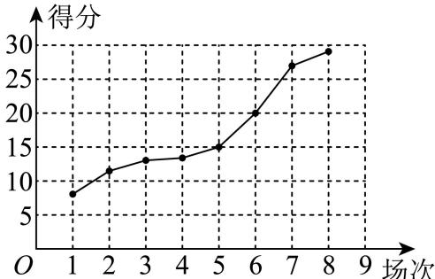
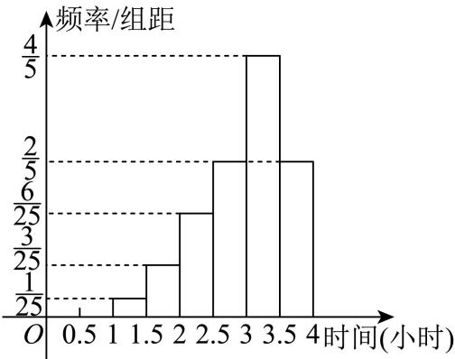

# 2025二模 概率与统计专题 · 教师版

> 本地预览：题目、答案及分类尚未全部审定。校对使用的PDF为高中工作台解析版，尚未逐区确认区级印刷原卷。

## 样本数据、图表与统计量

从直方图、茎叶图及原始数据恢复频数，区分平均数、分位数和方差。

### 宝山 · 第15题

甲、乙两名篮球运动员在8场比赛中的单场得分用茎叶图表示如左下图，茎叶图中甲的得分有部分数据丢失，但甲得分的折线图完好（右下图），则下列结论正确的是（ ）

A. 甲得分的极差小于乙得分的极差

B. 甲得分的第25百分位数大于乙得分的第75百分位数

C. 甲得分的平均数大于乙得分的平均数

D. 甲得分的方差小于乙得分的方差

**考点：** 极差、百分位数、均值与方差

**难度依据：** 茎叶图折线图及统计量比较；需连接多个条件或多步模型转化

**核查说明：** 已人工阅读完整底稿题干及原解，未逐页对照正式PDF，分类不等于数学终审。

【答案】C

【解析】

利用极差、百分位数和平均数的计算公式可以判断A、B、C三个选项，对于D选项，利用数据的分散程度判断方差的大小即可.

对于A选项，甲得分的极差为： $2 8 - 9 = 1 9$ ，乙得分的极差为： $2 0 - 9 = 1 1$

因为 $1 9 > 1 1$ ，所以甲得分的极差大于乙得分的极差，故A错误；

对于B选项，因为 $8 \times 2 5 \% = 2$ ，所以甲得分的第25百分位数为 ${ \frac { 1 2 + 1 3 } { 2 } } = { \frac { 2 5 } { 2 } }$

又 $8 \times 7 5 \% = 6$ ，所以乙得分的第75百分位数为 ${ \frac { 1 8 + 1 9 } { 2 } } = { \frac { 3 7 } { 2 } }$

因为 $\frac { 2 5 } { 2 } < \frac { 3 7 } { 2 }$ 所以甲得分的第25百分位数小于乙得分的第75百分位数，故B错误；

对于C选项，由折线图可知，在茎叶图中甲的得分中丢失的数据一个为15，另一个设为m，其中 $1 0 < m < 1 5$

所以甲的平均数为 ${ \frac { 9 + 1 2 + 1 3 + 1 5 + 2 0 + 2 6 + 2 8 + m } { 8 } } = { \frac { 1 2 3 + m } { 8 } }$ ，

乙的平均数为 $\frac { 9 + 1 4 + 1 5 + 1 6 + 1 7 + 1 8 + 1 9 + 2 0 } { 8 } = \frac { 1 2 8 } { 8 } = 1 6 ,$

因为 $1 0 < m < 1 5$ ，所以 $\frac { 1 3 3 } { 8 } < \frac { 1 2 3 + m } { 8 } < \frac { 1 3 8 } { 8 }$ ，所 $\therefore \frac { 1 2 3 + m } { 8 } > \frac { 1 2 8 } { 8 } = 1 6 ,$

所以甲得分的平均数大于乙得分的平均数，故C正确；

对于D选项，方差是刻画数据离散程度或波动幅度的指标.

从茎叶图中可以看到，甲的得分分布比乙的得分分布分散，

所以甲得分的方差大于乙得分的方差，故D错误.

故选：C

### 崇明 · 第7题

某次数学考试后，随机选取14位学生的成绩，得到如下茎叶图，其中个数部分作为“叶”，百位数和十位数作为“茎”，若该组数据的第25百分位数是87，则x的值为
$$
\begin{array}{c c c c c} 7 & 5 & & \\ 8 & 2 & 3 & x & 9 \\ 9 & 1 & 3 & 7 \\ 1 0 & 0 & 4 & 6 \\ 1 1 & 1 & 9 \\ 1 2 & 5 \end{array}
$$

**考点：** 百分位数定位缺失数据

**难度依据：** 茎叶图百分位数；需一次转化并结合定义域或几何条件计算

**核查说明：** 已人工阅读完整底稿题干及原解，未逐页对照正式PDF，分类不等于数学终审。

【答案】7.

【解析】

根据题意结合百分位数的概念运算求解.

$1 4 \times 2 5 \% = 3 . 5$ ，则该组数据从小到大排列后的第四位数是87，即x = 7，

故答案为：7.

### 普陀 · 第13题

某市职业技能大赛的移动机器人比赛项目有19位同学参赛，他们在预赛中所得的积分互不相同，只有积分在前10位的同学才能进入决赛.若该比赛项目中的某同学知道自 己的积分后，要判断自 己能否进入决赛，则他只需要知道这19位同学的预赛积分的（ ）

A. 平均数

B. 众数

C. 中位数

D. 方差

**考点：** 中位数判断

**难度依据：** 中位数；直接调用定义或基本公式，运算路径短

**核查说明：** 已人工阅读底稿题干和解析；尚未逐页对照原PDF，不作为数学终审。

【答案】C

【解析】

根据中位数的概念进行判断即可.

故选：C

因为19位同学的积分，中位数是第10名，所以知道中位数即可判断是否在前10.

### 浦东 · 第9题

李老师在整理建模小组10名学生的成绩时不小心遗失了一位学生的成绩，且剩余学生的成绩数据如下：5 6 6 7 7 7 8 9 9，但李老师记得这名学生的成绩恰好是本组学生成绩的第25百分位数，则这10名学生的成绩的方差为

**考点：** 百分位数确定缺失值及方差

**难度依据：** 百分位数与方差；需一次转化并结合定义域或几何条件计算

**核查说明：** 已人工阅读完整底稿题干及原解，未逐页对照正式PDF，分类不等于数学终审。

【解析】

现根据百分位数得出该生的成绩，再利用方差公式计算.

$1 0 \times 2 5 \% = 2 . 5$ ，则该学生的成绩为从小到大排列的第3个，

故该生的成绩为6，

则这10名学生的成绩的平均数为 ${ \frac { 5 + 6 \times 3 + 7 \times 3 + 8 + 9 \times 2 } { 1 0 } } = 7 .$

方差为 $s ^ { 2 } = { \frac { \left( 5 - 7 \right) ^ { 2 } + \left( 6 - 7 \right) ^ { 2 } \times 3 + { \left( 7 - 7 \right) } ^ { 2 } \times 3 + { \left( 8 - 7 \right) } ^ { 2 } + { \left( 9 - 7 \right) } ^ { 2 } \times 2 } { 1 0 } } = { \frac { 8 } { 5 } }$

$$
\frac {8}{5}
$$

### 金山 · 第14题

某人统计了甲、乙两家零售商店在周一到周五的营业额（单位：百元）情况，得到了如下的茎叶图（其中茎表示十位数，叶表示个位数），关于这5天的营业额情况，下列结论正确的是（ ）

A. 甲、乙两家商店营业额的极差相同

B. 甲、乙两家商店营业额的中位数相同

C. 从营业额超过3000元的天数所占比例来看，甲商店较高

D. 甲商店营业额的方差小于乙商店营业额的方差

> 本题资料或解析有待核事项，预览不可作为已审定成品。

**考点：** 极差中位数比例与方差

**难度依据：** 茎叶图及统计量比较；需一次转化并结合定义域或几何条件计算

**核查说明：** 题干所指营业额茎叶图未保留，需补图。；已人工阅读完整底稿题干及原解，未逐页对照正式PDF，分类不等于数学终审。；历史分类审查记录（不把旧记录直接判为当前未解决）：题干所指营业额茎叶图未保留，需补图。 本次只归组，未修改题干、答案或专题归属；上述具体疑点仍交回源/数学复核处理。

【答案】C

【解析】

对于A，由极差的定义，即最大值减最小值即可判断；对于B，由中位数的定义判断即可（从小到大排列数据）；对于C，直接由茎叶图即可判断；对于D，由方差公式运算即可判断.

A选项：甲商店营业额的极差为10，乙商店营业额的极差为8，故A错误；

B选项：甲商店营业额的中位数为32，乙商店营业额的中位数为30，故B错误；

C选项：甲商店营业额超过3000元的天数为3，乙商店营业额超过3000元的天数为2，故从营业额超过3000元的天数所占比例来看，甲商店较高，故C正确；

D选项：甲商店营业额的平均值为 $\frac { 2 7 + 2 8 + 3 2 + 3 6 + 3 7 } { 5 } = 3 2$ 乙商店营业额的平均值为${ \frac { 2 6 + 2 8 + 3 0 + 3 2 + 3 4 } { 5 } } = 3 0 ,$

故甲商店营业额的方差

$$
s _ {\text {甲}} ^ {2} = \frac {1}{5} \times \left[ (2 7 - 3 2) ^ {2} + (2 8 - 3 2) ^ {2} + (3 2 - 3 2) ^ {2} + (3 6 - 3 2) ^ {2} + (3 7 - 3 2) ^ {2} \right] = 1 6. 4,
$$

乙商店营业额的方差

$s _ { \scriptscriptstyle { \mathscr { Z } } } ^ { 2 } = \frac { 1 } { 5 } \times \left[ \left( 2 6 - 3 0 \right) ^ { 2 } + \left( 2 8 - 3 0 \right) ^ { 2 } + \left( 3 0 - 3 0 \right) ^ { 2 } + \left( 3 2 - 3 0 \right) ^ { 2 } + \left( 3 4 - 3 0 \right) ^ { 2 } \right] = 8 ,$ ，则 $s _ { \perp } ^ { 2 } > s _ { Z } ^ { 2 }$

，故甲商店营业额的方差大于乙商店营业额的方差，故D错误.

故选：C.

### 闵行 · 第7题

已知数据 $\smash {  { \vert x _ { 1 } , ~ x _ { 2 } , ~ \ldots , ~ x _ { 1 0 0 } } }$ 的平均数为2，方差为5，则 $x _ { 1 } ^ { 2 } , x _ { 2 } ^ { 2 } , \cdots , x _ { 1 0 0 } ^ { 2 }$ 的平均数为

**考点：** 方差与二阶矩

**难度依据：** 方差与二阶矩；需一次代换或条件转换后计算

**核查说明：** 已人工阅读底稿题干和原解；未逐页对照PDF，不作为数学终审。

【答案】9.

【解析】

由方差和平均数的计算公式结合已知计算即可

由题意可得 ${ \frac { 1 } { 1 0 0 } } \sum _ { i = 1 } ^ { 1 0 0 } { ( x _ { i } - 2 ) } ^ { 2 } = 5 , { \frac { 1 } { 1 0 0 } } \sum _ { i = 1 } ^ { 1 0 0 } x _ { i } = 2 ,$

所以 ${ \frac { 1 } { 1 0 0 } } \sum _ { i = 1 } ^ { 1 0 0 } \left( x _ { i } - 2 \right) ^ { 2 } = { \frac { 1 } { 1 0 0 } } \sum _ { i = 1 } ^ { 1 0 0 } \left( x _ { i } ^ { 2 } - 4 x _ { i } + 4 \right) = 5 ,$

又

$$
\frac {1}{1 0 0} \sum_ {i = 1} ^ {1 0 0} \left(x _ {i} ^ {2} - 4 x _ {i} + 4\right) = \frac {1}{1 0 0} \left(\sum_ {i = 1} ^ {1 0 0} x _ {i} ^ {2} - 4 \sum_ {i = 1} ^ {1 0 0} x _ {i} + \sum_ {i = 1} ^ {1 0 0} 4\right) = \frac {1}{1 0 0} \left(\sum_ {i = 1} ^ {1 0 0} x _ {i} ^ {2} - 4 \times 2 0 0 + 4 0 0\right) = 5
$$

即 $\sum _ { i = 1 } ^ { 1 0 0 } x _ { i } ^ { 2 } - 4 0 0 = 5 0 0$ ，即 $| \sum _ { i = 1 } ^ { 1 0 0 } x _ { i } ^ { 2 } = 9 0 0$

所以 $\therefore x _ { 2 } ^ { 2 } , \cdots x _ { 1 0 0 } ^ { 2 }$ 的平均数为9.

故答案为：9.

### 青浦 · 第4题

如图是6株果树植株挂果个数（两位数）的茎叶图，则6株果数植株挂果个数的中位数为
1 68 2 12 3

> 本题资料或解析有待核事项，预览不可作为已审定成品。

**考点：** 读取茎叶图与中位数

**难度依据：** 茎叶图与中位数；直接调用定义或基本公式，运算路径短

**核查说明：** 茎叶图已压成散落数字，缺明确答案字段，需回核原图而非仅靠解析恢复。；已人工阅读底稿题干和解析；尚未逐页对照原PDF，不作为数学终审。；历史分类审查记录（不把旧记录直接判为当前未解决）：茎叶图已压成散落数字，缺明确答案字段，需回核原图而非仅靠解析恢复。 本次只归组，未修改题干、答案或专题归属；上述具体疑点仍交回源/数学复核处理。

【解析】

将茎叶图中的数据按照从小到大排列后，根据中位数的定义即可求得.

将这6个数从小到大排列为16，18，21，22，22，31，

因数据有偶数个，则中位数是中间两个数的平均数，故中位数为 ${ \frac { 2 1 + 2 2 } { 2 } } = 2 1 . 5 .$ 故答案为：21.5.

### 静安 · 第18题

某校高三学生体检后，为了解高三学生的视力情况，该校从高三六个班的300名学生中以班为单位（每班学生50人），每班按随机抽样方法抽取了8名学生的视力数据.其中高三（1）班抽取的8名学生的视力数据与人数见下表：

| 视力 | 4.0 | 4.1 | 4.2 | 4.3 | 4.4 | 4.5 | 4.6 | 4.7 | 4.8 | 4.9 | 5.0 | 5.1 | 5.2 | 5.3 |
|---|---|---|---|---|---|---|---|---|---|---|---|---|---|---|
| 人数 |  |  |  |  | 2 |  | 2 |  | 2 | 1 |  | 1 |  |  |

（1）用上述样本数据估计高三（1）班学生视力的平均值；
（2）已知其余五个班学生视力的平均值分别为4.3、4.4、4.5、4.6、4.8.若从这六个班中任意抽取两个班学生视力的平均值作比较，求抽取的两个班学生视力的平均值之差的绝对值不小于0.2的概率.

> 本题资料或解析有待核事项，预览不可作为已审定成品。

**考点：** （1）样本加权平均估计总体；（2）枚举两班平均视力之差

**难度依据：** 样本平均与古典概型；需组合两类关系并检查区间或等号

**核查说明：** 视力人数表完全缺失；题干高三班级与原解“文科班”表述不同，需核原PDF。；已人工阅读底稿题干和原解；未逐页对照PDF，不作为数学终审。；历史分类审查记录（不把旧记录直接判为当前未解决）：视力人数表完全缺失；题干高三班级与原解“文科班”表述不同，需核原PDF。 当前底稿已有回源补丁，涉及question；具体修复范围以底稿patches和2025二模-缺表回源补丁-第三批.json为准。本题仍按可辨数学任务归组，不据分组宣称数学已审定。

【解析】

$$
\overline {{x}} = \frac {S}{n}
$$

试题分析：（1）平均数与一组数据里的每个数据都有关系， ；（2）古典概型的概率问题，关键是正确找出基本事件总数和所求事件包含的基本事件数，然后利用古典概型的概率计算公式计算；（3)当基本事件总数较少时，用列举法把所有的基本事件一一列举出来，要做到不重不漏，有时可借助列表，树状图列举，当基本事件总数较多时，注意去分排列与组合；（4）注意判断是古典概型还是几何概型，基本事件前者是有限的，后者是无限的，两者都是等可能性

试题解析：（1）高三文科（1）班抽取的8名学生视力的平均值为

$$
\frac {4 . 4 \times 2 + 4 . 6 \times 2 + 4 . 8 \times 2 + 4 . 9 + 5 . 1}{8} = 4. 7.
$$

据此估计高三文科（1）班学生视力的平均值约为4.7．3分

（2）因为高三文科六个班学生视力的平均值分别为4.3、4.4、4.5、4.6、4.7、4.8，所以任意抽取两个文科班学生视力的平均值数对有(4.3 4.4)，(4.3 4.5)，(4.3 4.6)，(4.3 4.7)，(4.3 4.8)，(4.4 4.5)，(4.4 4.6)，(4.4 4.7)，(4.4 4.8)，(4.5 4.6)，(4.5 4.7)，(4.5 4.8)，(4.6 4.7)，(4.6 4.8)，(4.7 4.8)，共15种情形． 7分其中抽取的两个班学生视力的平均值之差的绝对值不小于0.2的有(4.3 4.5)，(4.3 4.6)(4.3 4.7)， (4.3 4.8)，(4.4 4.6)，(4.4 4.7)，(4.4 4.8)，(4.5 4.7)，(4.5 4.8)，(4.6 4.8)，共10种． 10分

所以抽取的两个班学生视力的平均值之差的绝对值不小于0.2的概率为 $\frac { 1 0 } { 1 5 } = \frac { 2 } { 3 }$ ． 12分考点：1、数据的平均数；2、利用古典概型求随机事件概率

### 黄浦 · 第15题

设 $x_1<x_2<x_3<x_4$，随机变量 $X$ 取值 $x_1$、$x_2$、$x_3$、$x_4$ 的概率均为0.25，随机变量 $X_1$ 取值 $\frac{x_1+x_2}{2}$、$\frac{x_2+x_3}{2}$、$\frac{x_3+x_4}{2}$、$\frac{x_4+x_1}{2}$ 的概率也均为0.25，随机变量 $X_2$ 取值 $2x_1-x_2$、$2x_2-x_3$、$2x_3-x_4$、$2x_4-x_1$ 的概率也均为0.25。若记 $D[X_1]$、$D[X_2]$ 分别为 $X_1$、$X_2$ 的方差，则（ ）。

A. $D[X_1]<D[X_2]$

B. $D[X_1]=D[X_2]$

C. $D[X_1]>D[X_2]$

D. $D[X_1]$ 与 $D[X_2]$ 的大小关系与 $x_1$、$x_2$、$x_3$、$x_4$ 的取值有关

> 本题资料或解析有待核事项，预览不可作为已审定成品。

**考点：** 线性组合二阶矩与方差比较；平方和及严格等号条件

**难度依据：** 线性组合二阶矩与方差比较；平方和及严格等号条件；需多步建模、分类或参数约束

**核查说明：** 题干已回源；原解析未全面数学审校，公式及其他问题仍需处理。；已人工阅读底稿题干和原解；未逐页对照PDF，不作为数学终审。；历史分类审查记录（不把旧记录直接判为当前未解决）：题干已回源；原解析未全面数学审校，公式及其他问题仍需处理。 当前底稿已有回源补丁，涉及question；具体修复范围以底稿patches和2025二模-题干回源补丁-首批.json为准。本题仍按可辨数学任务归组，不据分组宣称数学已审定。

【答案】A

【解析】

根据随机变量 $X _ { 1 } , X _ { 2 }$ 的取值情况，计算出它们的期望和方差，再借助均值不等式即可判断作答.

由随机变 $\sharp X _ { 1 } , X _ { 2 }$ 的取值情况，它们的期望分别为：

$$
E X _ {1} = \frac {1}{4} \left(\frac {x _ {1} + x _ {2}}{2} + \frac {x _ {2} + x _ {3}}{2} + \frac {x _ {3} + x _ {4}}{2} + \frac {x _ {4} + x _ {1}}{2}\right) = \frac {1}{4} (x _ {1} + x _ {2} + x _ {3} + x _ {4}),
$$

$E X _ { 2 } = { \frac { 1 } { 4 } } ( 2 x _ { 1 } - x _ { 2 } + 2 x _ { 2 } - x _ { 3 } + 2 x _ { 3 } - x _ { 4 } + 2 x _ { 4 } - x _ { 1 } ) = { \frac { 1 } { 4 } } ( x _ { 1 } + x _ { 2 } + x _ { 3 } + x _ { 4 } ) ,$ ，即

$$
E X _ {2} = E X _ {1},
$$

$$
D X _ {1} = \frac {1}{4} \left[ \left(\frac {x _ {1} + x _ {2}}{2}\right) ^ {2} + \left(\frac {x _ {2} + x _ {3}}{2}\right) ^ {2} + \left(\frac {x _ {3} + x _ {4}}{2}\right) ^ {2} + \left(\frac {x _ {4} + x _ {1}}{2}\right) ^ {2} \right] - (E X _ {1}) ^ {2},
$$

$$
\left(\frac {x _ {1} + x _ {2}}{2}\right) ^ {2} + \left(\frac {x _ {2} + x _ {3}}{2}\right) ^ {2} + \left(\frac {x _ {3} + x _ {4}}{2}\right) ^ {2} + \left(\frac {x _ {4} + x _ {1}}{2}\right) ^ {2}
$$

$$
= \frac {2 \left(x _ {1} ^ {2} + x _ {2} ^ {2} + x _ {3} ^ {2} + x _ {4} ^ {2}\right) + 2 x _ {1} x _ {2} + 2 x _ {2} x _ {3} + 2 x _ {3} x _ {4} + 2 x _ {4} x _ {1}}{4}
$$

同理 $\begin{array} { l } { \displaystyle { D X _ { 2 } = \frac { 1 } { 4 } \big [ ( 2 x _ { 1 } - x _ { 2 } ) ^ { 2 } + ( 2 x _ { 2 } - x _ { 3 } ) ^ { 2 } + ( 2 x _ { 3 } - x _ { 4 } ) ^ { 2 } + ( 2 x _ { 4 } - x _ { 1 } ) ^ { 2 } \big ] - ( E X _ { 2 } ) ^ { 2 } , } } \end{array}$

$$
\left[ \left(2 x _ {1} - x _ {2}\right) ^ {2} + \left(2 x _ {2} - x _ {3}\right) ^ {2} + \left(2 x _ {3} - x _ {4}\right) ^ {2} + \left(2 x _ {4} - x _ {1}\right) ^ {2} \right.
$$

$$
= 5 \left(x _ {1} ^ {2} + x _ {2} ^ {2} + x _ {3} ^ {2} + x _ {4} ^ {2}\right) - 4 \left(x _ {1} x _ {2} + x _ {2} x _ {3} + x _ {3} x _ {4} + x _ {4} x _ {1}\right)
$$

则 $D \left[ X _ { 2 } \right] - D \left[ X _ { 1 } \right]$

$$
= \frac {1}{4}
$$

$$
\left[ 5 \left(x _ {1} ^ {2} + x _ {2} ^ {2} + x _ {3} ^ {2} + x _ {4} ^ {2}\right) - 4 \left(x _ {1} x _ {2} + x _ {2} x _ {3} + x _ {3} x _ {4} + x _ {4} x _ {1}\right) - \right.
$$

$$
\left. \frac {\left(x _ {1} ^ {2} + x _ {2} ^ {2} + x _ {3} ^ {2} + x _ {4} ^ {2}\right) + \left(x _ {1} x _ {2} + x _ {2} x _ {3} + x _ {3} x _ {4} + x _ {4} x _ {1}\right)}{2} \right]
$$

$$
\frac {9 \left[ \left(x _ {1} ^ {2} + x _ {2} ^ {2} + x _ {3} ^ {2} + x _ {4} ^ {2}\right) - \left(x _ {1} x _ {2} + x _ {2} x _ {3} + x _ {3} x _ {4} + x _ {4} x _ {1}\right) \right]}{8},
$$

因为 $\begin{array} { r } { \iota x _ { 1 } ^ { 2 } + x _ { 2 } ^ { 2 } \geq 2 x _ { 1 } x _ { 2 } , x _ { 3 } ^ { 2 } + x _ { 2 } ^ { 2 } \geq 2 x _ { 3 } x _ { 2 } , x _ { 3 } ^ { 2 } + x _ { 4 } ^ { 2 } \geq 2 x _ { 4 } x _ { 3 } , x _ { 1 } ^ { 2 } + x _ { 4 } ^ { 2 } \geq 2 x _ { 4 } x _ { 1 } } \end{array}$

所以x21 + x22 + x23 + x24 ≥ x1x2 + x2x3 + x3x4 + x4x1，

因为 $x _ { 1 } < x _ { 2 } < x _ { 3 } < x _ { 4 }$ ，不能取等号，所以 $x _ { 1 } ^ { 2 } + x _ { 2 } ^ { 2 } + x _ { 3 } ^ { 2 } + x _ { 4 } ^ { 2 } > x _ { 1 } x _ { 2 } + x _ { 2 } x _ { 3 } + x _ { 3 } x _ { 4 } + x _ { 4 } x _ { 1 }$

所以 $D \left[ X _ { 2 } \right] - D \left[ X _ { 1 } \right] > 0$

所以 $D \left[ X _ { 2 } \right] > D \left[ X _ { 1 } \right]$

故选：A.

## 相关、回归与样本中心

解释相关方向强弱，利用回归线过样本中心及残差定义作计算和预测。

### 奉贤 · 第9题

通过随机抽样，获得某种商品消费者年需求量与该商品每千克价格之间的一组数据调查，如下表所示:

| 价格（百元） | $x_1$ | $x_2$ | $x_3$ | $x_4$ | $x_5$ | $x_6$ | $x_7$ | $x_8$ | $x_9$ | $x_{10}$ |
|---|---|---|---|---|---|---|---|---|---|---|
|  | 4 | 4 | 4.6 | 5 | 5.2 | 5.6 | 6 | 6.6 | 7 | 10 |
| 需求量（千克） | $y_1$ | $y_2$ | $y_3$ | $y_4$ | $y_5$ | $y_6$ | $y_7$ | $y_8$ | $y_9$ | $y_{10}$ |
|  | 3.5 | 3 | 2.7 | 2.4 | 2.5 | 2 | 1.5 | 1.2 | 1.2 | 1 |

那么线性相关系数 $r=\underline{\qquad}$（精确到0.001）。线性相关系数公式为

$$
r=\frac{\displaystyle\sum_{i=1}^{n}(x_i-\bar{x})(y_i-\bar{y})}{\sqrt{\displaystyle\sum_{i=1}^{n}(x_i-\bar{x})^2\cdot\sum_{i=1}^{n}(y_i-\bar{y})^2}}.
$$

> 本题资料或解析有待核事项，预览不可作为已审定成品。

**考点：** 相关系数与样本数据

**难度依据：** 相关系数判断；需完成一次转化或结合基本条件后计算

**核查说明：** 题干表格和相关系数公式已依据解析版PDF第4页恢复；源解析与题目精度不一致及公式错误，已保留源解析并据表重新计算为-0.863；其他题目未因此视为终审。

【答案】$-0.863$。

【解析】

由表中数据，得 $\bar{x}=5.8$，$\bar{y}=2.1$。分别计算相关系数公式中的三项，得

$$
\sum_{i=1}^{10}(x_i-\bar{x})(y_i-\bar{y})=-11.86,
$$

$$
\sum_{i=1}^{10}(x_i-\bar{x})^2=28.72,\qquad
\sum_{i=1}^{10}(y_i-\bar{y})^2=6.58.
$$

因此

$$
r=\frac{-11.86}{\sqrt{28.72\times6.58}}\approx-0.862739.
$$

按题意精确到0.001，得 $r\approx-0.863$。

### 徐汇 · 第14题

在研究线性回归模型时，若样本数据 $( x _ { i } , y _ { i } ) ( i = 1 , 2 , 3 , \cdot \cdot \cdot , n )$ 所对应的点都在直线 $y = - { \frac { 1 } { 3 } } x + 2$ 上，则两组数据x 和 $\lvert y _ { i } ( i = 1 , 2 , 3 , \cdots , n )$ 的线性相关系数为（ ）

A. −1

B. 1

C. $- { \frac { 1 } { 3 } }$

D. 2

> 本题资料或解析有待核事项，预览不可作为已审定成品。

**考点：** 回归直线与相关系数

**难度依据：** 完全线性相关系数；需一次转化并结合定义域或几何条件计算

**核查说明：** x_i、y_i标记误识为绝对值符号，需核清，避免理解为|y_i|。；已人工阅读完整底稿题干及原解，未逐页对照正式PDF，分类不等于数学终审。；历史分类审查记录（不把旧记录直接判为当前未解决）：x_i、y_i标记误识为绝对值符号，需核清，避免理解为|y_i|。 本次只归组，未修改题干、答案或专题归属；上述具体疑点仍交回源/数学复核处理。

【答案】A

【解析】

根据回归模型性质判断即可.

若样本数据 $( x _ { i } , y _ { i } ) ( i = 1 , 2 , 3 , \cdot \cdot \cdot , n )$ 所对应的点都在直线 $y = - \frac { 1 } { 3 } x + 2 \mathrm { . } \mathrm { E }$ 则两组数据x 和 $| y _ { i } ( i = 1 , 2 , 3 , \cdots , n )$ 的线性相关系数为−1.故选：A.

### 杨浦 · 第9题

植物社团的同学观察一株植物的生长情况，为了解植物高度y（单位：厘米）与生长期x（单位：天）之间的关系，随机统计了某4天的植物高度，并制作了如下对照表：

| 生长期 $x$（天） | 3 | 9 | 11 | 17 |
|---|---|---|---|---|
| 植物高度 $y$（厘米） | 2.4 | 3.4 | 3.8 | 5.2 |

由表中数据可得回归方程 $y=\hat ax+\hat b$ 中 $\hat a=0.2$，试预测生长期是30天时，植物高度约为 ______ 厘米。

$$\hat a=\frac{\sum_{i=1}^n x_iy_i-n\bar x\bar y}{\sum_{i=1}^n x_i^2-n\bar x^2},\qquad\hat b=\bar y-\hat a\bar x.$$

> 本题资料或解析有待核事项，预览不可作为已审定成品。

**考点：** 样本中心与回归预测

**难度依据：** 线性回归预测；需一次转化并结合定义域或几何条件计算

**核查说明：** 题干数据表未保留，回归系数与公式OCR破损，需补表。；已人工阅读完整底稿题干及原解，未逐页对照正式PDF，分类不等于数学终审。；历史分类审查记录（不把旧记录直接判为当前未解决）：题干数据表未保留，回归系数与公式OCR破损，需补表。 当前底稿已有回源补丁，涉及question；具体修复范围以底稿patches和2025二模-缺表回源补丁-第三批.json,2025二模-残余OCR回源补丁-第四批.json为准。本题仍按可辨数学任务归组，不据分组宣称数学已审定。

【答案】7.7.

【解析】

根据表中数据求出线性回归方程，再代入x = 30即可.

由题意可得 $\overline { { { v } } } = \frac { 3 + 9 + 1 1 + 1 7 } { 4 } = 1 0 , \overline { { { y } } } = \frac { 2 . 4 + 3 . 4 + 3 . 8 + 5 . 2 } { 4 } = 3 . 7 ,$

所以 $\hat { b } = \overline { { y } } - \hat { a } \overline { { x } } = 3 . 7 - 0 . 2 \times 1 0 = 1 . 7 ,$

所以回归方程为 $| y = 0 . 2 x + 1 . 7 ,$

所以预测生长期是30天时，植物高度约为0.2×30+1.7 = 7.7厘米.

故答案为：7.7.

### 松江 · 第6题

根据如表所示的样本数据，用最小二乘法求得线性回归方程为 $\ y = \hat { a } x + 1 0 . 3$ ，则回归系数a^的值为

| $x$ | 6 | 8 | 9 | 10 | 12 |
|---|---|---|---|---|---|
| $y$ | 6 | 5 | 4 | 3 | 2 |

> 本题资料或解析有待核事项，预览不可作为已审定成品。

**考点：** 回归直线过样本中心

**难度依据：** 线性回归与样本中心；需一次转化并结合定义域或几何条件计算

**核查说明：** 题干所指样本数据表未保留，需补原表。；已人工阅读完整底稿题干及原解，未逐页对照正式PDF，分类不等于数学终审。；历史分类审查记录（不把旧记录直接判为当前未解决）：题干所指样本数据表未保留，需补原表。 当前底稿已有回源补丁，涉及question；具体修复范围以底稿patches和2025二模-缺表回源补丁-第三批.json为准。本题仍按可辨数学任务归组，不据分组宣称数学已审定。

【答案】−0.7.

【解析】

根据线性回归方程过样本中心点进行求解即可.

首先计算 $\overline { { x } } = \frac { 6 + 8 + 9 + 1 0 + 1 2 } { 5 } = 9 , \overline { { y } } = \frac { 6 + 5 + 4 + 3 + 2 } { 5 } = 4 .$

因为回归直线过样本中心点(x,–y)，把(9,4)代入– $\mathbf { \nabla } \cdot y = \hat { a } x + 1 0 . 3$

可得 $4 = 9 \hat { a } + 1 0 . 3 , 9 \hat { a } = - 6 . 3$ ，解得 ${ \hat { a } } = - 0 . 7 .$

故答案为：−0.7.

### 浦东 · 第15题

研究变量x，y得到一组成对数据 $( x _ { i } , y _ { i } ) , i = 1 , 2 , \cdots , n ,$ ，先进行一次线性回归分析，接着增加一个数据 $( x _ { n + 1 } , y _ { n + 1 } )$ ，其 $\forall x _ { n + 1 } = \frac { 1 } { n } \sum _ { i = 1 } ^ { n } x _ { i } , y _ { n + 1 } = \frac { 1 } { n } \sum _ { i = 1 } ^ { n } y _ { i }$ ，再重新进行一次线性回归分析，则下列说法正确的是（ ）

A. 变量x与变量y的相关性变强

B. 相关系数r的绝对值变小

C. 线性回归方程 $\boldsymbol { y } = \widehat { \boldsymbol { a } } \boldsymbol { x } + \widehat { \boldsymbol { b } }$ 不变

D. 拟合误差Q变大

**考点：** 增加样本中心点后的回归不变性

**难度依据：** 线性回归和相关系数；需连接多个条件或多步模型转化

**核查说明：** 已人工阅读完整底稿题干及原解，未逐页对照正式PDF，分类不等于数学终审。

【答案】C

【解析】

设变量x，y的平均数分别为x，–y，分析可知– $\overline { { x } } = x _ { n + 1 } , \overline { { y } } = y _ { n + 1 }$ .对于AB：根据相关系数的计算公式和性质分析判断；对于CD：根据回归方程和拟合误差的性质分析判断

设变量x，y的平均数分别为x，–y，–

则x– $= \frac { 1 } { n } \sum _ { i = 1 } ^ { n } x _ { i }$ 9 ${ \overline { { y } } } = { \frac { 1 } { n } } \sum _ { i = 1 } ^ { n } y _ { i }$ ，即 $\overline { { x } } = x _ { n + 1 } , \overline { { y } } = y _ { n + 1 }$

可知新数据的样本中心点不变，仍为 $( \overline { { x } } , \overline { { y } } )$

对 $\operatorname { \overline { { f } } A B } { \mathrm { : } }$ ：可得 $\displaystyle { \sum _ { i = 1 } ^ { n + 1 } \left( x _ { i } - \overline { { x } } \right) ^ { 2 } = \sum _ { i = 1 } ^ { n } \left( x _ { i } - \overline { { x } } \right) ^ { 2 } + \left( x _ { n + 1 } - \overline { { x } } \right) ^ { 2 } = \sum _ { i = 1 } ^ { n } \left( x _ { i } - \overline { { x } } \right) ^ { 2 } } ,$

$$
\sum_ {i = 1} ^ {n + 1} \left(y _ {i} - \bar {y}\right) ^ {2} = \sum_ {i = 1} ^ {n} \left(y _ {i} - \bar {y}\right) ^ {2}, \sum_ {i = 1} ^ {n + 1} \left(x _ {i} - \bar {x}\right) \left(y _ {i} - \bar {y}\right) = \sum_ {i = 1} ^ {n} \left(x _ {i} - \bar {x}\right) \left(y _ {i} - \bar {y}\right),
$$

则相关系数 $r = { \frac { \displaystyle \sum _ { i = 1 } ^ { n + 1 } \left( x _ { i } - { \overline { { x } } } \right) \left( y _ { i } - { \overline { { y } } } \right) } { \displaystyle { \sqrt { \sum _ { i = 1 } ^ { n + 1 } \left( x _ { i } - { \overline { { x } } } \right) ^ { 2 } \sum _ { i = 1 } ^ { n + 1 } \left( y _ { i } - { \overline { { y } } } \right) ^ { 2 } } } } } = { \frac { \displaystyle \sum _ { i = 1 } ^ { n } \left( x _ { i } - { \overline { { x } } } \right) \left( y _ { i } - { \overline { { y } } } \right) } { \displaystyle { \sqrt { \sum _ { i = 1 } ^ { n } \left( x _ { i } - { \overline { { x } } } \right) ^ { 2 } \sum _ { i = 1 } ^ { n } \left( y _ { i } - { \overline { { y } } } \right) ^ { 2 } } } } } ,$

可知相关系数r的值不变，变量 $x { \overset { \underset { L } { } } {  } }$ 变量y的相关性不变，故AB错误；

对于C：因为 ${ \hat { \mathfrak { h } } } = { \frac { \displaystyle \sum _ { i = 1 } ^ { n + 1 } \left( x _ { i } - { \overline { { x } } } \right) \left( y _ { i } - { \overline { { y } } } \right) } { \displaystyle \sum _ { i = 1 } ^ { n + 1 } \left( x _ { i } - { \overline { { x } } } \right) ^ { 2 } } } = { \frac { \displaystyle \sum _ { i = 1 } ^ { n } \left( x _ { i } - { \overline { { x } } } \right) \left( y _ { i } - { \overline { { y } } } \right) } { \displaystyle \sum _ { i = 1 } ^ { n } \left( x _ { i } - { \overline { { x } } } \right) ^ { 2 } } }$ 且线性回归方程过样本中心点(x, –y )，–

即^b,a^均不变，所以线性回归方程 $\boldsymbol { y } = \boldsymbol { \hat { a } } \boldsymbol { x } + \boldsymbol { \hat { b } }$ 不变，故C正确；

因为 $( x _ { n + 1 } , y _ { n + 1 } )$ 即为样本中心点，即 $\widehat { { y _ { n + 1 } } } = y _ { n + 1 }$ ，

可知残差平方和 $\prod _ { i = 1 } ^ { n + 1 } \left( \widehat { y _ { i } } - y _ { i } \right) ^ { 2 }$ 不变，

所以拟合误差Q不变，故D错误；

故选：C.

### 虹口 · 第6题

某公司为了解用电量 $y$（单位：千瓦时）与气温 $x$（单位：摄氏度）之间的关系，随机统计了4天的用电量与当天气温，绘制了如下表格，由表中数据可得回归方程 $y=-2x+59.5$，则实数 $m=$____。

| $x$ | $-1$ | $10$ | $13$ | $18$ |
|---|---|---|---|---|
| $y$ | $62$ | $38$ | $34$ | $m$ |

> 本题资料或解析有待核事项，预览不可作为已审定成品。

**考点：** 回归直线过样本中心

**难度依据：** 线性回归与中心点；需一次转化并结合定义域或几何条件计算

**核查说明：** 题干已回源；原解析未全面数学审校，公式及其他问题仍需处理。；题干所指气温与用电量表未保留，须补原表。；已人工阅读完整底稿题干及原解，未逐页对照正式PDF，分类不等于数学终审。；历史分类审查记录（不把旧记录直接判为当前未解决）：题干所指气温与用电量表未保留，须补原表。；题干已回源；原解析未全面数学审校，公式及其他问题仍需处理。 当前底稿已有回源补丁，涉及question；具体修复范围以底稿patches和2025二模-题干回源补丁-首批.json为准。本题仍按可辨数学任务归组，不据分组宣称数学已审定。

【解析】

求出样本中心点的坐标(x,–y)，将样本中心点的坐标代入回归直线方程，可得出实数m的值–由表格中的数据可知， $\overline { { x } } = \frac { - 1 + 1 0 + 1 3 + 1 8 } { 4 } = 1 0 , \overline { { y } } = \frac { 6 2 + 3 8 + 3 4 + m } { 4 } = \frac { m + 1 3 4 } { 4 } ,$ 所以，样本中心点的坐标为 $\left( 1 0 , { \frac { m + 1 3 4 } { 4 } } \right)$ 9

将样本中心点的坐标代入回归直线方程可得 $- 2 \times 1 0 + 5 9 . 5 = { \frac { m + 1 3 4 } { 4 } }$ ，解得m = 24.故答案为：24.

### 长宁 · 第14题

某书店为了分析书籍销量与宣传投入之间的关系，对宣传投入x（千元）和书籍销量y（百本）的情况进行了调研，并统计得到表中几组对应数据，同时用最小二乘法得到y关于x的线性回归方程为$y = 1 . 2 x + 1 . 6$ ，则下列说法不正确的是（ ）

| $x$ | 3 | 4 | 5 | 6 |
| --- | ---: | ---: | ---: | ---: |
| $y$ | 5 | 6.2 | 7.4 | $m$ |

A. 变量x、y之间呈正相关

B. 预测当宣传投入2千元时，书籍销量约为400本

C. $m = 8 . 8$

D. 拟合误差 $Q = 0 . 4 8$

> 题给回归方程与原始数据表存在数值冲突；暂不将源解作为标准答案。

**考点：** 回归中心与残差平方和

**难度依据：** 回归中心与残差平方和；需组合两类关系并检查区间或等号

**核查说明：** 原PDF表格及回归式存在内在冲突：由过均值点得m=9.4时最小二乘斜率为1.44，并非题给1.2；题干按原PDF恢复，不能认定源题数学已正确。；回归原数据表缺失，无法核实m与残差。原解列出的点与声称最小二乘回归方程的斜率还需复算。；已人工阅读底稿题干和原解；未逐页对照PDF，不作为数学终审。；历史分类审查记录（不把旧记录直接判为当前未解决）：回归原数据表缺失，无法核实m与残差。原解列出的点与声称最小二乘回归方程的斜率还需复算。 本次只归组，未修改题干、答案或专题归属；上述具体疑点仍交回源/数学复核处理。

【答案】C

【解析】

根据线性回归方程即可判断A；将x = 2代入线性回归方程即可判断B；由 $( { \overline { { x } } } , { \overline { { y } } } )$ 在线性回归方程上，即可求解 ；根据拟合误差计算公式求解即可

因为线性回归方程为 $y = 1 . 2 x + 1 . 6 , 1 . 2 > 0$

所以变量x、y之间呈正相关，故A正确；

当x = 2时， $y = 1 . 2 \times 2 + 1 . 6 = 4$ （百本），所以书籍销量约为400本，故B正确；

由表中数据可得 ${ \overline { { c } } } = { \frac { 3 + 4 + 5 + 6 } { 4 } } = { \frac { 9 } { 2 } } , { \overline { { y } } } = { \frac { 5 + 6 . 2 + 7 . 4 + m } { 4 } } = { \frac { 1 8 . 6 + m } { 4 } }$

所以 $\frac { 1 8 . 6 + m } { 4 } = 1 . 2 \times \frac { 9 } { 2 } + 1 . 6$ ，解得 $m = 9 . 4$ ，故C错误；

当x = 3时， $y = 1 . 2 \times 3 + 1 . 6 = 5 . 2 , ( 5 - 5 . 2 ) ^ { 2 } = 0 . 0 4 ,$

当x = 4时， $y = 1 . 2 \times 4 + 1 . 6 = 6 . 4 , ( 6 . 2 - 6 . 4 ) ^ { 2 } = 0 . 0 4 ,$

当x = 5时， $y = 1 . 2 \times 5 + 1 . 6 = 7 . 6 , ( 7 . 4 - 7 . 6 ) ^ { 2 } = 0 . 0 4 _ { 2 }$

当x = 6时， $y = 1 . 2 \times 6 + 1 . 6 = 8 . 8 , ( 9 . 4 - 8 . 8 ) ^ { 2 } = 0 . 3 6 ,$

所以 $Q = 0 . 0 4 + 0 . 0 4 + 0 . 0 4 + 0 . 3 6 = 0 . 4 8$ ，故D正确.

故选：C.

### 闵行 · 第13题

两个变量x与y之间的回归方程（ ）

A. 表示x与y之间的函数关系；

B. 表示x与y之间的不确定关系；

C. 反映x与y之间的真实关系；

D. 是反映x与y之间的真实关系的一种最佳拟合

**考点：** 回归模型意义

**难度依据：** 回归模型意义；直接调用定义或基本公式，路径短

**核查说明：** 已人工阅读底稿题干和原解；未逐页对照PDF，不作为数学终审。

【答案】D

【解析】

根据回归直线方程的定义，结合选项，即可求解.

根据回归方程的定义，可得两个变量x与y之间的回归方程是反映x与y之间的真实关系的一种

最佳拟合

故选：D.

### 黄浦 · 第13题

如果两种证券在一段时间内收益数据的相关系数为0.8，那么表明（ ）

A. 两种证券的收益有反向变动的倾向

B. 两种证券的收益有同向变动的倾向

C. 两种证券的收益之间存在完全反向的联动关系，即涨或跌是相反的

D. 两种证券的收益之间存在完全同向的联动关系，即同时涨或同时跌

**考点：** 相关系数方向与强度

**难度依据：** 相关系数方向与强度；直接调用定义或基本公式，路径短

**核查说明：** 已人工阅读底稿题干和原解；未逐页对照PDF，不作为数学终审。

【答案】B

【解析】

根据正相关的定义可得出结论.

因为两种证券在一段时间内收益数据的相关系数为0.8 > 0，所以两种证券是正相关，

故选：B.

那么表明两种证券的收益有同向变动的倾向，B正确，ACD错误.

## 古典概型、条件概率与事件结构

明确样本点和条件空间，区分互斥对立、两两独立与相互独立。

### 嘉定 · 第9题

在由1，2，3，4，5这五个数组成的无重复数字的四位数中，其能被3整除的概率为

**考点：** 排列组合与古典概型

**难度依据：** 排列组合计数；需完成一次转化或结合基本条件后计算

**核查说明：** 已人工阅读底稿题干和解析；尚未逐页对照原PDF，不作为数学终审。

【解析】

利用排列数公式分别求出由1，2，3，4，5这五个数组成的无重复数字的四位数的个数，及其中能被3整除的四位数的个数，再根据古典概型公式即可得解.

由1，2，3，4，5这五个数组成的无重复数字的四位数共 $\mathrm { A } _ { 5 } ^ { 4 } = 5 \times 4 \times 3 \times 2 = 1 2 0 $ 个，

其中能被3整除的四位数是由1，2，4，5组成的，共 ${ \bf A } _ { 4 } ^ { 4 } = 4 \times 3 \times 2 \times 1 = 2 4$

故由1，2，3，4，5这五个数组成的无重复数字的四位数中，其能被3整除的概率为 ${ \frac { 2 4 } { 1 2 0 } } = { \frac { 1 } { 5 } }$ 故答案为： $\frac { 1 } { 5 }$

### 崇明 · 第15题

抛掷一枚质地均匀的硬币n次（其中n为大于等于2的整数），设事件A表示“n次中既有正面朝上又有反面朝上”，事件B表示“n次中至多有一次正面朝上”，若事件A与事件B是独立的，则n的值为（ ）

A. 5

B. 4

C. 3

D. 2

> 本题资料或解析有待核事项，预览不可作为已审定成品。

**考点：** 对立事件及独立性方程

**难度依据：** 独立事件与抛币；需连接多个条件或多步模型转化

**核查说明：** 源解只试n=2、3、4，未说明n>=5无解；选项题可排除，但一般唯一性论证不完整。；已人工阅读完整底稿题干及原解，未逐页对照正式PDF，分类不等于数学终审。；历史分类审查记录（不把旧记录直接判为当前未解决）：源解只试n=2、3、4，未说明n>=5无解；选项题可排除，但一般唯一性论证不完整。 本次只归组，未修改题干、答案或专题归属；上述具体疑点仍交回源/数学复核处理。

【答案】C

【解析】

先分别求出事件A、事件B以及事件A∩B发生的概率，再根据事件A与事件B独立的性质$P ( A \cap B ) = P ( A ) P ( B )$ 来求解n的值.

抛掷一枚质地均匀的硬币n次，所有可能的结果有2n种.

事件A表示“n次中既有正面朝上又有反面朝上”，其对立事件 $\bar { \cdot } \overline { { A } }$ 为“n次都是正面朝上或n次都是反面朝上”，A包含的情况有2种，所以 $P \left( { \overline { { A } } } \right) = { \frac { 2 } { 2 ^ { n } } } = { \frac { 1 } { 2 ^ { n - 1 } } }$ 根据对立事件概率之和为1，可得 $P \left( A \right) = 1 - P \left( { \overline { { A } } } \right) = 1 - { \frac { 1 } { 2 ^ { n - 1 } } }$

事件B表示“n次中至多有一次正面朝上”，即“n次中没有正面朝上（全是反面朝上）”或“n次中有一次正面朝上”.

“n次中没有正面朝上”的情况有1种；“n次中有一次正面朝上”，从n次中选1次为正面朝上，有$\mathrm { C } _ { n } ^ { 1 } = n$ 种情况.

所以事件B包含的情况共有n+1种，则 $P \left( B \right) = \frac { n + 1 } { 2 ^ { n } }$

事件A∩B表示“n次中既有正面朝上又有反面朝上且至多有一次正面朝上”，即“n次中有一次正面朝上”，有 $\mathrm { C } _ { n } ^ { 1 } = n$ 种情况，所以 $P \left( A \cap B \right) = { \frac { n } { 2 ^ { n } } }$

因为事件A与事件B是独立的，所以 $P ( A \cap B ) = P ( A ) P ( B )$ ，即 ${ \frac { n } { 2 ^ { n } } } = \left( 1 - { \frac { 1 } { 2 ^ { n - 1 } } } \right) \times { \frac { n + 1 } { 2 ^ { n } } }$

可得： $n = \left( 1 - { \frac { 1 } { 2 ^ { n - 1 } } } \right) ( n + 1 )$ .展开得： $n = n + 1 - { \frac { n + 1 } { 2 ^ { n - 1 } } }$ .即 $n + 1 = 2 ^ { n - 1 }$

当n = 2时，2 + 1 = 3，22−1 = 2，等式不成立；

当n = 3时，3 + 1 = 4，23−1 = 4，等式成立；

当n = 4时，4 + 1 = 5，24−1 = 8，等式不成立.

所以n = 3.

故选：C.

### 徐汇 · 第9题

已知两个随机事件A,B，若 $P \left( A \right) = \frac { 1 } { 5 } , P \left( B \right) = \frac { 1 } { 4 } , P \left( B | A \right) = \frac { 2 } { 3 }$ ，则 $P \left( { \overline { { A } } } \left| B \right. \right)$

**考点：** 条件概率及对立事件

**难度依据：** 条件概率与事件分解；需一次转化并结合定义域或几何条件计算

**核查说明：** 已人工阅读完整底稿题干及原解，未逐页对照正式PDF，分类不等于数学终审。

【答案】$\frac { 7 } { 1 5 }$

【解析】

根据全概率公式有 $P \left( B \right) = P \left( B A \right) + P \left( B \overline { { A } } \right)$ ，由乘法公式有 $P \left( B A \right) = P \left( A \right) P \left( B \left| A \right. \right)$ 求出$P \left( B { \overline { { A } } } \right)$ ，最后利用条件概率公式即可求解

由题意 $P \left( B \right) = P \left( B A \right) + P \left( B \overline { { A } } \right) = P \left( A \right) P \left( B \left| A \right. \right) + P \left( B \overline { { A } } \right)$

所以 $P \left( B { \overline { { A } } } \right) = P \left( B \right) - P \left( A \right) P \left( B \left| A \right. \right) = { \frac { 1 } { 4 } } - { \frac { 1 } { 5 } } \times { \frac { 2 } { 3 } } = { \frac { 7 } { 6 0 } }$

所以 $P \left( { \overline { { A } } } { \Big | } B \right) = { \frac { P \left( B { \overline { { A } } } \right) } { P \left( B \right) } } = { \frac { \frac { 7 } { 6 0 } } { \frac { 1 } { 4 } } } = { \frac { 7 } { 1 5 } } .$

故答案为： $\frac { 7 } { 1 5 }$

### 徐汇 · 第13题

已知A､B为两个随机事件，则“A､B为互斥事件”是“A､B为对立事件”的（ ）

A. 充分非必要条件

B. 必要非充分条件

C. 充要条件

D. 非充分非必要条件

**考点：** 互斥和对立事件关系

**难度依据：** 充分必要条件；直接运用定义或基础公式，推理链短

**核查说明：** 已人工阅读完整底稿题干及原解，未逐页对照正式PDF，分类不等于数学终审。

【答案】B

【解析】

根据互斥事件和对立事件的概念直接判断即可.

根据互斥事件和对立事件的概念可知，互斥不一定对立，对立一定互斥，所以“ A､B为互斥事 件”是“ A､B为对立事件”的必要非充分条件.

故选：B

### 普陀 · 第3题

已知事件A与事件B相互独立，若 $P \left( A \cap { \overline { { B } } } \right) = { \frac { 3 } { 2 5 } } , P \left( B \right) = { \frac { 3 } { 5 } }$ ，则P(A) =

**考点：** 独立事件概率

**难度依据：** 独立事件与对立事件；需完成一次转化或结合基本条件后计算

**核查说明：** 已人工阅读底稿题干和解析；尚未逐页对照原PDF，不作为数学终审。

【答案】$\frac { 3 } { 1 0 }$

【解析】

利用相互独立事件概率乘法公式和对立事件概率公式来求解即可.

由独立事件性质 $P \left( A \cap { \overline { { B } } } \right) = P \left( A \right) P \left( { \overline { { B } } } \right) = { \frac { 3 } { 2 5 } }$

$$
P \left(\overline {{B}}\right) = 1 - \frac {3}{5} = \frac {2}{5},
$$

$$
\therefore P (A) = \frac {\overline {{2 5}}}{\frac {2}{\overline {{z}}}} = \frac {3}{1 0},
$$

故答案为： $\frac { 3 } { 1 0 }$

### 普陀 · 第7题

在一个不透明的盒中装着标有数字1，2，3，4的大小与质地都相同的小球各2个，现从该盒中一次取出2个球，设事件A为“取出2个球的数字之和大于5”，事件B为“取出的2个球中最小数字是2”，则$P ( B | A ) =$

**考点：** 条件概率计算

**难度依据：** 条件概率；需完成一次转化或结合基本条件后计算

**核查说明：** 已人工阅读底稿题干和解析；尚未逐页对照原PDF，不作为数学终审。

【答案】$\frac { 2 } { 5 }$

【解析】

首先求出事件A、事件A∩B的基本事件数，再由条件概率公式计算可得.

事件A（数字之和大于5）的基本事件数（数字组合(2, 4), (3, 3), (3, 4), (4, 4)），

共有 $2 \times 2 + \mathbf { C } _ { ? } ^ { 2 } + 2 \times 2 + \mathbf { C } _ { ? } ^ { 2 } = 4 + 1 + 4 + 1 = 1 0 \# 4$ ；

而事件 $A \cap B$ （最小数字是2且和大 $\mp 5$ ，即(2,4)）的基本事件数有2×2 = 4种，

由条件概率公式 $P \left( B | A \right) = { \frac { n ( A \cap B ) } { n ( A ) } } = { \frac { 4 } { 1 0 } } = { \frac { 2 } { 5 } } .$

故答案为： $\frac { 2 } { 5 }$

### 长宁 · 第9题

一项过关游戏的规则规定：在第n关要投掷骰子n次，如果这n次投掷所得的点数之和大于 $3 n$ ，则算过关，问一个人连过第一、二关的概率为

**考点：** 骰子古典概型和独立过关

**难度依据：** 骰子古典概型和独立过关；需一次代换或条件转换后计算

**核查说明：** 已人工阅读底稿题干和原解；未逐页对照PDF，不作为数学终审。

【答案】$\frac { 7 } { 2 4 }$

【解析】

利用古典概型的概率公式可求过第一、二关的概率，从而可得连过两关的概率.

由题设，在第一关投1次骰子，点数大于3，即掷得点数为4,5,6，

则过第一关的概率为 ${ \frac { 3 } { 6 } } = { \frac { 1 } { 2 } }$

第二关投2次骰子，点数之和大于6，则两次掷得点数分别为：

(1, 6), (2, 5), (2, 6), (3, 4), (3, 5), (3, 6), (4, 3), (4, 4), (4, 5)，

(4, 6), (5, 2), (5, 3), (5, 4), (5, 5), (5, 6), (6, 1), (6, 2), (6, 3), (6, 4), (6, 5), (6, 6)

故过第二关系的概率为 ${ \frac { 2 1 } { 3 6 } } = { \frac { 7 } { 1 2 } }$

故一个人连过第一、二关的概率为 $\frac { 7 } { 2 4 }$

故答案为： $\frac { 7 } { 2 4 }$

### 青浦 · 第15题

一个质地均匀的正四面体，四个面上分别标有数字1，2，3，4.任意掷一次该四面体，观察它与地面接触面上的数字，得到样本空间 $| \Omega = \{ 1 , 2 , 3 , 4 \}$ ，记事件 $A = \{ 1 , 2 \}$ ，事件 $B = \{ 1 , 3 \}$ ，事件$C = \{ 1 , 4 \}$ ，则（ ）

A. 事件A,B,C两两独立，事件 $A , B , C$ 相互独立

B. 事件A,B,C两两独立，事件A,B,C不相互独立

C. 事件A,B,C不两两独立，事件A,B,C相互独立

D. 事件A,B,C不两两独立，事件 $A , B , C$ 不相互独立

**考点：** 事件独立性的区别

**难度依据：** 两两独立与相互独立；需完成一次转化或结合基本条件后计算

**核查说明：** 已人工阅读底稿题干和解析；尚未逐页对照原PDF，不作为数学终审。

【答案】B

【解析】

根据独立事件的定义，结合题意即可判断各选项的正误.

由题知： $P \left( A \right) = \frac { 2 } { 4 } = \frac { 1 } { 2 } , P \left( B \right) = \frac { 2 } { 4 } = \frac { 1 } { 2 } , P \left( C \right) = \frac { 2 } { 4 } = \frac { 1 } { 2 } ,$

$$
P (A B) = \frac {1}{4}, P (A C) = \frac {1}{4}, P (B C) = \frac {1}{4}, P (A B C) = \frac {1}{4}.
$$

因为 $P \left( A B \right) = \frac { 1 } { 4 } = P \left( A \right) P \left( B \right) , P \left( A C \right) = \frac { 1 } { 4 } = P \left( A \right) P \left( C \right) , P \left( B C \right) = \frac { 1 } { 4 } = P \left( B \right) P \left( C \right) ,$ 所以事件 , , 两两独立；

但 $P \left( A B C \right) = \frac { 1 } { 4 } \neq P \left( A \right) P \left( B \right) P \left( C \right) = \frac { 1 } { 8 }$ ，所以事件A,B,C不相互独立.

故选：B.

### 静安 · 第7题

设一个罐子中有大小与质地相同的黑、白、红三个球，不放回的每次摸一个球，设第一次没有摸到黑球是事件A，第二次没有摸到黑球是事件B，则 $P \left( B | A \right)$ )的值为

**考点：** 不放回抽样条件概率

**难度依据：** 不放回抽样条件概率；需一次代换或条件转换后计算

**核查说明：** 已人工阅读底稿题干和原解；未逐页对照PDF，不作为数学终审。

【答案】$\frac { 1 } { 2 }$

【解析】

利用条件概率公式求解即可.

第一次没有摸到黑球，则还剩下一个黑球，一个不是黑球，共两个球，

所以 $P \left( B | A \right) = \frac { 1 } { 2 }$

故答案为： $\frac { 1 } { 2 }$

### 静安 · 第11题

从m个男生和n个女生 $( 1 0 \geq m > n \geq 4 )$ 中任选2个人当队长，假设事件A表示选出的2人性别相同，事件B表示选出的2人性别不同．如果事件A的概率和事件B的概率相等，那么m−n的可能值为

**考点：** 同异性别等概率；组合计数与整数限制

**难度依据：** 同异性别等概率；组合计数与整数限制；需组合两类关系并检查区间或等号

**核查说明：** 已人工阅读底稿题干和原解；未逐页对照PDF，不作为数学终审。

【答案】4.

【解析】

根 据 $P ( A ) = P ( B )$ ， 可 得 $( m - n ) ^ { 2 } = m + n$ ， 易 得 $9 \leq m + n \leq 1 9$ ， 从 而 可 得 出$3 \leq m - n \leq 4$ ，再分m−n = 3和m−n = 4两种情况讨论即可.

因为 $P ( A ) = P ( B )$ ，所以 ${ \frac { \mathrm { { C } } _ { m } ^ { 2 } + \mathrm { { C } } _ { n } ^ { 2 } } { \mathrm { { C } } _ { m + n } ^ { 2 } } } = { \frac { \mathrm { { C } } _ { m } ^ { 1 } \mathrm { { C } } _ { n } ^ { 1 } } { \mathrm { { C } } _ { m + n } ^ { 2 } } }$

即 $\mathrm { C } _ { m } ^ { 2 } + \mathrm { C } _ { n } ^ { 2 } = \mathrm { C } _ { m } ^ { 1 } \mathrm { C } _ { n } ^ { 1 }$ ，整理得 $( m - n ) ^ { 2 } = m + n$

因为 $1 0 \geq m > n \geq 4$ ，所以 $) \leq m + n \leq 1 9$ ，即 $9 \leq ( m - n ) ^ { 2 } \leq 1 9$

所以 $\ : \leq m - n \leq \sqrt { 1 9 } \ :$ ，又因为m,n都是正整数，

所以 $3 \leq m - n \leq 4 ,$

当m−n = 3时，此时 $m + n = 9$

所以 $\left\{ { \begin{array} { l } { m = 6 } \\ { n = 3 } \end{array} } \right.$ （舍去），

当 $m - n = 4$ 时，此时m + n = 16，

所以 $\begin{array} { l } { { \int } m = 1 0 } \\ { { \it \Omega } } \\ { { \it \Omega } } \end{array} ,$ ，

综上所述， $\begin{array} { l } { m = 1 0 } \\ { n = 6 } \end{array} ,$

所以 $m - n = 4 .$

故答案为：4.

### 黄浦 · 第10题

若从2025的所有正约数中任取一个数，则这个数是一个完全平方数的概率为

**考点：** 质因数指数计数；随机约数为平方数

**难度依据：** 质因数指数计数；随机约数为平方数；需组合两类关系并检查区间或等号

**核查说明：** 已人工阅读底稿题干和原解；未逐页对照PDF，不作为数学终审。

【解析】

利用质因数可得2025的所有正约数，从而可求概率.

因为 $\phantom { - } 2 0 2 5 = 3 ^ { 4 } \times 5 ^ { 2 }$ ，所以2025的正约数为1, 3, 5, 9, 15, 25, 27, 45, 75, 81, 135, 225, 405, 675, 2025共15个数，

其中完全平方数有1, 9, 25, 81, 225, 2025共6个数，

所以从2025的所有正约数中任取一个数，则这个数是一个完全平方数的概率为 ${ \frac { 6 } { 1 5 } } = { \frac { 2 } { 5 } }$

$$
\frac {2}{5}
$$

## 全概率分解与总体估计

按来源或先后抽取分层，频率估计概率时明确条件层和总体层。

### 嘉定 · 第19题

某学校对学生的课外阅读时间进行调查，随机抽取了150位学生，得到如下样本数据频率分布直方图

(1) (4分)估计该校学生的平均课外阅读时间；（同一组数据用该区间的中点值作代表）
(2) (4分)估计该校学生课外阅读时间位于区间[30,60)（单位：小时/月）的概率；
(3) (6分)已知该校喜欢阅读的学生占比为18%，初一年级学生占该校总学生数的28%，且初一年级学生中喜欢阅读的占40%，求其他年级学生中喜欢阅读的比例．（精确到0.1%）

**考点：** (1)分组均值；(2)频率；(3)全概率反求比例

**难度依据：** 样本统计与概率模型；需连接多个条件、建模或作分类讨论

**核查说明：** 已人工阅读底稿题干和解析；尚未逐页对照原PDF，不作为数学终审。

【解析】

(1) 由直方图知，平均课外阅读时间为

$0 . 0 5 \times 5 + 0 . 1 5 \times 1 5 + 0 . 2 \times 2 5 + 0 . 3 \times 3 5 + 0 . 2 5 \times 4 5 + 0 . 0 5 \times 5 5 = 3 2 ,$ 小时/月；

(2) 由直方图知，时间位于区间[30,60)的频率为 $( 0 . 0 3 + 0 . 0 2 5 + 0 . 0 0 5 ) \times 1 0 = 0 . 6$ 所以该校学生课外阅读时间位于区间[30,60)（单位：小时/月）的概率为0.6

(3) 由题设，初一年级学生中喜欢阅读的学生占比为 $1 2 8 \% \times 4 0 \% = 1 1 . 2 \%$

所以其他年级学生中喜欢阅读的学生占比为 $1 8 \% - 1 1 . 2 \% = 6 . 8 \%$

故其他年级学生中喜欢阅读的比例 $\frac { 6 . 8 \% } { 1 - 2 8 \% } \approx 9 . 4 \%$

### 奉贤 · 第3题

假设生产某产品的一个部件来自三个供应商，供货占比分别是 ${ \frac { 1 } { 2 } } , \ { \frac { 1 } { 6 } } , \ { \frac { 1 } { 3 } }$ ，而它们的良品率分别是0.96、0.90、0.93，则该部件的总体良品率是

**考点：** 分类与全概率

**难度依据：** 全概率公式；需完成一次转化或结合基本条件后计算

**核查说明：** 已人工阅读底稿题干和解析；尚未逐页对照原PDF，不作为数学终审。

【答案】0.94

【解析】

由全概率公式即可求解.

由题意可知该部件的总体良品率是：

$$
\frac {1}{2} \times 0. 9 6 + \frac {1}{6} \times 0. 9 0 + \frac {1}{3} \times 0. 9 3 = 0. 9 4,
$$

故答案为：0.94

### 奉贤 · 第10题

盒子中有大小与质地均相同的a个红球和b个白球，从中随机取1个球，观察其颜色后放回，并同时放入与其相同颜色的球c个（大小与质地均相同），再从中随机取1个球，计算此次取到白球的概率是

**考点：** 分步概率与全概率

**难度依据：** 放回增球与全概率；需连接多个条件、建模或作分类讨论

**核查说明：** 已人工阅读底稿题干和解析；尚未逐页对照原PDF，不作为数学终审。

【答案】${ \frac { b } { a + b } } .$

【解析】

由题意，根据古典概型求得概率，结合全概率公式，可得答案.

由题意可设A1 ={第一次取得红球}，B1 ={第一次取得白球}，

A ={第二次取得红球}，B ={第二次取得白球}，

易知 $| P \left( A _ { 1 } \right) = \frac { a } { a + b } , P \left( B _ { 1 } \right) = \frac { b } { a + b } , P \left( B _ { 2 } | A _ { 1 } \right) = \frac { b } { a + b + c } , P \left( B _ { 2 } | B _ { 1 } \right) = \frac { b + c } { a + b + c } ,$ 所以 $P ( B _ { 2 } ) = P ( A _ { 1 } ) P ( B _ { 2 } | A _ { 1 } ) + P ( B _ { 1 } ) P ( B _ { 2 } | B _ { 1 } ) = \frac { b } { a + b } .$

故答案为： ${ \frac { b } { a + b } } .$

### 长宁 · 第4题

某水果店的苹果，60%来自A基地，40%来自B基地，A基地苹果的新鲜率为90%，B基地苹果的新鲜率为85%，从该水果店随机选取一个苹果，则选到新鲜苹果的概率是

**考点：** 全概率公式

**难度依据：** 全概率公式；需一次代换或条件转换后计算

**核查说明：** 已人工阅读底稿题干和原解；未逐页对照PDF，不作为数学终审。

【答案】0.88.

【解析】

由已知结合全概率公式求解即可.

设选取的苹果来自A基地为事件M，选取的苹果来自B基地为事件N，

选到新鲜苹果为事件 $C ,$

所以 $P ( M ) = 0 . 6 , P ( N ) = 0 . 4 , P ( C | M ) = 0 . 9 , P ( C | N ) = 0 . 8 5 ,$

所以 $. P ( C ) = P ( M ) P ( C | M ) + P ( N ) P ( C | N )$

= 0.6 × 0.9 + 0.4 × 0.85 = 0.88，

所以从该水果店随机选取一个苹果，则选到新鲜苹果的概率是0.88.

故答案为：0.88.

## 正态分布与独立重复试验

先用标准化或对称性求单次概率，再建立二项分布并求期望方差。

### 嘉定 · 第10题

已知某次数学的测试成绩X服从 $\textstyle \mu = 7 5 , \sigma ^ { 2 } = 6 4$ 的正态分布，若小明的成绩不低于91分，那么他的成绩大约超过了 %的学生（精确到0.1%）．（参考数据：$P(\mu-\sigma<X<\mu+\sigma)\approx0.6827$，$P(\mu-2\sigma<X<\mu+2\sigma)\approx0.9545$，$P(\mu-3\sigma<X<\mu+3\sigma)\approx0.9973$）

**考点：** 正态分布概率

**难度依据：** 正态分布的对称性；需完成一次转化或结合基本条件后计算

**核查说明：** 已人工阅读底稿题干和解析；尚未逐页对照原PDF，不作为数学终审。

【答案】97.7%

【解析】

根据正态分布的2σ范围求解即可.

因为 $^ { I \mu } = 7 5 , \ \sigma ^ { 2 } = 6 4 .$

所以 $P \left( X < 9 1 \right) \approx 0 . 5 + \frac { 1 } { 2 } \times 9 5 . 4 \% = 9 7 . 7 \% ,$

故答案为：97.7%

### 徐汇 · 第19题

某公司生产的糖果每包标识“净含量500g”，但公司承认实际的净含量存在误差. 已知每包糖果的实际净含量ξ（单位：g）服从正态分布N (500, 2.52).
(1) (6分)随机抽取一包该公司生产的糖果，求其净含量误差超过5g的概率（精确到0.001）；
(2) (8分)随机抽取3包该公司生产的糖果，记其中净含量小于497.5g的包数为X.求X的分布和期望（精确到0.001）.
参考数据：Φ (1) ≈ 0.8413，Φ $( 2 ) \approx 0 . 9 7 7 2$ ，Φ $( 3 ) \approx 0 . 9 9 8 7$ ，其中 $y = \Phi \left( x \right)$ 为标准正态分布函数.

> 本题资料或解析有待核事项，预览不可作为已审定成品。

**考点：** (1)正态分布标准化；(2)二项分布列与期望

**难度依据：** 正态分布与二项分布；需连接多个条件或多步模型转化

**核查说明：** 分布列汇总表缺失，但四项概率已在解析式中给出。；已人工阅读完整底稿题干及原解，未逐页对照正式PDF，分类不等于数学终审。；历史分类审查记录（不把旧记录直接判为当前未解决）：分布列汇总表缺失，但四项概率已在解析式中给出。 本次只归组，未修改题干、答案或专题归属；上述具体疑点仍交回源/数学复核处理。

【解析】

(1) 由题意， $\xi \sim N \left( 5 0 0 , 2 . 5 ^ { 2 } \right)$ ，|ξ − 500| > 5的概率等于 $P \left( | \xi - 5 0 0 | > 5 \right)$ ).

令 $Y = \frac { \xi - 5 0 0 } { 2 . 5 }$ ，则 $Y \sim N \left( 0 , 1 \right)$

因此， $P \left( | \xi - 5 0 0 | > 5 \right) = P \left( | Y | > 2 \right)$

= 2 (1 − Φ (2)) ≈ 0.0456.

故净含量误差超过5g的概率约为0.046.

(2) X可能的取值为0、1、2、3.

由（1）可知，任取一包糖果，净含量小于497.5g的概率为Φ(−1) = 1 − Φ(1) ≈ 0.1587.

故X服从二项分布B (3, 0.1587)，记p = 0.1587，

$$
P (X = 0) = \mathrm{C} _ {3} ^ {0} (1 - p) ^ {3} = 0. 5 9 5, P (X = 1) = \mathrm{C} _ {3} ^ {1} p (1 - p) ^ {2} = 0. 3 3 7,
$$

$$
P (X = 2) = \mathrm{C} _ {3} ^ {2} p ^ {2} (1 - p) = 0. 0 6 4, P (X = 3) = \mathrm{C} _ {3} ^ {3} p ^ {3} = 0. 0 0 4
$$

从而X的分布为

因此 $E \left[ X \right] = n p = 3 \times 0 . 1 5 8 7 \approx 0 . 4 7 6 .$

### 虹口 · 第9题

某工厂生产的零件长度X（单位：毫米）服从正态分布 $N \left( 3 , \sigma ^ { 2 } \right)$ ，且 $P \left( | X - 3 | \leq 0 . 5 \right) = 0 . 8$ ，若对该工厂同批生产的4个零件逐一检查，则仅有1个零件的长度大于3.5毫米的概率为

> 本题资料或解析有待核事项，预览不可作为已审定成品。

**考点：** 正态对称性与独立试验

**难度依据：** 正态分布与二项概率；需一次转化并结合定义域或几何条件计算

**核查说明：** 使用二项分布依赖独立检查条件，底稿未明确给出独立性，应回核原题口径。；已人工阅读完整底稿题干及原解，未逐页对照正式PDF，分类不等于数学终审。；历史分类审查记录（不把旧记录直接判为当前未解决）：使用二项分布依赖独立检查条件，底稿未明确给出独立性，应回核原题口径。 本次只归组，未修改题干、答案或专题归属；上述具体疑点仍交回源/数学复核处理。

【答案】0.2916

【解析】

利用正态分布对称性计算可得任取1个零件其长度大于3.5毫米的概率为0.1，再由二项分布公式计算可得结果.

根据 $P \left( | X - 3 | \leq 0 . 5 \right) = 0 . 8$ 可得 $P \left( | X - 3 | > 0 . 5 \right) = 1 - 0 . 8 = 0 . 2$

即 $P \left( X > 3 . 5 \right) + P \left( X < 2 . 5 \right) = 0 . 2$ ，又由对称性可知 $P \left( X > 3 . 5 \right) = P \left( X < 2 . 5 \right) = 0 . 1$

所以 $P \left( X > 3 . 5 \right) = 0 . 1$ ，即任取1个零件其长度大于3.5毫米的概率为0.1；

因此4个零件逐一检查，仅有1个零件的长度大于3.5毫米的概率为

$$
P = \mathrm{C} _ {4} ^ {1} \times 0. 1 \times (1 - 0. 1) ^ {3} = 0. 2 9 1 6;
$$

故答案为：0.2916

### 金山 · 第9题

投篮测试中，每人投3次，至少投中2次才能通过测试.已知某同学每次投篮投中的概率为0.6，且各次投篮是否投中相互独立，则该同学通过测试的概率为

**考点：** 二项概率与至少事件

**难度依据：** 独立投篮二项概率；需一次转化并结合定义域或几何条件计算

**核查说明：** 已人工阅读完整底稿题干及原解，未逐页对照正式PDF，分类不等于数学终审。

【解析】

该同学通过测试的概率为 $C _ { 3 } ^ { 2 }$ $0 . 6 ^ { 2 } \cdot 0 . 4 + C _ { 3 } ^ { 3 } \cdot 0 . 6 ^ { 3 } = { \frac { 8 1 } { 1 2 5 } }$ ，故答案为 $\frac { 8 1 } { 1 2 5 }$

### 闵行 · 第9题

某公司生产的糖果每包的标识质量是500克，但公司承认实际质量存在误差．已知每包糖果的实际质量服从正态分布 $N \left( 5 0 0 , \sigma ^ { 2 } \right)$ ，且任意一包的糖果质量介于495克到505克之间的可能性为95.4%，则随意买一包该公司生产的糖果，其质量超过505克的可能性约为 ．（精确到0.1%）

**考点：** 正态分布对称性

**难度依据：** 正态分布对称性；直接调用定义或基本公式，路径短

**核查说明：** 已人工阅读底稿题干和原解；未逐页对照PDF，不作为数学终审。

【答案】2.3%.

【解析】

根据正态分布的对称性即可得结论

设每包糖果的实际质量为X，则 $X \sim \mathit { N } \left( 5 0 0 , \sigma ^ { 2 } \right)$

又 $P \left( 4 9 5 < X < 5 0 5 \right) = 9 5 . 4 \%$

所以 $P \left( X > 5 0 5 \right) = \frac { 1 - 9 5 . 4 \% } { 2 } = 2 . 3 \% ,$

故质量超过505克的可能性约为2.3%.

故答案为：2.3%.

### 青浦 · 第8题

已知随机变量 $\xi \sim { \cal N } \left( 3 , \sigma ^ { 2 } \right) \left( \sigma > 0 \right)$ ，若 $P ( \xi \geq 1 ) = 0 . 9$ ，则 $P ( \mathbf { 3 } \leq \xi \leq 5 ) =$

**考点：** 正态分布概率

**难度依据：** 正态分布对称性；需完成一次转化或结合基本条件后计算

**核查说明：** 已人工阅读底稿题干和解析；尚未逐页对照原PDF，不作为数学终审。

【答案】0.4.

【解析】

由正态分布曲线的对称性求解即可

因为随机变量 $\xi \sim { \cal N } \left( 3 , \sigma ^ { 2 } \right) \left( \sigma > 0 \right)$ ，正态曲线关于 = 3对称.

$P ( \xi \geq 1 ) = 0 . 9$ ，则 $P ( \xi \leq 1 ) = 1 - 0 . 9 = 0 . 1 , P ( 1 \leq \xi \leq 3 ) = 0 . 5 - 0 . 1 = 0 . 4 _ { \mathrm { { \scriptscriptstyle { \cdot } } } }$

根据正态曲线的对称性 $P ( 3 \leq \xi \leq 5 ) = P ( 1 \leq \xi \leq 3 ) = 0 . 4 .$

故答案为：0.4.

### 静安 · 第4题

已知随机变量 X服从二项分布 $B ( n , p )$ ，若 E(X) = 30，D(X) = 20，则 P =

**考点：** 二项分布期望方差求参数

**难度依据：** 二项分布期望方差求参数；需一次代换或条件转换后计算

**核查说明：** 已人工阅读底稿题干和原解；未逐页对照PDF，不作为数学终审。

【答案】$\frac 1 3$

【解析】

随机变量 X服从二项分布 $B ( n , p )$ ，若 $E ( X ) = 3 0 , D ( X ) = 2 0$

可得 np = 30，npq = 20， $q = \frac { 2 } { 3 }$ ，则 $p = \frac 1 3$

故答案为： $\frac 1 3$

## 列联表与独立性检验

补足行列总计，再比较统计量与临界值；复合大题保留分层抽样分布问。

### 奉贤 · 第17题

某疾病预防中心随机调查了339名50岁以上的公民，研究吸烟习惯与慢性气管炎患病 的关系，测得数据如表所示：

|  | 不吸烟 | 吸烟 | 总计 |
|---|---|---|---|
| 不患慢性气管炎者 | 121 | $b$ | 283 |
| 患慢性气管炎者 | $c$ | $d$ |  |
| 总计 | 134 |  | 339 |

(1) (6分)估算样本中吸烟者中患慢性支气管炎的百分比；
(2) (8分)有多少把握认为患慢性支气管炎与吸烟有关？
附： $\chi ^ { 2 } = \frac { n ( a d - b c ) ^ { 2 } } { ( a + b ) \left( c + d \right) ( a + c ) \left( b + d \right) }$ ，其中 $n = a + b + c + d P \left( \chi ^ { 2 } \geq 6 . 6 3 5 \right) \approx 0 . 0 1$ $P \left( \chi ^ { 2 } \geq 5 . 0 2 4 \right) \approx 0 . 0 2 5 , P \left( \chi ^ { 2 } \geq 3 . 8 4 1 \right) \approx 0 . 0 5 , P \left( \chi ^ { 2 } \geq 2 . 7 0 6 \right) \approx 0 . 1 .$

> 本题资料或解析有待核事项，预览不可作为已审定成品。

**考点：** (1)样本中条件频率；(2)列联表与独立性检验

**难度依据：** 列联表与独立性检验；需连接多个条件、建模或作分类讨论

**核查说明：** 题干所指列联表未保留，需补齐原始表格。；已人工阅读底稿题干和解析；尚未逐页对照原PDF，不作为数学终审。；历史分类审查记录（不把旧记录直接判为当前未解决）：题干所指列联表未保留，需补齐原始表格。 当前底稿已有回源补丁，涉及question；具体修复范围以底稿patches和2025二模-缺表回源补丁-第三批.json为准。本题仍按可辨数学任务归组，不据分组宣称数学已审定。

【解析】

(1) 因为 $1 2 1 + c = 1 3 4$ ，解得 $\begin{array} { r } { \dot { \mathbf { \nabla } } c = 1 3 , 1 2 1 + b = 2 8 3 } \end{array}$ ，解得 $\mathbf { \delta } \cdot b = 2 8 3 - 1 2 1 = 1 6 2$

所以吸咽者为 $3 3 9 - 1 3 4 = 2 0 5$ ，吸烟者中患有慢性支气管炎的人数为 $d = 2 0 5 - 1 6 2 = 4 3$ 所以 $\frac { 4 3 } { 2 0 5 } \times 1 0 0 \% \approx 2 0 . 9 8 \%$

所以，估算样本中吸烟者约有20.98%患有慢性支气管炎.

(2) 零假设 $H _ { 0 }$ ：假设患慢性支气管炎与吸烟无关， 计算 $\cdot \chi ^ { 2 }$ ，

$$
\chi^ {2} = \frac {n (a d - b c) ^ {2}}{(a + b) (c + d) (a + c) (b + d)} = \frac {3 3 9 (1 2 1 \times 4 3 - 1 6 2 \times 1 3) ^ {2}}{2 8 3 \times 5 6 \times 1 3 4 \times 2 0 5} \approx 7. 4 6 8,
$$

$\chi ^ { 2 } \approx 7 . 4 6 8 > 6 . 6 3 5$ ，从而 $H _ { 0 }$ 不成立，

所以我们有99%把握认为患慢性支气管炎与吸烟有关.

### 徐汇 · 第5题

如下是一个 $2\times2$ 列联表，则 $s=$ ______。

|  | $y_1$ | $y_2$ | 总计 |
|---|---|---|---|
| $x_1$ | $a$ | 35 | 45 |
| $x_2$ | 7 | $b$ | $n$ |
| 总计 | $m$ | 73 | $s$ |

> 本题资料或解析有待核事项，预览不可作为已审定成品。

**考点：** 列联表行列合计

**难度依据：** 列联表数据填补；直接运用定义或基础公式，推理链短

**核查说明：** 题干2x2列联表未保留，不可仅据解析反推表格。；已人工阅读完整底稿题干及原解，未逐页对照正式PDF，分类不等于数学终审。；历史分类审查记录（不把旧记录直接判为当前未解决）：题干2x2列联表未保留，不可仅据解析反推表格。 当前底稿已有回源补丁，涉及question；具体修复范围以底稿patches和2025二模-缺表回源补丁-第三批.json为准。本题仍按可辨数学任务归组，不据分组宣称数学已审定。

【答案】90.

【解析】

完善列联表即可求解.

由表格有 $\dot { a } = 4 5 - 3 5 = 1 0 , m = a + 7 = 1 7 , s = 1 7 + 7 3 = 9 0 ,$

故答案为：90.

### 虹口 · 第19题

已知某区组建了一支120人的志愿者队伍，并由其中72人组成“志愿模范队”.经过一年的实践，全队共有72人的周平均服务时长超过2小时，其中有54人来自“志愿模范队”，如下表所示.
(1) (4分)已知一名志愿者是“志愿模范队”成员，求其周平均服务时长超过2小时的概率.
(2) (4分)请完成2×2列联表，并根据表中数据回答：是否有99.9%的把握认为“是‘志愿模范队’成员”与“周平均服务时长超过2小时”有关系？
(3) (6分)现从周平均服务时长超过2小时的人员中按照是否为“志愿模范队”成员进行分层抽样，选取8人组建“志愿突击队”，并从这8人中再随机选取2人做深度访谈，记随机变量X为这2人中来自于“志愿模范队”的人数，求X的分布与方差
附录： $\chi ^ { 2 } = \frac { n ( a d - b c ) ^ { 2 } } { ( a + b ) \left( c + d \right) \left( a + c \right) \left( b + d \right) }$ ，其 $\displaystyle \mathsf { H } n = a + b + c + d .$

> 本题资料或解析有待核事项，预览不可作为已审定成品。

**考点：** (1)条件概率；(2)列联表及独立性检验；(3)分层抽样后分布列与方差

**难度依据：** 条件概率独立性检验与超几何分布；需连接多个条件或多步模型转化

**核查说明：** 列联表、临界值表和分布列汇总表未显示；题干给出的总数可恢复列联数，但仍须核原表。；已人工阅读完整底稿题干及原解，未逐页对照正式PDF，分类不等于数学终审。；历史分类审查记录（不把旧记录直接判为当前未解决）：列联表、临界值表和分布列汇总表未显示；题干给出的总数可恢复列联数，但仍须核原表。 本次只归组，未修改题干、答案或专题归属；上述具体疑点仍交回源/数学复核处理。

【解析】

(1) 由表可知，若一名志愿者是“志愿模范队”成员，则其周平均服务时长超过2小时的概率：$P = { \frac { 5 4 } { 7 2 } } = { \frac { 3 } { 4 } }$

(2) 根据题意，可将表格补充完整：

$$
\chi^ {2} = \frac {1 2 0 (5 4 \times 3 0 - 1 8 \times 1 8) ^ {2}}{7 2 \times 4 8 \times 7 2 \times 4 8} = 1 6. 8 7 5 > 1 0. 8 2 8,
$$

所以有99.9%的把握认为“是‘志愿模范队’成员”与“周平均服务时长超过2小时”有关系.

(3) 由分层抽样可知，这8人中有6个来自“志愿模范队”，2个不是“志愿模范队”成员，故随机变量X可能为0,1,2,

$$
P (X = 0) = \frac {\mathrm{C} _ {2} ^ {2}}{\mathrm{C} _ {8} ^ {2}} = \frac {1}{2 8}, P (X = 1) = \frac {\mathrm{C} _ {2} ^ {1} \mathrm{C} _ {6} ^ {1}}{\mathrm{C} _ {8} ^ {2}} = \frac {3}{7}, P (X = 2) = \frac {\mathrm{C} _ {6} ^ {2}}{\mathrm{C} _ {8} ^ {2}} = \frac {1 5}{2 8},
$$

故分布列如下：

所以期望： $\overline { { E } } \left( x \right) = 0 \times \frac { 1 } { 2 8 } + 1 \times \frac { 3 } { 7 } + 2 \times \frac { 1 5 } { 2 8 } = \frac { 3 } { 2 } ,$

$$
\text {方差:} D (x) = \left(0 - {\frac {3}{2}}\right) ^ {2} \times {\frac {1}{2 8}} + \left(1 - {\frac {3}{2}}\right) ^ {2} \times {\frac {3}{7}} + \left(2 - {\frac {3}{2}}\right) ^ {2} \times {\frac {1 5}{2 8}} = {\frac {9}{2 8}}.
$$

### 金山 · 第19题

为了研究高三学生每天整理数学错题的情况，某校数学建模兴趣小组的同学在本校高三年级学生中采用随机抽样的方法抽取了40名学生，调查他们平时的数学成绩和整理数学错题的情况，现统计得部分数据如下：

| 整理数学错题情况 | 数学成绩总评优秀人数 | 数学成绩总评非优秀人数 | 合计 |
| --- | ---: | ---: | ---: |
| 每天都整理数学错题人数 | 14 |  |  |
| 不是每天都整理数学错题人数 |  | 15 | 20 |
| 合计 |  |  | 40 |

(1) (4分)完成上述样本数据的2 × 2列联表，并计算：每天都整理数学错题且数学成绩总评优秀的经验概率；
(2) (4分)是否有99%的把握认为“数学成绩总评优秀与每天都整理数学错题有关”？
附： $\chi ^ { 2 } = \frac { n ( a d - b c ) ^ { 2 } } { \left( a + b \right) \left( c + d \right) \left( a + c \right) \left( b + d \right) } ;$

| 显著性水平 | 0.10 | 0.01 | 0.001 |
| --- | ---: | ---: | ---: |
| $\chi^2$ 临界值 | 2.706 | 6.635 | 10.828 |

(3) (6分)从不是每天都整理数学错题的学生中随机抽取3名学生做进一步访谈，设恰好抽取到数学成绩总评优秀的人数为X，求X的分布列和期望.

> 本题资料或解析有待核事项，预览不可作为已审定成品。

**考点：** (1)列联表与交事件频率；(2)独立性检验；(3)超几何分布列和期望

**难度依据：** 列联表独立检验及分布列；需连接多个条件或多步模型转化

**核查说明：** 样本数据表、2x2列联表与临界值表未显示，需补原表；分布列汇总也缺失。；已人工阅读完整底稿题干及原解，未逐页对照正式PDF，分类不等于数学终审。；历史分类审查记录（不把旧记录直接判为当前未解决）：样本数据表、2x2列联表与临界值表未显示，需补原表；分布列汇总也缺失。 本次只归组，未修改题干、答案或专题归属；上述具体疑点仍交回源/数学复核处理。

【解析】

(1) 完善2×2列联表，如下：

每天都整理数学错题且数学成绩总评优秀的经验概率为 $\frac { 1 4 } { 4 0 } = 0 . 3 5$

(2) 由（1）得 $\chi ^ { 2 } = \frac { 4 0 ( 1 4 \times 1 5 - 5 \times 6 ) ^ { 2 } } { 2 0 \times 2 0 \times 1 9 \times 2 1 } \approx 8 . 1 2 > 6 . 6 3 5 ,$

所以有99%的把握认为“数学成绩总评优秀与每天都整理数学错题有关”.

(3) 不是每天都整理数学错题的学生有20人，其中数学成绩总评优秀人数为5，

X的所有可能值为0，1，2，3，

$$
P (X = 0) = \frac {\mathrm{C} _ {5} ^ {0} \mathrm{C} _ {1 5} ^ {3}}{\mathrm{C} _ {2 0} ^ {3}} = \frac {9 1}{2 2 8}, P (X = 1) = \frac {\mathrm{C} _ {5} ^ {1} \mathrm{C} _ {1 5} ^ {2}}{\mathrm{C} _ {2 0} ^ {3}} = \frac {3 5}{7 6},
$$

$$
P (X = 2) = \frac {\mathrm{C} _ {5} ^ {2} \mathrm{C} _ {1 5} ^ {1}}{\mathrm{C} _ {2 0} ^ {3}} = \frac {5}{3 8}, P (X = 3) = \frac {\mathrm{C} _ {5} ^ {3} \mathrm{C} _ {1 5} ^ {0}}{\mathrm{C} _ {2 0} ^ {3}} = \frac {1}{1 1 4},
$$

所以X的分布列为：

期望 $E \left( X \right) = 0 \times \frac { 9 1 } { 2 2 8 } + 1 \times \frac { 3 5 } { 7 6 } + 2 \times \frac { 5 } { 3 8 } + 3 \times \frac { 1 } { 1 1 4 } = \frac { 3 } { 4 } .$

### 长宁 · 第5题

为了研究吸烟习惯与慢性气管炎患病的关系，某疾病预防中心对相关调查数据进行了研究，假设$H _ { 0 }$ ：患慢性气管炎与吸烟没有关系，并通过计算得到统计量 $\chi ^ { 2 } \approx 3 . 4 6 8$ ，则可推断 原假设$H _ { 0 }$ ．（填“拒绝”或“接受”，规定显著性水 $\yen \alpha =0.1, P \left( \chi ^ { 2 } \geq 2 . 7 0 6 \right) \approx 0 . 1 . \ )$

**考点：** 独立性检验临界值

**难度依据：** 独立性检验临界值；直接调用定义或基本公式，路径短

**核查说明：** 已人工阅读底稿题干和原解；未逐页对照PDF，不作为数学终审。

【答案】拒绝.

【解析】

在独立性检验中，当计算得到的统计量 $\cdot \chi ^ { 2 }$ 大于临界值时，就拒绝原假设，即可求解.

已知显著性水平 $\alpha = 0 . 1 , ~ P \left( \chi ^ { 2 } \geq 2 . 7 0 6 \right) \approx 0 . 1$ ，即临界值为2.706，

因为 $3 . 4 6 8 > 2 . 7 0 6$ ，所以可推断拒绝原假设 $H _ { 0 }$

故答案为：拒绝.

### 青浦 · 第19题

某工厂生产某款电池，在满电状态下能够持续放电时间不低于10小时的为合格品，工程师选择某台生产电池的机器进行参数调试，在调试前后，分别在其产品中随机抽取样本数据进行统计，制作了如下的2×2列联表：
(1) (4分)根据表中数据，依据 $\alpha = 0 . 0 1$ 的独立性检验，能否认为参数调试与产品质量有关联；
(2) (4分)现从调试前的样本中按合格和不合格，用分层随机抽样法抽取8件产品重新做参数调试，再从这8件产品中随机抽取3件做对比分析，记抽取的3件中合格的件数为X，求X的分布列和数学期望；
(3) (6分)用样本分布的频率估计总体分布的概率，若现在随机抽取调试后的产品1000件，记其中合格的件数为Y，求使事件“Y = k”的概率最大时k的取值.
参考公式及数据： $\chi ^ { 2 } = \frac { n ( a d - b c ) ^ { 2 } } { \left( a + b \right) \left( c + d \right) \left( a + c \right) \left( b + d \right) }$ ，其 $\displaystyle \# n = a + b + c + d .$

> 本题资料或解析有待核事项，预览不可作为已审定成品。

**考点：** (1)列联表与独立性检验；(2)分层抽样与分布列期望；(3)二项分布概率最大

**难度依据：** 独立性检验与分布列；需综合转化、参数分析或完整证明，推理链较长

**核查说明：** 题干缺2x2列联表及临界值表，解析分布列未显示；检验不拒绝零假设不能据此断言无关联，需修正结论措辞。；已人工阅读底稿题干和解析；尚未逐页对照原PDF，不作为数学终审。；历史分类审查记录（不把旧记录直接判为当前未解决）：题干缺2x2列联表及临界值表，解析分布列未显示；检验不拒绝零假设不能据此断言无关联，需修正结论措辞。 本次只归组，未修改题干、答案或专题归属；上述具体疑点仍交回源/数学复核处理。

【解析】

(1) 零假设为 $H _ { 0 } { \mathrm { : } }$ ：假设依据 $\alpha = 0 . 0 1$ 的独立性检验，认为参数调试与产品质量无关联；

$$
\left| \chi^ {2} = \frac {1 0 0 (4 5 \times 5 - 3 5 \times 1 5) ^ {2}}{8 0 \times 2 0 \times 4 0 \times 6 0} \approx 2. 3 4 4 <   x _ {0. 0 1} = 6. 6 3 5, \right.
$$

故依据 $\alpha = 0 . 0 1$ 的独立性检验，没有充分证据说明零假设 $H _ { 0 }$ 不成立，

因此可认为 $H _ { 0 }$ 成立，即认为参数调试与产品质量无关联；

(2) 依题意，用分层随机抽样法抽取的8件产品中，

合格产品有 $8 \times { \frac { 4 5 } { 6 0 } } = 6$ 件，不合格产品有2件，

而从这8件产品中随机抽取3件，其中的合格品件数X的可能值有1,2,3.

$$
P (X = 1) = \frac {\mathrm{C} _ {6} ^ {1} \mathrm{C} _ {2} ^ {2}}{\mathrm{C} _ {8} ^ {3}} = \frac {3}{2 8}, P (X = 2) = \frac {\mathrm{C} _ {6} ^ {2} \mathrm{C} _ {2} ^ {1}}{\mathrm{C} _ {8} ^ {3}} = \frac {1 5}{2 8}, P (X = 3) = \frac {\mathrm{C} _ {6} ^ {3} \mathrm{C} _ {2} ^ {0}}{\mathrm{C} _ {8} ^ {3}} = \frac {1 0}{2 8}.
$$

故X的分布列为：

$$
E (X) = 1 \times \frac {3}{2 8} + 2 \times \frac {1 5}{2 8} + 3 \times \frac {1 0}{2 8} = \frac {9}{4};
$$

(3) 依题意，因随机抽取调试后的产品的合格率为 ${ \frac { 3 5 } { 4 0 } } = { \frac { 7 } { 8 } }$ ，故Y $\sim B \left( 1 0 0 0 , \frac { 7 } { 8 } \right)$

$$
P (Y = k) = \mathrm{C} _ {1 0 0 0} ^ {k} \left(\frac {7}{8}\right) ^ {k} \left(\frac {1}{8}\right) ^ {1 0 0 0 - k}, k = 0, 1, \dots , 1 0 0 0,
$$

$$
\text {由} \frac {P (Y = k + 1)}{P (Y = k)} = \frac {\mathrm{C} _ {1 0 0 0} ^ {k + 1} \left(\frac {7}{8}\right) ^ {k + 1} \left(\frac {1}{8}\right) ^ {9 9 9 - k}}{\mathrm{C} _ {1 0 0 0} ^ {k} \left(\frac {7}{8}\right) ^ {k} \left(\frac {1}{8}\right) ^ {1 0 0 0 - k}} = \frac {1 0 0 0 - k}{k + 1} \times 7 = \frac {7 0 0 0 - 7 k}{k + 1},
$$

故由 $\frac { 7 0 0 0 - 7 k } { k + 1 } > 1$ 可解得 $k < 8 7 4 { \frac { 7 } { 8 } }$ 1 ，

因 $k \in \mathbf { Z }$ ，故当 $0 < k \le 8 7 4$ 时， $P ( Y = k )$ 单调递增；

由 ${ \frac { 7 0 0 0 - 7 0 0 0 k } { k + 1 } } \leq 1 { \overline { { \boxplus } } }$ 解得 $k \geq 8 7 4 { \frac { 7 } { 8 } }$ ，即当 $k \geq 8 7 5$ 时， $P ( \boldsymbol { Y } = k )$ 单调递减.

故当事件 ${ } ^ { \mathrm { : 6 } } Y = k { } ^ { \mathrm { : 9 } }$ 的概率最大时， $k = 8 7 5$

## 抽样分布、期望与策略决策

列举随机变量取值与概率，按有放回或无放回选择模型，用期望比较方案。

### 宝山 · 第19题

某游乐园的活动项目共有三类，分别是“过山车”等10个体验类项目、“海豚之舞”等4个表演类项目、“智力闯关”等3个互动类项目.因设备维护需要，项目并非每日都全部开放.以下数据是项目开放的数量x（个）和游客平均等待时间y（分钟/个）的关系：

| 类别 | 体验类 | 体验类 | 体验类 | 体验类 | 体验类 | 演出类 | 演出类 | 互动类 | 互动类 |
|---|---|---|---|---|---|---|---|---|---|
| 开放数量 $x$ | 4 | 5 | 6 | 7 | 8 | 2 | 4 | 2 | 3 |
| 平均等待时间 $y$ | 76 | 73 | 67 | $m$ | 60 | 53 | 30 | 46 | 30 |

(1) (4分)体验类项目中，若y关于x的回归方程为 $y=-4.3x+93.8$ ，请计算m的值，并依据该模型预测所有体验类项目均开放时的平均等待时间（精确到整数）；
(2) (4分)小王游玩当日，体验类、演出类、互动类项目分别开放了8个、4个、3个，他计划随机游玩其中的3个项目，已知他选择的项目中至少包含1个互动类项目，求他的等待总时间恰为120分钟的概率；
(3) (6分)为提高游客的参与度，园方在互动类项目“智力闯关”中设计了两关.通过第一关的游客奖励20个游园币，游客可以选择结束或继续闯关.若继续闯关，则必须完成第二关的所有题目.第二关包含2道相互独立的选择题，每答对1题可再奖励20个游园币，每答错1题则要扣除10个游园币。每个游园币可兑换园区内任意一个项目的1分钟等待时间.小王已通过第一关，假设他在第二关中每道题答对的概率均为p，为了获得更多项目等待时间的兑换奖励，小王是否应该继续闯关？请你帮他做出决策.

> 本题资料或解析有待核事项，预览不可作为已审定成品。

**考点：** (1)回归中心与预测；(2)条件概率与组合计数；(3)二项奖励期望与决策

**难度依据：** 回归预测条件概率与策略期望；需参数分类、构造递推或综合最值分析

**核查说明：** 题干项目开放数与等待时间表未保留，第二问等待时间组成依赖原表，须补齐。；已人工阅读完整底稿题干及原解，未逐页对照正式PDF，分类不等于数学终审。；历史分类审查记录（不把旧记录直接判为当前未解决）：题干项目开放数与等待时间表未保留，第二问等待时间组成依赖原表，须补齐。 当前底稿已有回源补丁，涉及question；具体修复范围以底稿patches和2025二模-缺表回源补丁-第三批.json,2025二模-残余OCR回源补丁-第四批.json为准。本题仍按可辨数学任务归组，不据分组宣称数学已审定。

【解析】

$$
\overline {{{x}}} = \frac {4 + 5 + 6 + 7 + 8}{5} = 6, \overline {{{y}}} = \frac {7 6 + 7 3 + 6 7 + m + 6 0}{5} = \frac {m + 2 7 6}{5},
$$

代入回归方程 $y = - 4 . 3 x + 9 3 . 8$ ，得 $\frac { m + 2 7 \dot { 6 } } { 5 } = - 4 . 3 \times 6 + 9 3 . 8$ ，解得 $m = 6 4$

当x = 10时 $, y = - 4 . 3 \times 1 0 + 9 3 . 8 = 5 0 . 8$ ，即开放所有体验类项目时的平均等待时间约为51分钟.

(2) 记事件A =“等待总时间恰为120分钟”，事件B =“选择的3个项目中至少包含1个互动类项目”，

因为全部的项目数为15个，其中互动类项目有3个，则事件B共包含了 $\mathrm { ^ { 7 } C _ { 1 5 } ^ { 3 } - C _ { 1 2 } ^ { 3 } }$ 种；在事件B的条件下，等待总时间恰为120分钟，此时的可能情况有：

①一个互动类项目，一个体验类项目，一个演出类项目，此时共有 $\mathrm { C _ { 3 } ^ { 1 } C _ { 8 } ^ { 1 } C _ { 4 } ^ { 1 } }$ 种情况；

②两个互动类项目，一个体验类项目，此时共有 $\mathrm { C _ { 3 } ^ { 2 } C _ { 8 } ^ { 1 } }$ 种情况.

由条件概率公式得 $P \left( A | B \right) = \frac { P \left( A B \right) } { P \left( B \right) } = \frac { n \left( A B \right) } { n \left( B \right) } = \frac { \mathrm { C _ { 3 } ^ { 2 } C _ { 8 } ^ { 1 } } + \mathrm { C _ { 3 } ^ { 1 } C _ { 4 } ^ { 1 } C _ { 8 } ^ { 1 } } } { \mathrm { C _ { 1 5 } ^ { 3 } - C _ { 1 2 } ^ { 3 } } } = \frac { 2 4 } { 4 7 } .$

(3) 设小王参加第二关获得的游园币数为随机变量X，则X所有可能取值为−20,10,40，

$$
P (X = - 2 0) = (1 - p) ^ {2}, P (X = 1 0) = \mathrm{C} _ {2} ^ {1} p (1 - p), P (X = 4 0) = p ^ {2},
$$

$$
E (X) = 4 0 \cdot P ^ {2} + 1 0 \cdot \mathrm{C} _ {2} ^ {1} p (1 - p) + (- 2 0) \cdot (1 - p) ^ {2} = 6 0 p - 2 0.
$$

所以，当 $0 \leq p < \frac { 1 } { 3 }$ 时， $E ( X ) < 0$ ，不建议小王继续闯关；

当 $| p = \frac 1 3$ 时， $E ( X ) = 0$ ，小王可根据自 己的情况随机选择；

当 $\frac { 1 } { 3 } < p \leq$ 1时， $E ( X ) > 0$ ，建议小王继续闯关.

### 崇明 · 第19题

某区2025年3月31日至4月13日的天气预报如图所示。

(1)（4分）从3月31日至4月13日某天开始，连续统计三天，求这三天中至少有两天是阵雨的概率；

(2)（4分）根据天气预报，该区4月14日的最低气温是 $9^\circ\mathrm C$。温差是指一段时间内最高温度与最低温度之间的差值，例如3月31日的最高温度为 $17^\circ\mathrm C$，最低温度为 $9^\circ\mathrm C$，当天的温差为 $8^\circ\mathrm C$。记4月1日至4日这4天温差的方差为 $s_1^2$，4月11日至14日这4天温差的方差为 $s_2^2$。若 $s_2^2=\dfrac43s_1^2$，求4月14日天气预报的最高气温；

(3)（6分）从3月31日至4月13日中随机抽取两天，用 $X$ 表示一天温差不高于 $9^\circ\mathrm C$ 的天数，求 $X$ 的分布列及期望。

> 本题资料或解析有待核事项，预览不可作为已审定成品。

**考点：** (1)连续三天的古典概型；(2)方差方程求温差；(3)超几何分布列与期望

**难度依据：** 天气样本概率方差与分布列；需连接多个条件或多步模型转化

**核查说明：** 原PDF第(2)问方差方程有温差9与23/3两个根，原解仅取9，且结论日期误写4月11日；本补丁不改原解，交统一数学复核。；题干天气预报图完全缺失，最高17最低19而温差8显然矛盾；第二问方差方程除x=9还有23/3，若需整数温度须由原图或题意确认；结论日期4月11误写应为4月14。；已人工阅读完整底稿题干及原解，未逐页对照正式PDF，分类不等于数学终审。；历史分类审查记录（不把旧记录直接判为当前未解决）：题干天气预报图完全缺失，最高17最低19而温差8显然矛盾；第二问方差方程除x=9还有23/3，若需整数温度须由原图或题意确认；结论日期4月11误写应为4月14。 本次只归组，未修改题干、答案或专题归属；上述具体疑点仍交回源/数学复核处理。

【解析】

(1) 设“从3月31日至4月13日某天开始，连续统计三天，这三天中至少有两天是阵雨”为事件A，连续统计三天共有12个样本点，事件A共有4个样本点，所以 $P \left( A \right) = \frac { 4 } { 1 2 } = \frac { 1 } { 3 }$

(2) 由天气图，4月1日至4日温差分别为 $9,8,9,9$，因此 $s_1^2=\frac3{16}$。设4月14日温差为 $x$，则4月11日至14日温差为 $8,9,8,x$，平均数为 $\frac{x+25}{4}$。

由题设 $s_2^2=\frac43s_1^2=\frac14$，得

$$
\frac{3x^2-50x+211}{16}=\frac14,
\qquad 3x^2-50x+207=0.
$$

解得 $x=9$ 或 $x=\frac{23}{3}$。两者均非负，又当日最低气温为 $9^\circ\mathrm C$，故按现有题设，最高气温可为 $18^\circ\mathrm C$ 或 $\frac{50}{3}^\circ\mathrm C$。

源解只给出前者，漏掉第二根；题设未明确规定温度必须为整数，不能擅自舍去。若另有正式条件限定温度为整数，则只保留 $18^\circ\mathrm C$。

(3) 从3月31 日 至4月13 日，一天温差不超过9∘C的共有11天，高于9∘C的共有3天

$$
P (X = 0) = \frac {\mathrm{C} _ {3} ^ {2}}{\mathrm{C} _ {1 4} ^ {2}} = \frac {3}{9 1}, P (X = 1) = \frac {\mathrm{C} _ {1 1} ^ {1} \mathrm{C} _ {3} ^ {1}}{\mathrm{C} _ {1 4} ^ {2}} = \frac {3 3}{9 1}, P (X = 2) = \frac {\mathrm{C} _ {1 1} ^ {2}}{\mathrm{C} _ {1 4} ^ {2}} = \frac {5 5}{9 1}
$$

随机变量 $X$ 的分布列为：

| $X$ | 0 | 1 | 2 |
|:---:|:---:|:---:|:---:|
| $P$ | $\frac3{91}$ | $\frac{33}{91}$ | $\frac{55}{91}$ |

随机变量X的期望E (X) $= 0 \times { \frac { 3 } { 9 1 } } + 1 \times { \frac { 3 3 } { 9 1 } } + 2 \times { \frac { 5 5 } { 9 1 } } = { \frac { 1 1 } { 7 } } .$

### 普陀 · 第19题

某区为推进教育数字化转型，通过聚合区域学校的教育资源，依托AI技术搭建了区域智慧题库系统，形成了“A通识过关—B综合拓展—C创新提升”三层动态原库，且A,B,C三层题量之比为7:3:2，设该题库中任意1道题被选到的可能性都相同.
(1) (6分)现有4人参加一项比赛，若每人分别独立地从该题库中随机选取一道题作答，求这4人中至少有2人的选题来自B层的概率；
(2) (8分)现采用分层随机抽样的方法，使用智能组卷系统从该题库中选取12道题生成试卷，若某老师要从生成的这份12道题的试卷中随机选取3道题做进一步改编，记该老师选到A层题的题数为X，求X的分布与期望E(X)

**考点：** (1)二项概率；(2)分层抽样后分布列与期望

**难度依据：** 二项概率与分布列期望；需连接多个条件、建模或作分类讨论

**核查说明：** 已人工阅读底稿题干和解析；尚未逐页对照原PDF，不作为数学终审。

【解析】

(1) 因为A,B,C三层题量之比为7:3:2，

所以在B层选题的概率为 ${ \frac { 3 } { 1 2 } } = { \frac { 1 } { 4 } }$ ，不在B层选题的概率为 $- \frac { 1 } { 4 } = \frac { 3 } { 4 }$

设至少2人的选题来自B层的概率为 $P ,$ ，从B层选题数量为 $X _ { 1 }$ ，

由题意得 $X _ { 1 } \sim B \left( 4 , \frac { 1 } { 4 } \right)$ 而二项分布概率公式为 $P \left( X _ { 1 } = k \right) = \mathbf { C } _ { 4 } ^ { k } { \Bigg ( } { \frac { 1 } { 4 } } { \Bigg ) } ^ { k } { \Bigg ( } { \frac { 3 } { 4 } } { \Bigg ) } ^ { n - k }$ 则至少2人的选题来自B层的概率为 $P ( X _ { 1 } = 2 ) + P ( X _ { 1 } = 3 ) + P ( X _ { 1 } = 4 )$

$$
P = \mathrm{C} _ {4} ^ {2} \left(\frac {1}{4}\right) ^ {2} \left(\frac {3}{4}\right) ^ {2} + \mathrm{C} _ {4} ^ {3} \left(\frac {1}{4}\right) ^ {3} \left(\frac {3}{4}\right) + \mathrm{C} _ {4} ^ {4} \left(\frac {1}{4}\right) ^ {4} = \frac {5 4}{2 5 6} + \frac {1 2}{2 5 6} + \frac {1}{2 5 6} = \frac {6 7}{2 5 6}.
$$

(2) 因为A,B,C三层题量之比为7:3:2，

所以在A层最多抽到7道，且X可取0,1,2,3，

则P (X = 0) = C07C35 1 , P (X = 1) = C17C25 7 C3 22 12 22

$$
P (X = 2) = \frac {\mathrm{C} _ {7} ^ {2} \mathrm{C} _ {5} ^ {1}}{\mathrm{C} _ {1 2} ^ {3}} = \frac {2 1}{4 4}, P (X = 3) = \frac {\mathrm{C} _ {7} ^ {3} \mathrm{C} _ {5} ^ {0}}{\mathrm{C} _ {1 2} ^ {3}} = \frac {7}{4 4},
$$

其分布列为

所以期望 $\overline { { E ( X ) } } = 0 \times \frac { 1 } { 2 2 } + 1 \times \frac { 7 } { 2 2 } + 2 \times \frac { 2 1 } { 4 4 } + 3 \times \frac { 7 } { 4 4 } = \frac { 7 } { 4 } .$

### 杨浦 · 第19题

为弘扬中华民族传统文化、增强民族自豪感，某学校开展中华古诗词背诵比赛，分为初赛和复赛.全校同学都参加了初赛，并随机抽取一个班级进行初赛成绩统计，已知该班级共有40位学生，他们的初赛分数的频率分布直方图如图所示：

(1) (4分)计算b的值，并估计该校这次初赛的平均分数.
(2) (4分)初赛分数达到80及以上的同学，称为优秀参赛选手，现从班级中随机选出2位同学，用X代表其中的优秀参赛选手人数，求X的分布；
(3) (6分)为增加比赛的趣味性，复赛规则如下：复赛试题将从题库中随机抽取，每位参赛选手将有机会回答填空、选择和简答各1题；每答对1题得1分，答错或不答得0分，每位选手可以自行选择回答问题的顺序，若答对一题可继续答下一题，直到3题全部答完；若答错或不答则比赛结束例如：选手甲可自行按“简答—填空—选择”顺序答题，甲答对第一题得1分，并继续回答第二题且答错得0分，结束比赛，总分为1分.
小杨作为优秀参赛选手，代表班级参加复赛.根据他初赛的答题正确频率，可估计他填空、选择和简答的答题正确概率分别为：

| 题型 | 填空 | 选择 | 简答 |
| --- | ---: | ---: | ---: |
| 答题正确概率 | 80% | 90% | 80% |

若小杨每次答题的结果都相互独立，那么为尽量在比赛中获得较高分数，小杨应该采用怎样的答题顺序？请说明理由.

> 本题资料或解析有待核事项，预览不可作为已审定成品。

**考点：** (1)频率直方图和均值；(2)超几何分布列；(3)独立作答顺序及得分期望

**难度依据：** 频率分布、抽样分布与策略期望；需参数分类、构造递推或综合最值分析

**核查说明：** 第三问答题正确概率表未保留，解析中给出的0.8/0.9/0.8不能代替原表核对；分布列表也未显示。；已人工阅读完整底稿题干及原解，未逐页对照正式PDF，分类不等于数学终审。；历史分类审查记录（不把旧记录直接判为当前未解决）：第三问答题正确概率表未保留，解析中给出的0.8/0.9/0.8不能代替原表核对；分布列表也未显示。 本次只归组，未修改题干、答案或专题归属；上述具体疑点仍交回源/数学复核处理。

【解析】

(1) 由频率分步直方图中小矩形的面积和为1可得：

$$
2 0 \times (0. 0 0 5 + b + 0. 0 2 0 + 0. 0 1 5) = 1,
$$

解得b = 0.010；

该校这次初赛的平均分数为 $2 0 \times ( 3 0 \times 0 . 0 0 5 + 5 0 \times 0 . 0 1 0 + 7 0 \times 0 . 0 2 0 + 9 0 \times 0 . 0 1 5 ) = 6 8 .$

(2) 初赛分数达到80及以上的同学为 $0 . 0 1 5 \times 2 0 \times 4 0 = 1 2 { \AA }$ ，非优秀为28人，

由题意可得X的可能取值为0,1,2，

$$
P (X = 0) = \frac {\mathrm{C} _ {2 8} ^ {2}}{\mathrm{C} _ {4 0} ^ {2}} = \frac {\frac {2 8 \times 2 7}{2}}{\frac {4 0 \times 3 9}{2}} = \frac {6 3}{1 3 0},
$$

$$
P (X = 1) = \frac {\mathrm{C} _ {2 8} ^ {1} \mathrm{C} _ {1 2} ^ {1}}{\mathrm{C} _ {4 0} ^ {2}} = \frac {\overline {{2 8 \times 1 2}}}{\underline {{\frac {4 0 \times 3 9}{2}}}} = \frac {5 6}{1 3 0} = \frac {2 8}{6 5},
$$

$$
P (X = 2) = \frac {\mathrm{C} _ {1 2} ^ {2}}{\mathrm{C} _ {4 0} ^ {2}} = \frac {\frac {1 2 \times 1 1}{2}}{\frac {4 0 \times 3 9}{2}} = \frac {1 1}{1 3 0},
$$

所以X的分布列为：

(3) 按照不同题目顺序分类讨论：

填空，选择，简答：

得零分的概率： $1 - 0 . 8 = 0 . 2 ,$

得一分的概率： $0 . 8 \times ( 1 - 0 . 9 ) = 0 . 0 8$

得两分的概率： $0 . 8 \times 0 . 9 \times 0 . 2 = 0 . 1 4 4 _ { \cdot }$

得三分的概率： $0 . 8 \times 0 . 9 \times 0 . 8 = 0 . 5 7 6$

期望为 $E _ { 1 } = 0 \times 0 . 2 + 1 \times 0 . 0 8 + 2 \times 0 . 1 4 4 + 3 \times 0 . 5 7 6 = 2 . 0 9 6 \%$ ；

因为填空和简答的正确率相同，所以“简答，选择，填空”的期望与之相同；

填空，简答，选择：

得零分的概率：1 − 0.8 = 0.2，

得一分的概率： $0 . 8 \times 0 . 2 = 0 . 1 6 ,$

得两分的概率： $0 . 8 \times 0 . 8 \times 0 . 1 = 0 . 0 6 4 ,$

得三分的概率： $0 . 8 \times 0 . 8 \times 0 . 9 = 0 . 5 7 6 .$

期望为 $E _ { 2 } = 0 \times 0 . 2 + 1 \times 0 . 1 6 + 2 \times 0 . 0 6 4 + 3 \times 0 . 5 7 6 = 2 . 0 1 6 \dot { ^ { \circ } }$ 分；

因为填空和简答的正确率相同，所以“简答，填空，选择”的期望与之相同；

选择，填空，简答：

得零分的概率： $1 - 0 . 9 = 0 . 1$

得一分的概率： $0 . 9 \times ( 1 - 0 . 8 ) = 0 . 1 8$

得两分的概率： $0 . 9 \times 0 . 8 \times 0 . 2 = 0 . 1 4 4 ,$

得三分的概率： $0 . 9 \times 0 . 8 \times 0 . 8 = 0 . 5 7 6 ,$

期望为 $E _ { 3 } = 0 \times 0 . 1 + 1 \times 0 . 1 8 + 2 \times 0 . 1 4 4 + 3 \times 0 . 5 7 6 = 2 . 1 9 6 \%$ ；

因为填空和简答的正确率相同，所以“选择，简答，填空”的期望与之相同；

所以 $E _ { 3 } > E _ { 1 } > E _ { 2 }$

小杨应采用“选择，填空，简答”或“选择，简答，填空”的顺序.

### 浦东 · 第19题

为测试A、B两款人工智能软件解答数学问题的能力，将100道难度相当的数学试题从1到100编号后随机分配给这两款软件测试．每道试题只被一款软件解答一次，并记录结果如下：

| 试题类别 | A软件测试试题数量 | A软件正确解答数量 | B软件测试试题数量 | B软件正确解答数量 |
| --- | ---: | ---: | ---: | ---: |
| 几何试题 | 20 | 16 | 30 | 20 |
| 函数试题 | 30 | 24 | 20 | 18 |

(1) (4分)分别估计A软件、B软件能正确解答数学问题的概率；
(2) (4分)小浦准备用这两款软件来解决某次数学测试中的第12题（假设其难度和测试的100道题基本相同），但该题内容还未知，从已往情况来看，该题是几何题的概率为 $\frac 1 3$ ，是函数题的概率为 $\frac { 2 } { 3 }$ ．将频率视为概率，试通过计算来说明小浦应该用哪款软件解决这道试题？
(3) (6分)小浦决定采用这两款软件解答6道类似试题，其中几何、函数各3道，每道试题只用其中一款软件解答一次．将频率视为概率，小浦比较了这两款软件在解答几何和函数题上的正确率，决定用表现较好的那款软件解决其擅长的题型．用 $X_1$、$X_2$ 分别表示这3道几何试题与3道函数试题被正确解答的个数，求随机变量 $X _ { 1 } + X _ { 2 }$ 的数学期望和方差

> 原始数据表已恢复；源解所用概率模型中的独立性条件尚待核实。

**考点：** (1)频率估计概率；(2)全概率比较软件；(3)二项分布期望方差及独立性

**难度依据：** 频率估计全概率与二项分布；需参数分类、构造递推或综合最值分析

**核查说明：** 第(3)问源解使用独立性，题干未显式给出各试题解答独立；本补丁仅恢复原表，不新增独立性假设。；题干测试结果表未保留；源解第二问条件事件G与补事件符号重复；第三问二项分布独立假设需回核原卷。；已人工阅读完整底稿题干及原解，未逐页对照正式PDF，分类不等于数学终审。；历史分类审查记录（不把旧记录直接判为当前未解决）：题干测试结果表未保留；源解第二问条件事件G与补事件符号重复；第三问二项分布独立假设需回核原卷。 本次只归组，未修改题干、答案或专题归属；上述具体疑点仍交回源/数学复核处理。

【解析】

(1) 记A、B软件能正确解答数学问题的概率为 $\mathtt { p } _ { 1 } \mathtt { \# } \mathbb { I } p _ { 2 }$ 结合题中数据以及古典概型的概率公式可得 $\cdot p _ { 1 } = { \frac { 1 6 + 2 4 } { 2 0 + 3 0 } } = { \frac { 4 } { 5 } } , \ p _ { 2 } = { \frac { 2 0 + 1 8 } { 3 0 + 2 0 } } = { \frac { 1 9 } { 2 5 } }$

(2) 记“A软件能正确解答这道题”为事件E，“B软件能正确解答这道题”为事件F，“该题为几何题”为事件G.

则 $P \left( G \right) = \frac { 1 } { 3 } , P \left( \overline { { G } } \right) = \frac { 2 } { 3 } , P \left( E \left| G \right. \right) = \frac { 4 } { 5 } , P \left( E \left| \overline { { G } } \right. \right) = \frac { 2 4 } { 3 0 } = \frac { 4 } { 5 } , P \left( F \left| G \right. \right) = \frac { 2 } { 3 } ,$ $P \left( F \left| G \right. \right) = \frac { 9 } { 1 0 } .$

由全概率公式可得 $P \left( E \right) = P \left( G \right) P \left( E \left| G \right. \right) + P \left( \overline { { G } } \right) P \left( E \left| \overline { { G } } \right. \right) = \frac { 1 } { 3 } \times \frac { 4 } { 5 } + \frac { 2 } { 3 } \times \frac { 4 } { 5 } = \frac { 4 } { 5 } .$ $P \left( F \right) = P \left( G \right) P \left( F \mid G \right) + P \left( \overline { { G } } \right) P \left( F \mid \overline { { G } } \right) = \frac { 1 } { 3 } \times \frac { 2 } { 3 } + \frac { 2 } { 3 } \times \frac { 9 } { 1 0 } = \frac { 3 7 } { 4 5 } .$

因为 $P \left( F \right) > P \left( E \right)$ ，所以B软件能够正确解决这道试题的概率更大，

故小浦应该使用B软件来解决这道试题.

(3) 几何试题用A软件解答，函数试题用B软件解答.

因为 $X _ { 1 } \sim B \left( 3 , \frac { 4 } { 5 } \right) , X _ { 2 } \sim B \left( 3 , \frac { 9 } { 1 0 } \right)$

由二项分布的期望公式可得 $E \left( X _ { 1 } \right) = 3 \times \frac { 4 } { 5 } = \frac { 1 2 } { 5 } , E \left( X _ { 2 } \right) = 3 \times \frac { 9 } { 1 0 } = \frac { 2 7 } { 1 0 } ,$ 由二项分布的方差公式可得 $D \left( X _ { 1 } \right) = 3 \times \frac { \bar { 4 } } { 5 } \times \frac { 1 } { 5 } = \frac { 1 2 } { 2 5 } , D \left( X _ { 2 } \right) = 3 \times \frac { 9 } { 1 0 } \times \frac { 1 } { 1 0 } = \frac { 2 7 } { 1 0 0 } ,$ 因为 $X _ { 1 \setminus } \ X _ { 2 }$ 相互独立，则 $E \left( X _ { 1 } + X _ { 2 } \right) = E \left( X _ { 1 } \right) + E \left( X _ { 2 } \right) = { \frac { 1 2 } { 5 } } + { \frac { 2 7 } { 1 0 } } = { \frac { 5 1 } { 1 0 } } ,$ $D \left( X _ { 1 } + X _ { 2 } \right) = D \left( X _ { 1 } \right) + D \left( X _ { 2 } \right) = { \frac { 1 2 } { 2 5 } } + { \frac { 2 7 } { 1 0 0 } } = { \frac { 3 } { 4 } } .$

### 长宁 · 第6题

已知随机变量X的分布是 $\left| { \begin{array} { c c c } { - 1 } & { 0 } & { 1 } \\ { 1 } & { 1 } & { 1 } \\ { 4 } & { { \frac { 1 } { 4 } } } & { { \frac { 1 } { 2 } } } \end{array} } \right|$ ，则其方差D[X] =

> 本题资料或解析有待核事项，预览不可作为已审定成品。

**考点：** 分布列期望与方差

**难度依据：** 分布列期望与方差；需一次代换或条件转换后计算

**核查说明：** 分布列概率的1/4断裂为独立两行，方差计算式大面积错位，需回PDF。；已人工阅读底稿题干和原解；未逐页对照PDF，不作为数学终审。；历史分类审查记录（不把旧记录直接判为当前未解决）：分布列概率的1/4断裂为独立两行，方差计算式大面积错位，需回PDF。 本次只归组，未修改题干、答案或专题归属；上述具体疑点仍交回源/数学复核处理。

【答案】$\frac { 1 1 } { 1 6 }$

【解析】

利用方差公式可求方差.

X的期望为 $- 1 \times { \frac { 1 } { 4 } } + 0 \times { \frac { 1 } { 4 } } + { \frac { 1 } { 2 } } = { \frac { 1 } { 4 } }$

故D [X] = (−1)2 × 1 + 12 × 1 1 3 1 1116 ，

故答案为： $\frac { 1 1 } { 1 6 }$

### 长宁 · 第19题

为响应国家促进消费的政策，某大型商场举办了“消费满减乐翻天”的优惠活动，顾客消费满800元（含800元）可抽奖一次，抽奖方案有两种（顾客只能选择其中的一种）
方案1：从装有5个红球，3个蓝球（形状、大小完全相同）的抽奖盒中，有放回地依次摸出3个球每摸出1次红球，立减150元，若3次都摸到红球，则额外再减200元（即总共减650元）；
方案2：从装有5个红球，3个蓝球（形状、大小完全相同）的抽奖盒中，不放回地依次摸出3个球中奖规则为：若摸出3个红球，享受免单优惠；若摸出2个红球，则打5折；其余情况无优惠
(1) (4分)顾客A选择抽奖方案2，已知他第一次摸出红球，求他能够享受优惠的概率；
(2) (10分)顾客B恰好消费了800元，
①若他选择抽奖方案1，求他实付金额的分布列和期望（结果精确到0.01）；
②试从实付金额的期望值分析顾客B选择何种抽奖方案更合理

**考点：** （1）条件不放回抽样；（2）①二项概率与实付分布列；②期望比较方案

**难度依据：** 条件概率分布列与方案期望；需多步建模、分类或参数约束

**核查说明：** 已人工阅读底稿题干和原解；未逐页对照PDF，不作为数学终审。

【解析】

(1) 设事件M表示“第一次摸到红球”，事件N表示“能够享受优惠”，

在第一次摸到红球后，抽奖盒中还剩4个红球和3个蓝球，共7个球，

享受优惠包含摸出2个红球和摸出3个红球这两种情况，

从7个球中不放回摸2个球，总情况有 $\mathrm { A } _ { 7 } ^ { 2 } = 7 \times 6 = 4 2 \ddagger$ ，

摸出两个红球的情况有 $\mathbf { A } _ { 4 } ^ { 2 } = 4 \times 3 = 1 2 \# \mathbb { 1 }$ ，

摸出1红1蓝的情况有 $\mathrm { C _ { 4 } ^ { 1 } C _ { 3 } ^ { 1 } A _ { 2 } ^ { 2 } = 2 4 \mathcal { \hat { H } } }$ ，

所以 $P \left( N \left| M \right. \right) = \frac { 1 2 + 2 4 } { 4 2 } = \frac { 6 } { 7 }$ ；

(2) ①设顾客B选择抽奖方案1时实付金额为 $X { \overline { { \mathcal { T } } } } { \overline { { \mathsf { L } } } }$

从装有5个红球，3个蓝球的抽奖盒中摸一个球，摸到红球的概率为 $\frac { 5 } { 8 }$ ，摸到蓝球的概率为${ \frac { 3 } { 8 } } ;$

当摸出0个红球时， $P \left( X = 8 0 0 \right) = \left( { \frac { 3 } { 8 } } \right) ^ { 3 } = { \frac { 2 7 } { 5 1 2 } } ,$

当摸出1个红球时， $P \left( X = 6 5 0 \right) = \mathrm { C _ { 3 } ^ { 1 } } \times \frac { 5 } { 8 } \times \left( \frac { 3 } { 8 } \right) ^ { 2 } = \frac { 1 3 5 } { 5 1 2 } ,$

当摸出2个红球时， $P \left( X = 5 0 0 \right) = \mathrm { { C } _ { 3 } ^ { 2 } \times \left( \frac { 5 } { 8 } \right) ^ { 2 } \times \frac { 3 } { 8 } = \frac { 2 2 5 } { 5 1 2 } , }$

当摸出3个红球时， $P \left( X = 1 5 0 \right) = \left( { \frac { 5 } { 8 } } \right) ^ { 3 } = { \frac { 1 2 5 } { 5 1 2 } }$

所以实付金额的分布列为

实付金额的期望为

$$
E (X) = 8 0 0 \times \frac {2 7}{5 1 2} + 6 5 0 \times \frac {1 3 5}{5 1 2} + 5 0 0 \times \frac {2 2 5}{5 1 2} + 1 5 0 \times \frac {1 2 5}{5 1 2} = \frac {2 4 0 6 0 0}{5 1 2} \approx 4 6 9. 9 2;
$$

②设顾客B选择抽奖方案2时实付金额为 $Y { \overline { { \mathcal { T } } } } { \overline { { \mathsf { L } } } }$ ，

当摸出0个红球或1个红球时， $P \left( Y = 8 0 0 \right) = \frac { \mathrm { C } _ { 3 } ^ { 3 } } { \mathrm { C } _ { 8 } ^ { 3 } } + \frac { \mathrm { C } _ { 5 } ^ { 1 } \mathrm { C } _ { 3 } ^ { 2 } } { \mathrm { C } _ { 8 } ^ { 3 } } = \frac { 2 } { 7 } ,$

当摸出2个红球时， $P \left( Y = 4 0 0 \right) = \frac { \mathrm { C _ { 5 } ^ { 2 } C _ { 3 } ^ { 1 } } } { \mathrm { C _ { 8 } ^ { 3 } } } = \frac { 1 5 } { 2 8 } ,$

当摸出3个红球时， $P \left( Y = 0 \right) = \frac { \mathrm { C } _ { 5 } ^ { 3 } } { \mathrm { C } _ { \mathrm { { s } } } ^ { 3 } } = \frac { 5 } { 2 8 } \ :$

所以 $E \left( Y \right) = 8 0 0 \times \frac { 2 } { 7 } + 4 0 0 \times \frac { 1 5 } { 2 8 } + 0 \times \frac { 5 } { 2 8 } = \frac { 2 4 8 0 0 } { 5 6 } \approx 4 4 2 . 8 6 ,$

所以 $E \left( Y \right) < E \left( X \right)$ ，所以从实付金额的期望值分析，顾客B选择抽奖方案2更合理.

### 闵行 · 第19题

某社团共有12名成员，其中高一男生2人，女生4人，高二男生3人，女生3人．现从中随机抽选2人参加数学知识问答
(1) (4分)若逐个抽选，求恰好第一个抽选的是男生的概率；
(2) (4分)若恰好抽选了1名男生与1名女生，求这2人都是高二学生的概率；
(3) (6分)若恰好抽选了1名高一学生与1名高二学生，记抽选出来的男生与女生的人数之差的绝对值为X，求X的分布列与数学期望E(X)

> 本题资料或解析有待核事项，预览不可作为已审定成品。

**考点：** （1）首抽男生概率；（2）性别条件下的年级概率；（3）按年级分层的性别人数差分布列与期望

**难度依据：** 条件抽样与人数差分布列；需组合两类关系并检查区间或等号

**核查说明：** 第（3）问分布列表格缺失，分情况文字也残缺；虽然概率和期望可辨，需回源。；已人工阅读底稿题干和原解；未逐页对照PDF，不作为数学终审。；历史分类审查记录（不把旧记录直接判为当前未解决）：第（3）问分布列表格缺失，分情况文字也残缺；虽然概率和期望可辨，需回源。 本次只归组，未修改题干、答案或专题归属；上述具体疑点仍交回源/数学复核处理。

【解析】

(1) 逐个抽选，恰好第一个抽选的是男生的情况为男生所占人数总比例，故概率为 ${ \frac { 2 + 3 } { 1 2 } } = { \frac { 5 } { 1 2 } }$

(2) 记事件B为恰好抽选了1名男生与1名女生，事件C为这2人都是高二学生，

由条件概率可得 $P \left( C | B \right) = \frac { P \left( B C \right) } { P \left( B \right) } = \frac { \mathrm { C _ { 3 } ^ { 1 } C _ { 3 } ^ { 1 } } } { \mathrm { C _ { 5 } ^ { 1 } C _ { 7 } ^ { 1 } } } = \frac { 9 } { 3 5 } .$

(3) 已知抽取了1名高一学生与1名高二学生，两组均有6人，因此共有 $6\times6=36$ 种等可能结果。

若抽到一男一女，则 $X=0$，对应 $2\times3+4\times3=18$ 种；若抽到两男或两女，则 $X=2$，对应 $2\times3+4\times3=18$ 种。

因此 $X$ 的分布列为：

| $X$ | 0 | 2 |
|:---:|:---:|:---:|
| $P$ | $\frac12$ | $\frac12$ |

$E(X)=0\times\frac12+2\times\frac12=1$。

本小问补全分布表并独立核验，原解析另存。

## 递推概率与概率最大化

重复游戏用状态递推；二项或超几何最值比较相邻概率，整数边界不能忽略。

### 徐汇 · 第15题

在桌面上有一个质地均匀的正四面体D—ABC．从该正四面体与桌面贴合的面上的三条棱中等可能地选取一条棱，沿其翻转正四面体至正四面体的另一个面与桌面贴合，如此翻转称为一次操作．如图，开始时，正四面体与桌面贴合的面为ABC，操作 ${ \mathrm { i } n ( n = 1 , 2 , 3 , \cdots ) }$ 次后，正四面体与桌面贴合的面是ABC的概率记为 $P _ { n } .$ . 现有下列两个结论： $\odot P _ { 2 } = { \frac { 1 } { 3 } } ; \odot P _ { 2 5 } < P _ { 2 4 }$ . 则下列说法正确的是（ ）

A. ①正确，②错误

B. ①错误，②正确

C. ①、②都正确

D. ①、②都错误

> 本题资料或解析有待核事项，预览不可作为已审定成品。

**考点：** 翻转概率递推、奇偶比较

**难度依据：** 正四面体翻转递推概率；需连接多个条件或多步模型转化

**核查说明：** 源解P24所列幂指数25与通式应得23不一致，虽不影响奇偶比较仍须核改；缺独立答案字段。；已人工阅读完整底稿题干及原解，未逐页对照正式PDF，分类不等于数学终审。；历史分类审查记录（不把旧记录直接判为当前未解决）：源解P24所列幂指数25与通式应得23不一致，虽不影响奇偶比较仍须核改；缺独立答案字段。 本次只归组，未修改题干、答案或专题归属；上述具体疑点仍交回源/数学复核处理。

【解析】

首先通过分析正四面体的翻转操作，找出操作n次后正四面体与桌面贴合的面是 的概率$P _ { n }$ 的递推关系，再根据递推关系计算 $P _ { 2 }$ ，并分析 $P _ { n }$ 的性质判断 $P _ { 2 4 } { \stackrel { \cal L } {  } } P _ { 2 5 }$ 的大小关系开始时正四面体与桌面贴合的面为ABC，进行一次操作后，正四面体与桌面贴合的面不可能再是 $A B C$ ，所以 $P _ { 1 } = 0$

要得到操作2次后正四面体与桌面贴合的面是ABC，那么第一次操作后正四面体与桌面贴合的面不是ABC，且第二次操作能回到ABC.

第一次操作后正四面体与桌面贴合的面不是ABC，有3种情况（正四面体共4个面，除去ABC面），从这3个面中的任意一个面进行第二次操作回到ABC面的概率为 $\frac 1 3$

根据分步乘法计数原理， $P _ { 2 } = ( 1 - P _ { 1 } ) \times \frac { 1 } { 3 }$ ，因为 $P _ { 1 } = 0$ ，所以 $P _ { 2 } = ( 1 - 0 ) \times \frac { 1 } { 3 } = \frac { 1 } { 3 }$ ，故①正确,

当n ≥ 2时，操作n次后正四面体与桌面贴合的面是 $A B C ,$ ，则操作n−1次后正四面体与桌面贴合的面不是 $A B C$ ，且第n次操作能回到ABC,

操作n−1次后正四面体与桌面贴合的面不是ABC的概率为 $1 - P _ { n - 1 }$ ，

从不是ABC的面进行一次操作回到ABC面的概率为 $\frac 1 3$

所以可得递推关系 $P _ { n } = ( 1 - P _ { n - 1 } ) \times \frac { 1 } { 3 } = - \frac { 1 } { 3 } P _ { n - 1 } + \frac { 1 } { 3 }$

将上式变形为 $P _ { n } - { \frac { 1 } { 4 } } = - { \frac { 1 } { 3 } } \biggl ( P _ { n - 1 } - { \frac { 1 } { 4 } } \biggr )$

所以数列 $\left\{ P _ { n } - { \frac { 1 } { 4 } } \right\}$ 是以 $P _ { 1 } - { \frac { 1 } { 4 } } = 0 - { \frac { 1 } { 4 } } = - { \frac { 1 } { 4 } }$ 为首项, $, - { \frac { 1 } { 3 } }$ 为公比的等比数列,

$P _ { n } - { \frac { 1 } { 4 } } = \left( - { \frac { 1 } { 4 } } \right) \times \left( - { \frac { 1 } { 3 } } \right) ^ { n - 1 }$ $P _ { n } = { \frac { 1 } { 4 } } + \left( - { \frac { 1 } { 4 } } \right) \times \left( - { \frac { 1 } { 3 } } \right) ^ { n - 1 }$

$P _ { 2 5 } = { \frac { 1 } { 4 } } - { \frac { 1 } { 4 } } \times { \bigg ( } { \frac { 1 } { 3 } } { \bigg ) } ^ { 2 4 } , P _ { 2 4 } = { \frac { 1 } { 4 } } + { \frac { 1 } { 4 } } \times { \bigg ( } { \frac { 1 } { 3 } } { \bigg ) } ^ { 2 5 }$ ，显然 $P _ { 2 5 } < P _ { 2 4 }$ ，故②正确.

### 松江 · 第19题

某校组织学生在周末时间利用DeepSeek等人工智能平台进行线上学习，但要求学生学习时间不超过4小时．现从该校高三学生某周末的线上学习时间统计数据中，随机抽取100个学生的学习时间进行分析，绘制成如下频率分布直方图．以抽取的100个学生该周末线上学习时间作为样本，估计该校高三年级全体学生周末线上学习时间的情况

(1) (6分)试估计该校高三学生周末线上学习时间的平均数x及中位数x （注：为了计算均值，可–用区间的中点值给区间内的每个数据赋值）；
(2) (8分)现从全部高三年级学生中随机抽取n人，若其中有4人周末线上学习的时间不小于3小时的可能性最大，求n的值.

**考点：** (1)分组均值和中位数；(2)二项概率随试验次数变化的最值

**难度依据：** 频率直方图与二项概率最值；需参数分类、构造递推或综合最值分析

**核查说明：** 已人工阅读完整底稿题干及原解，未逐页对照正式PDF，分类不等于数学终审。

【解析】

(1) $\overline { { x } } = \left( 1 . 2 5 \times \frac { 1 } { 2 5 } + 1 . 7 5 \times \frac { 3 } { 2 5 } + 2 . 2 5 \times \frac { 6 } { 2 5 } + 2 . 7 5 \times \frac { 2 } { 5 } + + 3 . 2 5 \times \frac { 4 } { 5 } + 3 . 7 5 \times \frac { 2 } { 5 } \right) \times 0 . 5 = 3$ （小时）.因为学习时间小于3小时的频率为0 $. 5 \times { \frac { 1 } { 2 5 } } + 0 . 5 \times { \frac { 3 } { 2 5 } } + 0 . 5 \times { \frac { 6 } { 2 5 } } + 0 . 5 \times { \frac { 2 } { 5 } } = 0 . 4 ,$ 所以中位数在[3,3.5]内，由 $0 . 4 + ( x _ { 0 } - 3 ) \times \frac { 4 } { 5 } = 0 . 5$ ，解得 $x _ { 0 } = 3 . 1 2 5$ 小时.

(2) 由频率分布直方图可知，学习时间不小于3小时的频率为 $\left( { \frac { 2 } { 5 } } + { \frac { 4 } { 5 } } \right) \times 0 . 5 = 0 . 6$ 设从全部高三年级学生中随机抽取n人，线上学习时间不小于3小时的人数为X，其中有4人周末线上学习时间不小于3小时的概率为P(X = 4)，所以 $P ( X = 4 ) = \mathrm { C } _ { n } ^ { 4 } ( 0 . 6 ) ^ { 4 } ( 0 . 4 ) ^ { n - 4 }$ .要使 $P ( X = 4 )$ 最大，则 $\left\{ \begin{array} { l l } { \mathrm { C } _ { n } ^ { 4 } ( 0 . 6 ) ^ { 4 } ( 0 . 4 ) ^ { n - 4 } \geq \mathrm { C } _ { n - 1 } ^ { 4 } ( 0 . 6 ) ^ { 4 } ( 0 . 4 ) ^ { n - 5 } } \\ { \mathrm { C } _ { n } ^ { 4 } ( 0 . 6 ) ^ { 4 } ( 0 . 4 ) ^ { n - 4 } \geq \mathrm { C } _ { n + 1 } ^ { 4 } ( 0 . 6 ) ^ { 4 } ( 0 . 4 ) ^ { n - 3 } } \end{array} \right.$ 解不等式组得 ${ \frac { 1 7 } { 3 } } \leq n \leq { \frac { 2 0 } { 3 } }$ ，因为n为正整数，所以 ${ { n } } = 6$ 所以n = 6时， $P ( X = 4 )$ 最大.

### 虹口 · 第15题

春节期间，小明和弟弟玩起了一种自定义游戏，规定先由弟弟掷一颗质量均匀的骰子，若弟弟掷出的点数为6，则吃1颗花生；若掷出其他点数，则记下这个点数，然后由小明开始两个人轮流掷这颗骰子，直至任意一方掷出这个记下的点数或者6，一次游戏结束.若掷出的是这个记下的点数，则弟弟吃1颗花生；若是6，则小明吃3颗花生.任意一次游戏中弟弟能吃到1颗花生的概率为（ ）.

A. $\frac { 5 } { 2 4 }$

B. $\frac { 5 } { 1 2 }$

C. $\frac { 3 } { 8 }$

D. $\frac { 7 } { 1 2 }$

**考点：** 吸收式游戏概率与全概率

**难度依据：** 重复掷骰与递推概率；需连接多个条件或多步模型转化

**核查说明：** 已人工阅读完整底稿题干及原解，未逐页对照正式PDF，分类不等于数学终审。

【答案】D

【解析】

先求出第一步掷骰子弟弟能吃到花生的概率为 $\frac { 1 } { 6 }$ ，再通过分类讨论求出第一次掷出非6，后续阶段弟弟能吃到花生的概率，二者相加即为任意一次游戏中弟弟能吃到1颗花生的概率

第一步：第一次掷骰子的概率

（1）掷出6点：概率为 $\frac { 1 } { 6 }$ ，弟弟直接吃1颗花生；

（2）非6点：概率为 ${ \frac { 5 } { 6 } } ;$ ，记下点数k (k = 1, 2, 3, 4, 5)，进入后续阶段.

第二步：后续阶段的概率分析

设小明掷骰子时弟弟吃到花生的概率为P，弟弟掷骰子时弟弟吃到花生的概率为Q，

若小明掷骰子：

（1）掷出k：概率为 $\frac { 1 } { 6 }$ ，弟弟吃1颗花生；

（2）掷出6：概率为 $\frac { 1 } { 6 }$ ，小明吃3颗花生；

（3）其他点数：概率为 $\frac { 4 } { 6 }$ ，轮到弟弟掷骰子，此时概率为 $Q$

故有 $P = \frac { 1 } { 6 } \times 1 + \frac { 1 } { 6 } \times 0 + \frac { 4 } { 6 } \times Q \textcircled { 1 }$

若弟弟掷骰子：

（1）掷出k：概率为 $\frac { 1 } { 6 }$ ，弟弟吃1颗花生；

（2）掷出6：概率为 $\frac { 1 } { 6 } { : }$ ，小明吃3颗花生；

（3）其他点数：概率为 $\frac { 4 } { 6 }$ ，轮到小明掷骰子，此时概率为 $P _ { \cdot }$

故有 $Q = { \frac { 1 } { 6 } } \times 1 + { \frac { 1 } { 6 } } \times 0 + { \frac { 4 } { 6 } } \times P { \widehat { \textmd { 2 } } }$

联立①②两式，可得 $P = Q = { \frac { 1 } { 2 } }$ ，即后续阶段弟弟吃到花生的概率为 ${ \frac { 5 } { 6 } } \times { \frac { 1 } { 2 } } = { \frac { 5 } { 1 2 } }$

故任意一次游戏中弟弟能吃到1颗花生的概率为 ${ \frac { 1 } { 6 } } + { \frac { 5 } { 1 2 } } = { \frac { 7 } { 1 2 } }$

故选：D

### 黄浦 · 第19题

一盒子中有大小与质地均相同的20个小球，其中白球 $n ( 3 \leq n \leq 1 3 )$ 个，其余为黑球
(1) (6分)当盒中的白球数n = 6时，从盒中不放回地随机取两次，每次取一个球，用A表示事件“第一次取到白球”，用B表示事件“第二次取到白球”，求 $P ( B | A )$ 和 $P ( B )$ ，并判断事件A与B是否相互独立；
(2) (8分)某同学要策划一个抽奖活动，参与者从盒中一次性随机取10个球，若其中恰有3个白球，则获奖，否则不获奖，要使参与者获奖的可能性最大、最小，该同学应该分别如何放置白球的数量n？

**考点：** （1）不放回条件概率与独立性；（2）组合数函数相邻比求最值

**难度依据：** 条件概率独立性与超几何最值；组合数相邻比值；需多步建模、分类或参数约束

**核查说明：** 已人工阅读底稿题干和原解；未逐页对照PDF，不作为数学终审。

【解析】

(1) 当n = 6时，盒中有6个白球，14个黑球， $P \left( A \right) = \frac { 6 } { 2 0 } = \frac { 3 } { 1 0 } , \ P \left( B | A \right) = \frac { 5 } { 1 9 }$ $P \left( B | { \overline { { A } } } \right) = { \frac { 6 } { 1 9 } } , P \left( B \right) = P \left( A B \right) + P \left( { \overline { { A } } } B \right) = P \left( A \right) P \left( B | A \right) + P \left( { \overline { { A } } } \right) P \left( B | { \overline { { A } } } \right)$ $= { \frac { 3 } { 1 0 } } \times { \frac { 5 } { 1 9 } } + { \frac { 7 } { 1 0 } } \times { \frac { 6 } { 1 9 } } = { \frac { 3 } { 1 0 } }$ ，则 $P ( B | A ) \neq P ( B )$ ，所以事件A与B相互不独立(2) 从20个球中取10个球，恰有3个白球的概率 $P = { \frac { \mathrm { C } _ { n } ^ { 3 } \mathrm { C } _ { 2 0 - n } ^ { 7 } } { \mathrm { C } _ { 2 0 } ^ { 1 0 } } }$

设 ${ \bf \ddot { \it f } } ( n ) = { \bf C } _ { n } ^ { 3 } { \bf C } _ { 2 0 - n } ^ { 7 } ,$ 当 $3 \leq n \leq 1 2 \mathbb { H } { \mathrm { . } } { \mathrm { ] } }$ ，

$$
\frac {f (n + 1)}{f (n)} = \frac {\mathrm{C} _ {n + 1} ^ {3} \mathrm{C} _ {1 9 - n} ^ {7}}{\mathrm{C} _ {n} ^ {3} \mathrm{C} _ {2 0 - n} ^ {7}} = \frac {\frac {(n + 1) !}{3 ! (n - 2) !} \cdot \frac {(1 9 - n) !}{7 ! (1 2 - n) !}}{\frac {n !}{3 ! (n - 3) !} \cdot \frac {(2 0 - n) !}{7 ! (1 3 - n) !}} = \frac {- n ^ {2} + 1 2 n + 1 3}{- n ^ {2} + 2 2 n - 4 0},
$$

$$
- n ^ {2} + 1 2 n + 1 3 - \left(- n ^ {2} + 2 2 n - 4 0\right) = 5 3 - 1 0 n, \text {当} 3 \leq n \leq 5 \text {时，} f (n + 1) > f (n),
$$

$6 \leq n \leq 1$ 2时， $f ( n + 1 ) < f ( n )$ ，因此 $f ( 3 ) < f ( 4 ) < f ( 5 ) < f ( 6 ) > f ( 7 ) > \cdots > f ( 1 3 )$ $f ( 3 ) = \mathbf { C } _ { 1 7 } ^ { 7 } > \mathbf { C } _ { 1 3 } ^ { 3 } = f ( 1 3 )$ ，则 $f ( n ) _ { \mathrm { m a x } } = f ( 6 ) , f ( n ) _ { \mathrm { m i n } } = f ( 1 3 )$

所以当 $n = 6 \mathbb { H }$ 时，参与者获奖的可能性最大；当 ${ \mathrm { i } n = 1 }$ 3时，参与者获奖的可能性最小.

