# 2025二模 立体几何专题 · 教师版

> 本地预览：题目、答案及分类尚未全部审定。校对使用的PDF为高中工作台解析版，尚未逐区确认区级印刷原卷。

## 旋转体的面积、体积与展开

确定半径、高、母线及展开扇形关系，复杂阴影先分割再旋转。

### 奉贤 · 第8题

抛物线 $\dot { x } ^ { 2 } = 4 y$ 的准线与圆 $x ^ { 2 } + y ^ { 2 } = r ^ { 2 }$ 相切，将圆绕直径所在直线旋转一周形成一个几何体，则该几何体的表面积为

**考点：** 抛物线准线与旋转几何

**难度依据：** 抛物线准线；需连接多个条件、建模或作分类讨论

**核查说明：** 已人工阅读底稿题干和解析；尚未逐页对照原PDF，不作为数学终审。

【答案】4π.

【解析】

利用抛物线的性质求准线，利用相切求半径，即可用球的表面积求解.

因为抛物线方程为 $x ^ { 2 } = 4 y$ ，可知准线方程为 $y = - 1$ ，

又由圆 $x ^ { 2 } + y ^ { 2 } = r ^ { 2 } { \frac { E } { \gamma } }$ 准线相切，可知： $r = 1$ 9

将圆绕直径旋转一周所成的球的表面积为： $S = 4 \pi$

故答案为：4π.

### 宝山 · 第8题

已知圆柱的底面积为9π，侧面积为18π，则该圆柱的体积为

**考点：** 圆柱底面积侧面积反求体积

**难度依据：** 圆柱表面积与体积；直接运用定义或基础公式，推理链短

**核查说明：** 已人工阅读完整底稿题干及原解，未逐页对照正式PDF，分类不等于数学终审。

【答案】27π.

【解析】

根据圆柱的底面积和侧面积公式求出圆柱的底面圆半径和高，再根据圆柱的体积公式即可得解.

设圆柱的底面圆的半径为r，高为h，

由题意可得 $\left\{ \begin{array} { l } { { \pi r ^ { 2 } = 9 \pi } } \\ { { 2 \pi r h = 1 8 \pi } } \end{array} \right.$ 解得 ${ \left\{ \begin{array} { l l } { r = 3 } \\ { h = 3 } \end{array} \right. }$

所以圆柱的体积 $V = \pi r ^ { 2 } h = 2 7 \pi$

故答案为：27π.

### 崇明 · 第14题

已知一个圆锥的轴截面是边长为2的等边三角形，则这个圆锥的侧面积为（ ）

A. 2π

B. 3π

C. 4π

D. ${ \frac { \sqrt { 3 } } { 3 } } \pi$

**考点：** 母线半径与侧面积

**难度依据：** 圆锥轴截面与侧面积；直接运用定义或基础公式，推理链短

**核查说明：** 已人工阅读完整底稿题干及原解，未逐页对照正式PDF，分类不等于数学终审。

【答案】A

【解析】

先求出母线长和底面圆的半径，再根据圆锥的侧面积公式即可得解.

由题意可知，圆锥的母线长和底面圆的直径均为2，

所以圆锥的侧面积为 $\pi \times 1 \times 2 = 2 \pi$

故选：A.

### 普陀 · 第8题

若一个圆锥的高为 ${ \sqrt { 2 } } ,$ ，侧面积为2 $\sqrt { 2 } \pi$ ，则该圆锥侧面展开图中扇形的中心角的大小为

**考点：** 圆锥展开图与长度

**难度依据：** 圆锥侧面展开；需完成一次转化或结合基本条件后计算

**核查说明：** 已人工阅读底稿题干和解析；尚未逐页对照原PDF，不作为数学终审。

【答案】$\sqrt2\pi$。

【解析】

设圆锥的底面半径为 $r$，母线长为 $l$。由侧面积公式，得 $\pi rl=2\sqrt2\pi$，即 $rl=2\sqrt2$。

又圆锥的高为 $\sqrt2$，故 $l^2=r^2+2$，从而 $r\sqrt{r^2+2}=2\sqrt2$。解得 $r=\sqrt2$，$l=2$。

侧面展开扇形的弧长等于底面周长 $L=2\pi r=2\sqrt2\pi$，因此其中心角为

$$\theta=\frac{L}{l}=\sqrt2\pi.$$

### 杨浦 · 第10题

如图，点D､E分别是直角三角形ABC的边AB､AC上的点，斜边 $A C { \stackrel { E } { = } }$ 扇形的弧DE相切，已知$A C = 4 , B C = 2$ ，则阴影部分绕直线AB旋转一周所形成的几何体的体积为

> 本题资料或解析有待核事项，预览不可作为已审定成品。

**考点：** 圆锥与半球体积差

**难度依据：** 旋转体体积；需连接多个条件或多步模型转化

**核查说明：** 题干相切关系文字破损，需要保留题图核对扇形圆心及阴影范围。；已人工阅读完整底稿题干及原解，未逐页对照正式PDF，分类不等于数学终审。；历史分类审查记录（不把旧记录直接判为当前未解决）：题干相切关系文字破损，需要保留题图核对扇形圆心及阴影范围。 本次只归组，未修改题干、答案或专题归属；上述具体疑点仍交回源/数学复核处理。

【答案】$\frac { 2 { \sqrt { 3 } } \pi } { 3 }$

【解析】

根据给定条件，求出 $\triangle A B C$ 斜边 $A C$ 上的高，再求出圆锥与半球体积的差即可得解.

在Rt $\triangle A B C$ 中， $\angle B = 9 0 ^ { \circ }$ ，则 $A B = { \sqrt { A C ^ { 2 } - B C ^ { 2 } } } = { \sqrt { 4 ^ { 2 } - 2 ^ { 2 } } } = 2 { \sqrt { 3 } } ,$

由斜边 $A C { \stackrel { E } {  } }$ 扇形的弧 $\hat { D E }$ 相切，扇形半径 $r = { \frac { A B \cdot B C } { A C } } = { \sqrt { 3 } } .$ ，

阴影部分绕直线AB旋转一周所形成的几何体是Rt $\triangle A B C$ 绕直线AB旋转一周所得圆锥，

挖去扇形弧 ⌢DE绕直线 $A B A .$ B旋转一周所得半球，

所以所求体积为 ${ \frac { 1 } { 3 } } \pi \times 2 ^ { 2 } \times 2 { \sqrt { 3 } } - { \frac { 1 } { 2 } } \times { \frac { 4 \pi } { 3 } } \times { \Big ( } { \sqrt { 3 } } { \Big ) } ^ { 3 } = { \frac { 2 { \sqrt { 3 } } \pi } { 3 } }$

故答案为： $\frac { 2 { \sqrt { 3 } } \pi } { 3 }$

### 虹口 · 第4题

已知圆柱的底面半径为1，母线长为2，则其侧面积为

**考点：** 圆柱侧面积公式

**难度依据：** 圆柱侧面积；直接运用定义或基础公式，推理链短

**核查说明：** 已人工阅读完整底稿题干及原解，未逐页对照正式PDF，分类不等于数学终审。

【解析】

根据圆柱的侧面积公式，即可求得该圆柱的侧面积，得到答案.由题意，圆柱的底面半径为1，母线长为2，

根据圆柱的侧面积公式，可得其侧面积为 $S = 2 \pi r l = 2 \pi \times 1 \times 2 = 4 \pi$

本题主要考查了圆柱的侧面积公式的应用，其中解答中熟记圆柱的侧面积公式，准确计算是解答的关键，着重考查了运算与求解能力，属于基础题

### 闵行 · 第4题

已知圆柱的底面半径为 ${ \sqrt { 3 } } .$ ，高为3，则圆柱的体积为

**考点：** 圆柱体积

**难度依据：** 圆柱体积；直接调用定义或基本公式，路径短

**核查说明：** 已人工阅读底稿题干和原解；未逐页对照PDF，不作为数学终审。

【答案】9π.

【解析】

由圆柱的体积公式计算即可.

由圆柱的体积公式可得 $V = S h = \pi \times \left( \sqrt { 3 } \right) ^ { 2 } \times 3 = 9 \pi .$

故答案为：9π.

## 空间位置关系与垂直证明

明确线线、线面、面面的判定条件，证明与度量小问相互依赖。

### 嘉定 · 第14题

已知平面α和平面 ${ \mathrm { ~ ~ } } ; { \boldsymbol { \beta } } ,$ ，直线 $m \subset \alpha$ ，直线 $n \subset \beta ,$ ，则下列结论一定成立的是（ ）

A. 若 $\dot { \mathbf { \rho } } _ { m } / / n ,$ ，则 $| \alpha / / \beta$

B. 若 $\dot { \overline { { { \dot { m } } } } }$ 与n为异面直线，则 $\alpha / / \beta$

C. $\sharp m \perp n$ ，则 $| \alpha \perp \beta$

D. 若 $n \bot \alpha .$ ，则 $m \perp n$

**考点：** 空间线面关系判断

**难度依据：** 空间线面位置关系；需完成一次转化或结合基本条件后计算

**核查说明：** 已人工阅读底稿题干和解析；尚未逐页对照原PDF，不作为数学终审。

【答案】D。

【解析】

对于A，$m\parallel n$ 不能保证 $\alpha\parallel\beta$，两平面相交时也可以分别包含两条平行直线，故A错误。

对于B，相交的两个平面中也可以分别选取两条异面直线，因此两条直线异面不能推出两平面平行，故B错误。

对于C，即使 $m\perp n$，也不一定有 $\alpha\perp\beta$。例如取两相交但不垂直的平面，以其交线为 $m$，在 $\beta$ 内作 $n\perp m$，即得反例，故C错误。

对于D，由 $n\perp\alpha$ 及 $m\subset\alpha$，得 $m\perp n$，故D正确。

故选D。

### 嘉定 · 第17题

如图，在四棱锥 $P - A B C D !$ 中，PA⊥平面ABCD， $P A = A C = 2 , B C = 1$ 1 $A B = { \sqrt { 3 } } .$
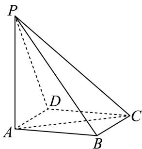
(1) (6分)若 $\mathrm { A D } / / \bar { \bar { - } }$ 平面PBC，证明： $A D \bot P B$ ；
(2) (8分)在我国古代数学典籍《九章算术》中，记载了一种特殊的三棱锥——鳖臑，其四个面均为直角三角形，找出本题图中的一个鳖臑，并计算它的体积和表面积

**考点：** (1)线面垂直证明；(2)鳖臑体积与表面积

**难度依据：** 线面垂直与几何体体积表面积；需连接多个条件、建模或作分类讨论

**核查说明：** 已人工阅读底稿题干和解析；尚未逐页对照原PDF，不作为数学终审。

【解析】

(1) 由题设 $B C ^ { 2 } + A B ^ { 2 } = A C ^ { 2 }$ ，则 $A B \bot B C$

由 $\mathrm { P A } \bot$ 平面ABCD，BC ⊂平面 $A B C D$ ，则 $P A \bot B C$

而 $P A \cap A B = A$ 都在面PAB内，则BC⊥面PAB，

由 $\mathrm { A D } / / \dot { - }$ 平面PBC， $A D \subset$ 面ABCD，面 $A B C D \cap$ 面 $P B C = B C$ 9

所以 $A D / / B C ,$ ，则AD⊥面PAB，PB ⊂面PAB，故 $A D \bot P B$

(2) 由PA⊥平面ABCD，AB,AC ⊂平面ABCD，则 $P A \bot A B , P A \bot A C$

由（1）知 $A B \bot B C$ ，且BC⊥面PAB，PB ⊂面 $P A B ,$ ，则 $B C \bot P B$

所以 $\triangle P A B , \triangle P A C , \triangle A B C , \triangle P B C$ 都是直角三角形，且 $P B = { \sqrt { 7 } }$

根据题设定义，P−ABC为一个鳖臑，体积

$$
V = \frac {1}{3} P A \cdot \frac {1}{2} A B \cdot B C = \frac {1}{3} \times 2 \times \frac {1}{2} \times \sqrt {3} \times 1 = \frac {\sqrt {3}}{3},
$$

$$
S = S _ {\triangle P A B} + S _ {\triangle P A C} + S _ {\triangle A B C} + S _ {\triangle P B C} = \sqrt {3} + 2 + \frac {\sqrt {3}}{2} + \frac {\sqrt {7}}{2} = \frac {4 + 3 \sqrt {3} + \sqrt {7}}{2}.
$$

### 青浦 · 第18题

如图，已知四棱锥S−ABCD的底面为菱形， $\angle B A D = \frac { \pi } { 3 } , A S = C S$

(1) (6分)求证：AC⊥平面BDS；
(2) (8分)若 $A B = 2 , B S = \sqrt { 3 } , D S = 1$ ，求四棱锥S−ABCD的体积.

> 本题资料或解析有待核事项，预览不可作为已审定成品。

**考点：** (1)线面垂直证明；(2)菱形底棱锥体积

**难度依据：** 线面垂直与棱锥体积；需连接多个条件、建模或作分类讨论

**核查说明：** 第二问原解将SO当作S到BD的高，但O为BD中点，BS不等于DS；公式标记错误，须改用S到BD垂线段并复核。；已人工阅读底稿题干和解析；尚未逐页对照原PDF，不作为数学终审。；历史分类审查记录（不把旧记录直接判为当前未解决）：第二问原解将SO当作S到BD的高，但O为BD中点，BS不等于DS；公式标记错误，须改用S到BD垂线段并复核。 本次只归组，未修改题干、答案或专题归属；上述具体疑点仍交回源/数学复核处理。

【解析】

(1) 设AC与BD相交于点O，

因为底面ABCD为菱形，所以 $A C \bot B D$ ，且O为AC、BD中点.

又因为 $A S = C S$ ，所以 $S O \bot A C , S O \cap B D = O , S O$ $B D \subset$ 平面BDS，

(2) 因为底面ABCD是菱形， $\angle B A D = \frac { \pi } { 3 } , A B = 2$ ，所以 $\triangle A B D$ 是等边三角形，则$B D = A B = 2$

在 $\triangle B D S ^ { \ E }$ 中， $B S = \sqrt { 3 } , D S = 1 , B D = 2$ ，满足 $B S ^ { 2 } + D S ^ { 2 } = B D ^ { 2 }$

根据勾股定理逆定理可知 $\angle B S D = 9 0 ^ { ^ { \circ } }$ ，即 $S D \bot S B$

由（1）知AC⊥平面BDS，所以 $V _ { S - A B C D } = { \frac { 1 } { 3 } } S _ { \not \equiv \not \equiv \not \equiv \not \equiv A B C D } \cdot S O$

√3 S菱形ABCD = 2S△ABD = 2 × 4 × 22 = 2√3.

在Rt $\triangle B D S ^ { \ E }$ 中， $S O = { \frac { B S \cdot D S } { B D } } = { \frac { { \sqrt { 3 } } \times 1 } { 2 } } = { \frac { \sqrt { 3 } } { 2 } }$ ，则VS $\mathbf { \sigma } _ { \cdot A B C D } = { \frac { 1 } { 3 } } \times 2 { \sqrt { 3 } } \times { \frac { \sqrt { 3 } } { 2 } } = 1$

## 线面角、二面角与翻折参数

构造平面角或法向量，翻折保持长度并显式记录二面角参数。

### 宝山 · 第12题

空间中有相互垂直的两条异面直线 $l _ { 1 } , \ l _ { 2 }$ ，点A、 $B \in l _ { 1 } , C , \ D \in l _ { 2 }$ ，且 $A B = 4 , C D = 1$ ，若 $D A \bot D B$ ，且 $A C = B C + 2$ ，则二面角 $D - A B - C$ 平面角的余弦值最小为

> 本题资料或解析有待核事项，预览不可作为已审定成品。

**考点：** 双曲线与球面约束下二面角最值

**难度依据：** 异面直线与二面角最值；需参数分类、构造递推或综合最值分析

**核查说明：** 双曲面、球面与三角形可行参数范围论证较简，需回核原图并检验最值可取。；已人工阅读完整底稿题干及原解，未逐页对照正式PDF，分类不等于数学终审。；历史分类审查记录（不把旧记录直接判为当前未解决）：双曲面、球面与三角形可行参数范围论证较简，需回核原图并检验最值可取。 本次只归组，未修改题干、答案或专题归属；上述具体疑点仍交回源/数学复核处理。

【答案】$\frac { 4 { \sqrt { 3 } } } { 9 }$

【解析】

先确定点C、D的轨迹及相关线段长度表达式，再利用余弦定理得 $\cos \angle C E D$ 的表达式，最后通过换元求最值.

根据双曲线的定义，平面内到两个定点A、B（焦点）的距离之差的绝对值为定值（小于|AB）的点的轨迹为双曲线.由 $A C = B C + 2$ ，可知 $A C - B C | = 2$

所以点C在以A、B为焦点的双曲线上.在空间中，是此双曲线绕AB旋转得到的曲面.

因为 $D A \bot D B$ ，根据直径所对的圆周角是直角，所以点D同时在以AB为直径的球面上.

由 $\mathbb { F } l _ { 1 } \bot l _ { 2 }$ ，所以C、D在与AB垂直的面上.

不妨令C固定在一支双曲线上，设双曲线方程为 $y ^ { 2 } - { \frac { x ^ { 2 } } { 3 } } = 1$

过C作CE⊥AB于E，在双曲线 $y ^ { 2 } - { \frac { x ^ { 2 } } { 3 } } = \pmb { \cdot }$ 1中，变形可得 $x ^ { 2 } = 3 ( y ^ { 2 } - 1 )$

在Rt △ CEB（因为 $\scriptstyle { \mathrm { C E \bot A B } } )$ 中，CE的长度可根据坐标关系得到， $C E = \sqrt { 3 y ^ { 2 } - 3 }$

因为D在过C与AB垂直的面与球的交线上，设球心为O（AB中点），

由 $D E ^ { 2 } + O E ^ { 2 } = 4$ （球的半径的平方为4，根据勾股定理得到此关系），OE的长度与y有关（E点坐标与C点纵坐标y有关），且OE在y轴上的投影长度就是y，所以 $D E = { \sqrt { 4 - y ^ { 2 } } }$

在 $\triangle C E D \sharp$ ，根据余弦定理 $\cos \angle C E D = { \frac { C E ^ { 2 } + D E ^ { 2 } - C D ^ { 2 } } { 2 \cdot C E \cdot D E } }$ ，

通过 $C E ^ { 2 } = 3 y ^ { 2 } - 3 , ~ D E ^ { 2 } = 4 - y ^ { 2 }$ 代入余弦定理公式化简得到,

$$
\cos \angle C E D = \frac {3 y ^ {2} - 3 + 4 - y ^ {2} - 1}{2 \sqrt {(3 y ^ {2} - 3) (4 - y ^ {2})}} = \frac {\sqrt {3}}{3} \cdot \sqrt {\frac {y ^ {4}}{- y ^ {4} + 5 y ^ {2} - 4}} = \frac {\sqrt {3}}{3} \cdot \sqrt {\frac {1}{- 1 - \frac {4}{y ^ {4}} + \frac {5}{y ^ {2}}}}.
$$

令 $\mathbf { \nabla } \cdot t = \frac { 1 } { y ^ { 2 } } ( t > 0 )$ ，则 $\cos \angle C E D = { \frac { \sqrt { 3 } } { 3 } } \cdot { \sqrt { \frac { 1 } { - 4 t ^ { 2 } + 5 t - 1 } } }$ 对于二次函数 $f ( t ) = - 4 t ^ { 2 } + 5 t - 1$ ，其对称轴为 $t = - { \frac { 5 } { 2 \times ( - 4 ) } } = { \frac { 5 } { 8 } }$ 当 $t = \frac { 5 } { 8 }$ 时，f(t)取得最大值 $f \left( { \frac { 5 } { 8 } } \right) = - 4 \times \left( { \frac { 5 } { 8 } } \right) ^ { 2 } + 5 \times { \frac { 5 } { 8 } } - 1 = { \frac { 9 } { 1 6 } }$

$$
\cos \angle C E D = \frac {\sqrt {3}}{3} \cdot \sqrt {\frac {1}{- 4 t ^ {2} + 5 t - 1}} \geq \frac {\sqrt {3}}{3} \cdot \sqrt {\frac {1}{\frac {9}{1 6}}} = \frac {4 \sqrt {3}}{9}.
$$

故答案为： $\frac { 4 { \sqrt { 3 } } } { 9 }$

### 宝山 · 第17题

如图，在四面体 $A B C D$ 中， $\triangle B C D$ 是边长为2的正三角形，且 $A B = A D = { \sqrt { 2 } } .$
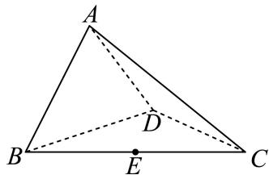
(1) (6分)证明： $B D \bot A C ;$
(2) (8分)若E是BC的中点，且二面角 $A - B D - ($ C的大小为 $\frac { \pi } { 2 }$ ，求AE与平面BCD所成角的大小.

> 本题资料或解析有待核事项，预览不可作为已审定成品。

**考点：** (1)等腰三角形构造线面垂直；(2)二面角条件与线面角

**难度依据：** 线线垂直与线面角；需连接多个条件或多步模型转化

**核查说明：** 第二问原解将AF垂直平面BCD误写为AF垂直平面ABD，后文又使用正确结论，须校正。；已人工阅读完整底稿题干及原解，未逐页对照正式PDF，分类不等于数学终审。；历史分类审查记录（不把旧记录直接判为当前未解决）：第二问原解将AF垂直平面BCD误写为AF垂直平面ABD，后文又使用正确结论，须校正。 本次只归组，未修改题干、答案或专题归属；上述具体疑点仍交回源/数学复核处理。

【解析】

(1) 取BD中点 $F ,$ ，连接 $A F , \ C F ,$

由已知条件 $\triangle B C D$ 是边长为2的正三角形， $A B = A D$ 得 $B D \bot A F , B D \bot C F$

$A F \cap C F = F , A F , C F \subset$ 平面 $A C F$ ，所以 $B D \perp$ 平面 $A C F$

又 $A C \subset \cdot$ 平面 $A C F$ ，所以 $B D \bot A C$

(2)

二面角 $A - B D - { }$ C的大小为 $\frac { \pi } { 2 }$ ，即平面 $A B D \bot$ 平面 $B C D$

由平面 $A B D \cap$ 平面 $B C D = B D$ ，且由（1）知 $A F \bot B D$ ， $A F \subset$ 平面ABD，

所以 $A F \bot$ 平面 $A B D ,$ ，从而 $\angle A E F$ 即为 $A E { \mathrm { - } }$ 与平面BCD所成角

在Rt $\triangle A B F ^ { \mathrm { H } }$ 中， $A B = \sqrt { 2 } , B F = 1$ ，从而 $A F = 1$

在 $\Delta B C D ^ {  }$ 中， $E F = { \frac { 1 } { 2 } } C D = 1$

因为 $A F \bot$ 平面 $B C D$ ，且 $E F \subset$ 平面 $B C D$ ，所以 $A F \bot E F$

所以在 $\mathrm { R t } \triangle A E F ^ { \prime }$ 中， $A F \bot E F$ ，且 $A { \cal F } = E { \cal F } = 1$

易求得 $\angle A E F = { \frac { \pi } { 4 } }$ ，即 $A E ^ { \underline { { I } } }$ 与平面BCD所成角的大小为 $\frac { \pi } { 4 }$

### 徐汇 · 第17题

如图， $A B C D - A _ { 1 } B _ { 1 } C _ { 1 } D _ { 1 }$ 是一块正四棱台形铁料，上、下底面的边长分别为20cm和40cm，高30cm

(1) (6分)求正四棱台 $A B C D - A _ { 1 } B _ { 1 } C _ { 1 } D _ { 1 }$ 的侧面 $B C C _ { 1 } B _ { 1 }$ 与底面ABCD所成二面角的大小；
(2) (8分)现削去部分铁料（不计损耗），将原正四棱台打磨为一个圆台，使得该圆台的上、下底面分别为原正四棱台上、下底面正方形的内切圆及其内部．求削去部分与原正四棱台的体积之比

**考点：** (1)棱台侧面与底面二面角；(2)圆台和棱台体积比

**难度依据：** 棱台二面角与体积比；需连接多个条件或多步模型转化

**核查说明：** 已人工阅读完整底稿题干及原解，未逐页对照正式PDF，分类不等于数学终审。

【解析】

(1) 设正方形ABCD， $A _ { 1 } B _ { 1 } C _ { 1 } D _ { 1 }$ 的中心分别为 $O , O _ { 1 }$ ，连接 $O O _ { 1 }$ ，则 $O O _ { 1 } \bot$ 平面 $A B C D$

分别取BC， $B _ { 1 } C _ { 1 }$ 的中点E， $E _ { 1 }$ ，连接 $E E _ { 1 } , O E , O E _ { 1 }$ ，则 $O E \bot B C , ~ O _ { 1 } E _ { 1 } \bot B _ { 1 } C _ { 1 }$ 由E， $E _ { 1 }$ 分别为等腰梯形 $B C C _ { 1 } B _ { 1 }$ 底边BC， $B _ { 1 } C _ { 1 }$ 的中点，得 $E { E _ { 1 } } \bot B C$ 由 $O _ { 1 } E _ { 1 } / / A _ { 1 } B _ { 1 } / / A B / / O E$ ，得四边形 $O _ { 1 } O E E _ { 1 }$ 是一个直角梯形，

$E E _ { 1 } \bot B C _ { \cdot }$ ，又 $O E \bot B C$ $\angle O E E _ { 1 }$ 为侧面 $B C C _ { 1 } B _ { 1 }$ 与底面ABCD所成二面角的平面角，

由条件知 $\vert O _ { 1 } E _ { 1 } = \frac { 1 } { 2 } A _ { 1 } B _ { 1 } = 1 0 , O E = \frac { 1 } { 2 } A B = 2 0 , O O _ { 1 } = 3 0$ ，则

$$
\tan \angle O E E _ {1} = \frac {O O _ {1}}{O E - O _ {1} E _ {1}} = \frac {3 0}{1 0} = 3,
$$

所以侧面 $B C C _ { 1 } B _ { 1 }$ 与底面ABCD所成二面角的大小为arctan3.

(2) 依题意，圆台 $O - O _ { 1 }$ 上底面半径r = 10cm，下底面半径 $R = 2 0 \mathrm { { c m } }$ ，高 $O _ { 1 } O = 3 0 \mathrm { { c m } }$ 1则圆台 $O - O _ { 1 }$ 的体积为 $V _ { 1 } = \frac { 1 } { 3 } \pi ( 1 0 ^ { 2 } + 2 0 ^ { 2 } + 1 0 \times 2 0 ) \times 3 0 = 7 0 0 0 \pi \left( \mathrm { c m ^ { 3 } } \right)$ 又正四棱台的体积 ${ } ! V _ { 2 } = { \frac { 1 } { 3 } } ( 2 0 ^ { 2 } + 4 0 ^ { 2 } + { \sqrt { 2 0 ^ { 2 } \times 4 0 ^ { 2 } } } ) \times 3 0 = 2 8 0 0 0 ( { \mathrm { c m } } ^ { 3 } )$ 所以削去部分的体积 $V _ { 3 } = 2 8 0 0 0 - 7 0 0 0 \pi ( \mathrm { c m ^ { 3 } } )$ \_所以削去部分与正四棱台的体积之比为 $\frac { 2 8 0 0 0 - 7 0 0 0 \pi } { 2 8 0 0 0 } = \frac { 4 - \pi } { 4 }$

### 普陀 · 第17题

如图，在三棱柱 $A B C - A _ { 1 } B _ { 1 } C _ { 1 }$ 中， $A C = A A _ { 1 } = A B = 2 , \angle B A A _ { 1 } = { \frac { \pi } { 3 } }$ ，且
$$
C A _ {1} = C B, C A _ {1} \bot A B _ {1}
$$

(1) (6分)求证：平面 $C A B _ { 1 } \bot$ 平面 $A A _ { 1 } B _ { 1 } B _ { \cdot }$
(2) (8分)求直线 $C A _ { 1 }$ 与平面 $B B _ { 1 } C _ { 1 }$ C所成的角的正弦值.

**考点：** (1)面面垂直证明；(2)空间向量求线面角

**难度依据：** 面面垂直与线面角；需连接多个条件、建模或作分类讨论

**核查说明：** 已人工阅读底稿题干和解析；尚未逐页对照原PDF，不作为数学终审。

【解析】

(1) 连结 $A _ { 1 } B \cap A B _ { 1 } = O$ ，连结CO

在 $: \triangle A B A _ { 1 }$ 1中， $A A _ { 1 } = A B = 2 , \angle B A A _ { 1 } = { \frac { \pi } { 3 } }$

故 $\triangle A B A _ { 1 }$ 是等边三角形，所以 $\square A _ { 1 } A B B _ { 1 }$ 为菱形，

所以 $A B _ { 1 } \bot A _ { 1 } B _ { \cdot }$ ，且O是 $A _ { 1 } B , A B _ { 1 }$ 的中点.

因为 $C A _ { 1 } = C B$

所以 $C O \bot A _ { 1 } B _ { \cdot }$

因为 ${ \cal C } { \cal O } \cap { \cal C } A _ { 1 } = C ,$

所以 $A _ { 1 } B \bot$ 平面 $\ C A B _ { 1 }$

又 $A _ { 1 } B \subset \bar { 2 }$ 平面 $A A _ { 1 } B _ { 1 } B _ { 2 }$

所以平面 $C A B _ { 1 } \bot$ 平面 $A A _ { 1 } B _ { 1 } B$

(2)

以O为原点，OA为x轴， $O A _ { 1 }$ 为y轴，OC为z轴建立空间直角坐标系，

则O (0, 0, 0), A $\left( \sqrt { 3 } , 0 , 0 \right) , A _ { 1 } \left( 0 , 1 , 0 \right) , C \left( 0 , 0 , 1 \right) , B \left( 0 , - 1 , 0 \right) , B _ { 1 } \left( - \sqrt { 3 } , 0 , 0 \right)$

所以， $\overrightarrow { B C } = ( 0 , 1 , 1 ) , \overrightarrow { B B _ { 1 } } = \left( - \sqrt { 3 } , 1 , 0 \right) , \overrightarrow { C A _ { 1 } } = ( 0 , 1 , - 1 )$

设平面 $B B _ { 1 } C _ { 1 } C$ 的一个法向 $\vec n=(x,y,z)$ ，

则有 $\left\{ { \begin{array} { l } { { \vec { n } } \cdot { \overrightarrow { B C } } = 0 } \\ { { \vec { n } } \cdot { \overrightarrow { B B _ { 1 } } } = 0 } \end{array} } \right.$ ，即 $\left\{ { \begin{array} { l l } { y + z = 0 } \\ { - { \sqrt { 3 } } x + y = 0 } \end{array} } \right. .$

令 $\mathbf { \bar { \rho } } y = \mathbf { \sqrt { 3 } }$ ，可得平面 $B B _ { 1 } C _ { 1 }$ C的一个法向量为 ${ \vec { n } } = \left( 1 , { \sqrt { 3 } } , - { \sqrt { 3 } } \right)$ 所以，直线 $C A _ { 1 } \mathrm { { - } }$ 与平面 $B B _ { 1 } C _ { 1 } C$ 所成的角θ的正弦值为

$$
\sin \theta = \frac {\left| \overrightarrow {C A _ {1}} \cdot \overrightarrow {n} \right|}{\left| \overrightarrow {C A _ {1}} \right| | \overrightarrow {n} |} = \frac {| 0 + \sqrt {3} + \sqrt {3} |}{\sqrt {1 + 1} \times \sqrt {7}} = \frac {2 \sqrt {3}}{\sqrt {2} \times \sqrt {7}} = \frac {\sqrt {4 2}}{7}.
$$

### 松江 · 第18题

已知梯形PBCD中， $P D / / B C$ ，E为PD上的一点且 $B E \bot P D$ $P E = B E = 1$ $B C = \frac { 1 } { 2 } E D$ ，将$\triangle P B E$ 沿BE翻折使得二面角P−BE−C的平面角为θ，连接PC、PD，F为棱PD的中点.
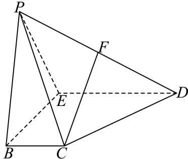
(1) (6分)求证： $F C / /$ 平面PBE；
(2) (8分)当 $| \theta = { \frac { 2 \pi } { 3 } }$ 时，求直线FC和平面BCDE所成角的大小.

**考点：** (1)线面平行证明；(2)翻折后线面角

**难度依据：** 翻折模型与线面角；需连接多个条件或多步模型转化

**核查说明：** 已人工阅读完整底稿题干及原解，未逐页对照正式PDF，分类不等于数学终审。

【解析】

(1) 取ED的中点M，连接CM、FM，

因为点F为棱PD的中点，且 $B C = \frac { 1 } { 2 } E D$ ，所以 $F M / / P E$ 且 $C M / / B E$

$F M / / P E ,$ ，FM ⊄平面PBE， $P E \subset$ 平面PBE，

所 以 $F M / /$ 平 面 PBE ， 同 理 可 得 $C M / /$ 平 面 PBE

因为FM ⊂平面CFM，CM ⊂平面CFM，且 $F M \cap C M = M$

所以平面 $C F M / /$ 平面PBE.

因为 $F C \subset$ 平面CFM，所以FC//平面PBE.

(2) 过点F作 $F H \bot E D$ 于点H，连接CH，

因为 $\because B E \bot P E , B E \bot D E , P E \cap D E = E , P E , D E \subset \widehat { \mathbb { F } } \widehat { | \mathrm { H } | } P D E ,$

因为BE⊥平面PDE，所以 $B E \bot F H$

因为BE ⊂平面BCDE，ED ⊂平面BCDE，且 $B E \cap E D = E$

所以FH⊥平面BCDE.

所以 $\angle F C H$ 就是直线FC和平面BCDE所成角.

由题意得：二面角 − − 的平面角为 $\angle P E D = { \frac { 2 \pi } { 3 } }$

由（1）易得 $\angle F M D = \frac { 2 \pi } { 3 }$

在Rt $\triangle F H M ^ { \sharp }$ ，由 $\angle F M H = \frac { \pi } { 3 }$ $F M = \frac { 1 } { 2 }$ ，得 $F H = \frac { \sqrt { 3 } } { 4 }$

取PE中点为G，连接BG，

因为G,F分别为PE,PD的中点，

所以 $G F / / E D ,$ ，且 $G F = \frac { 1 } { 2 } E D$ ，又 $B C = { \frac { 1 } { 2 } } E D _ { ; }$

所以四边形 $B C F G$ 为平行四边形，所以 $B G = C F$

在Rt $\triangle B E G \sharp$ ，由 $E G = \frac { 1 } { 2 }$ $B E = 1$ ，得 $B G = { \frac { \sqrt { 5 } } { 2 } }$ ，则 $C F = { \frac { \sqrt { 5 } } { 2 } }$ 在Rt $\triangle F H C ^ { \prime }$ 中，由sin $\angle F C H = { \frac { F H } { F C } } = { \frac { \sqrt { 1 5 } } { 1 0 } }$ ，得 $\angle F C H = \arcsin { \frac { \sqrt { 1 5 } } { 1 0 } }$ 即得直线FC和平面BCDE所成角为 $\arcsin { \frac { \sqrt { 1 5 } } { 1 0 } }$

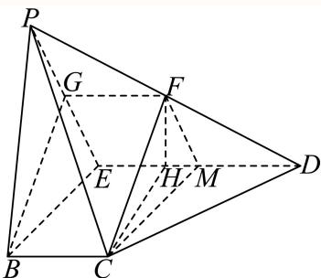

### 浦东 · 第18题

如图，四边形ABCD为长方形，PA⊥平面ABCD， $A B = A P = 2$ ，AD = 3

(1) (7分)若E、F分别是PB、CD的中点，求证：EF∥平面PAD；
(2) (7分)边BC上是否存在点G，使得直线 $P G .$ 与平面PAD所成的角的大小为 $3 0 ^ { \circ } ?$ 若存在，求BG长；若不存在，说明理由

> 本题资料或解析有待核事项，预览不可作为已审定成品。

**考点：** (1)线面平行证明；(2)线面角与边上动点

**难度依据：** 线面平行及线面角；需连接多个条件或多步模型转化

**核查说明：** 原解结论30度误识为130度；法一比例式分行破损，须校对。；已人工阅读完整底稿题干及原解，未逐页对照正式PDF，分类不等于数学终审。；历史分类审查记录（不把旧记录直接判为当前未解决）：原解结论30度误识为130度；法一比例式分行破损，须校对。 本次只归组，未修改题干、答案或专题归属；上述具体疑点仍交回源/数学复核处理。

【解析】

(1)

法一：取AP中点M，连接EM、DM，

∵ME//AB，DF//AB，

∴ME//DF ，

$\because M E = { \frac { 1 } { 2 } } A B ,$ $D F = { \frac { 1 } { 2 } } A B ,$

∴ME = DF，

∴四边形DFEM为平行四边形，

∴ $E F / / D M$ ，

$\because D M \subset$ 平面PDA，EF在平面PDA外，

∴EF//平面PDA

法二：如图建立空间直角坐标，

则 $D ( 3 , 0 , 0 ) , B ( 0 , 2 , 0 ) , P ( 0 , 0 , 2 )$

$$
F (3, 1, 0), E (0, 1, 1), C (3, 2, 0),
$$

$$
\therefore \overrightarrow {E F} = (3, 0, - 1),
$$

易知平面PAD的一个法向量 $\vec { \cdot n } = ( 0 , 1 , 0 )$

$$
\because \overrightarrow {E F} \cdot \overrightarrow {n} = 0,
$$

且 $E F ^ { \prime }$ 在平面PDA外

$. . E F / / .$ 平面 $P D A$

(2)

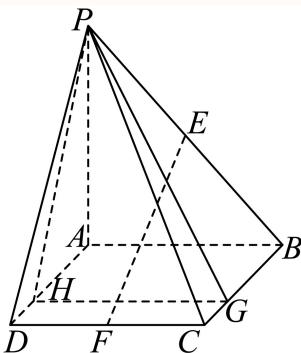

法一：作 $G H \bot A D$ ，垂足为H，连接 $P H$ ，

$\because P A \bot$ 平面 $A B C D$ ，GH在平面 $A B C D |$ 内，

$\cdot { \cal P } A \bot { \cal G } { \cal H }$ ，又 $A D , P A$ 为平面 $P A D |$ 内两条相交直线，

$\therefore G H \bot$ 平面 $P A D$

$\therefore$ 直线PG与平面 $P A D$ 所成的角为 $\angle G P H = 3 0 ^ { \circ }$

HG 1 = tan 30∘ = PH √3

$$
\therefore P H = 2 \sqrt {3},
$$

∴BG = AH = √PH2 − PA2 = 2√2 ，

∴边 $B C .$ 上存在点 $^ { \mathrm { ~ ~ G ~ } , }$ 使得直线PG与平面 $P A D$ 所成的角为 $1 3 0 ^ { \circ }$ $B G = 2 \sqrt { 2 }$

法 $\boldsymbol { \underline { { \mathbf { \Pi } } } } :$ ：设 $B G = t ( 0 \leq t \leq 3 )$ ，则 $G ( t , 2 , 0 )$

$$
\overrightarrow {\therefore P G} = (t, 2, - 2),
$$

易知平面PAD的一个法向 $\stackrel { \vartriangle } { \mathbf { E } } \vec { n } = ( 0 , 1 , 0 )$

设 $\xrightarrow [ P G ] { }$ 与→n的夹角为 $\varphi _ { : }$ ，

则 $\sin 30^{\circ}=| \cos \varphi | =\dfrac{2}{\sqrt{t^{2}+8}}$，

解得： $t = 2 { \sqrt { 2 } } .$

∴边 $B C .$ 上存在点G，使得直线PG与平面PAD所成的角为 $1 3 0 ^ { \circ }$ ， $B G = 2 { \sqrt { 2 } } .$

### 长宁 · 第15题

如图，等腰直角三角形ABC中， $\angle A = 9 0 ^ { \circ }$ ，点E是边AC的中点，点D是边BC上一点（不与C重合），将三角形DCE沿DE逆时针翻折，点C的对应点是 $C _ { 1 }$ ，连接 $C C _ { 1 }$ ，设θ为二面角 $C _ { 1 } - D E - C$ 大小， $\theta \in ( 0 , \pi )$ ．在翻折过程中，下列说法当中不正确的是（ ）

A. 存在点D和θ，使得 $D C _ { 1 } \bot A C$

B. 存在点D和θ，使得 $B C _ { 1 } \bot A C$

C. 存在点D和θ，使得 $B C _ { 1 } \bot D E$

D. 存在点D和θ，使得 $C C _ { 1 } \bot D E$

**考点：** 翻折中垂直关系存在性

**难度依据：** 翻折中垂直关系存在性；需多步建模、分类或参数约束

**核查说明：** 已人工阅读底稿题干和原解；未逐页对照PDF，不作为数学终审。

【答案】B

【解析】

取特例判断ACD，利用反证法判断B后可得正确的选项.

对 $\mathbb { F } \mathrm { A D } .$ ，取D为BC中点， $\theta = \frac { \pi } { 2 }$ ，则 $E D / / A B$ ，而 $A B \bot A C$

故 $D E \bot A C$ ，故在几何体 $C _ { 1 } - A B D E \Psi$ ， $D E \bot C _ { 1 } E .$

而 $C E \bot D E$ ，故 $\angle C E C _ { 1 }$ 为二面角 $C _ { 1 } - D E - C$ 的平面角，故 $\angle C E C _ { 1 } = 9 0 ^ { \circ }$

故 $C _ { 1 } E \bot A C$ ，而 $C _ { 1 } E \cap D E = E , C _ { 1 } E , D E \subset$ 平面 $D E C _ { 1 }$ •

故 $A C \bot$ 平面 $D E C _ { 1 }$ ，而 $D C _ { 1 } \subset$ 平面 $D E C _ { 1 }$ ，故 $A C \bot D C _ { 1 }$ ，故A成立.

因 $D E \bot A C$ $D E \bot C _ { 1 } E$ ，AC ∩ C E = E,AC,C E ⊂平面 $A C C _ { 1 }$

故 $D E \bot$ 平面 $A C C _ { 1 }$ ，而 $C C _ { 1 } \subset$ 平面 $A C C _ { 1 }$ ，故 $D E \bot C C _ { 1 }$ ，故D成立.

对 $\operatorname { F C } ,$ ，过E作 $D E \bot B C$ ，D为垂足， ${ \bar { \mathbb { H } } } \times \theta = { \frac { \pi } { 2 } }$ ，同理可证 $D E \bot$ 平面 $B C C _ { 1 }$

而 $B C _ { 1 } \subset$ 平面 $B C C _ { 1 }$ ，故 $D E \bot B C _ { 1 }$ ，故C成立.

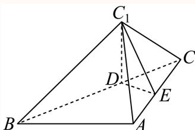

对于B，过 $C _ { 1 }$ 作 $\mathrm { \dot { C } } _ { 1 } H \bot$ 平面 $A B C$ ，垂足为H，

因为 $A C \subset$ 平面 $A B C$ ，故 $C _ { 1 } H \bot A C ,$

若 $B C _ { 1 } \bot A C _ { \cdot }$ ，因为 $C _ { 1 } H \cap B C _ { 1 } = C _ { 1 } , C _ { 1 } H , B C _ { 1 } \subset$ 平面 $B C _ { 1 } H$

故 $A C \bot$ 平面 $B C _ { 1 } H$ ，而 $B H \subset$ 平面 $B C _ { 1 } H$ ，故 $A C \bot B H$ ，

而 $A C \bot B A$ ，故H在BA上，

因为 $C _ { 1 } H \cap B A = H , \ C _ { 1 } H , B A \subset$ 平面 $B C _ { 1 } A$ ，故 $A C \bot$ 平面 $B C _ { 1 } A$

而 $C _ { 1 } A \subset \cdot$ 平面 $B C _ { 1 } A$ ，故 $C A \bot C _ { 1 } A$ ，故 $C _ { 1 } E > A E$ ，但 $C _ { 1 } E = C E = A E$

矛盾，故 $B C _ { 1 } \bot A C$ 不成立即B不成立，

故选：B.

### 闵行 · 第17题

如图，在四棱锥P − ABCD中，底面ABCD为长方形，PA⊥底面ABCD，E是 $P C ^ { \mathsf { \Pi } }$ 中点，已知$A B = 2 , A D = 2 { \sqrt { 2 } } , P A = 2$
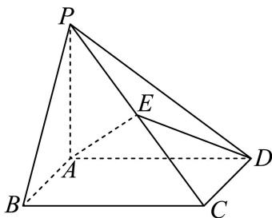
(1) (6分)证明： $A D \bot B P ;$
(2) (8分)求二面角E − AD − B的大小

**考点：** （1）线面垂直证明线线垂直；（2）法向量求二面角

**难度依据：** 线面垂直与二面角；空间法向量；需组合两类关系并检查区间或等号

**核查说明：** 已人工阅读底稿题干和原解；未逐页对照PDF，不作为数学终审。

【解析】

(1) 因为PA⊥底面ABCD，AD ⊂底面ABCD，所以 $P A \bot A D$ 又底面 $A B C D$ 为长方形，所以 $A B \bot A D$ $P A \cap A B = A , P A , A B \subset$ 平面 $P A B$ 所以 $A D \perp$ 平面PAB， $B P \subset$ 平面 $P A B ,$ ，所以 $A D \bot B P$

(2) 以A为原点，射线AB,AD,AP分别为 $x , y ,$ z轴建立如图所示空间直角坐标系，

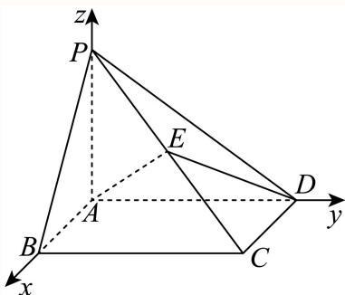

易知底面ABCD的一个法向量为(0,0,1)，设为 $\vec { \mathbf { \nabla } m }$

A (0, 0, 0), D (0, 2√2, 0), E (1, √2, 1)，

设平面EAD的法向量为 $\vec { n } = ( x , y , z )$ ，则 $\begin{cases}2\sqrt2 y=0\\x+\sqrt2y+z=0\end{cases}$

取 $\iota x = 1$ ，可得 $\vec { n } = ( 1 , 0 , - 1 )$

设二面角E − AD − B的大小为θ，

→m ⋅ →n 1 √2 则cos θ = cos ⟨→m,→n = →m →n √2 2

所以二面角E−AD−B的大小为 $\frac { \pi } { 4 }$

### 青浦 · 第12题

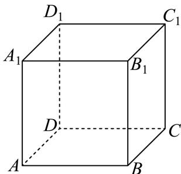
如图，正方体 $A B C D - A _ { 1 } B _ { 1 } C _ { 1 } D _ { 1 }$ 绕直线 $D B _ { 1 }$ 旋转 $\frac { \pi } { 3 }$ ，直线AB旋转至直线 $A ^ { \prime } B ^ { \prime }$ ，则直线AB与直线$A ^ { \prime } B ^ { \prime }$ 所成角的大小为

**考点：** 旋转轨迹与线线角

**难度依据：** 正方体旋转与异面直线角；需综合转化、参数分析或完整证明，推理链较长

**核查说明：** 已人工阅读底稿题干和解析；尚未逐页对照原PDF，不作为数学终审。

【答案】$\operatorname { a r c } \cos { \frac { 2 } { 3 } }$

【解析】

利用旋转思想把正方体问题转化到圆锥问题来求解即可.

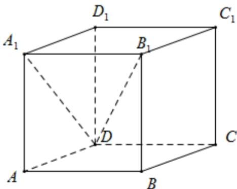

根据 $A B / / A _ { 1 } B _ { 1 }$ 可由题意将所求角转化为将 $A _ { 1 } B _ { 1 }$ 绕 $B _ { 1 } D$ 旋转 $\frac { \pi } { 3 }$ 所得到的直线 $B _ { 1 } A _ { 1 } ^ { ' }$ 与 $A _ { 1 } B _ { 1 }$ 所成的角，

即可将其转移到圆锥 $B _ { 1 } O ^ { \scriptscriptstyle | }$ 中求解，图中直线 $B _ { 1 } O \Xi B _ { 1 } D$ 重合，圆锥母线为 $A _ { 1 } B _ { 1 }$ ,如下图：

由旋转 $\frac { \pi } { 3 }$ 可转化到 $\angle A _ { 1 } ^ { \prime } O A _ { 1 } = \frac { \pi } { 3 }$

在正方体中，假设正方体的边长为1，则可知 $A _ { 1 } B _ { 1 } = 1 , A _ { 1 } D = { \sqrt { 2 } } , B _ { 1 } D = { \sqrt { 3 } } ,$

所以 $\cos \angle A _ { 1 } B _ { 1 } D = \frac { 1 } { \sqrt { 3 } }$ 即在圆锥中有 $\cos \angle A _ { 1 } B _ { 1 } O = \frac { 1 } { \sqrt { 3 } }$ $\sin \angle A _ { 1 } B _ { 1 } O = { \frac { \sqrt { 2 } } { \sqrt { 3 } } } ;$

由 $A _ { 1 } B _ { 1 } = 1$ ,可得 $A _ { 1 } O = A _ { 1 } B _ { 1 } \sin \angle A _ { 1 } B _ { 1 } O = { \frac { \sqrt { 2 } } { \sqrt { 3 } } }$

由等边三角形 $O A _ { 1 } A _ { 1 } ^ { ' }$ ，可得 $A _ { 1 } A _ { 1 } ^ { ' } = \frac { \sqrt { 2 } } { \sqrt { 3 } }$

在 $\cdot \triangle A _ { 1 } B _ { 1 } A _ { 1 } ^ { ' }$ 中，由余弦定理， $\cos \angle A _ { 1 } B _ { 1 } A _ { 1 } ^ { ^ { \prime } } = { \frac { 1 + 1 - { \frac { 2 } { 3 } } } { 2 } } = { \frac { 2 } { 3 } }$

从而可得旋转后直线 $A ^ { \prime } B ^ { \prime }$ 方向向量与直线AB方向向量夹角的余弦值为 $\frac { 2 } { 3 }$

所以直线AB与直线 $A ^ { \prime } B ^ { \prime }$ 所成角的大小为 $\operatorname { a r c } \cos { \frac { 2 } { 3 } }$

故答案为： $\operatorname { a r c } \cos { \frac { 2 } { 3 } }$

## 二、选择题

### 静安 · 第19题

如图，在正三棱柱 $A B C - A _ { 1 } B _ { 1 } C _ { 1 }$ 中， $A A _ { 1 } = 2 A C = 4$ ，延长CB至D，使 $C B = B D$ ，E是线段BC的中点

(1) (8分)求证：
①直线 $C _ { 1 } B / /$ 平面 $A B _ { 1 } D$ ；
② $A E \bot D B _ { 1 }$
(2) (6分)求二面角 $B _ { 1 } - A D -$ C的正弦值

**考点：** （1）①线面平行；②线线垂直；（2）空间法向量求二面角正弦

**难度依据：** 棱柱平行垂直与二面角；空间法向量求二面角；需多步建模、分类或参数约束

**核查说明：** 已人工阅读底稿题干和原解；未逐页对照PDF，不作为数学终审。

【解析】

(1) ①在正三棱柱 $A B C - A _ { 1 } B _ { 1 } C _ { 1 }$ 中， $B C = B _ { 1 } C _ { 1 } , B C / / B _ { 1 } C _ { 1 }$

因为 $\begin{array} { r } { { \cal C } { \cal B } = B D } \end{array}$ ，所以 $B D = B _ { 1 } C _ { 1 } , B D / / B _ { 1 } C _ { 1 }$

所以四边形 $B D B _ { 1 } C _ { 1 }$ 为平行四边形，所以 ${ C _ { 1 } B / } / { B _ { 1 } D }$

又 $C _ { 1 } B \subset \supset \overrightarrow { \mathrm { I f } } \overrightarrow { \mathrm { I f } } A B _ { 1 } D , B _ { 1 } D \subset \overrightarrow { \mathrm { I f } } A B _ { 1 } D ,$

所以 $C _ { 1 } B / / .$ 平面 $A B _ { 1 } D _ { 1 } ^ { \prime }$ ；

②因为 $A B = A C$ ，E是线段BC的中点，所以 $A E \bot B C$

因为 $B B _ { 1 } \bot$ 平面ABC， $A E \subset$ 平面 $A B C$

所以 $B B _ { 1 } \bot A E _ { \cdot }$

又 $B B _ { 1 } \cap B C = B , B B _ { 1 } , B C \subset$ 平面 $B C C _ { 1 } B _ { 1 }$ ，所以 $A E \bot$ 平面 $B C C _ { 1 } B _ { 1 }$

又 $D B _ { 1 } \subset$ 平面 $B C C _ { 1 } B _ { 1 }$

所以 $A E \bot D B _ { 1 }$ ；

(2) 在 $\triangle A C D \#$ ，由 $\mp C B = B D = B A$ ，所以 $\angle C A D = 9 0 ^ { \circ }$

则 $A D = 2 { \sqrt { 3 } } .$

如图，以点A为原点建立空间直角坐标系，

则 $A ( 0 , 0 , 0 ) , D \left( 2 { \sqrt { 3 } } , 0 , 0 \right) , B _ { 1 } \left( { \sqrt { 3 } } , 1 , 4 \right)$

故 $\overrightarrow { A B _ { 1 } } = \left( \sqrt { 3 } , 1 , 4 \right) , \overrightarrow { A D } = \left( 2 \sqrt { 3 } , 0 , 0 \right)$ ,，

设平面 $B _ { 1 } A D$ 的法向量为 $\vec { \vert m } = ( x , y , z )$ ，

则有 $\left\{ \begin{array} { l l } { { \overrightarrow { m } } \cdot { \overrightarrow { A D } } = { \sqrt { 3 } } x = 0 } \\ { { \overrightarrow { m } } \cdot { \overrightarrow { A B _ { 1 } } } = { \sqrt { 3 } } x + y + 4 z = 0 } \end{array} \right.$ 令 $y = - 4$ 则 $z = 1 , x = 0$

所 $\downarrow \downarrow \vec { m } = ( 0 , - 4 , 1 )$

因为z轴垂直平面 $A C D$

则可取平面ACD的法向量为 $\vec { \vert n \rangle } = ( 0 , 0 , 1 )$ ，

则cos ⟨m, n m ⋅ n→m →n 1√ √17

所以二面角 $B _ { 1 } - A D -$ C的正弦值为 ${ \sqrt { 1 - \left( { \frac { \sqrt { 1 7 } } { 1 7 } } \right) ^ { 2 } } } = { \frac { 4 { \sqrt { 1 7 } } } { 1 7 } }$

### 黄浦 · 第18题

在四面体ABCD中， $D B = D C = 2$ $D B \bot D C$

(1) (6分)若△ABC为正三角形，平面 $A B C \bot$ 平面DBC，求四面体ABCD体积；
(2) (8分)若AB = AC = 4，AD = 3，求二面角A − BC − D的大小

**考点：** （1）面面垂直和四面体体积；（2）公共垂线构造二面角

**难度依据：** 四面体体积与二面角；需组合两类关系并检查区间或等号

**核查说明：** 已人工阅读底稿题干和原解；未逐页对照PDF，不作为数学终审。

【解析】

(1) 由题设 $\triangle B C D$ 为等腰直角三角形，且 $D B = D C = 2$ $D B \bot D C ,$

所以 $B C = 2 { \sqrt { 2 } } , \ \subset \triangle A B C$ 为正三角形，故 $S _ { \triangle A B C } = \frac { 1 } { 2 } \times \left( 2 \sqrt { 2 } \right) ^ { 2 } \times \sin 6 0 ^ { \circ } = 2 \sqrt { 3 } ,$

若E为BC的中点，连接DE，则 $D E \bot B C$ ，又平面 $A B C \bot$ 平面 $D B C$ ，

平面 $A B C \cap$ 平面 $D B C = B C$ 9 $D E \subset$ 平面 $D B C$ ，故 $D E \bot$ 平面 $A B C _ { \mathrm { { \scriptscriptstyle 2 } } }$

所以 $D E = { \sqrt { 2 } }$ 是 $D - A B C$ 的高，则其体积 $\{ V = { \frac { 1 } { 3 } } \cdot D E \cdot S _ { \triangle A B C } = { \frac { 1 } { 3 } } \times { \sqrt { 2 } } \times 2 { \sqrt { 3 } } = { \frac { 2 { \sqrt { 6 } } } { 3 } }$

(2) 由（1） $D E \bot B C$ 且 $B C = 2 { \sqrt { 2 } } , D E = { \sqrt { 2 } } ,$

又 $A B = A C = 4$ ，则 $A E = { \sqrt { 1 4 } }$ ，且 $A E \bot B C$ ，又 $A D = 3$ ，

所以二面角 $A - B C - L$ 的平面角为 $\angle D E A$ ，且

$$
\cos \angle D E A = \frac {A E ^ {2} + D E ^ {2} - A D ^ {2}}{2 A E \cdot D E} = \frac {1 4 + 2 - 9}{2 \sqrt {1 4} \times \sqrt {2}} = \frac {\sqrt {7}}{4}.
$$

所以二面角大小为 $\operatorname { a r c c o s } { \frac { \sqrt { 7 } } { 4 } }$

## 点线距离与点面距离

用垂线、法向量或等体积法降维，区分真实高与斜线长。

### 崇明 · 第17题

如图，在四棱锥 $P - A B C D$ 中，底面ABCD是边长为2的正方形，且 $C B \bot B P , C D \bot D P$ $P A = 2$ ，点E，F分别为PB，PD的中点.
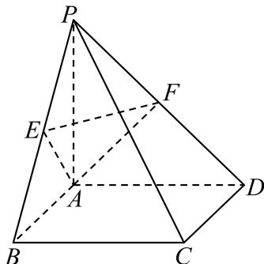
(1) (6分)求证： $P A \bot$ 平面ABCD；
(2) (8分)求点P到平面AEF的距离.

**考点：** (1)线面垂直证明；(2)等体积法点到平面距离

**难度依据：** 线面垂直与等体积点面距离；需连接多个条件或多步模型转化

**核查说明：** 已人工阅读完整底稿题干及原解，未逐页对照正式PDF，分类不等于数学终审。

【解析】

(1) 由底面ABCD为正方形，得 $C B \bot A B ,$ ，又 $C B \bot B P , A B \cap B P = B , A B , B P \subset$ 平面 $A B P _ { : }$ 于是CB⊥平面ABP，而 $P A \subset$ 平面ABP，则 $C B \bot P A$ ，同理 $C D \bot P A$ 1又 $\gamma B \cap C D = C , C B , C D \subset$ 平面ABCD，所以PA⊥平面ABCD.

(2) 由（1）得 $P A \bot A B$ ，点E为PB的中点，在 $\mathrm { : R t } \triangle P A B ^ { \sharp }$ 中， $A E = { \sqrt { 2 } } ,$ ，点F为PD的中点，同理 $A F = { \sqrt { 2 } }$

在△PBD中， $E F = { \frac { 1 } { 2 } } B D = { \sqrt { 2 } }$ ，因此 $S _ { \triangle A E F } = \frac { 1 } { 2 } \times \sqrt { 2 } \times \sqrt { 2 } \times \frac { \sqrt { 3 } } { 2 } = \frac { \sqrt { 3 } } { 2 }$ 在直角 $\triangle P A B$ 中， $S _ { \triangle A P E } = \frac { 1 } { 2 } \times \frac { 1 } { 2 } \times 2 \times 2 = 1$

由（1）知CB⊥平面 $A B P _ { \mathrm { i } }$ ，则 $A D \perp$ 平面 $A B P$ 于是点F到平面APE的距离为 ${ \frac { 1 } { 2 } } A D = 1$ 设点P到平面AEF的距离为h，由 $V _ { P - A E F } = V _ { F - A E P }$ ，得 ${ \frac { 1 } { 3 } } \times { \frac { \sqrt { 3 } } { 2 } } \times h = { \frac { 1 } { 3 } } \times 1 \times 1$ ，解得$h = { \frac { 2 { \sqrt { 3 } } } { 3 } }$

所以点P到平面AEF的距离为 $\frac { 2 { \sqrt { 3 } } } { 3 }$

### 徐汇 · 第7题

已知PA⊥平面ABC， $\triangle A B C$ 是直角三角形，且 $A B = A C = 2$ ，PA = 4，则点P到直线BC的距离是

**考点：** 线面垂直构造点线距离

**难度依据：** 点到直线距离；需一次转化并结合定义域或几何条件计算

**核查说明：** 已人工阅读完整底稿题干及原解，未逐页对照正式PDF，分类不等于数学终审。

【答案】$3 { \sqrt { 2 } } .$

【解析】

取BC中点为D，连接PD,AD，通过证明 $B C \bot P D$ ，从而证明点P到BC的距离为PD，再结合已知条件求出PD即可.

取 $BC$ 中点为D，连接 $A D , P D$ ，如下所示：

因为ABC为等腰三角形，又D为BC中点，故 $B C \bot A D$ ；

因为 $P A \bot$ 平面ABC， $B C \subset$ 面ABC，故 $B C \bot P A$ ；

又AD,PA ⊂面 $P A D , A D \cap P A = A$ ，故 $B C \bot$ 面PAD，又 $P D \subset$ 面PAD，故 $P D \bot B C$

故点P到直线BC的距离，即为PD；

在 $\triangle A B C ^ { \scriptscriptstyle \perp }$ 中， $A D = { \frac { 1 } { 2 } } B C = { \frac { 1 } { 2 } } \times { \sqrt { 2 } } A B = { \sqrt { 2 } } ;$

因为 $P A \bot$ 平面ABC，AD ⊂面 $A B C$ ，故 $P A \bot A D$ ，则 $\triangle P A D$ 为直角三角形；

在 $\triangle P A D ^ { | }$ 中， $P A = 4 , A D = { \sqrt { 2 } }$ ，故 $P D = { \sqrt { P A ^ { 2 } + A D ^ { 2 } } } = { \sqrt { 1 6 + 2 } } = 3 { \sqrt { 2 } } .$

故点P到直线BC的距离为3√2.

故答案为： $3 { \sqrt { 2 } } .$

### 杨浦 · 第18题

座落于杨浦滨江的世界技能博物馆由百年历史文化保护建筑改建而成，其中的支柱保留了原有的正八棱柱，既考虑了结构力学优势，又体现了对历史建筑的尊重和传承.如图， $O _ { 1 } , O$ 分别为正八棱柱的上下两个底面的中心，已知 $\lvert O A = 1 , A A _ { 1 } = 4$

(1) (6分)求证： $B C \bot C _ { 1 } F$ ；
(2) (8分)求点O到平面 $A C G _ { 1 }$ 的距离.

**考点：** (1)正八边形及线线垂直；(2)等体积法求点面距离

**难度依据：** 正八棱柱垂直与点面距离；需连接多个条件或多步模型转化

**核查说明：** 已人工阅读完整底稿题干及原解，未逐页对照正式PDF，分类不等于数学终审。

【解析】

(1)

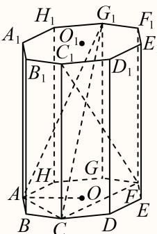

连接 $C F$

因为底面为正八边形，所以 $C F \bot B C$

又正八棱柱侧棱 $C C _ { 1 \bot }$ 底面 $A B C D E F G H$ $B C \subset$ 底面ABCDEFGH，

所以 $C C _ { 1 } \bot B C$

$C C _ { 1 } \cap C F = C , C C _ { 1 } , C F \subset$ 平面 $C F C _ { 1 }$ ，

所以 $B C \bot$ 平面 $C F C _ { 1 }$

又 $C _ { 1 } F \subset$ 平面 $C F C _ { 1 }$ ，所以 $B C \bot C _ { 1 } F .$

(2)

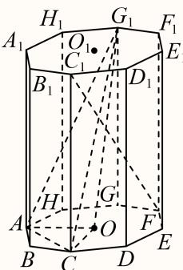

连接 $O C , O G _ { 1 }$

因为 $O A = 1 , A A _ { 1 } = 4$

由正八边形ABCDEFGH的性质可得 $\angle A O B = { \frac { 3 6 0 ^ { \circ } } { 8 } } = 4 5 ^ { \circ }$ $O C = O A = 1$ $G { \cal G } _ { 1 } \dot { \mathcal { H } } { \cal G } _ { 1 }$ 到底面AOC的距离， $G G _ { 1 } = 4$

所以 $S _ { \triangle A O C } = \frac { 1 } { 2 } \times 1 \times 1 = \frac { 1 } { 2 }$ ，

由勾股定理可得， $A C ^ { 2 } = A O ^ { 2 } + C O ^ { 2 } = 2$

又 $A G ^ { 2 } = A C ^ { 2 } = 2$ ，所以 $A G _ { 1 } = \sqrt { 2 + 1 6 } = \sqrt { 1 8 } = 3 \sqrt { 2 } ,$

又 $C G = 2 A O = 2$ ，所以 $C G _ { 1 } = { \sqrt { 4 + 1 6 } } = { \sqrt { 2 0 } } = 2 { \sqrt { 5 } } ,$

因为 $A C ^ { 2 } + A G _ { 1 } ^ { 2 } = C G _ { 1 } ^ { 2 }$ ，所以 $A C \bot A G _ { 1 }$ ，即 $S _ { \triangle A C G _ { 1 } } = \frac { 1 } { 2 } \times \sqrt { 2 } \times 3 \sqrt { 2 } = 3$

设点O到平面 $A C G _ { 1 }$ 的距离为d，

则 $V _ { O - A C G _ { 1 } } = V _ { G _ { 1 } - O A C }$ ，即 $\frac { 1 } { 3 } \times S _ { \triangle A C G _ { 1 } } \cdot d = \frac { 1 } { 3 } \times S _ { \triangle A O C } \times 4$ ，即 $\left. 3 d = 2 \right.$ 解得 $\cdot d = \frac { 2 } { 3 }$ 所以点O到平面 $A C G _ { 1 }$ 的距离为 $\frac { 2 } { 3 }$

### 虹口 · 第17题

如图所示，在四棱锥 $P - A B C D$ 中，PA⊥平面ABCD， $A B \bot A D$ $A D / / B C$ $A B = B C = 2$
$$
A D = 4.
$$

(1) (6分)求证：平面 $P A C \bot$ 平面PCD；
(2) (8分)若异面直线PB和CD所成角为 $\frac { \pi } { 3 }$ ，求点B到平面PCD的距离.

**考点：** (1)底面几何与面面垂直；(2)异面直线角确定高及等体积距离

**难度依据：** 面面垂直与点面距离；需连接多个条件或多步模型转化

**核查说明：** 已人工阅读完整底稿题干及原解，未逐页对照正式PDF，分类不等于数学终审。

【解析】

(1)

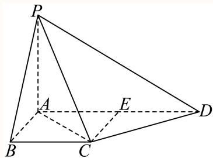

取AD的中点E，连接CE，

∵ AD = 4，∴ AE = ED = 1 AD = 2，

∵ AD//BC，BC = 2，∴ AE//BC且 $A E = B C$

∴四边形ABCE是平行四边形， $\therefore C E = A B = 2 , \ C E / / A B ,$

$$
\because A B \perp A D, \therefore A B \perp B C, C E \perp A D,
$$

$$
\therefore A C = \sqrt {A B ^ {2} + B C ^ {2}} = 2 \sqrt {2}, C D = \sqrt {C E ^ {2} + E D ^ {2}} = 2 \sqrt {2},
$$

$$
\therefore C D ^ {2} + A C ^ {2} = A D ^ {2}, \therefore C D \perp A C,
$$

$\because P A \bot$ 平面ABCD，CD ⊂平面 $A B C D , \ \dotsc P A \bot C D .$

∵ PA ∩ AC = A，PA ⊂平面PAC，AC ⊂平面 $P A C ,$

$\therefore C D \perp$ 平面PAC，

$\because C D$ ⊂平面PCD，∴平面 $P A C \bot$ 平面PCD；

(2)

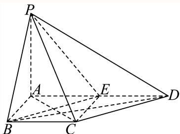

连接BE，BD，PE，

由(1)可知 $\boldsymbol { 1 } B C / / E D , B C = E D$ ，∴四边形BCDE是平行四边形，

$\therefore C D / / B E ,$ ，且 $C D = B E$

$\therefore \angle P B E$ 是异面直线PB和CD所成角，即 $\angle P B E = { \frac { \pi } { 3 } } ,$ ，

设PA = m，∵ AB = AE = 2，∴ PB = PE = √m2 + 4，CD = BE = 2√2，

$\therefore \triangle P B E$ 是等边三角形，∴ $\cdot { \sqrt { m ^ { 2 } + 4 } } = 2 { \sqrt { 2 } } , \ \cdot \cdot m = 2 ,$ ，即PA = 2，

$$
\because A C = 2 \sqrt {2}, P A \perp A C, \therefore P C = \sqrt {P A ^ {2} + A C ^ {2}} = 2 \sqrt {3},
$$

由(1)知，CD⊥平面 $P A C , ~ . . . C D \bot P C$

$$
\therefore S _ {\triangle P C D} = \frac {1}{2} \times C D \times P C = \frac {1}{2} \times 2 \sqrt {2} \times 2 \sqrt {3} = 2 \sqrt {6},
$$

$$
S _ {\triangle B C D} = \frac {1}{2} \times B C \times A B = \frac {1}{2} \times 2 \times 2 = 2,
$$

设点B到平面PCD的距离为h，

$\therefore V _ { B - P C D } = V _ { P - B C D }$ ，即 $\frac { 1 } { 3 } S _ { \triangle P C D } h = \frac { 1 } { 3 } S _ { \triangle B C D } \cdot P A$ ，即2 $\sqrt { 6 } h = 4$

$\therefore h = { \frac { 4 } { 2 { \sqrt { 6 } } } } = { \frac { \sqrt { 6 } } { 3 } }$ 即点B到平面PCD的距离为 $\frac { \sqrt { 6 } } { 3 }$

### 金山 · 第18题

如图，在四棱锥 $P - A B C D$ 中，PA⊥平面 $P B C , A B = 2 D C = 4 , B C = 2 \sqrt { 2 } , A B \bot B C , D C / / A B$
(1) (6分)证明：平面 $A B C D \bot$ 平面 $P A B$
(2) (8分)若 $\angle A B P = { \frac { \pi } { 3 } }$ ，求点C到平面PAD的距离.

**考点：** (1)线面垂直推面面垂直；(2)空间坐标与法向量点面距离

**难度依据：** 面面垂直与点面距离；需连接多个条件或多步模型转化

**核查说明：** 已人工阅读完整底稿题干及原解，未逐页对照正式PDF，分类不等于数学终审。

【解析】

(1) 因为PA⊥平面PBC，BC ⊂平面PBC，

所以 $P A \bot B C$

又 $A B \bot B C , A B \cap P A = A , A B , P A \subset { \widehat { \mathbb { F } } } { \widehat { \mathbb { H } } } P A B ,$

所以 $B C \bot$ 平面 $P A B ,$

又 $B C \subset$ 平面 $A B C D$

所以平面ABCD⊥平面PAB；

(2) 因为PA⊥平面PBC，PB ⊂平面PBC，

所以 $P A \bot P B ,$

在Rt $\triangle P A B ^ { \rvert }$ 中， $A B = 4 , \angle A B P = \frac { \pi } { 3 }$ ，则 $P B = 2$

如图，以点B为原点建立空间直角坐标系，

$$
A (4, 0, 0), C (0, 0, 2 \sqrt {2}), D (2, 0, 2 \sqrt {2}), P (1, \sqrt {3}, 0)
$$

故 $\overrightarrow { A D } = \left( - 2 , 0 , 2 \sqrt { 2 } \right) , \overrightarrow { A P } = \left( - 3 , \sqrt { 3 } , 0 \right) , \overrightarrow { D C } = ( - 2 , 0 , 0 ) ,$

设平面PAD的法向量为 $\vec { n } = ( x , y , z )$

则有 $\left\{ { \begin{array} { l } { { \vec { n } } \cdot { \overrightarrow { A D } } = - 2 x + 2 { \sqrt { 2 } } z = 0 } \\ { { \overrightarrow { n } } \cdot { \overrightarrow { A P } } = - 3 x + { \sqrt { 3 } } y = 0 } \end{array} } \right.$ ${ \mathfrak { H } } x = { \sqrt { 2 } } ,$ 则 $y = \sqrt { 6 } , z = 1$ ，所以→n $= \left( { \sqrt { 2 } } , { \sqrt { 6 } } , 1 \right)$

所以点C到平面PAD的距离为 $\frac { \left| { \vec { n } } \cdot { \overrightarrow { D C } } \right| } { \left| { \vec { n } } \right| } = { \frac { 2 { \sqrt { 2 } } } { 3 } }$

### 长宁 · 第18题

如图，在直三棱柱 $A B C - A ^ { \prime } B ^ { \prime } C ^ { \prime }$ 中， $A B \bot A C , A C = A B = 2 , A A ^ { \prime } = 2 { \sqrt { 2 } }$ ，点D是棱AA′的中点

(1) (6分)求证：平面 $C D B ^ { \prime } \perp$ 平面 $C B B ^ { \prime } C ^ { \prime }$ ；
(2) (8分)求点 $C ^ { \prime }$ 到平面 $C D B ^ { \prime }$ 的距离以及三棱锥 $C ^ { \prime } - C D B ^ { \prime }$ 的体积

> 本题资料或解析有待核事项，预览不可作为已审定成品。

**考点：** （1）平行四边形及线面垂直推出面面垂直；（2）曲面外点到平面距离与等体积

**难度依据：** 面面垂直与等体积求距离；需多步建模、分类或参数约束

**核查说明：** 第（2）问B′C等长度式混入异常字符，但后续采用长度4，须回源校净。；已人工阅读底稿题干和原解；未逐页对照PDF，不作为数学终审。；历史分类审查记录（不把旧记录直接判为当前未解决）：第（2）问B′C等长度式混入异常字符，但后续采用长度4，须回源校净。 本次只归组，未修改题干、答案或专题归属；上述具体疑点仍交回源/数学复核处理。

【解析】

(1)

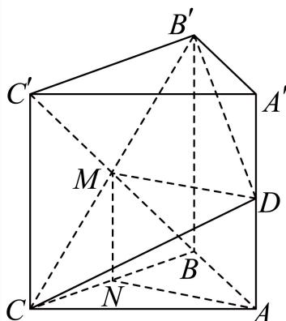

连接 $B C ^ { \prime } \cap B ^ { \prime } C = M$ ，取BC的中点N，连接AN，MN，

∵ AB = AC，∴ AN⊥BC，

∵在直三棱柱 $A B C - A ^ { \prime } B ^ { \prime } C ^ { \prime }$ 中，平面 $A B C \bot$ 平面 $C B B ^ { \prime } C ^ { \prime }$

平面 $A B C \cap$ 平面 $C B B ^ { \prime } C ^ { \prime } = B C$ $A N \subset$ 平面 $A B C$

$\therefore A N \bot$ 平面 $C B B ^ { \prime } C ^ { \prime }$

$\because M , N$ 分别为BC， $B ^ { \prime } C$ 的中点，∴ $M N / / B B ^ { \prime }$ 且 $M N = \frac { 1 } { 2 } B B ^ { \prime }$

∵点D是棱AA′的中点， $\therefore A D / / B B ^ { \prime }$ 且 $A D = { \frac { 1 } { 2 } } B B ^ { \prime }$

$\therefore A D / / M N \mathbb { H } A D = M N ,$ ，∴四边形 $A D M N$ 是平行四边形，

$\therefore A N / / M D , \ \therefore M D \bot$ 平面 $C B B ^ { \prime } C ^ { \prime }$

∵ MD ⊂平面CDB′，∴平面 $C D B ^ { \prime } \perp$ 平面 $C B B ^ { \prime } C ^ { \prime }$ ；

(2) $\because A B \bot A C , A C = A B = 2 , A A ^ { \prime } = 2 { \sqrt { 2 } } , \ \therefore B C = B ^ { \prime } C ^ { \prime } = 2 { \sqrt { 2 } } , \ B ^ { \prime } C = 4 { \sqrt { 2 } } \oplus B = 2 .$

∵点D是棱AA′的中点， $\therefore A D = D A ^ { \prime } = { \sqrt { 2 } } ,$

$$
\because A C = A B = A ^ {\prime} B ^ {\prime} = 2, \therefore C D = B ^ {\prime} D = \sqrt {6},
$$

由(1)知MD⊥平面 $C B B ^ { \prime } C ^ { \prime } , ~ \cdot \cdot M D \bot B ^ { \prime } C .$

$$
\therefore M D = \sqrt {C D ^ {2} - C M ^ {2}} = \sqrt {6 - 4} = \sqrt {2},
$$

$$
\therefore S _ {\triangle C D B ^ {\prime}} = \frac {1}{2} \times B ^ {\prime} C \times M D = \frac {1}{2} \times 4 \times \sqrt {2} = 2 \sqrt {2},
$$

$$
S _ {\triangle B ^ {\prime} C ^ {\prime} C} = \frac {1}{2} \times B ^ {\prime} C ^ {\prime} \times C C ^ {\prime} = \frac {1}{2} \times 2 \sqrt {2} \times 2 \sqrt {2} = 4,
$$

设点 $C ^ { \prime }$ 到平面CDB′的距离为h，

$$
\begin{array}{l} \therefore V _ {C ^ {\prime} - C D B ^ {\prime}} = V _ {D - B ^ {\prime} C ^ {\prime} C} = \frac {1}{3} \times S _ {\triangle B ^ {\prime} C ^ {\prime} C} \times D M = \frac {1}{3} \times 4 \times \sqrt {2} = \frac {4 \sqrt {2}}{3}, \\ \therefore \frac {1}{3} S _ {\triangle C D B ^ {\prime}} h = \frac {1}{3} \times 2 \sqrt {2} h = \frac {4 \sqrt {2}}{3}, \therefore h = 2, \end{array}
$$

∴点 $C ^ { \prime }$ 到平面 $C D B ^ { \prime }$ 的距离为2，三棱锥 $C ^ { \prime } - C D B ^ { \prime }$ ′的体积为 $\frac { 4 { \sqrt { 2 } } } { 3 }$

### 黄浦 · 第9题

某商场要悬挂一个棱长为2米的正方体物件作为装饰，如图，A、B、C、D为该正方体的顶点，$B B _ { 1 } , ~ C C _ { 1 } , ~ D D _ { 1 }$ 为三根直绳索，且均垂直于屋顶所在平面α．若平面BCD与平面α平行，且点A到α的距离为2米，则直绳索 $B B _ { 1 }$ 的长度约为 米．（结果精确到0.01米）

> 本题资料或解析有待核事项，预览不可作为已审定成品。

**考点：** 正方体斜悬挂与面间距离

**难度依据：** 正方体斜悬挂与面间距离；需组合两类关系并检查区间或等号

**核查说明：** 原解分析与详解使用不同的外接圆半径；AB=BC等棱长描述混淆，需据原图核算，不能将摘要当结论。；已人工阅读底稿题干和原解；未逐页对照PDF，不作为数学终审。；历史分类审查记录（不把旧记录直接判为当前未解决）：原解分析与详解使用不同的外接圆半径；AB=BC等棱长描述混淆，需据原图核算，不能将摘要当结论。 本次只归组，未修改题干、答案或专题归属；上述具体疑点仍交回源/数学复核处理。

【解析】

设正方体的中心为O，连接AO，得到 $A O _ { 1 \perp }$ 平面BCD，由三角形BCD是正三角形，得到外接圆的半径为 $r = { \frac { 2 { \sqrt { 3 } } } { 3 } }$ 米，利用勾股定理求得 $A O _ { 1 } = \sqrt { A B ^ { 2 } - B O _ { 1 } ^ { 2 } } = \frac { 2 \sqrt { 6 } } { 3 }$ 米，设 $B B _ { 1 } = h$ 米，结合h $\begin{array} { r } { \mathbf { \nabla } _ { \cdot } = B B _ { 1 } = 2 + A O _ { 1 } } \end{array}$ ，即可得到对答案.

解：由正方体的棱长 $A B = B C = C D = D A = 2$ 米，

因为平面 $B C D / /$ 平面α，且 $B B _ { 1 \perp }$ 平面α， $C C _ { 1 - }$ ⊥平面α， $D D _ { 1 \perp }$ 平面 $\overset { \cdot } { \alpha }$ ，

如图所示，设正方体的中心为O，连接AO，交平面 $B C D ^ { . }$ 于点 $O _ { 1 }$ ，则 $A O _ { 1 \perp }$ 平面 $B C D$

在正方体中，底面BCD是正三角形，其外接圆的半径为 $r = { \frac { \sqrt { 3 } } { 3 } } \times 2 { \sqrt { 2 } } = { \frac { 2 { \sqrt { 6 } } } { 3 } }$ 米，

又由勾股定理，可得 $A O _ { 1 } = \sqrt { A B ^ { 2 } - B O _ { 1 } ^ { 2 } } = \surd 2 ^ { 2 } - \left( \frac { 2 \sqrt { 6 } } { 3 } \right) ^ { 2 } = \frac { 2 \sqrt { 3 } } { 3 }$

设 $B B _ { 1 } = h$ 米，因为点A到平面α的距离为2米，

所以 $h = B B _ { 1 } = 2 + A O _ { 1 } = 2 + { \frac { 2 { \sqrt { 3 } } } { 3 } } \approx 2 + { \frac { 2 \times 1 . 7 3 1 } { 3 } } = 2 + { \frac { 3 . 4 6 2 } { 3 } } = 2 + 1 . 1 5 4 = 3 . 1 5 3$ 5米.故答案为：3.15.

## 体积分割、动点与定体积

抓住同底等高与总体积分割，动点轨迹先转为平行面或线段。

### 松江 · 第10题

如图在三棱锥 $P - A B C$ 中，PA、PB、PC两两垂直，且 $P A = 3 , P B = 2 , P C = 1$ ，设M是底面ABC内一点，定义 $f ( M ) = ( m , n , p )$ ，其中 $^ { \mathfrak { m } , n , p }$ 分别表示三棱锥 $M - P A B .$ ，三棱锥 $M - P B C$ 三棱锥 $M - P C A$ 的体积.若 $f \left( M \right) = \left( { \frac { 2 } { 3 } } , x , y \right)$ ，且 ${ \frac { a } { x } } + { \frac { 1 } { y } } \geq$ 12恒成立，则正实数 $\scriptstyle  \{ a$ 的最小值为

> 本题资料或解析有待核事项，预览不可作为已审定成品。

**考点：** 体积和约束与基本不等式

**难度依据：** 棱锥分割体积定义；需参数分类、构造递推或综合最值分析

**核查说明：** 底面内点是否排除边界及分母非零应回核原卷，解析按x,y>0处理。；已人工阅读完整底稿题干及原解，未逐页对照正式PDF，分类不等于数学终审。；历史分类审查记录（不把旧记录直接判为当前未解决）：底面内点是否排除边界及分母非零应回核原卷，解析按x,y>0处理。 本次只归组，未修改题干、答案或专题归属；上述具体疑点仍交回源/数学复核处理。

【答案】1

【解析】

根据给定的信息求出三棱锥 $P - A B C$ 的体积，进而求出 $x + y ,$ ，再利用基本不等式“1”的妙用求出最小值，并建立不等式求解.

在三棱锥 $P - A B C$ 中，PA、PB、PC两两垂直，且 $P A = 3 , P B = 2 , P C = 1$ 1

则 $x + y + { \frac { 2 } { 3 } } = V _ { P - A B C } = { \frac { 1 } { 6 } } P A \cdot P B \cdot P C = 1$ ，解得 $x + y = { \frac { 1 } { 3 } }$ ，又 $x > 0 , y > 0 , a > 0$

$$
\frac {a}{x} + \frac {1}{y} = 3 \left(\frac {a}{x} + \frac {1}{y}\right) (x + y) = 3 \left(a + 1 + \frac {a y}{x} + \frac {x}{y}\right) \geq 3 (a + 1 + 2 \sqrt {a})
$$

当且仅当 ${ \frac { a y } { x } } = { \frac { x } { y } }$ 时取等号，由 $\frac { a } { x } + \frac { 1 } { y } \geq 1$ 2恒成立，得3 $\left( a + 1 + 2 { \sqrt { a } } \right) \geq 1 2$

于是 $\left( { \sqrt { a } } + 1 \right) ^ { 2 } \geq 4$ ，解得 $a \geq 1$ ，所以正实数a的最小值为1.

故答案为：1

### 松江 · 第15题

在正三棱柱 $A B C - A _ { 1 } B _ { 1 } C _ { 1 }$ 中， $A B = A A _ { 1 } = 1$ ，动点P满足 $\overrightarrow { B P } = \lambda \overrightarrow { B C } + \overrightarrow { B B _ { 1 } } , \lambda \in ( 0 \mathrm { ~ , ~ } 1 )$ ，则下列几何体体积为定值的是（ ）

A. 四棱锥 $P - A _ { 1 } A B B _ { 1 }$

B. 四棱锥 $P - A _ { 1 } A C C _ { 1 }$

C. 三棱锥 $P - A _ { 1 } B _ { 1 } C _ { 1 }$

D. 三棱锥 $P - A _ { 1 } B C$

**考点：** 动点轨迹与线面平行定高

**难度依据：** 棱柱中动点与定体积；需连接多个条件或多步模型转化

**核查说明：** 已人工阅读完整底稿题干及原解，未逐页对照正式PDF，分类不等于数学终审。

【答案】D

【解析】

根据题设P在 $B _ { 1 } C _ { 1 }$ 上运动，结合棱柱的结构特征及线面平行的性质判断各棱锥的体积是否为定值即可.

对于正三棱柱 $A B C - A _ { 1 } B _ { 1 } C _ { 1 }$ ，且 $\overrightarrow { B P } = \lambda \overrightarrow { B C } + \overrightarrow { B B _ { 1 } } , ~ \lambda \in ( 0 , 1 )$ ，

则P在 $B _ { 1 } C _ { 1 }$ 上运动，

所以P到平面 $A _ { 1 } A B B _ { 1 }$ 、平面 $A _ { 1 } A C C _ { 1 }$ 的距离均是变化的，棱锥底面积都是定值，故A、B不符合条件，

P在平面 $A _ { 1 } B _ { 1 } C _ { 1 }$ 内， $P - A _ { 1 } B _ { 1 } C _ { 1 }$ 不是三棱锥，故C不符条件，

由 $B _ { 1 } C _ { 1 } / / B C _ { ; }$ $B C \subset$ 平面 $A _ { 1 } B C$ $B _ { 1 } C _ { 1 } \notin$ 平面 $A _ { 1 } B C$ ，则 $B _ { 1 } C _ { 1 } / / .$ 平面 $A _ { 1 } B C$

所以P到平面A BC的距离为定值，且底面A BC的面积是定值，

所以三棱锥 $P - A _ { 1 } B C$ 的体积为定值，D符合，

故选：D

## 球面轨迹、截面与空间约束

将距离比例或单位向量条件转为球面和截面，截面分点要保留符号距离信息。

### 普陀 · 第11题

在棱长为4的正方体 $A B C D - A _ { 1 } B _ { 1 } C _ { 1 } D _ { 1 } { } ^ { \prime }$ 中， $\overrightarrow { A N } = 2 \overrightarrow { A M } = \frac { 1 } { 2 } \overrightarrow { A C _ { 1 } }$ ，若一动点G满足$\left| { \overrightarrow { G N } } \right| = { \sqrt { 2 } } \left| { \overrightarrow { G M } } \right|$ ，则三棱锥 $G - A _ { 1 } B _ { 1 } D _ { 1 }$ 体积的最大值为

**考点：** 球面轨迹与体积最值

**难度依据：** 球面轨迹与棱锥体积最值；需综合转化、参数分析或完整证明，推理链较长

**核查说明：** 已人工阅读底稿题干和解析；尚未逐页对照原PDF，不作为数学终审。

【答案】$\frac { 3 2 + 8 { \sqrt { 6 } } } { 3 }$

【解析】

以A为坐标原点建立空间直角坐标系，得出 $M , N , A , C _ { 1 }$ 的坐标，设 $G ( x , y , z )$ ，根据已知$\left| { \overrightarrow { G N } } \right| = { \sqrt { 2 } } \left| { \overrightarrow { G M } } \right|$ 列出方程，化简得出点G的轨迹为球.进而结合图象即可得出点G到平面$A _ { 1 } B _ { 1 } D _ { 1 }$ 的最大距离，结合体积公式即可得出答案.

如图，以A为坐标原点建立空间直角坐标系，

则有 $A ( 0 , 0 , 0 ) , C _ { 1 } ( 4 , 4 , 4 )$

又 $\overrightarrow { A N } = \overrightarrow { 2 A M } = \frac { 1 } { 2 } \overrightarrow { A C _ { 1 } }$ ，

所以 $M ( 1 , 1 , 1 ) , N ( 2 , 2 , 2 )$

设 $G ( x , y , z )$ ，则 $| \overrightarrow { G N } = ( 2 - x , 2 - y , 2 - z ) , \overrightarrow { G M } = ( 1 - x , 1 - y , 1 - z ) .$

因为 $\left| \overrightarrow { G N } \right| = \sqrt { 2 } \left| \overrightarrow { G M } \right|$

代入可得 $\left( 2 - x \right) ^ { 2 } + ( 2 - y ) ^ { 2 } + ( 2 - z ) ^ { 2 } = 2 \left[ ( 1 - x ) ^ { 2 } + ( 1 - y ) ^ { 2 } + ( 1 - z ) ^ { 2 } \right]$

整理可得 $x ^ { 2 } + y ^ { 2 } + z ^ { 2 } = 6$

即G在以点A为球心， $r = { \sqrt { 6 } }$ 为半径的球上.

又 $\mathrm { R t } \triangle A _ { 1 } B _ { 1 } D _ { 1 }$ 的面积为 $S _ { \triangle A _ { 1 } B _ { 1 } D _ { 1 } } = \frac { 1 } { 2 } \times 4 \times 4 = 8 _ { \cdot }$

平面ABCD到平面 $A _ { 1 } B _ { 1 } C _ { 1 } D _ { 1 }$ 的距离为4，

所以G到平面 $A _ { 1 } B _ { 1 } D _ { 1 }$ 的最大距离为 $\begin{array} { r } { d _ { \operatorname* { m a x } \sim } = 4 + r = 4 + \sqrt { 6 } } \end{array}$

体积最大值为 $V = { \frac { 1 } { 3 } } \times S _ { \triangle A _ { 1 } B _ { 1 } D _ { 1 } } \times d _ { \mathrm { m a x } } = { \frac { 1 } { 3 } } \times 8 \times \Big ( 4 + \sqrt { 6 } \Big ) = { \frac { 3 2 + 8 \sqrt { 6 } } { 3 } } .$

故答案为： $\frac { 3 2 + 8 { \sqrt { 6 } } } { 3 }$

### 浦东 · 第11题

已知→a、 $\vec { b } , \vec { c }$ 为空间中三个单位向量， $\overrightarrow { \sf z } \overrightarrow { a } \cdot \overrightarrow { b } = \overrightarrow { b } \cdot \overrightarrow { c } = \overrightarrow { c } \cdot \overrightarrow { a } = 0$ ，若向量 $\vec { \cdot } \vec  p \}$ 满足 $| { \overrightarrow { p } } - 2 { \overrightarrow { a } } | = { \frac { 3 } { 2 } }$ $| { \vec { p } } - { \vec { 2 b } } | = { \frac { 3 } { 2 } }$ ，则向量 $\overrightarrow { p }$ 与向量 $\overrightarrow { : c }$ 夹角的最小值为 ．（用反三角表示）

> 本题资料或解析有待核事项，预览不可作为已审定成品。

**考点：** 正交坐标、双球交线与夹角

**难度依据：** 正交空间向量与夹角最值；需参数分类、构造递推或综合最值分析

**核查说明：** 求夹角的关键余弦分式与极值步骤严重乱码；需核清平方根及取等参数，不能直接发布。；已人工阅读完整底稿题干及原解，未逐页对照正式PDF，分类不等于数学终审。；历史分类审查记录（不把旧记录直接判为当前未解决）：求夹角的关键余弦分式与极值步骤严重乱码；需核清平方根及取等参数，不能直接发布。 当前底稿已有回源补丁，涉及answer_and_solution；具体修复范围以底稿patches和2025二模-解析公式回源补丁-第二批.json为准。本题仍按可辨数学任务归组，不据分组宣称数学已审定。

【答案】$\operatorname { a r c c o s } { \frac { \sqrt { 2 } } { 4 } }$

【解析】

由题意可设 $\vec a=(1,0,0),\vec b=(0,1,0),\vec c=(0,0,1),\vec p=(x,y,z)$ ，结合 $| { \vec { p } } - 2 { \vec { a } } | = { \frac { 3 } { 2 } }$ $| { \vec { p ^ { \prime } } } - { \vec { 2 b ^ { \prime } } } | = { \frac { 3 } { 2 } }$ ，求得 $x = y \mathbb { \hat { H } } \mathbb { I } 2 x ^ { 2 } + z ^ { 2 } = 4 x - \frac { 7 } { 4 }$ 再结合向量夹角得坐标表示即可求解可设 $\overleftrightarrow { \boldsymbol { \ z a } } ^ { + } = ( 1 , 0 , 0 ) , \overrightarrow { \boldsymbol { b } } ^ { - } = ( 0 , 1 , 0 ) , \overrightarrow { \boldsymbol { c } } ^ { - } = ( 0 , 0 , 1 ) , \overrightarrow { \mathbb { K } } \overrightarrow { \boldsymbol { p } } ^ { - } = ( x , y , z )$ 则 $| \overrightarrow { | p ^ { \prime } } - 2 \overrightarrow { a } = ( x - 2 , y , z ) , \overrightarrow { p } - 2 \overrightarrow { b } = ( x , y - 2 , z )$

所以 $\left\{ { \begin{array} { l } { \left( x - 2 \right) ^ { 2 } + y ^ { 2 } + z ^ { 2 } = { \frac { 9 } { 4 } } , } \\ { x ^ { 2 } + \left( y - 2 \right) ^ { 2 } + z ^ { 2 } = { \frac { 9 } { 4 } } } \end{array} } \right.$

两式相减可得： $x = y ;$ ，再代入第一个式子，

可得： $2 x ^ { 2 } + z ^ { 2 } = 4 x - { \frac { 7 } { 4 } }$

设向量 与向量→c夹角为θ，

7 4x 2x2 则cos θ = z 4 = 2x2 = 1 − 2 x2 + y2 + z2 4x 7 4x − 7 ⎷ 4 72

易知对 $\exists \ : y = - \frac { 7 } { 4 x ^ { 2 } } + \frac { 4 } { x } \frac { \underline { { { \upsilon } } } } {  } \frac { 1 } { x } = \frac { 8 } { 7 } \sharp \ : \mathbb { x } = \frac { 7 } { 8 }$ 取得最大值 $\frac { 1 6 } { 7 }$

此时 $\bigvee ^ { \lceil } \frac { 2 } { \frac { 4 } { x } - \frac { 7 } { 4 x ^ { 2 } } }$ 取得最大值 $\frac { \sqrt { 2 } } { 4 }$

即cosθ的最大值为 $\frac { \sqrt { 2 } } { 4 }$ ， $x = \frac { 7 } { 8 }$ 时取得，

再由余弦函数的单调性可知 的最小值为 $\operatorname { I a r c c o s } { \frac { \sqrt { 2 } } { 4 } }$

故答案为： $\operatorname { a r c c o s } { \frac { \sqrt { 2 } } { 4 } }$

### 虹口 · 第16题

在空间中，点O为定点，设集合 $S = \left\{ P \bigg | \bigg | \overrightarrow { O P } \bigg | ^ { 2 } - 2 \overrightarrow { O A } \cdot \overrightarrow { O P } \leq 1 , \bigg | \overrightarrow { O A } \bigg | = 1 \right\}$ ，则以下说法正确的是（ ）.①若 $\overrightarrow { \cdot O P } \overleftrightarrow { \pm O A }$ 上的数量投影为 $- { \frac { 1 } { 5 } }$ ，则线段OP在运动过程中所形成的几何体体积为 ${ \frac { 1 4 } { 3 7 5 } } \pi ;$ ②对于任意的 $P _ { i } \in S |$ 以及任意的正实数 ${ \bf \dot { \alpha } } _ { a _ { i } }$ ，设 $\overrightarrow { O Q } = \sum _ { i = 1 } ^ { 4 } a _ { i } \overrightarrow { O P _ { i } }$ ，若 $\sum _ { i = 1 } ^ { 4 } a _ { i } = 1$ ，则 $| Q \in S$

A. ①是真命题，②是真命题

B. ①是真命题，②是假命题

C. ①是假命题，②是真命题

D. ①是假命题，②是假命题

> 本题资料或解析有待核事项，预览不可作为已审定成品。

**考点：** 球体轨迹、数量投影与凸组合

**难度依据：** 空间向量不等式与凸组合；需参数分类、构造递推或综合最值分析

**核查说明：** 题干数量投影方向关系符号破损，需核清为OP在OA方向；球体定义中A为定点的文字口径应核。；已人工阅读完整底稿题干及原解，未逐页对照正式PDF，分类不等于数学终审。；历史分类审查记录（不把旧记录直接判为当前未解决）：题干数量投影方向关系符号破损，需核清为OP在OA方向；球体定义中A为定点的文字口径应核。 当前底稿已有回源补丁，涉及answer_and_solution；具体修复范围以底稿patches和2025二模-解析公式回源补丁-第二批.json为准。本题仍按可辨数学任务归组，不据分组宣称数学已审定。

【答案】A

【解析】

由 $\left| \overrightarrow { O P } \right| ^ { 2 } - 2 \overrightarrow { O A } \cdot \overrightarrow { O P } = \left| \overrightarrow { O P } - \overrightarrow { O A } \right| ^ { 2 } - \left| \overrightarrow { O A } \right| ^ { 2 }$ ，求得 $\left| { \overrightarrow { O P } } - { \overrightarrow { O A } } \right| ^ { 2 } \leq 2$ ，得到 $\left| { \overrightarrow { A P } } \right| ^ { 2 } \leq 2$ ，得出S是以A为球心，半径为√2的球体内部及其表面，①根据题意得到 ${ \overrightarrow { O P } } \cdot { \overrightarrow { O A } } = - { \frac { 1 } { 5 } }$ ，设$\overrightarrow { O A }$ 是x轴上的单位向量，点P的坐标为 $( x , y , z )$ ，求得 $y ^ { 2 } + z ^ { 2 } \leq { \frac { 1 4 } { 2 5 } }$ ，得到线段OP在运动中所形成的几何体为圆锥，结合圆锥的体积公式，可判定①是真命题；由集合S是球体内部及其表面，得到集合S是凸集，结合球体中的任意两点的连线段上的点均在球体内，以及凸集的性质，可判定②正确.

2 2 2由 OP 2OA ⋅ OP =→ → OP OA OA因为 $\left| { \overrightarrow { O P } } \right| ^ { 2 } - 2 { \overrightarrow { O A } } \cdot { \overrightarrow { O P } } \leq 1$ 1且 $\left| { \overrightarrow { O A } } \right| = 1$ ，可得 $\left| { \overrightarrow { O P } } - { \overrightarrow { O A } } \right| ^ { 2 } - 1 \leq 1$ 即 $\left| { \overrightarrow { O P } } - { \overrightarrow { O A } } \right| ^ { 2 } \leq 2 ;$ 即 $\left| { \overrightarrow { A P } } \right| ^ { 2 } \leq 2$ 所以S是以A为球心，半径为 $\sqrt { 2 }$ 的球体内部及其表面，①若 $\overrightarrow{OP}$ 在 $\overrightarrow{OA}$ 上的数量投影为 $- { \frac { 1 } { 5 } } .$ ，即 ${ \overrightarrow { O P } } \cdot { \overrightarrow { O A } } = - { \frac { 1 } { 5 } }$ 2

设 $\xrightarrow { }$ 是x轴上的单位向量，点P的坐标为 $( x , y , z )$

则满足 $\mathbf { \mathcal { x } = - \frac { 1 } { 5 } }$ ，且 $( x - 1 ) ^ { 2 } + y ^ { 2 } + z ^ { 2 } \leq 2$

将 $x = - { \frac { 1 } { 5 } }$ 代入可得 $\left( - { \frac { 1 } { 5 } } - 1 \right) ^ { 2 } + y ^ { 2 } + z ^ { 2 } \leq 2$ ，解得 $y ^ { 2 } + z ^ { 2 } \leq { \frac { 1 4 } { 2 5 } }$

所以轨迹为半径为 $r = { \frac { \sqrt { 1 4 } } { 5 } }$ ，位于平面 $x = - { \frac { 1 } { 5 } }$ 上，

所以线段 $O P$ 在运动中所形成的几何体为圆锥，其中底面半径为 $r = { \frac { \sqrt { 1 4 } } { 5 } }$ ，高为 $h = \frac { 1 } { 5 }$

则圆锥的体积为 $V = { \frac { 1 } { 3 } } \pi r ^ { 2 } \cdot h = { \frac { 1 } { 3 } } \pi \times { \bigg ( } { \frac { \sqrt { 1 4 } } { 5 } } { \bigg ) } ^ { 2 } \cdot { \frac { 1 } { 5 } } = { \frac { 1 4 } { 3 7 5 } } \pi$ 所以①是真命题；

由集合S是以A为球心，半径为 $\bar { \sqrt { 2 } }$ 的球体内部及其表面，

对于任意的 $P _ { i } \in S _ { \mathrm { : } }$ ，以及任意的正实数 $[ a _ { i }$ ，且 $\sum _ { i = 1 } ^ { 4 } a _ { i } = 1$

即 $P _ { 1 } , P _ { 2 } , P _ { 3 } , P _ { 4 } \in S$ ，且 $a _ { 1 } + a _ { 2 } + a _ { 3 } + a _ { 4 } = 1$ ，且 $0 < a _ { 1 } , a _ { 2 } , a _ { 3 } , a _ { 4 } < 1$

$$
\overrightarrow {O Q} = \sum_ {i = 1} ^ {4} a _ {i} \overrightarrow {O P _ {i}} = a _ {1} \overrightarrow {O P _ {1}} + a _ {2} \overrightarrow {O P _ {2}} + a _ {3} \overrightarrow {O P _ {3}} + a _ {4} \overrightarrow {O P _ {4}},
$$

因为球体中的任意两点的连线段上的点均在球体内，

根据S是凸集，结合凸集的性质，可得 $\left| { \overrightarrow { O Q } } - { \overrightarrow { O A } } \right| ^ { 2 } \leq 2 \cdot$ ，即 $\left| { \overrightarrow { O Q } } \right| ^ { 2 } - 2 { \overrightarrow { O A } } \cdot { \overrightarrow { O Q } } \leq 1$

$$
Q \in S
$$

故选：A.

## 三、解答题

### 闵行 · 第16题

设n为正整数，空间中n个单位向量构成集合 $A _ { n } = \left\{ { \vec { a } } _ { 1 } , { \vec { a } } _ { 2 } , \cdot \cdot \cdot , { \vec { a } } _ { n } \right\}$ ，若存在实数t，满足对任意$\vec { a } _ { i } \in A _ { n } , \vec { a } _ { j } \in A _ { n } , \vec { a } _ { i } \neq \vec { a } _ { j }$ ，都有 ${ \vec { a } } _ { i } \cdot { \vec { a } } _ { j } = t$ ，则当 $_ n$ 取得最大值时，t的值为（ ）

A. $- { \frac { 1 } { 2 } }$

B. $\frac { 1 } { 2 }$

C. $- { \frac { 1 } { 3 } }$

D. $\frac 1 3$

> 本题资料或解析有待核事项，预览不可作为已审定成品。

**考点：** 空间等角单位向量与正四面体；球面等距点组

**难度依据：** 空间等角单位向量与正四面体；球面等距点组；需证明新定义命题或完成复杂参数分类

**核查说明：** 原解析多段只有公式无连接文字，需核PDF；不能把现稿当完整证明。；已人工阅读底稿题干和原解；未逐页对照PDF，不作为数学终审。；历史分类审查记录（不把旧记录直接判为当前未解决）：原解析多段只有公式无连接文字，需核PDF；不能把现稿当完整证明。 本次只归组，未修改题干、答案或专题归属；上述具体疑点仍交回源/数学复核处理。

【答案】C

【解析】

根据给定条件可得集合 $A _ { n } { } ^ { \mathfrak { k } }$ 中所有向量共起点时，终点在球面上，再利用数量积的运算律求出n的最大值，进而求出t值.

$$
A _ {n} = \left\{\vec {a} _ {1}, \vec {a} _ {2}, \dots , \vec {a} _ {n} \right\}
$$

$$
A _ {1}, A _ {2}, \dots , A _ {n}
$$

$$
\overrightarrow {a _ {i}} (i \in \mathrm{N} ^ {*}, i \leq n)
$$

$$
A _ {1}, A _ {2}, \dots , A _ {n}
$$

$$
\exists \vec {a} _ {i} \in A _ {n}, \vec {a} _ {j} \in A _ {n}, \vec {a} _ {i} \neq \vec {a} _ {j}
$$

$$
A _ {1}, A _ {2}, \dots , A _ {n} \text {中}
$$

$$
t = \vec {a} _ {1} \cdot \vec {a} _ {2} = \vec {a} _ {2} \cdot \vec {a} _ {3}
$$

$$
\overrightarrow {O A _ {2}} \cdot \left(\overrightarrow {O A _ {1}} - \overrightarrow {O A _ {3}}\right) = \overrightarrow {O A _ {2}} \cdot \overrightarrow {A _ {3} A _ {1}} = 0
$$

$$
O A _ {2} \bot A _ {1} A _ {3}
$$

$$
t = \vec {a} _ {4} \cdot \vec {a} _ {2} = \vec {a} _ {2} \cdot \vec {a} _ {3}
$$

$$
O A _ {2} \bot A _ {4} A _ {3}
$$

$$
A _ {1}, A _ {3}, A _ {4}
$$

$$
A _ {1}, A _ {2}, A _ {3}, A _ {4}
$$

$$
A _ {1}, A _ {2}, A _ {3}, A _ {4}
$$

$$
n \geq 5.
$$

$$
n = 5
$$

$$
O A _ {5} \perp A _ {1} A _ {3}, O A _ {5} \perp A _ {4} A _ {3}, O A _ {5 -}
$$

$$
A _ {1} A _ {3} A _ {4}
$$

又 $O A _ { 5 } \bot A _ { 2 } A _ { 3 }$ ，由过一点有且只有一个平面垂直于已知直线，得点 $A _ { 2 } \in$ 平面 $A _ { 1 } A _ { 3 } A _ { 4 }$ 与点 $A _ { 1 } , A _ { 2 } , A _ { 3 } , A _ { 4 }$ 不共面矛盾，因此 $n _ { \mathrm { m a x } } = 4$ ，设正四面体 $A _ { 1 } A _ { 2 } A _ { 3 } A _ { 4 }$ 的棱长为 $m$ ，

$$
\triangle A _ {1} A _ {2} A _ {3}
$$

$$
\frac {\sqrt {3}}{2} m \cdot \frac {2}{3} = \frac {\sqrt {3}}{3} m
$$

$$
\sqrt {m ^ {2} - \left(\frac {\sqrt {3}}{3} m\right) ^ {2}} = \frac {\sqrt {6}}{3} m
$$

球心到平面 $A _ { 1 } A _ { 2 } A _ { 3 }$ 的距离为 $\frac { \sqrt { 6 } } { 3 } m - 1$ ，因此 $\left( { \frac { \sqrt { 6 } } { 3 } } m - 1 \right) ^ { 2 } + \left( { \frac { \sqrt { 3 } } { 3 } } m \right) ^ { 2 } = 1 ^ { 2 }$ ，解得$m = { \frac { 2 { \sqrt { 6 } } } { 3 } }$

所以 $\quad : = \cos \angle A _ { 1 } O A _ { 2 } = { \frac { 1 ^ { 2 } + 1 ^ { 2 } - \left( { \frac { 2 { \sqrt { 6 } } } { 3 } } \right) ^ { 2 } } { 2 \times 1 \times 1 } } = - { \frac { 1 } { 3 } } .$

故选：C

## 三、解答题

### 黄浦 · 第16题

给定四面体ABCD．平面α满足：①A、B、C、D四个点均不在平面α上，也不在α的同侧；②若平面α与四面体ABCD的棱有公共点，则该公共点一定是此棱的中点或两个三等分点之一．设A、B、C、D四个点到平面α的距离分别为d (i = 1,2,3,4)，那 $\ L d _ { i }$ 的所有不同值的个数组成的集合为（ ）

A. {1, 2, 3, 4}

B. {1, 2, 3}

C. {1, 2}

D. {1}

> 本题资料或解析有待核事项，预览不可作为已审定成品。

**考点：** 截面分点与点面距离种数

**难度依据：** 截面分点与点面距离种数；需证明新定义命题或完成复杂参数分类

**核查说明：** 题干dᵢ下标与集合表述乱码；原解仅列举部分截面，且称四种距离必在同侧未证明，需独立核验完整分类。；已人工阅读底稿题干和原解；未逐页对照PDF，不作为数学终审。；历史分类审查记录（不把旧记录直接判为当前未解决）：题干dᵢ下标与集合表述乱码；原解仅列举部分截面，且称四种距离必在同侧未证明，需独立核验完整分类。 本次只归组，未修改题干、答案或专题归属；上述具体疑点仍交回源/数学复核处理。

【答案】B

【解析】

根据题意，分类讨论，确定平面α的位置，结合点到平面的距离的定义，进行分析判断，即可求解.

当平面α与四面体ABCD的一条棱的中点相交时，

不妨设平面α过棱 $A B , A C , A D$ 的中点 $E , M , N _ { \colon }$ ，此时点A,B到平面α的距离相等，

且平面 $\dot { \alpha } / /$ 平面BCD，如图（1）所示

此时B,C,D到平面α的距离可能与A,B到平面α的距离相同，此时 $d _ { i }$ 有1不同的值；

图(1)

不妨设平面α过棱AB的中点 $E ,$ ，且过 $A C , A D$ 分别为的三等分点M,N时，

如图（2）所示，此时点A,B到平面α的距离相等，且 $C ,$ D到平面α的距离相等，

且A,B到平面α的距离与 $C ,$ D到平面α的距离不相等，此时 $\mathbf { \dot { \alpha } } d _ { i }$ 有2不同的值；

图(2)

不妨设平面α过棱AB,AD的中点E,N，且过AC分别为的三等分点M时，

如图（3）所示，此时点A,B,D到平面α的距离相等，

其中A,B,D到平面α的距离与C到平面α的距离不相等，此时 $\mathbf { \dot { d } } _ { i }$ 有2不同的值；

图(3)

不妨设平面α过棱AB的中点 $E _ { i }$ ，过AC的靠近C的三等分点M，过AD靠近A点的三等分点 $N$ ，此时A,B到平面α的距离不同， $C ,$ D到平面α的距离不同，

且A,B,C,D到平面α的距离两两之间都可能不同，此时 $\dot { d } _ { i }$ 有3个不同的值；

又因为A,B,C,D四个点均不在平面α上，也不在平面α的同侧，

所以 $d _ { i }$ 不能有4个不同的值（若有4个不同的值，四个点必然在平面α的同侧），

所以 $d _ { i }$ 的所有不同值的个数组成的集合为{1,2,3}.

故选：B.

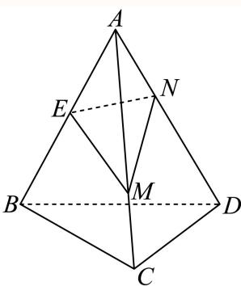
图(4)

## 三、解答题

## 几何设计、切割与体积优化

建立侧棱或截割参数与高、底面积的关系，核实可行区间及极值可达性。

### 嘉定 · 第11题

某建筑公司欲设计一个正四棱锥形纪念碑，要求其顶点位于容积为36π立方米的球形景观灯所在球面上．考虑到抗风、抗震等结构安全需求，侧棱长度l需满足 $\pm 2 { \sqrt { 3 } } \leq l \leq 3 { \sqrt { 3 } } .$ ．当纪念碑体积取得最大值时，正四棱锥的侧棱长约为 米（精确到0.01米）

> 本题资料或解析有待核事项，预览不可作为已审定成品。

**考点：** 棱锥外接球与几何最值

**难度依据：** 棱锥外接球与最值；需综合转化、参数分析或完整证明，推理链较长

**核查说明：** 侧棱范围、球面条件与参数公式OCR破损，需原卷复核。；已人工阅读底稿题干和解析；尚未逐页对照原PDF，不作为数学终审。；历史分类审查记录（不把旧记录直接判为当前未解决）：侧棱范围、球面条件与参数公式OCR破损，需原卷复核。 本次只归组，未修改题干、答案或专题归属；上述具体疑点仍交回源/数学复核处理。

【解析】

由题设可得球的半径为 $\scriptstyle \mathbf { r } = 3$ ，结合正四棱锥的结构特征及其外接球半径与棱长、底面边长的关系得 $6 h = l ^ { 2 }$ ，进而得到纪念碑体积关于l的表达式，应用导数求其最大值，并确定对应的侧棱长.

若球的半径为r，则 ${ \frac { 4 } { 3 } } \pi r ^ { 3 } = 3 6 \pi$ ，可得 $r = 3 , \ Z 2 \sqrt { 3 } \le l \le 3 \sqrt { 3 } .$

对于正四棱锥，设底面边长为 $^ { \cdot } a ,$ ，高为h，

则 $h ^ { 2 } = l ^ { 2 } - \left( \frac { \sqrt { 2 } } { 2 } a \right) ^ { 2 } = l ^ { 2 } - \frac { a ^ { 2 } } { 2 }$ ，所以 $\frac { a ^ { 2 } } { 2 } = l ^ { 2 } - h ^ { 2 }$ ，即 $a ^ { 2 } = 2 ( l ^ { 2 } - h ^ { 2 } )$

又 $( h - r ) ^ { 2 } + { \frac { a ^ { 2 } } { 2 } } = r ^ { 2 }$ ，则 ${ \frac { a ^ { 2 } } { 2 } } = 6 h - h ^ { 2 }$ ，故 $5 6 h = l ^ { 2 }$ ，即 ${ \mathfrak { h } } = { \frac { l ^ { 2 } } { 6 } }$

纪念碑体积 $| V = { \frac { 1 } { 3 } } a ^ { 2 } h = { \frac { 2 } { 3 } } \times \left( l ^ { 2 } - { \frac { l ^ { 4 } } { 3 6 } } \right) \cdot { \frac { l ^ { 2 } } { 6 } } = { \frac { 1 } { 9 } } \times \left( l ^ { 4 } - { \frac { l ^ { 6 } } { 3 6 } } \right)$ 令 $\cdot t = l ^ { 2 } \in [ 1 2 , 2 7 ]$

对 $\mp y = t ^ { 2 } - \frac { t ^ { 3 } } { 3 6 }$ ，则 $| y ^ { \prime } = 2 t - { \frac { t ^ { 2 } } { 1 2 } } = { \frac { 2 4 t - t ^ { 2 } } { 1 2 } }$ 在 $t \in [ 1 2 , 2 7 ]$ ]上单调递减，

当 $1 2 \leq t < 2$ 24时 $\dot { \boldsymbol { y } } ^ { \prime } > 0 \mathrm { ; }$ ，即 $y = t ^ { 2 } - { \frac { t ^ { 3 } } { 3 6 } }$ 在[12, 24)上单调递增，

当 $2 4 < t \leq$ 27时 $\dot { \boldsymbol y } ^ { \prime } < 0$ ，即 $y = t ^ { 2 } - { \frac { t ^ { 3 } } { 3 6 } }$ 在(24,27]上单调递减，

所以 $y _ { \mathrm { { m a x } } } = 2 4 ^ { 2 } - { \frac { 2 4 ^ { 3 } } { 3 6 } } = 1 9 2$ ，故 $V _ { \mathrm { m a x } } = \frac { 1 } { 9 } \times 1 9 2 = \frac { 6 4 } { 3 }$ ，此时 $l = 2 \sqrt { 6 } \approx 4 . 9 0$ 米.故答案为：4.90

### 奉贤 · 第19题

将一块边长为10cm的正方形铁片制作一个正四棱锥的容器罩．同学们设计了甲、乙、丙三个不同的方案，各自裁下阴影部分，用余下的制作成正四棱锥容器罩，形如最右边的图．甲和丙是去制作有盖的容器罩，乙是去制作无盖的容器罩．假设加工过程中铁片损失忽略不计．设甲、乙、丙中白色的四个等腰三角形的底边分别是x、m、n

甲

乙
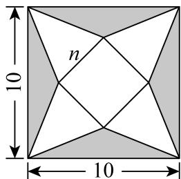
丙
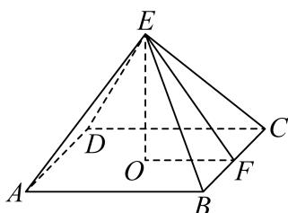
(1) (10分)请你选择其中的某一个方案，而且只需选一个方案（选择超过一个方案的，按第一个方案处理）．你选择的方案是______，求解以下2个问题：
①求出所选方案相对应的棱锥的侧面积 $S \left( x \right) , S \left( m \right) , S \left( n \right)$ ；
②求出所选方案相对应棱锥的体积V(x)、 $V \left( m \right) , \ V \left( n \right)$ 的最大值
(2) (4分)假设三个方案中相应的体积最大值分别记作 $V ( x ) _ { \mathrm { m a x } } \ { \cal V } ( m ) _ { \mathrm { m a x } } \ { \cal V } ( n ) _ { \mathrm { m a x } }$ ，请直接写出三者的大小关系．（不写判断理由与过程）

> 本题资料或解析有待核事项，预览不可作为已审定成品。

**考点：** (1)①展开图与棱锥侧面积；(1)②体积函数与最大值；(2)三方案最大体积比较

**难度依据：** 棱锥展开与体积最值；需综合转化、参数分析或完整证明，推理链较长

**核查说明：** 甲方案h=根号(25-5x)与所写定义域(0,10)不一致；侧面积及丙方案公式有OCR疑点，须核图和原解。；已人工阅读底稿题干和解析；尚未逐页对照原PDF，不作为数学终审。；历史分类审查记录（不把旧记录直接判为当前未解决）：甲方案h=根号(25-5x)与所写定义域(0,10)不一致；侧面积及丙方案公式有OCR疑点，须核图和原解。 本次只归组，未修改题干、答案或专题归属；上述具体疑点仍交回源/数学复核处理。

【解析】

(1) 选择甲方案： $\mathbb { O } S \left( x \right) = \frac { 1 } { 2 } x \cdot \left( 5 - \frac { x } { 2 } \right) \cdot 4 = 1 0 x - x ^ { 2 } \left( 0 < x < 1 0 \right)$

②该正四棱锥的高 $h \left( x \right) = \sqrt { \left( 5 - \frac { x } { 2 } \right) ^ { 2 } - \left( \frac { x } { 2 } \right) ^ { 2 } = \sqrt { 2 5 - 5 x } \left( 0 < x < 1 0 \right) } ,$

$$
\therefore V (x) = \frac {1}{3} x ^ {2} \cdot h (x) = \frac {1}{3} x ^ {2} \sqrt {2 5 - 5 x} = \frac {1}{6} \sqrt {2 5 x ^ {4} - 5 x ^ {5}} (0 <   x <   1 0),
$$

设 $z g \left( x \right) = 2 5 x ^ { 4 } - 5 x ^ { 5 } \left( 0 < x < 1 0 \right)$

$$
\left| g ^ {\prime} (x) = 1 0 0 x ^ {3} - 2 5 x ^ {4} = 2 5 x ^ {3} (4 - x) (0 <   x <   1 0) \right.
$$

当 $0 < x <$ < 4时， $g ^ { \prime } \left( x \right) > 0 ;$ ；当 $4 < x < 1$ 0时， $g ^ { \prime } \left( x \right) < 0$

∴函数 $. y = g \left( x \right)$ 在区间(0,4)上严格增，在区间(4,10)上严格减，

∴当x = 4时， $V ( x ) _ { \mathrm { m a x } } = { \frac { 1 6 { \sqrt { 5 } } } { 3 } }$

选择乙方案： $\textcircled { 1 } S \left( m \right) = \frac { 1 } { 2 } m \cdot 5 \cdot 4 = 1 0 m \left( 0 < m < 1 0 \right)$

②该正四棱锥的高h $( m ) = { \sqrt { 5 ^ { 2 } - \left( { \frac { m } { 2 } } \right) ^ { 2 } } } = { \sqrt { 2 5 - { \frac { m ^ { 2 } } { 4 } } } } \left( 0 < m < 1 0 \right)$

$$
\therefore V (m) = \frac {1}{3} m ^ {2} \cdot h (m) = \frac {1}{3} m ^ {2} \sqrt {5 ^ {2} - \left(\frac {m}{2}\right) ^ {2}} = \frac {1}{6} \sqrt {1 0 0 m ^ {4} - m ^ {6}} (0 <   m <   1 0),
$$

设 $z g \left( m \right) = 1 0 0 m ^ { 4 } - m ^ { 6 } \left( 0 < m < 1 0 \right)$

$$
\left. \right| g ^ {\prime} (m) = 4 0 0 m ^ {3} - 6 m ^ {5} = 2 m ^ {3} (2 0 0 - 3 m ^ {2}) (0 <   m <   1 0)
$$

当0 $< m < \frac { 1 0 \sqrt { 6 } } { 3 }$ 时， $g ^ { \prime } \left( m \right) > 0 ;$ 当 $\frac { 1 0 \sqrt { 6 } } { 3 } < m <$ < 10时， $g ^ { \prime } \left( m \right) < 0$ ∴函数 $y = g \left( m \right)$ 在区间 $\left( 0 , { \frac { 1 0 } { 3 } } { \sqrt { 6 } } \right)$ 上严格增，在区间 $\left( \frac { 1 0 } { 3 } \sqrt { 6 } , 1 0 \right)$ 上严格减∴当 $m = \frac { 1 0 \sqrt { 6 } } { 3 }$ 时， $V ( m ) _ { \mathrm { m a x } } = \frac { 1 0 0 0 \sqrt { 3 } } { 2 7 }$

选择丙方案： $\mathbb { O } S \left( n \right) = \frac { 1 } { 2 } n \left( 5 \sqrt { 2 } - \frac { n } { 2 } \right) = - n ^ { 2 } + 1 0 \sqrt { 2 } \left( 0 < n < 5 \sqrt { 2 } \right)$

②该正四棱锥的高h $\cdot ( n ) = { \sqrt { \left( 5 { \sqrt { 2 } } - { \frac { n } { 2 } } \right) ^ { 2 } - \left( { \frac { 1 } { 2 } } n \right) ^ { 2 } = { \sqrt { 5 0 - 5 { \sqrt { 2 } } n } } \left( 0 < n < 5 { \sqrt { 2 } } \right) } }$

$$
V (n) = \frac {1}{3} n ^ {2} \sqrt {5 0 - 5 \sqrt {2} n} = \frac {1}{3} \sqrt {5 0 n ^ {4} - 5 \sqrt {2} n ^ {5}} (0 <   n <   5 \sqrt {2}),
$$

令 $f \left( n \right) = 5 0 n ^ { 4 } - 5 \sqrt { 2 } n ^ { 5 }$ ，则 $f ^ { \prime } \left( n \right) = 2 0 0 n ^ { 3 } - 2 5 \sqrt { 2 } n ^ { 4 } = 2 5 \sqrt { 2 } n ^ { 3 } \left( 4 \sqrt { 2 } - n \right)$

当 $0 < n < 4 { \sqrt { 2 } } |$ 时， $f ^ { \prime } \left( n \right) > 0$ ；当 $4 { \sqrt { 2 } } < n < 5 { \sqrt { 2 } }$ 时， $f ^ { \prime } \left( n \right) < 0$

所以函数 $y = f \left( n \right)$ 在区间 $( 0 , 4 \sqrt { 2 } )  { \mathrm { \perp } } \vec { \mathnormal { \mathnormal { \imath } } }$ 格增，在区间 $\left( 4 { \sqrt { 2 } } , 5 { \sqrt { 2 } } \right)$ 上严格减，所以当 $n = 4 \sqrt { 2 }$ 时， $V ( n ) _ { \mathrm { m a x } } = { \frac { 3 2 { \sqrt { 1 0 } } } { 3 } }$

(2) 甲乙丙中总面积一样，由于乙的方案是不需要盖，所以相应的侧面积多了，因此凭直觉猜想乙的体积最大，可以猜想： $V ( m ) _ { \mathrm { m a x } } > V ( n ) _ { \mathrm { m a x } } > V ( x ) _ { \mathrm { m a x } }$

### 金山 · 第7题

已知圆锥底面半径为1，高为 ${ \sqrt { 3 } } ,$ ，则过圆锥母线的截面面积的最大值为

**考点：** 母线截面角与面积

**难度依据：** 圆锥截面面积最大；需一次转化并结合定义域或几何条件计算

**核查说明：** 已人工阅读完整底稿题干及原解，未逐页对照正式PDF，分类不等于数学终审。

【答案】${ \sqrt { 3 } } .$

【解析】

依题意求得圆锥的母线长，确定轴截面的顶角，从而求出截面面积的取值的最大值，由此得解．

依题意，设圆锥的母线长为l，

∵圆锥的底面半径为1，高为 $\sqrt { 3 }$ ，

$$
\therefore l = \sqrt {3 + 1} = 2,
$$

设圆锥的轴截面的两母线夹角为θ，显然 $\wp = { \frac { \pi } { 3 } }$

则过该圆锥的母线作截面，截面上的两母线夹角设为 $\alpha , \alpha \in \left( 0 , { \frac { \pi } { 3 } } \right]$

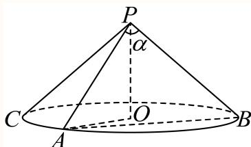

故截面的面积为 $S = { \frac { 1 } { 2 } } \times 2 \times 2 \times \sin \alpha = 2 \sin \alpha \leq { \sqrt { 3 } }$ ，当且仅当 $\alpha = \frac { \pi } { 3 }$ 时，等号成立，故截面的面积的最大值为 $\sqrt { 3 }$

故答案为： ${ \sqrt { 3 } } .$

### 长宁 · 第11题

现有一块正四面体木料PABC，其边长为3，现需要将木料进行切割，要求切割后底面ABC上任意一点Q到顶点P的距离不大于 ${ \sqrt { 7 } } ,$ ，则切割好后，木料体积的最大值是 ．（结果保留π）

**考点：** 正四面体切割及曲边锥体体积；圆与三角形交域面积

**难度依据：** 正四面体切割及曲边锥体体积；圆与三角形交域面积；需多步建模、分类或参数约束

**核查说明：** 已人工阅读底稿题干和原解；未逐页对照PDF，不作为数学终审。

【答案】$\frac { 3 \sqrt { 2 } } { 4 } + \frac { \sqrt { 6 } \pi } { 6 }$

【解析】

设正四面体定点P在底面ABC的投影为O，连接OA，可得以O为圆心，半径为1的圆在底面$\triangle A B C$ 内的部分为底，以P为顶点的几何体即为符合要求的部分，先求解底面面积，PO为高，即可求解切割好后，木料体积的最大值

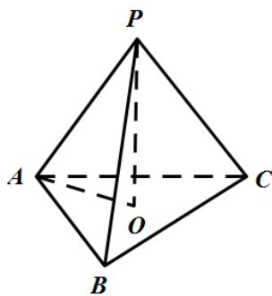

设正四面体定点P在底面ABC的投影为O，则O为正三角形ABC的中心，

连接 $O A$ ，所以 $A O = { \frac { 2 } { 3 } } \times { \frac { \sqrt { 3 } } { 2 } } \times 3 = { \sqrt { 3 } } , P O = { \sqrt { P A ^ { 2 } - A O ^ { 2 } } } = { \sqrt { 6 } } ,$

若底面 $A B C$ 上任意一点Q到顶点P的距离不大于 ${ \sqrt { 7 } } ,$

设 $P Q = { \sqrt { 7 } } .$ ，则 $O Q = { \sqrt { P Q ^ { 2 } - P O ^ { 2 } } } = 1$ ，

所以以O为圆心，半径为1的圆在底面 $\triangle A B C$ 内的部分为底，以P为顶点的几何体即为符合要求的部分，

如图以O为圆心，半径为1的圆与底面 $\triangle A B C$ 相交的交点为 $M , N _ { \mathrm { { i } } }$

延长 $. O A { \stackrel { . } { \times } } B C { \mp } E$ ，连接OM，ON，

所以 $O E = \frac { 1 } { 3 } \times \frac { \sqrt { 3 } } { 2 } \times 3 = \frac { \sqrt { 3 } } { 2 } , \ O M = O N = 1$

所以 $\cos \angle E O M = { \frac { O E } { O M } } = { \frac { \sqrt { 3 } } { 2 } }$ ，所以 $\angle E O M = \frac { \pi } { 6 }$

所以 $\angle M O N = \frac { \pi } { 3 }$ ，所以 $\triangle M O N$ 为等边三角形，

所以以O为圆心，半径为1的圆在底面 $\triangle A B C$ 内的部分的面积为

$$
\pi \times 1 ^ {2} - 3 \times \left(\frac {1}{6} \pi \times 1 ^ {2} - \frac {\sqrt {3}}{4} \times 1 ^ {2}\right) = \frac {\pi}{2} + \frac {3 \sqrt {3}}{4},
$$

所以切割好后，木料体积的最大值是 ${ \frac { 1 } { 3 } } \times \left( { \frac { \pi } { 2 } } + { \frac { 3 { \sqrt { 3 } } } { 4 } } \right) \times { \sqrt { 6 } } = { \frac { 3 { \sqrt { 2 } } } { 4 } } + { \frac { { \sqrt { 6 } } \pi } { 6 } }$

故答案为： $\frac { 3 \sqrt { 2 } } { 4 } + \frac { \sqrt { 6 } \pi } { 6 }$

### 静安 · 第9题

用总长为14.8m的钢条制作一个长方体容器的框架，且容器底面的长边比短边长0.5m（不计损耗）若要使该容器的容积最大，则容器的高为 m

**考点：** 长方体框架体积；三次函数导数求最值

**难度依据：** 长方体框架体积；三次函数导数求最值；需组合两类关系并检查区间或等号

**核查说明：** 已人工阅读底稿题干和原解；未逐页对照PDF，不作为数学终审。

【答案】1.2.

【解析】

设底面短边长为 m，求出容器的容积的表达式，再利用导数求出最大值即可

设底面短边长为xm，

则长边长为 $( x + 0 . 5 ) \mathrm { m } .$ ，高为 ${ \frac { 1 4 . 8 - 4 x - 4 ( x + 0 . 5 ) } { 4 } } = ( 3 . 2 - 2 x ) \mathrm { m } ,$

则 $\displaystyle { \int _ { 3 . 2 - 2 x > 0 } ^ { x > 0 } }$ 解得 $0 < x < 1 . 6$

则容器的容积 $^ { 1 } V \left( x \right) = x \left( x + 0 . 5 \right) \left( 3 . 2 - 2 x \right) = - 2 x ^ { 3 } + 2 . 2 x ^ { 2 } + 1 . 6 x , 0 < x < 1 . 6 ,$

则 $\begin{array} { r } { V ^ { \prime } \left( x \right) = - 6 x ^ { 2 } + 4 . 4 x + 1 . 6 = - \left( 6 x + 1 . 6 \right) \left( x - 1 \right) } \end{array}$

令 $V ^ { \prime } \left( x \right) > 0 ,$ ，得 $0 < x < 1$ ，令 $V ^ { \prime } \left( x \right) < 0 ,$ ，得 $1 < x < 1 . 6$

所以函数V(x)在(0,1)上单调递增，在(1,1.6)上单调递减，

所以当x = 1时，V(x)取得最大值，

所以要使该容器的容积最大，则容器的高为 $3 . 2 - 2 = 1 . 2 \mathrm { m }$

故答案为：1.2.

