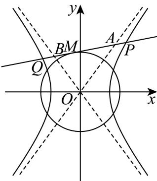
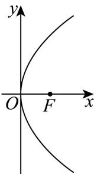
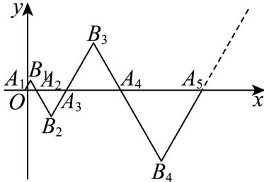

# 2025二模 解析几何专题 · 学生版

> 本地预览：题目、答案及分类尚未全部审定。校对使用的PDF为高中工作台解析版，尚未逐区确认区级印刷原卷。

## 直线与圆的基本度量

通过斜率、配方、圆心距或点线距离求直线方程、弦长及半径。

### 嘉定 · 第7题

直线l: $y = x + 1$ 与圆 $C { : } x ^ { 2 } + y ^ { 2 } - 4 x - 2 y = 0$ 相交所得的弦长为

### 奉贤 · 第5题

直线3x + 4y − 5 = 0上的动点P和直线 $3 x + 4 y + 1 0 = 0$ 上的动点Q，则点P与点Q之间距离的最小值是

### 奉贤 · 第6题

已知θ是斜率为−1的直线的倾斜角，计算 $\sin \left( \theta - { \frac { \pi } { 2 } } \right) =$

### 崇明 · 第4题

求直线x = −2与直线 ${ \sqrt { 3 } } x - y + 1 = 0$ 的夹角为 .

### 浦东 · 第3题

圆的方程为 $\textstyle { | x ^ { 2 } + y ^ { 2 } - 4 x + 6 y + 1 2 = 0 }$ ，则该圆的半径为

### 虹口 · 第5题

若直线l与直线y = x平行，且经过圆 $x ^ { 2 } - 2 x + y ^ { 2 }$ = 0的圆心，则l的方程为

> 本题资料或解析有待核事项，预览不可作为已审定成品。

## 圆锥曲线定义、参数与焦点几何

先识别焦点准线或离心率关系，再以几何定义处理焦点三角形及光学性质。

### 奉贤 · 第8题

抛物线 $\dot { x } ^ { 2 } = 4 y$ 的准线与圆 $x ^ { 2 } + y ^ { 2 } = r ^ { 2 }$ 相切，将圆绕直径所在直线旋转一周形成一个几何体，则该几何体的表面积为

### 宝山 · 第3题

抛物线x2 = 4y的准线方程是

### 崇明 · 第11题

已知双曲线 $x ^ { 2 } - { \frac { y ^ { 2 } } { b ^ { 2 } } } = 1 \left( b > 0 \right)$ 的左、右焦点为 $F _ { 1 } , F _ { 2 }$ ，以O为顶点， $F _ { 2 }$ 为焦点作抛物线交双曲线于P，且 $\angle P F _ { 1 } F _ { 2 } = 4 5 ^ { \circ }$ ，则 $| b ^ { 2 } = |$

> 本题资料或解析有待核事项，预览不可作为已审定成品。

### 徐汇 · 第10题

已知双曲线 ${ \frac { x ^ { 2 } } { a ^ { 2 } } } - { \frac { y ^ { 2 } } { b ^ { 2 } } } = 1 ( a > 0 , b > 0 )$ 的左焦点为 $F _ { 1 }$ ，右焦点为 $F _ { 2 }$ .若双曲线的右支上存在一点P，使得直线 $P F _ { 1 }$ 与以双曲线的实轴为直径的圆相切，切点为线段 $P F _ { 1 }$ 的中点，则该双曲线的离心率为

### 普陀 · 第5题

设m > 2，拋物线 $C \colon x ^ { 2 } = 2 m y$ 上的点P到C的焦点的距离为5，点P到y轴的距离为3，则m的值为

### 普陀 · 第15题

设 $\because { \cal 0 } , { \cal b } > 0$ ，点 $M \left( x _ { 0 } , y _ { 0 } \right)$ ，O是坐标原点， $| O M | = a _ { \mathrm { { . } } }$ ，F是双曲线Γ: ${ \frac { x ^ { 2 } } { a ^ { 2 } } } - { \frac { y ^ { 2 } } { b ^ { 2 } } } = 1$ 1的左焦点，若直线l: $x _ { 0 } x + y _ { 0 } y = a ^ { 2 }$ 经过点F，且与双曲线Γ的右支在第一象限内交于P点，则双曲线Γ的离心率的一个可能的值是（ ）

A. $\frac { \sqrt { 5 } } { 2 }$

B. $\frac { \sqrt { 6 } } { 2 }$

C. $\frac { \sqrt { 7 } } { 2 }$

D. $\frac { \sqrt { 1 1 } } { 2 }$

### 杨浦 · 第11题

如图，阿基米德椭圆规是由基座､带孔的横杆､两条互相垂直的空槽､两个可动滑块A､B组成的一种绘图工具，横杆的一端C上装有铅笔，假设两条互相垂直的空槽和带孔的横杆都足够长，将滑块A､B固定在带孔的横杆上，令滑块A在中一条空槽上滑动，滑块B在另一条空槽上滑动，铅笔C随之运动就能画出椭圆.当A､B之间的距离为14厘米时，若需要画出一个离心率为 $\frac { 4 } { 5 }$ 的椭圆，则B､C之间的距离为 .厘米.

### 松江 · 第2题

抛物线y2 = 8x的焦点到准线的距离是

### 长宁 · 第16题

椭圆具有如下光学性质：如图， $F _ { 1 } \left( - c , 0 \right) , F _ { 2 } \left( c , 0 \right)$ 分别是椭圆 ${ \frac { x ^ { 2 } } { a ^ { 2 } } } + { \frac { y ^ { 2 } } { b ^ { 2 } } } = 1$ 1的左、右焦点，从点 $F _ { 1 }$ 发出的光线在到达椭圆上的点P后，经过到达点的切线反射后经过点 $F _ { 2 }$ ，有以下两个命题：

①若P是椭圆上除长轴端点外的一点，设法线与x轴的交点为M(t,0)，则 $t \in \left( - \frac { c ^ { 2 } } { a } , \frac { c ^ { 2 } } { a } \right)$
②若从 $F _ { 1 }$ 发出的光线，经椭圆两次反射后，第一次回到 $F _ { 1 }$ 所经过的路程为8c，则该椭圆的离心率为$\frac { 1 } { 2 }$ ；
则以下说法正确的是（ ）

A. ①是真命题，②是真命题

B. ①是真命题，②是假命题

C. ①是假命题，②是真命题

D. ①是假命题，②是假命题

> 本题资料或解析有待核事项，预览不可作为已审定成品。

### 闵行 · 第11题

已知某星球的球心为F，半径为R，该星球的卫星的运行轨道是以F为一个焦点的椭圆，该椭圆的离心率为 $\frac { 3 } { 5 }$ ，卫星运行过程中离该星球表面最近的距离为R，若当卫星处于某位置时，用卫星上的光学仪器观测该星球，把光学仪器的镜头与星球表面被观测点的连线称为视线，任意两条视线所成的最大夹角称为张角，则卫星运行过程中张角的最小值为 ．（精确到0.1°）

### 静安 · 第3题

椭圆 ${ \frac { x ^ { 2 } } { 4 } } + { \frac { y ^ { 2 } } { 3 } } = 1$ 的离心率是

### 黄浦 · 第3题

抛物线 $\operatorname { i } y ^ { 2 } = x $ 的焦点到其顶点的距离为

## 圆及空间轨迹与几何最值

将模、垂直或距离比例条件转为平面或空间轨迹；空间角度最值应交代轨迹转化与可达性。

### 宝山 · 第12题

空间中有相互垂直的两条异面直线 $l _ { 1 } , \ l _ { 2 }$ ，点A、 $B \in l _ { 1 } , C , \ D \in l _ { 2 }$ ，且 $A B = 4 , C D = 1$ ，若 $D A \bot D B$ ，且 $A C = B C + 2$ ，则二面角 $D - A B - C$ 平面角的余弦值最小为

> 本题资料或解析有待核事项，预览不可作为已审定成品。

### 杨浦 · 第7题

已知复数z满足 $| z - 1 + \mathrm { i } | = 1$ ，其中i为虚数单位，则|z|的最小值为

### 松江 · 第9题

已知点P为直线l: $x + y + 1 = 0 .$ 上的点，过点P作圆N: $( x - 1 ) ^ { 2 } + ( y - 1 ) ^ { 2 } = 1$ 的切线PA，切点为A，则 $\cos \angle P N A$ 最大值为

### 松江 · 第11题

设向量 $\vec { \cdot a } = ( x _ { 1 } , y _ { 1 } ) , \vec { b } = ( x _ { 2 } , y _ { 2 } )$ ，记 $\displaystyle { \mathop { \ ? } { \vec { a } } } \star { \vec { b } } = x _ { 1 } x _ { 2 } - y _ { 1 } y _ { 2 }$ .若点 $A _ { 1 } , ~ A _ { 2 } , ~ A _ { 3 }$ 为圆C：
$x ^ { 2 } + y ^ { 2 } + 4 x - 2 y = 0 .$ 上任意三点，且满足 $A _ { 1 } A _ { 2 } \bot A _ { 2 } A _ { 3 }$ ，则 $\Bigl | \overrightarrow { O A _ { 1 } } \star \overrightarrow { O A _ { 2 } } + \overrightarrow { O A _ { 2 } } \star \overrightarrow { O A _ { 3 } } \Bigr |$ 的取值范围是

### 浦东 · 第8题

设M(x,y)为抛物线 $\dot { y } ^ { 2 } = 4 x$ 上任意一点，若x+2y+m的最小值为1，则m的值为

### 虹口 · 第8题

已知z是实系数一元二次方程 $x ^ { 2 } + p x + q = 0$ 的一个虚根，且 $. | z - 1 | = 2$ ，若z在复平面上所对应的点在抛物线 $\dot { y } ^ { 2 } = 4 x _ { - }$ 上，则p = .

### 金山 · 第16题

已知点A $( x _ { 1 } , y _ { 1 } )$ 在圆 $x ^ { 2 } + y ^ { 2 } = 9 .$ 上，点 $B \left( x _ { 2 } , y _ { 2 } \right)$ 在圆 $x ^ { 2 } + y ^ { 2 } = 1 2$ 上，且
$x _ { 1 } x _ { 2 } + y _ { 1 } y _ { 2 } = x _ { 1 } + x _ { 2 } - 1$ ,O为坐标原点.对于以下两个命题，判断正确的是（ ）
①在坐标平面内存在点P，使得 $A P \bot B P$ 恒成立；
②三角形OAB面积的最小值为 ${ \sqrt { 2 2 } }$

A. ①是真命题，②是真命题

B. ①是假命题，②是真命题

C. ①是真命题，②是假命题

D. ①是假命题，②是假命题

> 本题资料或解析有待核事项，预览不可作为已审定成品。

### 长宁 · 第11题

现有一块正四面体木料PABC，其边长为3，现需要将木料进行切割，要求切割后底面ABC上任意一点Q到顶点P的距离不大于 ${ \sqrt { 7 } } ,$ ，则切割好后，木料体积的最大值是 ．（结果保留π）

### 青浦 · 第9题

已知复数z、w满 $\Re { | z | } = 2 , z = ( 1 + \mathrm { i } ) w$ （i是虚数单位），则|w+2|的最大值是

### 青浦 · 第10题

已知点P是抛物线 $y ^ { 2 } = 8 x$ 上一动点，点Q在圆 $( x - 5 ) ^ { 2 } + y ^ { 2 } = 1$ 上运动，则P与Q两点间最短距离为

### 黄浦 · 第8题

已知a为常数，圆 $( x - a ) ^ { 2 } + ( y + a - 2 ) ^ { 2 } = r ^ { 2 } ( r > 0 )$ 与圆 $x ^ { 2 } + y ^ { 2 } = 1$ 有公共点，当r取到最小值时，a的值为

## 椭圆弦、面积与分点约束

联立直线与椭圆后利用韦达、弦长及面积，参数范围同时保留判别式和点位。

### 嘉定 · 第20题

已知椭圆C： ${ \frac { x ^ { 2 } } { 9 } } + y ^ { 2 } = 1$ ．F为椭圆的右焦点，过椭圆上一点 $P \left( 3 , 0 \right)$ 的直线 $\vdots l _ { 1 }$ 交椭圆于另 $- \sharp { \sf Q }$ 点M为椭圆上任意一点

(1) (4分)求|MF|的最小值；
(2) (6分)当直线l1的斜率为1时，求 $\triangle P Q M$ 面积的最大值及此时点M的坐标；
(3) (8分)若直线PQ与直线 $\mathbf { \langle } l _ { 2 } : x = - 3$ 交于点D，点D不在x轴上，Q关于原点的对称点为点R，直线PR与 $\mathrm { i } _ { 2 }$ 交于点E，求线段|DE|的取值范围

> 本题资料或解析有待核事项，预览不可作为已审定成品。

### 普陀 · 第20题

设 $a > b > 0 , m > 0$ ，点A、F分别是椭圆Γ: ${ \frac { x ^ { 2 } } { a ^ { 2 } } } + { \frac { y ^ { 2 } } { b ^ { 2 } } } = 1$ 的上顶点与右焦点，且 $\left| A F \right| = 2 { \mathrm { . } }$ ，直线 $l { : } x - m y - 1 = 0$ 经过点F与Γ交于P、Q两点，O是坐标原点.
(1) (4分)求椭圆Γ的方程；
(2) (6分)若 $m = { \sqrt { 3 } } .$ ，点M是x轴上的一点，且 $\triangle M P Q$ 的面积为 $\frac { 6 } { 1 3 }$ ，求点M的坐标；
(3) (8分)若点G在直线x = 5上，向量 $\vec { P G }$ 在直线l上的投影为向量 $\vec { P F }$ ，证明 $\angle P G Q < \frac { \pi } { 4 }$

### 松江 · 第20题

已知椭圆Γ: ${ \frac { x ^ { 2 } } { a ^ { 2 } } } + { \frac { y ^ { 2 } } { b ^ { 2 } } } = 1 ( a > b > 0 )$ 的左右焦点分别为 $F _ { 1 } , \ F _ { 2 } ,$ ，上下顶点分别为 $B _ { 1 } .$ 、
$B _ { 2 } , \triangle B _ { 1 } F _ { 1 } F _ { 2 }$ 是面积为 $\sqrt { 3 }$ 的正三角形，过焦点的直线交椭圆Γ于P、Q两点（P、Q分别在第一、四象限）.
(1) (4分)求椭圆Γ的离心率；
(2) (6分)已知点 $M ( 0 , m ) , ~ m > 0$ ，求椭圆Γ上的动点R到点M的最大距离；
(3) (8分)求四边形 $B _ { 1 } B _ { 2 } Q I$ P面积的取值范围.

> 本题资料或解析有待核事项，预览不可作为已审定成品。

### 金山 · 第20题

已知椭圆Γ: ${ \frac { x ^ { 2 } } { 4 } } + { \frac { y ^ { 2 } } { 3 } } = 1$ ，左右焦点分别为 $F _ { 1 } , F _ { 2 }$ ，上下顶点分别为A,B，左右顶点分别为 $C , D ,$ P,Q是Γ上异于椭圆顶点的两点.
(1) (4分)求 $\triangle A F _ { 1 } F _ { 2 }$ 的周长；
(2) (6分)若点Q在第一象限且满足 $. \triangle A B Q$ 的面积比 $\triangle F _ { 1 } F _ { 2 } Q$ 的面积大，求点Q的横坐标的取值范围；
(3) (8分)记点A在直线PQ上的投影为H，且直线CP的斜率是直线DQ的斜率的3倍，试判断：过点A,H,O(O为坐标原点)三点的圆是否为定圆？若是，求出该圆的方程；若不是，请说明理由.

> 本题资料或解析有待核事项，预览不可作为已审定成品。

### 黄浦 · 第20题

椭圆Γ: ${ \frac { x ^ { 2 } } { a ^ { 2 } } } + { \frac { y ^ { 2 } } { b ^ { 2 } } } = 1 ( a > b > 0 )$ 的左、右焦点分别为 $F _ { 1 } ( - c , 0 ) , F _ { 2 } ( c , 0 ) ( c > 0 )$ ，过点 $F _ { 1 }$ 的直线l与Γ 交于点P
(1) (4分)若c = 2，点P的坐标为 $\left( 2 , { \sqrt { 2 } } \right)$ ，求点 $F _ { 2 }$ 到直线l的距离；
(2) (6分)当b ≤ c时，求满足 $P F _ { 1 } \bot P F _ { 2 }$ 的点P的个数；
(3) (8分)设直线l与Γ的另一个交点为Q，− $\overrightarrow { F _ { 1 } Q } = \lambda \overrightarrow { Q P } \left( \lambda \in \bf R \right)$ ，点P的横坐标为 $\frac { c } { 2 }$ ，若Γ的离心率 $e > \frac 1 2$ ，求λ的取值范围

## 双曲线弦、渐近线与角度

结合焦点定义、斜率角及向量约束，区分同支异支和直线斜率不存在。

### 宝山 · 第20题

已知双曲线 $C { : } x ^ { 2 } - \frac { y ^ { 2 } } { 3 } = 1 , F _ { 1 }$ 、 $F _ { 2 }$ 分别是其左、右焦点，直线l与双曲线C的右支交于A、B两点.
(1) (4分)当直线l过点 $F _ { 2 }$ ，且 $| A B | = 6 \mathbb { H }$ ，求 $\triangle A B F _ { 1 }$ 的周长；
(2) (6分)已知点N (−2, 3)，若直线AN、BN的斜率之和为0，且 $\tan \angle A N B = \frac { 4 } { 3 }$ ，当AN、BN分别与y轴交于点R、S时，求 $\triangle R S N$ 的面积；
(3) (8分)已知直线l过点F2，P是双曲线C上一点且位于第一象限，且满足− $F _ { 2 }$ $\overrightarrow { O Q } = 2 \overrightarrow { O P }$ 的点Q在线段AB上，若 $\overrightarrow { A B } = 2 \overrightarrow { Q F _ { 2 } }$ ，求点P的坐标.

> 本题资料或解析有待核事项，预览不可作为已审定成品。

### 杨浦 · 第20题

已知双曲线Γ的标准方程为 $x ^ { 2 } - { \frac { y ^ { 2 } } { 2 } } = 1$ ，点P是双曲线Γ右支上的一个动点.

(1) (4分)求双曲线Γ的焦点坐标和渐近线方程；
(2) (6分)过点P分别向两条渐近线作垂线，垂足为点 $P _ { 1 } , P _ { 2 }$ ，求− $\overrightarrow { P P _ { 1 } } \cdot \overrightarrow { P P _ { 2 } }$ 的值；
(3) (8分)若 $| O P | > { \sqrt { 2 } } ,$ ，如图，过P作圆 $O \colon x ^ { 2 } + y ^ { 2 } =$ 2的切线l，切点为M，交双曲线Γ的左支于 点Q，分别交两条渐近线于点A､B.设 $| P Q | = \lambda | A B |$ ，求实数λ的取值范围

> 本题资料或解析有待核事项，预览不可作为已审定成品。

### 虹口 · 第20题

已知点 $F _ { 1 }$ 和 $F _ { 2 }$ 是双曲线 $C \colon \frac { x ^ { 2 } } { a ^ { 2 } } - y ^ { 2 } = 1 \left( a > 0 \right)$ 的左、右焦点.
(1) (4分)若 $y = x$ 是双曲线C的一条渐近线，求C的离心率；
(2) (6分)当 $a = { \sqrt { 2 } } \mathbb { H } { \bmod { } }$ ，若双曲线C上存在一点P满足 $| P F _ { 1 } | + | P F _ { 2 } | = 4 .$ ，求 $\triangle P F _ { 1 } F _ { 2 }$ 的面积；
(3) (8分)若在双曲线C上分别存在两点A和B，点A在第一象限，点B在第二象限，使得四边形$F _ { 1 } B A F _ { 2 }$ 的面积为 $2 \sqrt { a ^ { 2 } + 1 }$ ，且存在实数λ使 ${ \overline { { F _ { 2 } A } } } = \lambda { \overline { { F _ { 1 } B } } }$ ，求实数a的取值范围.

> 本题资料或解析有待核事项，预览不可作为已审定成品。

### 长宁 · 第20题

已知双曲线Γ: ${ \frac { x ^ { 2 } } { a ^ { 2 } } } - { \frac { y ^ { 2 } } { b ^ { 2 } } } = 1$ 的左、右焦点分别为 $F _ { 1 } , F _ { 2 }$ ，点A是其左顶点，点P是双曲线上一点，且位于第一象限，若双曲线Γ的离心率 $\displaystyle { e = 2 , b = 2 \sqrt { 3 } } .$
(1) (4分)求双曲线Γ的方程；
(2) (6分)若三角形 $A P F _ { 2 }$ 是等腰三角形，求点P的坐标；
(3) (8分)直线 $P F _ { 2 }$ 不垂直于x轴，且与曲线Γ的另一个交点为Q，若 $\angle P F _ { 1 } Q$ 是锐角，求直线 $P F _ { 2 }$ 的斜率的取值范围

> 本题资料或解析有待核事项，预览不可作为已审定成品。

### 闵行 · 第20题

已知双曲线Γ: $x ^ { 2 } - { \frac { y ^ { 2 } } { 3 } } = 1$ 的右焦点为F，过点F的直线l交双曲线Γ右支于A、B两点（点A在x轴上方），点C在双曲线Γ上，直线AC交x轴于点Q（点Q在点F的右侧）
(1) (4分)求双曲线Γ的渐近线方程；
(2) (6分)若点A (2, 3)，且 $\tan \angle B A C = \frac { 1 } { 2 }$ ，求点C的坐标；
(3) (8分)若 $\triangle A B C$ 的重心G在x轴上，记 $\triangle A F G , \ \triangle C Q G$ 的面积分别为S1、 $S _ { 2 }$ ，求 $\frac { S _ { 1 } } { S _ { 2 } }$ 的最小值

## 抛物线中点弦、垂直弦与面积

以焦准性质和弦端点代数关系连接中点、定点垂直及面积优化。

### 崇明 · 第20题

已知抛物线Γ: $x ^ { 2 } = 4 y ,$ ，过点 $P \left( a , b \right)$ 的直线l与抛物线Γ交于点A、B，与y轴交于点C

(1) (4分)若点A位于第一象限，且点A到抛物线Γ的焦点的距离等于3，求点A的坐标；
(2) (6分)若点A坐标为(4,4)，且点B恰为线段AC的中点，求原点O到直线l的距离；
(3) (8分)若抛物线Γ上存在定点D使得满足题意的点A、B都有 $D A \bot D B$ ，求a、b满足的关系式

> 本题资料或解析有待核事项，预览不可作为已审定成品。

### 徐汇 · 第20题

已知抛物线C: $y ^ { 2 } = 4 x$ ，点F是抛物线C的焦点

(1) (4分)求点F的坐标及点F到准线l的距离；
(2) (6分)过点F作相互垂直的两条直线 $l _ { 1 } , l _ { 2 } , \ l _ { 1 }$ 交抛物线C于点 $P _ { 1 } , \ P _ { 2 } , \ l _ { 2 }$ 交抛物线C于点 $\ Q _ { 1 } , \ Q _ { 2 }$ ，求证： $\frac { 1 } { | P _ { 1 } P _ { 2 } | } + \frac { 1 } { | Q _ { 1 } Q _ { 2 } | }$ 为定值，并求出该定值；
(3) (8分)过点F且斜率为√3的直线交抛物线C于A、B两点，设点P不在直线AB上且PF为 $\triangle P A B$ 的内角平分线，求 $\triangle P A$ B面积的最大值.

### 静安 · 第20题

如图，在直角坐标平面 $\mathrm { \bf x O y }$ 中， $\triangle A _ { i } B _ { i } A _ { i + 1 }$ 中 $( i = 1 , 2 , \cdot \cdot \cdot , n , \cdot \cdot \cdot )$ 为正三角形，且满足$\overrightarrow { O A _ { 1 } } = \left( - \frac { 1 } { 4 } , 0 \right) , \overrightarrow { A _ { i } A _ { i + 1 } } = ( 2 i - 1 , 0 )$

(1) (4分)求点 $A _ { n }$ 的横坐标 $X _ { n }$ 关于正整数n的表达式；
(2) (6分)求证：点 $B _ { 1 } , \ B _ { 2 } , . . . , \ B _ { n } . .$ 在抛物线Γ： $y ^ { 2 } = 3 x .$ 上；
(3) (8分)过（2）中抛物线Γ： $y ^ { 2 } = 3 x$ 的焦点F作两条互相垂直的弦AC和BD，求四边形ABCD面积的最小值

> 本题资料或解析有待核事项，预览不可作为已审定成品。

## 拼接、旋转与几何构造综合

拼接曲线分支或旋转构造须分别落实约束；新定义先译成代数与几何条件。

### 奉贤 · 第20题

如图1，曲线 $\Gamma$ 是 $\dfrac{x^2}{4}+\dfrac{y^2}{b^2}=1\ (y\ge0)$ 与 $\dfrac{y^2}{b^2}-\dfrac{x^2}{4}=1\ (y\ge0)$ 组合的。

| 图1 | 图2 |
|:---:|:---:|
|  |  |

(1)（4分）$\dfrac{x^2}{4}+\dfrac{y^2}{b^2}=1\ (y\ge0)$ 过点 $\left(-1,\dfrac32\right)$，求 $\dfrac{y^2}{b^2}-\dfrac{x^2}{4}=1\ (y\ge0)$ 的渐近线方程；

(2)（6分）$b=\sqrt2$，设 $T(0,t)$，$t\in\left[-\dfrac{\sqrt2}{2},3\sqrt2\right]$，曲线 $\Gamma$ 上找一个点 $Q$，使得 $|\overrightarrow{TQ}|$ 达到最小；

(3)（8分）若 $b=1$，如图2，存在过点 $P(0,1)$ 的两条直线 $l_1$、$l_2$ 与曲线 $\Gamma$ 的交点分别是点 $A$、点 $M$、点 $B$、点 $N$，点 $A$ 在第二象限，点 $M$ 在第一象限。是否存在非零实数 $\lambda$ 使得 $\overrightarrow{MN}=\lambda\overrightarrow{AB}$ 成立，请说明理由。

> 本题资料或解析有待核事项，预览不可作为已审定成品。

### 杨浦 · 第12题

由若干个多边形所覆盖的区域，称为这些多边形的并集，例如图中，梯形ACDE是 $\triangle A C E$ 与矩形BCDE的并集.已知n是正整数，在平面直角坐标系 $x O y \boxed { \mathsf { H } }$ ，直线 $\therefore \boldsymbol { l } _ { n }$ 的方程为 $y = - 2 ^ { n } x + n ,$ ，若直线$l _ { n }$ 交x轴于点 $A _ { n }$ ，交y轴于点 $B _ { n }$ ，则 $\triangle A _ { 1 } O B _ { 1 } , \triangle A _ { 2 } O B _ { 2 } , \cdot \cdot \cdot , \triangle A _ { 1 0 } O B _ { 1 0 }$ 的并集，其面积为

### 浦东 · 第16题

已知圆锥曲线Γ的对称中心为原点O，若对于Γ上的任意一点A，均存在Γ上两点B，C，使得原点O到直线AB，AC和BC的距离都相等，则称曲线Γ为“完美曲线”．现有如下两个命题：
①任意椭圆都是“完美曲线”；②存在双曲线是“完美曲线”
下列判断正确的是（ ）

A. ①是真命题，②是假命题

B. ①是假命题，②是真命题

C. ①②都是真命题

D. ①②都是假命题

> 本题资料或解析有待核事项，预览不可作为已审定成品。

### 浦东 · 第20题

已知椭圆 $C_1$ 的方程为 $\frac{x^2}{3}+y^2=1$，右顶点为 $A$，上顶点为 $B$，椭圆 $C_2$ 的中心位于坐标原点，两个椭圆的离心率相等。
(1) (4分) 若椭圆 $C_2$ 的方程是 $\frac{x^2}{a^2}+\frac{y^2}{2a}=1\ (a>0)$，焦点在 $x$ 轴上，求 $a$ 的值；
(2) (6分) 设椭圆 $C_2$ 的焦点在 $x$ 轴上，直线 $AB$ 与 $C_2$ 相交于点 $C$、$D$，若 $|CD|=3|AB|$，求 $C_2$ 的标准方程；
(3) (8分) 设椭圆 $C_2$ 的焦点在 $y$ 轴上，点 $P$ 在 $C_1$ 上，点 $Q$ 在 $C_2$ 上。若存在 $\triangle APQ$ 是等腰直角三角形，且 $|AP|=|AQ|$，求 $C_2$ 的长轴的取值范围。

> 本题资料或解析有待核事项，预览不可作为已审定成品。

### 青浦 · 第20题

如图，椭圆 $C _ { 1 } \colon \frac { x ^ { 2 } } { 8 } + \frac { y ^ { 2 } } { b ^ { 2 } } = 1 \left( 0 < b < 2 \sqrt { 2 } \right)$ 与双曲线 $C _ { 2 } \colon \frac { x ^ { 2 } } { b ^ { 2 } } - y ^ { 2 } = 1$ 在第一象限的公共点为$A \left( x _ { A } , y _ { A } \right) \left( x _ { A } > 0 \right)$ .曲线Γ由两段曲线组成：当 $x \leq x _ { A }$ 时，曲线Γ与椭圆 $C _ { 1 }$ 重合，当 $x > x _ { A }$ 时，曲线Γ与双曲线 $C _ { 2 }$ 重合.

(1) (4分)当 $x _ { A } = 2$ 时，求b的值；
(2) (6分)已知 $| b = { \sqrt { 2 } } ,$ ，直线l过点 $D ( 2 , 0 )$ 与曲线Γ交于E、F两点，若 $\overrightarrow { \cdot } \overrightarrow { A D } \cdot \overrightarrow { E F } = 2$ ，求直线l的方程；
(3) (8分)已知A(2, 1)，斜率为 $k ( k \geq 1 )$ 的直线m过点 $P ( 0 , 1 )$ 与曲线Γ交于M、N两点，若$S _ { \triangle A M N } = \lambda \tan \angle M A N$ ，求实数λ的最大值.

> 本题资料或解析有待核事项，预览不可作为已审定成品。

