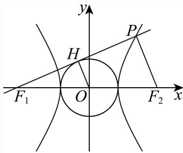
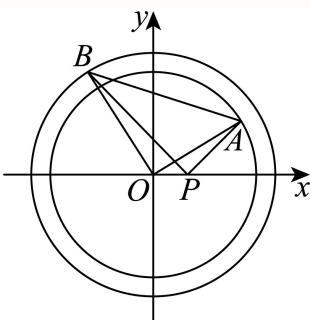
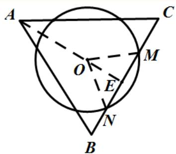
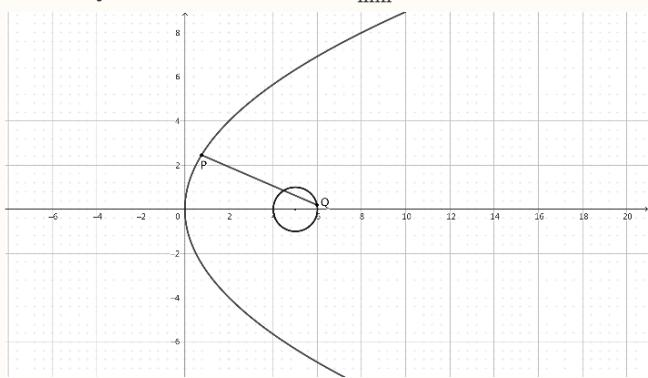
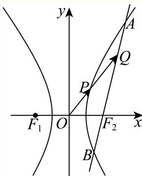
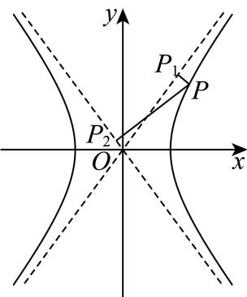
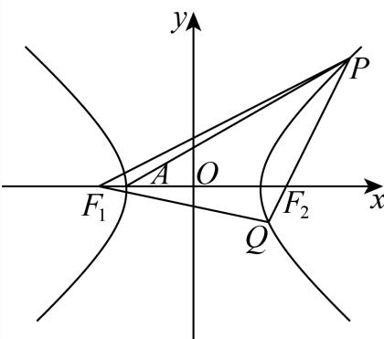
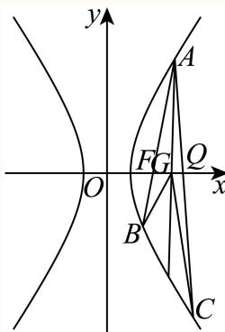
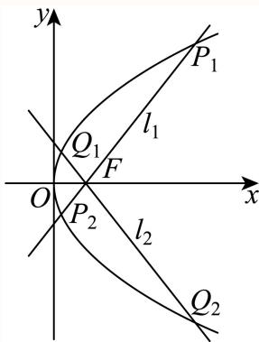
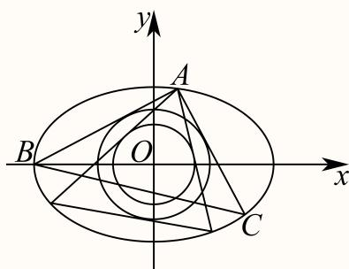

# 2025二模 解析几何专题 · 教师版

> 本地预览：题目、答案及分类尚未全部审定。校对使用的PDF为高中工作台解析版，尚未逐区确认区级印刷原卷。

## 直线与圆的基本度量

通过斜率、配方、圆心距或点线距离求直线方程、弦长及半径。

### 嘉定 · 第7题

直线l: $y = x + 1$ 与圆 $C { : } x ^ { 2 } + y ^ { 2 } - 4 x - 2 y = 0$ 相交所得的弦长为

**考点：** 圆心到直线距离与弦长

**难度依据：** 直线与圆弦长；需完成一次转化或结合基本条件后计算

**核查说明：** 已人工阅读底稿题干和解析；尚未逐页对照原PDF，不作为数学终审。

【答案】$2 \sqrt { 3 }$

【解析】

首先确定圆心和半径，应用点线距离公式求圆心到直线的距离，再利用几何法求相交弦长即可.

由C: $x ^ { 2 } + y ^ { 2 } - 4 x - 2 y = 0$ ，即 $C \colon ( x - 2 ) ^ { 2 } + ( y - 1 ) ^ { 2 } = 5$

所以圆心为 $C ( 2 , 1 )$ ，半径为 $r = { \sqrt { 5 } }$

所以C(2, 1)到l: $y = x + 1$ 的距离 $d = { \frac { | 2 - 1 + 1 | } { \sqrt { 2 } } } = { \sqrt { 2 } } \quad$

综上，直线与圆的相交弦长为 $2 { \sqrt { r ^ { 2 } - d ^ { 2 } } } = 2 { \sqrt { 3 } }$

故答案为： $2 \sqrt { 3 }$

### 奉贤 · 第5题

直线3x + 4y − 5 = 0上的动点P和直线 $3 x + 4 y + 1 0 = 0$ 上的动点Q，则点P与点Q之间距离的最小值是

**考点：** 平行直线距离公式

**难度依据：** 平行直线间距离；直接调用定义或基本公式，运算路径短

**核查说明：** 已人工阅读底稿题干和解析；尚未逐页对照原PDF，不作为数学终审。

【答案】3

【解析】

利用平行线之间的距离公式求解即可.

直线 $3 x + 4 y - 5 = 0$ 和直线 $3 x + 4 y + 1 0 = 0 \textcircled { 1 }$ 相平行，

故点P与点Q之间距离的最小值即两条直线间的距离，

且两条直线间的距离： $d = { \frac { | - 5 - 1 0 | } { \sqrt { 3 ^ { 2 } + 4 ^ { 2 } } } } = 3 .$

故答案为：3

### 奉贤 · 第6题

已知θ是斜率为−1的直线的倾斜角，计算 $\sin \left( \theta - { \frac { \pi } { 2 } } \right) =$

**考点：** 直线倾角与三角函数

**难度依据：** 直线倾角与三角函数；需完成一次转化或结合基本条件后计算

**核查说明：** 已人工阅读底稿题干和解析；尚未逐页对照原PDF，不作为数学终审。

【答案】$\frac { \sqrt { 2 } } { 2 }$

【解析】

根据正切函数值求出角进而得出正弦值即可.

因为θ是斜率为−1的直线的倾斜角，所以 $\tan \theta = - 1 \ , \theta \in [ 0 , \pi )$ ，

所以 $\theta = \frac { 3 \pi } { 4 }$ ，

所以 $\sin \left( \theta - { \frac { \pi } { 2 } } \right) = \sin \left( { \frac { 3 \pi } { 4 } } - { \frac { \pi } { 2 } } \right) = \sin { \frac { \pi } { 4 } } = { \frac { \sqrt { 2 } } { 2 } } .$

故答案为： $\frac { \sqrt { 2 } } { 2 }$

### 崇明 · 第4题

求直线x = −2与直线 ${ \sqrt { 3 } } x - y + 1 = 0$ 的夹角为 .

**考点：** 直线倾角及夹角

**难度依据：** 直线倾角与夹角；直接运用定义或基础公式，推理链短

**核查说明：** 已人工阅读完整底稿题干及原解，未逐页对照正式PDF，分类不等于数学终审。

【答案】$\frac { \pi } { 6 } .$

【解析】

先求出直线的斜率，可得它们的倾斜角，从而求出两条直线的夹角

解：∵直线 $x = - 2$ 的斜率不存在，倾斜角为 $\frac { \pi } { 2 }$

直线 ${ \sqrt { 3 } } x - y + 1 = 0$ 的斜率为 ${ \sqrt { 3 } }$ ，倾斜角为 $\frac { \pi } { 3 }$ ，

故直线 $x = - 2 ^ { \frac { 1 } { - } }$ 与直线 ${ \sqrt { 3 } } x - y + 1 = 0$ 的夹角为 ${ \frac { \pi } { 2 } } - { \frac { \pi } { 3 } } = { \frac { \pi } { 6 } }$ ，

故答案为： $\frac { \pi } { 6 } .$

### 浦东 · 第3题

圆的方程为 $\textstyle { | x ^ { 2 } + y ^ { 2 } - 4 x + 6 y + 1 2 = 0 }$ ，则该圆的半径为

**考点：** 配方求圆半径

**难度依据：** 圆的一般方程化标准式；直接运用定义或基础公式，推理链短

**核查说明：** 已人工阅读完整底稿题干及原解，未逐页对照正式PDF，分类不等于数学终审。

【答案】1

【解析】

将圆的一般方程转化为标准方程，即可求解.

由题，转化方程为标准方程 $( x - 2 ) ^ { 2 } + ( y + 3 ) ^ { 2 } = 1$

所以圆的半径为1，

故答案为：1

### 虹口 · 第5题

若直线l与直线y = x平行，且经过圆 $x ^ { 2 } - 2 x + y ^ { 2 }$ = 0的圆心，则l的方程为

> 本题资料或解析有待核事项，预览不可作为已审定成品。

**考点：** 配方及点斜式

**难度依据：** 圆心与平行直线；直接运用定义或基础公式，推理链短

**核查说明：** 解析圆心附近有多余公式噪声，需清理并核原式。；已人工阅读完整底稿题干及原解，未逐页对照正式PDF，分类不等于数学终审。；历史分类审查记录（不把旧记录直接判为当前未解决）：解析圆心附近有多余公式噪声，需清理并核原式。 本次只归组，未修改题干、答案或专题归属；上述具体疑点仍交回源/数学复核处理。

【答案】$x - y - 1 = 0$

【解析】

求出圆心坐标，利用点斜式可得出直线l的方程.

圆 $\| x ^ { 2 } - 2 x + y ^ { 2 } =$ 0的标准方程为 $( x - 1 ) ^ { 2 } + y ^ { 2 } = 1$ ，圆心坐标为(1,0)，

因为直线l与直线y = x平行，且经过圆 $x ^ { 2 } - 2 x + y ^ { 2 } = 0 H ^ { 2 } ] \big | \vec { y } \big | , \vec { \downarrow }$ ，

所以，直线l的方程为 $x - y - 1 = 0$

故答案为： $x - y - 1 = 0$

## 圆锥曲线定义、参数与焦点几何

先识别焦点准线或离心率关系，再以几何定义处理焦点三角形及光学性质。

### 奉贤 · 第8题

抛物线 $\dot { x } ^ { 2 } = 4 y$ 的准线与圆 $x ^ { 2 } + y ^ { 2 } = r ^ { 2 }$ 相切，将圆绕直径所在直线旋转一周形成一个几何体，则该几何体的表面积为

**考点：** 抛物线准线与旋转几何

**难度依据：** 抛物线准线；需连接多个条件、建模或作分类讨论

**核查说明：** 已人工阅读底稿题干和解析；尚未逐页对照原PDF，不作为数学终审。

【答案】4π.

【解析】

利用抛物线的性质求准线，利用相切求半径，即可用球的表面积求解.

因为抛物线方程为 $x ^ { 2 } = 4 y$ ，可知准线方程为 $y = - 1$ ，

又由圆 $x ^ { 2 } + y ^ { 2 } = r ^ { 2 } { \frac { E } { \gamma } }$ 准线相切，可知： $r = 1$ 9

将圆绕直径旋转一周所成的球的表面积为： $S = 4 \pi$

故答案为：4π.

### 宝山 · 第3题

抛物线x2 = 4y的准线方程是

**考点：** 抛物线标准方程与准线

**难度依据：** 抛物线准线；直接运用定义或基础公式，推理链短

**核查说明：** 已人工阅读完整底稿题干及原解，未逐页对照正式PDF，分类不等于数学终审。

【解析】

先根据抛物线的标准方程得到焦点在y轴上以及2p = 4，再直接代入即可求出其准线方程.因为抛物线的标准方程为 $\scriptstyle { | x ^ { 2 } = 4 y }$ ，焦点在y轴上，

所以：2p = 4，即p = 2，所以 ${ \frac { p } { 2 } } = 1$

所以准线方程为：y = −1，

故答案是：y = −1.

该题考查的是有关抛物线的几何性质，涉及到的知识点是已知抛物线的标准方程求其准线方程，属于简单题目.

### 崇明 · 第11题

已知双曲线 $x ^ { 2 } - { \frac { y ^ { 2 } } { b ^ { 2 } } } = 1 \left( b > 0 \right)$ 的左、右焦点为 $F _ { 1 } , F _ { 2 }$ ，以O为顶点， $F _ { 2 }$ 为焦点作抛物线交双曲线于P，且 $\angle P F _ { 1 } F _ { 2 } = 4 5 ^ { \circ }$ ，则 $| b ^ { 2 } = |$

> 本题资料或解析有待核事项，预览不可作为已审定成品。

**考点：** 焦准定义及双曲线焦距

**难度依据：** 共焦点抛物线与双曲线；需连接多个条件或多步模型转化

**核查说明：** 源解直接写PD=p但未展开由45度及抛物线定义推出交点横坐标为焦点横坐标的步骤，需核原图和补齐推导。；已人工阅读完整底稿题干及原解，未逐页对照正式PDF，分类不等于数学终审。；历史分类审查记录（不把旧记录直接判为当前未解决）：源解直接写PD=p但未展开由45度及抛物线定义推出交点横坐标为焦点横坐标的步骤，需核原图和补齐推导。 当前底稿已有回源补丁，涉及answer_and_solution；具体修复范围以底稿patches和2025二模-解析公式回源补丁-第二批.json为准。本题仍按可辨数学任务归组，不据分组宣称数学已审定。

【答案】$2 + 2 \sqrt { 2 }$

【解析】

由抛物线得定义过点P作准线的垂线，可构造直角三角形，由此可得 $| P F _ { 1 } |$ ，再在 $\triangle P F _ { 1 } F _ { 2 } \ntrianglerighteq$ 由余弦定理可得 $| P F _ { 2 } |$ ，接着利用双曲线的定义可求p，最后利用共焦点求得b2.

由题意可知， $| F _ { 1 } F _ { 2 } | = p = 2 \sqrt { b ^ { 2 } + 1 }$

如图，过点P作准线的垂线，垂足为D，则 $| P D | = p$

则 $\cos\angle PF_1F_2=\cos\angle F_1PD=\frac{|DP|}{|PF_1|}=\frac{p}{|PF_1|}=\frac{\sqrt2}{2}$ ，得 $| P F _ { 1 } | = \sqrt { 2 } p$

在 $\triangle P F _ { 1 } F _ { 2 }$ 中由余弦定理可得， $| P F _ { 2 } | ^ { 2 } = | P F _ { 1 } | ^ { 2 } + | F _ { 1 } F _ { 2 } | ^ { 2 } - 2 | P F _ { 1 } | | F _ { 1 } F _ { 2 } | \cos { \frac { \pi } { 4 } }$

$= 2 p ^ { 2 } + p ^ { 2 } - 2 { \sqrt { 2 } } p ^ { 2 } \times { \frac { \sqrt { 2 } } { 2 } } = p ^ { 2 }$ ，即 $| P F _ { 2 } | = p ,$

则由双曲线的定义可得 $| P F _ { 1 } | - | P F _ { 2 } | = { \Big ( } { \sqrt { 2 } } - 1 { \Big ) } p = 2$ ，得 $\cdot p = 2 + 2 { \sqrt { 2 } }$

则 $b ^ { 2 } = \frac { p ^ { 2 } } { 4 } - 1 = 2 + 2 \sqrt { 2 }$

故答案为： $2 + 2 \sqrt { 2 }$

### 徐汇 · 第10题

已知双曲线 ${ \frac { x ^ { 2 } } { a ^ { 2 } } } - { \frac { y ^ { 2 } } { b ^ { 2 } } } = 1 ( a > 0 , b > 0 )$ 的左焦点为 $F _ { 1 }$ ，右焦点为 $F _ { 2 }$ .若双曲线的右支上存在一点P，使得直线 $P F _ { 1 }$ 与以双曲线的实轴为直径的圆相切，切点为线段 $P F _ { 1 }$ 的中点，则该双曲线的离心率为

**考点：** 双曲线定义、圆切线与离心率

**难度依据：** 双曲线焦点三角形与切圆；需连接多个条件或多步模型转化

**核查说明：** 已人工阅读完整底稿题干及原解，未逐页对照正式PDF，分类不等于数学终审。

【答案】${ \sqrt { 5 } } .$

【解析】

根据题意，求得 $| P F _ { 2 } |$ ，再结合双曲线定义，求得 $| P F _ { 1 } |$ |，结合 $\triangle P F _ { 1 } F _ { 2 }$ 为直角三角形，利用勾股定理，建立 $^ { ( a , }$ 的等量关系，进而求解即可

设 $P F _ { 1 }$ 中点为H，连接 $O H , P F _ { 2 }$ ，作图如下所示：

在 $\triangle P F _ { 1 } F _ { 2 }$ 中，因为O,H分别为 $F _ { 1 } F _ { 2 } , P F _ { 1 }$ 1的中点，故 $O H / / P F _ { 2 }$ ，且 $| O H | = \frac { 1 } { 2 } | P F _ { 2 } |$ ；

由题可知， $| O H | = a$ ，且 $O H \bot P F _ { 1 }$ ，故 $| P F _ { 2 } | = 2 a$ ，且 $P F _ { 2 } \bot P F _ { 1 }$ ；

根据双曲线定义可知， $| P F _ { 1 } | = 2 a + | P F _ { 2 } | = 2 a + 2 a = 4 a$ ，又 $| F _ { 1 } F _ { 2 } | = 2 c$

故在 $\triangle P F _ { 1 } F _ { 2 }$ 中，由勾股定理 $| P F _ { 1 } | ^ { 2 } + | P F _ { 2 } | ^ { 2 } = | F _ { 1 } F _ { 2 } | ^ { 2 }$ ，也即 $1 6 a ^ { 2 } + 4 a ^ { 2 } = 4 c ^ { 2 }$

整理得 ${ \frac { c ^ { 2 } } { a ^ { 2 } } } = 5$ ，故 ${ \frac { c } { a } } = { \sqrt { 5 } }$ 也即该双曲线的离心率为 $\sqrt { 5 }$

故答案为： ${ \sqrt { 5 } } .$

### 普陀 · 第5题

设m > 2，拋物线 $C \colon x ^ { 2 } = 2 m y$ 上的点P到C的焦点的距离为5，点P到y轴的距离为3，则m的值为

**考点：** 焦准距离

**难度依据：** 抛物线焦点与准线；直接调用定义或基本公式，运算路径短

**核查说明：** 已人工阅读底稿题干和解析；尚未逐页对照原PDF，不作为数学终审。

【答案】9

【解析】

根据给定条件，求出点P的纵坐标，再利用抛物线的定义列式求解.

拋物线 $C \colon x ^ { 2 } = 2 m y$ 的准线为 $y = - { \frac { m } { 2 } }$ ，

由点P到y轴的距离为3，得点P的纵坐标 $y _ { P } = { \frac { 9 } { 2 m } }$

由点P到C的焦点的距离为5，得 ${ \frac { 9 } { 2 m } } + { \frac { m } { 2 } } = 5$ ，解得m = 1或m = 9，而 $m > 2$ 所以m = 9.

故答案为：9

### 普陀 · 第15题

设 $\because { \cal 0 } , { \cal b } > 0$ ，点 $M \left( x _ { 0 } , y _ { 0 } \right)$ ，O是坐标原点， $| O M | = a _ { \mathrm { { . } } }$ ，F是双曲线Γ: ${ \frac { x ^ { 2 } } { a ^ { 2 } } } - { \frac { y ^ { 2 } } { b ^ { 2 } } } = 1$ 1的左焦点，若直线l: $x _ { 0 } x + y _ { 0 } y = a ^ { 2 }$ 经过点F，且与双曲线Γ的右支在第一象限内交于P点，则双曲线Γ的离心率的一个可能的值是（ ）

A. $\frac { \sqrt { 5 } } { 2 }$

B. $\frac { \sqrt { 6 } } { 2 }$

C. $\frac { \sqrt { 7 } } { 2 }$

D. $\frac { \sqrt { 1 1 } } { 2 }$

**考点：** 双曲线焦点切线与渐近线

**难度依据：** 双曲线切线与离心率；需综合转化、参数分析或完整证明，推理链较长

**核查说明：** 已人工阅读底稿题干和解析；尚未逐页对照原PDF，不作为数学终审。

【答案】D

【解析】

先确定直线l与圆 $x ^ { 2 } + y ^ { 2 } = a ^ { 2 }$ 的位置关系，表示出直线 的斜率，数形结合，根据直线斜率与双曲线渐近线斜率的关系，得到a,b的关系，求出离心率的取值范围，即可进行判断.如图：

因为 $| O M | = a$ ，所以M点的轨迹是以O为圆心，以a为半径的圆，方程为： $x ^ { 2 } + y ^ { 2 } = a ^ { 2 }$ 因为点O到直线l： $x _ { 0 } x + y _ { 0 } y - a ^ { 2 } = 0$ 的距离为： $d = { \frac { a ^ { 2 } } { \sqrt { x _ { 0 } ^ { 2 } + y _ { 0 } ^ { 2 } } } } = { \frac { a ^ { 2 } } { a } } = a .$

所以直线l与圆 $x ^ { 2 } + y ^ { 2 } = a ^ { 2 }$ 相切.

又l过点 $F \left( - c , 0 \right)$ ，且 $c ^ { 2 } = a ^ { 2 } + b ^ { 2 }$ ，直线l与双曲线Γ的右支在第一象限内交于P点，

所以直线l的斜率为： $k _ { l } = { \frac { | O M | } { | F M | } } = { \frac { a } { b } }$

又一、三象限双曲线的渐近线的斜率为： $\frac { b } { a }$

$$
\frac {b}{a} > \frac {a}{b} \Rightarrow b ^ {2} > a ^ {2} \Rightarrow c ^ {2} - a ^ {2} > a ^ {2} \Rightarrow c ^ {2} > 2 a ^ {2} \Rightarrow \frac {c ^ {2}}{a ^ {2}} > 2.
$$

即 $e ^ { 2 } > 2 \Rightarrow e > { \sqrt { 2 } } .$

故选：D

### 杨浦 · 第11题

如图，阿基米德椭圆规是由基座､带孔的横杆､两条互相垂直的空槽､两个可动滑块A､B组成的一种绘图工具，横杆的一端C上装有铅笔，假设两条互相垂直的空槽和带孔的横杆都足够长，将滑块A､B固定在带孔的横杆上，令滑块A在中一条空槽上滑动，滑块B在另一条空槽上滑动，铅笔C随之运动就能画出椭圆.当A､B之间的距离为14厘米时，若需要画出一个离心率为 $\frac { 4 } { 5 }$ 的椭圆，则B､C之间的距离为 .厘米.

**考点：** 滑块轨迹半轴与离心率

**难度依据：** 椭圆规与离心率；需连接多个条件或多步模型转化

**核查说明：** 已人工阅读完整底稿题干及原解，未逐页对照正式PDF，分类不等于数学终审。

【答案】21

【解析】

根据给定条件，确定椭圆的长短半轴长，再利用椭圆离心率求法列式计算得解.

依题意，当滑块B在两条空槽的交点处时，BC长为椭圆的短半轴长b，

当滑块A在两条空槽的交点处时，AC长为椭圆的长半轴长a，则 $a = 1 4 + b$

由椭圆的离心率为 $\frac { 4 } { 5 }$ ，得 ${ \frac { { \sqrt { a ^ { 2 } - b ^ { 2 } } } } { a } } = { \sqrt { 1 - \left( { \frac { b } { a } } \right) ^ { 2 } } } = { \frac { 4 } { 5 } }$ ，解得 ${ \frac { b } { a } } = { \frac { 3 } { 5 } }$ ，即 ${ \frac { b } { 1 4 + b } } = { \frac { 3 } { 5 } }$ ，解

得 $b = 2 1$

所以B､C之间的距离为21厘米.

故答案为：21

### 松江 · 第2题

抛物线y2 = 8x的焦点到准线的距离是

**考点：** 抛物线参数与焦准距离

**难度依据：** 抛物线焦准距离；直接运用定义或基础公式，推理链短

**核查说明：** 已人工阅读完整底稿题干及原解，未逐页对照正式PDF，分类不等于数学终审。

【解析】

由 $\mathtt { J } \mathbf { y } ^ { 2 } = 2 \mathtt { p } \mathrm { x } = 8 \mathrm { x } ^ { \sharp } { \cdot } \rVert \mathrm { p } = 4$ ，又焦点到准线的距离就是p，所以焦点到准线的距离为4.

### 长宁 · 第16题

椭圆具有如下光学性质：如图， $F _ { 1 } \left( - c , 0 \right) , F _ { 2 } \left( c , 0 \right)$ 分别是椭圆 ${ \frac { x ^ { 2 } } { a ^ { 2 } } } + { \frac { y ^ { 2 } } { b ^ { 2 } } } = 1$ 1的左、右焦点，从点 $F _ { 1 }$ 发出的光线在到达椭圆上的点P后，经过到达点的切线反射后经过点 $F _ { 2 }$ ，有以下两个命题：

①若P是椭圆上除长轴端点外的一点，设法线与x轴的交点为M(t,0)，则 $t \in \left( - \frac { c ^ { 2 } } { a } , \frac { c ^ { 2 } } { a } \right)$
②若从 $F _ { 1 }$ 发出的光线，经椭圆两次反射后，第一次回到 $F _ { 1 }$ 所经过的路程为8c，则该椭圆的离心率为$\frac { 1 } { 2 }$ ；
则以下说法正确的是（ ）

A. ①是真命题，②是真命题

B. ①是真命题，②是假命题

C. ①是假命题，②是真命题

D. ①是假命题，②是假命题

> 本题资料或解析有待核事项，预览不可作为已审定成品。

**考点：** 椭圆切线法线与光学性质；椭圆函数求导

**难度依据：** 椭圆切线法线与光学性质；椭圆函数求导；需多步建模、分类或参数约束

**核查说明：** 原解法线斜率法除以x₀，x₀=0（短轴端点）情形须另验；结论t=0成立。；已人工阅读底稿题干和原解；未逐页对照PDF，不作为数学终审。；历史分类审查记录（不把旧记录直接判为当前未解决）：原解法线斜率法除以x₀，x₀=0（短轴端点）情形须另验；结论t=0成立。 本次只归组，未修改题干、答案或专题归属；上述具体疑点仍交回源/数学复核处理。

【答案】A

【解析】

设 $P \left( x _ { 0 } , y _ { 0 } \right)$ 通过求导可得椭圆 ${ \frac { x ^ { 2 } } { a ^ { 2 } } } + { \frac { y ^ { 2 } } { b ^ { 2 } } } = 1$ 在点 $P \left( x _ { 0 } , y _ { 0 } \right)$ 处的切线的斜率为 $k = - { \frac { b ^ { 2 } x _ { 0 } } { a ^ { 2 } y _ { 0 } } }$ 由法线和切线垂直可得 $t = { \frac { c ^ { 2 } x _ { 0 } } { a ^ { 2 } } }$ 即可判断①；由已知结合椭圆的定义可得 $4 a = 8 c$ 即可判断②.设 $P \left( x _ { 0 } , y _ { 0 } \right)$ ，因为 ${ \frac { x ^ { 2 } } { a ^ { 2 } } } + { \frac { y ^ { 2 } } { b ^ { 2 } } } = 1$ ，所以 $\cdot y = \pm b { \sqrt { 1 - { \frac { x ^ { 2 } } { a ^ { 2 } } } } }$ 当 $y = b { \sqrt { 1 - { \frac { x ^ { 2 } } { a ^ { 2 } } } } }$ 时， $y ^ { \prime } = { \frac { - { \frac { b } { a } } x } { \sqrt { a ^ { 2 } - x ^ { 2 } } } }$ 所以在点 $P \left( x _ { 0 } , y _ { 0 } \right)$ 处的切线的斜率为 $k = { \frac { - { \frac { b } { a } } x _ { 0 } } { \sqrt { a ^ { 2 } - x _ { 0 } ^ { 2 } } } } = { \frac { - { \frac { b } { a } } x _ { 0 } } { \sqrt { \frac { a ^ { 2 } y _ { 0 } ^ { 2 } } { b ^ { 2 } } } } } = - { \frac { b ^ { 2 } x _ { 0 } } { a ^ { 2 } y _ { 0 } } } ,$ 同理可得当 $y = - b { \sqrt { 1 - { \frac { x ^ { 2 } } { a ^ { 2 } } } } }$ 时，在点 $P \left( x _ { 0 } , y _ { 0 } \right)$ 处的切线的斜率为 $k = - { \frac { b ^ { 2 } x _ { 0 } } { a ^ { 2 } y _ { 0 } } }$ 所以椭圆 ${ \frac { x ^ { 2 } } { a ^ { 2 } } } + { \frac { y ^ { 2 } } { b ^ { 2 } } }$ = 1在点 $P \left( x _ { 0 } , y _ { 0 } \right)$ 处的切线的斜率为 $k = - \frac { b ^ { 2 } x _ { 0 } } { a ^ { 2 } y _ { 0 } } ;$ 因为 $M \left( t , 0 \right)$ ，所以k ${ \mathrm { \Delta } } _ { P M } = { \frac { y _ { 0 } } { x _ { 0 } - t } }$ 因为 $k _ { P M } \cdot k = - 1$ ，所以 ${ \frac { y _ { 0 } } { x _ { 0 } - t } } \cdot \left( - { \frac { b ^ { 2 } x _ { 0 } } { a ^ { 2 } y _ { 0 } } } \right) = - 1$ 所以 $t = x _ { 0 } - { \frac { b ^ { 2 } x _ { 0 } } { a ^ { 2 } } } = { \frac { a ^ { 2 } x _ { 0 } - b ^ { 2 } x _ { 0 } } { a ^ { 2 } } } = { \frac { c ^ { 2 } x _ { 0 } } { a ^ { 2 } } }$

因为 $x _ { 0 } \in ( - a , a )$ ，所以 $t \in \left( - \frac { c ^ { 2 } } { a } , \frac { c ^ { 2 } } { a } \right)$ ，故①是真命题；

因为 $F _ { 1 }$ 发出的光线在到达椭圆上的点P后，经过到达点的切线反射后经过点 $F _ { 2 }$

所以两次反射后，第一次回到 $F _ { 1 }$ 所经过的路程为 $4 a ,$ ，

所以 $4 a = 8 c ,$ ，所以 $e = { \frac { c } { a } } = { \frac { 1 } { 2 } }$ ，故②是真命题.

故选：A.

## 三、解答题

### 闵行 · 第11题

已知某星球的球心为F，半径为R，该星球的卫星的运行轨道是以F为一个焦点的椭圆，该椭圆的离心率为 $\frac { 3 } { 5 }$ ，卫星运行过程中离该星球表面最近的距离为R，若当卫星处于某位置时，用卫星上的光学仪器观测该星球，把光学仪器的镜头与星球表面被观测点的连线称为视线，任意两条视线所成的最大夹角称为张角，则卫星运行过程中张角的最小值为 ．（精确到0.1°）

**考点：** 椭圆近远焦距；球体张角与反三角

**难度依据：** 椭圆近远焦距；球体张角与反三角；需组合两类关系并检查区间或等号

**核查说明：** 已人工阅读底稿题干和原解；未逐页对照PDF，不作为数学终审。

【答案】14.4∘.

【解析】

结合题意由椭圆的几何性质和离心率确定椭圆的 $[ a , c ,$ 再由椭圆的光学性质和反三角函数计算. 设椭圆轨道的半长轴为a，焦距为 $\lceil 2 c$

由题意可得，卫星运行过程中离该星球表面最近的距离为R，在近日点即 $\displaystyle { \lvert { a - c = 2 R } }$ ，又椭圆的离心率为 $\frac { 3 } { 5 }$ ，即 ${ \frac { c } { a } } = { \frac { 3 } { 5 } }$

由以上可得 $a = 5 R , c = 3 R$

又由椭圆的光学性质可得在远日点时张角最小，

设此时张角为θ，则 $\sin \left( { \frac { \theta } { 2 } } \right) = { \frac { R } { 8 R } } = { \frac { 1 } { 8 } }$ ，即 $1 \theta = 2 \arcsin \left( { \frac { 1 } { 8 } } \right) \approx 1 4 . 4 ^ { \circ }$

故答案为：14.4∘.

### 静安 · 第3题

椭圆 ${ \frac { x ^ { 2 } } { 4 } } + { \frac { y ^ { 2 } } { 3 } } = 1$ 的离心率是

**考点：** 椭圆离心率

**难度依据：** 椭圆离心率；直接调用定义或基本公式，路径短

**核查说明：** 已人工阅读底稿题干和原解；未逐页对照PDF，不作为数学终审。

【解析】

求出a、b、c的值，即可得出椭圆 ${ \frac { x ^ { 2 } } { 4 } } + { \frac { y ^ { 2 } } { 3 } } =$ 1的离心率.在椭圆 ${ \frac { x ^ { 2 } } { 4 } } + { \frac { y ^ { 2 } } { 3 } } = 1 ^ { \varepsilon }$ 中， $a = 2 , \ b = { \sqrt { 3 } } , \ c = { \sqrt { a ^ { 2 } - b ^ { 2 } } } = 1$ 因此，椭圆 ${ \frac { x ^ { 2 } } { 4 } } + { \frac { y ^ { 2 } } { 3 } } = 1$ 1的离心率是 $\displaystyle { \boldsymbol { \cdot } } { \boldsymbol { e } } = { \frac { c } { a } } = { \frac { 1 } { 2 } }$ 故答案为： $\frac { 1 } { 2 }$

### 黄浦 · 第3题

抛物线 $\operatorname { i } y ^ { 2 } = x $ 的焦点到其顶点的距离为

**考点：** 抛物线焦点距顶点

**难度依据：** 抛物线焦点距顶点；直接调用定义或基本公式，路径短

**核查说明：** 已人工阅读底稿题干和原解；未逐页对照PDF，不作为数学终审。

【答案】$\frac 1 4$

【解析】

求出抛物线的焦点及顶点即可得解.

抛物线 $\dot { y } ^ { 2 } = x$ 的焦点为 $\left( { \frac { 1 } { 4 } } , 0 \right)$ ，顶点为(0, 0)，

所以该抛物线的焦点到其顶点的距离为 $\frac 1 4$

故答案为： $\frac 1 4$

## 圆及空间轨迹与几何最值

将模、垂直或距离比例条件转为平面或空间轨迹；空间角度最值应交代轨迹转化与可达性。

### 宝山 · 第12题

空间中有相互垂直的两条异面直线 $l _ { 1 } , \ l _ { 2 }$ ，点A、 $B \in l _ { 1 } , C , \ D \in l _ { 2 }$ ，且 $A B = 4 , C D = 1$ ，若 $D A \bot D B$ ，且 $A C = B C + 2$ ，则二面角 $D - A B - C$ 平面角的余弦值最小为

> 本题资料或解析有待核事项，预览不可作为已审定成品。

**考点：** 双曲线与球面约束下二面角最值

**难度依据：** 异面直线与二面角最值；需参数分类、构造递推或综合最值分析

**核查说明：** 双曲面、球面与三角形可行参数范围论证较简，需回核原图并检验最值可取。；已人工阅读完整底稿题干及原解，未逐页对照正式PDF，分类不等于数学终审。；历史分类审查记录（不把旧记录直接判为当前未解决）：双曲面、球面与三角形可行参数范围论证较简，需回核原图并检验最值可取。 本次只归组，未修改题干、答案或专题归属；上述具体疑点仍交回源/数学复核处理。

【答案】$\frac { 4 { \sqrt { 3 } } } { 9 }$

【解析】

先确定点C、D的轨迹及相关线段长度表达式，再利用余弦定理得 $\cos \angle C E D$ 的表达式，最后通过换元求最值.

根据双曲线的定义，平面内到两个定点A、B（焦点）的距离之差的绝对值为定值（小于|AB）的点的轨迹为双曲线.由 $A C = B C + 2$ ，可知 $A C - B C | = 2$

所以点C在以A、B为焦点的双曲线上.在空间中，是此双曲线绕AB旋转得到的曲面.

因为 $D A \bot D B$ ，根据直径所对的圆周角是直角，所以点D同时在以AB为直径的球面上.

由 $\mathbb { F } l _ { 1 } \bot l _ { 2 }$ ，所以C、D在与AB垂直的面上.

不妨令C固定在一支双曲线上，设双曲线方程为 $y ^ { 2 } - { \frac { x ^ { 2 } } { 3 } } = 1$

过C作CE⊥AB于E，在双曲线 $y ^ { 2 } - { \frac { x ^ { 2 } } { 3 } } = \pmb { \cdot }$ 1中，变形可得 $x ^ { 2 } = 3 ( y ^ { 2 } - 1 )$

在Rt △ CEB（因为 $\scriptstyle { \mathrm { C E \bot A B } } )$ 中，CE的长度可根据坐标关系得到， $C E = \sqrt { 3 y ^ { 2 } - 3 }$

因为D在过C与AB垂直的面与球的交线上，设球心为O（AB中点），

由 $D E ^ { 2 } + O E ^ { 2 } = 4$ （球的半径的平方为4，根据勾股定理得到此关系），OE的长度与y有关（E点坐标与C点纵坐标y有关），且OE在y轴上的投影长度就是y，所以 $D E = { \sqrt { 4 - y ^ { 2 } } }$

在 $\triangle C E D \sharp$ ，根据余弦定理 $\cos \angle C E D = { \frac { C E ^ { 2 } + D E ^ { 2 } - C D ^ { 2 } } { 2 \cdot C E \cdot D E } }$ ，

通过 $C E ^ { 2 } = 3 y ^ { 2 } - 3 , ~ D E ^ { 2 } = 4 - y ^ { 2 }$ 代入余弦定理公式化简得到,

$$
\cos \angle C E D = \frac {3 y ^ {2} - 3 + 4 - y ^ {2} - 1}{2 \sqrt {(3 y ^ {2} - 3) (4 - y ^ {2})}} = \frac {\sqrt {3}}{3} \cdot \sqrt {\frac {y ^ {4}}{- y ^ {4} + 5 y ^ {2} - 4}} = \frac {\sqrt {3}}{3} \cdot \sqrt {\frac {1}{- 1 - \frac {4}{y ^ {4}} + \frac {5}{y ^ {2}}}}.
$$

令 $\mathbf { \nabla } \cdot t = \frac { 1 } { y ^ { 2 } } ( t > 0 )$ ，则 $\cos \angle C E D = { \frac { \sqrt { 3 } } { 3 } } \cdot { \sqrt { \frac { 1 } { - 4 t ^ { 2 } + 5 t - 1 } } }$ 对于二次函数 $f ( t ) = - 4 t ^ { 2 } + 5 t - 1$ ，其对称轴为 $t = - { \frac { 5 } { 2 \times ( - 4 ) } } = { \frac { 5 } { 8 } }$ 当 $t = \frac { 5 } { 8 }$ 时，f(t)取得最大值 $f \left( { \frac { 5 } { 8 } } \right) = - 4 \times \left( { \frac { 5 } { 8 } } \right) ^ { 2 } + 5 \times { \frac { 5 } { 8 } } - 1 = { \frac { 9 } { 1 6 } }$

$$
\cos \angle C E D = \frac {\sqrt {3}}{3} \cdot \sqrt {\frac {1}{- 4 t ^ {2} + 5 t - 1}} \geq \frac {\sqrt {3}}{3} \cdot \sqrt {\frac {1}{\frac {9}{1 6}}} = \frac {4 \sqrt {3}}{9}.
$$

故答案为： $\frac { 4 { \sqrt { 3 } } } { 9 }$

### 杨浦 · 第7题

已知复数z满足 $| z - 1 + \mathrm { i } | = 1$ ，其中i为虚数单位，则|z|的最小值为

**考点：** 复数轨迹圆与模最小值

**难度依据：** 复数模的几何最值；需一次转化并结合定义域或几何条件计算

**核查说明：** 已人工阅读完整底稿题干及原解，未逐页对照正式PDF，分类不等于数学终审。

【答案】${ \sqrt { 2 } } - 1$

【解析】

根据给定条件，利用复数模的几何意义求出最小值.

在复平面内，|z−1+i| = 1表示复数z对应的点Z与复数1−i对应点A(1,−1)的距离为1，

因此点Z的轨迹是以A(1,−1)为圆心，1为半径的圆，

|z|表示点Z到原点O的距离，所以|z|的最小值为 $| O A | - 1 = { \sqrt { 2 } } - 1$

故答案为： ${ \sqrt { 2 } } - 1$

### 松江 · 第9题

已知点P为直线l: $x + y + 1 = 0 .$ 上的点，过点P作圆N: $( x - 1 ) ^ { 2 } + ( y - 1 ) ^ { 2 } = 1$ 的切线PA，切点为A，则 $\cos \angle P N A$ 最大值为

**考点：** 圆切线构造和距离最值

**难度依据：** 切线与点到直线距离最值；需连接多个条件或多步模型转化

**核查说明：** 已人工阅读完整底稿题干及原解，未逐页对照正式PDF，分类不等于数学终审。

【答案】$\frac { \sqrt { 2 } } { 3 }$

【解析】

结合图象得到 $\cos \angle P N A = { \frac { | N A | } { | N P | } } = { \frac { 1 } { | N P | } }$ ，问题转化成求|NP|最小值即可求解

圆 $N \colon ( x - 1 ) ^ { 2 } + ( y - 1 ) ^ { 2 } =$ 1的圆 $\therefore N ( 1 , 1 )$ ，半径r = 1，

$$
\therefore \cos \angle P N A = \frac {| N A |}{| N P |} = \frac {1}{| N P |},
$$

当 $| N P |$ 最小时， $\cos \angle P N A$ 最大.

$| N P |$ |的最小值为圆心N到直线l $: x + y + 1 = 0$ 的距离d，

根据点到直线距离公 $\overrightarrow { \overrightarrow { \mathrm { x } } } \overrightarrow { \mathrm { c } } d = \frac { | 1 + 1 + 1 | } { \sqrt { 1 ^ { 2 } + 1 ^ { 2 } } } = \frac { 3 } { \sqrt { 2 } } = \frac { 3 \sqrt { 2 } } { 2 }$

所以 $( \cos \angle P N A ) _ { \mathrm { m a x } } = { \frac { 1 } { \frac { 3 { \sqrt { 2 } } } { 2 } } } = { \frac { \sqrt { 2 } } { 3 } } .$

故答案为： $\frac { \sqrt { 2 } } { 3 }$

### 松江 · 第11题

设向量 $\vec { \cdot a } = ( x _ { 1 } , y _ { 1 } ) , \vec { b } = ( x _ { 2 } , y _ { 2 } )$ ，记 $\displaystyle { \mathop { \ ? } { \vec { a } } } \star { \vec { b } } = x _ { 1 } x _ { 2 } - y _ { 1 } y _ { 2 }$ .若点 $A _ { 1 } , ~ A _ { 2 } , ~ A _ { 3 }$ 为圆C：
$x ^ { 2 } + y ^ { 2 } + 4 x - 2 y = 0 .$ 上任意三点，且满足 $A _ { 1 } A _ { 2 } \bot A _ { 2 } A _ { 3 }$ ，则 $\Bigl | \overrightarrow { O A _ { 1 } } \star \overrightarrow { O A _ { 2 } } + \overrightarrow { O A _ { 2 } } \star \overrightarrow { O A _ { 3 } } \Bigr |$ 的取值范围是

**考点：** 新运算化简、圆上线性函数范围

**难度依据：** 向量新运算；需参数分类、构造递推或综合最值分析

**核查说明：** 已人工阅读完整底稿题干及原解，未逐页对照正式PDF，分类不等于数学终审。

【答案】[0, 16].

【解析】

设 $A _ { 1 } ( x _ { 1 } , y _ { 1 } ) , A _ { 2 } ( x _ { 2 } , y _ { 2 } ) , A _ { 3 } ( x _ { 3 } , y _ { 3 } )$ ，根据题意可得 $A _ { 1 } A _ { 3 }$ 为圆的直径，得$\overrightarrow { O A _ { 1 } } * \overrightarrow { O A _ { 2 } } + \overrightarrow { O A _ { 2 } } * \overrightarrow { O A _ { 3 } } = - 4 x _ { 2 } - 2 y _ { 2 }$ ，将求 $\boxed { \overrightarrow { O A _ { 1 } } * \overrightarrow { O A _ { 2 } } + \overrightarrow { O A _ { 2 } } * \overrightarrow { O A _ { 3 } } }$ 范围问题转化为直线与圆相切的问题.

将圆 $C { : } x ^ { 2 } + y ^ { 2 } + 4 x - 2 y = 0$ 化为标准方程 $( x + 2 ) ^ { 2 } + ( y - 1 ) ^ { 2 } = 5$ ，圆 $\iota \mathsf { L C } ( - 2 , 1 )$ ，半径$r = { \sqrt { 5 } } .$

因为 $A _ { 1 } A _ { 2 } \bot A _ { 2 } A _ { 3 }$ ，所以 $A _ { 1 } A _ { 3 }$ 为圆的直径.

设 $\cdot A _ { 1 } \left( x _ { 1 } , y _ { 1 } \right) , A _ { 2 } \left( x _ { 2 } , y _ { 2 } \right) , A _ { 3 } \left( x _ { 3 } , y _ { 3 } \right) , \overrightarrow { O A _ { 1 } } = \left( x _ { 1 } , y _ { 1 } \right) , \overrightarrow { O A _ { 2 } } = \left( x _ { 2 } , y _ { 2 } \right) , \overrightarrow { O A _ { 3 } } = \left( x _ { 3 } , y _ { 3 } \right) .$ $\mathrm { E i } \overrightarrow { O A _ { 1 } } * \overrightarrow { O A _ { 2 } } + \overrightarrow { O A _ { 2 } } * \overrightarrow { O A _ { 3 } } = x _ { 1 } x _ { 2 } - y _ { 1 } y _ { 2 } + x _ { 2 } x _ { 3 } - y _ { 2 } y _ { 3 } = x _ { 2 } \left( x _ { 1 } + x _ { 3 } \right) - y _ { 2 } \left( y _ { 1 } + y _ { 3 } \right) .$

因为 $A _ { 1 } A _ { 3 }$ 为直径，所以 $x _ { 1 } + x _ { 3 } = - 4 , y _ { 1 } + y _ { 3 } = 2$

$$
\overrightarrow {O A _ {1}} * \overrightarrow {O A _ {2}} + \overrightarrow {O A _ {2}} * \overrightarrow {O A _ {3}} = - 4 x _ {2} - 2 y _ {2}
$$

$\stackrel { \wedge } { \prec } z = - 4 x - 2 y ,$ ，即 $y = - 2 x - \frac { z } { 2 }$ ，且 $( x + 2 ) ^ { 2 } + ( y - 1 ) ^ { 2 } = 5$

当直线 $y = - 2 x - \frac { z } { 2 }$ 与圆相切时，z取得最值.

根据圆心到直线的距离等于半径，可得 ${ \frac { | 4 \times ( - 2 ) + 2 \times 1 + z | } { { \sqrt { 4 ^ { 2 } + 2 ^ { 2 } } } } } = { \sqrt { 5 } }$ 解得 $z = 1 6 \not \equiv \not \{ z = - 4$ 所以 $| z | \in [ 0 , 1 6 ]$ ，则 $\left| \overrightarrow { O A _ { 1 } } * \overrightarrow { O A _ { 2 } } + \overrightarrow { O A _ { 2 } } * \overrightarrow { O A _ { 3 } } \right|$ 的取值范围是[0, 16].

故答案为：[0, 16].

### 浦东 · 第8题

设M(x,y)为抛物线 $\dot { y } ^ { 2 } = 4 x$ 上任意一点，若x+2y+m的最小值为1，则m的值为

**考点：** 抛物线代换与配方

**难度依据：** 抛物线上线性式最值；需一次转化并结合定义域或几何条件计算

**核查说明：** 已人工阅读完整底稿题干及原解，未逐页对照正式PDF，分类不等于数学终审。

【解析】

依题意可得 $x = { \frac { y ^ { 2 } } { 4 } }$ ，则 $x + 2 y + m = \frac { 1 } { 4 } ( y + 4 ) ^ { 2 } + m - 4$ 结合二次函数的性质计算可得

因为 $M \left( x , y \right)$ 为抛物线 $y ^ { 2 } = 4 x$ 上任意一点，所以 $x = { \frac { y ^ { 2 } } { 4 } } , \ y \in \mathrm { R } .$

所以 $x + 2 y + m = \frac { y ^ { 2 } } { 4 } + 2 y + m = \frac { 1 } { 4 } { ( y + 4 ) } ^ { 2 } + m - 4 ,$

所以当y = −4时 $x + 2 y + m .$ 取得最小值 $\mathrm { m } - 4$ ，依题意可得m−4 = 1，所以 $m = 5$ 故答案为：5

### 虹口 · 第8题

已知z是实系数一元二次方程 $x ^ { 2 } + p x + q = 0$ 的一个虚根，且 $. | z - 1 | = 2$ ，若z在复平面上所对应的点在抛物线 $\dot { y } ^ { 2 } = 4 x _ { - }$ 上，则p = .

**考点：** 复数模、抛物线与实系数方程

**难度依据：** 虚根及复平面轨迹；需连接多个条件或多步模型转化

**核查说明：** 已人工阅读完整底稿题干及原解，未逐页对照正式PDF，分类不等于数学终审。

【答案】−2

【解析】

利用 $| z - 1 | = 2$ 和抛物线 $\dot { y } ^ { 2 } = 4 x$ 求出复数z，然后带入方程 $x ^ { 2 } + p x + q = 0$ 即可求出 $\iota p = - 2$ $\sharp _ { \mathsf { X } } ^ { \Pi } z = a + b \mathrm { i }$ ，因为z在复平面上所对应的点在抛物线 $: y ^ { 2 } = 4 x \operatorname { E }$

所以 $b ^ { 2 } = 4 a , \ a > 0$ ，因为 $| | z - 1 | = | a - 1 + b \mathbf { i } | = 2$ ，

故 $( a - 1 ) ^ { 2 } + b ^ { 2 } = 4 \qquad $ ，即 $( a - 1 ) ^ { 2 } + 4 a = 4$

解得：a = 1或a = −3（舍去），故 $b ^ { 2 } = 4 a = 4 , b = \pm 2$

当z = 1+2i时，代入方程 $x ^ { 2 } + p x + q = 0 $ 得，

(1 + 2i)2 + p (1 + 2i) + q = 0，即p + q − 3 + (2p + 4)i = 0，

故2p + 4 = 0, p = −2,

当z = 1−2i时，代入方程 $x ^ { 2 } + p x + q = 0$ 得，

(1 − 2i)2 + p (1 − 2i) + q = 0，即p + q − 3 − (2p + 4)i = 0，

故 $2 p + 4 = 0 , p = - 2 ,$

综上可得， $p = - 2$

故答案为：−2

### 金山 · 第16题

已知点A $( x _ { 1 } , y _ { 1 } )$ 在圆 $x ^ { 2 } + y ^ { 2 } = 9 .$ 上，点 $B \left( x _ { 2 } , y _ { 2 } \right)$ 在圆 $x ^ { 2 } + y ^ { 2 } = 1 2$ 上，且
$x _ { 1 } x _ { 2 } + y _ { 1 } y _ { 2 } = x _ { 1 } + x _ { 2 } - 1$ ,O为坐标原点.对于以下两个命题，判断正确的是（ ）
①在坐标平面内存在点P，使得 $A P \bot B P$ 恒成立；
②三角形OAB面积的最小值为 ${ \sqrt { 2 2 } }$

A. ①是真命题，②是真命题

B. ①是假命题，②是真命题

C. ①是真命题，②是假命题

D. ①是假命题，②是假命题

> 本题资料或解析有待核事项，预览不可作为已审定成品。

**考点：** 数量积转定点、三角参数化面积最值

**难度依据：** 坐标数量积与定点垂直；需参数分类、构造递推或综合最值分析

**核查说明：** 原解只给面积下界，尚未显式验证取等条件可达；辅助角gamma区间需处理系数为负情况。；已人工阅读完整底稿题干及原解，未逐页对照正式PDF，分类不等于数学终审。；历史分类审查记录（不把旧记录直接判为当前未解决）：原解只给面积下界，尚未显式验证取等条件可达；辅助角gamma区间需处理系数为负情况。 本次只归组，未修改题干、答案或专题归属；上述具体疑点仍交回源/数学复核处理。

【答案】A

【解析】

对于①，注意到 $x _ { 1 } x _ { 2 } + y _ { 1 } y _ { 2 } = x _ { 1 } + x _ { 2 } - 1 \Rightarrow \left( x _ { 1 } - 1 \right) \left( x _ { 2 } - 1 \right) + y _ { 1 } y _ { 2 } = 0 ,$

则可想到当P(1,0)时满足题意；对于②，设 $4 \left( 3 \cos \theta , 3 \sin \theta \right) , B \left( 2 { \sqrt { 3 } } \cos \beta , 2 { \sqrt { 3 } } \sin \beta \right)$

则 $S _ { \triangle A O B } = 3 \sqrt { 3 } \left| \sin \left( \theta - \beta \right) \right|$ ， 后 由 $x _ { 1 } x _ { 2 } + y _ { 1 } y _ { 2 } = x _ { 1 } + x _ { 2 } - 1$ 可 得$6 \sqrt { 3 } \cos \left( \theta - \beta \right) = 3 \cos \theta + 2 \sqrt { 3 } \cos \beta - 1$ ，利用三角函数知识可得 $| \sin \alpha | \geq { \frac { \sqrt { 2 2 } } { 3 { \sqrt { 3 } } } }$ ，据此可判断命题正误.

$$
x _ {1} x _ {2} + y _ {1} y _ {2} = x _ {1} + x _ {2} - 1 \Rightarrow x _ {1} x _ {2} - x _ {1} - x _ {2} + 1 + y _ {1} y _ {2} = 0 \Rightarrow
$$

$( x _ { 1 } - 1 ) ( x _ { 2 } - 1 ) + y _ { 1 } y _ { 2 } = 0$ ，则当 $P \left( 1 , 0 \right)$ 时， $\stackrel {  } { A P } = ( 1 - x _ { 1 } , - y _ { 1 } ) , \stackrel {  } { B P } = ( 1 - x _ { 2 } , - y _ { 2 } )$

AP ⋅ BP = (1 − x1) (1 − x2) + y1y2 = 0，

即当 $P \left( 1 , 0 \right)$ 时，AP⊥BP恒成立，则①是真命题；

设 $. A \left( 3 \cos \theta , 3 \sin \theta \right) , B \left( 2 \sqrt { 3 } \cos \beta , 2 \sqrt { 3 } \sin \beta \right)$ ，

则OA = (3 cos θ, 3 sin θ), OB = (2√3 cos β, 2√3 sin β)，

$$
\text {又} \cos \angle A O B = \frac {\vec {O A} \cdot \vec {O B}}{\left| \vec {O A} \right| \cdot \left| \vec {O B} \right|} = \frac {6 \sqrt {3} \cos \theta \cos \beta + 6 \sqrt {3} \sin \theta \sin \beta}{3 \cdot 2 \sqrt {3}} = \cos (\theta - \beta),
$$

则 $| S _ { \triangle A O B } = \frac { 1 } { 2 } | O A | | O B | \sin \angle A O B = 3 \sqrt { 3 } | \sin ( \theta - \beta ) | .$

因 $| x _ { 1 } x _ { 2 } + y _ { 1 } y _ { 2 } = x _ { 1 } + x _ { 2 } - 1$ ，

则6√3 cos θ cos β + 6√3 sin θ sin β = 3 cos θ + 2√3 cos β − 1，

$$
\text { 则 } 6 \sqrt {3} \cos (\theta - \beta) = 3 \cos \theta + 2 \sqrt {3} \cos \beta - 1, \text { 令 } \theta - \beta = \alpha ,
$$

$$
\text { 则 } 6 \sqrt {3} \cos \alpha = 3 \cos \theta + 2 \sqrt {3} \cos (\theta - \alpha) - 1,
$$

即6√3 cos α = 3 cos θ + 2√3 cos θ cos α + 2√3 sin θ sin α − 1，

则6√3 cos α + 1 = (3 + 2√3 cos α) cos θ + 2√3 sin α sin θ

$$
= \sqrt {\left(3 + 2 \sqrt {3} \cos \alpha\right) ^ {2} + \left(2 \sqrt {3} \sin \alpha\right) ^ {2}} \cos (\theta - \gamma), \text {其中} \tan \gamma = \frac {2 \sqrt {3} \sin \alpha}{3 + 2 \sqrt {3} \cos \alpha},
$$

$$
\gamma \in \left(- {\frac {\pi}{2}}, {\frac {\pi}{2}}\right), \text {则} \cos (\theta - \gamma) = {\frac {6 {\sqrt {3}} \cos \alpha + 1}{\sqrt {\left(3 + 2 {\sqrt {3}} \cos \alpha\right) ^ {2} + \left(2 {\sqrt {3}} \sin \alpha\right) ^ {2}}}},
$$

$$
\text {因} \cos (\theta - \gamma) \in [ - 1, 1 ], \text {则} {\frac {6 \sqrt {3} \cos \alpha + 1}{\sqrt {(3 + 2 \sqrt {3} \cos \alpha) ^ {2} + (2 \sqrt {3} \sin \alpha) ^ {2}}}} \in [ - 1, 1 ] \Rightarrow
$$

$$
\frac {\left(6 \sqrt {3} \cos \alpha + 1\right) ^ {2}}{\left(3 + 2 \sqrt {3} \cos \alpha\right) ^ {2} + \left(2 \sqrt {3} \sin \alpha\right) ^ {2}} \in [ 0, 1 ] \Rightarrow \left(6 \sqrt {3} \cos \alpha + 1\right) ^ {2} \leq \left(3 + 2 \sqrt {3} \cos \alpha\right) ^ {2} +   \left(2 \sqrt {3} \sin \alpha\right) ^ {2}
$$

$$
\text {则} 1 0 8 \cos^ {2} \alpha \leq 2 0 \Rightarrow 1 0 8 \left(1 - \sin^ {2} \alpha\right) \leq 2 0 \Rightarrow \sin^ {2} \alpha \geq {\frac {2 2}{2 7}} \Rightarrow | \sin \alpha | \geq {\frac {\sqrt {2 2}}{3 \sqrt {3}}},
$$

则 $S _ { \triangle A O B } = 3 \sqrt { 3 } \left| \sin \left( \theta - \beta \right) \right| = 3 \sqrt { 3 } \left| \sin \alpha \right| \geq \sqrt { 2 2 }$ ，故②是真命题.

故选：A.

关键点睛：对于命题①，关键为注意到 $x _ { 1 } x _ { 2 } - x _ { 1 } - x _ { 2 } + 1 = \left( x _ { 1 } - 1 \right) \left( x _ { 2 } - 1 \right)$ ；

对于命题②，难点在于确定 $| \sin \left( \theta - \beta \right)$ |的范围，为此首先将 $\left[ \theta - \beta \right]$ 看作整体，随后将 $\mathbf { \partial } \cdot \theta - \beta ,$ 从相关等式中分离出来，最后利用三角函数的值域确定范围.

## 三、解答题

### 长宁 · 第11题

现有一块正四面体木料PABC，其边长为3，现需要将木料进行切割，要求切割后底面ABC上任意一点Q到顶点P的距离不大于 ${ \sqrt { 7 } } ,$ ，则切割好后，木料体积的最大值是 ．（结果保留π）

**考点：** 正四面体切割及曲边锥体体积；圆与三角形交域面积

**难度依据：** 正四面体切割及曲边锥体体积；圆与三角形交域面积；需多步建模、分类或参数约束

**核查说明：** 已人工阅读底稿题干和原解；未逐页对照PDF，不作为数学终审。

【答案】$\frac { 3 \sqrt { 2 } } { 4 } + \frac { \sqrt { 6 } \pi } { 6 }$

【解析】

设正四面体定点P在底面ABC的投影为O，连接OA，可得以O为圆心，半径为1的圆在底面$\triangle A B C$ 内的部分为底，以P为顶点的几何体即为符合要求的部分，先求解底面面积，PO为高，即可求解切割好后，木料体积的最大值

设正四面体定点P在底面ABC的投影为O，则O为正三角形ABC的中心，

连接 $O A$ ，所以 $A O = { \frac { 2 } { 3 } } \times { \frac { \sqrt { 3 } } { 2 } } \times 3 = { \sqrt { 3 } } , P O = { \sqrt { P A ^ { 2 } - A O ^ { 2 } } } = { \sqrt { 6 } } ,$

若底面 $A B C$ 上任意一点Q到顶点P的距离不大于 ${ \sqrt { 7 } } ,$

设 $P Q = { \sqrt { 7 } } .$ ，则 $O Q = { \sqrt { P Q ^ { 2 } - P O ^ { 2 } } } = 1$ ，

所以以O为圆心，半径为1的圆在底面 $\triangle A B C$ 内的部分为底，以P为顶点的几何体即为符合要求的部分，

如图以O为圆心，半径为1的圆与底面 $\triangle A B C$ 相交的交点为 $M , N _ { \mathrm { { i } } }$

延长 $. O A { \stackrel { . } { \times } } B C { \mp } E$ ，连接OM，ON，

所以 $O E = \frac { 1 } { 3 } \times \frac { \sqrt { 3 } } { 2 } \times 3 = \frac { \sqrt { 3 } } { 2 } , \ O M = O N = 1$

所以 $\cos \angle E O M = { \frac { O E } { O M } } = { \frac { \sqrt { 3 } } { 2 } }$ ，所以 $\angle E O M = \frac { \pi } { 6 }$

所以 $\angle M O N = \frac { \pi } { 3 }$ ，所以 $\triangle M O N$ 为等边三角形，

所以以O为圆心，半径为1的圆在底面 $\triangle A B C$ 内的部分的面积为

$$
\pi \times 1 ^ {2} - 3 \times \left(\frac {1}{6} \pi \times 1 ^ {2} - \frac {\sqrt {3}}{4} \times 1 ^ {2}\right) = \frac {\pi}{2} + \frac {3 \sqrt {3}}{4},
$$

所以切割好后，木料体积的最大值是 ${ \frac { 1 } { 3 } } \times \left( { \frac { \pi } { 2 } } + { \frac { 3 { \sqrt { 3 } } } { 4 } } \right) \times { \sqrt { 6 } } = { \frac { 3 { \sqrt { 2 } } } { 4 } } + { \frac { { \sqrt { 6 } } \pi } { 6 } }$

故答案为： $\frac { 3 \sqrt { 2 } } { 4 } + \frac { \sqrt { 6 } \pi } { 6 }$

### 青浦 · 第9题

已知复数z、w满 $\Re { | z | } = 2 , z = ( 1 + \mathrm { i } ) w$ （i是虚数单位），则|w+2|的最大值是

**考点：** 复数模与圆的距离最值

**难度依据：** 复数模的几何最值；需完成一次转化或结合基本条件后计算

**核查说明：** 已人工阅读底稿题干和解析；尚未逐页对照原PDF，不作为数学终审。

【答案】$2 + { \sqrt { 2 } } .$

【解析】

由模长运算，可得复数 的模长，根据复数的几何意义与圆的性质，可得答案

已知 $| z | = 2 , z = ( 1 + \mathrm { i } ) w _ { \cdot }$ ，则 $| z | = | ( 1 + \mathrm { i } ) w | = | 1 + \mathrm { i } | | w |$

因为 $| 1 + \mathbf { i } | = { \sqrt { 1 ^ { 2 } + 1 ^ { 2 } } } = { \sqrt { 2 } }$ ，所以 $| w | = { \frac { | z | } { | 1 + \mathrm { i } | } } = { \frac { 2 } { \sqrt { 2 } } } = { \sqrt { 2 } }$

$\vert w + 2 \vert$ 表示复数w所对应的点到−2所对应的点的距离，

$| w | = { \sqrt { 2 } }$ 说明w对应的点在以原点为圆心， ${ \sqrt { 2 } }$ 为半径的圆上，

所以|w+2|的最大值为圆心(0,0)到点(−2,0)的距离加上半径， $\mathbb { H } \mathbb { J } 2 + { \sqrt { 2 } } .$

故答案为： $2 + { \sqrt { 2 } } .$

### 青浦 · 第10题

已知点P是抛物线 $y ^ { 2 } = 8 x$ 上一动点，点Q在圆 $( x - 5 ) ^ { 2 } + y ^ { 2 } = 1$ 上运动，则P与Q两点间最短距离为

**考点：** 点到圆心距离及二次函数最值

**难度依据：** 抛物线与圆距离最值；需连接多个条件、建模或作分类讨论

**核查说明：** 已人工阅读底稿题干和解析；尚未逐页对照原PDF，不作为数学终审。

【答案】$2 \sqrt { 6 } - 1$

【解析】

因为点P在圆外，P与Q两点间最短距离是抛物线上的点到圆心距离减去圆的半径，设出点P坐标，写出距离，再根据二次函数性质即可求解.

设抛物线 $\operatorname { i } _ { \mathit { y } ^ { 2 } } = 8 x$ 上的点P坐标为 $\left( { \frac { y ^ { 2 } } { 8 } } , y \right)$

圆 $( x - 5 ) ^ { 2 } + y ^ { 2 } = 1$ 的圆心为C(5,0)，半径r = 1.

点P到圆心C的距离 $d = { \sqrt { \left( { \frac { y ^ { 2 } } { 8 } } - 5 \right) ^ { 2 } + y ^ { 2 } } } = { \sqrt { { \frac { y ^ { 4 } } { 6 4 } } - { \frac { 5 } { 4 } } y ^ { 2 } + 2 5 + y ^ { 2 } } } = { \sqrt { { \frac { y ^ { 4 } } { 6 4 } } - { \frac { 1 } { 4 } } y ^ { 2 } + 2 5 } } .$

令 $\cdot t = y ^ { 2 } ( t \geq 0 )$ ，则 $d = \sqrt { \frac { t ^ { 2 } } { 6 4 } - \frac { 1 } { 4 } t + 2 5 } = \sqrt { \frac { 1 } { 6 4 } ( t - 8 ) ^ { 2 } + 2 4 }$ ，对其求最小值，

根据二次函数性质，当t = 8时，d最小为2√6.

则 $P { \stackrel { E } { \neg } } Q { \dot { | } }$ 两点间最短距离为 $\vert d _ { \mathrm { m i n } \sim } - r = 2 \sqrt { 6 } - 1$

故答案为： $2 \sqrt { 6 } - 1$

### 黄浦 · 第8题

已知a为常数，圆 $( x - a ) ^ { 2 } + ( y + a - 2 ) ^ { 2 } = r ^ { 2 } ( r > 0 )$ 与圆 $x ^ { 2 } + y ^ { 2 } = 1$ 有公共点，当r取到最小值时，a的值为

**考点：** 动圆圆心距与最小半径

**难度依据：** 动圆圆心距与最小半径；需组合两类关系并检查区间或等号

**核查说明：** 已人工阅读底稿题干和原解；未逐页对照PDF，不作为数学终审。

【答案】1

【解析】

根据给定条件，求出两圆的圆心距，利用两圆有公共点的条件建立不等式求解.

圆 $( x - a ) ^ { 2 } + ( y + a - 2 ) ^ { 2 } = r ^ { 2 } ( r > 0 )$ 的圆 $\iota \dot { \operatorname { L } } ( a , 2 - a )$ ，半径r，圆 $x ^ { 2 } + y ^ { 2 } = 1$ 的圆心(0, 0)，半径为1，

由两圆有公共点，得 $\left| r - 1 \right| \leq { \sqrt { ( a - 0 ) ^ { 2 } + ( 2 - a - 0 ) ^ { 2 } } } \leq r + 1$

$d = { \sqrt { ( a - 0 ) ^ { 2 } + ( 2 - a - 0 ) ^ { 2 } } } = { \sqrt { 2 ( a - 1 ) ^ { 2 } + 2 } } \geq { \sqrt { 2 } }$ ，当且仅当a = 1时取等号，

$\ Y q _ { a } = 1$ 时，d取得最小值 ${ \sqrt { 2 } }$ ，r取得最小值 ${ \sqrt { 2 } } - 1$ ，此时两圆外切，满足两圆有公共点所以当r取到最小值时，a的值为1.

故答案为：1

## 椭圆弦、面积与分点约束

联立直线与椭圆后利用韦达、弦长及面积，参数范围同时保留判别式和点位。

### 嘉定 · 第20题

已知椭圆C： ${ \frac { x ^ { 2 } } { 9 } } + y ^ { 2 } = 1$ ．F为椭圆的右焦点，过椭圆上一点 $P \left( 3 , 0 \right)$ 的直线 $\vdots l _ { 1 }$ 交椭圆于另 $- \sharp { \sf Q }$ 点M为椭圆上任意一点

(1) (4分)求|MF|的最小值；
(2) (6分)当直线l1的斜率为1时，求 $\triangle P Q M$ 面积的最大值及此时点M的坐标；
(3) (8分)若直线PQ与直线 $\mathbf { \langle } l _ { 2 } : x = - 3$ 交于点D，点D不在x轴上，Q关于原点的对称点为点R，直线PR与 $\mathrm { i } _ { 2 }$ 交于点E，求线段|DE|的取值范围

> 本题资料或解析有待核事项，预览不可作为已审定成品。

**考点：** (1)椭圆焦点距离；(2)弦与三角形面积最值；(3)直线联立及距离范围

**难度依据：** 椭圆焦点距离与弦三角形面积最值；需综合转化、参数分析或完整证明，推理链较长

**核查说明：** 题干过P直线的交点Q等文字OCR损坏，需校对原卷。；已人工阅读底稿题干和解析；尚未逐页对照原PDF，不作为数学终审。；历史分类审查记录（不把旧记录直接判为当前未解决）：题干过P直线的交点Q等文字OCR损坏，需校对原卷。 本次只归组，未修改题干、答案或专题归属；上述具体疑点仍交回源/数学复核处理。

【解析】

(1)

由椭圆方程 ${ \frac { x ^ { 2 } } { 9 } } + y ^ { 2 } = 1$ 知， $a ^ { 2 } = 9 , b ^ { 2 } = 1 , c ^ { 2 } = a ^ { 2 } - b ^ { 2 } = 9 - 1 = 8$ ，所以右焦点$F \left( 2 { \sqrt { 2 } } , 0 \right)$

设 $M \left( m , n \right)$ ，则 $| M F | = \sqrt { \left( m - 2 \sqrt { 2 } \right) ^ { 2 } + n ^ { 2 } }$ ，由 ${ \frac { m ^ { 2 } } { 9 } } + n ^ { 2 } = 1 \Rightarrow n ^ { 2 } = 1 - { \frac { m ^ { 2 } } { 9 } }$ 代入得：

$$
| M F | = \sqrt {\left(m - 2 \sqrt {2}\right) ^ {2} + n ^ {2}} = \sqrt {\left(m - 2 \sqrt {2}\right) ^ {2} + 1 - \frac {m ^ {2}}{9}}
$$

$$
= \sqrt {\frac {8 m ^ {2}}{9} - 4 \sqrt {2} m + 9} = \frac {\sqrt {8 m ^ {2} - 3 6 \sqrt {2} m + 8 1}}{3},
$$

由于 $m \in [ - 3 , 3 ]$ ，对称轴 $m = \frac { 9 \sqrt { 2 } } { 4 } > 3 .$ ，

所以 $| M F | \geq { \frac { { \sqrt { 8 \times 9 - 3 6 { \sqrt { 2 } } } } \times 3 + 8 1 } { 3 } } = { \sqrt { 1 7 - 1 2 { \sqrt { 2 } } } } = { \sqrt { 9 - 2 \times 3 \times { \sqrt { 8 } } + 8 } } = 3 - 2 { \sqrt { 2 } }$

即|MF|的最小值为 $\hphantom { - } 3 - 2 \sqrt { 2 }$ ，此时点M为椭圆的右顶点.

(2)

由直线l 的斜率为1且经过P(3,0)，可得直线方程 $y = x - 3$

与椭圆 ${ \frac { x ^ { 2 } } { 9 } } + y ^ { 2 } = 1$ 联立方程组，消元得： ${ \frac { x ^ { 2 } } { 9 } } + ( x - 3 ) ^ { 2 } = 1 \Rightarrow 1 0 x ^ { 2 } - 5 4 x + 7 2 = 0 ,$

解得 $x = 3 , x = { \frac { 1 2 } { 5 } }$ ，则代入 $\ 、 x = { \frac { 1 2 } { 5 } }$ 得： $y = { \frac { 1 2 } { 5 } } - 3 = - { \frac { 3 } { 5 } }$ ，所以Q $\left( { \frac { 1 2 } { 5 } } , - { \frac { 3 } { 5 } } \right)$

$$
| P Q | = \sqrt {\left(\frac {1 2}{5} - 3\right) ^ {2} + \left(- \frac {3}{5} - 0\right) ^ {2}} = \frac {3 \sqrt {2}}{5},
$$

设平行于直线 $\dot { \iota } _ { 1 }$ 的直线方程为 $y = x + t ,$ ，则与椭圆 ${ \frac { x ^ { 2 } } { 9 } } + y ^ { 2 } = 1$ 联立方程组，消元得：

${ \frac { x ^ { 2 } } { 9 } } + \left( x + t \right) ^ { 2 } = 1 \Rightarrow 1 0 x ^ { 2 } + 1 8 t x + 9 t ^ { 2 } - 9 = 0$ 当此直线与椭圆相切时，满足判别式为0

即 $\Delta = 1 8 ^ { 2 } t ^ { 2 } - 4 \times 1 0 \times \left( 9 t ^ { 2 } - 9 \right) = 0$ ，解得 $t = \pm \sqrt { 1 0 }$

根据数形结合可得 $t = { \sqrt { 1 0 } } \mathbb { H }$ 时，满足切点M取到 $\triangle P Q M$ 面积最大值，

此时方程为 $1 0 x ^ { 2 } + 1 8 { \sqrt { 1 0 } } x + 8 1 = 0 \Rightarrow \left( { \sqrt { 1 0 } } x + 9 \right) ^ { 2 } = 0 \Rightarrow x = - { \frac { 9 } { \sqrt { 1 0 } } } ,$

代入直线得 $\cdot y = - { \frac { 9 } { \sqrt { 1 0 } } } + { \sqrt { 1 0 } } = { \frac { 1 } { \sqrt { 1 0 } } }$ ，则 $M \left( - { \frac { 9 } { \sqrt { 1 0 } } } , { \frac { 1 } { \sqrt { 1 0 } } } \right)$

由点M $\left( - { \frac { 9 } { \sqrt { 1 0 } } } , { \frac { 1 } { \sqrt { 1 0 } } } \right)$ 到直线 $y = x -$ 3的距离公式得：

$$
d = \frac {\left| - \frac {9}{\sqrt {1 0}} - \frac {1}{\sqrt {1 0}} - 3 \right|}{\sqrt {2}} = \frac {3 + \sqrt {1 0}}{\sqrt {2}},
$$

所以 $\triangle P Q M$ 面积的最大值为 $S = { \frac { 1 } { 2 } } \times { \frac { 3 { \sqrt { 2 } } } { 5 } } \times { \frac { 3 + { \sqrt { 1 0 } } } { \sqrt { 2 } } } = { \frac { 9 + 3 { \sqrt { 1 0 } } } { 1 0 } }$

此时点 $M \left( - { \frac { 9 } { \sqrt { 1 0 } } } , { \frac { 1 } { \sqrt { 1 0 } } } \right)$ ；

(3)

设过点 $P \left( 3 , 0 \right)$ 直线为： $y = k \left( x - 3 \right)$ ，与椭圆 ${ \frac { x ^ { 2 } } { 9 } } + y ^ { 2 } = 1$ 联立方程组，消元得：

$$
\frac {x ^ {2}}{9} + k ^ {2} (x - 3) ^ {2} = 1 \Rightarrow (1 + 9 k ^ {2}) x ^ {2} - 5 4 k ^ {2} x + 8 1 k ^ {2} - 9 = 0,
$$

$$
\Delta = \left(- 5 4 k ^ {2}\right) ^ {2} - 4 (1 + 9 k ^ {2}) (8 1 k ^ {2} - 9) = 3 6 > 0,
$$

再由于交点D不在x轴上，即 $k \neq 0$

设交点 $Q \left( x _ { 1 } , y _ { 1 } \right)$ ，则有 $x _ { 1 } + 3 = { \frac { 5 4 k ^ { 2 } } { 1 + 9 k ^ { 2 } } } \Rightarrow x _ { 1 } = { \frac { 2 7 k ^ { 2 } - 3 } { 1 + 9 k ^ { 2 } } }$

代入 $x _ { 1 } = \frac { 2 7 k ^ { 2 } - 3 } { 1 + 9 k ^ { 2 } }$ 得： $y _ { 1 } = k \left( { \frac { 2 7 k ^ { 2 } - 3 } { 1 + 9 k ^ { 2 } } } - 3 \right) = { \frac { - 6 k } { 1 + 9 k ^ { 2 } } } ,$

由于Q关于原点的对称点为点R，所以R $\left( - \frac { 2 7 k ^ { 2 } - 3 } { 1 + 9 k ^ { 2 } } , \frac { 6 k } { 1 + 9 k ^ { 2 } } \right)$ ，

则直线PR方程为 $\displaystyle y = { \frac { \frac { 6 k } { 1 + 9 k ^ { 2 } } } { \displaystyle - { \frac { 2 7 k ^ { 2 } - 3 } { 1 + 9 k ^ { 2 } } } - 3 } } ( x - 3 )$ 与直线x = −3相交得：

E点纵坐标为 $\vert y = - 6 { \frac { \overline { { 1 + 9 k ^ { 2 } } } } { - { \frac { 2 7 k ^ { 2 } - 3 } { 1 + 9 k ^ { 2 } } } - 3 } } = { \frac { 2 } { 3 k } } .$

而直线 $y = k \left( x - 3 \right)$ 与直线x = −3相交得：

D点纵坐标为 $y = - 6 k$

所以可得 $| D E | = \left| { \frac { 2 } { 3 k } } + 6 k \right| = \left| { \frac { 2 } { 3 k } } \right| + | 6 k | \geq 2 { \sqrt { \left| { \frac { 2 } { 3 k } } \right| \cdot | 6 k | } } = 4$

当且仅当 ${ \bigg | } { \frac { 2 } { 3 k } } { \bigg | } = { \big | } 6 k { \big | }$ ，即 $\vert k = \pm \frac { 1 } { 3 }$ 时，|DE|取到最小值4.

即|DE|的取值范围是 $[ 4 , + \infty )$

### 普陀 · 第20题

设 $a > b > 0 , m > 0$ ，点A、F分别是椭圆Γ: ${ \frac { x ^ { 2 } } { a ^ { 2 } } } + { \frac { y ^ { 2 } } { b ^ { 2 } } } = 1$ 的上顶点与右焦点，且 $\left| A F \right| = 2 { \mathrm { . } }$ ，直线 $l { : } x - m y - 1 = 0$ 经过点F与Γ交于P、Q两点，O是坐标原点.
(1) (4分)求椭圆Γ的方程；
(2) (6分)若 $m = { \sqrt { 3 } } .$ ，点M是x轴上的一点，且 $\triangle M P Q$ 的面积为 $\frac { 6 } { 1 3 }$ ，求点M的坐标；
(3) (8分)若点G在直线x = 5上，向量 $\vec { P G }$ 在直线l上的投影为向量 $\vec { P F }$ ，证明 $\angle P G Q < \frac { \pi } { 4 }$

**考点：** (1)焦点弦；(2)三角形面积；(3)向量投影与角

**难度依据：** 椭圆焦点弦与面积；需综合转化、参数分析或完整证明，推理链较长

**核查说明：** 已人工阅读底稿题干和解析；尚未逐页对照原PDF，不作为数学终审。

【解析】

(1) $| A F | = { \sqrt { b ^ { 2 } + c ^ { 2 } } } = a = 2$

直线l: $x - m y - 1 = 0 \nVdash ( 1 , 0 )$ 所以右焦点 $F ( 1 , 0 )$ ，即 $| c = 1$

所以 $b ^ { 2 } = a ^ { 2 } - c ^ { 2 } = 4 - 1 = 3$ ，椭圆方程为 ${ \frac { x ^ { 2 } } { 4 } } + { \frac { y ^ { 2 } } { 3 } } = 1$ .

(2) $x = { \sqrt { 3 } } y + 1 , \left\{ { \begin{array} { l } { x = { \sqrt { 3 } } y + 1 } \\ { { \frac { x ^ { 2 } } { 4 } } + { \frac { y ^ { 2 } } { 3 } } = 1 } \end{array} } \right. \Rightarrow 1 3 y ^ { 2 } + 6 { \sqrt { 3 } } y - 9 = 0 ,$ 当 $m = { \sqrt { 3 } } ,$ 直线l:

$$
y _ {1} = \frac {- 6 \sqrt {3} + 2 4}{2 6} = \frac {- 3 \sqrt {3} + 1 2}{1 3}, y _ {2} = \frac {- 6 \sqrt {3} - 2 4}{2 6} = \frac {- 3 \sqrt {3} - 1 2}{1 3},
$$

$$
\therefore \left| y _ {1} - y _ {2} \right| = \frac {2 4}{1 3} \Rightarrow | P Q | = \sqrt {1 + (\sqrt {3}) ^ {2}} \left| y _ {1} - y _ {2} \right| = \frac {4 8}{1 3},
$$

设 $M \left( x _ { 0 } , 0 \right)$ 到直线距离 $ d = { \frac { | x _ { 0 } - 1 | } { \sqrt { 1 + ( { \sqrt { 3 } } ) ^ { 2 } } } } = { \frac { | x _ { 0 } - 1 | } { 2 } }$

由面积 $S _ { \triangle A B C } = \frac { 1 } { 2 } \times \frac { 4 8 } { 1 3 } \times \frac { | x _ { 0 } - 1 | } { 2 } = \frac { 6 } { 1 3 }$ ，得 $| x _ { 0 } - 1 | = \frac { 1 } { 2 } , x _ { 0 } = \frac { 3 } { 2 } \mathbb { H } \frac { 1 } { 2 }$ 即 $I M \left( { \frac { 3 } { 2 } } , 0 \right) { \overrightarrow { \sf u } } { \widehat { \sf x } } \left( { \frac { 1 } { 2 } } , 0 \right)$

(3)

设 $P \left( x _ { P } , y _ { P } \right) , Q \left( x _ { Q } , y _ { Q } \right) , G ( 5 , k )$

因为向量 $\xrightarrow [ P G ] { }$ 在直线l上的投影为向量 $\xrightarrow [ P F ] { }$ ，故 $F G \bot P Q$

故直线FG的斜率为−m，故直线FG的方程为 $y = - m \left( x - 1 \right)$ ，故 $G ( 5 , - 4 m )$

故 $| P F | = \sqrt { 1 + m ^ { 2 } } | y _ { P } | , | Q F | = \sqrt { 1 + m ^ { 2 } } | y _ { Q } | , | F G | = \sqrt { 1 + m ^ { 2 } } | 5 - 1 | = 4 \sqrt { 1 + m ^ { 2 } } | y _ { P } | ^ { 2 } .$

$$
\tan \angle P G Q = \frac {\tan \angle P G F + \tan \angle Q G F}{1 - \tan \angle P G F \tan \angle Q G F} = \frac {\frac {| y _ {P} |}{4} + \frac {| y _ {Q} |}{4}}{1 - \frac {| y _ {P} y _ {Q} |}{1 6}} = \frac {\frac {| y _ {P} |}{4} + \frac {| y _ {Q} |}{4}}{1 - \frac {| y _ {P} y _ {Q} |}{1 6}} = \frac {4 | y _ {P} - y _ {Q} |}{1 6 - | y _ {P} y _ {Q} |}
$$

$$
\text {联立} \left\{ \begin{array}{l l} x = m y + 1 \\ \frac {x ^ {2}}{4} + \frac {y ^ {2}}{3} = 1 \end{array} \right. \Rightarrow (3 m ^ {2} + 4) y ^ {2} + 6 m y - 9 = 0,
$$

$$
y _ {P} + y _ {Q} = - \frac {6 m}{3 m ^ {2} + 4}, y _ {P} y _ {Q} = - \frac {9}{3 m ^ {2} + 4}, \Delta = 1 4 4 (m ^ {2} + 1) > 0,
$$

$$
\text {故} \tan \angle P G Q = \frac {4 8 \sqrt {m ^ {2} + 1}}{1 6 (3 m ^ {2} + 4) - 9} = \frac {4 8 \sqrt {m ^ {2} + 1}}{4 8 (m ^ {2} + 1) + 7} = \frac {4 8}{4 8 \sqrt {m ^ {2} + 1} + \frac {7}{\sqrt {m ^ {2} + 1}}},
$$

$$
\text { 设 } t = \sqrt {m ^ {2} + 1} > 1, \text { 设 } y = 4 8 t + \frac {7}{t}, t > 1,
$$

由双勾函数的性质可得 $\mathbf { \nabla } \cdot y = 4 8 t + \frac { 7 } { t } \mathcal { \overleftarrow { 1 } } ( 1 , + \infty )$ 为增函数，

故 $\cdot 4 8 t + \frac { 7 } { t } > 5 5$ ，故 $\tan \angle P G Q < \frac { 4 8 } { 5 5 } < 1$ ，

$$
\therefore \angle P G Q <   \frac {\pi}{4}.
$$

### 松江 · 第20题

已知椭圆Γ: ${ \frac { x ^ { 2 } } { a ^ { 2 } } } + { \frac { y ^ { 2 } } { b ^ { 2 } } } = 1 ( a > b > 0 )$ 的左右焦点分别为 $F _ { 1 } , \ F _ { 2 } ,$ ，上下顶点分别为 $B _ { 1 } .$ 、
$B _ { 2 } , \triangle B _ { 1 } F _ { 1 } F _ { 2 }$ 是面积为 $\sqrt { 3 }$ 的正三角形，过焦点的直线交椭圆Γ于P、Q两点（P、Q分别在第一、四象限）.
(1) (4分)求椭圆Γ的离心率；
(2) (6分)已知点 $M ( 0 , m ) , ~ m > 0$ ，求椭圆Γ上的动点R到点M的最大距离；
(3) (8分)求四边形 $B _ { 1 } B _ { 2 } Q I$ P面积的取值范围.

> 本题资料或解析有待核事项，预览不可作为已审定成品。

**考点：** (1)等边三角形求离心率；(2)动点到定点最大距离；(3)焦点弦四边形面积范围

**难度依据：** 椭圆焦点弦与面积范围；需处理新定义或多对象联动，包含一般性证明及边界

**核查说明：** 题干四边形名称混入I，解析三角形面积sqrt3/2与题设sqrt3不符但后续参数按sqrt3计算；距离平方负号与韦达负号丢失，须逐式校核。；已人工阅读完整底稿题干及原解，未逐页对照正式PDF，分类不等于数学终审。；历史分类审查记录（不把旧记录直接判为当前未解决）：题干四边形名称混入I，解析三角形面积sqrt3/2与题设sqrt3不符但后续参数按sqrt3计算；距离平方负号与韦达负号丢失，须逐式校核。 本次只归组，未修改题干、答案或专题归属；上述具体疑点仍交回源/数学复核处理。

【解析】

(1) 如图，设椭圆C的焦距为 $| F _ { 1 } F _ { 2 } | = 2 c ( c > 0 )$ ，则 $| O F _ { 2 } | = c$

因为 $| O B _ { 1 } | = b ,$ ，所以Rt $\triangle B _ { 1 } O F _ { 2 } \sharp | B _ { 1 } F _ { 2 } | = a$

又因为 $\triangle B _ { 1 } F _ { 1 } F _ { 2 }$ 为正三角形，所以 $\left| B _ { 1 } F _ { 2 } \right| = 2 | O F _ { 2 } |$ ，即 $a = 2 c$

所以椭圆的离心率 $e = { \frac { c } { a } } = { \frac { 1 } { 2 } }$

(2) (2)

由于正三角形 $F _ { 1 } F _ { 2 } B _ { 1 }$ 的面积为 ${ \sqrt { 3 } } ,$ ，得到 $\left\{ \begin{array} { l l } { \displaystyle \frac { \sqrt { 3 } } { 2 } = \frac { 1 } { 2 } | F _ { 1 } F _ { 2 } | b = b c } \\ { { b = \displaystyle \frac { \sqrt { 3 } } { 2 } \times 2 c = \sqrt { 3 } c } } \end{array} \right.$

解得 $\mathsf { i } c = 1$ 9 $b = { \sqrt { 3 } } .$ ，又 $a ^ { 2 } = c ^ { 2 } + b ^ { 2 }$ ，得到 $\left[ a = 2 \right.$ ，故椭圆方程为 ${ \frac { x ^ { 2 } } { 4 } } + { \frac { y ^ { 2 } } { 3 } } = 1$

设 $R ( x , y )$ ，且 ${ \frac { x ^ { 2 } } { 4 } } + { \frac { y ^ { 2 } } { 3 } } = 1$ ，即 $x ^ { 2 } = 4 - { \frac { 4 y ^ { 2 } } { 3 } }$

|RM|2 = x2 + (y − m)2 = 4 − 4y2 + y2 − 2my + m2 = 1 y2 − 2my + m2 + 4， 3 3

其对称轴为 $y = - 3 m < 0$ ，而 $- { \sqrt { 3 } } \leq y \leq { \sqrt { 3 } } .$ ，当 $- 3 m \leq - { \sqrt { 3 } }$ ，即 $m \geq \frac { \sqrt { 3 } } { 3 }$ 时，

$\left| R M \right| ^ { 2 } \ddagger y = - \sqrt { 3 } |$ 时取得最大值， $| R M | _ { \mathrm { { m a x } } } = m + \sqrt { 3 }$

当0 $> - 3 m > - \sqrt { 3 }$ ，即 $0 < m < \frac { \sqrt { 3 } } { 3 }$ 时，

$\vert R M \vert ^ { 2 } \ddagger y = - 3 m$ 时取得最大值， $| R M | _ { \mathrm { m a x } } = 2 \sqrt { m ^ { 2 } + 1 }$

综上，当 $0 < m < \frac { \sqrt { 3 } } { 3 }$ 时，最大距离为 $2 \sqrt { m ^ { 2 } + 1 }$ ；当 $m \geq \frac { \sqrt { 3 } } { 3 }$ 时，最大距离为 $m + { \sqrt { 3 } } .$

(3) 设直线PQ的方程为 $x = m y + 1 , P \left( x _ { 1 } , y _ { 1 } \right) , Q \left( x _ { 2 } , y _ { 2 } \right)$

联立 $\left\{ { \begin{array} { l } { x = m y + 1 } \\ { { \frac { x ^ { 2 } } { 4 } } + { \frac { y ^ { 2 } } { 3 } } = 1 } \end{array} } \right.$ 消去x整理得 $( 3 m ^ { 2 } + 4 ) y ^ { 2 } + 6 m y - 9 = 0 \nonumber$

6m 9 则Δ > 0，y1 + y2 = 3m2 + 4 , y1y2 = 3m2 + 4 因为点 $P , Q$ 分别在第一、四象限，

所以 $\left\{ { \begin{array} { l } { x _ { 1 } + x _ { 2 } > 0 } \\ { x _ { 1 } \cdot x _ { 2 } > 0 } \end{array} } \right.$ ，即 $\left\{ { \begin{array} { l } { m \left( y _ { 1 } + y _ { 2 } \right) + 2 > 0 } \\ { m ^ { 2 } y _ { 1 } y _ { 2 } + m \left( y _ { 1 } + y _ { 2 } \right) + 1 > 0 } \end{array} } \right.$

$\left\{ \begin{array} { l } { { \frac { - 6 m ^ { 2 } } { 3 m ^ { 2 } + 4 } + 2 > 0 } } \\ { { \frac { - 9 m ^ { 2 } } { 3 m ^ { 2 } + 4 } - \frac { 6 m ^ { 2 } } { 3 m ^ { 2 } + 4 } + 1 > 0 } } \end{array} \right.$ 解得 $- { \frac { \sqrt { 3 } } { 3 } } < m < { \frac { \sqrt { 3 } } { 3 } }$

得到四边形 $B _ { 1 } B _ { 2 } Q P$ 的面积为 $S = S _ { \triangle O B _ { 1 } P } + S _ { \triangle O B _ { 2 } Q } + S _ { \triangle O P Q }$

$$
= \frac {1}{2} | O B _ {1} | \cdot x _ {1} + \frac {1}{2} | O B _ {2} | \cdot x _ {2} + \frac {1}{2} | O F _ {2} | \cdot | y _ {1} - y _ {2} |,
$$

因为 $| B _ { 1 } B _ { 2 } | = 2 \sqrt { 3 } , x _ { 1 } = m y _ { 1 } + 1 , x _ { 2 } = m y _ { 2 } + 1 ,$

$$
S = \frac {\sqrt {3}}{2} m (y _ {1} + y _ {2}) + \sqrt {3} + \frac {1}{2} \sqrt {(y _ {1} + y _ {2}) ^ {2} - 4 y _ {1} y _ {2}} = \frac {4 \sqrt {3} + 6 \sqrt {m ^ {2} + 1}}{3 m ^ {2} + 4},
$$

令 $\cdot t = 4 \sqrt { \overline { { 3 } } } + 6 \sqrt { m ^ { 2 } + 1 } , 4 \sqrt { \overline { { 3 } } } + 6 \leq t < 8 \sqrt { \overline { { 3 } } } ,$ ，则

$$
S = \frac {t}{\frac {1}{1 2} t ^ {2} - \frac {2 \sqrt {3}}{3} t + 5} = \frac {1}{\frac {t}{1 2} + \frac {5}{t} - \frac {2 \sqrt {3}}{3}},
$$

因为 $4 \sqrt { 3 } + 6 > 2 \sqrt { 1 5 }$ ，所 $\lambda y = \frac { t } { 1 2 } + \frac { 5 } { t }$ 在 $\left\lceil 4 { \sqrt { 3 } } + 6 , 8 { \sqrt { 3 } } \right.$ 上单调递增，

故 $S \in \left( { \frac { 8 { \sqrt { 3 } } } { 5 } } , { \frac { 3 } { 2 } } + { \sqrt { 3 } } \right]$ 即四边形 $B _ { 1 } B _ { 2 } Q P$ 面积的取值范围为 $\left( { \frac { 8 { \sqrt { 3 } } } { 5 } } , { \frac { 3 } { 2 } } + { \sqrt { 3 } } \right]$

### 金山 · 第20题

已知椭圆Γ: ${ \frac { x ^ { 2 } } { 4 } } + { \frac { y ^ { 2 } } { 3 } } = 1$ ，左右焦点分别为 $F _ { 1 } , F _ { 2 }$ ，上下顶点分别为A,B，左右顶点分别为 $C , D ,$ P,Q是Γ上异于椭圆顶点的两点.
(1) (4分)求 $\triangle A F _ { 1 } F _ { 2 }$ 的周长；
(2) (6分)若点Q在第一象限且满足 $. \triangle A B Q$ 的面积比 $\triangle F _ { 1 } F _ { 2 } Q$ 的面积大，求点Q的横坐标的取值范围；
(3) (8分)记点A在直线PQ上的投影为H，且直线CP的斜率是直线DQ的斜率的3倍，试判断：过点A,H,O(O为坐标原点)三点的圆是否为定圆？若是，求出该圆的方程；若不是，请说明理由.

> 本题资料或解析有待核事项，预览不可作为已审定成品。

**考点：** (1)焦点三角形周长；(2)面积比较与横坐标范围；(3)斜率比导出定点弦及垂足定圆

**难度依据：** 椭圆面积范围与定圆；需处理新定义或多对象联动，包含一般性证明及边界

**核查说明：** 第三问联立直线条件缺失，y_P曾误写分母4k²+3，后文改为12k²+1；PQ方程点斜式正负号有OCR错误，须逐式复核。；已人工阅读完整底稿题干及原解，未逐页对照正式PDF，分类不等于数学终审。；历史分类审查记录（不把旧记录直接判为当前未解决）：第三问联立直线条件缺失，y_P曾误写分母4k²+3，后文改为12k²+1；PQ方程点斜式正负号有OCR错误，须逐式复核。 本次只归组，未修改题干、答案或专题归属；上述具体疑点仍交回源/数学复核处理。

【解析】

(1) 由椭圆Γ: ${ \frac { x ^ { 2 } } { 4 } } + { \frac { y ^ { 2 } } { 3 } } = 1$

得 $\displaystyle { \dot { \cdot } a ^ { 2 } = 4 , b ^ { 2 } = 3 , c ^ { 2 } = 1 }$ ，所以 $\cdot a = 2 , c = 1$ ，

所以 $\triangle A F _ { 1 } F _ { 2 }$ 的周长为 $2 a + 2 c = 6 ;$ ；

(2) 设 $Q \left( x _ { 0 } , y \right) \left( x _ { 0 } > 0 , y _ { 0 } > 0 \right)$

由 $S _ { \triangle A B Q } > S _ { \triangle F _ { 1 } F _ { 2 } Q }$ ，得 $\frac { 1 } { 2 } | A B | | x _ { 0 } | > \frac { 1 } { 2 } | F _ { 1 } F _ { 2 } | | y _ { 0 } | .$

所以 ${ \sqrt { 3 } } \left. x _ { 0 } \right. > \left. y _ { 0 } \right.$ ，即 $3 x _ { 0 } ^ { 2 } > y _ { 0 } ^ { 2 }$ ，

又因为 $\frac { x _ { 0 } ^ { 2 } } { 4 } + \frac { y _ { 0 } ^ { 2 } } { 3 } = 1$ ，所以 $0 < y _ { 0 } ^ { 2 } = 3 - \frac { 3 x _ { 0 } ^ { 2 } } { 4 } < 3 x _ { 0 } ^ { 2 } .$

解得 $\frac { 2 \sqrt { 5 } } { 5 } < x _ { 0 } < 2 .$

即点Q的横坐标的取值范围为 $\left( { \frac { 2 { \sqrt { 5 } } } { 5 } } , 2 \right)$

(3) C (−2, 0), D (2, 0)，

设直线CP的方程为 $\mathinner { | { y = 3 k \left( x + 2 \right) } }$ ，直线DQ的方程为 $y = k ( x - 2 ) , k \neq 0$

联立 $\left\{ { \frac { x ^ { 2 } } { 4 } } + { \frac { y ^ { 2 } } { 3 } } = 1 \right.$ ，消y得 $\big ( 4 k ^ { 2 } + 3 \big ) x ^ { 2 } - 1 6 k ^ { 2 } x + 1 6 k ^ { 2 } - 1 2 = 0 \mathrm { { } } _ { \mathrm { { ; } } }$

则2 $x _ { Q } = \frac { 1 6 k ^ { 2 } - 1 2 } { 4 k ^ { 2 } + 3 }$ ，所以 $x _ { Q } = \frac { 8 k ^ { 2 } - 6 } { 4 k ^ { 2 } + 3 }$ ，所以 $y _ { Q } = k \left( \frac { 8 k ^ { 2 } - 6 } { 4 k ^ { 2 } + 3 } - 2 \right) = \frac { - 1 2 k } { 4 k ^ { 2 } + 3 } ,$

故Q $\left( { \frac { 8 k ^ { 2 } - 6 } { 4 k ^ { 2 } + 3 } } , { \frac { - 1 2 k } { 4 k ^ { 2 } + 3 } } \right)$

联立 $\left\{ { \frac { x ^ { 2 } } { 4 } } + { \frac { y ^ { 2 } } { 3 } } = 1 \right.$ ，消y得 $\big ( 1 2 k ^ { 2 } + 1 \big ) x ^ { 2 } + 4 8 k ^ { 2 } x + 4 8 k ^ { 2 } - 4 = 0 ,$ y = 3k (x + 2)

则 $- 2 x _ { P } = \frac { 4 8 k ^ { 2 } - 4 } { 1 2 k ^ { 2 } + 1 }$ ，所以 $x _ { P } = { \frac { - 2 4 k ^ { 2 } + 2 } { 1 2 k ^ { 2 } + 1 } }$ ，所以 $y _ { P } = 3 k \left( { \frac { - 2 4 k ^ { 2 } + 2 } { 1 2 k ^ { 2 } + 1 } } + 2 \right) = { \frac { 1 2 k } { 4 k ^ { 2 } + 3 } }$

故 $P \left( { \frac { - 2 4 k ^ { 2 } + 2 } { 1 2 k ^ { 2 } + 1 } } , { \frac { 1 2 k } { 1 2 k ^ { 2 } + 1 } } \right)$ ，

当 $; _ { P } \ne x _ { Q }$ ，即 $k ^ { 2 } \neq \frac { 1 } { 4 }$ 时，

$$
k _ {P Q} = \frac {\frac {- 1 2 k}{4 k ^ {2} + 3} - \frac {1 2 k}{1 2 k ^ {2} + 1}}{\frac {8 k ^ {2} - 6}{4 k ^ {2} + 3} - \frac {- 2 4 k ^ {2} + 2}{1 2 k ^ {2} + 1}} = \frac {4 k}{1 - 4 k ^ {2}},
$$

则直线PQ的方程为 $\quad y + { \frac { - 1 2 k } { 4 k ^ { 2 } + 3 } } = { \frac { 4 k } { 1 - 4 k ^ { 2 } } } \left( x - { \frac { 8 k ^ { 2 } - 6 } { 4 k ^ { 2 } + 3 } } \right)$

即 $\operatorname { J } y = { \frac { 4 k } { 1 - 4 k ^ { 2 } } } ( x + 1 )$ ，过定点 $F _ { 1 } \left( - 1 , 0 \right)$

当x $\mathbf { \boldsymbol { P } } = \mathbf { \boldsymbol { x } } _ { Q }$ ，即 $k ^ { 2 } = \frac { 1 } { 4 }$ 时，

此时 $x _ { P } = x _ { Q } = - 1$ ，直线 $P Q \dot { \iota } \dot { \mathsf { J } }$ 定点 $F _ { 1 } \left( - 1 , 0 \right)$

设 $H \left( x , y \right)$ ，因为 $A H \bot P Q , A O \bot O F _ { 1 }$ ，

所以过点 $A , H , O ( O$ 为坐标原点)三点的圆即为过点 $A , F _ { 1 } , O ( O$ 为坐标原点)三点的圆，因为 $( x + 1 ) x + y \left( y - { \sqrt { 3 } } \right) = 0 { \mathrm { : } }$ 过原点，点 $F _ { 1 } \left( - 1 , 0 \right)$ ，点A $\left( 0 , { \sqrt { 3 } } \right)$

所以过点 $A , H , O ( O$ 为坐标原点)三点的圆是定圆 $\left( x + { \frac { 1 } { 2 } } \right) ^ { 2 } + \left( y - { \frac { \sqrt { 3 } } { 2 } } \right) ^ { 2 } = 1$

### 黄浦 · 第20题

椭圆Γ: ${ \frac { x ^ { 2 } } { a ^ { 2 } } } + { \frac { y ^ { 2 } } { b ^ { 2 } } } = 1 ( a > b > 0 )$ 的左、右焦点分别为 $F _ { 1 } ( - c , 0 ) , F _ { 2 } ( c , 0 ) ( c > 0 )$ ，过点 $F _ { 1 }$ 的直线l与Γ 交于点P
(1) (4分)若c = 2，点P的坐标为 $\left( 2 , { \sqrt { 2 } } \right)$ ，求点 $F _ { 2 }$ 到直线l的距离；
(2) (6分)当b ≤ c时，求满足 $P F _ { 1 } \bot P F _ { 2 }$ 的点P的个数；
(3) (8分)设直线l与Γ的另一个交点为Q，− $\overrightarrow { F _ { 1 } Q } = \lambda \overrightarrow { Q P } \left( \lambda \in \bf R \right)$ ，点P的横坐标为 $\frac { c } { 2 }$ ，若Γ的离心率 $e > \frac 1 2$ ，求λ的取值范围

**考点：** （1）点到直线距离；（2）直径圆与椭圆交点个数；（3）焦点分点向量与离心率范围

**难度依据：** 椭圆焦点弦与圆交点；分点向量与离心率；需多步建模、分类或参数约束

**核查说明：** 已人工阅读底稿题干和原解；未逐页对照PDF，不作为数学终审。

【解析】

(1) 依题意， $F _ { 1 } ( - 2 , 0 ) , F _ { 2 } ( 2 , 0 )$ ，而 $P \left( 2 , { \sqrt { 2 } } \right)$ 则直线l的方程为 $y = { \frac { \sqrt { 2 } } { 4 } } ( x + 2 )$ 即 $\ : | x - 2 \sqrt { 2 } y + 2 = 0 \ :$ ，所以点 $F _ { 2 }$ 到直线l的距离 $: d = { \frac { | 2 - 2 { \sqrt { 2 } } \times 0 + 2 | } { \sqrt { 1 ^ { 2 } + \left( - 2 { \sqrt { 2 } } \right) ^ { 2 } } } } = { \frac { 4 } { 3 } }$

(2) 由 $P F _ { 1 } \bot P F _ { 2 }$ ，得点P在以线段 $F _ { 1 } F _ { 2 }$ 为直径的圆 $x^2+y^2=c^2,\quad c^2=a^2-b^2$ 由 $\left\{ { x ^ { 2 } + y ^ { 2 } = c ^ { 2 } \qquad } \right. \qquad \mathrm { { } }$ 消去y得 $( a ^ { 2 } - b ^ { 2 } ) x ^ { 2 } = a ^ { 2 } ( c ^ { 2 } - b ^ { 2 } )$ ，即 $\displaystyle { \lvert c ^ { 2 } x ^ { 2 } = a ^ { 2 } ( c ^ { 2 } - b ^ { 2 } ) }$ 当b = c时， $x = 0 , \ y = \pm b$ ，因此点 $P ( 0 , \pm b )$ ，共2个；当b < c时， $c ^ { 2 } x ^ { 2 } = a ^ { 2 } ( c ^ { 2 } - b ^ { 2 } )$ ，解得 $x ^ { 2 } = { \frac { a ^ { 2 } ( c ^ { 2 } - b ^ { 2 } ) } { c ^ { 2 } } } , y ^ { 2 } = { \frac { b ^ { 4 } } { c ^ { 2 } } }$ 因此点 $P \left( \pm { \frac { a { \sqrt { c ^ { 2 } - b ^ { 2 } } } } { c } } , \pm { \frac { b ^ { 2 } } { c } } \right)$ ，共4个，

所以当b = c时，点P的个数为2；当b < c时，点P的个数为4.

(3) 设 $P \left( { \frac { c } { 2 } } , y _ { P } \right) , Q \left( x _ { Q } , y _ { Q } \right)$ ，由 $\overrightarrow { F _ { 1 } Q } = \lambda \overrightarrow { Q P }$ ，且 $F _ { 1 }$ 在线段PQ上，得 $- 1 < \lambda < 0$ 则 $( x _ { Q } + c , y _ { Q } ) = \lambda \left( \frac { c } { 2 } - x _ { Q } , y _ { P } - y _ { Q } \right)$ ，解得 $\left\{ \begin{array} { l l } { x _ { Q } = { \frac { c } { 2 } } \cdot { \frac { \lambda - 2 } { \lambda + 1 } } } \\ { y _ { Q } = { \frac { \lambda } { \lambda + 1 } } y _ { P } } \end{array} \right.$ ，而 $k = { \frac { c } { a } }$ 由点P,Q在Γ上，得 $\left\{ \begin{array} { l l } { \displaystyle \frac { c ^ { 2 } } { 4 a ^ { 2 } } + \frac { y _ { P } ^ { 2 } } { b ^ { 2 } } = 1 } \\ { \displaystyle \frac { c ^ { 2 } ( \lambda - 2 ) ^ { 2 } } { 4 a ^ { 2 } ( \lambda + 1 ) ^ { 2 } } + \frac { \lambda ^ { 2 } } { ( \lambda + 1 ) ^ { 2 } } \cdot \frac { y _ { P } ^ { 2 } } { b ^ { 2 } } = 1 } \end{array} \right. ,$ 即$\left\{ \begin{array} { l l } { \displaystyle \frac { e ^ { 2 } } { 4 } + \frac { y _ { P } ^ { 2 } } { b ^ { 2 } } = 1 } \\ { \displaystyle \frac { e ^ { 2 } ( \lambda - 2 ) ^ { 2 } } { 4 \lambda ^ { 2 } } + \frac { y _ { P } ^ { 2 } } { b ^ { 2 } } = \frac { ( \lambda + 1 ) ^ { 2 } } { \lambda ^ { 2 } } } \end{array} \right. ,$ 整理得 $e ^ { 2 } ( - \lambda + 1 ) = 2 \lambda + 1$ ，即 $| e ^ { 2 } = \frac { 2 \lambda + 1 } { - \lambda + 1 }$ ，由 $e > \frac 1 2$ ，得 $\frac { 1 } { 4 } < \frac { 2 \lambda + 1 } { - \lambda + 1 } < 1$ ，解得$- \frac { 1 } { 3 } < \lambda < 0 .$ 所以λ的取值范围是 $- \frac { 1 } { 3 } < \lambda < 0$

## 双曲线弦、渐近线与角度

结合焦点定义、斜率角及向量约束，区分同支异支和直线斜率不存在。

### 宝山 · 第20题

已知双曲线 $C { : } x ^ { 2 } - \frac { y ^ { 2 } } { 3 } = 1 , F _ { 1 }$ 、 $F _ { 2 }$ 分别是其左、右焦点，直线l与双曲线C的右支交于A、B两点.
(1) (4分)当直线l过点 $F _ { 2 }$ ，且 $| A B | = 6 \mathbb { H }$ ，求 $\triangle A B F _ { 1 }$ 的周长；
(2) (6分)已知点N (−2, 3)，若直线AN、BN的斜率之和为0，且 $\tan \angle A N B = \frac { 4 } { 3 }$ ，当AN、BN分别与y轴交于点R、S时，求 $\triangle R S N$ 的面积；
(3) (8分)已知直线l过点F2，P是双曲线C上一点且位于第一象限，且满足− $F _ { 2 }$ $\overrightarrow { O Q } = 2 \overrightarrow { O P }$ 的点Q在线段AB上，若 $\overrightarrow { A B } = 2 \overrightarrow { Q F _ { 2 } }$ ，求点P的坐标.

> 本题资料或解析有待核事项，预览不可作为已审定成品。

**考点：** (1)双曲线定义与周长；(2)斜率和、夹角及截距面积；(3)焦点弦与向量条件

**难度依据：** 双曲线焦点弦与向量点；需参数分类、构造递推或综合最值分析

**核查说明：** 第三问题干向量关系附近混入F2与异常上下标，需回核原题；韦达公式末尾杂入2。；已人工阅读完整底稿题干及原解，未逐页对照正式PDF，分类不等于数学终审。；历史分类审查记录（不把旧记录直接判为当前未解决）：第三问题干向量关系附近混入F2与异常上下标，需回核原题；韦达公式末尾杂入2。 当前底稿已有回源补丁，涉及answer_and_solution；具体修复范围以底稿patches和2025二模-解析公式回源补丁-第二批.json为准。本题仍按可辨数学任务归组，不据分组宣称数学已审定。

【解析】

(1)

根据双曲线定义得： $| A F _ { 1 } | - | A F _ { 2 } | = 2 , | B F _ { 1 } | - | B F _ { 2 } | = 2$

两式相加得 $| A F _ { 1 } | + | B F _ { 1 } | - \left( | A F _ { 2 } | + | B F _ { 2 } | \right) = 4$ ，即 $A F _ { 1 } | + | B F _ { 1 } | - | A B | = 4$

由已知 $A B | = 6$ 得 $| A F _ { 1 } | + | B F _ { 1 } | = 1 0$ ，所以 $\triangle A B F _ { 1 }$ 的周长为16，

(2)

设直线AN、BN的倾斜角分别为α、 $\beta ,$

由已知 $k _ { A N } + k _ { B N } = 0 / \sharp \alpha + \beta = \pi$ ，不妨设 $0 < \alpha < \frac { \pi } { 2 } < \beta < \pi$ ，则 $\angle A N B = 2 \alpha$

则 $\tan \angle A N B = \tan 2 \alpha = \frac { 4 } { 3 }$ 可求得 $\tan \alpha = \frac { 1 } { 2 } \overrightarrow { \sf z } - 2$ （舍）， $\tan \beta = - \frac 1 2$

所以直线 $A N \colon y - 3 = { \frac { 1 } { 2 } } ( x + 2 )$ 解得 $R ( 0 , 4 )$

直线 $B N ; y - 3 = - \frac 1 2 ( x + 2 )$ 解得S(0, 2)，

所以 $\triangle R S N$ 的面积为 $\frac 1 2 | R S | \cdot | x _ { N } | = \frac 1 2 \times 2 \times 2 = 2$

(3) 设 $P \left( x _ { 0 } , y _ { 0 } \right) , \left( x _ { 0 } > 0 , y _ { 0 } > 0 \right)$ ，由 $\overrightarrow { O Q } = 2 \overrightarrow { O P } \dot { \ast } \mathbb { I } Q \left( 2 x _ { 0 } , 2 y _ { 0 } \right)$

若直线l斜率不存在，则 $l \colon x = 2$ ，此时 $P \left( 1 , 0 \right) , Q \left( 2 , 0 \right)$ 与点 $F _ { 2 } \left( 2 , 0 \right)$ 重合，不符题意，舍去；设直线l方程为： $y = k \left( x - 2 \right)$

与双曲线 $C { : } x ^ { 2 } - { \frac { y ^ { 2 } } { 3 } } = 1$ 联立化简得 $\left( k ^ { 2 } - 3 \right) x ^ { 2 } - 4 k ^ { 2 } x + 4 k ^ { 2 } + 3 = 0 \nonumber$

$k ^ { 2 } - 3 \neq 0 , \Delta >$ 0显然成立，设交点 $A \left( x _ { 1 } , y _ { 1 } \right) , B \left( x _ { 2 } , y _ { 2 } \right)$

由韦达定理： $x _ { 1 } + x _ { 2 } = { \frac { 4 k ^ { 2 } } { k ^ { 2 } - 3 } } , x _ { 1 } x _ { 2 } = { \frac { 4 k ^ { 2 } + 3 } { k ^ { 2 } - 3 } }$ 2

由 $\overrightarrow { A B } = 2 \overrightarrow { Q F _ { 2 } }$ 得 $\left( x _ { 2 } - x _ { 1 } , y _ { 2 } - y _ { 1 } \right) = 2 \left( 2 - 2 x _ { 0 } , - 2 y _ { 0 } \right)$

从而 $x _ { 2 } - x _ { 1 } = 2 \left( 2 - 2 x _ { 0 } \right)$ ，即 $( x _ { 1 } - x _ { 2 } ) ^ { 2 } = 1 6 ( x _ { 0 } - 1 ) ^ { 2 }$

将韦达定理代入 $\left( \frac { 4 k ^ { 2 } } { k ^ { 2 } - 3 } \right) ^ { 2 } - 4 \times \frac { 4 k ^ { 2 } + 3 } { k ^ { 2 } - 3 } = 1 6 ( x _ { 0 } - 1 ) ^ { 2 }$

化简得 $9 ( k ^ { 2 } + 1 ) = 4 ( x _ { 0 } - 1 ) ^ { 2 } ( k ^ { 2 } - 3 ) ^ { 2 } ( \ast \ast )$ ），

因为 $k = k _ { Q F _ { 2 } } = \frac { 2 y _ { 0 } } { 2 x _ { 0 } - 2 } = \frac { y _ { 0 } } { x _ { 0 } - 1 }$ ，即 $y _ { 0 } = k ( x _ { 0 } - 1 )$

由已知 $P \left( x _ { 0 } , y _ { 0 } \right)$ 在双曲线上， $3x_0^2-y_0^2=3$

从而 $3 x _ { 0 } ^ { 2 } - ( k ( x _ { 0 } - 1 ) ) ^ { 2 } = :$ 3得 $k ^ { 2 } = { \frac { 3 x _ { 0 } ^ { 2 } - 3 } { ( x _ { 0 } - 1 ) ^ { 2 } } } = { \frac { 3 ( x _ { 0 } + 1 ) } { x _ { 0 } - 1 } }$ 代入（※）式，

$$
9 \left(\frac {3 x _ {0} + 3}{x _ {0} - 1} + 1\right) = 4 (x _ {0} - 1) ^ {2} \left(\frac {3 x _ {0} + 3}{x _ {0} - 1} - 3\right) ^ {2}
$$

化简得 $9 \frac { 4 x _ { 0 } + 2 } { x _ { 0 } - 1 } = 4 ( x _ { 0 } - 1 ) ^ { 2 } \bigg ( \frac { 6 } { x _ { 0 } - 1 } \bigg ) ^ { 2 }$ ，即9 ${ \frac { 4 x _ { 0 } + 2 } { x _ { 0 } - 1 } } = 4 \times 3 6$

解得 $x _ { 0 } = \frac { 3 } { 2 }$ 则点P的坐标为 $\left( { \frac { 3 } { 2 } } , { \frac { \sqrt { 1 5 } } { 2 } } \right)$

### 杨浦 · 第20题

已知双曲线Γ的标准方程为 $x ^ { 2 } - { \frac { y ^ { 2 } } { 2 } } = 1$ ，点P是双曲线Γ右支上的一个动点.

(1) (4分)求双曲线Γ的焦点坐标和渐近线方程；
(2) (6分)过点P分别向两条渐近线作垂线，垂足为点 $P _ { 1 } , P _ { 2 }$ ，求− $\overrightarrow { P P _ { 1 } } \cdot \overrightarrow { P P _ { 2 } }$ 的值；
(3) (8分)若 $| O P | > { \sqrt { 2 } } ,$ ，如图，过P作圆 $O \colon x ^ { 2 } + y ^ { 2 } =$ 2的切线l，切点为M，交双曲线Γ的左支于 点Q，分别交两条渐近线于点A､B.设 $| P Q | = \lambda | A B |$ ，求实数λ的取值范围

> 本题资料或解析有待核事项，预览不可作为已审定成品。

**考点：** (1)焦点与渐近线；(2)垂足向量数量积；(3)圆切线与双曲线截弦比范围

**难度依据：** 双曲线渐近线与切线弦长；需处理新定义或多对象联动，包含一般性证明及边界

**核查说明：** 第三问联立渐近线的方程缺右端与0等符号，根号范围破损，需要逐式校对。；已人工阅读完整底稿题干及原解，未逐页对照正式PDF，分类不等于数学终审。；历史分类审查记录（不把旧记录直接判为当前未解决）：第三问联立渐近线的方程缺右端与0等符号，根号范围破损，需要逐式校对。 本次只归组，未修改题干、答案或专题归属；上述具体疑点仍交回源/数学复核处理。

【解析】

(1) 双曲线Γ的标准方程为 $x ^ { 2 } - { \frac { y ^ { 2 } } { 2 } } = 1$ ，则 $c = { \sqrt { 3 } }$ 所以双曲线Γ的焦点坐标为 $\left( \pm { \sqrt { 3 } } , 0 \right)$ ，渐近线方程为 $y = \pm \sqrt { 2 } x$ ；

(2) 设 $P \left( m , n \right)$ ，则 $2 m ^ { 2 } - n ^ { 2 } = 2$

由 $\left\{ \begin{array} { l } { { y = \sqrt { 2 } x } } \\ { { } } \\ { { y - n = - { \frac { \sqrt { 2 } } { 2 } } ( x - m ) } } \end{array} \right. ,$ 解得 $\left\{ { \begin{array} { l } { x = { \frac { m + { \sqrt { 2 } } n } { 3 } } } \\ { y = { \frac { { \sqrt { 2 } } m + 2 n } { 3 } } } \end{array} } \right.$ ，所以 $P _ { 1 } \left( { \frac { m + { \sqrt { 2 } } n } { 3 } } , { \frac { { \sqrt { 2 } } m + 2 n } { 3 } } \right)$

由 $\left\{ \begin{array} { l } { { y = - \sqrt { 2 } x } } \\ { { \displaystyle y - n = \frac { \sqrt { 2 } } { 2 } ( x - m ) ^ { , } } } \end{array} \right.$ 解得 $\left\{ { \begin{array} { l } { \displaystyle \leq x = { \frac { m - { \sqrt { 2 } } n } { 3 } } } \\ { \displaystyle y = { \frac { - { \sqrt { 2 } } m + 2 n } { 3 } } } \end{array} } \right.$ ，所以 $P _ { 2 } \left( { \frac { m - { \sqrt { 2 } } n } { 3 } } , { \frac { - { \sqrt { 2 } } m + 2 n } { 3 } } \right)$

所以 $\overrightarrow { P P _ { 1 } } = \left( \frac { - 2 m + \sqrt { 2 } n } { 3 } , \frac { \sqrt { 2 } m - n } { 3 } \right) , \overrightarrow { P P _ { 2 } } = \left( \frac { - 2 m - \sqrt { 2 } n } { 3 } , \frac { - \sqrt { 2 } m - n } { 3 } \right)$

$$
\overrightarrow {P P _ {1}} \cdot \overrightarrow {P P _ {2}} = \frac {\left(\sqrt {2} n - 2 m\right) (- 2 m - \sqrt {2} n)}{9} + \frac {\left(\sqrt {2} m - n\right) (- \sqrt {2} m - n)}{9}
$$

$$
= \frac {4 m ^ {2} - 2 n ^ {2} + n ^ {2} - 2 m ^ {2}}{9} = \frac {2 m ^ {2} - n ^ {2}}{9} = \frac {2}{9},
$$

$$
\overrightarrow {P P _ {1}} \cdot \overrightarrow {P P _ {2}} = \frac {2}{9}.
$$

(3) 设切点 $M \left( s , t \right)$ ，则切线l的方程为 $ s x + t y = 2$ ，且 $s ^ { 2 } + t ^ { 2 } = 2$

由 $\left\{ { x ^ { 2 } + y ^ { 2 } = 2 \atop { x ^ { 2 } - { \frac { y ^ { 2 } } { 2 } } = 1 } } \right.$ ，解得 $\left\{ { \begin{array} { l } { y ^ { 2 } = { \frac { 2 } { 3 } } } \\ { x ^ { 2 } = { \frac { 4 } { 3 } } } \end{array} } \right. \mathrm { ~ }$ 所以 $\left\{ \begin{array} { l l } { \displaystyle | s | < \frac { 2 \sqrt { 3 } } { 3 } } \\ { \displaystyle \frac { \sqrt { 6 } } { 3 } < | t | \leq \sqrt { 2 } } \end{array} , \right.$

设P (x1, y1)，Q (x2, y2)，A (x3, y3)，B (x4, y4)，

由 $\left\{ { { s x + t y } = 2 \atop { { x ^ { 2 } } - { \frac { { y ^ { 2 } } } { 2 } } } } \right.$ ，消去y得 $\ { \big ( } 2 t ^ { 2 } - s ^ { 2 } { \big ) } x ^ { 2 } + 4 s x - 4 - 2 t ^ { 2 } = 0$ ，所以 $\left\{ { \begin{array} { l } { \displaystyle x _ { 1 } + x _ { 2 } = - { \frac { 4 s } { 2 t ^ { 2 } - s ^ { 2 } } } } \\ { \displaystyle x _ { 1 } x _ { 2 } = { \frac { - 4 - 2 t ^ { 2 } } { 2 t ^ { 2 } - s ^ { 2 } } } } \end{array} } \right.$

由 $\left\{ { { s x + t y } = 2 \atop { { x ^ { 2 } } - \frac { { y ^ { 2 } } } { 2 } } } \right.$ 消去y得 $ \big ( 2 t ^ { 2 } - s ^ { 2 } \big ) x ^ { 2 } + 4 s x - 4 = 0$ 所以 $\left\{ { \begin{array} { l } { \displaystyle x _ { 3 } + x _ { 4 } = - { \frac { 4 s } { 2 t ^ { 2 } - s ^ { 2 } } } } \\ { \displaystyle x _ { 3 } x _ { 4 } = { \frac { - 4 } { 2 t ^ { 2 } - s ^ { 2 } } } } \end{array} } \right.$

所以 $| P Q | = \sqrt { 1 ^ { 2 } + \left( - \frac { s } { t } \right) ^ { 2 } } | x _ { 1 } - x _ { 2 } | , | A B | = \sqrt { 1 ^ { 2 } + \left( - \frac { s } { t } \right) ^ { 2 } } | x _ { 3 } - x _ { 4 } | ,$

所以λ $= { \frac { | P Q | } { | A B | } } = { \frac { | x _ { 1 } - x _ { 2 } | } { | x _ { 3 } - x _ { 4 } | } } = { \frac { \sqrt { ( x _ { 1 } + x _ { 2 } ) ^ { 2 } - 4 x _ { 1 } x _ { 2 } } } { \sqrt { ( x _ { 3 } + x _ { 4 } ) ^ { 2 } - 4 x _ { 3 } x _ { 4 } } } }$

$$
\begin{array}{l} = \frac {\sqrt {\left(- \frac {4 s}{2 t ^ {2} - s ^ {2}}\right) ^ {2} + \frac {1 6 + 8 t ^ {2}}{2 t ^ {2} - s ^ {2}}}}{\sqrt {\left(- \frac {4 s}{2 t ^ {2} - s ^ {2}}\right) ^ {2} + \frac {1 6}{2 t ^ {2} - s ^ {2}}}} = \frac {\sqrt {1 6 s ^ {2} + (1 6 + 8 t ^ {2}) (2 t ^ {2} - s ^ {2})}}{\sqrt {1 6 s ^ {2} + 1 6 (2 t ^ {2} - s ^ {2})}} = \frac {\sqrt {3 2 t ^ {2} + 1 6 t ^ {4} - 8 t ^ {2} s ^ {2}}}{\sqrt {3 2 t ^ {2}}} \\ = \sqrt {1 + \frac {1}{2} t ^ {2} - \frac {1}{4} s ^ {2}}, \end{array}
$$

又 $s ^ { 2 } = 2 - t ^ { 2 }$ ，所以 ${ \sqrt { 1 + { \frac { 1 } { 2 } } t ^ { 2 } - { \frac { 1 } { 4 } } s ^ { 2 } } } = { \sqrt { 1 + { \frac { 1 } { 2 } } t ^ { 2 } - { \frac { 1 } { 4 } } ( 2 - t ^ { 2 } ) } } = { \sqrt { { \frac { 1 } { 2 } } + { \frac { 3 } { 4 } } t ^ { 2 } } }$ 因为 ${ \frac { { \sqrt { 6 } } } { 3 } } < | t | \leq { \sqrt { 2 } } .$ ，所以 $\frac { 2 } { 3 } < t ^ { 2 } \leq 2 .$ ，所以 $1 < \frac { 1 } { 2 } + \frac { 3 } { 4 } t ^ { 2 } \le 2 .$ ，所以 ${ \sf l } < \sqrt { \frac { 1 } { 2 } + \frac { 3 } { 4 } t ^ { 2 } } \le \sqrt { 2 }$ ，即 $\lambda = \sqrt { 1 + \frac { 1 } { 2 } t ^ { 2 } - \frac { 1 } { 4 } s ^ { 2 } } \in \left( 1 , \sqrt { 2 } \right]$

### 虹口 · 第20题

已知点 $F _ { 1 }$ 和 $F _ { 2 }$ 是双曲线 $C \colon \frac { x ^ { 2 } } { a ^ { 2 } } - y ^ { 2 } = 1 \left( a > 0 \right)$ 的左、右焦点.
(1) (4分)若 $y = x$ 是双曲线C的一条渐近线，求C的离心率；
(2) (6分)当 $a = { \sqrt { 2 } } \mathbb { H } { \bmod { } }$ ，若双曲线C上存在一点P满足 $| P F _ { 1 } | + | P F _ { 2 } | = 4 .$ ，求 $\triangle P F _ { 1 } F _ { 2 }$ 的面积；
(3) (8分)若在双曲线C上分别存在两点A和B，点A在第一象限，点B在第二象限，使得四边形$F _ { 1 } B A F _ { 2 }$ 的面积为 $2 \sqrt { a ^ { 2 } + 1 }$ ，且存在实数λ使 ${ \overline { { F _ { 2 } A } } } = \lambda { \overline { { F _ { 1 } B } } }$ ，求实数a的取值范围.

> 本题资料或解析有待核事项，预览不可作为已审定成品。

**考点：** (1)渐近线及离心率；(2)焦点距离和与面积；(3)对称点、焦点弦和二次方程根范围

**难度依据：** 双曲线焦点三角形与面积参数；需参数分类、构造递推或综合最值分析

**核查说明：** 第三问F2A=lambda F1B被转为上横线而非向量，需核正式符号；换元t=m²的语句乱码。；已人工阅读完整底稿题干及原解，未逐页对照正式PDF，分类不等于数学终审。；历史分类审查记录（不把旧记录直接判为当前未解决）：第三问F2A=lambda F1B被转为上横线而非向量，需核正式符号；换元t=m²的语句乱码。 本次只归组，未修改题干、答案或专题归属；上述具体疑点仍交回源/数学复核处理。

【解析】

(1) 若y = x是双曲线C的一条渐近线，则 ${ \frac { 1 } { a } } = 1$ ，可得 $a = 1$ 此时，双曲线C的离心率为 $\vert e = { \frac { c } { a } } = { \frac { \sqrt { a ^ { 2 } + b ^ { 2 } } } { a } } = { \sqrt { 2 } } .$

(2) 若 $\dot { a } = \sqrt { 2 } ,$ ，不妨设点P位于第一象限，且 $. c = { \sqrt { a ^ { 2 } + b ^ { 2 } } } = { \sqrt { 3 } }$ ，则 $F _ { 1 } F _ { 2 } | = 2 c = 2 { \sqrt { 3 } } ,$ 由双曲线的定义可得 $| P F _ { 1 } | - | P F _ { 2 } | = 2 \sqrt { 2 } ,$

又因为 $| P F _ { 1 } | + | P F _ { 2 } | = 4$ ，则 $| P F _ { 1 } | = 2 + \sqrt { 2 } , | P F _ { 2 } | = 2 - \sqrt { 2 } ,$

所以， $| P F _ { 1 } | ^ { 2 } + | P F _ { 2 } | ^ { 2 } = \left( 2 + { \sqrt { 2 } } \right) ^ { 2 } + \left( 2 - { \sqrt { 2 } } \right) ^ { 2 } = 1 2 = | F _ { 1 } F _ { 2 } | ^ { 2 } ,$

所以， $\angle F _ { 1 } P F _ { 2 } = 9 0 ^ { \circ }$

故S△PF1F2 = 1 |PF1| ⋅ |PF2| = 1 × (2 + √2) × (2 − √2) = 1.

(3) 取点B关于原点O的对称点E，由双曲线的对称性可知，点E在双曲线上，

连接 $B F _ { 1 } , \ E F _ { 2 }$

则O为BE、 $F _ { 1 } F _ { 2 }$ 的中点，所以，四边形 $B F _ { 1 } E F _ { 2 }$ 为平行四边形，所以， $\overrightarrow { F _ { 1 } B } = \overrightarrow { E F _ { 2 } }$

又因为 ${ \overline { { F _ { 2 } A } } } = \lambda { \overline { { F _ { 1 } B } } }$ ，则 $\overrightarrow { F _ { 2 } A } = \lambda \overrightarrow { E F _ { 2 } }$ ，即A、 $F _ { 2 }$ 、E三点共线，

易知，直线AE不与x轴重合，设直线AE的方程为 $x = m y + c$

设点 $A \left( x _ { 1 } , y _ { 1 } \right) , ~ E \left( x _ { 2 } , y _ { 2 } \right)$

因为

$$
\begin{array}{l} {S _ {\text {四边形} A B F _ {1} F _ {2}} = S _ {\triangle B O F _ {1}} + S _ {\text {四边形} A B O F _ {2}} = S _ {\triangle O E F _ {2}} + S _ {\text {四边形} A B O F _ {2}} = S _ {\triangle A B E} = 2 S _ {\triangle A O E} = 2} \\ {\sqrt {a ^ {2} + 1} = 2 c} \end{array}
$$

所以， $S _ { \triangle A O E } = c = { \frac { 1 } { 2 } } | O F _ { 2 } | \cdot | y _ { 1 } - y _ { 2 } | = { \frac { 1 } { 2 } } c \cdot | y _ { 1 } - y _ { 2 } |$ ，则 $| y _ { 1 } - y _ { 2 } | = 2$

联立 $\left\{ { \begin{array} { l } { x = m y + c } \\ { { \frac { x ^ { 2 } } { a ^ { 2 } } } - y ^ { 2 } = 1 } \end{array} } \right.$ 可得 $\left( m ^ { 2 } - a ^ { 2 } \right) y ^ { 2 } + 2 m c y + 1 = 0$

由题意可得 $\left\{ \begin{array} { l } { { m ^ { 2 } - a ^ { 2 } \neq 0 } } \\ { { \Delta = 4 m ^ { 2 } c ^ { 2 } - 4 \left( m ^ { 2 } - a ^ { 2 } \right) > 0 } } \\ { { \qquad \frac { 1 } { m ^ { 2 } - a ^ { 2 } } < 0 } } \end{array} \right.$ 可得 $- a < m < a$

由韦达定理可得 $y _ { 1 } + y _ { 2 } = - { \frac { 2 m c } { m ^ { 2 } - a ^ { 2 } } } , y _ { 1 } y _ { 2 } = { \frac { 1 } { m ^ { 2 } - a ^ { 2 } } } ,$

$$
\left| y _ {1} - y _ {2} \right| ^ {2} = \left(y _ {1} + y _ {2}\right) ^ {2} - 4 y _ {1} y _ {2} = \left(- \frac {2 m c}{m ^ {2} - a ^ {2}}\right) ^ {2} - \frac {4}{m ^ {2} - a ^ {2}} = \frac {4 m ^ {2} c ^ {2} - 4 (m ^ {2} - a ^ {2})}{(m ^ {2} - a ^ {2}) ^ {2}} = 4
$$

整理可得 $m ^ { 4 } - 3 a ^ { 2 } m ^ { 2 } + a ^ { 4 } - a ^ { 2 } = 0$ ，

$\textstyle { \hat { \vec { \mathbf { \tau } } } } { \hat { \vec { \mathbf { \tau } } } } + { \bar { \mathbf { \tau } } } = m ^ { 2 }$ ，则 $0 \leq t < a ^ { 2 }$ ，则关于t的二次方程 $t ^ { 2 } - 3 a ^ { 2 } t + a ^ { 4 } - a ^ { 2 } = 0 \not \equiv \bigl [ 0 , a ^ { 2 } \bigr )$ 上有解，设 $f \left( t \right) = t ^ { 2 } - 3 a ^ { 2 } t + a ^ { 4 } - a ^ { 2 }$ ，则二次函数 $f \left( t \right) \overleftarrow { 1 } \mathbf {  { \mathbb { E } } } \left[ 0 , a ^ { 2 } \right)$ 上单调递减，

所以， $\left\{ \begin{array} { l l } { f \left( 0 \right) = a ^ { 4 } - a ^ { 2 } \geq 0 } \\ { f \left( a ^ { 2 } \right) = - a ^ { 4 } - a ^ { 2 } < 0 } \\ { a > 0 } \end{array} \right.$ ，解得 $a \geq 1$

因此，a的取值范围是 $[ 1 , + \infty )$ .

### 长宁 · 第20题

已知双曲线Γ: ${ \frac { x ^ { 2 } } { a ^ { 2 } } } - { \frac { y ^ { 2 } } { b ^ { 2 } } } = 1$ 的左、右焦点分别为 $F _ { 1 } , F _ { 2 }$ ，点A是其左顶点，点P是双曲线上一点，且位于第一象限，若双曲线Γ的离心率 $\displaystyle { e = 2 , b = 2 \sqrt { 3 } } .$
(1) (4分)求双曲线Γ的方程；
(2) (6分)若三角形 $A P F _ { 2 }$ 是等腰三角形，求点P的坐标；
(3) (8分)直线 $P F _ { 2 }$ 不垂直于x轴，且与曲线Γ的另一个交点为Q，若 $\angle P F _ { 1 } Q$ 是锐角，求直线 $P F _ { 2 }$ 的斜率的取值范围

> 本题资料或解析有待核事项，预览不可作为已审定成品。

**考点：** （1）离心率求双曲线方程；（2）等腰三角形三种情况；（3）联立韦达及锐角数量积

**难度依据：** 双曲线等腰三角形与角度斜率；锐角数量积条件；需证明新定义命题或完成复杂参数分类

**核查说明：** 第（3）问推导出的(9−7k²)/(3−k²)<0与随后区间解相反；需核原卷。还应排除k=0对应P不在第一象限的情况，不能照抄区间。；已人工阅读底稿题干和原解；未逐页对照PDF，不作为数学终审。；历史分类审查记录（不把旧记录直接判为当前未解决）：第（3）问推导出的(9−7k²)/(3−k²)<0与随后区间解相反；需核原卷。还应排除k=0对应P不在第一象限的情况，不能照抄区间。 本次只归组，未修改题干、答案或专题归属；上述具体疑点仍交回源/数学复核处理。

【解析】

(1) 设半焦距为c，则 ${ \frac { c } { a } } = { }$ 1即 $\boldsymbol { \mathrm { \Pi } } \boldsymbol { \mathrm { \Pi } } | \boldsymbol { c } = 2 a$ ，而 $\dot { \vert } b = 2 \sqrt { 3 }$ ，故 $c ^ { 2 } - a ^ { 2 } = 1 2$ $^ { \ddagger } { \ x| } { \chi } a = 2 , ~ c = 4 .$ ，故双曲线Γ的方程为： ${ \frac { x ^ { 2 } } { 4 } } - { \frac { y ^ { 2 } } { 1 2 } } = 1$

(2) 由（1）得 $F _ { 2 } \left( 4 , 0 \right)$ ，A (−2, 0)，

因为P在第一象限，故设 $P \left( m , n \right)$ ，其中 $m > 2 , n > 0$

因为三角形 $A P F _ { 2 }$ 是等腰三角形，故 $| A P | = | P F _ { 2 } | \overrightarrow { \sf z } \overrightarrow { \sf z } | A F _ { 2 } | = | P F _ { 2 } |$ |或 $| A F _ { 2 } | = | P A |$

若 $A P | = | P F _ { 2 } |$ ，则P在 $A F _ { 2 }$ 的中垂线上，则 $m = { \frac { - 2 + 4 } { 2 } } = 1 < 2$ ，舍；

若 $A F _ { 2 } | = | P F _ { 2 } |$ ，则 $| A F _ { 2 } | = a + c = 6$ ，故 $| P F _ { 2 } | = 6$

$\left\{ { \frac { m ^ { 2 } } { 4 } } - { \frac { n ^ { 2 } } { 1 2 } } = 1 \right. \qquad \quad \quad \quad \quad \quad \quad \quad \quad \quad \quad \quad \quad \quad \quad \left. ( m - 4 ) ^ { 2 } + n ^ { 2 } = 3 6 \right. \qquad \quad \quad$ ，解得 $\begin{array} { c } { { m = 4 } } \\ { { n = 6 } } \end{array}$ ，故 $P \left( 4 , 6 \right)$

若 $A F _ { 2 } | = | P A |$ ，同理有 $\left\{ { \begin{array} { l } { { \displaystyle { \frac { m ^ { 2 } } { 4 } } } - { \frac { n ^ { 2 } } { 1 2 } } = 1 } \\ { { \displaystyle ( m + 2 ) ^ { 2 } } + n ^ { 2 } = 3 6 ^ { , } } \\ { { \displaystyle m > 2 } } \end{array} } \right. \left\{ m = { \frac { 3 \sqrt { 5 } - 1 } { 2 } } \right.$

故 $P \left( { \frac { 3 { \sqrt { 5 } } - 1 } { 2 } } , { \frac { 3 { \sqrt { 1 0 - 2 { \sqrt { 5 } } } } } { 2 } } \right)$

综上， $P \left( 4 , 6 \right)$ 或 $P \left( { \frac { 3 { \sqrt { 5 } } - 1 } { 2 } } , { \frac { 3 { \sqrt { 1 0 - 2 { \sqrt { 5 } } } } } { 2 } } \right)$

(3)

设直线 $P F _ { 2 } { : } y = k ( x - 4 )$ ，设 $P ( x _ { 1 } , y _ { 1 } ) , Q \left( x _ { 2 } , y _ { 2 } \right)$ ，

而 $F _ { 1 } \left( - 4 , 0 \right)$ ，故 $\overrightarrow { . P F _ { 1 } } = ( - 4 - x _ { 1 } , - y _ { 1 } ) , \overrightarrow { Q F _ { 1 } } = ( - 4 - x _ { 2 } , - y _ { 2 } )$

因为 $\angle P F _ { 1 } Q$ 是锐角，故 $( x _ { 1 } + 4 ) ( x _ { 2 } + 4 ) + y _ { 1 } y _ { 2 } > 0$

所以 $( x _ { 1 } + 4 ) ( x _ { 2 } + 4 ) + k ^ { 2 } ( x _ { 1 } - 4 ) ( x _ { 2 } - 4 ) > 0 ,$

整理得到 $\left( 1 + k ^ { 2 } \right) x _ { 1 } x _ { 2 } + \left( 4 - 4 k ^ { 2 } \right) \left( x _ { 1 } + x _ { 2 } \right) + 1 6 + 1 6 k ^ { 2 } > 0$

由 $\left\{ \begin{array} { l l } { y = k ( x - 4 ) } \\ { 3 x ^ { 2 } - y ^ { 2 } = 1 2 } \end{array} \right.$ 可得 $\left( 3 - k ^ { 2 } \right) x ^ { 2 } + 8 k ^ { 2 } x - 1 6 k ^ { 2 } - 1 2 = 0 ,$

$$
3 - k ^ {2} \neq 0 \text {且} \Delta = 6 4 k ^ {4} + 4 (3 - k ^ {2}) (1 6 k ^ {2} + 1 2) = 1 4 4 k ^ {2} + 1 4 4 > 0,
$$

且 $x _ { 1 } + x _ { 2 } = { \frac { - 8 k ^ { 2 } } { 3 - k ^ { 2 } } } , x _ { 1 } x _ { 2 } = { \frac { - 1 6 k ^ { 2 } - 1 2 } { 3 - k ^ { 2 } } }$ ，所以k $\neq \pm { \sqrt { 3 } } .$

$$
\text { 又 } \left(1 + k ^ {2}\right) \times \frac {- 1 6 k ^ {2} - 1 2}{3 - k ^ {2}} + \left(4 - 4 k ^ {2}\right) \times \frac {- 8 k ^ {2}}{3 - k ^ {2}} + 1 6 + 1 6 k ^ {2} > 0,
$$

整理得： $\frac { 9 - 7 k ^ { 2 } } { 3 - k ^ { 2 } } < 0 .$ ，故 $- { \frac { 3 { \sqrt { 7 } } } { 7 } } < k < { \frac { 3 { \sqrt { 7 } } } { 7 } }$ 或k $< - \sqrt { 3 }$ 或k $> \sqrt { 3 } .$

### 闵行 · 第20题

已知双曲线Γ: $x ^ { 2 } - { \frac { y ^ { 2 } } { 3 } } = 1$ 的右焦点为F，过点F的直线l交双曲线Γ右支于A、B两点（点A在x轴上方），点C在双曲线Γ上，直线AC交x轴于点Q（点Q在点F的右侧）
(1) (4分)求双曲线Γ的渐近线方程；
(2) (6分)若点A (2, 3)，且 $\tan \angle B A C = \frac { 1 } { 2 }$ ，求点C的坐标；
(3) (8分)若 $\triangle A B C$ 的重心G在x轴上，记 $\triangle A F G , \ \triangle C Q G$ 的面积分别为S1、 $S _ { 2 }$ ，求 $\frac { S _ { 1 } } { S _ { 2 } }$ 的最小值

**考点：** （1）双曲线渐近线；（2）角度条件与直线交双曲线；（3）重心条件转面积比及最小值

**难度依据：** 双曲线焦点弦与重心面积比；均值求比值最小；需证明新定义命题或完成复杂参数分类

**核查说明：** 已人工阅读底稿题干和原解；未逐页对照PDF，不作为数学终审。

【解析】

(1) 已知双曲线Γ: $: x ^ { 2 } - { \frac { y ^ { 2 } } { 3 } } = 1$ ，则 $a = 1 , b = { \sqrt { 3 } } ,$ ，所以双曲线方程为 $y = \pm \sqrt { 3 } x$

(2) 双曲线Γ: $x ^ { 2 } - { \frac { y ^ { 2 } } { 3 } } = 1$ 的右焦点 $F \left( 2 , 0 \right)$

又A (2, 3)，所以 $A B \bot O F$ ，则B (2, −3)，

因为 $\tan \angle B A C = \frac { 1 } { 2 }$ ，所以k $\ O _ { A C } = \tan \left( \angle B A C + \frac { \pi } { 2 } \right) = - \frac { 1 } { \tan \angle B A C } = - 2 ,$

则直线 $A C \colon y - 3 = - 2 \left( x - 2 \right)$ ，即 $y = - 2 x + 7$

所以 $\left\{ x ^ { 2 } - { \frac { y ^ { 2 } } { 3 } } = 1 \right. \Rightarrow x ^ { 2 } - 2 8 x + 5 2 = 0$ 解得 $x _ { 1 } = 2 , x _ { 2 } = 2 6$ ，即 $; c = 2 6$

则 $| y _ { C } = - 2 \times 2 6 + 7 = - 4 5$ ，所以点C的坐标为(26,−45)；

(3) 设直线 $A B : x = t y + 2 , A ( x _ { 1 } , y _ { 1 } ) , B ( x _ { 2 } , y _ { 2 } ) , C ( x _ { 3 } , y _ { 3 } )$

$$
\left\{ \begin{array}{l} x = t y + 2 \\ x ^ {2} - \frac {y ^ {2}}{3} = 1 \end{array} \Rightarrow (3 t ^ {2} - 1) y ^ {2} + 1 2 t y + 9 = 0, t ^ {2} \neq \frac {1}{3}, \Delta = 3 6 (t ^ {2} + 1) > 0 \right.
$$

则 $| y _ { 1 } + y _ { 2 } = - { \frac { 1 2 t } { 3 t ^ { 2 } - 1 } } , y _ { 1 } y _ { 2 } = { \frac { 9 } { 3 t ^ { 2 } - 1 } }$

因为直线l过点F且与双曲线Γ右支交于A、B两点，所以 $t \in \left( - { \frac { \sqrt { 3 } } { 3 } } , { \frac { \sqrt { 3 } } { 3 } } \right)$

又因为 $\triangle A B C$ 的重心G在x轴上，所以 $y _ { 1 } + y _ { 2 } + y _ { 3 } = 0$ ，

由点Q在点F的右侧，可得 $y _ { 3 } < 0 _ { : }$ ，所以 $y _ { 1 } + y _ { 2 } > 0$ ，解得 $t > 0 _ { : }$ ，所以 $: \in \left( 0 , \frac { \sqrt { 3 } } { 3 } \right)$

而 $| y _ { 1 } - y _ { 2 } | = { \sqrt { \left( y _ { 1 } + y _ { 2 } \right) ^ { 2 } - 4 y _ { 1 } y _ { 2 } } }$ ，代入可得 $y _ { 1 } - y _ { 2 } = - { \frac { 6 { \sqrt { t ^ { 2 } + 1 } } } { 3 t ^ { 2 } - 1 } }$

所以 $\frac { S _ { 1 } } { S _ { 2 } } = \frac { \displaystyle \frac { S _ { 1 } } { S _ { \bigtriangleup A B G } } } { \displaystyle \frac { S _ { 2 } } { S _ { \bigtriangleup A C G } } } = \frac { \displaystyle \frac { | A F | } { | A B | } } { \displaystyle \frac { | C Q | } { | A C | } } = \frac { \displaystyle \frac { y _ { 1 } } { y _ { 1 } - y _ { 2 } } } { \displaystyle \frac { - y _ { 3 } } { y _ { 1 } - y _ { 3 } } } = \frac { \displaystyle \frac { y _ { 1 } } { y _ { 1 } - y _ { 2 } } } { \displaystyle \frac { y _ { 1 } + y _ { 2 } } { 2 y _ { 1 } + y _ { 2 } } }$

$$
= \frac {\left(y _ {1} + y _ {2} + y _ {1}\right) \left(y _ {1} + y _ {2} - y _ {2}\right)}{\left(y _ {1} - y _ {2}\right) \left(y _ {1} + y _ {2}\right)} = \frac {y _ {1} + y _ {2}}{y _ {1} - y _ {2}} + 1 - \frac {y _ {1} y _ {2}}{\left(y _ {1} - y _ {2}\right) \left(y _ {1} + y _ {2}\right)},
$$

代入化简可得： $\frac { S _ { 1 } } { S _ { 2 } } = \frac { 1 3 t ^ { 2 } + 1 } { 8 t \sqrt { t ^ { 2 } + 1 } } + 1$

所以

$$
\begin{array}{l} \frac {S _ {1}}{S _ {2}} = \frac {1 3 t ^ {2} + 1}{8 t \sqrt {t ^ {2} + 1}} + 1 = \frac {1 2 t ^ {2}}{8 t \sqrt {t ^ {2} + 1}} + \frac {t ^ {2} + 1}{8 t \sqrt {t ^ {2} + 1}} + 1 \geq 2 \sqrt {\frac {1 2 t ^ {2}}{8 t \sqrt {t ^ {2} + 1}} \cdot \frac {t ^ {2} + 1}{8 t \sqrt {t ^ {2} + 1}}} + 1 = \\ \frac {\sqrt {3}}{2} + 1 \end{array}
$$

当且仅当 $t = { \frac { \sqrt { 1 1 } } { 1 1 } }$ 时等号成立，所以 $\frac { S _ { 1 } } { S _ { 2 } }$ 的最小值为 ${ \frac { \sqrt { 3 } } { 2 } } + 1$

## 抛物线中点弦、垂直弦与面积

以焦准性质和弦端点代数关系连接中点、定点垂直及面积优化。

### 崇明 · 第20题

已知抛物线Γ: $x ^ { 2 } = 4 y ,$ ，过点 $P \left( a , b \right)$ 的直线l与抛物线Γ交于点A、B，与y轴交于点C

(1) (4分)若点A位于第一象限，且点A到抛物线Γ的焦点的距离等于3，求点A的坐标；
(2) (6分)若点A坐标为(4,4)，且点B恰为线段AC的中点，求原点O到直线l的距离；
(3) (8分)若抛物线Γ上存在定点D使得满足题意的点A、B都有 $D A \bot D B$ ，求a、b满足的关系式

> 本题资料或解析有待核事项，预览不可作为已审定成品。

**考点：** (1)焦点距离求点；(2)中点条件与点线距离；(3)数量积、韦达与定点条件

**难度依据：** 抛物线中点弦与定点垂直；需参数分类、构造递推或综合最值分析

**核查说明：** 第三问数量积长式分母等TeX破损，需校对；固定点与弦端点不重合的可行性需保留。；已人工阅读完整底稿题干及原解，未逐页对照正式PDF，分类不等于数学终审。；历史分类审查记录（不把旧记录直接判为当前未解决）：第三问数量积长式分母等TeX破损，需校对；固定点与弦端点不重合的可行性需保留。 当前底稿已有回源补丁，涉及answer_and_solution；具体修复范围以底稿patches和2025二模-解析公式回源补丁-第二批.json为准。本题仍按可辨数学任务归组，不据分组宣称数学已审定。

【解析】

(1) 设A $\mid ( x , y ) ( x > 0 , y > 0 )$ ，因为点A在抛物线上，

所以点A到抛物线Γ的焦点的距离等于它到抛物线Γ的准线 $y = - 1$ 的距离，

所 $\mathbb { V } y + 1 = 3$ ，则y = 2，所以 $x = 2 { \sqrt { y } } = 2 { \sqrt { 2 } }$ ，故点A的坐标是 $\left( 2 { \sqrt { 2 } } , 2 \right)$

(2) 设 $B \left( b , { \frac { b ^ { 2 } } { 4 } } \right)$ ，则 $\left| C \left( 2 b - 4 , { \frac { b ^ { 2 } } { 2 } } - 4 \right) \right.$ ，由题意 $2 b - 4 = 0$ ，所以b = 2，

所以点B的坐标为(2,1)，则 $k _ { A B } = \frac { \dot { 4 } - 1 } { 4 - 2 } = \frac { 3 } { 2 }$

所以，直线l的方程为 $y - 1 = { \frac { 3 } { 2 } } ( x - 2 )$ ，即直线l的方程为 $3 x - 2 y - 4 = 0$

所以原点 到直线 的距离为 $t d = { \frac { 4 } { \sqrt { 3 ^ { 2 } + \left( - 2 \right) ^ { 2 } } } } = { \frac { 4 { \sqrt { 1 3 } } } { 1 3 } } .$

(3) 设 $D \left( x _ { 0 } , { \frac { x _ { 0 } ^ { 2 } } { 4 } } \right)$ ，若直线l的斜率不存在时，则直线l与抛物线Γ只有一个交点，不合乎题意

所以，直线l斜率必然存在，设其方程为 $\left| y - b = k \left( x - a \right) \right.$

代入 $x ^ { 2 } = 4 y \mathsf { H }$ 中，得 $x ^ { 2 } - 4 k x + 4 k a - 4 b = 0$ ，

设A $\left( x _ { 1 } , { \frac { x _ { 1 } ^ { 2 } } { 4 } } \right)$ 1 $B \left( x _ { 2 } , \frac { x _ { 2 } ^ { 2 } } { 4 } \right)$ ，则 $x _ { 1 } + x _ { 2 } = 4 k , x _ { 1 } x _ { 2 } = 4 k a - 4 b ,$

因为 $D A \bot D B ,$ ，且 $\overrightarrow { D A } = \left( x _ { 1 } - x _ { 0 } , \frac { x _ { 1 } ^ { 2 } - x _ { 0 } ^ { 2 } } { 4 } \right) , \overrightarrow { D B } = \left( x _ { 2 } - x _ { 0 } , \frac { x _ { 2 } ^ { 2 } - x _ { 0 } ^ { 2 } } { 4 } \right)$

所以DA ⋅ DB = (x1 − x0) (x2 − x0) + (x1 − x0) (x1 + x0) (x2 − x0) (x2 + x0) = 0，−−→ →

显然 $\dot { \mathbf { \xi } } x _ { 1 } - x _ { 0 } \neq 0 , x _ { 2 } - x _ { 0 } \neq 0 ,$ ，则 $1 + { \frac { \left( x _ { 1 } + x _ { 0 } \right) \left( x _ { 2 } + x _ { 0 } \right) } { 1 6 } } = 0 ,$

所以 $x _ { 1 } x _ { 2 } + ( x _ { 1 } + x _ { 2 } ) x _ { 0 } + x _ { 0 } ^ { 2 } + 1 6 = 0$

故4ka − 4b + 4 $k x _ { 0 } + x _ { 0 } ^ { 2 } + 1 6 = 0$ ，即4 $( a + x _ { 0 } ) k + x _ { 0 } ^ { 2 } + 1 6 - 4 b = 0$

由题意，得 $\begin{cases}x_0=-a\\x_0^2=4b-16\end{cases}$ 因此 $\acute { z } a ^ { 2 } = 4 b - 1 6 .$

### 徐汇 · 第20题

已知抛物线C: $y ^ { 2 } = 4 x$ ，点F是抛物线C的焦点

(1) (4分)求点F的坐标及点F到准线l的距离；
(2) (6分)过点F作相互垂直的两条直线 $l _ { 1 } , l _ { 2 } , \ l _ { 1 }$ 交抛物线C于点 $P _ { 1 } , \ P _ { 2 } , \ l _ { 2 }$ 交抛物线C于点 $\ Q _ { 1 } , \ Q _ { 2 }$ ，求证： $\frac { 1 } { | P _ { 1 } P _ { 2 } | } + \frac { 1 } { | Q _ { 1 } Q _ { 2 } | }$ 为定值，并求出该定值；
(3) (8分)过点F且斜率为√3的直线交抛物线C于A、B两点，设点P不在直线AB上且PF为 $\triangle P A B$ 的内角平分线，求 $\triangle P A$ B面积的最大值.

**考点：** (1)焦点与准线；(2)垂直焦点弦长度倒数定值；(3)角平分线与阿波罗尼斯圆面积最值

**难度依据：** 抛物线焦点弦与轨迹最值；需参数分类、构造递推或综合最值分析

**核查说明：** 已人工阅读完整底稿题干及原解，未逐页对照正式PDF，分类不等于数学终审。

【解析】

(1) 由已知可得 $2 p = 4 .$ ，即 $\lceil p = 2$

所以点F的坐标为(1,0)，点F到准线l的距离为2；

(2) 由已知可知直线 $l _ { 1 } , l _ { 2 }$ 的斜率均存在且不等于0并过点 $F ( 1 , 0 )$ )，

设 $l _ { 1 }$ 的方程为 $y = k ( x - 1 ) ( k \neq 0 )$ ，则 $| l _ { 2 }$ 的斜率为 $- { \frac { 1 } { k } }$ ，设l 与C相交于 $\cdot P _ { 1 } ( x _ { 1 } , y _ { 1 } ) , P _ { 2 } ( x _ { 2 } , y _ { 2 } )$

由 $\left\{ \begin{array} { l } { y ^ { 2 } = 4 x } \\ { y = k ( x - 1 ) } \end{array} \right.$ 得 $k ^ { 2 } x ^ { 2 } - ( 2 k ^ { 2 } + 4 ) x + k ^ { 2 } = 0$ ，则 $x _ { 1 } + x _ { 2 } = { \frac { 2 k ^ { 2 } + 4 } { k ^ { 2 } } } , x _ { 1 } x _ { 2 } = 1$ ，

$\vert P _ { 1 } P _ { 2 } \vert = x _ { 1 } + x _ { 2 } + 2 = \frac { 2 k ^ { 2 } + 4 } { k ^ { 2 } } + 2 = \frac { 4 k ^ { 2 } + 4 } { k ^ { 2 } }$ ，同理可得

$$
\left| Q _ {1} Q _ {2} \right| = \frac {4 \left(- \frac {1}{k}\right) ^ {2} + 4}{\left(- \frac {1}{k}\right) ^ {2}} = 4 k ^ {2} + 4,
$$

所以 $\frac { 1 } { | P _ { 1 } P _ { 2 } | } + \frac { 1 } { | Q _ { 1 } Q _ { 2 } | } = \frac { k ^ { 2 } } { 4 k ^ { 2 } + 4 } + \frac { 1 } { 4 k ^ { 2 } + 4 } = \frac { 1 } { 4 }$

(3) 由已知可得直线AB的方程为 $y = \sqrt { 3 } \left( x - 1 \right)$

由 $\left\{ \begin{array} { l l } { y = \sqrt { 3 } \left( x - 1 \right) } \\ { y ^ { 2 } = 4 x } \end{array} \right.$ ，解得 $\left\{ \begin{array} { l l } { \displaystyle x _ { 1 } = \frac { 1 } { 3 } } \\ { \displaystyle y _ { 1 } = - \frac { 2 \sqrt { 3 } } { 3 } } \end{array} , \right. \left\{ \begin{array} { l l } { \displaystyle x _ { 1 } = 3 } \\ { \displaystyle y _ { 1 } = 2 \sqrt { 3 } } \end{array} \right.$

不妨令B $\left( { \frac { 1 } { 3 } } , - { \frac { 2 { \sqrt { 3 } } } { 3 } } \right) , A \left( 3 , 2 { \sqrt { 3 } } \right)$

$$
| A B | = \frac {1}{3} + 1 + 3 + 1 = \frac {1 6}{3}, \frac {| A F |}{| B F |} = \frac {3 + 1}{\frac {1}{3} + 1} = 3,
$$

$\triangle P A F 1$ ${ \begin{array} { r } { { \frac { | P A | } { \sin \angle P F A } } = { \frac { | A F | } { \sin \angle A P F } } , } \\ { { \frac { | P B | } { \sin \angle P F B } } = { \frac { | B F | } { \sin \angle B P F } } , } \end{array} }$ $\triangle P B F$

由 $\angle P F A + \angle P F B = \pi \mathcal { K } \angle A P F = \angle B P F$ 得 ${ \frac { | P A | } { | P B | } } = { \frac { | A F | } { | B F | } } = 3$

设点 $P ( x , y )$ ，于是 $\sqrt { ( x - 3 ) ^ { 2 } + \left( y - 2 { \sqrt { 3 } } \right) ^ { 2 } } = 3 \sqrt { \left( x - { \frac { 1 } { 3 } } \right) ^ { 2 } + \left( y + { \frac { 2 { \sqrt { 3 } } } { 3 } } \right) ^ { 2 } } ,$

整理得 $x ^ { 2 } + \left( y + { \sqrt { 3 } } \right) ^ { 2 } = 4$

所以点P在以点 $\left( 0 , - { \sqrt { 3 } } \right)$ 为圆心，2为半径的圆上（除去与直线AB的两个交点），因为圆 ${ \dot { \mathbb { L } } } \left( 0 , - { \sqrt { 3 } } \right)$ 在直线AB上，则点P到直线AB距离的最大值为2，

所以 $\triangle P A .$ B面积的最大值为 ${ \frac { 1 } { 2 } } \times 2 \times { \frac { 1 6 } { 3 } } = { \frac { 1 6 } { 3 } }$

### 静安 · 第20题

如图，在直角坐标平面 $\mathrm { \bf x O y }$ 中， $\triangle A _ { i } B _ { i } A _ { i + 1 }$ 中 $( i = 1 , 2 , \cdot \cdot \cdot , n , \cdot \cdot \cdot )$ 为正三角形，且满足$\overrightarrow { O A _ { 1 } } = \left( - \frac { 1 } { 4 } , 0 \right) , \overrightarrow { A _ { i } A _ { i + 1 } } = ( 2 i - 1 , 0 )$

(1) (4分)求点 $A _ { n }$ 的横坐标 $X _ { n }$ 关于正整数n的表达式；
(2) (6分)求证：点 $B _ { 1 } , \ B _ { 2 } , . . . , \ B _ { n } . .$ 在抛物线Γ： $y ^ { 2 } = 3 x .$ 上；
(3) (8分)过（2）中抛物线Γ： $y ^ { 2 } = 3 x$ 的焦点F作两条互相垂直的弦AC和BD，求四边形ABCD面积的最小值

> 本题资料或解析有待核事项，预览不可作为已审定成品。

**考点：** （1）等差求和得顶点横坐标；（2）正三角形顶点代入抛物线；（3）垂直焦点弦与四边形面积最小值

**难度依据：** 奇数项累加及点坐标；抛物线焦点垂直弦面积；需多步建模、分类或参数约束

**核查说明：** 第（1）问和式尾部多出log(2n−1)；第（2）问误把n写成x；第（3）问韦达乘积错标为和，需回源校净。；已人工阅读底稿题干和原解；未逐页对照PDF，不作为数学终审。；历史分类审查记录（不把旧记录直接判为当前未解决）：第（1）问和式尾部多出log(2n−1)；第（2）问误把n写成x；第（3）问韦达乘积错标为和，需回源校净。 本次只归组，未修改题干、答案或专题归属；上述具体疑点仍交回源/数学复核处理。

【解析】

(1) − $\overrightarrow { \mathrm { E H } O A _ { n } } = \overrightarrow { O A _ { 1 } } + \overrightarrow { A _ { 1 } A _ { 2 } } + \cdot \cdot \cdot + \overrightarrow { A _ { n - 1 } A _ { n } } ,$

可得 $X _ { n } = - { \frac { 1 } { 4 } } + \sum _ { i = 1 } ^ { n - 1 } \left( 2 i - 1 \right) = - { \frac { 1 } { 4 } } + { \frac { \left( 1 + 2 n - 3 \right) \left( n - 1 \right) } { 2 } } = - { \frac { 1 } { 4 } } + ( n - 1 ) ^ { 2 } \log ( 2 n - 1 )$

(2) 设点 $B _ { n }$ 的坐标为(x,y)，

则 $\left\{ \begin{array} { l l } { \displaystyle x = X _ { n } + \frac { 2 n - 1 } { 2 } = - \frac { 1 } { 4 } + \left( n - 1 \right) ^ { 2 } + \frac { 2 n - 1 } { 2 } } \\ { \displaystyle | y | = \frac { \sqrt { 3 } } { 2 } ( 2 n - 1 ) } \end{array} \right.$ 即 $\left\{ \begin{array} { l l } { \displaystyle x = \left( n - \frac 1 2 \right) ^ { 2 } } \\ { \displaystyle | y | = \sqrt { 3 } \left( n - \frac 1 2 \right) ^ { , } } \end{array} \right.$

所以 $\cdot y ^ { 2 } = 3 { \Bigg ( } x - { \frac { 1 } { 2 } } { \Bigg ) } ^ { 2 } = 3 x$

所以点 $B _ { 1 } , ~ B _ { 2 } , ~ \cdot \cdot \cdot , ~ B _ { n } \cdot \cdot$ ⋅在抛物线Γ： $y ^ { 2 } = 3 x .$ 上；

(3) 抛物线Γ： $y ^ { 2 } = 3 x$ 的焦点为 $F \left( { \frac { 3 } { 4 } } , 0 \right)$

互相垂直的弦AC和BD显然都不垂直坐标轴，

设直线AC的方程为 $\qquad x = m y + { \frac { 3 } { 4 } } , m \neq 0$ ，

代入Γ： $: y ^ { 2 } = 3 x$ ，得 $y ^ { 2 } - 3 m y - { \frac { 9 } { 4 } } = 0$

则有 $y _ { A } + y _ { C } = 3 m , y _ { A } + y _ { C } = - { \frac { 9 } { 4 } }$ ，

所以 $| A C | = \sqrt { 1 + m ^ { 2 } } | y _ { A } - y _ { C } | = 3 ( 1 + m ^ { 2 } )$

将上式中的m用 $- \frac { 1 } { m }$ 代换，得 $| B D | = 3 \left( 1 + { \frac { 1 } { m ^ { 2 } } } \right)$

$$
S _ {A B C D} = \frac {1}{2} | A C | \cdot | B D | = \frac {9}{2} (1 + m ^ {2}) \left(1 + \frac {1}{m ^ {2}}\right) = \frac {9}{2} \left(2 + m ^ {2} + \frac {1}{m ^ {2}}\right) \geq 1 8.
$$

当且仅当 $m ^ { 2 } = { \frac { 1 } { m ^ { 2 } } }$ ，即 $\mid m = \pm 1$ 时，取等号，

所以四边形 $A B C D$ 面积的最小值为18

## 拼接、旋转与几何构造综合

拼接曲线分支或旋转构造须分别落实约束；新定义先译成代数与几何条件。

### 奉贤 · 第20题

如图1，曲线 $\Gamma$ 是 $\dfrac{x^2}{4}+\dfrac{y^2}{b^2}=1\ (y\ge0)$ 与 $\dfrac{y^2}{b^2}-\dfrac{x^2}{4}=1\ (y\ge0)$ 组合的。

| 图1 | 图2 |
|:---:|:---:|
|  |  |

(1)（4分）$\dfrac{x^2}{4}+\dfrac{y^2}{b^2}=1\ (y\ge0)$ 过点 $\left(-1,\dfrac32\right)$，求 $\dfrac{y^2}{b^2}-\dfrac{x^2}{4}=1\ (y\ge0)$ 的渐近线方程；

(2)（6分）$b=\sqrt2$，设 $T(0,t)$，$t\in\left[-\dfrac{\sqrt2}{2},3\sqrt2\right]$，曲线 $\Gamma$ 上找一个点 $Q$，使得 $|\overrightarrow{TQ}|$ 达到最小；

(3)（8分）若 $b=1$，如图2，存在过点 $P(0,1)$ 的两条直线 $l_1$、$l_2$ 与曲线 $\Gamma$ 的交点分别是点 $A$、点 $M$、点 $B$、点 $N$，点 $A$ 在第二象限，点 $M$ 在第一象限。是否存在非零实数 $\lambda$ 使得 $\overrightarrow{MN}=\lambda\overrightarrow{AB}$ 成立，请说明理由。

> 本题资料或解析有待核事项，预览不可作为已审定成品。

**考点：** (1)双曲线渐近线；(2)动点距离；(3)弦与向量条件

**难度依据：** 椭圆双曲线拼接曲线；需构造新对象、综合多问并处理一般性或参数边界

**核查说明：** 本次为同名整理版PDF忠实转录，非整题数学终审；第(3)问沿用源解对图2位置与斜率范围的约定，不以转录完成宣称题设所有构型均已终审。；第三问题干MN=lambda MB与解析MN=lambda AB冲突，必须核原题及图，不能猜改。；已人工阅读底稿题干和解析；尚未逐页对照原PDF，不作为数学终审。；本地重编题目版PDF文本提取为MN=lambda AB；仍需视觉及正式原卷确认。；历史分类审查记录（不把旧记录直接判为当前未解决）：第三问题干MN=lambda MB与解析MN=lambda AB冲突，必须核原题及图，不能猜改。；本地重编题目版PDF文本提取为MN=lambda AB；仍需视觉及正式原卷确认。 本次只归组，未修改题干、答案或专题归属；上述具体疑点仍交回源/数学复核处理。

【解析】

(1) 将点 $\left(-1,\dfrac32\right)$ 代入 $\dfrac{x^2}{4}+\dfrac{y^2}{b^2}=1$，得

$$
\frac14+\frac9{4b^2}=1,
$$

得 $b^2=3$。

所以 $\dfrac{y^2}{3}-\dfrac{x^2}{4}=1\ (y\ge0)$，渐近线方程为 $y=\pm\dfrac{\sqrt3}{2}x$。

(2) 因 $b=\sqrt2$，则 $\dfrac{x^2}{4}+\dfrac{y^2}{2}=1\ (y\ge0)$，$\dfrac{y^2}{2}-\dfrac{x^2}{4}=1\ (y\ge0)$。

① 当 $t\in\left[-\dfrac{\sqrt2}{2},\sqrt2\right]$ 时，$|\overrightarrow{QT}|$ 取到最小值时，点 $Q$ 一定在 $\dfrac{x^2}{4}+\dfrac{y^2}{2}=1\ (y\ge0)$ 上。

设点 $Q(x,y)$，则 $x^2=4\left(1-\dfrac{y^2}{2}\right)$，$0\le y\le\sqrt2$，则

$$
\begin{aligned}
|\overrightarrow{TQ}|&=\sqrt{x^2+(y-t)^2}\\
&=\sqrt{4-2y^2+y^2-2ty+t^2}\\
&=\sqrt{-(y+t)^2+4+2t^2},\qquad 0\le y\le\sqrt2.
\end{aligned}
$$

当 $t=-\dfrac{\sqrt2}{2}$ 时，则 $y=0$ 或 $\sqrt2$ 时，$|\overrightarrow{QT}|$ 取最小值 $\dfrac{3\sqrt2}{2}$，此时 $Q(\pm2,0)$ 或 $Q(0,\sqrt2)$。

当 $-\dfrac{\sqrt2}{2}<t\le\sqrt2$ 时，当 $y=\sqrt2$ 时，$|\overrightarrow{QT}|$ 取最小值 $\sqrt2-t$，此时 $Q(0,\sqrt2)$。

② 当 $t\in(\sqrt2,3\sqrt2]$ 时，$|\overrightarrow{QT}|$ 取到最小值时，点 $Q$ 一定在 $\dfrac{y^2}{2}-\dfrac{x^2}{4}=1\ (y\ge0)$ 上。

设点 $Q(x,y)$，则 $x^2=4\left(\dfrac{y^2}{2}-1\right)$，$y\ge\sqrt2$，则

$$
\begin{aligned}
|TQ|&=\sqrt{2y^2-4+y^2-2ty+t^2}\\
&=\sqrt{3\left(y-\frac t3\right)^2+\frac23t^2-4},\qquad y\ge\sqrt2.
\end{aligned}
$$

因 $\sqrt2<t\le3\sqrt2$，则 $\dfrac{\sqrt2}{3}<\dfrac t3\le\sqrt2$，故当 $y=\sqrt2$ 时，$|\overrightarrow{QT}|$ 取最小值 $t-\sqrt2$，此时 $Q(0,\sqrt2)$。

综上可知，曲线 $\Gamma$ 上存在点 $Q(0,\sqrt2)$，使得 $|\overrightarrow{TQ}|$ 达到最小。

(3) 设 $l_1:y=k_1x+1$，$l_2:y=k_2x+1$，设 $A(x_1,y_1)$、$B(x_2,y_2)$、$M(x_3,y_3)$、$N(x_4,y_4)$。

由

$$
\begin{cases}y=k_1x+1,\\\dfrac{x^2}{4}+y^2=1,\end{cases}
$$

得 $x_1=\dfrac{-8k_1}{4k_1^2+1}$，$0<k_1<\dfrac12$，则

$$
A\left(\frac{-8k_1}{4k_1^2+1},\frac{-4k_1^2+1}{4k_1^2+1}\right).
$$

由

$$
\begin{cases}y=k_2x+1,\\\dfrac{x^2}{4}+y^2=1,\end{cases}
$$

得 $x_2=\dfrac{-8k_2}{4k_2^2+1}$，$-\dfrac12<k_2<0$，则

$$
B\left(\frac{-8k_2}{4k_2^2+1},\frac{-4k_2^2+1}{4k_2^2+1}\right).
$$

由

$$
\begin{cases}y=k_1x+1,\\y^2-\dfrac{x^2}{4}=1,\end{cases}
$$

得 $x_3=\dfrac{-8k_1}{4k_1^2-1}$，$0<k_1<\dfrac12$，则

$$
M\left(\frac{-8k_1}{4k_1^2-1},\frac{-4k_1^2-1}{4k_1^2-1}\right).
$$

由

$$
\begin{cases}y=k_2x+1,\\y^2-\dfrac{x^2}{4}=1,\end{cases}
$$

得 $x_4=\dfrac{-8k_2}{4k_2^2-1}$，$-\dfrac12<k_2<0$，则

$$
N\left(\frac{-8k_2}{4k_2^2-1},\frac{-4k_2^2-1}{4k_2^2-1}\right).
$$

则

$$
\begin{aligned}
k_{AB}&=\frac{\dfrac{-4k_1^2+1}{4k_1^2+1}-\dfrac{-4k_2^2+1}{4k_2^2+1}}{\dfrac{-8k_1}{4k_1^2+1}-\dfrac{-8k_2}{4k_2^2+1}}\\
&=\frac{(-4k_1^2+1)(4k_2^2+1)-(-4k_2^2+1)(4k_1^2+1)}{(-8k_1)(4k_2^2+1)-(-8k_2)(4k_1^2+1)}\\
&=\frac{k_2^2-k_1^2}{(k_2-k_1)(1-4k_1k_2)}\\
&=\frac{k_1+k_2}{1-4k_1k_2}.
\end{aligned}
$$

同理可得 $k_{MN}=\dfrac{k_1+k_2}{1+4k_1k_2}$。

若存在非零实数 $\lambda$ 使得 $\overrightarrow{MN}=\lambda\overrightarrow{AB}$ 成立，则 $k_{AB}=k_{MN}$，即

$$
\frac{k_1+k_2}{1-4k_1k_2}=\frac{k_1+k_2}{1+4k_1k_2},
$$

即 $k_1k_2(k_1+k_2)=0$，则 $k_1+k_2=0$ 或 $k_1k_2=0$。

若 $k_1k_2=0$，则 $k_1=0$ 或 $k_2=0$，此时直线 $l_1$ 或 $l_2$ 的方程为 $y=1$，不符合题意。

故当 $k_1+k_2=0$ 且 $k_1$、$k_2$ 均不为零时，存在非零实数 $\lambda$ 使得 $\overrightarrow{MN}=\lambda\overrightarrow{AB}$ 成立。

### 杨浦 · 第12题

由若干个多边形所覆盖的区域，称为这些多边形的并集，例如图中，梯形ACDE是 $\triangle A C E$ 与矩形BCDE的并集.已知n是正整数，在平面直角坐标系 $x O y \boxed { \mathsf { H } }$ ，直线 $\therefore \boldsymbol { l } _ { n }$ 的方程为 $y = - 2 ^ { n } x + n ,$ ，若直线$l _ { n }$ 交x轴于点 $A _ { n }$ ，交y轴于点 $B _ { n }$ ，则 $\triangle A _ { 1 } O B _ { 1 } , \triangle A _ { 2 } O B _ { 2 } , \cdot \cdot \cdot , \triangle A _ { 1 0 } O B _ { 1 0 }$ 的并集，其面积为

**考点：** 截距三角形增量与数列求和

**难度依据：** 直线截距三角形并集；需参数分类、构造递推或综合最值分析

**核查说明：** 已人工阅读完整底稿题干及原解，未逐页对照正式PDF，分类不等于数学终审。

【答案】$\frac { 7 6 7 } { 1 0 2 4 }$

【解析】

先计算点 $A _ { n } , B _ { n }$ ，再通过数列的增减性检验点列 $A _ { n }$ 的变化趋势，则图形每次增加一个小三角形，设直线 $\mathrm { : } l _ { n }$ 与直线 $l _ { n + 1 }$ 的交点为 $C _ { n }$ ，计算 $S _ { \triangle C _ { n } B _ { n } B _ { n + 1 } }$ ，此为增加的面积，再得出前n个三角形的面积之和构成的数列 $\{ S _ { n } \}$ 的递推关系，即可利用累加法求出 $S _ { n }$ ，再计算 $S _ { 1 0 }$ 即可.

由题意可得 $A _ { n } \left( { \frac { n } { 2 ^ { n } } } , 0 \right) , B _ { n } \left( 0 , n \right)$ ，

令 $a _ { n } = { \frac { n } { 2 ^ { n } } }$ ，则 $\bar  | a _ { n + 1 } - a _ { n } = \frac { n + 1 } { 2 ^ { n + 1 } } - \frac { n } { 2 ^ { n } } = \frac { 1 - n } { 2 ^ { n + 1 } }$

当 $n = 1$ 时， $a _ { n + 1 } - a _ { n } = 0$ ；当 $n \geq$ 2时， $a _ { n + 1 } - a _ { n } < 0$ ，即 $a _ { 1 } = a _ { 2 } > a _ { 3 } > a _ { 4 } > \cdots$

则随着三角形的个数增加，所有三角形围成的图形每次增加一个小三角形，

设直线 $\displaystyle { l _ { n } } \Theta$ 直线 $l _ { n + 1 }$ 的交点为 $C _ { n }$ ，

联立 $\left\{ \begin{array} { l l } { y = - 2 ^ { n } x + n } \\ { y = - 2 ^ { n + 1 } x + n + 1 } \end{array} \right. ,$ 解得 $x = { \frac { 1 } { 2 ^ { n } } } , y = n - 1$ ，即 $\displaystyle | C _ { n } \left( { \frac { 1 } { 2 ^ { n } } } , n - 1 \right)$

$$
S _ {\triangle C _ {n} B _ {n} B _ {n + 1}} = \frac {1}{2} \left| B _ {n} B _ {n + 1} \right| \cdot x _ {C _ {n}} = \frac {1}{2} \times (n + 1 - n) \times \frac {1}{2 ^ {n}} = \frac {1}{2 ^ {n + 1}},
$$

设前 $\dot { n }$ 个三角形围成图形的面积为 $S _ { n }$ ，则 $S _ { n + 1 } - S _ { n } = S _ { \triangle C _ { n } B _ { n } B _ { n + 1 } } = { \frac { 1 } { 2 ^ { n + 1 } } }$

$$
S _ {1} = S _ {\triangle O A _ {1} B _ {1}} = \frac {1}{2} \times \frac {1}{2} \times 1 = \frac {1}{4},
$$

$$
S _ {2} - S _ {1} = \frac {1}{2 ^ {2}}, \quad S _ {3} - S _ {2} = \frac {1}{2 ^ {3}}, \dots , \quad S _ {n} - S _ {n - 1} = \frac {1}{2 ^ {n}}, \quad n \geq 2,
$$

由累加法可得， $S _ { n } - S _ { 1 } = { \frac { 1 } { 2 ^ { 2 } } } + { \frac { 1 } { 2 ^ { 3 } } } + \cdots + { \frac { 1 } { 2 ^ { n } } } = { \frac { { \frac { 1 } { 2 ^ { 2 } } } - { \frac { 1 } { 2 ^ { n + 1 } } } } { 1 - { \frac { 1 } { \lnot _ { \ l } } } } } = { \frac { 1 } { 2 } } - { \frac { 1 } { 2 ^ { n } } } , n \geq 2 ,$

2 $S _ { n } = { \frac { 3 } { 4 } } - { \frac { 1 } { 2 ^ { n } } } , n \geq 2 ,$ ，而 $S _ { 1 } = \frac { 1 } { 4 }$ 符合上式，则 $S _ { n } = \frac { 3 } { 4 } - \frac { 1 } { 2 ^ { n } } , n \in \mathbb { N } ^ { * }$ $S _ { 1 0 } = \frac { 3 } { 4 } - \frac { 1 } { 2 ^ { 1 0 } } = \frac { 7 6 7 } { 1 0 2 4 }$

则 $\triangle A _ { 1 } O B _ { 1 } , \triangle A _ { 2 } O B _ { 2 } , \cdot \cdot \cdot , \triangle A _ { 1 0 } O B _ { 1 0 }$ 的并集，其面积为 $\frac { 7 6 7 } { 1 0 2 4 }$

故答案为： $\frac { 7 6 7 } { 1 0 2 4 }$

## 二、选择题

### 浦东 · 第16题

已知圆锥曲线Γ的对称中心为原点O，若对于Γ上的任意一点A，均存在Γ上两点B，C，使得原点O到直线AB，AC和BC的距离都相等，则称曲线Γ为“完美曲线”．现有如下两个命题：
①任意椭圆都是“完美曲线”；②存在双曲线是“完美曲线”
下列判断正确的是（ ）

A. ①是真命题，②是假命题

B. ①是假命题，②是真命题

C. ①②都是真命题

D. ①②都是假命题

> 本题资料或解析有待核事项，预览不可作为已审定成品。

**考点：** 圆锥曲线、内切圆构造与反例

**难度依据：** 完美曲线定义；需处理新定义或多对象联动，包含一般性证明及边界

**核查说明：** 源解椭圆存在性“动态调半径”与双曲线否定均缺严密论证，分类不视为证明已完成。；已人工阅读完整底稿题干及原解，未逐页对照正式PDF，分类不等于数学终审。；历史分类审查记录（不把旧记录直接判为当前未解决）：源解椭圆存在性“动态调半径”与双曲线否定均缺严密论证，分类不视为证明已完成。 本次只归组，未修改题干、答案或专题归属；上述具体疑点仍交回源/数学复核处理。

【答案】A

【解析】

对于命题①，通过考虑以原点为圆心的圆与椭圆上直线的位置关系来判断；

对于命题②，通过取双曲线顶点，分析以原点为圆心的圆与双曲线相关直线的位置关系来判断.

判断命题①：

已知过椭圆上任意一点A作以原点为圆心的圆的切线，分别交椭圆于B，C两点，连接BC.根据直线与圆的位置关系，当BC与圆相切时，满足给定条件

当BC与圆相交时，因为圆的圆心是固定的原点，我们可以通过缩小圆的半径，使得圆逐渐靠近BC，直到BC与圆相切；同理，当BC与圆相离时，扩大圆的半径，也能使圆靠近BC直至相切.所以从直线与圆位置关系的动态调整角度可知，一定能找到合适的圆半径使得BC与圆相切，故①正确.

判断命题②：

当A在双曲线顶点时，过A作圆的切线，交双曲线于另外两点B，C.

由双曲线的性质可知，双曲线在顶点附近的形状特点决定了，过顶点作圆的切线与双曲线相交得到的线段BC，其整体位置与以原点为圆心的圆是相离的.这是因为双曲线的渐近线性质以及顶点处的曲线走向，使得从顶点出发的切线与双曲线相交形成的线段不会与圆相切，所以②不正确.

故选：A.

## 三、解答题

### 浦东 · 第20题

已知椭圆 $C_1$ 的方程为 $\frac{x^2}{3}+y^2=1$，右顶点为 $A$，上顶点为 $B$，椭圆 $C_2$ 的中心位于坐标原点，两个椭圆的离心率相等。
(1) (4分) 若椭圆 $C_2$ 的方程是 $\frac{x^2}{a^2}+\frac{y^2}{2a}=1\ (a>0)$，焦点在 $x$ 轴上，求 $a$ 的值；
(2) (6分) 设椭圆 $C_2$ 的焦点在 $x$ 轴上，直线 $AB$ 与 $C_2$ 相交于点 $C$、$D$，若 $|CD|=3|AB|$，求 $C_2$ 的标准方程；
(3) (8分) 设椭圆 $C_2$ 的焦点在 $y$ 轴上，点 $P$ 在 $C_1$ 上，点 $Q$ 在 $C_2$ 上。若存在 $\triangle APQ$ 是等腰直角三角形，且 $|AP|=|AQ|$，求 $C_2$ 的长轴的取值范围。

> 本题资料或解析有待核事项，预览不可作为已审定成品。

**考点：** (1)同离心率求参数；(2)直线与椭圆弦长；(3)等腰直角旋转与椭圆参数范围

**难度依据：** 同离心率椭圆与旋转轨迹；需处理新定义或多对象联动，包含一般性证明及边界

**核查说明：** 题干已回源；原解析未全面数学审校，公式及其他问题仍需处理。；第三问点在曲线上条件OCR严重破损；第二问Delta>0推出lambda>12有误，实际为lambda>3/2，根号和方程组排版需修复。；已人工阅读完整底稿题干及原解，未逐页对照正式PDF，分类不等于数学终审。；历史分类审查记录（不把旧记录直接判为当前未解决）：第三问点在曲线上条件OCR严重破损；第二问Delta>0推出lambda>12有误，实际为lambda>3/2，根号和方程组排版需修复。；题干已回源；原解析未全面数学审校，公式及其他问题仍需处理。 当前底稿已有回源补丁，涉及question；具体修复范围以底稿patches和2025二模-题干回源补丁-首批.json为准。本题仍按可辨数学任务归组，不据分组宣称数学已审定。

【解析】

(1) 由题，椭圆 $C _ { 1 }$ 的离心率为 $\frac { \sqrt { 6 } } { 3 }$ ，椭圆 $C _ { 2 }$ 的离心率为 $\frac { \sqrt { a ^ { 2 } - 2 a } } { a }$ $\frac { \sqrt { 6 } } { 3 } = \frac { \sqrt { a ^ { 2 } - 2 a } } { a }$ 解得 ${ a = 6 }$

(2) 由题， $A \left( { \sqrt { 3 } } , 0 \right)$ ，B (0, 1)，所以 $| A B | = 2 $ ，直线AB的方程为 $y = - { \frac { \sqrt { 3 } } { 3 } } x + 1$ 设 $C _ { 2 }$ 的方程为 $x ^ { 2 } + 3 y ^ { 2 } = \lambda ( \lambda > 0 ) , C ( x _ { 1 } , y _ { 1 } ) , D ( x _ { 2 } , y _ { 2 } )$

联立直线 $A B \cdot$ 与椭圆 $C _ { 2 }$ 的方程 $\left\{ { y = - { \frac { \sqrt { 3 } } { 3 } } x + 1 } \right.  \\ { \left. { x ^ { 2 } + 3 y ^ { 2 } = \lambda } \right. }$ ，代入整理得 $2 x ^ { 2 } - 2 { \sqrt { 3 } } x + 3 - \lambda = 0$

$\Delta = 1 2 - 8 ( 3 - \lambda ) = 8 \lambda - 1 2 > 0$ ，可得 $\lambda > 1 2$

由韦达定理可得 $x _ { 1 } + x _ { 2 } = { \sqrt { 3 } } , x _ { 1 } x _ { 2 } = { \frac { 3 - \lambda } { 2 } }$

$$
| C D | = \sqrt [ 1 ]{1 + \left(- \frac {\sqrt {3}}{3}\right) ^ {2} \left| x _ {1} - x _ {2} \right| = \frac {2}{\sqrt {3}} \sqrt {\left(x _ {1} + x _ {2}\right) ^ {2} - 4 x _ {1} x _ {2}}} = \frac {2}{\sqrt {3}} \sqrt {3 - 2 (3 - \lambda)}
$$

$= { \frac { 2 } { \sqrt { 3 } } } { \sqrt { 2 \lambda - 3 } } = 3 \left| A B \right| = 6$ ，解得 $\lambda = 1 5$

所以 $C _ { 2 }$ 的标准方程为 ${ \frac { x ^ { 2 } } { 1 5 } } + { \frac { y ^ { 2 } } { 5 } } = 1$

(3) 由题，设 $C _ { 2 }$ 的方程为 $3 x ^ { 2 } + y ^ { 2 } = \lambda ( \lambda > 0 )$ ，

由题意， $A P \bot A Q$ 且 $| A P | ^ { 2 } = | A Q | ^ { 2 }$

任取 $C _ { 1 }$ 上一点 $P \left( x _ { 0 } , y _ { 0 } \right)$ （不与点A重合），则 $| A P | ^ { 2 } = \Big ( x _ { 0 } - \sqrt { 3 } \Big ) ^ { 2 } + y _ { 0 } ^ { 2 } , ~ k _ { A P } = \frac { y _ { 0 } } { x _ { 0 } - \sqrt { 3 } } .$ 设 $Q \left( x _ { Q } , y _ { Q } \right)$ ，则 $A Q | ^ { 2 } = \left( x _ { Q } - \sqrt { 3 } \right) ^ { 2 } + y _ { Q } ^ { 2 }$

直线 $A Q$ 的方程为 $x = \frac { 1 } { k _ { A Q } } y + \sqrt { 3 } = - k _ { A P } y + \sqrt { 3 }$ ，故 $x _ { Q } - \sqrt { 3 } = - k _ { A P } y _ { Q }$

$$
\left| A Q \right| ^ {2} = \left(x _ {Q} - \sqrt {3}\right) ^ {2} + y _ {Q} ^ {2} = \left(k _ {A P} ^ {2} + 1\right) y _ {Q} ^ {2} = \frac {\left(x _ {0} - \sqrt {3}\right) ^ {2} + y _ {0} ^ {2}}{\left(x _ {0} - \sqrt {3}\right) ^ {2}} y _ {Q} ^ {2} = \frac {| A P | ^ {2}}{\left(x _ {0} - \sqrt {3}\right) ^ {2}} y _ {Q} ^ {2}
$$

因为 $| A P | ^ { 2 } = | A Q | ^ { 2 }$ ，解得 $y _ { Q } ^ { 2 } = { \Big ( } x _ { 0 } - { \sqrt { 3 } } { \Big ) } ^ { 2 }$

由对称性，不妨设 $y _ { Q } = x _ { 0 } - { \sqrt { 3 } }$ ，代回直线 $A Q$ 方程可解得 $Q \left( { \sqrt { 3 } } - y _ { 0 } , x _ { 0 } - { \sqrt { 3 } } \right)$

而点Q位 $\mathrm { F } C _ { \mathrm { 2 } } \mathrm { \perp }$ ，所以

$$
\begin{array}{l} \lambda = 3 \left(\sqrt {3} - y _ {0}\right) ^ {2} + \left(x _ {0} - \sqrt {3}\right) ^ {2} = 3 \left(y _ {0} ^ {2} - 2 \sqrt {3} y _ {0} + 3\right) + x _ {0} ^ {2} - 2 \sqrt {3} x _ {0} + 3 \\ = \left(x _ {0} ^ {2} + 3 y _ {0} ^ {2}\right) + 1 2 - 2 \sqrt {3} \left(x _ {0} + 3 y _ {0}\right), \end{array}
$$

$P \left( x _ { 0 } , y _ { 0 } \right)$ 为 $C _ { 1 }$ 上任一点，所以 $\boldsymbol { x } _ { 0 } ^ { 2 } + 3 y _ { 0 } ^ { 2 } = 3$ 为定值，化简得 $\lambda = 1 5 - 2 \sqrt { 3 } \left( x _ { 0 } + 3 y _ { 0 } \right)$

设 $x _ { 0 } + 3 y _ { 0 } = b , P \left( x _ { 0 } , y _ { 0 } \right)$ 为 $C _ { 1 }$ 上任一点，即 $\left\{ { \frac { x _ { 0 } ^ { 2 } } { 3 } } + y _ { 0 } ^ { 2 } = 1 \right\}$ 有解.

整理得 $1 2 y _ { 0 } ^ { 2 } - 6 b y _ { 0 } + b ^ { 2 } - 3 = 0 , \Delta = 3 6 b ^ { 2 } - 4 8 \left( b ^ { 2 } - 3 \right) = 1 2 \left( 1 2 - b ^ { 2 } \right) \ge 0 ,$

解得 $b \in \left\lceil - 2 \sqrt { 3 } \ , \ 2 \sqrt { 3 } \right\rceil$ ，所以 $\lambda = 1 5 - 2 \sqrt { 3 } b \in [ 3 , 2 7 ]$

故 $C _ { 2 }$ 的长轴长 $2 \sqrt { \lambda } \in \left\lceil 2 \sqrt { 3 } , 6 \sqrt { 3 } \right\rceil$

### 青浦 · 第20题

如图，椭圆 $C _ { 1 } \colon \frac { x ^ { 2 } } { 8 } + \frac { y ^ { 2 } } { b ^ { 2 } } = 1 \left( 0 < b < 2 \sqrt { 2 } \right)$ 与双曲线 $C _ { 2 } \colon \frac { x ^ { 2 } } { b ^ { 2 } } - y ^ { 2 } = 1$ 在第一象限的公共点为$A \left( x _ { A } , y _ { A } \right) \left( x _ { A } > 0 \right)$ .曲线Γ由两段曲线组成：当 $x \leq x _ { A }$ 时，曲线Γ与椭圆 $C _ { 1 }$ 重合，当 $x > x _ { A }$ 时，曲线Γ与双曲线 $C _ { 2 }$ 重合.

(1) (4分)当 $x _ { A } = 2$ 时，求b的值；
(2) (6分)已知 $| b = { \sqrt { 2 } } ,$ ，直线l过点 $D ( 2 , 0 )$ 与曲线Γ交于E、F两点，若 $\overrightarrow { \cdot } \overrightarrow { A D } \cdot \overrightarrow { E F } = 2$ ，求直线l的方程；
(3) (8分)已知A(2, 1)，斜率为 $k ( k \geq 1 )$ 的直线m过点 $P ( 0 , 1 )$ 与曲线Γ交于M、N两点，若$S _ { \triangle A M N } = \lambda \tan \angle M A N$ ，求实数λ的最大值.

> 本题资料或解析有待核事项，预览不可作为已审定成品。

**考点：** (1)公共点求参数；(2)直线交点与数量积；(3)面积角关系及最值

**难度依据：** 椭圆双曲线拼接与直线；需构造新对象、综合多问并处理一般性或参数边界

**核查说明：** 源解析第（2）问的排除论证不完整；新解析补足，并纠正源文代数笔误。；原解多处式子OCR损坏（如4/b^4、参数代换与最终有理式），需逐式核对原卷。；已人工阅读底稿题干和解析；尚未逐页对照原PDF，不作为数学终审。；历史分类审查记录（不把旧记录直接判为当前未解决）：原解多处式子OCR损坏（如4/b^4、参数代换与最终有理式），需逐式核对原卷。 本次只归组，未修改题干、答案或专题归属；上述具体疑点仍交回源/数学复核处理。

【解析】

（1）

$x_A=2$ 代入椭圆方程，得 $y_A^2=\dfrac{b^2}{2}$。再代入双曲线方程，得

$$\frac4{b^2}-\frac{b^2}{2}=1.$$

令 $t=b^2>0$，则 $t^2+2t-8=0$，得 $t=2$，故 $b=\sqrt2$。

（2）

此时两曲线的第一象限公共点为 $A(2,1)$，$D(2,0)$，所以 $\overrightarrow{AD}=(0,-1)$。当直线 $l$ 为 $x=2$ 时，取 $E(2,1)$，$F(2,-1)$，满足 $\overrightarrow{AD}\cdot\overrightarrow{EF}=2$。

设 $l$ 的斜率为 $k$。先考虑两个交点均在椭圆部分：当 $k=0$ 时，两点纵坐标差为0；当 $k\ne0$ 时，令 $t=1/k^2>0$，由 $x=2+y/k$ 代入椭圆方程得

$$(4+t)y^2+\frac4k y-4=0.$$

该方程两根的差的平方为

$$\frac{16(2t+4)}{(t+4)^2}=4-\frac{4t^2}{(t+4)^2}<4.$$

因此纵坐标差的绝对值小于2，不符合条件。

再考虑有交点在双曲线右支 $x>2$ 上。令 $K=|k|$，则必须有 $K>1/\sqrt2$，因为右支上 $|y|=\sqrt{x^2/2-1}>(x-2)/\sqrt2$。令 $v=x-2>0$，联立直线与双曲线得到

$$\left(K^2-\frac12\right)v^2-2v-1=0.$$

当 $K>1/\sqrt2$ 时，此方程两根异号，所以右支上恰有一个交点；当 $K\leq1/\sqrt2$ 时无正根。故另一交点在椭圆的 $x<2$ 部分，设为 $(x_E,y_E)$。若 $|y_E|\leq1$，由椭圆方程与 $x_E<2$ 可得 $x_E\leq-2$，从而 $|y_E|=K(2-x_E)\geq4K>1$，矛盾。因此 $|y_E|>1$；右支交点的纵坐标绝对值也大于1，且两交点位于 $x$ 轴两侧，故其纵坐标差的绝对值大于2，不满足条件。

综上，所求直线为 $x=2$。

（3）

直线 $m$ 的方程为 $y=kx+1$。由于 $k\geq1$，直线在 $x>2$ 时位于双曲线右支上方，所以交点 $M,N$ 均在椭圆部分。设其横坐标分别为 $x_1,x_2$，联立直线与椭圆方程，得

$$ (4k^2+1)x^2+8kx-4=0,$$

故 $x_1+x_2=-\dfrac{8k}{4k^2+1}$，$x_1x_2=-\dfrac4{4k^2+1}$。由面积公式及题设，得

$$\lambda=\frac12\overrightarrow{AM}\cdot\overrightarrow{AN}
=\frac12\cdot\frac{12k^2+16k}{4k^2+1}.$$

记 $F(k)=\dfrac{12k^2+16k}{4k^2+1}$，则

$$F'(k)=\frac{-64k^2+24k+16}{(4k^2+1)^2}<0\qquad(k\geq1).$$

因此 $F(k)$ 的最大值为 $F(1)=\dfrac{28}{5}$，故 $\lambda$ 的最大值为 $\dfrac{14}{5}$。

